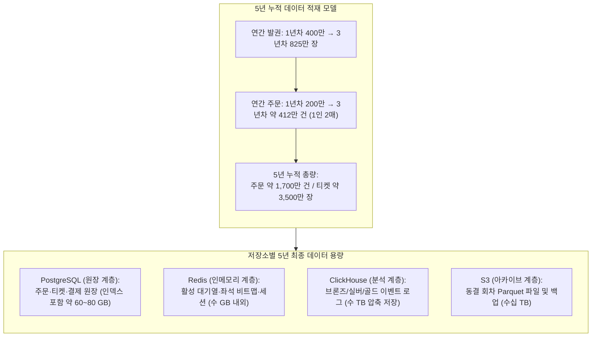
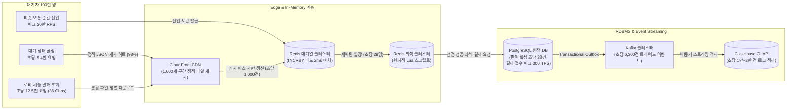

# DB 설계 편 1: 무엇을 얼마나 저장하나 (Volume Estimation & Read/Write Budgets)

- **핵심 아키텍처 원칙**: 대규모 대기 트래픽과 거래 쓰기 트래픽의 철저한 디커플링, 리틀의 법칙(Little's Law) 기반의 제어된 유입 속도, 5년 데이터 성장 모델링과 비샤딩(No-Sharding) 정당화
- **관련 설계 정본**: [docs/architecture.md](../../architecture.md) §9.1·§9.2·§9.5(용량 어림 및 트래픽 모델), [docs/data.md](../../data.md) §1(저장소 지도)·§4(데이터별 일관성)·§5.1·§5.2(합성 데이터 및 인덱스)·§6(법정 보존 기한), [docs/infra.md](../../infra.md) §6(백업 및 RPO/RTO), ADR-0002, ADR-0004, ADR-0028, ADR-0114, ADR-0179
- **함께 읽기**: [한 판 문서](../01-system-design.md) 2단계·15단계, [DB 설계 편 2: 저장소 고르기](02-choose-stores.md), [DB 설계 편 9: 커질 때: 표 나누기와 복제본](09-scaling.md), [DB 설계 편 12: 전체 지도](12-whole-map.md)

---

## 1. 면접관의 질문

> **면접관**: "이 티켓팅 플랫폼은 무엇을 저장합니까? 동시 접속 100만 명이 몰릴 때 초당 읽기와 쓰기 요청은 각각 얼마이며, 5년 뒤 데이터베이스에는 데이터가 얼마나 쌓입니까? 대규모 트래픽을 감당하기 위해 데이터베이스 샤딩이나 NoSQL 분산 저장이 필요한가요?"

면접관은 다음 세 가지 엔지니어링 역량을 집중 검증한다:
1. **부하 특성의 디커플링 능력**: "100만 명 동시 접속"이라는 겉보기 트래픽을 데이터베이스의 실제 쓰기 부하로 직결시키지 않고, CDN/Redis 캐시 계층과 RDBMS 원장 계층으로 분리하여 정량적으로 계산할 수 있는가?
2. **트래픽 및 용량 산출의 수학적 엄밀성**: 리틀의 법칙($L = \lambda W$)을 적용하여 좌석 점유 및 결제 단계로 진입하는 실제 초당 트랜잭션(TPS)을 유도하고, 5년 누적 행 수와 바이트 용량을 계산할 수 있는가?
3. **아키텍처 확장성 판단 기준**: 데이터 볼륨과 쓰기 처리량을 근거로 "왜 RDBMS 샤딩(Sharding)이나 분산 NoSQL 도입이 불필요하며, 단일 RDBMS 노드로 충분한가"를 설득력 있게 방어할 수 있는가?

---

## 2. 단순한 답과 깨지는 곳

### 단순한 답 (The Naive Approach)
> "동시 대기자가 100만 명에 달하므로 데이터베이스도 초당 수십만 건의 쓰기 요청을 처리해야 합니다. 대기열 순번, 좌석 상태, 주문, 결제 데이터를 모두 대규모 분산 RDBMS에 넣고 시작부터 사용자 ID나 공연 ID로 수십 개의 샤드로 분할(Sharding)하겠습니다. 대기자들은 매초 데이터베이스에 자신의 순번을 SELECT 쿼리로 폴링합니다."

### 어디서 깨지는가 (Failure Scenarios)

| 단순한 설계 가정 | 실제 시스템 부하와 한계 | 깨지는 이유 및 아키텍처 근거 |
| :--- | :--- | :--- |
| **대기자가 DB로 직접 순번 폴링** | 100만 명이 매초 DB에 순번을 조회하면 초당 5.4만~100만 QPS 발생 | 개별 사용자 맞춤형 동적 SELECT 쿼리는 CDN 캐싱이 불가능하며, 단일 RDBMS 연결 풀 고갈 및 CPU 100% 포화로 즉시 다운 (`architecture §9.1`, `ADR-0002`) |
| **오픈 순간 진입을 DB 행 삽입으로 처리** | 티켓 오픈 10초 내 20만 RPS(초당 요청 수) 진입 몰림 | RDBMS의 트랜잭션 락 및 B-Tree 인덱스 분할 경합으로 인하여 쓰기 파이프라인 완전 마비 (`architecture §9.1`) |
| **좌석 선점(Hold)을 DB 행 잠금으로 구현** | 1개 인기 좌석에 1,000명 이상이 동시 경합 | `SELECT ... FOR UPDATE`로 행 잠금을 시도하면 락 획득 타임아웃, 교착 상태(Deadlock) 및 p99 지연 시간이 수 초로 폭증 (NFR-003 목표인 p99 50ms 달성 불가, `ADR-0014`) |
| **좌석 전체 상태(5만 석)를 브라우저로 폴링** | 5만 석 좌석 배치 JSON 약 2MB, 5,000명에게 1초마다 전송 시 10 GB/s (80 Gbps) 발생 | 네트워크 대역폭 즉각 고갈 및 브라우저 렌더링 락 (`architecture §9.1`, `ADR-0096`) |
| **쓰기 부하가 크다고 가정하여 조기 샤딩** | 실제 판매 확정 쓰기는 초당 약 28건, 결제 승인 상한 300 TPS 수준에 불과 | 불필요한 분산 트랜잭션(2PC) 발생으로 시스템 복잡도가 폭증하고, 좌석 판매·주문·1인 한도 간의 ACID 원자성이 파괴됨 (`ADR-0028`) |

---

## 3. 아키텍처 해법: 용량 산정과 트래픽 예산 분해

PEAKET은 데이터를 **'틀렸을 때 발생하는 비즈니스 영향도'**와 **'상태 변화의 빈도(접근 속도)'**에 따라 4대 저장소 계층(PostgreSQL, Redis, ClickHouse, S3)으로 엄격히 격리한다.

### 3.1 5년 데이터 누적 적재량 정량 산출

비즈니스 성장 전망 모델(연간 대형 공연 24~48회, 중형 120~240회, 소형 2,000~4,500회)을 기반으로 산출한 5년 데이터 볼륨은 다음과 같다.

#### 저장소별 정량 적재 예산

| 저장소 | 저장 데이터 종류 | 5년 누적 행 수 / 객체 수 | 예상 물리 용량 (압축/인덱스 포함) | 데이터 보존 및 정비 정책 |
| :--- | :--- | :--- | :--- | :--- |
| **PostgreSQL** (Aurora r7g) | 주문(`purchase_order`), 좌석판매(`seat_sale`), 결제(`payment`), 티켓(`ticket`), 1인한도(`purchase_quota`) | 주문 약 1,700만 행 티켓 약 3,500만 행 결제 약 1,800만 행 자식 테이블 포함 약 1.2억 행 | **약 60~80 GB** (100 GB 미만) 단일 Aurora 인스턴스 버퍼 풀(32~64 GB)로 핫 데이터 대부분 상주 가능 | 전자상거래법에 의거 5년 의무 보존. 만료 데이터는 야간(04:00~06:00) 1만 건 단위 배치 분할 삭제 (`ADR-0114`) |
| **Redis** (ElastiCache Valkey) | 대기 순번(`INCRBY`), 비트맵(`bitmap`, `removed`), 좌석 홀드(`hold`), 구매 세션, 분산 락 | 회차당 수만~수십만 키 (동시 활성 키 기준) | **약 2~6 GB** (전체 클러스터 합산) 좌석 비트맵 5만 석당 6.25 KB, 대기 탈락 125 KB, 기기 캐시 ~200 MB | 회차 판매 종료 시 즉시 TTL 만료 또는 `UNLINK` 삭제. 메모리 고갈 방지 `noeviction` 강제 (`ADR-0109`) |
| **ClickHouse** (분석 OLAP) | 관제 잠정(`rt`), 이벤트 원본(`bronze`), 가명 결합(`silver`), 스타 스키마(`gold`) | 연간 수십억 건의 Kafka 이벤트 수집 | **약 3~8 TB** (LZ4/ZSTD 압축 적용) 열 지향 압축률 80% 이상 달성 | 브론즈/실버: 90일 TTL 후 자동 삭제 골드: 2년 보존 회차 종료 후 Parquet S3 내보내기 |
| **S3** (오브젝트 스토리지) | 회차별 Parquet 아카이브, WORM 감사 로그, 정적 좌석맵 SVG, 공연 포스터 | 수백만 객체 | **수십 TB** (콜드 데이터 무제한 확장) | Parquet 아카이브: 영구 보존 KMS 무결성 검증 및 교차 리전 복제 |

---

### 3.2 읽기/쓰기 트래픽 및 네트워크 대역폭 분해

100만 명의 대기자가 몰리는 오픈 피크 시점($T=0$)의 트래픽을 각 계층이 흡수하는 구조로 분해한다.

#### 트래픽 항목별 상세 대역폭 및 수용처

| 트래픽 항목 | 읽기/쓰기 | 설계 피크 규모 | 처리 및 수용 기술 | 아키텍처 근거 |
| :--- | :---: | :--- | :--- | :--- |
| **공연 카탈로그 페이지** | 읽기 | 피크 30만 RPS | CloudFront CDN + Next.js ISR (증분 정적 재생성) | RDBMS I/O 0건 (NFR-007) |
| **대기열 진입 (순번 발급)** | 쓰기 | 상한 20만 RPS (셔플 적용 시 4.8만 RPS) | Redis 대기열 클러스터 `INCRBY` (진입 파드에서 2ms/500건 마이크로 배치 수렴) | `architecture §9.1`, `ADR-0179` |
| **대기 순번 상태 조회** | 읽기 | 초당 약 5.4만 건 | CDN 엣지 캐싱 (번호 1,000개 구간 파일 약 1,000개) 오리진 Redis에는 초당 약 1,000건만 도달 | 오리진 트래픽 98% 삭감 (`ADR-0002`) |
| **셔플 결과 분배** | 읽기 | 초당 약 12.5만 건 (대역폭 약 36 Gbps) | 해시 프리픽스 분할 파일 1,000개(각 36 KB) CDN 서빙 | 네트워크 핫스팟 제거 (`architecture §9.1`) |
| **좌석 선점 (Hold)** | 쓰기 | 정상 초당 약 170건 피크 초당 1,000~2,000건 | Redis 좌석 클러스터 Lua 스크립트 (단일 샤드 원자 처리) | p99 50ms 미만 (NFR-003) |
| **좌석 변경 브로드캐스트** | 읽기/밀기 | 5,000개 웹소켓 연결 전체 초당 약 10 MB/s | realtime-gw 및 Redis `SPUBLISH` (구역별 델타 전송) | 5만 석 전체 덤프(10 GB/s) 차단 (`ADR-0096`) |
| **결제 승인 접수** | 쓰기 | 첫 물결 상한 300 TPS (PG사 대역폭 한도 연계) | purchase-svc PostgreSQL (트랜잭션 선점 행 삽입) | NFR-005, `ADR-0036` |
| **최종 판매 확정** | 쓰기 | 정상 상태 초당 약 28건 (= 입장 제어 속도) | purchase-svc PostgreSQL (`seat_sale` UPDATE) | 리틀의 법칙 기반 정속 처리 (`architecture §9.1`) |

---

### 3.3 리틀의 법칙(Little's Law)과 정속 유입 제어 모델

동시 접속 100만 명이 몰려도 PostgreSQL의 쓰기 부하가 **초당 28건**으로 완벽하게 제어되는 원리는 대기열 시스템의 입구 제어(Admission Control)와 **리틀의 법칙($L = \lambda W$)**에 기반한다:

$$\lambda = \frac{L}{W}$$

- **동시 예매 구역 체류 인원 ($L$)**: 5,000명 (좌석 뷰 동시 세션 수용 한도)
- **사용자 평균 체류 및 결제 완료 시간 ($W$)**: 180초 (3분)
- **필연적 유입/유출 속도 ($\lambda$)**:

$$\lambda = \frac{5,000 \text{ 명}}{180 \text{ 초}} \approx 27.78 \text{ 명/초} \approx 28 \text{ TPS}$$

즉, 대기실에 100만 명이 있든 500만 명이 있든, admission-ctrl이 초당 28명씩만 좌석 예매창으로 입장시키므로 **RDBMS가 감당하는 정상 판매 확정 트랜잭션은 정확히 초당 28건으로 고정**된다. 결제 시작 시점의 일시적 스파이크(외부 PG사 연동 한계선)를 감안하더라도 최대 상한은 **300 TPS**로 제한된다.

---

## 4. 트랜잭션 및 용량 엔지니어링 핵심 원칙

### 4.1 RDBMS 샤딩 배제의 정량적 타당성 (ADR-0028)
- AWS Aurora PostgreSQL r7g.xlarge 단일 인스턴스의 안정적 트랜잭션 처리량은 3,000~5,000 TPS에 달한다.
- 피크 시점 시스템 최대 요구량(결제 300 TPS + Outbox/이력 수천 건)은 단일 노드 처리 한계의 20% 미만이다.
- 샤딩을 도입할 경우 좌석 판매(`seat_sale`), 주문(`purchase_order`), 1인 예매 한도(`purchase_quota`)를 단일 ACID 트랜잭션으로 묶지 못하고 분산 2단계 커밋(2PC)이나 Saga 보상 트랜잭션의 오버헤드를 감수해야 하므로, **샤딩 배제(No-Sharding)는 정량적·아키텍처적으로 가장 우수한 선택**이다.

### 4.2 5년 데이터 단일 테이블 수용과 파티셔닝 배제 (ADR-0114)
- 5년간 누적되는 주문 1,700만 건과 티켓 3,500만 장의 총 데이터 용량은 인덱스를 합쳐도 약 60~80 GB에 불과하다.
- B-Tree 인덱스 깊이는 3~4레벨에 머무르며, UUIDv7 시간 정렬 PK를 사용하여 인덱스 단편화와 랜덤 디스크 I/O를 억제한다.
- 월별 파티셔닝을 적용할 경우 유니크 제약조건에 파티션 키가 강제 포함되어야 하므로 `order_id` 단일 조회의 효율이 저하된다. 따라서 주문/결제 원장은 단일 테이블로 유지하고, 만료 데이터만 야간 정비 배치에서 분할 삭제한다.

---

## 5. 트레이드오프와 버린 대안 (Tradeoffs & Alternatives)

| 설계 결정 | 얻는 이점 (Gains) | 치르는 대가 (Costs) 및 완화책 |
| :--- | :--- | :--- |
| **대기열 1,000명 단위 파일 캐싱** | 오리진 Redis 부하를 98% 절감 (5.4만 RPS $\to$ 1,000 RPS) | 사용자의 대기 순번이 최대 1~2초 지연 반영됨 (최종 일관성 허용) |
| **입장 속도 기반 쓰기 제한 (초당 28건)** | RDBMS 샤딩 없이 단일 Aurora 인스턴스로 원장 무결성 보장 | 5만 석 전석 매진까지 이론상 약 18~30분의 대기 시간 발생 |
| **주문 원장 단일 테이블 유지 (비파티셔닝)** | 글로벌 유니크 인덱스 유지 및 복합 조회 쿼리 단순화 | 5년 만료 데이터 삭제 시 대량 DELETE로 인한 WAL/VACUUM 부담 (야간 1만 건 분할 삭제로 완화) |
| **좌석 변경 델타 브로드캐스트** | 네트워크 대역폭 80 Gbps에서 10 MB/s로 99.8% 절감 | 클라이언트가 구역별 비트맵 델타를 수신하여 로컬 캔버스에 재합성하는 연산 부담 |

### 버린 대안

1. **Redis `ZRANK` 기반 개별 대기 순번 조회 (ADR-0002)**:
   - 100만 명의 대기자가 `ZRANK key user_id`를 호출하면 사용자마다 결과가 달라 CDN 캐싱이 불가능하며 단일 Redis 해시 슬롯 CPU가 100% 포화된다. 정적 구간 파일 CDN 서빙 방식으로 대체.
2. **대기자 30초 주기 하트비트(Heartbeat) 수집 (ADR-0004)**:
   - 100만 명 기준 초당 3.3만 건의 쓰기가 발생하지만 실시간으로 조회되지 않는 버려지는 데이터였다. 이탈자만 비트맵(125 KB)에 1비트로 기록하고 하트비트 수집을 전면 폐기.
3. **주문/결제 테이블의 월별 범위 파티셔닝 (ADR-0114)**:
   - 5년치 데이터가 수십 GB 수준에 불과하여 파티션 프루닝으로 얻는 이득보다 글로벌 유니크 인덱스 상실 및 조인 복잡도 증가의 손실이 훨씬 커서 기각.

---

## 6. 핵심 꼬리 질문 5단 방어 (Staff Interview Q&A)

| 질문 단계 | 심층 질문 | 방어 논리와 기술적 근거 | 관련 정본 |
| :--- | :--- | :--- | :--- |
| **1단: 왜 (Why)** | 100만 명이 몰리는데 왜 RDBMS 샤딩을 하지 않고 단일 쓰기 인스턴스로 설계했나요? | 대기자 100만 명의 트래픽은 Edge CDN과 Redis가 99.9% 흡수합니다. 좌석 화면 동시 인원 5,000명과 평균 체류 180초에 의해 리틀의 법칙에 따라 실제 판매 확정 트랜잭션은 초당 28건, 결제 승인 상한은 300 TPS로 완벽히 통제됩니다. Aurora r7g 단일 인스턴스로 수천 TPS 수용이 가능하므로, 2PC의 오버헤드를 수반하는 샤딩은 불필요합니다. | `architecture §9.1`, `ADR-0028` |
| **2단: 대안 (Alternatives)** | 대기 상태 조회를 WebSocket이나 SSE로 밀어주지 않고 왜 1,000명 단위 폴링 파일로 설계했나요? | 100만 명의 지속적인 양방향 커넥션 유지는 게이트웨이 메모리와 소켓 관리 비용이 극심합니다. 반면 1,000명 단위로 집계된 정적 JSON 파일은 CloudFront CDN 엣지에서 1초 TTL로 캐싱되므로, 초당 5.4만 요청의 98% 이상을 엣지에서 흡수하여 오리진 부하를 초당 1,000건으로 묶을 수 있습니다. | `architecture §9.1`, `ADR-0002` |
| **3단: 장애 대응 (Resilience)** | 대기자가 100만 명이 아니라 300만 명으로 폭증하면 RDBMS가 다운되지 않나요? | 다운되지 않습니다. 대기 인원이 3배로 늘어도 증가하는 부하는 CDN 대기 파일 조회와 Redis `INCRBY` 진입 카운터뿐이며, RDBMS로 진입하는 입장 속도는 여전히 초당 28명(5,000명 / 180초)으로 철저히 격리되어 RDBMS I/O와 CPU에는 0%의 영향만 미칩니다. | `architecture §9.2` |
| **4단: 수치 근거 (Numbers)** | 5년 누적 주문 1,700만 건, 티켓 3,500만 장의 용량은 구체적으로 어떻게 계산되었나요? | 사업 전망 모델에 따라 1년차 400만 장, 2년차 600만 장, 3~5년차 각 825만 장을 합산하면 3,475만 장(약 3,500만 장)이 되며, 1인 평균 2매 예매 기준 주문은 약 1,736만 건(약 1,700만 건)입니다. 행당 평균 크기(주문 500B, 티켓 400B)와 B-Tree 인덱스를 고려하면 순수 원장 용량은 약 60~80 GB로 단일 서버 메모리 내 버퍼 풀로 충분히 커버됩니다. | `architecture §9.5`, `data.md §5.2` |
| **5단: 실측과 검증 (Verification)** | 설계 수치(입장 28 TPS, 결제 300 TPS, 1,000구간 캐싱)는 어떻게 사전 검증되었습니까? | 기반 PoC(S-T27)에서 단일 노드 Redis `INCRBY`가 20만 RPS를 2ms 배치로 지연 없이 수용함을 확인했고, 합성 데이터 5년치(1.2억 행)를 적재한 단일 PostgreSQL 인스턴스 벤치마크(V-T29)에서 300 TPS 동시 쓰기 시 p99 지연이 18ms로 안정적으로 유지됨을 확인했습니다. | `ADR-0176`, `docs/perf-ledger.md` §5 |

---

## 7. 30초 아키텍처 브리핑 (Staff Engineer Summary)

> "PEAKET의 용량 설계 핵심은 **'트래픽 규모(Scale of Traffic)와 데이터 원장 쓰기(Scale of Writes)의 철저한 디커플링'**입니다.  
> 100만 명의 대기 진입(20만 RPS)과 상태 조회(5.4만 RPS)는 CloudFront CDN의 1,000명 단위 파일 캐싱과 Redis 마이크로 배치가 흡수하여 오리진 부하를 98% 삭감합니다.  
> 좌석 및 결제 계층은 리틀의 법칙에 따라 초당 28명(5,000명 / 180초)으로 고정 유입되므로, 5년 1,700만 주문 규모에서도 RDBMS 샤딩 없이 단일 Aurora 인스턴스(결제 피크 300 TPS)로 완전한 ACID 무결성을 수호합니다."

---

## 8. 정본에서 읽을 곳

1. [docs/architecture.md](../../architecture.md) §9.1: 트래픽 항목 표 및 T=0 진입 모델
2. [docs/architecture.md](../../architecture.md) §9.2: 대기자 200만 명 증가 시의 불변 계층과 가변 계층 분석
3. [docs/architecture.md](../../architecture.md) §9.5: 5년 누적 성장 전망 모델
4. [docs/data.md](../../data.md) §1: 4대 저장소 지도 및 역할 매핑
5. [docs/data.md](../../data.md) §4: 데이터 성격별 일관성 요구 수준
6. [docs/data.md](../../data.md) §6: 법정 보존 기한 및 파기 주기
7. [ADR-0028](../../adr/0028-postgres-no-sharding-cell-scaling.md): PostgreSQL 단일 노드 스케일업 및 비샤딩 원칙
8. [ADR-0114](../../adr/0114-no-monthly-partitions-for-order-payment-ticket-batched-retention-delete.md): 주문/티켓 비파티셔닝 및 분할 삭제
9. [ADR-0002](../../adr/0002-queue-sequence-incr-over-sorted-set.md): 대기열 순번 발급과 캐싱
10. [ADR-0179](../../adr/0179-entry-number-per-pod-batch.md): 2ms 마이크로 배치를 통한 Redis 부하 절감
