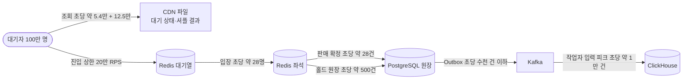

# DB 설계 편 1: 무엇을 얼마나 저장하나: 읽고 쓰는 방식과 양 어림

- **기준 시점**: ADR-0177까지, 2026-11-01
- **맡는 정본**: [docs/architecture.md](../../architecture.md) §9.1·§9.2·§9.5(용량 어림과 성장 전망), [docs/data.md](../../data.md) §1(저장소 지도)·§4(일관성 요구)·§5.1·§5.2(합성 데이터 크기)·§6(보존 기한), [docs/infra.md](../../infra.md) §6(백업 보존), ADR-0114·0002·0004(링크는 §8)
- **규범이 아니다**: 정본을 풀어 쓴 해설이다. 숫자와 규칙이 정본과 다르면 정본이 맞다([ADR-0177](../../adr/0177-walkthrough-explain-in-interview.md)).
- **앞뒤 편**: DB 설계 편의 첫 편이다. 다음 편은 [DB 설계 편 2: 저장소 고르기](02-choose-stores.md)다. [한 판 문서](../01-system-design.md) 2단계(규모 어림)와 15단계(저장소 총정리)가 같은 숫자를 이야기 순서로 쓴다.

## 1. 면접관의 질문

> **면접관**: "이 시스템은 무엇을 저장합니까? 초당 얼마나 읽고 쓰고, 5년 뒤에는 얼마나 쌓입니까?"

면접관은 저장소를 고르기 전에 접근 방식(누가 무엇을 얼마나 자주 읽고 쓰나)과 양을 숫자로 잡는지 본다. 특히 "동시 대기 100만 명"을 그대로 데이터베이스 부하로 옮기지 않고, 어떤 부하가 사람 수에 비례하는지 가려내는지 본다.

## 2. 단순한 답

> "100만 명이 동시에 들어오니 데이터베이스도 초당 수십만 건을 받아야 합니다. 대기 순번, 좌석 상태, 주문을 모두 관계형 데이터베이스 한 곳에 두고, 대기자는 자기 순번을 데이터베이스에 물어봅니다. 쓰기가 많으니 처음부터 샤딩하겠습니다."

관계형 데이터베이스는 표(행과 칸)로 데이터를 두고 트랜잭션(여러 변경을 모두 하거나 모두 하지 않는 작업 단위)을 보장하는 저장소다. 샤딩은 데이터를 여러 데이터베이스 서버에 나눠 담는 것이다. 이 답은 사람 수와 쓰기 양을 같은 것으로 본다.

## 3. 어디서 깨지나

정본의 숫자로 보면 단순한 답은 두 방향으로 틀린다. 대기 쪽은 데이터베이스가 받을 수 없을 만큼 크고, 판매 쪽은 샤딩이 필요 없을 만큼 작다.

| 단순한 답의 가정 | 정본의 숫자 | 무엇이 깨지나 |
| --- | --- | --- |
| 대기자가 순번을 데이터베이스에 묻는다 | 대기 상태 조회가 초당 약 5.4만 건이다. 차례가 1분 안인 사람은 0.5초, 5분 넘게 남은 99만 명은 20초마다 묻는다(architecture §9.1) | 사람마다 답이 다르면 CDN(사용자 가까이에 파일을 복사해 두고 대신 답하는 전송망)이 캐시할 수 없다. 사람마다 순위를 묻는 구조는 초당 약 5.3만 조회가 원 서버와 키 하나에 몰린다고 ADR-0002가 셈했다 |
| 오픈 순간 진입을 데이터베이스가 받는다 | 진입 피크는 상한 20만 RPS(초당 요청 수)다. 로비 셔플(오픈 10분 전 대기실에 모인 사람의 순번을 오픈 순간 무작위로 섞는 방식)을 끈 공연에서 100만 명이 오픈 뒤 10초 안에 새로고침까지 2번씩 보내는 경우다. 값은 모두 `[가정]`이다(architecture §9.1 'T=0 도착 모델') | 순번 카운터 하나에 초당 20만 번 더하기가 몰린다 |
| 좌석 잡기(홀드)를 데이터베이스 행 잠금으로 한다 | 홀드 피크는 초당 1,000~2,000건이고, 인기 좌석 하나에 수십 명이 동시에 겨룬다(architecture §9.1). NFR-003은 인기 좌석 하나에 1,000명이 겨루는 환경에서도 p99(100건 중 99건이 끝나는 시간) 50ms를 목표로 둔다 | 행 잠금으로 잡으면 경합 때 p99가 수 초이고, 잠금 대기 시간 초과와 교착(서로를 기다려 멈춤)이 생긴다(ADR-0014 '검토한 대안') |
| 좌석 상태를 통째로 보낸다 | 5만 석 전체 JSON은 약 2MB다. 5,000명에게 1초마다 보내면 초당 약 10GB다(architecture §9.1) | 네트워크가 바로 포화한다. 계산만으로 실패가 분명해 단순한 설계(v0)로도 만들지 않는다(ADR-0096) |
| 쓰기가 많으니 샤딩한다 | 판매 확정 쓰기는 초당 약 28건, 결제 접수는 첫 물결 상한 300 TPS(초당 처리 건수), 주문 이벤트와 Outbox(보낼 사건을 같은 트랜잭션으로 표에 적어 두는 방식)를 합쳐도 초당 수천 건 이하다(architecture §9.1) | 쓰기 노드 하나로 받을 양이다. 샤딩하면 주문·좌석·1인 한도를 트랜잭션 하나로 묶지 못하고, 여러 샤드를 묶는 비용(2단계 커밋: 여러 데이터베이스가 함께 확정하는 절차)이 생긴다(ADR-0028 맥락) |

서비스 수준 측정(NFR 목표를 운영 규모로 잰 것)은 아직 없어 성능 숫자는 설계 목표값이고 `[실측 전]`을 붙였다. 기반 PoC(wbs 0.5.1, 본 개발 전에 위험한 부분만 먼저 재 보는 시험)는 2026-11-01에 PC 한 대에서 쟀다([ADR-0176](../../adr/0176-foundation-poc-results.md), 성능 장부 docs/perf-ledger.md §5). 그 숫자는 '실측(PC)'이고 운영 규모 증거가 아니다.

## 4. 지금 설계

### 4.1 무엇을 저장하나: 성격으로 나눈다

정본은 데이터를 '틀리면 무슨 일이 생기나'와 '얼마나 빨리 바뀌나'로 나눠 저장소를 정한다(data.md §1·§4). 저장소를 고른 이유는 [DB 설계 편 2](02-choose-stores.md)가 다룬다.

| 성격 | 예 | 틀리거나 잃으면 | 두는 곳 |
| --- | --- | --- | --- |
| 돈과 소유권의 원장(감사용으로 쌓아 두는 확정 기록) | 주문, 좌석 판매 행, 1인 한도, 결제, 환불, 정산, 티켓, 양도 | 돈 손실과 법적 분쟁이 생긴다. 강한 일관성(읽으면 늘 마지막 확정 값)이 필요하다 | PostgreSQL(관계형 데이터베이스) |
| 빠르게 바뀌는 판매 상태 | 대기 순번, 좌석 비트맵(좌석 하나를 1비트로 담은 상태표), 홀드, 구매 세션 | 다시 만들거나, PostgreSQL 제약이 마지막을 지킨다 | Redis(메모리에 데이터를 두는 빠른 저장소) 대기열·좌석 |
| 세션·캐시·카운터 | 로그인 세션, 요청 수 제한 카운터, 읽기 캐시, 봇 판정 피처 | 키마다 유실 등급을 정한다(A 다시 만든다, B 사람이 다시 한다, C 다른 층이 지킨다, ADR-0109) | Redis 세션·캐시 |
| 서비스 사이의 사건 | 주문·결제·좌석 확정·발권 사건, 텔레메트리(운영 신호) | 원본은 데이터베이스에 있고 사건은 7일 보관한다(infra §6) | Kafka(사건을 순서대로 쌓아 나눠 주는 메시지 시스템) |
| 분석·관제 숫자 | 원본·정리본·집계본, 관제 실시간 표, 회차 집계 파일 | 거래와 따로 두고 다시 적재로 복구한다 | ClickHouse(대량 분석용 저장소), S3(AWS 파일 저장소) |
| 공개 파일 | 좌석맵 파일, 공연 이미지, 대기 상태 파일, 셔플 결과 파일 | 개인정보를 담지 않는다 | S3와 CDN |
| 기기 안 데이터 | 월렛 서명 데이터, 기기 개인키, 스캐너 회차 목록, 스캔 기록 큐 | 기기 개인키는 서버로 보내지 않는다 | 브라우저 저장소 IndexedDB |

### 4.2 어떻게 읽고 쓰나: 접근 방식 표

설계 목표값이다 `[실측 전]`. '받는 곳'이 데이터베이스가 아닌 줄이 대부분이라는 점이 핵심이다.

| 접근 | 읽기·쓰기 | 양(설계 목표) | 받는 곳 | 근거 |
| --- | --- | --- | --- | --- |
| 공연 페이지 | 읽기 | 오픈 직전 피크 30만 RPS | CDN과 미리 그려 둔 화면(ISR) | NFR-007 |
| 대기열 진입(순번 받기) | 쓰기 | 상한 20만 RPS, 로비 셔플 켬(기본)이면 약 4.8만 RPS `[가정]` | Redis 대기열의 `INCRBY`(진입 서버 파드마다 2ms 모아 n 더하기, ADR-0179) | architecture §9.1 |
| 대기 상태 조회 | 읽기 | CDN에 초당 약 5.4만 건, 원 서버에는 초당 약 1,000건 | 번호 1,000개 구간마다 1초마다 만든 파일 약 1,000개 | architecture §9.1 |
| 셔플 결과 조회 | 읽기 | 초당 약 12.5만 건, 약 36 Gbps | 해시 앞자리로 나눈 파일 약 1,000개(각 약 36KB) | architecture §9.1 |
| 입장 확정 | 쓰기 | 초당 약 28건, 1인당 Redis 쓰기 2~3회라 초당 100건 미만 | Redis 대기열 | architecture §9.1 |
| 좌석 홀드 | 쓰기 | 평시 초당 약 170건, 입장 직후 피크 초당 1,000~2,000건 | Redis 좌석의 Lua 스크립트(Redis 안에서 한 번에 도는 짧은 프로그램) | architecture §9.1 |
| 좌석 변경 전파 | 읽기(밀어 주기) | 연결 5,000개, 1인당 초당 최대 10개 메시지, 전체 초당 약 10MB 이하. 전체 배치 보기의 구역 스냅샷 재요청(5초 `[가정]`, 초당 약 1,000건)이 초당 최대 약 6MB를 더한다 | realtime-gw(좌석 변경을 브라우저로 밀어 주는 입구 서버)와 Redis 변경 채널 | architecture §9.1 |
| 결제 접수 | 쓰기 | 첫 물결 상한 300 TPS(결제사 한도를 추정한 값, ADR-0036) | purchase-svc(좌석과 주문을 맡는 서비스)의 PostgreSQL | NFR-005 |
| 판매 확정 | 쓰기 | 정상 상태 초당 약 28건(= 입장 속도) | PostgreSQL purchase | architecture §9.1 |
| 홀드 원장 적재 | 쓰기(비동기) | 초당 약 500건 | PostgreSQL purchase `seat_hold` | architecture §9.1 |
| 주문 이벤트·Outbox | 쓰기 | 합쳐 초당 수천 건 이하 | 서비스마다 PostgreSQL | architecture §9.1 |
| 거래 사건 | 쓰기 | 초당 약 6,300건 | Kafka 거래·제어 클러스터 | architecture §9.1, docs/streaming.md §11 |
| 분석·관제 적재 | 쓰기(비동기) | 스트림 작업자(Kafka 사건을 읽어 ClickHouse에 싣는 TypeScript 프로그램) 넷의 입력이 피크 초당 약 1만 건(시험 3만)이다. ClickHouse에 들어가는 행 수로 적은 값은 아니다 | 스트림 작업자를 거쳐 ClickHouse | architecture §6.1 '스트림 처리' 행 |

### 4.3 두 종류의 부하

- **대기열에서 대기 인원에 비례하는 부하는 셋뿐이다**: 오픈 순간의 진입, 대기 상태 조회, 셔플 결과 조회다. 셋 다 CDN과 Redis가 받고 데이터베이스 조회는 0건이다(architecture §9.1).
- **로그인은 예외로 기억한다**: 로그인·토큰 갱신과 봇 판정도 대기 인원에 비례한다(architecture §9.2). 로비 참가는 초당 약 1,700명이고, 개방 첫 1분에 몰리면 초당 약 3,500명 `[가정]`까지 본다(architecture §9.1). 로그인은 공유 클러스터의 identity DB에 닿으므로, 운영 명령 DB는 그 몰림에 묶이지 않게 전용 클러스터로 뗐다(data.md §1 ops 행, ADR-0102).
- **나머지는 입장 속도가 정한다**: 좌석 화면 동시 인원 5,000명 ÷ 평균 체류 180초 ≈ 초당 약 28명이다. 판매 확정 쓰기도 정상 상태에서 이 속도와 같다. 이것은 리틀의 법칙(안에 머무는 수 = 들어오는 속도 × 머무는 시간)이다.
- **대기자가 200만 명이 되어도 데이터베이스는 그대로다**: 좌석 홀드, 결제 접수, PostgreSQL은 바뀌지 않는 계층이다. 늘어나는 것은 진입(약 40만 RPS), CDN 조회, 로그인·봇 판정, 매진 공지다(architecture §9.2).
- **동시 입장 5,000명은 처음 값이다**: 좌석·결제 계층 용량으로 정했다. 결제사 추정 상한 300 TPS로 셈하면 결제사가 허용하는 동시 입장은 300 × 180 × 안전 계수 0.5 `[가정]` = 2.7만 명이라, 5,000명을 묶는 것은 결제사가 아니다(architecture §9.1). 절대 상한 8,000명 `[가정]`을 고른 근거는 정본에 비어 있어 소유자가 정할 일로 남았다(docs/review/open-items.md 열린 일 86번).

### 4.4 얼마나 쌓이나: 행 수 어림

성장 전망은 사업 예측치이고 1년에 한 번 다시 본다(architecture §9.5).

| 항목 | 1년차 | 2년차 | 3년차 | 셈 |
| --- | --- | --- | --- | --- |
| 대형 공연(평균 5만 석) | 24회 | 36회 | 48회 | 월 2회 → 3회 → 4회 |
| 중형 공연(평균 1.5만 석) | 120회 | 180회 | 240회 | 대형의 5배 |
| 소형 공연(평균 500석) | 2,000회 | 3,000회 | 4,500회 | 매년 1.5배 |
| 연간 발권 | 400만 장 | 600만 장 | 825만 장 | 연간 공연 수 × 평균 좌석 수 |
| 연간 주문 | 200만 건 | 300만 건 | 약 412만 건 | 발권 ÷ 1인 평균 2매 |

- **검산**: 1년차 발권은 24 × 5만 + 120 × 1.5만 + 2,000 × 500 = 400만 장이다.
- **5년 누적**: 주문 약 1,700만 건, 티켓 약 3,500만 장이다. 전자상거래법의 5년 보관을 셈한 값이다(architecture §9.5, NFR-021). 정본은 덧셈을 적지 않았다. 4·5년차를 3년차와 같다고 두면 주문 200 + 300 + 412 × 3 ≈ 1,736만 건, 티켓 400 + 600 + 825 × 3 = 3,475만 장이라 맞는다(해설서의 검산이다).
- **한 달에 쌓이는 행**: 3년차 기준 주문 약 34만 행이다(architecture §9.5). ADR-0114는 한 달에 지울 행을 주문 약 30만, 티켓 약 60만, 자식 표까지 합치면 수백만 행 `[추정]`으로 적는다.
- **바이트 크기**: 정본은 합성 5년치(주문·티켓과 자식 표)를 인덱스(행을 빨리 찾게 하는 찾아보기 구조) 포함 수십 GB `[추정]`로만 적는다(data.md §5.2). 행 하나의 크기나 표별 GB는 정본에 없다. 표·인덱스 크기는 합성 5년치로 잴 계획이다(data.md §5.1, 검증 시험 V-T29).

### 4.5 Redis와 파일의 크기

메모리 저장소는 키 하나의 크기가 설계를 정한다. 정본에 적힌 크기는 이렇다.

| 대상 | 크기 | 근거 |
| --- | --- | --- |
| 좌석 비트맵 `s:{event:E}:bitmap` | 6.25KB(5만 석 × 1비트) | data.md §3 |
| 빠진 번호 비트맵 `q:{event:E}:removed` | 125KB(100만 번호 × 1비트) | data.md §3, ADR-0002 |
| 기기 신뢰 이력 키 | 기기 100만 개면 약 200MB `[추정]` | data.md §3 |
| 대기 상태 파일 | 파일 약 1,000개, 각 수백 바이트(125바이트 비트맵 포함) | architecture §9.1 |
| 셔플 결과 파일 | 약 1,000개, 각 약 36KB, 합계 약 36GB 전송 | architecture §9.1 |

### 4.6 얼마나 오래 두나

보존 기한이 쌓이는 양을 정한다. 법이 정한 것과 설계가 정한 것을 나눠 본다.

| 데이터 | 보존 | 근거 |
| --- | --- | --- |
| 주문·결제 기록 | 5년 | 전자상거래법, NFR-018, data.md §6 |
| 소비자 불만·분쟁 처리 기록 | 3년 | NFR-018 |
| 시스템 접속기록(일시·IP·기기) | 3개월, 하루 파티션(큰 표를 날짜 등으로 나눈 조각) 약 92개 | 통신비밀보호법 준용, data.md §6 |
| 행동 신호 원시 데이터 | 30일 | NFR-018, ADR-0004 |
| 분석 원본·정리본 / 집계본 / 회차 아카이브 | 90일 / 2년 / 영구(사람 단위 행 없음) | data.md §1, ADR-0042 |
| 홀드 원장 `seat_hold` | 회차 판매 종료 + 90일 `[가정]` | data.md §2 |
| 게이트 스캔 기록 `scan_event` | 5년 | data.md §2 |
| 멱등 기록 표(같은 요청을 두 번 처리하지 않게 남기는 기록) | 24시간 `[가정]` | data.md §2 |
| Outbox 행 | 3일 `[가정]` 지난 파티션을 지운다 | data.md §4 |
| Redis 대기열 회차 키 | 그 회차의 판매 종료(공연 시작 24시간 전) TTL(정해 둔 유효 시간) | data.md §3, infra §6 |
| Aurora(AWS가 운영해 주는 PostgreSQL) 백업 | 시점 복구(기간 안의 어느 순간으로 되돌리기) 35일, 다른 리전(클라우드 데이터센터가 모인 지역) 사본 7일 `[가정]` | infra §6 |

보존 기한이 지난 주문·결제·티켓 행은 정비 잡(정해진 시간에 도는 관리 작업)이 정비 시간(04:00~06:00)에 1만 건 `[가정]`씩 나눠 지운다. 파기 결과는 법정 파기 관리 대장에 남긴다(ADR-0114 결정 3, FR-044).

## 5. 트레이드오프와 버린 길

| 정한 것 | 얻는 것 | 치르는 값 |
| --- | --- | --- |
| 대기 상태를 사람별 조회 대신 번호 1,000개 단위 파일로 준다 | 원 서버 요청이 대기 인원이 아니라 파일 수(초당 약 1,000건)에 묶인다 | 앞 인원이 폴링 주기와 파일 생성 주기만큼 늦게 보인다(최종적 일관성: 잠시 옛 값이 보여도 곧 같아짐). 대형 온세일(판매가 열리는 시각 앞뒤로 접속이 몰리는 기간)마다 CDN 요청 요금이 든다 |
| 뒤쪽 부하를 입장 속도로 묶는다 | 데이터베이스와 결제 부하가 대기 인원과 무관하다 | 매진까지 이론상 약 18분 걸리고 사람은 그동안 기다린다. 5,000명과 8,000명의 근거는 재거나 정해야 한다 |
| 5년치를 표 하나에 둔다(ADR-0114) | 파티션 때문에 생기던 유일 확인 표, 떼어 내기 순서, 손으로 쓴 마이그레이션(표 구조를 바꾸는 스크립트)이 없다 | 묶음 삭제가 WAL(데이터베이스의 변경 기록)·죽은 행·복제 지연을 만든다. 5년치 인덱스가 하나로 크다 |
| 용량을 설계 식으로 먼저 정한다 | 구조를 일찍 정하고 무엇을 잴지 안다 | 서비스 수준 측정은 아직 없다. 진입 피크의 새로고침 배수 같은 사람의 행동은 `[가정]`이라 실제 공연 전에는 확인할 수 없다(ADR-0057) |

**버린 길**

- **사람마다 Sorted Set(점수 순으로 정렬된 집합)의 `ZRANK`로 앞 인원을 묻기**: 응답이 사람마다 달라 CDN이 캐시하지 못하고, 원소 100만 개짜리 큰 키 하나는 한 슬롯(Redis 클러스터가 키를 나눠 두는 칸)에만 있어 여러 서버로 나눌 수 없다(ADR-0002 비교 표). 이 구조는 v0의 실패 기준선으로 남겨 K1(대기 상태 조회 부하를 증명하는 측정) 때 견준다.
- **대기자의 '살아 있음' 신호(하트비트)를 기록하기**: 30초 주기 하트비트는 100만 명 기준 초당 약 3.3만 건 쓰기인데, 실시간으로 읽는 곳이 없다. 대기실이 적응형 폴링(차례가 가까울수록 자주 묻는 방식)으로 바뀌어 하트비트 자체를 없앴고, 줄에서 빠지는 사건만 비트맵에 1비트로 적는다(ADR-0004 맥락).
- **5만 석 전체 JSON을 1초마다 모두에게 보내기**: 초당 약 10GB라 v0로도 만들지 않는다(architecture §9.1, ADR-0096).
- **주문·결제·티켓을 월 단위로 나누기**: 이득(지우기 속도)을 잰 적이 없고 장치만 늘었다(ADR-0114 '검토한 대안' B·C). 나누는 판단은 [DB 설계 편 9](09-scaling.md)가 이어 다룬다.

## 6. 꼬리 질문

| 질문 | 답의 요지 | 근거 |
| --- | --- | --- |
| 5년에 주문 1,700만 건은 어디서 나왔나요? | 성장 전망의 연간 주문 200만·300만·412만 건에서 나왔다. 4·5년차를 3년차와 같다고 두면 약 1,736만 건이다. 이 덧셈은 정본에 없고 해설서의 검산이라고 말한다 | architecture §9.5 |
| 그 행들은 몇 GB인가요? | 정본은 합성 5년치(주문 약 1,700만·티켓 약 3,500만과 자식 표)를 인덱스 포함 수십 GB `[추정]`로만 적는다. 행 크기나 표별 크기를 적은 곳은 없다. 같은 합성 데이터로 실행 계획 시험과 V-T29를 돌려 표·인덱스 크기를 잴 계획이다 | data.md §5.1·§5.2, ADR-0114 결정 6 |
| 판매 확정 28건과 결제 300 TPS는 무엇이 다른가요? | 28건은 정상 상태의 속도(= 입장 속도)이고, 300 TPS는 오픈 직후 첫 물결의 상한이다. 결제사 상한이 공개되지 않아 추정했다. 100 TPS 비관 시험도 한다 | architecture §9.1, ADR-0036 |
| 대기자가 200만 명이면 데이터베이스는요? | 그대로다. 동시 입장 목표가 뒤쪽 부하를 정한다. 진입은 약 40만 RPS, 대기 상태 파일은 약 2,000개, 원 서버 요청은 초당 약 2,000건으로 는다 | architecture §9.2 |
| 공연 여러 개가 동시에 열리면요? | 3년차 '대형 1 + 중형 4'면 합산 동시 입장 1.5만 명이다. 판매 확정 초당 약 83건, 홀드 피크 초당 약 6,000건, 홀드 원장 초당 약 1,500건 `[추정]`이고, 쓰기 노드 하나로 받는다고 본다 `[실측 전]`. 회차 키가 좌석 Redis의 한 샤드(키를 나눠 맡은 서버 묶음)에 겹칠 수 있어 기반 PoC가 다섯 회차 합 초당 6,000건을 한 샤드에 넣어 PC에서 쟀다. 홀드 Lua p99(엔진)는 75.3·68.1·72.2µs, 샤드 엔진 CPU는 36~38%, 오버셀은 0이었지만 SLOWLOG(10ms) 기록이 3회 가운데 1회 남았다(실측(PC)). 그래서 큰 회차를 서로 다른 주 노드에 두는 배치 규칙을 두었다 | architecture §9.2·§9.5, ADR-0176 결정 3 |
| 읽기와 쓰기의 비율은요? | 시스템 전체를 한 숫자로 적은 비율은 정본에 없다. 공연 정보는 쓰기가 드물고 읽기가 훨씬 많아 CDN·캐시가 받는다. 원장은 쓰기가 입장 속도에 묶이고, 읽기는 쿼리마다 맞춘 인덱스로 찾는다(쿼리-인덱스 표) | data.md §4·§5.1 |
| 홀드 원장 초당 약 500건은 어떻게 셈했나요? | 값만 있고 계산은 정본에 없다. 3년차 약 1,500건은 이 값을 동시 입장에 비례해 늘린 `[추정]`이다 | architecture §9.1·§9.5 |
| 실제로 재 봤나요? | 서비스 수준 측정은 아직 없다. 성능 장부의 기록은 PC 한 대에서 잰 기반 PoC(Redis 한 키 `INCR`, 좌석 샤드 하나, HTTP 어댑터, Kafka 클라이언트)뿐이고 '실측(PC)'이다. 판매 확정은 K3, 나눠 지우기는 V-T29, Outbox 릴레이는 V-T27로 잴 계획이다 | docs/perf-ledger.md §5, ADR-0176, docs/verification.md §9 |

## 7. 내 말로 설명하기

> "저장할 것은 성격으로 나눴습니다. 틀리면 안 되는 돈과 좌석, 티켓 원장은 PostgreSQL에, 빠르게 바뀌는 순번과 홀드는 Redis에, 분석 숫자는 ClickHouse에 둡니다. 대기열에서 100만 명에 비례하는 부하는 오픈 순간의 진입, 대기 상태 조회, 셔플 결과 조회 셋뿐이고, CDN과 Redis가 받아 데이터베이스 조회는 0건입니다. 나머지는 입장 속도가 정합니다. 5,000명이 평균 3분 머물면 초당 약 28명이 들어오고, 판매 확정 쓰기도 초당 약 28건입니다. 그래서 쓰기 노드 하나로 받고 샤딩하지 않습니다. 5년 법정 보관을 셈하면 주문 약 1,700만 건, 티켓 약 3,500만 장이라 표 하나로 받고, 기한이 지난 행은 정비 시간에 나눠 지웁니다. 모두 설계 목표값이고 서비스 규모로는 아직 재지 않았습니다."

**꼭 넣을 말**

- 비례하는 부하 셋과 입장 속도가 정하는 부하를 나눈다. 초당 약 28건은 5,000명 ÷ 180초다.
- 5년 누적 주문 약 1,700만, 티켓 약 3,500만이라 샤딩도 파티션도 하지 않는다.
- 숫자는 설계 목표값이고 서비스 수준 측정은 아직 없다(기반 PoC만 PC에서 쟀다). 바이트 크기는 정본에 '인덱스 포함 수십 GB `[추정]`' 하나뿐이라고 정직하게 말한다.

## 8. 정본에서 읽을 곳

1. [docs/architecture.md](../../architecture.md) §9.1: 트래픽 항목 표, 'T=0 도착 모델', 결제사 상한 문단
2. [docs/architecture.md](../../architecture.md) §9.2: 200만 명일 때 바뀌는 곳과 바뀌지 않는 계층
3. [docs/architecture.md](../../architecture.md) §9.5: 1~3년 성장 전망, '장기 데이터베이스 누적' 행
4. [docs/data.md](../../data.md) §1(저장소 지도)과 §4(데이터별 일관성 표)
5. [docs/data.md](../../data.md) §6(보존·파기)과 [docs/infra.md](../../infra.md) §6(백업 보존)
6. [ADR-0114](../../adr/0114-no-monthly-partitions-for-order-payment-ticket-batched-retention-delete.md): 크기 계산과 나눠 지우기
7. [ADR-0002](../../adr/0002-queue-sequence-incr-over-sorted-set.md)와 [ADR-0004](../../adr/0004-drop-cassandra-from-runtime.md): 대기열 데이터를 줄인 이유

## 9. 정본에서 찾은 어긋남

| 어긋난 곳 | 내용 | 지금 읽는 법 |
| --- | --- | --- |
| docs/architecture.md §9.5 '좌석 예매 및 홀드 계층' 행 | 판매 확정 '초당 약 84건'과 결제 승인 '약 83건'이 섞여 있었다(둘 다 1.5만 ÷ 180초). 고침(2026-11-01 정합 점검) | 지금 정본은 약 83건이다 |

어긋남은 아니지만 근거가 비어 있는 곳이 둘 있다. 홀드 원장 초당 약 500건의 계산과 표별 바이트 크기다(전체는 '인덱스 포함 수십 GB `[추정]`'뿐이다). 면접에서는 '정본에 없다'고 말한다.
