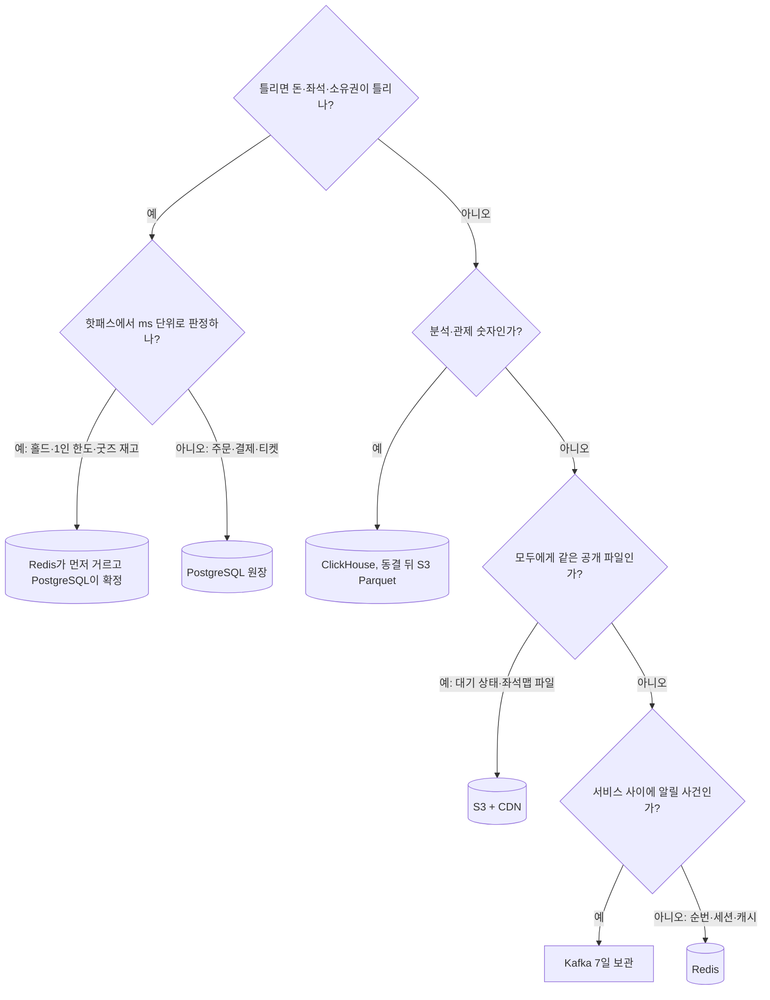

# DB 설계 편 2: 저장소 고르기: 쓰는 저장소와 쓰지 않기로 한 저장소

- **기준 시점**: ADR-0177까지, 2026-11-01
- **맡는 정본**: [docs/data.md](../../data.md) §1(저장소 지도와 엔진 판)·§4(데이터별 일관성), [docs/architecture.md](../../architecture.md) §6.1(기술 표와 '일부러 쓰지 않거나 미룬 기술')·§3(서비스마다 데이터베이스), [docs/infra.md](../../infra.md) §6(저장소별 RPO·RTO), 저장소를 고르거나 뺀 ADR(0004·0014·0021·0028·0042·0083·0094·0101·0109·0115, 링크는 §8)
- **규범이 아니다**: 정본을 풀어 쓴 해설이다. 숫자와 규칙이 정본과 다르면 정본이 맞다([ADR-0177](../../adr/0177-walkthrough-explain-in-interview.md)).
- **앞뒤 편**: 앞 편은 [DB 설계 편 1: 무엇을 얼마나 저장하나](01-what-and-how-much.md), 다음 편은 [DB 설계 편 3: 핵심 표와 관계](03-core-tables.md)다. [한 판 문서](../01-system-design.md) 15단계가 저장소 지도를 한 번에 정리한다.

## 1. 면접관의 질문

> **면접관**: "저장소는 무엇을 쓰겠습니까? 왜 하나로 끝내지 않고, 반대로 왜 더 쓰지 않습니까?"

면접관은 저장소마다 '무엇을 맡기고, 잃거나 틀리면 누가 마지막을 지키는지'를 말하는지 본다. 그리고 유행하는 저장소를 늘어놓지 않고, 쓰지 않기로 한 것에 이유와 다시 볼 조건을 대는지 본다.

## 2. 단순한 답

단순한 답은 두 갈래로 나온다.

- **하나로**: "PostgreSQL(표로 데이터를 두는 관계형 데이터베이스) 하나에 대기열, 좌석, 주문, 분석을 다 둡니다. 운영할 것이 하나라 단순합니다."
- **기능마다 하나씩**: "대기열은 Redis(메모리에 데이터를 두는 빠른 저장소), 주문은 PostgreSQL, 상품은 MongoDB(문서 형태로 저장하는 데이터베이스), 검색은 Elasticsearch(검색 전용 서버), 로그는 Cassandra(분산 쓰기에 강한 저장소), 확장은 CockroachDB(여러 노드에 나눠 저장하는 분산 SQL 데이터베이스)로 합니다."

## 3. 어디서 깨지나

| 단순한 답 | 깨지는 곳 | 정본의 근거 |
| --- | --- | --- |
| PostgreSQL 하나로 좌석 홀드(결제하는 동안 좌석을 잠시 잡아 두기) | 행 잠금(`SELECT … FOR UPDATE`) 홀드는 경합 때 p99(100건 중 99건이 끝나는 시간)가 수 초이고, 잠금 대기 시간 초과와 교착(서로를 기다려 멈춤)이 생긴다. 목표는 p99 50ms다 | ADR-0014 '검토한 대안', NFR-003 |
| PostgreSQL 하나로 대기 상태 | 대기 상태 조회가 초당 약 5.4만 건이다. 사람마다 답이 다르면 CDN(사용자 가까이에 파일을 복사해 두고 대신 답하는 전송망)이 받지 못한다 | architecture §9.1, ADR-0002 |
| PostgreSQL 하나로 분석 | 분석·관제 사건을 싣는 스트림 작업자의 입력이 피크 초당 약 1만 건(시험 3만)이다. 정본은 분석 저장소가 거래 데이터베이스의 부하에 영향을 주면 안 된다고 제약을 건다 | ADR-0042 맥락, architecture §6.1 |
| Redis만으로 좌석 확정 | Redis는 주 노드가 고장 나 복사본으로 넘어갈 때(장애 조치) 복제되지 못한 마지막 쓰기를 잃는다. 그러면 같은 좌석을 두 번 파는 오버셀이 날 수 있다 | ADR-0014 '검토한 대안' |
| 상품은 MongoDB | 상품 정의 하나 때문에 저장소 하나(복제 세트·인증·백업·복원 훈련·경보·판 올림)를 더 운영한다. 백업이 Enterprise 기능이라 'RPO(잃어도 되는 데이터의 시간 폭) 1일' 주장이 성립하지 않았다. 상품과 재고 사이 원자성(모두 하거나 모두 하지 않음)도 없다 | ADR-0101 |
| 검색은 Elasticsearch | 대상이 1~2만 건이라 얻는 것이 적고, 고가용성 구성은 월 약 687달러다. 판매 승인 취소가 같은 트랜잭션(모두 하거나 모두 하지 않는 DB 쓰기 단위)으로 검색에서 빠지지 않는다 | ADR-0094 '검토한 대안' |
| 로그는 Cassandra | 맡기려던 대기열 활동 로그(하트비트 초당 약 3.3만 건)와 봇 탐지 원시 신호에 실시간 하나씩 조회하는 길이 없다 | ADR-0004 맥락 |
| 확장은 CockroachDB | 리전 장애를 견디려면 리전이 셋 이상 필요하고, 분산 합의로 쓰기 지연이 가장 가까운 리전 왕복만큼 는다 | ADR-0021 맥락 |

한쪽은 성질이 다른 부하를 한 저장소에 몰아 서로 번지게 한다. 다른 쪽은 각 저장소의 운영 비용과 저장소 사이의 원자성 손실을 셈하지 않는다.

## 4. 지금 설계

### 4.1 고르는 순서

정본은 데이터의 성격과 부하로 저장소를 고르고, 저장소마다 잃었을 때 마지막을 지키는 곳을 정한다(data.md §1·§4). 그림의 '핫패스'는 요청이 몰리는 가장 바쁜 길이다. 아래 그림은 정본의 배치를 해설서가 질문 순서로 묶은 것이다. 정본에 이런 결정 나무가 따로 있지는 않다.

### 4.2 쓰는 저장소

엔진 판은 Aurora PostgreSQL(AWS가 운영해 주는 PostgreSQL) 18.x(18.6.1 이상), ClickHouse(대량 분석용 저장소) 26.8 LTS, ElastiCache(AWS가 운영해 주는 Redis 호환 저장소) Valkey(Redis와 호환되는 엔진) 8.1 이상 노드 기반 클러스터 모드, 연결 풀(데이터베이스 연결을 모아 나눠 쓰는 중간 서버) PgBouncer 1.26.1 이상이다(data.md §1, ADR-0086 결정 2). 표의 RTO는 복구까지 걸려도 되는 시간이다.

| 저장소 | 맡는 것 | 고른 이유 | 잃거나 고장 나면 |
| --- | --- | --- | --- |
| Redis 대기열 | 순번 카운터, 1인 1순번 키, 로비 참가자, 셔플(오픈 순간 순번을 무작위로 섞기) 결과, 빠진 번호 비트맵(값마다 한 비트로 줄여 적은 표), 입장 자리 | 대기열 폭주가 좌석 예매의 응답 지연으로 번지지 않게 물리 인스턴스를 떼어 둔다 | RPO는 비동기 복제 지연분(수백 ms 이내), RTO 30초다. 새 주 노드는 순번을 안전 여유만큼 건너뛰고 세대 번호를 올린다(infra §6) |
| Redis 좌석 | 좌석 비트맵, 홀드, 펜싱 토큰(늦게 온 옛 요청을 버리게 하는, 계속 커지는 번호), 1인 보유 수, 구매 세션, 변경 채널 | 좌석 장애가 대기열로 번지지 않게 한다. 한 회차의 키를 해시 태그 `{event:E}`(같은 칸에 모이게 키 이름에 넣는 표시)로 한 샤드(키를 나눠 맡은 서버 묶음)에 모아 Lua 스크립트(Redis 안에서 한 번에 도는 짧은 프로그램) 하나로 원자 처리한다 | 장애 조치 동안 그 회차 구매 요청을 503으로 30초 안에서 미룬다. 잃은 홀드는 PostgreSQL 판매 확정의 제약이 흡수한다(ADR-0121) |
| Redis 세션·캐시 | 로그인 세션, 요청 수 제한 카운터, 읽기 캐시, 봇 판정 피처 | 여러 서비스가 키 접두사와 Redis 권한(ACL)으로 나눠 쓴다 | 키마다 유실 등급(A 다시 만든다, B 사람이 다시 한다, C 다른 층이 지킨다)을 둔다. `maxmemory-policy noeviction`이라 메모리가 차면 지우지 않고 오류를 낸다(ADR-0109) |
| PostgreSQL 다섯 클러스터 | purchase, payment, ticket, ops 전용, 공유(identity·core 논리 DB) | 돈·좌석·소유권을 트랜잭션과 제약으로 지킨다. 나눈 이유는 처리량이 아니라 격리다(4.4) | AZ(같은 리전 안의 독립 데이터센터) 장애에서 RPO 0, RTO 5분이다(NFR-015) |
| ClickHouse | 분석의 원본(브론즈)·정리본(실버)·집계본(골드), 관제 실시간 표 `rt`, 접속기록 DB 등 | 대량 분석·관제 부하를 거래 데이터베이스에서 뗀다. 잠정 숫자와 확정 숫자를 다른 표에 둔다(ADR-0042·0052) | RPO 1일, RTO 1시간. 스냅샷 복원 뒤 Kafka를 다시 읽어 채운다(infra §6) |
| Kafka(MSK 셋. MSK는 AWS가 운영해 주는 Kafka) | 거래 사건, 텔레메트리(운영 신호), 설정형 제어 사건, 세션 종료 사건 | 사건을 순서대로 쌓아 여러 소비자에게 나눠 준다. 클러스터를 거래·제어, 텔레메트리, 관측으로 나눠 장애와 권한을 격리한다(data.md §1) | 복제 3, `acks=all`(모든 복제본 확인)로 RPO 0이다. 정본 원장은 데이터베이스라 리전 사이로 복제하지 않는다(infra §6) |
| S3 | 회차별 집계 Parquet(열 단위로 압축한 공개 파일 형식) 아카이브, 백업, 좌석맵 파일·이미지 같은 공개 파일 | 개인을 식별하는 원본은 두지 않는다. 회차마다 한 번 쓰는 작은 집계라 표 형식 대신 파일로 둔다(ADR-0115) | 버전 관리를 켜고 백업 버킷은 다른 리전으로 복제한다(infra §6) |
| 브라우저 IndexedDB | 월렛 서명 데이터, 기기 개인키, 스캐너 목록, 스캔 기록 큐 | 기기 개인키를 서버로 보내지 않고, 인터넷이 끊겨도 입장 판정을 한다 | 저장소가 지워지면 입장 시작 전에는 재인증 뒤 재발급(새 키 등록), 입장 시작 뒤에는 현장 부스 재발급으로 복구한다(docs/features/offline-gate.md §4) |

### 4.3 왜 PostgreSQL인가: MySQL과 견준 이유

PostgreSQL과 MySQL 가운데 무엇이 합리적인지 소유자가 물어 ADR-0083이 견줬다. 남은 근거는 넷이다. 원래 둘째 근거(비상 홀드 경로의 밀리초 잠금 대기)는 ADR-0121이 그 경로를 없애 더 이상 근거가 아니다(ADR-0083 상태 줄).

1. 오버셀의 마지막 방어선이 부분 유니크 인덱스(조건에 맞는 행끼리만 같은 값을 막는 색인) 셋이다. `seat_sale`, `seat_hold`, `payment_attempt`에 건다. MySQL은 부분 인덱스가 없어 '비활성이면 NULL이 되는 식 + UNIQUE'로 흉내 내야 하고, 상태를 하나 더할 때 놓치기 쉽다.
2. 서버 쪽 시간 초과(모든 문장의 상한, 트랜잭션 안에서 멈춘 연결 끊기, 데이터베이스 사용자별 기본값)에 MySQL 대응이 없다.
3. 마이그레이션(표 구조를 바꾸는 스크립트) 규칙이 트랜잭션 안의 DDL(표 구조 변경 문장)에 기댄다. MySQL DDL은 바로 확정되어 중간에 실패하면 반쯤 바뀐 상태가 남는다.
4. 회차 범위 파티션(큰 표를 범위로 나눈 조각) 표 `scan_event`가 같은 데이터베이스 안의 외래 키(다른 표의 행을 가리키는 칸과 그 제약)로 `ticket`을 가리킨다. InnoDB(MySQL의 기본 저장 엔진) 파티션 표는 외래 키를 쓸 수 없다.

서울 가격은 두 엔진이 같아 비용은 근거가 아니다. Aurora PostgreSQL Limitless Database는 셀 확장(같은 구성을 통째로 하나 더 두는 확장)이 모자랄 때 볼 선택지로만 적었다(ADR-0083 결정 1).

### 4.4 PostgreSQL 클러스터를 다섯으로 나눈 이유

쓰기량만 보면 클러스터 하나로도 충분하다(판매 확정 초당 약 28건, 결제 승인 피크 약 300 TPS). 그래서 나눈 근거는 격리다(ADR-0028 상태 줄, 기술 검토 낮음-144).

| 클러스터 | 나눈 이유 |
| --- | --- |
| purchase | 판매 확정·1인 한도 차감·주문 상태 바꾸기를 트랜잭션 하나로 한다 |
| payment | 결제 비밀 키와 결제사 장애의 영향을 가둔다 |
| ticket | 현장 입장의 가용성을 지킨다. 도쿄 Global Database(다른 리전에 읽기 클러스터를 두는 Aurora 기능) 보조 클러스터(읽기 인스턴스 1대)는 클러스터 통째로만 복제되어 이 클러스터에만 붙인다 |
| ops 전용 | 오픈 직전 로그인·토큰 갱신이 공유 클러스터에 몰려도 운영 명령 접수 p95 500ms(NFR-008)를 지킨다. 쓰기 1 + 읽기 1, db.r7g.large `[가정]`(ADR-0102) |
| 공유(identity·core) | 비용 때문에 물리 클러스터는 함께 쓴다. 논리 데이터베이스와 전용 DB 계정을 따로 두고, 논리 DB끼리의 교차 참조와 외래 키 조인을 금지한다 |

바꿀 조건도 있다. 온세일 피크에 한 클러스터의 쓰기 인스턴스 CPU가 60% `[가정]`를 넘거나 연결 수가 상한의 70% `[가정]`를 넘으면 더 나눈다. 비용 측정에서 두 클러스터가 모두 30% `[가정]` 아래이고 격리 근거가 없는 쌍이면 합치기 후보로 올린다(ADR-0028 상태 줄).

### 4.5 서비스마다 데이터베이스

다른 업무(바운디드 컨텍스트)끼리는 저장소를 같이 쓰지 않는다. 여기서 '같이 쓰지 않는다'는 다른 업무의 표나 Redis 키를 직접 읽거나 고치지 않고 gRPC API나 Kafka 사건으로만 주고받는다는 뜻이다. 그래서 비용 때문에 물리 클러스터를 함께 쓰는 곳(PostgreSQL 공유 클러스터의 identity·core 논리 DB, 여러 서비스가 쓰는 Redis 세션·캐시)도 키 접두사, DB 스키마, 전용 IAM·DB 역할로 같은 격리 규칙을 지킨다(architecture §3 'Database per Service' 원칙). 같은 업무를 실행 방식 때문에 나눈 두 쌍만 한 저장소를 함께 쓴다. queue-svc와 admission-ctrl(입장 인원 조절기)은 Redis 대기열을, purchase-svc와 realtime-gw(좌석 변경을 밀어 주는 입구 서버)는 Redis 좌석을 쓴다. realtime-gw는 변경 채널을 구독만 한다(architecture §3, data.md §1). 서비스 사이는 Saga(단계별로 처리하고 실패하면 앞 단계를 되돌리는 방식)와 Outbox(보낼 사건을 같은 트랜잭션으로 표에 적어 두는 방식)로 맞춘다. 이 경계는 [DB 설계 편 5](05-consistency-transactions.md)가 다룬다.

### 4.6 쓰지 않기로 한 저장소

'문서 근거로 기각'은 비교 실험 없이 문서의 사실(지원 범위, 라이선스, 쓰기 지연, 운영 부담)로 정했다는 뜻이다(architecture §6.1).

| 저장소 | 결정 | 이유(요지) | 다시 볼 조건 |
| --- | --- | --- | --- |
| Cassandra | 운영 경로에서 쓰지 않는다(문서 근거로 기각) | 맡기려던 데이터에 실시간 조회 길이 없고, 이미 운영하는 ClickHouse로 충분하다. 운영할 저장소가 하나 준다 | 원시 신호를 실시간으로 하나씩 조회해야 할 때, ClickHouse 삽입 부하가 관제 반영 SLO(서비스 품질 목표, p95 5초 미만)를 위협할 때(ADR-0004) |
| CockroachDB | 쓰지 않는다(문서 근거로 기각) | 한 리전이고 쓰기가 적다. 리전 장애를 견디려면 리전이 셋 이상 필요하고 쓰기 지연이 는다. 라이선스 위험이 있다 | 정본에 없음 |
| MySQL | 쓰지 않는다 | 4.3의 네 가지. PostgreSQL 전용 이름이 57개 파일 292곳(2026-10-22 집계)에 있다 | 운영 조직이 MySQL 도구와 경험만 갖췄을 때. 그때도 네 가지를 대신할 방법과 측정이 먼저다(ADR-0083) |
| MongoDB(상품 정의) | 2026-10-28에 뺐다 | `product` 표의 `attributes jsonb` 칸(JSON을 이진 형식으로 담는 칸)과 코드의 Zod 스키마(값의 모양을 검사하는 코드 규칙)로 같은 유연성을 내고, 상품·재고·주문·Outbox가 한 트랜잭션에 든다. 관리형 문서 DB(Amazon DocumentDB)도 저장소가 하나 더 생기는 문제는 같다 | 상품 유형이 수백 개로 늘고 부분 갱신이나 속성 검색이 병목으로 재어질 때, 상품 정의 쓰기가 공유 클러스터 쓰기 지연을 늘릴 때(ADR-0101) |
| Elasticsearch·OpenSearch·Algolia | 지금은 쓰지 않는다 | PostgreSQL 검색 읽기 모델과 서버 메모리 자동완성 사전으로 충분하다. Algolia는 키 입력마다 요금이 붙고 검색어가 국외로 간다 | 본문 검색 요구, 검색 대상 10만 건 `[가정]` 초과, 정답률이 NFR-028에 못 미침, 검색 p95가 NFR-028을 넘음(ADR-0094 결정 4) |
| BullMQ(Redis 위의 작업 큐) | 2026-10-28에 뺐다 | 알림·웹훅 발송 작업을 캐시 Redis에 두면 메모리 정리나 장애 조치 때 작업을 잃고 다시 만들 원본이 없다. core DB 원장에 두고 `FOR UPDATE SKIP LOCKED`(다른 작업자가 잠근 행은 건너뛰고 가져가기)로 가져간다 | 발송량이 DB 원장으로 감당하지 못할 만큼 커질 때(ADR-0109 '검토한 대안' 나) |
| Iceberg 표와 Glue 카탈로그(분석 아카이브) | 2026-10-28에 뺐다 | 회차마다 한 번 쓰고 ClickHouse 하나가 읽는 작은 집계라 Parquet 파일로 충분하다. ClickHouse의 Iceberg 쓰기는 26.8에서 Beta다 | 다른 엔진이 같은 아카이브를 표로 읽어야 할 때, 아카이브 행을 고치거나 지워야 할 때, 비교 조회가 10초 `[가정]`를 넘을 때(ADR-0115 결정 5) |

## 5. 트레이드오프와 버린 길

| 정한 것 | 얻는 것 | 치르는 값 |
| --- | --- | --- |
| 저장소를 성격별로 여럿 쓴다 | 부하와 장애가 저장소 사이로 번지지 않는다. 원장의 정합성은 PostgreSQL 제약이 마지막에 지킨다 | 서비스 사이를 Saga·Outbox·멱등 받기(같은 사건이 두 번 와도 한 번만 반영)로 맞춰야 한다. 운영할 부품이 많다 |
| Redis를 셋으로 물리적으로 나눈다 | 대기열 폭주와 좌석 장애가 서로 번지지 않는다 | 클러스터가 셋이다. 좌석 홀드는 장애 조치 때 복제되지 못한 마지막 쓰기를 잃는다 |
| 상품 정의를 PostgreSQL JSONB로 | 저장소가 하나 준다. 상품 정의의 RPO가 Aurora와 같은 0이 된다 | 속성 검증을 코드가 맡고, 스키마 판을 관리해야 한다. JSONB 속성은 통계가 약해 여러 속성을 함께 거르는 쿼리의 계획이 빗나갈 수 있다(ADR-0101) |
| 검색을 PostgreSQL 읽기 모델로 | 판매 승인 취소가 같은 트랜잭션으로 검색에서 빠진다. 검색 서버 비용이 없다 | 한국어 형태소 분석이 없다. 중간 일치는 표를 훑는다(data.md §5) |
| PostgreSQL 클러스터를 다섯으로 | 결제 비밀·결제사 장애, 현장 입장, 운영 명령이 서로 묶이지 않는다 | 클러스터마다 비용이 든다. 공유 클러스터는 비용 때문에 물리 서버를 함께 쓴다 |

버린 길의 이유와 다시 볼 조건은 4.6 표에 모았다. 그 밖에 둘이 더 있다.

- **ElastiCache 서버리스**: 노드 기반을 골랐다. 서버리스에는 SLOWLOG·LATENCY·`WAIT`·로그 전달이 없고, 노드 기반에서만 SLOWLOG와 로그 전달을 쓸 수 있다(ADR-0086 맥락·결정 2).
- **원시 이벤트를 S3에만 두고 필요할 때 Athena(S3 파일에 SQL을 거는 AWS 서비스)로 조회**: 공연 직후 리포트가 수십 분 넘게 늦고 잦은 조회의 비용이 커진다. ClickHouse가 이미 있어 적재 비용이 작다(ADR-0042 '검토한 대안').

## 6. 꼬리 질문

| 질문 | 답의 요지 | 근거 |
| --- | --- | --- |
| 왜 MySQL이 아니라 PostgreSQL인가요? | 부분 유니크 인덱스가 오버셀의 마지막 방어선이고, 서버 쪽 시간 초과, 트랜잭션 안의 DDL, 파티션 표를 가리키는 외래 키가 필요하다. 가격은 같아 근거가 아니다 | ADR-0083 결정 1·상태 줄 |
| Redis가 좌석 홀드를 잃으면 오버셀이 나지 않나요? | Redis는 빠른 판정만 하고, 판매 확정은 PostgreSQL의 `UNIQUE (event_id, seat_id) WHERE status IN ('PENDING','SOLD')`가 마지막에 막는다. 장애 조치 동안은 구매를 503으로 미루고 DB로 홀드를 대신 주지 않는다 | data.md §4, ADR-0014·0121 |
| 세션·캐시 Redis의 메모리가 차면요? | 키를 지우지 않고 쓰기가 오류를 낸다. 조용히 지워 한도가 풀리거나 로그인이 끊기는 것보다 오류로 바로 보이는 쪽을 골랐다. 그래서 이 클러스터의 키에는 모두 TTL(정해 둔 유효 시간)을 둔다. 대기열·좌석 클러스터는 키마다 data.md §3 키 표의 수명을 따른다 | data.md §3, ADR-0109 결정 5·상태 줄 |
| 상품 속성이 제각각이면 문서 DB가 맞지 않나요? | 저장소 하나를 더 운영하는 대가가 크고, JSONB와 Zod 스키마로 같은 유연성을 얻으며 상품·재고·주문을 한 트랜잭션에 둔다. 새 유형에 DDL이 없다(NFR-025) | ADR-0101 |
| 쓰기가 많은 로그에는 Cassandra가 맞지 않나요? | 쓰기가 많아도 실시간으로 하나씩 읽는 길이 없었다. 하트비트는 아예 없앴고, 원시 신호는 ClickHouse에 30일 둔다. 사용자 한 명 기록을 꺼내는 조회는 느릴 수 있지만 사후 조사용이라 받아들였다 | ADR-0004 |
| 클러스터 다섯은 과하지 않나요? | 처리량으로는 하나로 충분하다고 인정한다. 나눈 이유는 격리이고, CPU 60%·연결 70% `[가정]`이면 더 나누고 둘 다 30% `[가정]` 아래면 합치기 후보로 올린다 | ADR-0028 상태 줄 |
| 리전 전체가 멈추면요? | 판매를 멈추고, 주문·결제는 다른 리전으로 복제한 일 스냅샷(RPO 24시간)과 결제사 거래 대사로 복원한다. 도쿄 ticket 보조 클러스터는 티켓 원장 보존(RPO 약 1초)과 복구 기준점이다 | infra §6, ADR-0083 결정 6·상태 줄 |
| 저장소 선택을 측정으로 정했나요? | 대부분은 문서 근거다. 측정으로 판정하는 것은 좌석 홀드·판매(좌석 경합 측정 K2·K3), 큰 원장 표의 나눠 지우기(V-T29), Outbox 릴레이(V-T27·V-T28), 분석 아카이브(A-T19)이고 서비스 수준으로는 모두 아직 재지 않았다. 기반 PoC(본 개발 전에 위험한 부분만 먼저 재 보는 시험)는 좌석 Redis 샤드 하나의 처리량 같은 부품 몫만 PC 한 대에서 쟀다('실측(PC)', ADR-0176) | architecture §6.1 '측정 근거' 칸, ADR-0176 |

## 7. 내 말로 설명하기

> "저장소는 데이터의 성격과 부하로 골랐습니다. 돈, 좌석, 티켓 소유권은 PostgreSQL의 트랜잭션과 제약이 지킵니다. MySQL과도 견줬는데, 오버셀의 마지막 방어선이 부분 유니크 인덱스라 PostgreSQL을 유지했습니다. 밀리초 단위로 판정할 대기열과 좌석은 Redis가 먼저 거르고, 좌석 판매는 PostgreSQL이 확정합니다. Redis는 대기열, 좌석, 세션·캐시 셋으로 나눠 대기열 폭주가 좌석으로 번지지 않게 했고, 분석은 ClickHouse로 떼었습니다. MongoDB, Elasticsearch, Cassandra, CockroachDB는 쓰지 않습니다. 저장소를 하나 더 운영하는 대가가 크거나, 맡길 조회 길이 없거나, 한 리전에 쓰기가 적어서입니다. 대신 저마다 다시 볼 조건을 적어 두었습니다."

**꼭 넣을 말**

- 저장소마다 '잃으면 누가 마지막을 지키나'를 말한다. 좌석은 Redis가 거르고 PostgreSQL 부분 유니크 인덱스가 막는다.
- PostgreSQL 클러스터 다섯과 Redis 셋은 처리량이 아니라 격리 때문이다.
- 쓰지 않은 저장소는 이유와 다시 볼 조건을 함께 말한다(MongoDB는 상품 유형 수백 개, 검색 서버는 대상 10만 건 `[가정]`).

## 8. 정본에서 읽을 곳

1. [docs/data.md](../../data.md) §1: 저장소 지도 표와 엔진 판 문단
2. [docs/data.md](../../data.md) §4: 데이터별 일관성 표
3. [docs/architecture.md](../../architecture.md) §6.1: '데이터 저장소' 행과 '일부러 쓰지 않거나 미룬 기술' 표
4. [ADR-0083](../../adr/0083-keep-postgresql-partition-keys-transaction-scoped-settings-global-replica.md): PostgreSQL과 MySQL 비교(상태 줄 먼저)
5. [ADR-0028](../../adr/0028-postgres-no-sharding-cell-scaling.md) 상태 줄: 클러스터 다섯의 격리 근거와 바꿀 조건
6. [ADR-0101](../../adr/0101-product-catalog-postgres-jsonb-drop-mongodb.md), [ADR-0094](../../adr/0094-search-redesign-autocomplete-read-model-search-port.md), [ADR-0109](../../adr/0109-delivery-jobs-in-postgres-drop-bullmq-cache-redis-key-classes-noeviction.md), [ADR-0115](../../adr/0115-analytics-archive-per-event-parquet-files-read-with-clickhouse-s3.md): 빼거나 미룬 저장소 넷
7. [ADR-0004](../../adr/0004-drop-cassandra-from-runtime.md), [ADR-0021](../../adr/0021-reject-cockroachdb.md): 문서 근거로 기각한 둘
8. [ADR-0014](../../adr/0014-soft-hold-hard-sale.md)(좌석을 Redis와 PostgreSQL 두 단계로), [ADR-0042](../../adr/0042-analytics-store-and-decision-rules.md)(분석 저장소): 상태 줄과 '검토한 대안'
9. [docs/infra.md](../../infra.md) §6: 저장소별 RPO·RTO와 리전 장애 절차

## 9. 정본에서 찾은 어긋남

| 어긋난 곳 | 내용 | 지금 읽는 법 |
| --- | --- | --- |
| docs/data.md §1 'Aurora PostgreSQL (ticket, 교차 리전 읽기 복제본 포함)' 행 | 도쿄 읽기 복제본이 현장 조회를 받치는 것처럼 읽혔다(ADR-0083 상태 줄·infra §6은 도쿄에 읽을 서비스가 없다고 적는다). 고침(2026-11-01 정합 점검) | 지금 정본은 도쿄 보조 클러스터를 티켓 원장 보존(RPO 약 1초)과 복구 기준점으로 적고, 리전 장애 당일 현장 입장은 스캐너의 오프라인 판정으로만 이어 간다고 적는다 |
| ADR-0004 상태 줄의 2026-10-20(ADR-0071) 줄 | 원시 행동 신호 적재를 'Flink `trust-reassess`'가 한다고 적고 ADR-0099 줄이 없었다. 고침(2026-11-01 정합 점검) | 지금 상태 줄은 TypeScript 스트림 작업자 `trust-reassess`로 읽게 하고, architecture §11의 0004 행도 0099를 보완으로 적는다 |
