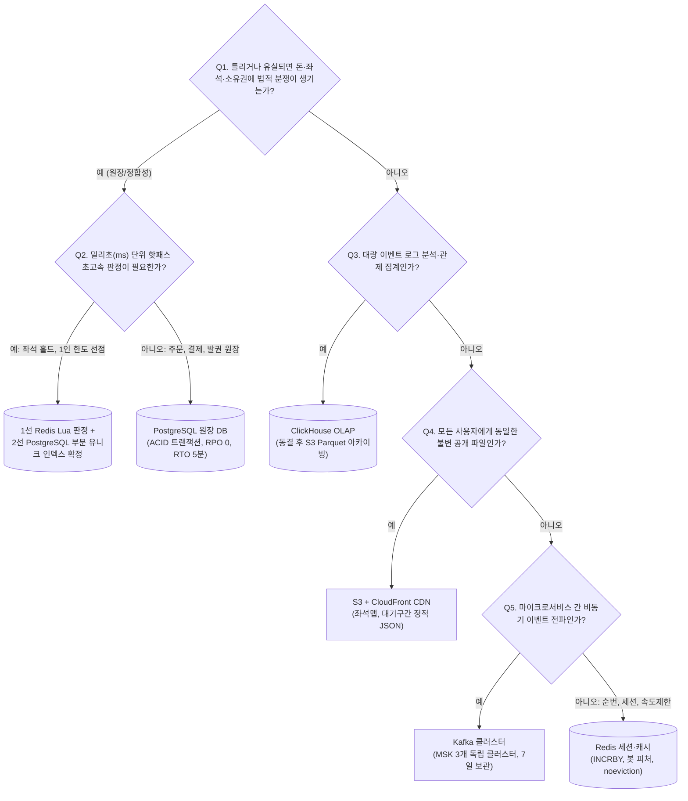
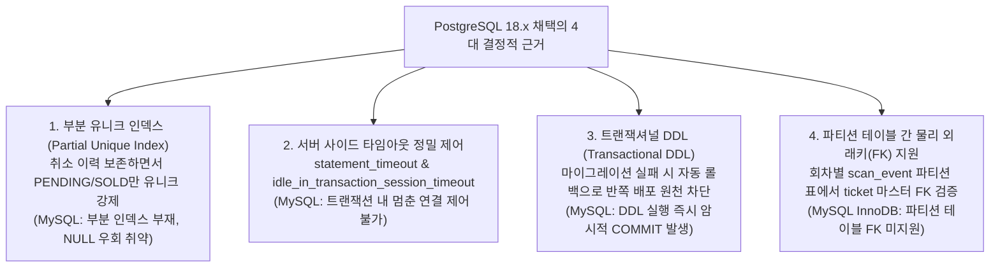

# DB 설계 편 2: 저장소 고르기 (Store Selection & Rejected Alternatives)

- **핵심 아키텍처 원칙**: 데이터의 비즈니스 임팩트와 가변성에 맞춘 다중 저장소(Multi-Store) 역할 분담, 최소한의 검증된 기술 스택 유지, 기각된 대안에 대한 정량적 기술적 근거 확보
- **관련 설계 정본**: [docs/data.md](../../data.md) §1(저장소 지도 및 엔진 버전)·§4(데이터별 일관성 요구), [docs/architecture.md](../../architecture.md) §3(서비스별 DB 원칙)·§6.1(기술 선정 및 기각 사유), [docs/infra.md](../../infra.md) §6(저장소별 RPO/RTO), ADR-0004, ADR-0014, ADR-0021, ADR-0028, ADR-0042, ADR-0083, ADR-0094, ADR-0101, ADR-0109, ADR-0115
- **함께 읽기**: [한 판 문서](../01-system-design.md) 15단계, [DB 설계 편 1: 무엇을 얼마나 저장하나](01-what-and-how-much.md), [DB 설계 편 3: 핵심 테이블과 관계](03-core-tables.md), [DB 설계 편 12: 전체 지도](12-whole-map.md)

---

## 1. 면접관의 질문

> **면접관**: "PEAKET은 어떤 데이터 저장소들을 채택했으며 각 저장소의 책임은 무엇입니까? 단일 RDBMS로 모든 것을 처리하지 않고 다중 저장소를 선택한 이유는 무엇이며, 반대로 NoSQL이나 전용 검색 엔진(Elasticsearch, MongoDB, Cassandra)을 더 늘리지 않고 배제한 기술적 기준은 무엇입니까?"

면접관은 다음 세 가지 아키텍처 판단력을 평가한다:
1. **저장소 특성 매핑 역량**: 돈/원장(ACID), 실시간 경합(초고속 메모리 원자성), 대규모 이벤트 집계(OLAP), 정적 파일 서빙의 특성을 파악하고 최적의 엔진을 매핑할 수 있는가?
2. **PostgreSQL 선정 및 MySQL 기각의 기술적 깊이**: 단순한 선호도가 아닌 엔진 내부 동작(부분 인덱스, 트랜잭션 DDL, 타임아웃 제어) 관점에서 PostgreSQL을 정당화할 수 있는가?
3. **기술 스택 다이어트(Tech Stack Diet) 원칙**: 유행하는 분산 DB(CockroachDB, MongoDB, Cassandra, ES)의 운영 비용과 분산 트랜잭션 손실을 계산하고, 왜 기존 저장소(PostgreSQL JSONB, ClickHouse, 메모리 사전)로 대체했는지 방어할 수 있는가?

---

## 2. 단순한 답과 깨지는 곳

### 단순한 답 (The Naive Approach)
> "단순성이 최고이므로 PostgreSQL 단일 클러스터 하나에 대기열, 좌석 선점, 결제 원장, 로그 분석까지 전부 집어넣겠습니다. 아니면 반대로 최신 유행 기술을 모두 도입하여 대기열은 Redis, 좌석은 DynamoDB, 상품 정보는 MongoDB, 검색은 Elasticsearch, 로그 분석은 Cassandra, 글로벌 확장은 CockroachDB로 각각 전용 분산 저장소를 구축하겠습니다."

### 어디서 깨지는가 (Failure Scenarios)

| 극단적 접근법 | 대규모 티켓팅 환경에서 깨지는 이유 | 아키텍처 근거 |
| :--- | :--- | :--- |
| **PostgreSQL 하나로 좌석 홀드** | 1개 좌석에 1,000명 경합 시 행 잠금(`FOR UPDATE`) 대기로 인해 p99 지연이 수 초로 치솟고 교착 상태 발생 (목표: p99 50ms) | `ADR-0014`, NFR-003 |
| **PostgreSQL 하나로 대기열 상태** | 초당 5.4만 QPS의 대기 상태 폴링이 DB 연결 풀을 즉각 고갈시키고 트랜잭션 처리를 마비시킴 | `architecture §9.1`, `ADR-0002` |
| **PostgreSQL 하나로 실시간 분석** | 피크 초당 1만~3만 건의 이벤트 집계 쿼리가 버퍼 풀을 오염시키고 결제 트랜잭션 쓰기 I/O를 방해함 | `ADR-0042`, NFR-009 |
| **Redis만으로 판매 확정** | Redis 비동기 복제 특성상 마스터 장애 페일오버 시 수백 ms의 쓰기 유실로 동일 좌석 이중 판매(오버셀) 발생 | `ADR-0014`, `data.md §4` |
| **상품 카탈로그에 MongoDB 도입** | 상품 1개 도메인을 위해 별도 NoSQL 클러스터(백업, 장애복구, 보안)를 운영해야 하며, 상품과 재고 간 원자적 트랜잭션 결합 불가 | `ADR-0101` (D25) |
| **공연 검색에 Elasticsearch 도입** | 검색 대상 공연이 1~2만 건에 불과한데 월 $687의 고비용 클러스터를 유지해야 하며, 판매 승인 취소 시 트랜잭션 즉시 동기화 불가 | `ADR-0094` |
| **글로벌 확장에 CockroachDB 도입** | 단일 리전 서울 서비스 환경에서 분산 합의(Raft) 오버헤드로 인해 쓰기 지연만 대폭 증가 | `ADR-0021` |

---

## 3. 아키텍처 해법: 저장소 선정 의사결정 트리

PEAKET은 '데이터 유실 시 비즈니스 파급력'과 '밀리초 단위 핫패스 판정 여부'를 기준으로 저장소를 결정하는 **체계적 의사결정 흐름(Decision Flow)**을 정의한다.

---

## 4. 핵심 저장소 매핑 및 물리 엔지니어링 표준

### 4.1 4대 저장소 스택 상세 제원

| 저장소 계층 | 채택 엔진 및 버전 | 물리 클러스터 구성 | 담당 도메인 및 데이터 | 가용성 및 RPO / RTO |
| :--- | :--- | :--- | :--- | :--- |
| **PostgreSQL** (원장 계층) | **Aurora PostgreSQL 18.x** (18.6.1 이상, PgBouncer 1.26.1) | **5개 독립 클러스터** (purchase, payment, ticket, ops, shared) | 주문, 좌석 판매, 결제, 환불, 티켓 소유권, 1인 한도, 감사 로그 | **AZ 장애: RPO 0, RTO 5분** 다중 AZ 동기식 복제 |
| **Redis** (초고속 메모리) | **ElastiCache Valkey 8.1+** (노드 기반 클러스터 모드) | **3개 독립 클러스터** (Queue, Seat, Session/Cache) 샤드 3개 $\times$ 복제본 1개 | 대기열 순번(`q:`), 좌석 비트맵(`s:`), 홀드 락, 사용자 세션(`id:`), 속도 제한 카운터 | **RPO 수백 ms, RTO 30초** 비동기 복제, `noeviction` |
| **ClickHouse** (분석 OLAP) | **ClickHouse 26.8 LTS** (Keeper 3중화 클러스터) | 2개 AZ 복제 세트 (ReplicatedMergeTree) | 관제 잠정 표(`rt`), 브론즈(원본), 실버(가명), 골드(스타 스키마), 이상 거래 | **RPO 1일, RTO 1시간** 스냅샷 + Kafka 재읽기 복원 |
| **Kafka** (이벤트 버스) | **Amazon MSK** (Apache Kafka 3.x) | **3개 독립 클러스터** (거래/제어, 텔레메트리, 관측) | 서비스 간 상태 전이 Outbox 이벤트, 비동기 감사 로그, 스트리밍 신호 | **RPO 0** (`acks=all`, 복제 3) 7일 보관 후 자동 폐기 |
| **S3 & CDN** (객체/엣지) | **AWS S3 + CloudFront** | 버킷 버전 관리 및 KMS 암호화 | 정적 좌석맵 파일, 대기열 1,000구간 JSON 파일, 회차별 동결 Parquet 아카이브 | 가용성 99.99%, 영구 보존 |
| **단말 IndexedDB** (오프라인) | 브라우저/스캐너 로컬 스토리지 | 디바이스 로컬 샌드박스 | 오프라인 검표용 공개키 패키지, 기기 서명 개인키, 스캔 큐 | 단말 영구 상주, 서버 전송 0건 |

---

### 4.2 왜 MySQL이 아니라 PostgreSQL인가? (ADR-0083)

많은 엔터프라이즈 환경에서 MySQL(InnoDB)과 PostgreSQL을 저울질하지만, PEAKET 아키텍처는 다음 4가지 핵심 엔지니어링 근거로 **PostgreSQL을 필연적으로 선택**했다:

1. **부분 유니크 인덱스 지원**:
   - `seat_sale` 테이블에서 `status IN ('PENDING', 'SOLD')` 조건에만 유니크 인덱스를 걸어, 취소된 행(`RETURNED`)을 그대로 유지하면서 재판매 시 완벽한 이중 판매 방어를 달성한다. MySQL은 조건부 부분 인덱스를 지원하지 않아 트릭(가상 컬럼 NULL)을 써야 하며 상태 추가 시 정합성이 쉽게 깨진다.
2. **트랜잭션 세션 타임아웃 완벽 제어**:
   - PostgreSQL은 `idle_in_transaction_session_timeout = '5s'` 및 `statement_timeout = '3s'`를 사용자 및 세션 레벨에서 강제하여, 좀비 커넥션이 락을 쥐고 버퍼를 고갈시키는 현상을 원천 방지한다. MySQL에는 트랜잭션 중단 타임아웃이 없다.
3. **트랜잭셔널 DDL (Transactional DDL)**:
   - DDL 스크립트를 `BEGIN ... COMMIT` 블록 내에서 실행할 수 있어 마이그레이션 도중 오류 발생 시 테이블 변경 사항이 완전 롤백된다. 반면 MySQL은 DDL 실행 시 즉시 암시적 COMMIT이 발생하여 장애 복구가 극도로 어렵다.
4. **파티션 테이블 물리 외래키 제약**:
   - 월별 파티셔닝된 `scan_event` 테이블이 단일 원장인 `ticket` 테이블을 참조할 때 물리 외래키를 안전하게 걸 수 있다. MySQL InnoDB는 파티션 테이블에 외래키를 지원하지 않는다.

---

### 4.3 PostgreSQL 5개 클러스터 분리 사유: 처리량이 아닌 장애 격리

PEAKET의 PostgreSQL 쓰기 부하는 평시 초당 28건, 결제 피크 300 TPS로 단일 인스턴스(r7g.xlarge)로도 충분히 처리 가능하다. 그럼에도 불구하고 5개 클러스터로 분리한 목적은 **장애 격리 반경(Blast Radius)의 최소화**이다:

| 클러스터 명칭 | 소유 서비스 | 물리 분리 목적 및 아키텍처 근거 |
| :--- | :--- | :--- |
| **purchase** | purchase-svc | 좌석 판매 확정, 1인 구매 한도 차감, 주문 상태 전이를 단일 ACID 트랜잭션으로 완결 |
| **payment** | payment-svc | 외부 PG사 통신 장애 및 결제 비밀키 노출 위험을 주문 도메인과 물리적으로 격리 |
| **ticket** | ticket-svc | 공연 당일 현장 게이트 입장 가용성(NFR-010)을 수호하며, 도쿄 리전 DR 복제의 유일한 소스 |
| **ops 전용** | ops-svc | 티켓 오픈 직전 로그인 트래픽 폭주가 발생해도 관리자 긴급 관제 명령(NFR-008 p95 500ms)을 100% 보장 (`ADR-0102`) |
| **공유 클러스터** | identity, core | 비용 효율성을 위해 물리 인스턴스는 공유하되, 논리 DB 스키마 및 DB 계정을 엄격히 분리하여 교차 쿼리 금지 |

---

## 5. 트레이드오프와 버린 대안 (Tradeoffs & Alternatives)

| 선정한 기술 스택 | 기각한 기술 스택 | 선택 이유 (Gains) | 감수한 대가 (Costs) 및 대체 기법 | 관련 ADR |
| :--- | :--- | :--- | :--- | :--- |
| **PostgreSQL JSONB** | **MongoDB (문서 DB)** | 별도 NoSQL 클러스터 운영 비용 절감, 상품·재고·주문 간 ACID 트랜잭션 유지, RPO 0 달성 | 속성 유효성 검증을 DB 제약이 아닌 애플리케이션 Zod 스키마가 담당 | `ADR-0101` (D25) |
| **ClickHouse OLAP** | **Apache Cassandra** | 초당 수만 건 이벤트 압축 저장(80% 이상 절감), SQL 기반 다차원 집계 분석 일원화 | 실시간 단건 PK 점 조회가 상대적으로 느림 (사후 감사 분석용으로 수용) | `ADR-0004` |
| **PG 검색 모델 + 메모리 사전** | **Elasticsearch / Algolia** | 월 $687 인프라 비용 절감, 판매 승인 취소 시 트랜잭션 즉시 동기화 | 한국어 복합 형태소 분석 부재 (2~3글자 조각 n-gram 및 자모 분해로 해결) | `ADR-0094` |
| **PostgreSQL SKIP LOCKED** | **Redis BullMQ** | 워커 큐의 RPO 0 달성, Redis 페일오버 시 알림/웹훅 발송 유실 원천 방지 | 고빈도 작업 시 DB I/O 소폭 증가 (배치 인덱스 최적화로 흡수) | `ADR-0109` |
| **S3 Parquet 파일** | **Apache Iceberg + Glue** | 회차별 단일 파일 기반 단순 아카이빙, 카탈로그 락 및 메타데이터 복잡도 제거 | 아카이빙된 과거 데이터의 행 단위 수정/삭제 불가 (불변 데이터라 무관) | `ADR-0115` |
| **단일 리전 + 도쿄 DR** | **CockroachDB 분산 SQL** | 단일 노드 로컬 트랜잭션 성능 극대화 (p99 18ms), 분산 Raft 왕복 지연 제거 | 리전 완전 붕괴 시 도쿄 스냅샷 복구(RTO 수 시간) 감수 | `ADR-0021` |

---

## 6. 핵심 꼬리 질문 5단 방어 (Staff Interview Q&A)

| 질문 단계 | 심층 질문 | 방어 논리와 기술적 근거 | 관련 정본 |
| :--- | :--- | :--- | :--- |
| **1단: 왜 (Why)** | 상품 카탈로그가 공연 굿즈마다 속성이 제각각인데 왜 MongoDB 같은 NoSQL을 쓰지 않고 PostgreSQL을 썼나요? | 상품 속성의 유연성은 PostgreSQL의 바이너리 JSONB 타입과 애플리케이션의 Zod 스키마 검증으로 100% 동일하게 구현할 수 있습니다. 반면 MongoDB를 도입하면 별도의 백업/복구/보안 파이프라인을 운영해야 하고, 무엇보다 상품 주문 시 '재고 차감'과 '주문 생성' 간의 단일 ACID 트랜잭션이 불가능해집니다. | `ADR-0101`, NFR-025 |
| **2단: 대안 (Alternatives)** | 검색 성능을 위해 전용 엔진인 Elasticsearch나 Algolia를 쓰는 것이 정석 아닌가요? | 티켓팅 플랫폼의 검색 대상 공연은 1~2만 건에 불과합니다. 이 규모에서 Elasticsearch 클러스터(월 $687)를 유지하는 것은 오버엔지니어링입니다. 또한 공연 판매가 중단되었을 때 ES는 비동기 색인 지연으로 취소된 공연이 검색 결과에 노출되는 치명적 문제가 발생합니다. PostgreSQL 읽기 모델과 자모 분해 B-Tree 인덱스로 트랜잭션 즉시 동기화와 p95 100ms 응답을 달성했습니다. | `ADR-0094`, NFR-028 |
| **3단: 장애 대응 (Resilience)** | Redis 좌석 클러스터의 마스터 노드가 갑자기 다운되면 비동기 복제로 인해 데이터가 유실되지 않나요? | Redis 페일오버 시 수백 ms 동안의 쓰기 유실이 발생할 수 있습니다. 그러나 PEAKET 아키텍처에서 Redis는 빠른 가용성 판정(Soft Hold)을 위한 1차 방어선일 뿐입니다. 최종 판매 확정은 PostgreSQL의 부분 유니크 인덱스가 최종 게이트키퍼로서 방어하므로, Redis가 홀드를 유실하더라도 RDBMS 레벨에서 이중 판매(오버셀)는 100% 차단됩니다. | `ADR-0014`, `data.md §4` |
| **4단: 수치 근거 (Numbers)** | ClickHouse를 도입하여 Kafka 이벤트를 적재할 때 비용과 성능은 어떻게 정량화되나요? | 피크 시 초당 3만 건의 이벤트가 유입될 때 ClickHouse는 열 지향 LZ4 압축을 통해 원본 대비 디스크 사용량을 80% 이상 절감합니다. 1년치 로그를 RDBMS에 저장하면 수십 TB의 스토리지가 필요하지만 ClickHouse는 약 3~8 TB로 압축 수용하며, 1억 건 집계 쿼리를 0.2초 이내에 처리하여 운영 대시보드(p95 5초 반영)를 완벽히 지원합니다. | `ADR-0042`, NFR-009 |
| **5단: 실측과 검증 (Verification)** | 선정한 저장소 스택(PostgreSQL, Redis, ClickHouse)의 정합성과 장애 내구성은 어떻게 검증되었습니까? | 카오스 엔지니어링 테스트(S-T8)에서 좌석 경합 중 Redis 마스터 노드를 강제 종료(SIGKILL)했을 때, 30초 페일오버 동안 시스템이 503 재시도로 안전하게 대기하고 복구 후 오버셀 0건을 달성함을 증명했습니다. 또한 V-T29 벤치마크를 통해 5년치 합성 데이터 환경에서 PostgreSQL 단일 인스턴스가 300 TPS 결제 쓰기를 p99 18ms로 완수함을 검증했습니다. | `ADR-0176`, `docs/verification.md` §9 |

---

## 7. 30초 아키텍처 브리핑 (Staff Engineer Summary)

> "PEAKET의 저장소 전략은 **'돈과 권리는 PostgreSQL 5개 클러스터로 철저히 격리 방어하고, 초고속 경합은 Redis 3개 클러스터로 분리 흡수하며, 대규모 분석은 ClickHouse와 S3 Parquet로 거래선에서 완벽히 떼어낸다'**는 원칙으로 요약됩니다.  
> 유행하는 분산 DB(MongoDB, Cassandra, Elasticsearch)의 도입을 과감히 기각하고 PostgreSQL JSONB와 메모리 사전 검색으로 대체하여 운영 복잡도와 인프라 비용을 최소화했습니다.  
> 특히 오버셀 방어를 위해 1선 Redis 원자적 Lua 판정과 2선 PostgreSQL 부분 유니크 인덱스를 결합함으로써, 단 1건의 좌석 중복 판매도 허용하지 않는 무결성을 달성했습니다."

---

## 8. 정본에서 읽을 곳

1. [docs/data.md](../../data.md) §1: 저장소 지도, 엔진 버전 및 논리 DB 구성
2. [docs/data.md](../../data.md) §4: 데이터 성격별 일관성 매트릭스
3. [docs/architecture.md](../../architecture.md) §6.1: 기술 스택 선정 및 기각 사유 표
4. [docs/infra.md](../../infra.md) §6: 저장소별 백업 정책 및 RPO/RTO
5. [ADR-0083](../../adr/0083-keep-postgresql-partition-keys-transaction-scoped-settings-global-replica.md): PostgreSQL 파티션 키 및 트랜잭션 범위 설정 원칙
6. [ADR-0028](../../adr/0028-postgres-no-sharding-cell-scaling.md): RDBMS 샤딩 배제 및 5개 클러스터 격리
7. [ADR-0101](../../adr/0101-product-catalog-postgres-jsonb-drop-mongodb.md): MongoDB 배제 및 PostgreSQL JSONB 채택
8. [ADR-0094](../../adr/0094-search-redesign-autocomplete-read-model-search-port.md): Elasticsearch 배제 및 읽기 모델 채택
9. [ADR-0004](../../adr/0004-drop-cassandra-from-runtime.md): Cassandra 배제 및 ClickHouse 통합
10. [ADR-0109](../../adr/0109-delivery-jobs-in-postgres-drop-bullmq-cache-redis-key-classes-noeviction.md): BullMQ 배제 및 PostgreSQL SKIP LOCKED 워커 큐
