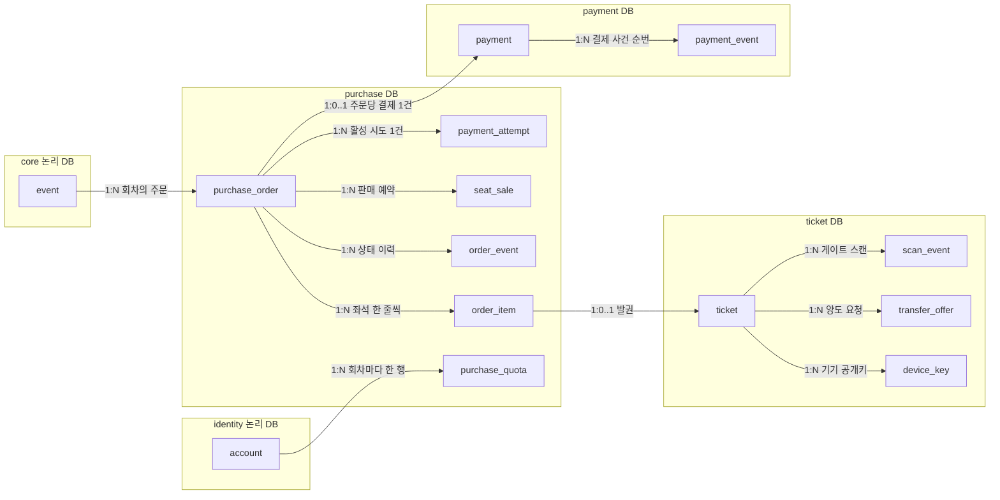

# DB 설계 편 3: 핵심 표와 관계

- **기준 시점**: ADR-0177까지, 2026-11-01
- **맡는 정본**: [docs/data.md](../../data.md) §1(표가 있는 DB)·§2(ERD ①~⑦, 기본 키·검사 규칙, 복사한 칸 목록)·§4(트랜잭션 경계 1·2·4·9), ADR-0086·0113·0114·0101(링크는 §8)
- **규범이 아니다**: 정본을 풀어 쓴 해설이다. 숫자와 규칙이 정본과 다르면 정본이 맞다([ADR-0177](../../adr/0177-walkthrough-explain-in-interview.md)).
- **앞뒤 편**: 앞 편은 [DB 설계 편 2: 저장소 고르기](02-choose-stores.md)다. 다음 편은 [DB 설계 편 4: 같은 좌석을 두 번 팔지 않기](04-no-double-sale.md)다. [한 판 문서](../01-system-design.md) 3단계가 데이터 뼈대를 한 표로 보인다. 이 편이 고른 핵심 표 밖의 표까지 모두 보려면 [DB 설계 편 12: 전체 지도](12-whole-map.md)와 [표 사전 ①](13-table-dictionary-postgres.md)을 본다.

## 1. 면접관의 질문

> **면접관**: "핵심 표를 그려 보세요. 공연, 좌석, 주문, 결제, 티켓은 어떻게 이어집니까? 기본 키는 무엇입니까?"

면접관은 엔티티(표로 담을 대상)를 고르는 눈, 기본 키와 관계, 어디를 정규화(같은 사실을 한 곳에만 두기)하고 어디를 일부러 복사하는지 본다. 서비스마다 데이터베이스가 따로일 때 관계를 어떻게 잇는지도 본다.

## 2. 단순한 답

> "`users`, `events`, `seats`, `orders`, `payments`, `tickets` 여섯 표를 외래 키(다른 표의 행을 가리키는 칸과 그 제약)로 모두 잇겠습니다. `seats`에 `status` 칸을 두고 AVAILABLE → HELD → SOLD로 바꾸고, 주문 상태도 `orders.status`를 덮어씁니다. 1인 한도는 주문을 세어 확인합니다."

## 3. 어디서 깨지나

| 단순한 답 | 깨지는 곳 | 정본의 근거 |
| --- | --- | --- |
| 좌석 행 하나에 판매 상태를 둔다 | 한 공연의 회차는 모두 같은 좌석 배치본을 쓴다. 배치(바뀌지 않음)와 회차별 판매(계속 바뀜)를 한 행에 두면 회차마다 좌석 행을 복제해야 한다. 홀드(결제하는 동안 좌석을 잠시 잡아 두기)까지 이 행의 잠금으로 하면 경합 때 p99(100건 중 99건이 끝나는 시간)가 수 초다 | data.md §2 ② `event.production_id` 주석, ADR-0014 '검토한 대안' |
| 판매를 `status` UPDATE로 한다 | '비었는지 보고 바꾸기'는 앱 코드의 확인에 기댄다. 정본은 앱 로직이 아니라 데이터베이스의 물리 유니크 제약을 마지막 방어선으로 둔다 | data.md §5 |
| 모든 표를 외래 키로 잇는다 | 주문(purchase), 결제(payment), 티켓(ticket), 계정(identity), 공연(core)이 서로 다른 데이터베이스에 있다. 논리 DB끼리의 교차 참조와 외래 키 조인은 금지다 | data.md §1 공유 클러스터 행 |
| 주문 상태를 덮어쓰기만 한다 | 분쟁 때 '그 시각에 어떤 상태였나'를 되짚을 수 없다 | ADR-0113 맥락(FR-031) |
| 주문은 결제 하나만 가진다 | 결제창을 다시 열면 결제 시도가 여러 번 생긴다. 시도와 실제 승인을 나누지 않으면 이중 승인이나 결제 누락을 막는 키를 둘 곳이 없다 | data.md §2 ③·④, §4의 1·3 |
| 1인 한도는 주문을 세어 본다 | 여러 탭에서 동시에 오면 세는 사이에 다른 주문이 들어와 한도를 넘긴다 | data.md §5 '동일 사용자가 여러 브라우저 탭' 행 |

## 4. 지금 설계

### 4.1 표의 묶음과 주인

ERD(표와 관계를 그린 그림)는 한 그림에 담으면 mermaid(글로 그림을 그리는 도구)의 글자 수 한도를 넘어 업무 묶음별로 일곱 그림으로 나눴다. 표가 실제로 어느 데이터베이스에 있는지는 data.md §1이 정본이다(data.md §2 머리).

| ERD 그림 | 핵심 표 | 데이터베이스(주인 서비스) |
| --- | --- | --- |
| ① 계정과 관리 계정 | `account`, `identity_verification`, `session`, `device`, `consent` | 공유 클러스터의 identity 논리 DB(identity-svc) |
| ② 공연·회차·좌석 배치와 판매자 | `production`, `event`, `venue`, `section`, `seat`, `price_tier`, `event_seat_price`, `promoter` | 공유 클러스터의 core 논리 DB(core-svc) |
| ③ 주문과 좌석 판매 | `purchase_order`, `order_item`, `order_event`, `order_idempotency`, `seat_sale`, `seat_hold`, `purchase_quota`, `payment_attempt`, `ticket_issue_job`, `event_sale` | purchase 클러스터(purchase-svc) |
| ④ 결제와 정산 | `payment`, `payment_event`, `payment_cancel`, `webhook_receipt`, `settlement_statement`, `payout` | payment 클러스터(payment-svc) |
| ⑤ 티켓과 현장 입장 | `ticket`, `device_key`, `transfer_offer`, `scan_event`, `scanner_change`, `gate_flag` | ticket 클러스터(ticket-svc) |
| ⑥ 굿즈·알림·후기·문의 | `product`, `merch_order`, `notification_job`, `review`, `inquiry` | core 논리 DB |
| ⑦ 운영·CS·감사·법적 요청 | `command_event`, `audit_chain`, `approval_request`, `cs_case` | ops 전용 클러스터(ops-svc) |

### 4.2 구매 길의 핵심 관계

주문에서 티켓까지 이어지는 관계만 골랐다. 상자는 표가 있는 데이터베이스로 묶었다. 선 이름의 1:N은 앞 표의 행 하나에 뒤 표의 행이 여럿, 1:0..1은 없거나 하나라는 뜻이다. 선 가운데 `event`→`purchase_order`, `account`→`purchase_quota`, `purchase_order`→`payment`, `order_item`→`ticket`은 데이터베이스를 건너므로 외래 키가 아니라 ID만 둔다(4.5). 칸은 4.3 표에 있다.

### 4.3 표마다 키와 제약

| 표 | 기본 키 | 핵심 칸 | 지키는 규칙 |
| --- | --- | --- | --- |
| `purchase_order` | `id`(UUIDv7: 앞부분이 만든 시각이라 시간순으로 커지는 ID) | `account_id`, `event_id`, `status`(CREATED부터 EXPIRED까지 13값), `amount`(서버 계산), `event_seq`, `payment_event_seq`, `buyer_name`·`buyer_phone` | 상태는 주문 전이 함수 하나로만 바꾼다. 결제 결과는 `WHERE payment_event_seq < 받은 순번`으로 반영해 두 번 반영하지 않는다(ADR-0146 결정 2). 표는 나누지 않는다(ADR-0114) |
| `order_item` | `(order_id, line_no)` | `seat_id`, `tier`, `unit_price`, `ticket_id` | `unit_price`는 주문 때 가격 스냅샷이고 티켓 단위 환급의 기준이다. `ticket_id`는 발권 뒤 채우고 외래 키가 없다 |
| `order_event` | `(order_id, seq)` | `from_status`, `to_status`, `cause`, `actor`, `occurred_at` | `seq`는 주문마다 1부터 빈틈 없이 는다. 상태를 바꾸는 같은 UPDATE에서 `event_seq`를 올려 매긴다(ADR-0113) |
| `order_idempotency` | `(account_id, operation, idempotency_key)` | `request_hash`, `order_id`, `result_id` | 주문 생성·결제 시도 시작·결제 접수의 멱등 기록(같은 요청이 여러 번 와도 한 번만 처리)이다. 같은 키에 요청 지문이 다르면 422다. 24시간 `[가정]` 뒤 지운다 |
| `seat_sale` | `(event_id, seat_id, order_id)` | `status`(PENDING·SOLD·RETURNED), `pending_until` | `UNIQUE (event_id, seat_id) WHERE status IN ('PENDING','SOLD')`. 조건에 맞는 행끼리만 같은 값을 막는 부분 유니크 인덱스다. 반환된 좌석은 RETURNED로 남고 다시 팔 수 있다. 자세한 것은 [DB 설계 편 4](04-no-double-sale.md) |
| `seat_hold` | `(event_id, seat_id, fencing_token)`. `fencing_token`은 홀드 순서대로 커지는 번호다 | `account_id`, `status`(HELD·RELEASED·EXPIRED), `kind`(FAN·PRIORITY), `held_at`, `expires_at` | 홀드 원장(감사용 이력)이다. Redis(메모리에 데이터를 두는 빠른 저장소)의 홀드 사건을 비동기로 싣고, 좌석 Redis 전체 장애 뒤 다시 만들기의 입력이 된다. HELD 부분 유니크, 회차 ID 범위 월 파티션(큰 표를 범위로 나눈 조각) |
| `purchase_quota` | `(account_id, event_id)` | `used`, `limit_count` | `used + n ≤ limit_count`일 때만 UPDATE한다. 인덱스 밖 칸만 바꿔 HOT 갱신(인덱스를 고치지 않는 가벼운 갱신)이 된다 |
| `payment_attempt` | `id` | `order_id`, `pg`, `pg_order_ref`, `status`(READY·ACCEPTED·SUPERSEDED·EXPIRED) | 활성(READY·ACCEPTED) 시도는 주문당 하나(부분 유니크). 새 시도를 만들면 이전 READY를 SUPERSEDED로 바꾼다 |
| `payment` | `id`(UUIDv7) | `order_id`, `event_id`(주문에서 복사), `amount`, `status`, `idempotency_key`(`confirm-{orderId}`) | `order_id` UNIQUE로 승인 요청은 주문당 한 번이다. 상태 사건은 자식 표 `payment_event (payment_id, seq)`에 늘어나기만 하는 순번으로 쌓고, purchase의 `payment_event_seq`가 그 순번을 받는다 |
| `ticket` | `id`(UUIDv7) | `account_id`(보유자), `payer_account_id`(결제자), `event_id`, `seat_id`, `gate_zone`, `status`, `version` | 한 요청 안의 경합(양도·취소·스캔)은 행 잠금이 맡고, `version`은 사람이 화면에서 읽고 나중에 저장하는 흐름에만 쓴다 |
| `device_key` | `id` | `ticket_id`, `key_id`, `public_key`, `reason`, `revoked_at` | 첫 키는 팬이 '입장용 휴대폰 등록'을 누를 때 넣는다. 키를 넣거나 폐기하면 같은 트랜잭션(모두 하거나 모두 하지 않는 DB 쓰기 단위)에서 `scanner_change`에 적는다 |
| `scan_event` | `(event_id, id)` | `ticket_id`, `scanner_device_id`, `direction`, `result`, `known_seq`, `device_seq` | `id`는 단말이 만들어 다시 올려도 한 번만 저장된다. 회차 ID 범위 월 파티션이다 |

`seat_sale` 기본 키에 `order_id`가 든 것은 칸 구성으로 읽으면 이렇다. RETURNED 행이 남은 채 같은 좌석이 다시 팔리면 `(event_id, seat_id)`가 겹친다. 그래서 기본 키에 주문을 넣고, 살아 있는 판매 하나는 부분 유니크 인덱스가 지킨다(seat-hold §4의 '반환된 좌석을 다시 판매할 수 있다').

### 4.4 좌석 배치와 회차 판매를 나눈다

- **공연과 회차**: `production`(공연, 회차 묶음)이 판매 승인 `sale_review`를 가진다. 승인은 공연 단위다. `event`(회차)는 `open_at`·`starts_at`·`per_person_limit`·`pg_primary`(결제사 지정)와 `status`(SCHEDULED·CANCELLED·POSTPONED)를 가진다. 판매 전·중·종료는 칸이 아니라 `open_at`·`starts_at`으로 계산하고, 판매 종료는 칸 없이 `starts_at` − 24시간이다(ADR-0064·0093).
- **배치는 core, 판매는 purchase**: `venue`(공연장 틀 TEMPLATE 또는 공연용 배치본 LAYOUT) → `section`(구역 도형) → `seat`(좌석, 좌표 `x`·`y`)는 바뀌지 않는 배치다. 한 공연의 회차는 모두 같은 배치본(`venue_id`)을 쓴다. 회차마다 바뀌는 것은 `event_seat_price (event_id, seat_id)`(회차·좌석별 등급 정본), purchase의 `seat_sale`(판매), `event_sale`(회차 판매 상태: UPCOMING·ON_SALE·ALL_HELD·SOLD_OUT·ENDED)다. 지금 잡혀 있는 홀드는 Redis 좌석 비트맵에 있다.
- **판매 상태의 원본은 purchase**: 검색 읽기 모델 `search_document.sale_status`는 purchase-svc의 `event_sale` 변경 사건을 공연 단위로 모은 값이다(data.md §2 ②).

### 4.5 데이터베이스를 건너는 관계: 외래 키 대신 ID와 복사

| 방법 | 예 | 맞추는 법 |
| --- | --- | --- |
| ID만 두고 외래 키를 걸지 않는다 | `order_item.ticket_id`(ticket DB), `review.basis_order_id`(purchase DB), `priority_grant.fraud_case_id`(ops DB) | 몇몇 칸은 하루 한 번 고아 행(가리키는 대상이 없는 행) 수를 세어 지표로 낸다(data.md §2) |
| 바뀌지 않는 값을 복사한다(역정규화: 읽기를 위해 같은 값을 일부러 여러 곳에 두기) | `ticket.payer_account_id`·`event_id`·`seat_id`(발권 때), `payment.event_id`(결제를 만들 때), `order_item.unit_price`(주문 때), `event.commission_rate_bp`(판매 승인 때) | 그 시점 값이라 맞출 것이 없다 |
| 바뀔 수 있는 값을 복사한다 | `ticket.gate_zone`(좌석이나 구역의 입장 게이트) | ticket-svc가 티켓 값을 고치고 `scanner_change`로 스캐너에 알린다 |
| 사건으로 알린다 | 주문 확정, 좌석 판매, 회차 판매 상태 | 같은 트랜잭션의 Outbox(보낼 사건을 표에 적어 두는 방식)로 Kafka에 보낸다. 자세한 것은 [DB 설계 편 5](05-consistency-transactions.md) |

계정을 합칠 때도 원장의 `account_id`는 고치지 않는다. 주문·`order_event`·결제 원장·스캔 기록은 덧붙이기만 하는 기록이고 5년 보존 대상이며, 부정 조사의 '실제로 산 계정'을 지켜야 하기 때문이다. 대신 서비스마다 대응표 `merged_account(absorbed_account_id PK, representative_account_id, merged_at)`를 두고, '내 주문'은 `account_id = ANY(대표 계정 + 흡수 계정 ID들)`로 찾는다. 1인 한도도 이 표로 계정 묶음을 함께 센다(data.md §4의 9, ADR-0148).

### 4.6 모든 표에 쓰는 규칙

- **ID**: 원장 표는 서버가 만든 UUIDv7을 쓴다. 보존 기한이 지난 행을 `id < 기한 경계` 범위로 기본 키를 타며 나눠 지운다(ADR-0114 결정 3).
- **상태 칸**: `CHECK (… IN (…))`로 허용 값을 검사하고 enum 타입(허용 값 목록을 타입으로 만든 것)은 쓰지 않는다. enum은 있는 값을 뺄 수 없어서다. 허용 값의 원본은 서비스 코드의 상수 목록 하나이고, API 계약·Drizzle(쿼리 도구) 타입·CHECK가 같은지 CI(코드를 올릴 때마다 도는 자동 검사)가 본다. 예외는 `product.type` 하나로, 참조 표 `product_type`을 외래 키로 가리킨다. 새 상품 유형마다 DDL(표 구조 변경)이 생기지 않게 하려는 것이다(data.md §2, ADR-0101).
- **금액**: 모두 원 단위 정수다. 한 건의 금액은 `int`(약 21억 4,748만 원까지), 여러 건을 모은 정산·지급 금액은 `bigint`다. 큰 공연 하나의 정산서만으로 `int`를 넘을 수 있어서다(25억 원 정산서, data.md §2).
- **순서가 중요한 번호**: DB 시퀀스로 매기지 않는다. 같은 트랜잭션에서 카운터 행을 `UPDATE … RETURNING`으로 올려 번호 순서와 커밋 순서를 같게 한다(`scanner_seq`, `audit_chain_head`, ADR-0086).
- **2인 승인**: 승인자를 JSON 배열이 아니라 자식 표(`approval_vote`, `event_cancellation_approval` 등)에 두고 `UNIQUE (요청 ID, 승인자)`와 요청자와 다른지 보는 CHECK를 건다.
- **외래 키 쪽 인덱스와 삭제**: PostgreSQL(이 설계의 관계형 데이터베이스)은 참조하는 쪽 칸에 인덱스(행을 빨리 찾게 하는 찾아보기 구조)를 자동으로 만들지 않아 직접 둔다. 외래 키에 연쇄 삭제를 걸지 않고, 정비 잡이 자식 행을 먼저 지운다(data.md §5.1, ADR-0114 결정 3).

## 5. 트레이드오프와 버린 길

| 정한 것 | 얻는 것 | 치르는 값 |
| --- | --- | --- |
| 주문은 '지금 상태 + 덧붙이기 이력'(`purchase_order` + `order_event`) | 주문 읽기는 행 하나다. 이력으로 그 시각의 상태를 되짚는다 | 코드 버그가 있으면 상태와 이력이 어긋날 수 있다. 전이 함수 하나·권한·CI 검사·매일 대조로 줄이지만 0은 아니다(ADR-0113) |
| 판매는 `seat_sale` 행을 넣고 부분 유니크 인덱스로 막는다 | 같은 좌석의 두 번째 판매를 데이터베이스가 거절한다. 반환된 좌석을 다시 팔 수 있다 | 상태 전이가 인덱스 조건 칸을 바꿔 HOT 갱신이 되지 않는다. 죽은 행 청소를 앞당겨야 한다(data.md §5) |
| 다른 DB를 가리키는 칸은 ID만 | 서비스마다 데이터베이스를 따로 운영하고 배포할 수 있다 | 가리키는 대상이 없는 행이 생길 수 있어 지표로 지켜본다. 서비스 사이 정합성은 Saga(단계별로 처리하고 실패하면 앞 단계를 되돌리는 방식)·Outbox로 맞춘다 |
| 바뀌지 않는 값은 복사한다 | 정산·환급·스캐너 목록이 다른 DB를 읽지 않고 계산된다 | 복사한 칸 목록을 관리해야 한다. 바뀌는 칸(`gate_zone`)은 따로 맞춘다 |
| 상품 정의는 `product` 공통 칸 + `attributes jsonb`(JSON을 이진 형식으로 담는 칸) | 새 상품 유형에 DDL이 없고 상품·재고·주문이 한 트랜잭션이다 | 속성 검증이 데이터베이스가 아니라 코드에 있다(ADR-0101) |

**버린 길**

- **주문을 진짜 이벤트 소싱(사건만 저장하고 상태는 사건을 다시 돌려 얻는 방식)으로**: 채우는 요구는 지금과 같은데 사건 판 올림 규칙, 핫패스(요청이 몰리는 길) 읽기의 재생이나 투영, 재생 시험이 더해진다. 사건이 10개 안팎이라 스냅샷(어느 시점의 상태를 저장해 둔 것) 이득도 없다(ADR-0113 '검토한 대안' 가). 이벤트 소싱은 운영 명령 기록(`command_event`)에만 쓴다.
- **읽기 저장소를 따로 두는 CQRS(쓰기 모델과 읽기 모델을 나누는 방식)**: catalog 읽기는 CDN(사용자 가까이에서 대신 답하는 전송망)·캐시가 이미 받고, 검색은 판매 승인 취소를 바로 반영하려고 같은 트랜잭션에 둔다. 저장소가 하나 늘고 따라잡는 동안 틀린 화면이 생긴다(ADR-0113 '검토한 대안' 라).
- **상품 유형마다 표 하나**: 새 유형마다 DDL과 배포가 생기고 목록 조회가 표를 여럿 묶는다. **속성 행 표(EAV, 속성 하나를 행 하나로 두는 방식)**: 여러 속성을 함께 거르는 쿼리가 복잡하고 느리며 값 검증이 어렵다(ADR-0101 '검토한 대안' D·E).
- **주문·결제·티켓을 `created_at` 월 파티션으로 나누고 키에 `created_at`을 더하기**: 유일 규칙이 같은 달 안에서만 지켜지고, 외래 키마다 부모의 `created_at`을 들고 다녀야 한다(ADR-0083 '검토한 대안'). 지금은 아예 나누지 않는다(ADR-0114).

## 6. 꼬리 질문

| 질문 | 답의 요지 | 근거 |
| --- | --- | --- |
| 좌석 표에 상태 칸을 두면 안 되나요? | 배치는 회차마다 같고 판매는 회차마다 다르다. 그래서 `seat`(core)와 `seat_sale`(purchase)를 나눴다. 지금 잡힌 홀드는 Redis 비트맵에 있고, PostgreSQL에는 판매 행과 홀드 원장만 있다 | data.md §2 ②·③ |
| 결제 시도와 결제를 왜 나눴나요? | 결제 시도는 purchase가 결제창 값과 결제사를 고정하려고 두고, 여러 번 생길 수 있다(활성 하나). 결제는 payment의 원장이고 승인 요청은 주문당 한 번(`payment.order_id` UNIQUE)이다. 결제 비밀과 결제사 장애를 payment에 가둔다 | data.md §2 ③·④, §4의 1·3 |
| 티켓에 결제자와 보유자가 따로 있는 이유는요? | 양도하면 보유자(`account_id`)가 바뀌어도 결제자(`payer_account_id`)는 바뀌지 않는다. 후기 자격과 '받은 티켓을 결제자에게 돌려주기'가 결제자를 기준으로 한다 | data.md §2 ⑤ |
| 주문 상태 이력은 이벤트 소싱인가요? | 아니다. 상태가 원본이고, 이력은 상태를 바꾸는 같은 트랜잭션에서 덧붙인다. 매일 마지막 이력과 지금 상태가 같은지 대조하고 어긋나면 SEV3(경보 등급, 숫자가 작을수록 심각)다 | data.md §4의 1, ADR-0113 |
| 외래 키를 못 걸면 정합성은 어떻게 지키나요? | 같은 DB 안에서만 외래 키를 건다. 건너는 칸은 ID만 두고, 복사는 바뀌지 않는 값만 한다. 서비스 사이는 Outbox 사건과 멱등 받기로 맞추고 고아 행을 지표로 본다 | data.md §1·§2 |
| 계정을 합치면 주문의 `account_id`를 고치나요? | 고치지 않는다. 원장은 덧붙이기 기록이고 5년 보존이다. `merged_account` 대응표로 묶어 조회하고 1인 한도도 함께 센다 | data.md §4의 9 |
| 왜 enum 타입이 아니라 CHECK인가요? | enum은 있는 값을 뺄 수 없다. 부분 유니크 인덱스가 `'PENDING'`·`'SOLD'` 같은 정확한 문자열에 기대므로 CHECK가 오버셀 방어선의 앞을 지킨다 | data.md §2 '허용 값 검사' |
| 표 크기와 쿼리 속도를 재 봤나요? | 아니다. 서비스 수준 측정은 아직 없다. 합성 5년치(주문 약 1,700만·티켓 약 3,500만)로 실행 계획(DB가 쿼리를 처리할 순서)을 떠서 확인할 계획이다 `[실측 전]`. 쿼리마다 인덱스는 [DB 설계 편 7](07-indexes-queries.md)이 다룬다 | data.md §5.1 |

## 7. 내 말로 설명하기

> "핵심은 좌석 배치와 회차 판매를 나눈 것입니다. 배치와 좌석은 바뀌지 않으니 공연 정보 데이터베이스에, 회차마다 바뀌는 판매는 주문 데이터베이스의 `seat_sale`에 둡니다. PENDING과 SOLD인 행끼리만 같은 좌석을 막는 부분 유니크 인덱스가 오버셀을 막습니다. 주문은 지금 상태를 `purchase_order`에 두고, 바뀔 때마다 같은 트랜잭션에서 `order_event`에 이력을 덧붙입니다. 1인 한도는 `purchase_quota` 행 하나를 조건부로 갱신합니다. 결제 시도는 주문 쪽에, 결제 원장은 결제 쪽에 두고 주문당 결제 하나를 유일 제약으로 지킵니다. 티켓은 보유자와 결제자를 따로 둡니다. 데이터베이스를 건너는 관계는 외래 키 대신 ID, 바뀌지 않는 값의 복사, 사건으로 맞춥니다."

**꼭 넣을 말**

- 배치(core `seat`)와 판매(purchase `seat_sale`)를 나누고, 판매는 행 넣기 + 부분 유니크 인덱스로 막는다.
- 주문은 '상태 + 덧붙이기 이력'이고 이벤트 소싱이 아니다.
- 데이터베이스를 건너는 관계는 외래 키가 아니라 ID·복사·사건이다. 계정 병합에도 원장을 고치지 않는다.

## 8. 정본에서 읽을 곳

1. [docs/data.md](../../data.md) §2 머리와 ③ 주문과 좌석 판매
2. [docs/data.md](../../data.md) §2의 ②(공연·회차·좌석 배치), ④(결제), ⑤(티켓)
3. [docs/data.md](../../data.md) §2 끝의 '기본 키·유일·검사 규칙'과 '복사한 칸 목록'
4. [docs/data.md](../../data.md) §4의 트랜잭션 경계 1(주문 생성), 2(판매 확정), 4(발권), 9(계정 병합)
5. [ADR-0113](../../adr/0113-order-state-with-append-only-history-event-sourcing-only-for-ops-commands.md): 주문 상태와 이력
6. [ADR-0086](../../adr/0086-query-index-rules-plan-diagnostics-data-pattern-gaps.md) 결정 3·4: 돈·정합성 제약과 기본 키
7. [ADR-0114](../../adr/0114-no-monthly-partitions-for-order-payment-ticket-batched-retention-delete.md) 결정 1·2: 나누지 않는 표와 키
8. [ADR-0101](../../adr/0101-product-catalog-postgres-jsonb-drop-mongodb.md) '검토한 대안': 상품 표의 모양(JSONB, 유형마다 표, EAV)
9. [docs/features/seat-hold.md](../../features/seat-hold.md) §11, [docs/features/payment.md](../../features/payment.md) §10, [docs/features/offline-gate.md](../../features/offline-gate.md) §10: 기능별 데이터 참조

## 9. 정본에서 찾은 어긋남

| 어긋난 곳 | 내용 | 지금 읽는 법 |
| --- | --- | --- |
| docs/data.md §2 ⑤의 `ticket` 칸 | `ticket`에는 주문을 가리키는 칸이 없다. 주문과 티켓을 잇는 칸은 purchase 쪽 `order_item.ticket_id`뿐이다. 그런데 발권은 '주문 ID로 멱등'이고(docs/features/payment.md §2, docs/architecture.md §3.3, `IssueTickets`의 `order_id`), 후기 작성 자격 확인은 근거가 된 결제자 주문(`basis_order_id`)을 돌려준다(docs/api/proto/peaket/ticket/v1/ticket.proto). ticket-svc가 주문 ID를 어디에 두는지 정본에 없다. 열린 일 92번(docs/review/open-items.md) | 발권 멱등과 후기 근거 주문에는 ticket 쪽에 주문 ID가 필요하다고 읽는다. 어느 칸에 둘지는 정본에 없어, 면접에서는 '열린 일로 올라간 빈칸'이라고 말한다 |
