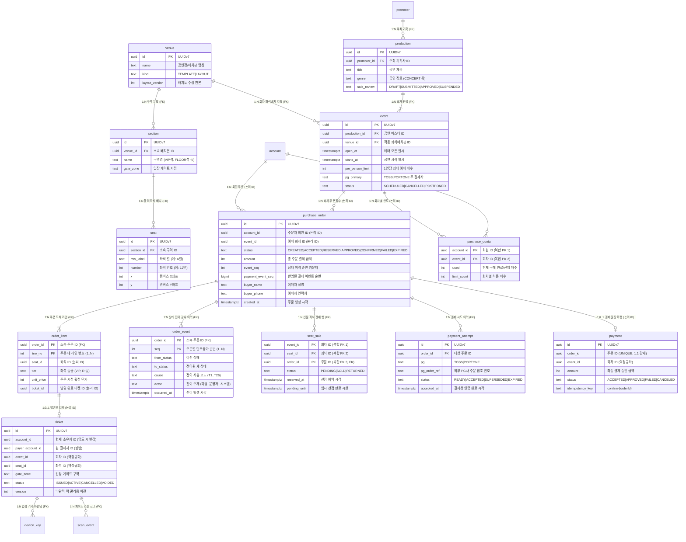
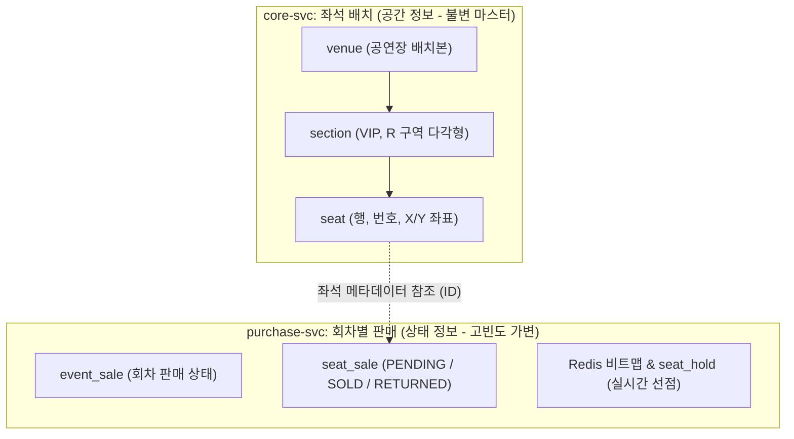
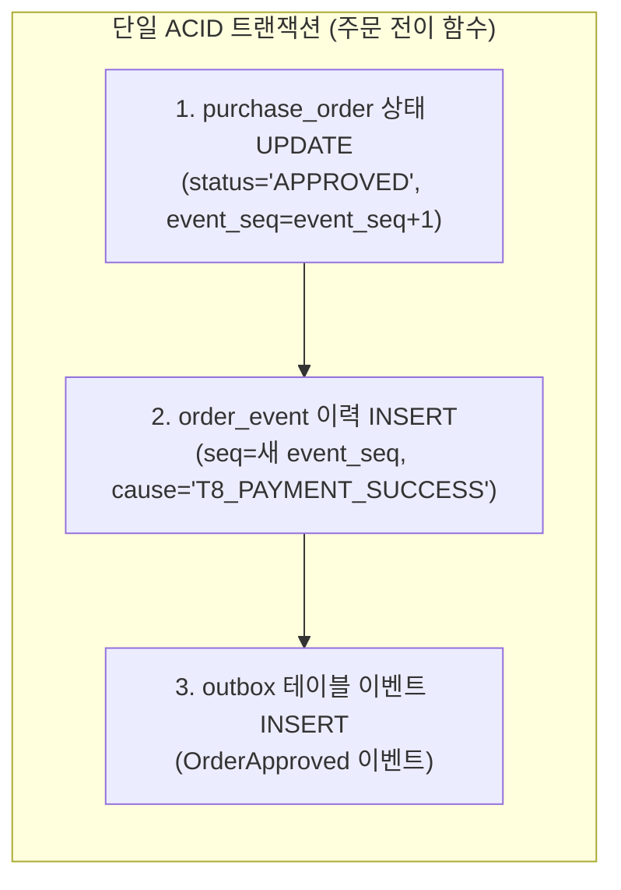

# DB 설계 편 3: 핵심 테이블과 관계 (Core Tables & Domain Relationships)

- **핵심 아키텍처 원칙**: 공연 배치와 회차 판매의 물리적 분리, 서비스 경계 간 느슨한 결합(논리 ID 참조와 Outbox 비동기 전파), 불변 원장 모델 및 상태-이력 분리
- **관련 설계 정본**: [docs/data.md](../../data.md) §1(저장소 지도)·§2(ERD ①~⑤, 키·검사 규칙, 복사 목록)·§4(트랜잭션 경계 1·2·4·9), ADR-0086, ADR-0113, ADR-0114, ADR-0101
- **함께 읽기**: [한 판 문서](../01-system-design.md) 3단계, [DB 설계 편 4: 같은 좌석을 두 번 팔지 않기](04-no-double-sale.md), [DB 설계 편 5: 일관성과 트랜잭션 경계](05-consistency-transactions.md), [DB 설계 편 6: 동시에 고칠 때](06-concurrency.md)

---

## 1. 면접관의 질문

> **면접관**: "대규모 티켓팅 플랫폼의 핵심 데이터베이스 테이블을 설계해 보세요. 공연, 회차, 구역, 좌석, 좌석판매, 주문, 결제시도, 티켓은 어떻게 연결됩니까? 기본 키(PK)는 무엇을 쓰며, 마이크로서비스로 분리된 DB 환경에서 외래키 제약과 참조 무결성은 어떻게 다루나요?"

면접관은 다음 세 가지 역량을 집중적으로 검증한다:
1. **도메인 격리 능력**: 영구 불변에 가까운 '좌석 배치(공간 정보)'와 극심하게 변하는 '회차별 판매(상태 정보)'를 모델링 레벨에서 깔끔하게 분리할 수 있는가?
2. **분산 데이터 무결성 설계**: 서비스별 독립 DB 환경에서 물리 외래키(FK) 없이 논리적 참조와 비동기 이벤트를 통해 데이터 정합성을 어떻게 유지하는가?
3. **원장 신뢰성과 확장성**: 5년 누적 수천만 건의 주문/티켓 데이터 속에서 B-Tree 인덱스 분할을 억제하고 감사 추적성(Auditability)을 확보하는 기본 키 및 제약조건 설계 원칙이 있는가?

---

## 2. 단순한 답과 깨지는 곳

### 단순한 답 (The Naive Approach)
> "단일 RDBMS에 `users`, `events`, `seats`, `orders`, `payments`, `tickets` 6개 테이블을 만들고 모든 관계를 물리 외래키(Foreign Key)로 연결합니다. `seats` 테이블에 `status` 컬럼(`AVAILABLE`, `HELD`, `SOLD`)을 두고 UPDATE로 판매 상태를 변경하며, 주문 상태는 `orders.status`를 덮어씁니다. 1인 구매 한도는 `orders` 테이블에서 `COUNT(*)`로 검증합니다."

### 어디서 깨지는가 (Failure Scenarios)

| 단순한 설계 | 대규모 환경에서 깨지는 이유 | 정본의 아키텍처 근거 |
| :--- | :--- | :--- |
| **`seats` 테이블에 판매 `status`를 둠** | 한 공연이 10회차를 진행할 때 동일한 좌석 배치를 사용한다. 배치와 판매를 한 행에 두면 회차마다 좌석 수만 개를 통째로 복제해야 한다. 또한 좌석 행을 잠그며 상태를 바꾸면 인기 좌석 클릭 경합 시 트랜잭션 대기로 p99 응답 지연이 수 초로 치솟는다. | `docs/data.md` §2 ②, ADR-0014 |
| **`status` UPDATE로 판매 처리** | '비어 있는지 확인하고 UPDATE'하는 방식은 애플리케이션 메모리 조건문에 의존하므로 동시성 레이스 컨디션 발생 시 중복 판매를 막지 못한다. DB 물리적 제약조건이 마지막 방어선이 되어야 한다. | `docs/data.md` §5 |
| **모든 테이블을 물리 FK로 연결** | 주문(purchase-svc), 결제(payment-svc), 티켓(ticket-svc), 회원(identity-svc), 공연(core-svc)은 서로 다른 서비스의 독립 데이터베이스다. 물리 FK 조인을 걸면 단일 DB 장애가 전사로 전파되며 독립 배포가 불가능해진다. | `docs/data.md` §1 |
| **주문 상태를 단순 덮어쓰기** | 분쟁이나 감사 시 '특정 시각에 주문이 어떤 상태였고 어떤 사유로 전이되었는지' 역추적이 불가능하다. 금융/거래 플랫폼에서 상태 덮어쓰기는 규제 및 감사 위반이다. | ADR-0113, FR-031 |
| **주문과 결제를 1:1 결합** | 사용자가 결제창을 닫고 다시 열거나 카드 인증에 실패하면 결제 시도가 여러 번 발생한다. 결제 시도(`payment_attempt`)와 실제 최종 승인(`payment`)을 분리하지 않으면 이중 결제 방지 멱등키를 둘 공간이 없다. | `docs/data.md` §2 ③·④, §4 |
| **1인 구매 한도를 `COUNT(*)`로 계산** | 동일 사용자가 여러 브라우저 탭에서 동시에 결제 요청을 날리면, 각 트랜잭션이 동시에 `COUNT(*)`를 실행하여 한도 미달로 판정하고 모두 결제를 승인해버리는 쓰기 스큐(Write Skew)가 발생한다. | `docs/data.md` §5 |

---

## 3. 아키텍처 해법: 핵심 8대 엔티티와 완결된 ERD

PEAKET은 도메인 책임에 따라 4개 독립 서비스 DB로 분할하되, 거래의 중심축을 이루는 **핵심 8대 도메인 엔티티**를 엄격한 불변식과 함께 정의한다.

### 3.1 핵심 8대 엔티티 구성 요약

| 번호 | 엔티티 명칭 | 물리 테이블명 | 소유 서비스 및 DB | 핵심 역할 및 불변식 |
| :---: | :--- | :--- | :--- | :--- |
| **1** | 공연 | `production` | core-svc (core DB) | 여러 회차를 묶는 마스터 공연 정보, 공연 장르, 관람 연령, 파트너 판매 승인(`sale_review`) 관리 |
| **2** | 회차 | `event` | core-svc (core DB) | 특정 일시의 실제 공연 회차, 티켓 오픈 시각(`open_at`), 1인 예매 한도(`per_person_limit`), 사용 배치본(`venue_id`) |
| **3** | 구역 | `section` | core-svc (core DB) | 공연장 내 물리적 구역(VIP, R, S석 등), 다각형 좌표(`shape`), 기본 등급 및 게이트 구역(`gate_zone`) |
| **4** | 좌석 | `seat` | core-svc (core DB) | 불변 좌석 마스터 (열 `row_label`, 번호 `number`, 캔버스 좌표 `x, y`). 판매 상태를 일체 갖지 않음 |
| **5** | 좌석판매 | `seat_sale` | purchase-svc (purchase DB) | 회차별 좌석의 실제 판매 상태(`PENDING`, `SOLD`, `RETURNED`). 부분 유니크 인덱스로 이중 판매 차단 |
| **6** | 주문 | `purchase_order` | purchase-svc (purchase DB) | 예매 주문의 현재 상태 원장(UUIDv7 PK). 하위 `order_item`(항목) 및 `order_event`(이력) 보유 |
| **7** | 결제시도 / 결제 | `payment_attempt` / `payment` | purchase-svc / payment-svc | 결제창 호출 시도(purchase DB)와 외부 PG 승인을 마친 최종 결제 원장(payment DB) 분리 |
| **8** | 티켓 | `ticket` | ticket-svc (ticket DB) | 현장 입장 권리를 증명하는 최종 발권 원장. 결제자(`payer_account_id`)와 보유자(`account_id`) 분리 |

---

### 3.2 핵심 도메인 완결 Mermaid ERD

다음은 서비스 경계를 넘나드는 핵심 도메인 간의 전체 엔티티 관계 다이어그램(ERD)이다. 물리 외래키가 존재하는 관계와 논리적 ID로만 참조하는 분산 관계를 명확히 구분한다.



---

### 3.3 테이블별 핵심 컬럼, 키 및 비즈니스 불변식

#### 1) `purchase_order` (주문 원장)
- **기본 키**: `id uuid` (시간순으로 정렬되는 UUIDv7 단일 PK).
- **상태 관리**: 
  - `status`: `CHECK (status IN ('CREATED', 'AUTHENTICATED', 'ACCEPTED', 'RESERVED', 'AWAITING_DEPOSIT', 'APPROVED', 'UNKNOWN', 'CONFIRMED', 'FAILED', 'COMPENSATED', 'REFUNDED', 'EXPIRED'))`.
  - 상태 변경은 반드시 단일 주문 전이 함수(`transitionOrder`)를 통해서만 실행된다.
- **멱등 및 이벤트 순서 보장**:
  - `event_seq`: 상태 전이 시마다 `UPDATE purchase_order SET event_seq = event_seq + 1`을 통해 단조증가 번호를 부여하며, 동일 트랜잭션 내에서 `order_event (order_id, seq)`를 덧붙인다.
  - `payment_event_seq`: 결제 서비스로부터 전달받은 결제 이벤트 순번(`payment_event.seq`). `WHERE payment_event_seq < $new_seq` 조건부 갱신을 통해 중복 메시지가 인입되어도 한 번만 반영한다.
- **예매자 정보**:
  - `buyer_name`, `buyer_phone`: 전자상거래법에 따른 거래 기록 5년 보존 대상이다. 회원 탈퇴 시 원장은 삭제하지 않고 보존 전용 스키마로 분리 이관한다.

#### 2) `order_item` (주문 좌석 항목)
- **기본 키**: `(order_id, line_no)` 복합 PK.
- **불변 가격 스냅샷**: `unit_price`는 주문 시점의 좌석 등급 단가를 그대로 복제하여 저장한다. 향후 좌석 가격 정책이 바뀌거나 부분 환불/취소가 발생해도 이 스냅샷 단가를 기준으로 환불 금액을 계산한다.
- **티켓 참조**: `ticket_id`는 발권 완료 후 ticket-svc로부터 비동기 응답을 받아 채워지며, 외래키 없이 논리적 ID만 유지한다.

#### 3) `seat_sale` (좌석 판매 및 오버셀 방어 테이블)
- **기본 키**: `(event_id, seat_id, order_id)` 복합 PK.
- **부분 유니크 인덱스 (Partial Unique Index)**:
  ```sql
  CREATE UNIQUE INDEX idx_seat_sale_active_unique 
  ON seat_sale (event_id, seat_id) 
  WHERE status IN ('PENDING', 'SOLD');
  ```
  - 살아있는 판매(`PENDING`, `SOLD`) 건에 대해서만 `(event_id, seat_id)`의 유일성을 데이터베이스 엔진 커널 레벨에서 강제한다.
  - 예매 취소 시 행을 `DELETE`하지 않고 `status = 'RETURNED'`로 UPDATE하면, 부분 인덱스 조건에서 즉각 제외되어 동일 좌석을 새 주문자가 즉시 재구매할 수 있다.

#### 4) `purchase_quota` (1인당 예매 한도 원장)
- **기본 키**: `(account_id, event_id)` 복합 PK.
- **조건부 갱신 (Atomic CAS)**:
  ```sql
  UPDATE purchase_quota 
  SET used = used + $requested_qty 
  WHERE account_id = $account_id 
    AND event_id = $event_id 
    AND (used + $requested_qty) <= limit_count;
  ```
  - `COUNT(*)` 쿼리 대신 숫자 카운터 행을 조건부로 갱신하여, 동시 인입되는 다중 탭 공격에서도 한도 초과 예매를 100% 원천 차단한다.
  - 인덱스가 걸리지 않은 `used` 컬럼만 변경되므로 PostgreSQL의 HOT(Heap-Only Tuple) 최적화가 동작하여 인덱스 재작성 오버헤드가 없다.

#### 5) `payment_attempt` vs `payment` (결제 시도와 결제 원장의 분리)
- **`payment_attempt` (purchase DB)**:
  - 사용자가 결제창을 열 때마다 생성되는 시도 기록 (`status: READY, ACCEPTED, SUPERSEDED, EXPIRED`).
  - `order_id`에 대해 활성 상태(`READY`, `ACCEPTED`)인 행은 단 1건만 존재하도록 부분 유니크 인덱스로 제약한다. 사용자가 결제창을 닫고 새로 열면 기존 `READY` 행은 즉시 `SUPERSEDED`로 격하된다.
- **`payment` (payment DB)**:
  - 외부 PG사로부터 최종 결제 승인 응답을 받은 뒤 기록되는 영구 금융 원장.
  - `order_id` 컬럼에 `UNIQUE` 제약조건을 부여하여, 동일 주문에 대한 이중 승인 결제를 물리적으로 불가능하게 차단한다.

#### 6) `ticket` (티켓 원장 및 소유권)
- **소유자와 결제자의 명시적 분리**:
  - `payer_account_id`: 돈을 지불한 원래 결제자 (양도되어도 절대 바뀌지 않음). 관람 후기 작성 자격, 결제 취소 환불의 기준이 된다.
  - `account_id`: 현재 티켓을 소유하고 있는 회원. 티켓 양도(Transfer) 완료 시 이 컬럼만 변경된다.
- **동시성 제어**: 현장 게이트 스캔, 취소, 양도 경합은 서버 트랜잭션의 비관적 행 잠금(`SELECT ... FOR UPDATE`)이 담당하고, `version` 컬럼은 관리자 콘솔 등 사람이 화면을 보며 수동 처리하는 낙관적 락(Optimistic Lock)에만 사용된다.

---

## 4. 핵심 설계 결정과 아키텍처 Rationale

### 4.1 좌석 배치(Core)와 회차 판매(Purchase)의 물리적 분리



- **공유성 (1:N 매핑)**: 대형 콘서트는 동일한 좌석 배치(`venue_id`)를 바탕으로 금/토/일 3~5회차를 진행한다. 만약 좌석 배치에 판매 상태를 두면 회차마다 5만 개의 좌석 행을 중복 복사해야 하며, 공연장 시설 보수나 좌표 수정 시 모든 회차의 좌석 데이터를 일일이 갱신해야 한다.
- **부하 격리**: 좌석 좌표(`x, y`)와 구역 도형은 CDN과 브라우저에 수 시간 동안 캐싱되는 정적 데이터다. 반면 좌석 판매 상태(`PENDING`, `SOLD`)는 초당 수천 번 변경되는 극단적인 쓰기 핫스팟이다. 두 도메인을 물리적으로 분리함으로써 카탈로그 조회 트래픽과 예매 트래픽의 DB 경합을 완전히 차단했다.

---

### 4.2 서비스 경계를 건너는 관계: 물리 FK 대신 ID 참조와 역정규화

마이크로서비스 아키텍처에서 서비스 간 교차 DB 조인과 물리 FK는 금지된다. PEAKET은 3가지 전략으로 참조 무결성을 유지한다:

1. **논리 ID만 유지하고 물리 FK 제거**:
   - `order_item.ticket_id`, `review.basis_order_id` 등은 외래키 제약조건 없이 UUID 값만 저장한다.
   - 데이터 삭제 시 연쇄 삭제(CASCADE)를 일체 사용하지 않으며, 일일 배치 정합성 검사기가 고아 행(Orphan Row)을 탐지하여 지표로 보고한다.
2. **시점 스냅샷 속성의 의도적 역정규화 (복사)**:
   - `ticket` 테이블에 `payer_account_id`, `event_id`, `seat_id`를 복사해 둔다.
   - `order_item` 테이블에 주문 시점 단가(`unit_price`)를 복사해 둔다.
   - 결제 시점이나 주문 시점의 확정 스냅샷이므로 원본 데이터가 변경되어도 동기화할 필요가 없는 완벽한 불변 복사본이다.
3. **Outbox 이벤트를 통한 최종 일관성 (Eventual Consistency)**:
   - 주문 확정, 결제 승인, 발권 완료 등 서비스 간 상태 전파는 로컬 DB 트랜잭션 내에서 Outbox 테이블에 이벤트를 적재하고, Kafka를 통해 비동기로 전파한다.

---

### 4.3 주문의 '현재 상태 + Append-Only 이력' 구조

주문 테이블은 완전한 이벤트 소싱(Event Sourcing)을 채택하지 않고, **현재 상태(`purchase_order`)와 덧붙이기 이력(`order_event`)의 하이브리드 모델**을 채택했다 (ADR-0113):



- **조회 성능의 극대화**: 주문 상세 화면이나 예매 내역 조회 시 수십 개의 이벤트를 리플레이(Replay)할 필요 없이 `purchase_order`의 단일 행만 읽으면 된다 (O(1) 인덱스 스캔).
- **완벽한 감사 추적성**: 주문 상태가 변경될 때마다 동일한 트랜잭션 내에서 `order_event`에 빈틈없는 연속 순번(`seq`)으로 이력을 덧붙인다. 매일 새벽 배치 잡이 `purchase_order.event_seq`와 `order_event`의 마지막 `seq`를 대조하여 불일치 발견 시 경보(SEV3)를 발송한다.

---

### 4.4 전사 공통 DB 엔지니어링 원칙

1. **UUIDv7 기반 기본 키 채택**:
   - 시간 순서대로 단조증가하는 128비트 UUIDv7을 전사 원장 테이블의 기본 키로 채택했다.
   - 무작위 UUIDv4 사용 시 발생하는 B-Tree 인덱스 페이지 분할(Page Split) 및 디스크 I/O 증폭을 원천 억제하며, `id < cutoff_timestamp` 조건으로 보존 기한이 지난 과거 데이터를 효율적으로 범위 삭제(Range Delete)할 수 있다.
2. **PostgreSQL Enum 타입 배제 및 CHECK 제약조건 강제**:
   - PostgreSQL의 `CREATE TYPE ... AS ENUM`은 한 번 추가한 값을 삭제하거나 변경하기 어렵고 DDL 마이그레이션 락을 유발한다.
   - 모든 상태 컬럼은 `text` 타입과 `CHECK (status IN (...))` 제약조건을 사용한다. 상태 정의의 단일 진실 공급원(SSOT)은 애플리케이션 코드의 타입 상수이며, CI 파이프라인에서 TypeScript/Drizzle 스키마와 DB CHECK 제약조건의 일치 여부를 자동 검증한다.
3. **단조증가 카운터의 트랜잭션 동기화**:
   - 스캐너 변경 일련번호(`scanner_seq`)나 감사 체인(`audit_chain_head`)은 DB Sequence를 쓰지 않는다. DB Sequence는 트랜잭션 롤백 시 번호에 구멍(Gap)이 생기기 때문이다.
   - 카운터 전용 행을 두고 트랜잭션 내에서 `UPDATE counter_table SET seq = seq + 1 RETURNING seq`로 발급받아, 커밋 순서와 일련번호의 연속성을 100% 일치시킨다.
4. **계정 병합 시 원장 보존 불변식**:
   - 여러 계정을 하나로 통합하더라도 과거 `purchase_order`, `payment` 원장의 `account_id`는 절대 UPDATE하지 않는다. 금융 거래 원장의 5년 보존 규정과 이상 거래 수사의 사실 관계를 보존하기 위함이다.
   - 대신 서비스마다 `merged_account (absorbed_account_id PK, representative_account_id)` 매핑 테이블을 두고, 내 예매 조회 시 `account_id = ANY(대표계정 + 흡수계정목록)`으로 조회한다.

---

## 5. 트레이드오프와 버린 대안 (Tradeoffs & Alternatives)

| 설계 결정 | 얻는 것 (Gains) | 치르는 값 (Costs) |
| :--- | :--- | :--- |
| **주문: 현재 상태 + 덧붙이기 이력** | 주문 조회가 단일 행 읽기로 완료되며, 상태 전이의 완벽한 감사 추적성을 동시에 확보 | 상태 전이 함수 버그 발생 시 현재 상태와 이력 간 불일치 위험 존재 (매일 배치 검증으로 통제) |
| **좌석판매: 부분 유니크 인덱스** | 취소된 좌석(`RETURNED`)의 이력을 영구 보존하면서도 재판매 시 오버셀을 DB 레벨에서 원천 차단 | `status` 전이 시 인덱스 대상 컬럼이 변경되므로 HOT 최적화가 불가. Autovacuum 주기를 짧게 튜닝해야 함 |
| **서비스 간 물리 FK 제거** | 서비스별 독립 배포, 스키마 격리, 장애 전파 차단 | 참조 대상이 삭제되거나 유실되는 고아 데이터 발생 가능성 (일일 무결성 스캔 필요) |
| **속성 정의: 공통 테이블 + JSONB** | 공연 굿즈, 부가 상품의 다양한 옵션 스키마 변경 시 DDL 마이그레이션 불필요 | JSONB 내부 필드에 대한 스키마 유효성 검증 책임이 DB가 아닌 애플리케이션 레이어로 이동 |

### 버린 대안

1. **주문 도메인에 대한 순수 이벤트 소싱(Event Sourcing) 도입 배제 (ADR-0113)**:
   - 주문의 라이프사이클은 상태 전이가 10회 안팎으로 매우 짧다. 이벤트 소싱을 적용할 경우 스냅샷 관리, 프로젝션 모델 구축, 이벤트 버전 관리(Schema Evolution)의 복잡도만 증가하고 실익이 없다. 이벤트 소싱은 불변 감사 추적이 필수적인 운영자 관제 명령(`command_event`)에만 국한 적용했다.
2. **별도 읽기 전용 저장소를 구축하는 CQRS 배제**:
   - 카탈로그 읽기는 CloudFront CDN과 Redis 캐시 계층이 99% 이상 흡수하고 있다. 쓰기 모델과 읽기 모델을 별도 데이터베이스로 분리할 경우, 이벤트 프로젝션 지연으로 인해 예매 직후 사용자의 화면에 방금 산 티켓이 보이지 않는 읽기 일관성 문제가 발생한다.
3. **주문/결제/티켓 테이블의 월별 범위 파티셔닝(Range Partitioning) 배제 (ADR-0114)**:
   - 테이블을 월별 파티셔닝할 경우 모든 유니크 인덱스에 `created_at` 파티션 키가 강제로 포함되어야 한다. 이는 `order_id`나 `ticket_id` 단일 키 조회의 인덱스 효율을 떨어뜨리며 외래키 참조 관계를 극도로 복잡하게 만든다. 보존 기한(5년) 경과 데이터는 UUIDv7의 시간 기반 특성을 활용해 야간 배치에서 ID 범위로 안전하게 분할 삭제한다.
4. **상품 속성에 대한 EAV(Entity-Attribute-Value) 패턴 배제 (ADR-0101)**:
   - 속성 하나마다 테이블 행을 추가하는 EAV 구조는 복합 조건 검색 시 다중 셀프 조인(Self-Join)을 유발하여 쿼리 성능이 처참하게 저하된다. PostgreSQL의 고성능 바이너리 JSONB 포맷을 채택하여 유연성과 쿼리 성능을 모두 잡았다.

---

## 6. 핵심 꼬리 질문 5단 방어 (Staff Interview Q&A)

| 질문 단계 | 심층 질문 | 방어 논리와 기술적 근거 | 관련 정본 |
| :--- | :--- | :--- | :--- |
| **1단: 왜 (Why)** | 좌석 마스터 테이블(`seat`)에 `status` 컬럼을 두지 않고 굳이 `seat_sale` 테이블을 따로 분리한 근거는 무엇인가요? | 한 공연이 여러 회차를 진행할 때 물리적 좌석 배치본(`venue`, `section`, `seat`)은 바뀌지 않는 정적 공간 정보입니다. 반면 판매 상태는 회차마다 완전히 독립적으로 움직입니다. 만약 좌석 행에 상태를 두면 회차마다 수만 석을 복제해야 하고, 핫스팟 경합 시 행 잠금이 읽기 트래픽까지 블로킹합니다. 따라서 불변 공간 마스터(core DB)와 고빈도 판매 상태(purchase DB)를 물리적으로 격리했습니다. | `docs/data.md` §2 ②·③ |
| **2단: 대안 (Alternatives)** | 주문에 상태 테이블과 이력 테이블을 둘 다 두면 중복인데, 차라리 상태를 없애고 이력만 남기는 완전한 이벤트 소싱을 쓰지 않은 이유는 무엇인가요? | 티켓 주문은 상태 전이가 최대 10단계 내외로 종결되는 유한 상태 머신입니다. 순수 이벤트 소싱을 쓰면 주문 1건을 조회할 때마다 매번 이벤트를 리플레이하거나 프로젝션 테이블을 유지해야 하는 운영 비용이 발생합니다. 현재 상태를 단일 행으로 두어 O(1) 조회를 보장하고, 동일 트랜잭션 내에서 `order_event`를 덧붙임으로써 단순성과 감사 추적성을 모두 달성했습니다. | ADR-0113 |
| **3단: 장애 대응 (Resilience)** | 서비스 간 물리 FK가 없으면 결제가 승인되었는데 주문이 누락되는 고아 데이터가 생길 수 있지 않나요? | 로컬 트랜잭션과 트랜잭셔널 아웃박스(Transactional Outbox) 패턴, 그리고 Kafka의 최소 한 번(At-least-once) 전송을 결합하여 분산 상태를 동기화합니다. 수신 측은 `payment_event_seq` 순번 조건부 갱신을 통해 중복 처리를 방지합니다. 또한 일일 배치 무결성 검사기가 양쪽 DB를 대조하여 0.01%의 불일치도 SEV1 경보로 탐지하여 보정 트랜잭션을 가동합니다. | `docs/data.md` §1·§4 |
| **4단: 수치 근거 (Numbers)** | UUIDv7을 기본 키로 채택했을 때 5년 누적 3,500만 티켓 규모에서 구체적으로 어떤 이점이 있나요? | UUIDv4와 같은 완전 무작위 키는 B-Tree 리프 노드 삽입 시 무작위 디스크 I/O와 페이지 분할(Page Split)을 유발하여 버퍼 풀 히트율을 50% 이하로 떨어뜨립니다. UUIDv7은 상위 48비트가 밀리초 타임스탬프이므로 순차 정렬 삽입(Append-like)이 이루어져 인덱스 단편화율이 5% 미만으로 유지됩니다. 또한 5년 보존 기한 만료 데이터 정리 시 `id < UUIDv7(5년전)` 조건으로 인덱스 레인지 스캔 기반 배치 삭제가 가능합니다. | ADR-0086, ADR-0114 |
| **5단: 실측과 검증 (Verification)** | 8개 핵심 엔티티 간의 정합성 불변식은 테스트 환경에서 어떻게 지속적으로 증명됩니까? | 카오스 엔지니어링 및 동시성 부하 테스트(S-T1, S-T8, S-T10)를 통해 검증합니다. 부하 종료 후 '회차별 가용 좌석 + 판매 좌석 = 전체 좌석', '좌석당 활성 `seat_sale` 행 정확히 1건 이하', '사용자별 구매 완료 좌석 <= 1인 한도'를 검증하는 SQL 불변식 검사기(S-T2)를 자동 실행하여 위반 건수가 0건인지 단언(Assert)합니다. | `docs/verification.md` §2.1, `docs/features/seat-hold.md` §12 |

---

## 7. 30초 아키텍처 브리핑 (Staff Engineer Summary)

> "PEAKET의 데이터베이스 아키텍처는 **'불변 공간 배치와 가변 회차 판매의 물리적 격리'** 및 **'부분 유니크 인덱스를 통한 물리적 오버셀 차단'**을 핵심 원칙으로 합니다.  
> 공간 정보인 좌석 배치(`seat`)는 공연 마스터 DB에서 영구 불변으로 관리하여 수 회차가 안전하게 공유하며, 회차별 가변 판매 상태는 주문 DB의 `seat_sale` 테이블에서 전담합니다.  
> 특히 `seat_sale`은 `UNIQUE (event_id, seat_id) WHERE status IN ('PENDING', 'SOLD')` 부분 유니크 인덱스를 적용하여, 취소 좌석의 이력을 온전히 보존하면서도 동시 경합 시 단 1건의 판매만 허용하는 무결성을 보장합니다.  
> 서비스 간 물리 외래키를 과감히 제거하는 대신 UUIDv7 기반의 논리 ID 참조, 불변 스냅샷 역정규화, 그리고 트랜잭셔널 아웃박스 비동기 이벤트를 통해 서비스 독립성과 최종 일관성을 완벽히 양립시켰습니다."

---

## 8. 정본에서 읽을 곳

1. [docs/data.md](../../data.md) §1(저장소 지도), §2(ERD ① 계정, ② 공연·좌석, ③ 주문, ④ 결제, ⑤ 티켓)
2. [docs/data.md](../../data.md) §2 '기본 키·유일·검사 규칙' 및 '복사한 칸 목록'
3. [docs/data.md](../../data.md) §4(트랜잭션 경계 1번 주문 생성, 2번 판매 확정, 4번 발권, 9번 계정 병합)
4. [ADR-0113](../../adr/0113-order-state-with-append-only-history-event-sourcing-only-for-ops-commands.md): 주문 상태와 이력 분리
5. [ADR-0086](../../adr/0086-query-index-rules-plan-diagnostics-data-pattern-gaps.md): 금융/정합성 제약 및 기본 키 설계 표준
6. [ADR-0114](../../adr/0114-no-monthly-partitions-for-order-payment-ticket-batched-retention-delete.md): 파티셔닝 배제 및 배치 보존기간 삭제
7. [ADR-0101](../../adr/0101-product-catalog-postgres-jsonb-drop-mongodb.md): 상품 스키마의 PostgreSQL JSONB 채택
8. [docs/verification.md](../../verification.md) §2.1: 데이터 무결성 불변식 검증 명세
