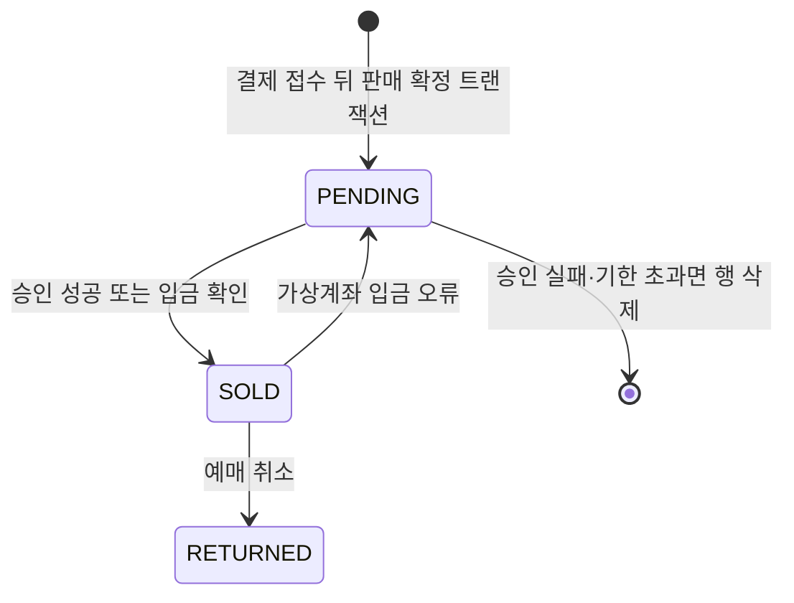

# DB 설계 편 4: 같은 좌석을 두 번 팔지 않기

- **기준 시점**: ADR-0177까지, 2026-11-01
- **맡는 정본**: [docs/data.md](../../data.md) §2의 ③(`seat_sale`·`seat_hold`·`purchase_quota`), §4의 '판매 확정' 행과 트랜잭션 경계 2번, §5의 좌석 경합 행과 인덱스 표준, [docs/features/seat-hold.md](../../features/seat-hold.md) §1·§3·§4·§6·§12, [ADR-0014](../../adr/0014-soft-hold-hard-sale.md), [ADR-0121](../../adr/0121-seat-redis-failover-defer-purchase-drop-db-hold-path.md), [ADR-0083](../../adr/0083-keep-postgresql-partition-keys-transaction-scoped-settings-global-replica.md) 결정 1
- **규범이 아니다**: 정본을 풀어 쓴 해설이다. 숫자와 규칙이 정본과 다르면 정본이 맞다([ADR-0177](../../adr/0177-walkthrough-explain-in-interview.md)).
- **앞뒤 편**: 앞은 [DB 설계 편 3 핵심 표와 관계](03-core-tables.md)이고, 뒤는 [DB 설계 편 5 일관성과 트랜잭션 경계](05-consistency-transactions.md)다. 좌석 기능 전체는 [분야 편 10 좌석](../fields/10-seat-hold.md), 결제 흐름은 [분야 편 11 결제](../fields/11-payment.md)가 맡는다.
- **측정 전이다**: 서비스 수준 측정(NFR 목표를 운영 규모로 잰 것)은 아직 없어 성능 숫자는 설계 목표값이고 `[실측 전]`을 붙였다. 기반 PoC(wbs 0.5.1, 본 개발 전에 위험한 부분만 먼저 재 보는 시험)는 2026-11-01에 PC 한 대에서 쟀다([ADR-0176](../../adr/0176-foundation-poc-results.md), 성능 장부 docs/perf-ledger.md §5). 그 숫자는 '실측(PC)'이고 운영 규모 증거가 아니다.

## 1. 면접관의 질문

> **면접관**: "인기 좌석 한 자리에 1,000명이 동시에 누릅니다. 같은 좌석이 두 사람에게 팔리지 않게 데이터베이스를 어떻게 설계하시겠어요?"

면접관은 두 가지를 본다. 경합(여러 요청이 같은 데이터를 동시에 노리는 일)을 어느 층에서 거르는지, 그리고 빠른 층이 고장 나도 무엇이 마지막에 지키는지다.

## 2. 단순한 답

좌석마다 행을 하나 두고, 팬이 누르면 `SELECT … FOR UPDATE`(읽은 행을 잠가 다른 트랜잭션이 못 고치게 하는 SQL)로 잠근다. 비어 있으면 '잡힘'으로 바꾸고 커밋하고, 결제가 끝나면 '팔림'으로 바꾼다. 여러 좌석은 누른 순서대로 잠근다. 트랜잭션은 여러 변경을 한꺼번에 반영하거나 한꺼번에 취소하는 DB 작업 단위다. PEAKET의 비교 기준인 v0(유능한 팀이 처음 만들 법한 단순한 설계)가 이 모양이다(docs/architecture.md §9.3 K2·K3, docs/verification.md §1.4).

빠르게 하려고 Redis(메모리에 데이터를 두는 빠른 저장소)만으로 잡고 확정까지 하는 답도 흔하다.

## 3. 어디서 깨지나

부하는 피크 초당 2,000건, 인기 좌석 하나에 1,000명이다. 목표는 홀드(결제하는 동안 좌석을 잠시 잡아 두는 것) p99(요청 100건 중 99건이 끝나는 시간) 50ms, p99.9 150ms, 오버셀(같은 좌석이 두 사람에게 팔리는 사고) 0건이다(NFR-003, `[실측 전]`).

| 단순한 답 | 깨지는 곳 | 근거 |
| --- | --- | --- |
| 행 잠금으로 잡기 | 1,000명이 한 행의 잠금을 줄 서서 기다린다. p99가 수 초로 오르고 잠금 대기 시간 초과가 난다 | ADR-0014 '검토한 대안' |
| 누른 순서대로 잠그기 | A는 1→2번, B는 2→1번 순으로 잠그다 서로를 기다리며 멈춘다(교착, K3) | ADR-0014 |
| Redis만으로 확정 | Redis의 주 노드와 복제본(복사본 노드) 사이 복제는 비동기다. 장애 조치(주 노드가 죽으면 복제본을 올려 쓰는 일) 때 복제되지 못한 마지막 홀드를 잃고, 그 좌석을 다른 사람이 잡으면 오버셀이 날 수 있다 | ADR-0014, docs/data.md §3 |
| 결제사 승인 뒤에 좌석 확정 | 경합에서 진 사람도 이미 돈이 나가 환불해야 한다 | ADR-0015 '검토한 대안' |

## 4. 지금 설계

### 4.1 두 층으로 나눈다

| 층 | 어디서 | 무엇을 보나 | 지키는 정도 |
| --- | --- | --- | --- |
| Soft Hold(1층) | 좌석 전용 Redis와 Lua 스크립트(Redis 안에서 다른 명령과 섞이지 않고 한 번에 도는 짧은 프로그램) | 좌석이 비었나, 1인 한도 안인가 | 빠른 판정. 장애 조치 때 잃을 수 있다 |
| Hard Sale(2층) | PostgreSQL(표로 데이터를 두는 관계형 데이터베이스) purchase DB | 좌석마다 살아 있는 판매 행이 하나뿐인가, 한도 행이 넘지 않나 | 강한 일관성. 오버셀의 마지막 방어선이다 |

docs/data.md §4는 이 짝을 '빠른 판정(Redis 원자 연산) + 최종 확정(PostgreSQL 제약)'이라 부른다. 원자 연산은 중간 상태 없이 한 번에 끝나는 연산이다.

### 4.2 1층: 좌석 Redis에서 잡는다

- **키가 한곳에 모인다**: 회차의 키에는 `{event:E}` 해시 태그(키를 같은 칸에 모으는 표시)를 붙여 한 샤드(데이터를 나눠 맡은 서버 묶음)에 둔다. 비트맵 `s:{event:E}:bitmap`(좌석 하나를 1비트로 담은 전체 좌석 상태, 5만 석 약 6.25KB), 홀드 Hash `s:{event:E}:hold:{seat}`(소유자·holdId·펜싱 토큰·만료 시각. 펜싱 토큰은 늦게 온 옛 사건을 버리게 하는, 계속 커지는 번호다), 만료 정렬 집합 `s:{event:E}:expiry`, 보유 수 `s:{event:E}:quota:{account}`, 사건 목록 `s:{event:E}:stream`, 멱등키(여러 번 와도 결과가 한 번과 같게 하는 키) `s:{event:E}:idem:{account}:{key}`, 준비 표시 `s:{event:E}:epoch`가 있다. 키 전체는 [DB 설계 편 8](08-redis-keys.md)이 다룬다.
- **`hold.lua`는 검사를 먼저, 쓰기는 마지막에 한꺼번에 한다**: 요청 좌석의 비트가 모두 0인지, '보유 수 + 요청 수 ≤ 한도'인지 본다. 세대 키, 판매 정지 사본 `s:{event:E}:ctl`, 방금 놓은 좌석 `s:{event:E}:rel:{account}`, 멱등키도 같은 연산에서 본다. 모두 맞을 때만 비트 켜기, 홀드 Hash, 만료 정렬 집합, `INCRBY`, `XADD HELD`를 한다. Valkey(이 설계의 Redis 호환 저장소)는 이미 한 쓰기를 되돌리지 못해서 '실패하면 되돌린다'가 아니라 '검사를 모두 통과한 뒤에만 쓴다'로 원자성을 지킨다(seat-hold §3).
- **잠금이 없다**: Lua는 샤드에서 하나씩 차례로 돈다. 1,000명이 와도 첫 요청만 잡고, 나머지는 409 `seat-already-held`를 받는다. 서로 기다리지 않으니 교착도 없다(docs/data.md §5).
- **DB에 쓰지 않는다**: 홀드 이력은 Redis Stream(Redis 안의 사건 목록) → 릴레이 → Kafka(사건을 쌓아 나눠 주는 메시지 시스템) `trade.seats` → `seat_hold` 순서로 나중에 싣는다. 좌석을 잡는 길에 DB 쓰기가 0건이라 p99 50ms 예산(Redis 왕복 7ms, 여유 29ms 등, seat-hold §8)에 들어간다.

### 4.3 2층: PostgreSQL에서 확정한다

| 표 | 칸 | 키와 제약 |
| --- | --- | --- |
| `seat_sale` | `event_id`, `seat_id`, `order_id`, `status`(`PENDING`·`SOLD`·`RETURNED`), `reserved_at`, `pending_until` | 기본 키 `(event_id, seat_id, order_id)`. 부분 유니크 인덱스(조건에 맞는 행끼리만 같은 값을 막는 색인) `UNIQUE (event_id, seat_id) WHERE status IN ('PENDING','SOLD')` |
| `purchase_quota` | `account_id`, `event_id`, `used`, `limit_count` | 기본 키 `(account_id, event_id)`. `used + n ≤ limit_count`일 때만 UPDATE한다 |
| `seat_hold` | `event_id`, `seat_id`, `account_id`, `fencing_token`, `status`(`HELD`·`RELEASED`·`EXPIRED`), `kind`, `held_at`, `expires_at` | 기본 키 `(event_id, seat_id, fencing_token)`. `(event_id, seat_id) WHERE status = 'HELD'` 부분 유일. 회차 ID 범위 월 파티션. 감사 원장이고 판매를 막는 데 쓰지 않는다 |

판매 확정 트랜잭션은 결제 접수가 202로 답한 직후 주문 Saga(단계를 차례로 처리하고 실패하면 앞 단계를 되돌리는 방식)가 연다(seat-hold §6, docs/data.md §4의 2번).

1. `seat_sale`에 좌석마다 `PENDING`(승인 전 사전 예약) 행을 넣는다. 여러 좌석이면 좌석 ID 오름차순으로 넣어, 겹치는 좌석을 가진 두 주문이 서로를 기다리는 교착을 막는다.
2. `purchase_quota`를 한도 안일 때만 늘린다. 1인 한도를 두 번째로 보는 곳이다.
3. 주문 상태를 바꾸고(T7 `RESERVED`, docs/features/payment.md §3) 상태 이력과 Outbox(보낼 사건을 같은 트랜잭션에 적어 두는 표) 행을 함께 적는다.
4. 커밋한 주문만 payment-svc에 승인을 명령한다.

| 결과 | 그다음 |
| --- | --- |
| 유니크 위반 | 경합에서 진 것이다. 승인을 부르지 않고 주문을 FAILED로 끝낸다(T8). 돈이 나가지 않는다. 위반 수(유일 위반 오류 코드 23505)는 표별 지표로 센다(docs/data.md §5.1) |
| 승인 성공 | `seat_sale` SOLD, 주문 APPROVED, 발권 재시도 행 `ticket_issue_job`, Outbox를 한 트랜잭션으로 쓴다 |
| 승인 실패·기한 초과 | `PENDING` 행을 지우고 좌석 해제 사건을 낸다(T11). 토스페이먼츠 승인 기한은 결제창 인증 뒤 10분이다 |
| 승인 응답 유실 | 결과 모름(UNKNOWN)으로 두고 결제사 조회로 정한다. 그동안 `PENDING`은 남고, 회차 매진 판정에서는 팔린 쪽으로 센다(seat-hold §4) |
| 가상계좌 입금 대기 | 입금 기한 + 10분 `[가정]`까지 `PENDING`으로 둔다. 쓸기 인덱스 `seat_sale (pending_until) WHERE status = 'PENDING'`가 안전망이다 |
| 예매 취소 | `RETURNED`로 바꾼다. 인덱스 조건에서 빠지므로 다시 팔 수 있고, 기본 키에 `order_id`가 있어 이력 행이 남는다 |

- **허용 값 검사**: `status` 칸에 `CHECK (… IN (…))`를 둔다. 부분 유니크 인덱스는 정확한 문자열(`'PENDING'`, `'SOLD'`)에 기대므로, 오타 하나가 방어선을 뚫지 않게 이 검사가 앞을 지킨다. enum 타입은 있는 값을 뺄 수 없어 쓰지 않는다(docs/data.md §2).
- **한도 행을 처음 만드는 때**: `purchase_quota` 행을 언제 넣는지(회차 판매 시작 때인지, 첫 확정 때인지)는 '정본에 없음'이고 열린 일 90번(docs/review/open-items.md)으로 올라갔다.

### 4.4 판매 행의 일생

- 유니크 위반으로 넣지 못한 행은 처음부터 생기지 않는다.
- `RETURNED` 행은 지우지 않는다. 같은 좌석을 다시 팔면 다른 `order_id`로 새 행이 생긴다.

### 4.5 고장 나면

| 고장 | 동작 | 남는 것 |
| --- | --- | --- |
| 좌석 Redis 주 노드 장애 조치 | 그 회차의 구매 요청을 503 `seat-store-unavailable`과 `Retry-After: 2` `[가정]`로 미룬다. 목표는 30초 이하다(NFR-015). PostgreSQL로 홀드를 대신 주는 길은 2026-10-28에 없앴다(ADR-0121) | 복제되지 못한 홀드는 잃는다. 그 좌석을 다른 사람이 잡고 둘 다 결제 접수까지 가면 Hard Sale의 유니크 위반이 한 명만 남긴다. 진 사람은 결제창 인증 뒤 실패 안내를 받고 과금은 없다 |
| 좌석 Redis 전체 장애 | 세대 키가 없어 이미 503이다. RB-06(장애 대응 절차서)이 `seat_sale`의 `PENDING`·`SOLD`, `seat_hold`의 만료 전 `HELD`, `purchase_quota`로 비트맵·홀드·보유 수를 다시 만들고 세대 키를 마지막에 쓴다 | 원장에 싣기 전에 사라진 홀드는 돌아오지 않고 빈 좌석이 된다 |
| 1인 보유 수를 잃음 | 판매 확정의 `purchase_quota` 조건부 갱신이 한도를 넘는 판매를 거절한다(seat-hold §4) | 정본이 약속하는 것은 '판매가 한도를 넘지 않는다'까지다 |

### 4.6 어떻게 증명하나

- **불변식 검사**(S-T2): 부하 시험마다 '판매 좌석 수 ≤ 전체 좌석 수', '좌석당 활성 판매 행 정확히 1건', '사람마다 보유 수 ≤ 한도'를 SQL로 센다. 운영에서는 오버셀 의심 1건이 SEV1(가장 높은 장애 등급)이다(docs/observability.md).
- **경합 시험**: S-T1(한 좌석 1,000명), S-T8(Redis 상태를 일부러 어긋나게 한 뒤 같은 좌석 결제 접수 둘), S-T10(엇갈린 순서의 여러 좌석, `pg_stat_database.deadlocks` 0건), S-T11(격리 수준 셋에서 쓰기 스큐 재현)이다. 격리 수준은 동시에 도는 트랜잭션이 서로의 변경을 얼마나 보게 할지 정한 단계이고, 쓰기 스큐는 두 트랜잭션이 각자 '아직 없다'를 읽고 둘 다 쓰는 이상이다.
- **규칙 모델 검사**: docs/verification.md §2.1의 `seat` 명세가 '좌석당 판매 1건 이하', '1인 한도 초과 판매 0', '낡은 펜싱 토큰으로 판매 확정 0'을 모든 순서로 따진다.

## 5. 트레이드오프와 버린 길

| 정한 것 | 얻는 것 | 치르는 값 |
| --- | --- | --- |
| Redis에서 잡고 PostgreSQL에서 확정 | 잡는 길에 DB 쓰기가 0건이라 p99 50ms를 노린다. 오버셀은 DB 제약이 지킨다 | Lua, 펜싱 토큰, 이력 릴레이를 운영하고 불변식 검사기를 계속 돌린다 |
| 승인 앞에서 `PENDING` | 진 주문은 승인 전에 걸러져 환불이 없다 | Redis가 홀드를 잃으면 한 명은 결제창 인증 뒤에 실패를 본다 |
| 부분 유니크 + 기본 키에 `order_id` | 취소 이력을 남기면서 다시 판다 | `status` 전이가 인덱스 조건 열을 바꿔 HOT 갱신(인덱스를 고치지 않는 가벼운 갱신)이 아니다. `seat_hold` 청소 기준을 0.02 `[가정]`(기본 0.2)로 당긴다(docs/data.md §5) |
| 장애 조치 동안 미룸 | 홀드를 주는 곳이 늘 하나라 이중 홀드가 없다 | 그동안 그 회차 구매가 멈춘다. 온세일 중이면 그 회의 오류 버짓 약 75건을 넘긴다(ADR-0121) |

**버린 길**(각 ADR의 '검토한 대안'):

- **`SELECT … FOR UPDATE` 홀드(v0)**: 경합 때 p99 수 초, 잠금 대기 시간 초과, 엇갈린 순서의 교착이 난다(ADR-0014).
- **Redis만으로 확정**: 장애 조치 때 쓰기를 잃으면 오버셀이 날 수 있다(ADR-0014).
- **CockroachDB 분산 트랜잭션**: 한 리전이고 쓰기량이 적어 필요 없다(ADR-0014, ADR-0021).
- **Redis 장애 때 PostgreSQL 비상 홀드 경로**: '확인할 수 없는 좌석'을 정할 자료가 Redis에만 있고, 복귀에도 홀드 멈춤이 들며, 1년에 몇 번 도는 두 번째 구현이 남는다(ADR-0121).
- **`WAIT`로 복제를 확인한 뒤 답하기**: `WAIT`는 복제를 보장하지 않고 시간 초과면 확인 없이 돌아온다. 잃는 쓰기를 줄일 뿐이다(ADR-0121). 쓸지는 PoC로 정한다(seat-hold §13). 2026-11-01 기반 PoC에는 `WAIT` 측정이 들지 않았다.
- **MySQL로 바꾸기**: '비활성이면 NULL이 되는 식 + UNIQUE'로 흉내 낼 수 있지만 활성 상태의 정의가 인덱스 식으로 흩어져 상태를 더할 때 놓치기 쉽다(ADR-0083 결정 1의 ①).

## 6. 꼬리 질문

| 질문 | 답의 요지 | 근거 |
| --- | --- | --- |
| 왜 그냥 UNIQUE가 아니라 부분 유니크인가요? | 취소된 좌석의 `RETURNED` 행을 이력으로 남기면서 다시 팔아야 한다. 살아 있는 상태(`PENDING`·`SOLD`)끼리만 막는다 | docs/data.md §2 |
| 격리 수준은 SERIALIZABLE이어야 하나요? | 아니다. 쓰기 스큐를 READ COMMITTED·REPEATABLE READ·SERIALIZABLE에서 재현해, 유니크 제약이 격리 수준과 관계없이 막는다는 것을 보인다. 판매 확정에 어느 격리 수준을 쓸지는 '정본에 없음'이고 열린 일 89번이다 | seat-hold §12 S-T11, docs/data.md §5 |
| 여러 좌석이면 교착이 나지 않나요? | Redis는 Lua가 차례로 돌아 기다림이 없다. DB는 `PENDING`을 좌석 ID 오름차순으로 넣는다. 교착 0건을 S-T10으로 잰다 | seat-hold §3·§6 |
| Redis가 홀드를 잃으면 두 사람이 결제하나요? | 결제창 인증까지는 둘 다 갈 수 있다. 판매 확정에서 한 명만 행을 넣고, 진 사람은 승인 전이라 돈이 나가지 않는다 | ADR-0121 '남는 한계' |
| 여러 탭으로 1인 한도를 넘기면요? | 같은 샤드의 Lua가 한 계정의 요청을 차례로 처리하고, 판매 확정 때 `purchase_quota`가 한 번 더 막는다 | seat-hold §4, S-T3 |
| 판매 확정 쓰기가 DB를 버티나요? | 판매 확정 초당 약 28건, 결제 접수 피크 300 TPS(초당 300건), 홀드 원장 비동기 초당 약 500건이라 쓰기 노드 하나로 받는다고 셈했다 `[실측 전]` | docs/architecture.md §9.1 |
| `status`를 자주 바꾸면 느려지지 않나요? | HOT 갱신이 되지 않아 죽은 행이 쌓인다. 쓰기가 많은 표는 인덱스를 아끼고, `seat_hold`는 청소를 앞당긴다. 죽은 행 수와 HOT 비율을 S-T10에서 기록한다 | docs/data.md §5·§5.1 |
| 실제로 재 봤나요? | 서비스 수준 측정은 아직 없다. 기반 PoC가 좌석 샤드 하나에 PoC 홀드 Lua를 넣어 PC에서 쟀다(S-T27). 한 회차 초당 2,000건에서 홀드 Lua p99(엔진)는 85.5·64.3·83.5µs, 다섯 회차 합 초당 6,000건에서 75.3·68.1·72.2µs이고, 모든 유효 측정에서 오버셀 0이었다(실측(PC)). 운영 Lua가 아닌 대역이라 운영 홀드 Lua로 다시 잰다. 서비스 수준은 S-T1·S-T2·S-T8·S-T10·S-T11과 `seat` 명세 검사로 잰다 | ADR-0176 결정 3, seat-hold §12, docs/verification.md §2.1 |

## 7. 내 말로 설명하기

> "좌석은 두 층으로 지킵니다. 좌석을 누르는 순간에는 좌석 전용 Redis에서 Lua 스크립트 하나가 좌석이 비었는지와 1인 한도 안인지를 함께 보고, 둘 다 맞을 때만 잡습니다. Lua는 샤드에서 하나씩 차례로 돌아서 잠금이 없고, 1,000명이 와도 한 명만 잡고 나머지는 바로 409를 받습니다. 이 단계는 데이터베이스에 쓰지 않아 p99 50ms를 노립니다. 다만 Redis 복제는 비동기라 장애 때 홀드를 잃을 수 있습니다. 그래서 결제 접수 직후, 결제사 승인 바로 앞에서 PostgreSQL `seat_sale`에 PENDING 행을 넣습니다. 'PENDING이나 SOLD인 행은 좌석마다 하나'라는 부분 유니크 인덱스가 두 번째 판매를 막고, 같은 트랜잭션에서 1인 한도 행도 조건부로 늘립니다. 행을 넣은 주문만 승인을 부르니, 진 사람은 돈이 나가지 않습니다. 취소된 좌석은 RETURNED가 되어 인덱스 조건에서 빠지므로 다시 팝니다."

- **꼭 넣을 말 1**: 빠른 판정은 Redis, 마지막 방어선은 PostgreSQL 부분 유니크 인덱스다.
- **꼭 넣을 말 2**: 승인 앞에 `PENDING`을 넣어 진 주문은 과금되지 않는다.
- **꼭 넣을 말 3**: Redis 장애 조치 동안은 DB로 좌석을 주지 않고 몇 초 미룬다. 좌석을 주는 곳을 하나로 두려는 것이다.

## 8. 정본에서 읽을 곳

1. [docs/features/seat-hold.md](../../features/seat-hold.md) §1(두 층), §3(`hold.lua` 계약), §6(Hard Sale)
2. [docs/data.md](../../data.md) §2의 ③ 그림과 그 아래 문단(`seat_sale` 부분 유니크, 기본 키·허용 값 검사)
3. [docs/data.md](../../data.md) §4의 표 첫 세 행과 트랜잭션 경계 2번, §5의 좌석 경합·교착·HOT 행
4. [docs/features/payment.md](../../features/payment.md) §2의 순서도와 §3 전이 표(T7·T8·T11·T12)
5. [ADR-0014](../../adr/0014-soft-hold-hard-sale.md)(상태 줄을 먼저 읽는다. 본문의 비상 경로와 예산은 옛 판이다)
6. [ADR-0121](../../adr/0121-seat-redis-failover-defer-purchase-drop-db-hold-path.md) 결정 1·4·6·7과 '검토한 대안'
7. [docs/features/seat-hold.md](../../features/seat-hold.md) §12의 S-T1·S-T2·S-T8·S-T10·S-T11, [docs/verification.md](../../verification.md) §2.1 `seat` 행

## 9. 정본에서 찾은 어긋남

정본끼리 견주어 찾은 것이다(2026-11-01). 둘 다 정본에 고를 근거가 없는 설계 빈칸이라 열린 일로 올라갔다(docs/review/open-items.md).

| 어긋난 곳 | 내용 | 지금 읽는 법 |
| --- | --- | --- |
| docs/verification.md §2.1 `seat` 행과 docs/features/seat-hold.md §6·docs/data.md §4의 2번 | 명세는 '만료된 홀드(펜싱 토큰이 낡은 것)로 판매 확정 0'을 약속한다. 그런데 판매 확정 트랜잭션의 설명에는 펜싱 토큰이나 세대를 견주는 단계가 없다. docs/features/payment.md §2는 결제 접수가 '홀드 유효성 검증'을 한다고만 적는다 | seat-hold §5 '결제창 유지 30분과의 관계'대로, 결제 접수 때 다른 사람이 그 좌석을 홀드했으면 승인하지 않는다고 읽는다. 무엇을 견주는지(토큰인지 소유자인지)는 '정본에 없음'이다. 열린 일 87번 |
| docs/data.md §4의 2번, docs/features/payment.md §3 T11·T17과 §4.1 | 승인 실패·기한 초과·입금 기한 경과로 `PENDING`을 지울 때는 '좌석 해제'만 적고 `purchase_quota.used`를 되돌린다는 말이 없다. 예매 취소는 'purchase_quota 감소'를 적는다(payment §4.1, data.md §4의 8번) | 승인 실패 때 한도 행을 되돌리는지는 '정본에 없음'이다. 정본에 적힌 감소는 예매 취소 때뿐이다. 열린 일 88번 |
