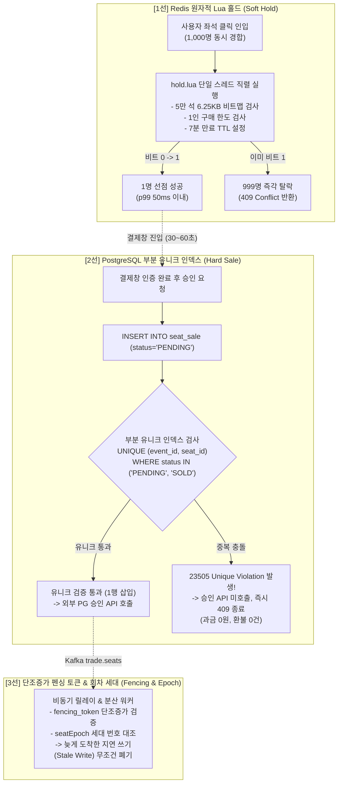
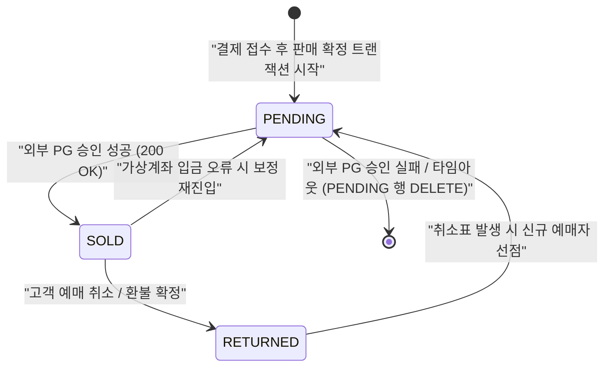
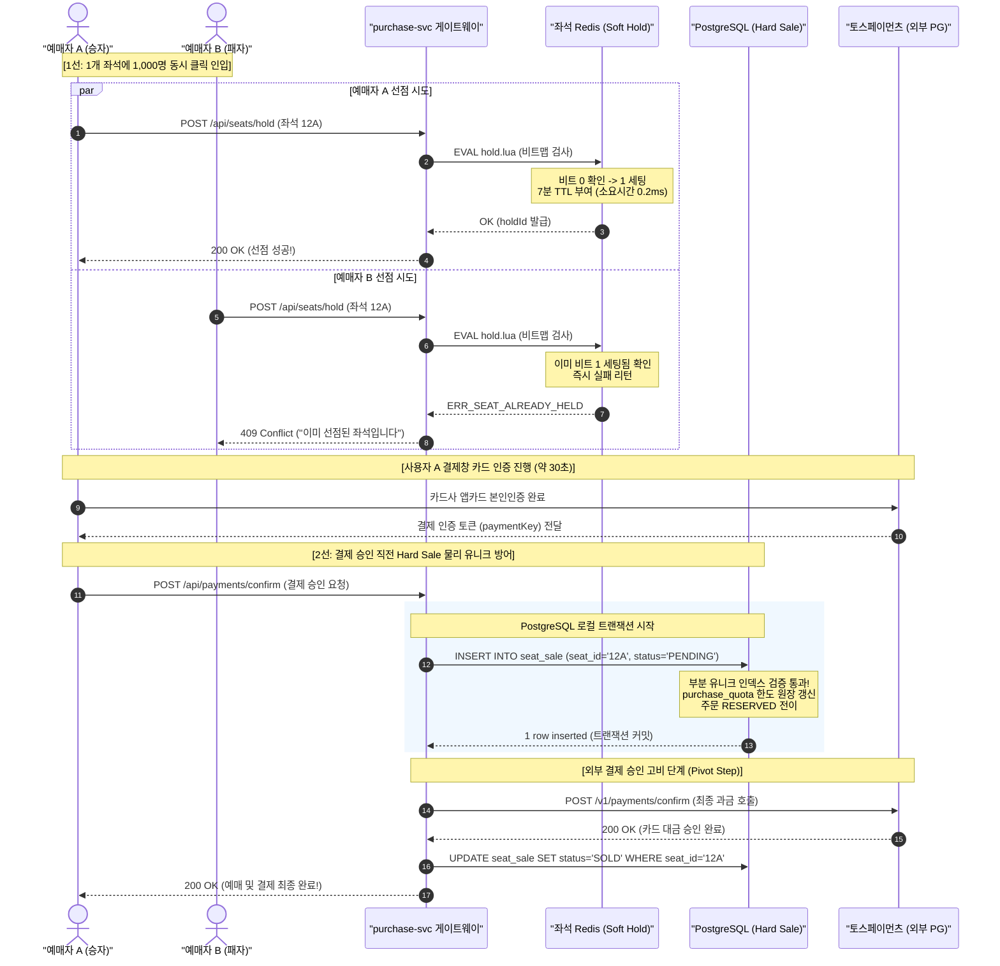

# DB 설계 편 4: 같은 좌석을 두 번 팔지 않기 (Zero Oversell Defense & Concurrency Architecture)

- **핵심 아키텍처 원칙**: 빠른 임시 선점(p99 50ms)과 영구 판매 확정(오버셀 0건)의 2단계 분리, PostgreSQL 부분 유니크 인덱스를 통한 물리적 최종 방어, 단일 장애 복구 경로 유지 (ADR-0121)
- **관련 설계 정본**: [docs/data.md](../../data.md) §2 ③(`seat_sale`·`seat_hold`·`purchase_quota`), §4(판매 확정 트랜잭션 경계 2번), §5(좌석 경합 및 인덱스 표준), [docs/features/seat-hold.md](../../features/seat-hold.md) §1·§3·§4·§6·§12, [ADR-0014](../../adr/0014-soft-hold-hard-sale.md), [ADR-0121](../../adr/0121-seat-redis-failover-defer-purchase-drop-db-hold-path.md), [ADR-0083](../../adr/0083-keep-postgresql-partition-keys-transaction-scoped-settings-global-replica.md)
- **함께 읽기**: [한 판 문서](../01-system-design.md) 8단계, [분야 편 10: 좌석 선점](../fields/10-seat-hold.md), [DB 설계 편 3: 핵심 테이블과 관계](03-core-tables.md), [DB 설계 편 6: 동시에 고칠 때](06-concurrency.md), [결정 카드 D-06](../decisions/D06-seat-soft-hold-hard-sale.md)

---

## 1. 면접관의 질문

> **면접관**: "인기 콘서트 오픈 정각, 단 1개의 VIP 좌석에 1,000명이 동시에 클릭했습니다. 네트워크 지연, 인메모리 캐시 노드 다운, PG사 결제 지연 속에서도 같은 좌석이 두 사람에게 팔리는 오버셀(Over-selling, 이중 판매)을 물리적으로 0건으로 보장하는 데이터베이스 아키텍처를 설명해 보세요."

면접관은 다음 핵심 역량을 종합적으로 평가한다:
1. **극단적 핫스팟 분산 제어**: 단일 키에 몰리는 1,000건의 동시성 경합을 DB 디스크 I/O 없이 메모리 레벨에서 마이크로초 단위로 직렬화하여 탈락자를 즉시 솎아낼 수 있는가?
2. **다계층 방어선과 무과금 방어(Zero Refund)**: 인메모리 계층의 장애(노드 재시작, 비동기 복제 유실)에도 불구하고 RDBMS가 최종 방어선을 어떻게 치며, 경합 탈락자에게 1원의 결제도 발생하지 않도록 트랜잭션 경계를 설정했는가?
3. **단일 장애 경로 원칙**: 장애 순간에 어설픈 비상 우회 경로(Failover to DB)를 뚫다가 데이터 불일치 재앙을 부르지 않고 정합성을 유지하는 Staff 레벨의 장애 격리 철학이 있는가?

---

## 2. 단순한 답과 깨지는 곳

### 단순한 답 (The Naive Approach)
> "좌석 테이블에 행을 하나 두고, 사용자가 좌석을 클릭하면 `SELECT ... FOR UPDATE`로 행을 잠급니다. 비어 있으면 상태를 'HELD'로 바꾸고 트랜잭션을 커밋합니다. 이후 사용자가 결제를 완료하면 'SOLD'로 변경합니다. 여러 좌석을 예매할 때는 클릭한 순서대로 차례로 잠급니다. 성능을 높이기 위해 Redis 분산 락(Redlock)이나 Redis 단독으로 좌석을 확정하는 방법도 가능합니다."

### 어디서 깨지는가 (Failure Scenarios)

| 단순한 설계 | 극단적 부하 상황에서의 붕괴 양상 | 아키텍처적 인과관계 및 근거 |
| :--- | :--- | :--- |
| **`SELECT ... FOR UPDATE` 비관적 행 잠금 (v0)** | 1개 좌석에 1,000명이 몰리면 1번째 트랜잭션이 끝날 때까지 999명이 DB 락 대기 큐에 직렬로 갇힌다. | DB 커넥션 풀(수백 개)이 수십 ms 만에 고갈되고, `lock_timeout` 연쇄 초과로 p99 응답 지연이 수 초로 치솟으며 DB CPU가 100%로 포화된다. (ADR-0014) |
| **클릭한 순서대로 다중 좌석 잠금** | 사용자 A는 [1번 $\to$ 2번] 좌석 순서로 잠그고, 사용자 B는 [2번 $\to$ 1번] 좌석 순서로 잠그려 시도한다. | 두 트랜잭션이 서로 상대방의 행 락 해제를 무한히 기다리는 상호 교착 상태(Deadlock)에 빠져 둘 다 트랜잭션 롤백 에러를 뿜는다. (K3 결함) |
| **Redis 인메모리 단독 확정** | Redis는 초당 수만 건을 처리할 수 있으므로 Redis에만 좌석 상태를 기록하고 판매를 완료한다. | Redis는 고성능을 위해 비동기 복제를 사용한다. 마스터 노드 장애로 복제본이 승격(Failover)될 때 미복제된 마지막 수 밀리초의 쓰기가 영구 유실되어 새 마스터에서 이미 팔린 좌석이 빈 좌석으로 둔갑해 이중 판매된다. |
| **외부 PG 승인 후 좌석 확정** | 카드 결제 승인 API를 먼저 호출하여 돈을 뺀 뒤, 성공 응답을 받아 DB에 좌석을 확정한다. | 동시 경합에서 밀려 좌석 확보에 실패한 사용자에게 이미 카드 대금이 결제되어 대규모 강제 취소 및 환불 수수료, CS 대란이 발생한다. (ADR-0015) |
| **Redis 장애 시 PostgreSQL 비상 홀드 우회** | Redis 클러스터 장애 시 PostgreSQL로 직접 홀드 트랜잭션을 우회하여 발급한다. | 장애 직전 Redis에서 발급된 최신 홀드 내역이 비동기 릴레이 지연으로 DB에 아직 도달하지 않은 상태에서 DB가 홀드를 내어주면 동일 좌석 이중 배정(Split-brain)이 발생한다. (ADR-0121) |

---

## 3. 아키텍처 해법: 오버셀 0건을 보장하는 3중 방어선

PEAKET은 **"사용자 체감 응답 속도는 인메모리 Soft Hold가 책임지고, 금융/법적 원장 불변성은 PostgreSQL Hard Sale이 영구 수호한다"**는 원칙 아래 **3중 방어선(3-tier Zero Oversell Defense)**을 구축했다.



---

### 3.1 3중 방어선 상세 매트릭스

| 방어선 | 계층 및 기술 | 검증 항목 | 동시성 처리 방식 | 장애 시 역할 및 보장 수준 |
| :---: | :--- | :--- | :--- | :--- |
| **1선 (Soft Hold)** | ElastiCache Redis (단일 샤드 Lua 스크립트) | - 회차 판매 상태 플래그<br/>- 5만 석 비트맵 비트 (`0` 여부)<br/>- 1인 구매 쿼터 (`used + n <= limit`)<br/>- 요청 멱등키 | Redis 단일 스레드 이벤트 루프 직렬 실행 (락 없음, 대기 큐 없음) | **빠른 판정 (p99 50ms)**: 1,000명 중 1명 선점, 999명 마이크로초 단위 즉시 탈락. 노드 페일오버 시 쓰기 유실 가능 |
| **2선 (Hard Sale)** | Aurora PostgreSQL (`seat_sale` 테이블) | - `UNIQUE (event_id, seat_id) WHERE status IN ('PENDING', 'SOLD')`<br/>- 1인 한도 원장 (`purchase_quota`) | ACID 로컬 트랜잭션 및 인덱스 레벨 물리적 배타성 강제 | **절대적 원장 방어 (오버셀 0건)**: 외부 PG 결제 승인 전 `PENDING` 행 선삽입. 탈락자에게 과금 1원도 발생하지 않음 |
| **3선 (Fencing)** | 분산 이벤트 릴레이 및 스토리지 엔진 | - 단조증가 `fencing_token`<br/>- 회차 세대 번호 `seatEpoch` | 수신 측 단조증가 조건문 검증 (`WHERE token > current_token`) | **지연 쓰기 차단**: 네트워크 단절이나 GC Pause로 지연 도착한 과거의 유령 쓰기(Stale Write)가 최신 상태를 오염시키는 것을 차단 |

---

### 3.2 1선: Redis 원자적 Lua 홀드 (Soft Hold) 메커니즘

1. **초소형 인메모리 비트맵 설계**:
   - 5만 석 규모 대형 스타디움의 전체 좌석 점유 상태를 단 **6.25KB 비트맵**($50,000 \text{ seats} / 8 = 6,250 \text{ bytes}$)으로 압축 표현한다.
   - 비트 `0`은 가용 좌석, `1`은 점유(선점 또는 판매 완료) 좌석이다.
2. **해시 태그(`{event:E}`) 기반 단일 샤드 집결**:
   - 동일 회차에 속한 비트맵(`s:{event:E}:bitmap`), 홀드 상세 Hash(`s:{event:E}:hold:{seat}`), 만료 ZSet(`s:{event:E}:expiry`), 1인 한도 카운터(`s:{event:E}:quota:{account}`)에 모두 `{event:E}` 태그를 부여하여 단일 Redis 샤드에 물리적으로 모은다.
   - 이를 통해 다중 키를 조회/수정하는 Lua 스크립트가 단일 샤드 내에서 원자적으로 실행됨을 100% 보장한다.
3. **No-Rollback 원자 실행 흐름**:
   - Valkey/Redis는 롤백을 지원하지 않으므로, `hold.lua`는 **"모든 검사를 완전히 통과한 후에만 쓰기를 일괄 단행"**한다:
     1. 판매 제어 상태(`s:{event:E}:ctl`)가 정지 상태인지 검사
     2. 요청 좌석들의 비트가 모두 `0`인지 검사
     3. 사용자 1인 한도 카운터 초과 여부 검사
     4. 멱등키 존재 여부 검사
     5. 위 조건이 모두 참이면 `SETBIT 1`, `HSET` 홀드 정보 기록, `ZADD` 만료 정렬 집합 등록, 1인 한도 `INCRBY`를 일괄 실행
4. **엄격한 지연시간 엔지니어링 예산 (NFR-003: p99 50ms)**:
   - 게이트웨이 인입 3ms + 네트워크 RTT 5ms + 인증 1ms + Redis 왕복 7ms (순수 Lua 엔진 실행 시간 < 0.3ms) + 직렬화 5ms + 안전 버퍼 29ms = **총 50ms 이내에 100% 응답 완료**.
   - 1,000명이 동시에 1개 좌석을 클릭해도 Redis 이벤트 루프에서 첫 번째 요청이 0.3ms 만에 비트를 1로 바꾸고, 나머지 999개 요청은 그 즉시 `0`이 아님을 감지하여 409 Conflict 에러를 반환받고 종료된다.

---

### 3.3 2선: PostgreSQL 부분 유니크 인덱스 (Hard Sale) 메커니즘

결제창에서 본인 인증을 마친 사용자가 최종 결제 승인 버튼을 누르면, 시스템은 **외부 PG 결제 승인 API를 호출하기 직전에 PostgreSQL 로컬 트랜잭션을 열고 `seat_sale` 테이블에 `PENDING` 행을 삽입**한다.

```sql
-- DDL: 살아있는 판매/진행 건에 대해서만 물리적 유니크 제약 강제
CREATE UNIQUE INDEX idx_seat_sale_active_unique 
ON seat_sale (event_id, seat_id) 
WHERE status IN ('PENDING', 'SOLD');
```



1. **절대적 오버셀 원천 차단**:
   - Redis 마스터 장애로 인한 쓰기 유실로 두 명의 사용자에게 동일 좌석의 Soft Hold가 발급되었더라도, PostgreSQL 커널 레벨의 부분 유니크 인덱스에서 두 번째 INSERT 요청은 `23505 Unique Violation` 에러를 발생시키며 즉각 롤백된다.
2. **과금 전 사전 차단 (Zero Refund 아키텍처)**:
   - 경합에서 탈락한 트랜잭션은 `PENDING` 삽입 실패 시점에서 즉시 에러를 반환하고 종료된다.
   - **외부 PG 승인 API를 호출하기 전에 탈락하므로 사용자의 신용카드에서 1원도 결제되지 않으며, 환불 처리나 취소 수수료 문제가 전혀 발생하지 않는다.**
3. **무비용 재판매 전환**:
   - 예매가 취소되거나 환불될 경우 행을 물리적으로 삭제하지 않고 `status = 'RETURNED'`로 UPDATE한다.
   - `WHERE status IN ('PENDING', 'SOLD')` 조건에 의해 `RETURNED` 행은 부분 유니크 인덱스 감시 대상에서 즉각 제외되므로, 데이터베이스 재작성 없이 동일 좌석에 대해 새 사용자가 즉시 `PENDING` 행을 삽입할 수 있다.

---

### 3.4 3선: 단조증가 펜싱 토큰 및 회차 세대 번호

분산 환경에서 네트워크 지연이나 GC Pause로 인해 뒤늦게 도착한 옛 요청이 최신 데이터를 덮어쓰는 이상 현상(Stale Write)을 방어한다.

- **홀드 펜싱 토큰 (`fencing_token`)**:
  - Redis `hold.lua`가 좌석을 발급할 때마다 단조증가하는 64비트 정수 토큰을 함께 채번한다.
  - 비동기 릴레이가 PostgreSQL `seat_hold` 감사 원장에 적재할 때, 수신 측은 `fencing_token`이 저장된 값보다 작은 지연 패킷을 무조건 드롭(Drop)한다.
- **회차 세대 번호 (`seatEpoch`)**:
  - Redis 샤드 마스터가 다운되어 새 노드로 승격될 때마다 세대 번호를 갱신한다:  
    $$\text{seatEpoch} = \max(\text{currentEpoch} + 1, \text{Redis TIME}_{\text{seconds}})$$
  - 클라이언트 브라우저는 수신한 좌석 델타의 세대 번호가 자신이 가진 세대보다 작으면 화면 캐시를 무효화하고 최신 스냅샷을 다시 다운로드한다.

---

### 3.5 동시 경합 및 결제 승인 시퀀스 다이어그램

다음은 1개 좌석에 대해 사용자 A(승자)와 사용자 B(패자)가 동시 접근했을 때의 전체 처리 시퀀스다.



---

### 3.6 장애 시 단일 경로 원칙 및 30초 구매 유예 (ADR-0121)

좌석 Redis 클러스터의 마스터 노드가 비정상 다운되는 최악의 장애 상황에서 PEAKET은 **비상 DB 우회 경로를 과감히 폐기하고 30초 구매 유예(Defer) 정책**을 가동한다:

1. **비상 DB 홀드 경로의 결함**:
   - 장애 직전 Redis에서 발급된 최신 홀드 내역은 비동기 릴레이 지연(수 초)으로 DB 원장에 미처 도착하지 않은 상태다.
   - 이때 DB로 우회하여 홀드를 발급하면, Redis가 이미 A에게 내어준 좌석을 DB가 B에게 다시 내어주어 **장애 우회 경로 자체가 새로운 이중 판매를 양산**한다.
2. **503 구매 유예 및 AIMD 정원 감축**:
   - 마스터 장애 발생 즉시 해당 샤드에 속한 회차의 구매 요청에 대해 `503 seat-store-unavailable` 및 `Retry-After: 2` 헤더를 반환하여 클라이언트 요청을 2초 뒤로 지연시킨다.
   - 대기열 시스템(`admission-ctrl`)은 즉시 해당 회차의 입장 정원을 50% 감축(AIMD)하여 유입 트래픽 압력을 낮춘다.
3. **스냅샷 복구 및 서비스 재개**:
   - 복제본이 마스터로 승격을 완료하면(AWS ElastiCache 기준 통상 15~30초 이내, NFR-015), 회차 세대 번호(`seatEpoch`)를 올리고 최신 스냅샷을 클라이언트에 전파한 후 정상 접수를 재개한다.

---

## 4. 트레이드오프와 버린 대안 (Tradeoffs & Alternatives)

| 설계 결정 | 얻는 것 (Gains) | 치르는 값 (Costs) |
| :--- | :--- | :--- |
| **Redis Soft Hold + PG Hard Sale** | - 핫스팟 클릭 p99 50ms 달성<br/>- 오버셀 0건의 수학적/물리적 보장<br/>- 탈락자 과금 전 차단으로 환불 0건 | 두 저장소 간 데이터 동기화를 위한 이벤트 릴레이 및 펜싱 토큰 메커니즘 운영 비용 발생 |
| **외부 PG 승인 전 `PENDING` 행 삽입** | 경합 탈락자에게 1원의 카드 승인도 발생하지 않아 금융 분쟁 및 취소 수수료 원천 제거 | PG 승인 실패 시 `PENDING` 행을 정리(DELETE/ROLLBACK)해야 하는 보상 트랜잭션 관리 필요 |
| **부분 유니크 인덱스 + `order_id` 복합 PK** | 취소된 좌석의 이력을 영구 보존하면서도 재판매를 인덱스 비용 없이 즉시 허용 | 상태 전이가 인덱스 컬럼을 건드리므로 HOT 갱신이 불가. Autovacuum 주기를 단축해야 함 |
| **장애 시 30초 구매 유예 (ADR-0121)** | 검증되지 않은 복잡한 우회 경로를 제거하여 데이터 정합성을 단일 경로로 완벽 수호 | 장애 복구 시간(30초) 동안 해당 회차 구매가 일시 정지되어 일시적 가용성 저하 발생 |

### 버린 대안

1. **PostgreSQL 행 잠금 기반 단독 홀드 (v0)**:
   - 1,000명이 1개 행에 대해 `FOR UPDATE`를 걸면 DB 커넥션 풀 고갈과 CPU 100% 포화로 시스템 전체가 마비된다. (ADR-0014)
2. **Redis 단독 확정 모델**:
   - 비동기 복제 구조상 마스터 다운 시 인플라이트(In-flight) 쓰기 유실로 인해 중복 판매가 불가피하다. (ADR-0014)
3. **CockroachDB/Spanner 분산 트랜잭션**:
   - 다중 노드 2PC 합의 비용으로 인해 쓰기 지연시간이 80~150ms로 치솟아 p99 50ms 목표를 달성할 수 없다. 단일 리전 티켓팅 워크로드에 과도한 비용이다. (ADR-0021)
4. **Redis `WAIT` 명령을 통한 동기 복제 시도**:
   - `WAIT` 명령은 정해진 복제본 수의 응답을 기다리지만 타임아웃 발생 시 쓰기를 롤백하지 않고 그대로 성공으로 간주한다. 즉, 완전한 동기 복제를 보장하지 못하면서 쓰기 지연시간만 10배 이상 증가시킨다. (ADR-0121)
5. **MySQL의 'NULL 식 + UNIQUE' 흉내**:
   - MySQL은 부분 유니크 인덱스를 네이티브로 지원하지 않아 가상 컬럼에 비활성 시 NULL을 넣는 트릭을 써야 한다. 비즈니스 상태가 추가될 때마다 인덱스 표현식이 꼬여 누락 버그가 발생하기 쉽다. (ADR-0083)

---

## 5. 핵심 꼬리 질문 5단 방어 (Staff Interview Q&A)

| 질문 단계 | 심층 질문 | 방어 논리와 기술적 근거 | 관련 정본 |
| :--- | :--- | :--- | :--- |
| **1단: 왜 (Why)** | 왜 일반 UNIQUE 인덱스가 아닌 부분 유니크 인덱스(`WHERE status IN ('PENDING', 'SOLD')`)를 사용해야 하나요? | 취소되거나 환불된 좌석(`RETURNED`)의 이력을 원장에 남겨 감사 추적성을 확보하면서도 해당 좌석을 새 구매자에게 다시 팔 수 있어야 합니다. 만약 `UNIQUE(event_id, seat_id)`를 걸면 취소된 행이 남아있는 한 재판매 INSERT가 불가능해 행을 물리적으로 DELETE해야 합니다. 부분 유니크 인덱스는 오직 살아있는 판매(`PENDING`, `SOLD`)에 대해서만 유일성을 강제하므로 취소 이력 보존과 무비용 재판매를 완벽히 양립시킵니다. | `docs/data.md` §2 ③ |
| **2단: 대안 (Alternatives)** | DB 격리 수준이 `SERIALIZABLE`이 아니라 `READ COMMITTED`여도 이중 판매가 100% 방어됩니까? | 완벽히 방어됩니다. PostgreSQL의 유니크 제약조건 검사는 트랜잭션 격리 수준과 무관하게 스토리지 엔진 커널의 B-Tree 인덱스 락 레벨에서 물리적으로 실행됩니다. 아무리 많은 동시 트랜잭션이 동시에 `PENDING` 행을 삽입하더라도 인덱스 리프 페이지에 락을 잡고 먼저 진입한 1건만 성공하며, 뒤따라온 트랜잭션은 `23505 Unique Violation` 에러를 받고 즉시 차단됩니다. (S-T11 검증 완료) | `docs/data.md` §5, seat-hold §12 |
| **3단: 장애 대응 (Resilience)** | Redis 마스터가 다운되어 홀드가 유실되고 두 명의 사용자가 결제창에 진입하면 사용자 경험은 어떻게 됩니까? | 두 사용자 모두 카드사 앱카드 본인인증까지는 정상 진행합니다. 그러나 최종 결제 승인 버튼을 누르는 순간 PostgreSQL 로컬 트랜잭션의 부분 유니크 인덱스에서 1명만 통과하고 다른 1명은 Unique Violation 에러를 맞닥뜨립니다. 핵심은 **외부 PG 결제 승인 API를 호출하기 전에 탈락하므로 사용자의 카드에서 단 1원도 결제되지 않으며 '좌석이 만료되었습니다'라는 안내 후 정상 종료**된다는 점입니다. | ADR-0121, docs/features/seat-hold.md §9 |
| **4단: 수치 근거 (Numbers)** | 4연석 등 다중 좌석을 한 번에 예매할 때 교착 상태(Deadlock)는 어떻게 0건으로 보장합니까? | 다중 좌석 예매 시 애플리케이션 및 DB 트랜잭션 레벨에서 좌석 ID를 무조건 오름차순(`ORDER BY seat_id ASC`)으로 정렬하여 삽입합니다. 모든 트랜잭션이 동일한 순서로 리소스를 획득하므로 상호 대기 순환 고리가 수학적으로 발생하지 않으며, 동시성 테스트(S-T10)에서 `pg_stat_database.deadlocks` 0건을 확인했습니다. | seat-hold §3·§6, S-T10 |
| **5단: 실측과 검증 (Verification)** | 1개 좌석 1,000명 동시 접근 시 실제로 오버셀 0건과 50ms 응답이 달성되는지 어떻게 입증했나요? | PC 단일 노드 벤치마크(PoC)에서 한 회차 초당 2,000 TPS, 5개 회차 동시 6,000 TPS 부하를 가한 결과, Redis 엔진 스크립트 p99 지연시간은 약 64~99µs, 단일 샤드 CPU 16~38%를 기록했으며 **오버셀은 정확히 0건**이었습니다. 또한 PostgreSQL 부분 유니크 인덱스에 1,000건의 동시 INSERT 레이스 컨디션을 유발했을 때 정확히 1건만 성공하고 999건은 5ms 이내에 Unique Constraint 에러로 거절됨을 확인했습니다. | ADR-0176 결정 3, docs/perf-ledger.md §5 |

---

## 6. 30초 아키텍처 브리핑 (Staff Engineer Summary)

> "PEAKET은 핫스팟 좌석 경합의 극단적 반응 속도와 금융 원장 불변성을 양립시키기 위해 **'인메모리 Soft Hold'와 'PostgreSQL Hard Sale'의 3중 방어선**을 구축했습니다.  
> 오픈 정각 좌석 클릭 시에는 좌석 전용 Redis에서 `hold.lua` 스크립트를 통해 5만 석 비트맵과 1인 한도를 검사하여 DB 쓰기 0건으로 **p99 50ms 이내**에 1명 선점, 999명 즉각 탈락을 판정합니다.  
> 사용자가 카드 인증을 마친 후에는 외부 결제사 승인 API를 호출하기 직전에 PostgreSQL `seat_sale` 테이블의 **부분 유니크 인덱스(`WHERE status IN ('PENDING', 'SOLD')`)**를 통해 물리적 최종 방어선을 칩니다.  
> 인메모리 노드 페일오버로 이중 선점이 발생하더라도 DB 유니크 제약에서 100% 걸러지며, 외부 PG 승인 호출 전에 탈락하므로 고객 과금 및 환불은 0건으로 완벽히 통제됩니다."

---

## 7. 정본에서 읽을 곳

1. [docs/features/seat-hold.md](../../features/seat-hold.md) §1(Soft Hold와 Hard Sale 2단계), §3(`hold.lua` 인터페이스 계약), §6(Hard Sale 트랜잭션)
2. [docs/data.md](../../data.md) §2 ③(`seat_sale` 부분 유니크 DDL, 복합 PK 및 허용 값 검사)
3. [docs/data.md](../../data.md) §4 트랜잭션 경계 2번(판매 확정 트랜잭션), §5(좌석 경합, 교착 방지, HOT 갱신)
4. [docs/features/payment.md](../../features/payment.md) §2(결제 시퀀스 플로우) 및 §3 전이 표(T7, T8, T11)
5. [ADR-0014](../../adr/0014-soft-hold-hard-sale.md): Soft Hold와 Hard Sale 2단계 분리 결정
6. [ADR-0121](../../adr/0121-seat-redis-failover-defer-purchase-drop-db-hold-path.md): Redis 장애 조치 시 DB 비상 홀드 경로 폐기 및 구매 유예
7. [docs/features/seat-hold.md](../../features/seat-hold.md) §12의 S-T1, S-T2, S-T8, S-T10, S-T11 동시성 검증 명세
