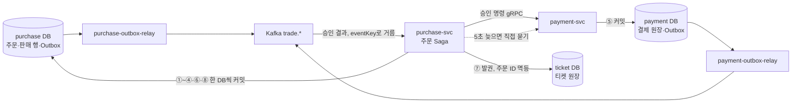

# DB 설계 편 5: 일관성과 트랜잭션 경계

- **기준 시점**: ADR-0177까지, 2026-11-01
- **맡는 정본**: [docs/data.md](../../data.md) §4(일관성 표와 트랜잭션 경계 1~15번), §1의 purchase 행, [docs/features/payment.md](../../features/payment.md) §2·§3, [ADR-0113](../../adr/0113-order-state-with-append-only-history-event-sourcing-only-for-ops-commands.md), [ADR-0116](../../adr/0116-single-polling-outbox-relay-drop-debezium-place-pgbouncer-schema-registry.md), [ADR-0140](../../adr/0140-payment-result-pull-fallback-when-kafka-is-late.md), [ADR-0142](../../adr/0142-consumer-key-concurrency-held-events-client-required-settings.md), [ADR-0106](../../adr/0106-forward-recovery-after-payment-approval-ticket-issue-retry.md), [ADR-0028](../../adr/0028-postgres-no-sharding-cell-scaling.md)
- **규범이 아니다**: 정본을 풀어 쓴 해설이다. 숫자와 규칙이 정본과 다르면 정본이 맞다([ADR-0177](../../adr/0177-walkthrough-explain-in-interview.md)).
- **앞뒤 편**: 앞은 [DB 설계 편 4 같은 좌석을 두 번 팔지 않기](04-no-double-sale.md), 뒤는 [DB 설계 편 6 동시에 고칠 때](06-concurrency.md)다. 결제 Saga 전체는 [분야 편 11 결제](../fields/11-payment.md)가 맡는다.
- **측정 전이다**: 서비스 수준 측정(NFR 목표를 운영 규모로 잰 것)은 아직 없어 성능 숫자는 설계 목표값이고 `[실측 전]`을 붙였다. 기반 PoC(wbs 0.5.1, 본 개발 전에 위험한 부분만 먼저 재 보는 시험)는 2026-11-01에 PC 한 대에서 쟀다([ADR-0176](../../adr/0176-foundation-poc-results.md), 성능 장부 docs/perf-ledger.md §5). 그 숫자는 '실측(PC)'이고 운영 규모 증거가 아니다.

## 1. 면접관의 질문

> **면접관**: "주문은 purchase, 결제는 payment, 티켓은 ticket 서비스에 있고 데이터베이스도 따로입니다. 데이터가 서로 어긋나지 않게 어떻게 맞추고, 트랜잭션은 어디서 끊나요?"

면접관은 데이터마다 필요한 일관성을 나눠 고르는지, 그리고 분산 트랜잭션 없이 '빠짐없이, 한 번만'을 어떻게 얻는지 본다. 트랜잭션은 여러 변경을 한꺼번에 반영하거나 한꺼번에 취소하는 DB 작업 단위다.

## 2. 단순한 답

- **큰 트랜잭션 하나**: 주문·결제·티켓 표를 모두 묶어 한 번에 커밋한다. DB가 나뉘어 있으면 2단계 커밋(2PC: 여러 DB에 '준비'를 묻고 모두 되면 함께 커밋하는 방식)으로 묶는다.
- **동기 호출 + 바로 보내기**: 주문 → 결제 → 발권을 HTTP로 줄줄이 부르고, 각 서비스는 자기 DB에 쓴 뒤 Kafka(사건을 쌓아 나눠 주는 메시지 시스템)에 사건을 바로 보낸다.

## 3. 어디서 깨지나

| 단순한 답 | 깨지는 곳 | 근거 |
| --- | --- | --- |
| DB를 나눠 2PC로 묶기 | 샤드(데이터를 나눠 맡은 저장소)끼리 트랜잭션이 생기면 2PC 조정 비용으로 p99(요청 100건 중 99건이 끝나는 시간)가 튄다. 큰 공연 하나에 부하가 몰린다 | ADR-0028 '검토한 대안' |
| 동기 HTTP 호출 체인 | 네트워크가 끊기면 이중 결제나 좌석 누수(좌석이 잡힌 채 남는 일)가 생긴다(K7) | docs/architecture.md §9.3 |
| DB에 쓰고 Kafka에 바로 보내기 | Kafka가 멈춘 동안 보낸 사건을 잃을 수 있고, 보냈는지 알기 어렵다 | ADR-0143 '검토한 대안' |
| 승인을 gRPC 응답으로 바로 기다리기 | gRPC(서비스끼리 함수처럼 부르는 통신) 호출의 시간 상한이 결제사 지연(읽기 시간 초과 60초 `[가정]`)과 묶인다. 결제 접수 목표는 p99 150ms다(NFR-005) | ADR-0140 '검토한 대안' |

## 4. 지금 설계

### 4.1 데이터마다 일관성을 고른다

docs/data.md §4 표에서 구매 길에 걸리는 행만 옮겼다. '강함'은 읽으면 늘 마지막으로 확정된 값을 본다는 뜻이고, '최종적'은 잠시 옛 값이 보여도 곧 같아진다는 뜻이다. 데이터마다 CP·AP를 붙이던 표기는 뜻이 흐려져 뺐다(기술 검토 낮음-035).

| 데이터 | 일관성 | 어떻게 지키나 |
| --- | --- | --- |
| 판매 확정(SOLD) | 강함 | 부분 유니크 인덱스와 트랜잭션(DB 설계 편 4) |
| 좌석 홀드, 1인 한도, 한정 굿즈 재고 | 빠른 판정 + 최종 확정 | Redis(메모리에 데이터를 두는 빠른 저장소) 원자 연산으로 먼저 거르고 PostgreSQL 제약·조건부 갱신이 마지막을 지킨다 |
| 결제 원장, 예매 취소·환불, 정산 지급 | 강함 + 멱등 | 트랜잭션과 멱등키(여러 번 와도 결과가 한 번과 같게 하는 키), 유일 제약 |
| 티켓 소유권 | 강함 | 행 잠금과 버전 칸(DB 설계 편 6) |
| 대기 순번, 공연 정보, 관제 지표 | 최종적 | CDN(사용자 가까이에서 대신 응답하는 전송망)·캐시·조회 시점 집계 |
| 현장 스캔 기록 | 오프라인 우선, 나중에 맞춤 | 기기 저장소 → 업로드 → 서버 판정 |

### 4.2 경계의 원칙

- **ACID 트랜잭션(모두 하거나 하나도 하지 않고, 커밋하면 남는 DB 트랜잭션) 하나는 한 서비스의 한 데이터베이스 안으로 한정한다**(docs/data.md §4). 2단계 커밋은 쓰지 않는다. 그 자리를 Saga(단계를 차례로 처리하고 실패하면 앞 단계를 되돌리는 방식), Outbox(보낼 사건을 같은 트랜잭션에 표로 적어 두는 방식), 멱등키, 결제사 대사(결제사 장부와 내부 장부를 맞춰 보는 일), 불변식 SEV1(가장 높은 장애 등급)이 맡는다(ADR-0077 맥락, ADR-0028).
- **샤딩하지 않는다**: 판매 확정 초당 약 28건, 결제 접수 피크 300 TPS, 주문 사건·Outbox 합계 초당 수천 건 이하라 쓰기 노드 하나로 받는다고 셈했다 `[실측 전]`(docs/architecture.md §9.1). 그래서 판매 확정 같은 묶음을 한 트랜잭션에 둘 수 있다.

### 4.3 구매 길의 트랜잭션

purchase-svc가 Saga를 지휘한다(docs/features/payment.md §2, docs/data.md §4의 1~4번).

| 차례 | DB | 한 트랜잭션에 담는 것 | 끝나면 |
| --- | --- | --- | --- |
| ① 주문 생성 | purchase | `purchase_order` 행, 멱등 기록 `order_idempotency`, 상태 이력 `order_event` 1번, Outbox | 201 |
| ② 결제 시도 시작 | purchase | `payment_attempt` READY, 이전 READY를 SUPERSEDED로(주문당 활성 시도 1건) | 201, 결제창 |
| ③ 결제 접수 | purchase | 시도 ACCEPTED, 주문 이력 ACCEPTED, Saga 시작 명령, Outbox | 202. 결제사 호출은 응답 밖이다 |
| ④ 판매 확정 | purchase | `seat_sale` PENDING, `purchase_quota` 조건부 갱신, 주문 RESERVED, Outbox | 행을 넣은 주문만 승인 명령 |
| ⑤ 승인 처리 | payment | `payment` 상태 전이, `payment_event`, Outbox. 주문당 결제 1건은 `payment.order_id` UNIQUE | `trade.payments` 사건 |
| ⑥ 승인 결과 반영 | purchase | `seat_sale` SOLD, 주문 APPROVED, `ticket_issue_job`, Outbox | 발권 gRPC |
| ⑦ 발권 | ticket | 주문 ID로 멱등하게 티켓 발급 | ISSUED |
| ⑧ 발권 확인 | purchase | 주문 CONFIRMED, `ticket_issue_job` 삭제 | 끝 |

결제를 접수하지 않고 끝난 CREATED·AUTHENTICATED 주문은 '상태가 그대로일 때만' 바꾸는 조건부 UPDATE로 EXPIRED와 Outbox를 한 트랜잭션에 쓴다(ADR-0107).

### 4.4 주문은 '상태 + 덧붙이기 이력 + Outbox'

- 원본은 `purchase_order`의 지금 상태다. 상태는 주문 전이 함수 하나로만 바꾼다. 조건부 UPDATE가 `event_seq`를 1 올리고, 그 번호로 `order_event`(기본 키 `(order_id, seq)`, 이전·새 상태, 원인, 행위자, 시각)를 덧붙이고, Outbox 행을 마지막에 넣는다(ADR-0113).
- 정비 잡이 매일 마지막 이력과 지금 상태가 같은지 보고, 어긋나면 SEV3다.
- 이벤트 소싱(사건 목록을 원본으로 두고 다시 재생해 상태를 만드는 방식)은 아니다. 이벤트 소싱은 운영 명령 기록(`command_event`)에만 쓴다.

### 4.5 Outbox와 폴링 릴레이

- **칸**: `id uuid`(시간순으로 커지는 UUIDv7, 기본 키이자 표를 나누는 기준), `seq bigint`(시퀀스 `outbox_seq`), `topic`, `msg_key`, `payload bytea`(Avro라는 이진 형식의 바이트), `headers jsonb`, `sent_at`. 트랜잭션 안에서 스키마 레지스트리(사건 형식 정의를 모아 두는 서버)를 부르지 않아, 레지스트리가 멈춰도 주문·결제 쓰기가 막히지 않는다(docs/data.md §4의 7번).
- **보내기**: 서비스마다 `<서비스>-outbox-relay`(복제 2)를 두고 쿠버네티스 Lease(정해진 시간 동안만 유효한 권한)로 하나만 보낸다. 리더는 100ms `[가정]`마다 `SELECT … WHERE sent_at IS NULL ORDER BY seq LIMIT 500 FOR UPDATE`로 읽어 `seq` 순서로 보내고, 모든 복제의 확인(`acks=all`)을 받은 뒤 `sent_at`을 적고 커밋한다.
- **순서**: Outbox 행은 트랜잭션의 마지막 문장으로 넣는다. 같은 주문·좌석을 바꾸는 트랜잭션은 앞 트랜잭션이 커밋한 뒤에야 그 행을 잡으므로 뒤 사건의 `seq`가 늘 크다.
- **적어도 한 번**: 보낸 뒤 `sent_at`을 적기 전에 멈추면 같은 행이 다시 나간다. 받는 쪽이 사건 키 `eventKey`로 버린다.
- **정리와 경보**: 표는 ID 범위로 하루씩 나눈 파티션(큰 표를 기간으로 나눈 부분)에 두고, 3일 `[가정]` 지난 파티션을 지운다(보내지 않은 행이 있으면 지우지 않고 SEV2). 가장 오래 기다린 행의 나이 `outbox_relay_lag_seconds`가 5초 `[가정]`를 1분 넘게 넘으면 SEV2다.
- **Redis에서 생긴 사건**: 좌석 홀드와 구매 세션 시작·종료는 Redis Stream `s:{event:E}:stream`이 메모리 안의 Outbox이고, 전용 릴레이가 Kafka로 보낸다.

### 4.6 받는 쪽과 늦을 때

- **키 단위 동시 처리**: 서비스 소비자는 파티션(토픽을 나눈 칸) 안에서 업무 키(주문 ID, 좌석 ID)마다 순서를 지키고 다른 키는 동시에 처리한다(파티션마다 32개 `[가정]`). 앞 사건이 모두 끝난 위치까지만 커밋한다(ADR-0142).
- **보류 표**: 다시 해도 같은 결과일 실패를 5회 `[가정]` 겪은 사건은 그 서비스 DB의 `held_event`로 옮기고 같은 업무 키의 뒤 사건도 함께 보류한다. 결제·주문 토픽은 1건이라도 SEV2다. Kafka 데드 레터 토픽(실패 메시지를 모아 두는 토픽)은 가명 처리 전 식별값이 한 벌 더 생겨 두지 않는다(ADR-0142).
- **당기기**: 승인 결과 사건이 5초 `[가정]` 안에 오지 않으면 purchase-svc가 `BatchGetPayments`(한 번에 최대 100건 `[가정]`)로 직접 묻는다. payment-svc는 쓰기 인스턴스에서 읽는다. 읽기 복제본(원본을 복사해 읽기를 나눠 받는 DB)은 복제가 늦으면 방금 승인한 건을 놓친다(ADR-0140).
- **두 길이 와도 한 번만**: 반영한 결제 사건 순번을 `purchase_order.payment_event_seq`에 두고, 반영 UPDATE를 `WHERE payment_event_seq < $seq`로 한다. 사건과 당기기가 같은 처리기를 쓴다(ADR-0146 결정 2).
- **거래 Kafka 전체가 멈추면**: 결제 확정은 당기기로 이어진다. 확정 지연이 5~10초 `[추정]` 늘고, 알림·관제 실시간 표·홀드 원장 적재가 늦는다(ADR-0140 결정 5).

### 4.7 Saga의 세 구간

| 구간 | 단계 | 실패하면 |
| --- | --- | --- |
| 승인 앞 | 판매 확정, 승인 요청 | 되돌린다. `PENDING`을 지우고 좌석을 푼다. 과금이 없다 |
| 고비 | 결제사 승인 | 응답이 끊기면 같은 멱등키 `confirm-{orderId}`로 다시 보내고, 그래도 모르면 결과 모름(UNKNOWN)으로 두고 조회로 정한다 |
| 승인 뒤 | SOLD, 발권 | 앞으로 다시 한다. 1초에서 두 배씩 최대 60초 `[가정]` 간격, 발권 기한 승인 뒤 30분 `[가정]`. 결제 취소는 회차 취소 확정이나 CS 확인 때만이다(ADR-0106) |

승인 뒤 60초 안에 발권되지도 재시도 큐에 들어가지도 않은 결제는 SEV1이다(NFR-006). 매일 자정 결제사별 승인·취소를 모두 조회해 내부 장부와 1:1로 맞춘다(docs/features/payment.md §8).

## 5. 트레이드오프와 버린 길

| 정한 것 | 얻는 것 | 치르는 값 |
| --- | --- | --- |
| 트랜잭션은 한 서비스의 한 DB 안 | 2PC 조정 비용과 그에 따른 복잡도·장애 확률이 없다(ADR-0028 맥락) | 서비스 사이는 Saga·Outbox·멱등 받기·대사로 맞추고, 결과 모름이나 발권 실패 동안 결제와 발권이 잠시 어긋난다(docs/architecture.md §1) |
| 폴링 릴레이 하나 | 로컬·운영이 같은 코드라 잰 길이 운영 길이다. 복제 슬롯(변경 기록을 읽는 쪽을 위해 DB가 기록을 붙잡아 두는 장치)·로그 보존 위험과 자바 실행 기반이 없다 | 폴링 주기(100ms `[가정]`)만큼 늦고, 보낸 표시 UPDATE가 쓰기를 늘린다 |
| 주문은 상태 + 이력 | 읽기는 행 하나다. 시점별 역추적은 이력으로 한다 | 코드 버그면 상태와 이력이 어긋날 수 있어 매일 검사한다 |
| 밀기 + 당기기 | Kafka가 멈춰도 결제 확정이 이어진다 | Kafka와 payment-svc가 함께 멈추면 확정도 멈춘다 |

**버린 길**(각 ADR의 '검토한 대안'):

- **공연 ID 샤딩과 2PC**: 크로스 트랜잭션의 2PC 조정 비용으로 p99가 튀고 큰 공연에 부하가 몰린다(ADR-0028).
- **운영은 Debezium(DB 변경 로그를 읽어 보내는 도구), 로컬은 폴링**: 잰 길과 운영 길이 다르고, Kafka Connect(Debezium을 돌리는 자바 실행 기반)·슬롯·WAL(DB 변경 기록 파일) 위험이 운영에만 있다(ADR-0116 B).
- **LISTEN/NOTIFY(커밋을 알려 주는 PostgreSQL 기능)로 깨우기**: 세션 연결을 오래 쥐어야 해 PgBouncer(DB 연결 풀) 트랜잭션 풀링 밖으로 붙어야 한다. 100ms 폴링으로 예산을 맞추는 지금은 얻는 것이 작다(ADR-0116 E).
- **주문을 진짜 이벤트 소싱으로**: 채우는 요구는 같은데 사건 판 올림·재생·재생 시험이 더해지고, 사건이 10개 안팎이라 스냅샷 이득이 없다(ADR-0113 가).
- **CQRS(쓰기 모델과 읽기 모델을 나누는 방식)로 읽기 저장소를 따로**: 저장소가 하나 늘고 따라잡는 시간만큼 틀린 화면이 생긴다(ADR-0113 라).
- **사건 길을 없애고 당기기만**: 평소 지연과 payment DB 부하가 늘고 관제·분석·알림은 어차피 사건이 필요하다(ADR-0140).
- **발권이 실패하면 바로 결제 취소**: 잠깐의 장애로 산 사람의 표가 환불되고 그 좌석이 다시 팔린다(ADR-0106).

## 6. 꼬리 질문

| 질문 | 답의 요지 | 근거 |
| --- | --- | --- |
| Outbox 행을 왜 마지막에 넣나요? | 같은 주문·좌석의 뒤 트랜잭션은 앞이 커밋한 뒤에야 그 행을 잡으므로, 마지막에 넣은 `seq`가 커밋 순서와 맞는다. 관계없는 사건끼리의 순서는 쓰는 곳이 없다 | docs/data.md §4의 7번 |
| 정확히 한 번 전달인가요? | 아니다. 적어도 한 번이다. 멱등 생산자와 받는 쪽의 `eventKey` 거르기로 결과를 한 번으로 만든다 | ADR-0026, docs/data.md §4의 7번 |
| 사건과 당기기가 둘 다 오면 두 번 반영되나요? | `payment_event_seq < $seq` 조건부 UPDATE라 이미 반영한 순번 이하는 건너뛴다 | ADR-0146 결정 2, ADR-0140 |
| 방금 만든 주문을 복제본에서 읽으면요? | 예매 직후 주문서 조회처럼 자기 쓰기를 바로 읽는 흐름은 쓰기 인스턴스로 보낸다. 결과 당기기도 쓰기 인스턴스에서 읽는다 | ADR-0028 결정 4, ADR-0140 결정 3 |
| long polling(답이 생길 때까지 요청을 붙잡아 두는 방식) 동안 트랜잭션을 열어 두나요? | 열지 않는다. 결과를 최대 25초 `[가정]` 기다리는 동안 DB 트랜잭션을 쥐지 않는다 | docs/data.md §5.1, docs/features/payment.md §2 |
| 실제로 재 봤나요? | 서비스 수준 측정은 아직 없다. 릴레이 지연 p99가 200ms `[가정]`를 넘는지 V-T27로, Kafka 정지 중 확정을 P-T47·G-31로 잰다. 기반 PoC는 Kafka 클라이언트 몫만 PC에서 쟀다. 텔레메트리 피크 5,600/s `[추정]`와 거래 300/s를 함께 넣을 때 거래 토픽 `acks=all` 보내기 p99가 7.8·7.9·7.8ms였다(실측(PC)). 공용 Outbox 릴레이·멱등 모듈 코드는 있다 | ADR-0116 결정 6, ADR-0140 결정 6, ADR-0176 결정 5, docs/walkthrough/00-status.md |

## 7. 내 말로 설명하기

> "트랜잭션은 한 서비스의 한 데이터베이스 안에서만 겁니다. 2단계 커밋은 쓰지 않습니다. purchase-svc가 Saga를 지휘하고, 주문 생성, 결제 접수, 판매 확정, 승인 반영, 발권 확인을 각각 purchase DB의 트랜잭션 하나로 커밋합니다. 서비스 사이로 나갈 사건은 같은 트랜잭션의 Outbox 표에 마지막 문장으로 적고, 서비스마다 둔 폴링 릴레이 하나가 순번대로 Kafka에 보냅니다. 그래서 커밋한 사건은 잃지 않고, 두 번 나가더라도 받는 쪽이 사건 키로 버립니다. 승인 결과가 5초 안에 안 오면 직접 물어서 Kafka가 멈춰도 확정이 이어지고, 순번 조건으로 두 번 반영하지 않습니다. 결제 승인은 되돌리기 어려운 고비라 그 앞은 되돌리고, 그 뒤는 발권을 다시 시도합니다. 일관성은 데이터마다 고릅니다. 판매·결제·티켓은 강하게, 대기 순번이나 관제 숫자는 최종적으로 둡니다."

- **꼭 넣을 말 1**: 트랜잭션 경계는 한 서비스의 한 DB이고, 그 사이는 Saga + Outbox + 멱등 받기다.
- **꼭 넣을 말 2**: Outbox는 적어도 한 번이고, `eventKey`와 순번 조건이 결과를 한 번으로 만든다.
- **꼭 넣을 말 3**: 승인은 고비다. 앞은 되돌리고 뒤는 앞으로 다시 한다.

## 8. 정본에서 읽을 곳

1. [docs/data.md](../../data.md) §4의 표와 트랜잭션 경계 1·2·3번
2. [docs/data.md](../../data.md) §4의 7번(Outbox 릴레이)과 15번(보류 표)
3. [docs/features/payment.md](../../features/payment.md) §2 순서도와 §3 전이 표
4. [ADR-0113](../../adr/0113-order-state-with-append-only-history-event-sourcing-only-for-ops-commands.md) '검토한 대안'
5. [ADR-0116](../../adr/0116-single-polling-outbox-relay-drop-debezium-place-pgbouncer-schema-registry.md) 결정과 '검토한 대안' A~F
6. [ADR-0140](../../adr/0140-payment-result-pull-fallback-when-kafka-is-late.md), [ADR-0146](../../adr/0146-data-retention-gaps-idempotency-records-log-retention.md) 결정 2
7. [ADR-0106](../../adr/0106-forward-recovery-after-payment-approval-ticket-issue-retry.md) '검토한 대안'
8. [ADR-0142](../../adr/0142-consumer-key-concurrency-held-events-client-required-settings.md) 결정 1·2

## 9. 정본에서 찾은 어긋남

정본끼리 견주어 찾은 것이다(2026-11-01). 아래 줄은 그 뒤 정본에서 고쳤다.

| 어긋난 곳 | 내용 | 지금 읽는 법 |
| --- | --- | --- |
| ADR-0028 '맥락' 둘째 줄과 docs/data.md §1 purchase 행·§4의 1·2번 | ADR-0028 맥락은 주문 생성·SOLD 전이·1인 한도 차감을 단일 ACID 트랜잭션으로 묶는다고 적고, 상태 줄에 지금 판이 없었다. 고침(2026-11-01 정합 점검) | 지금 상태 줄은 purchase DB 안의 트랜잭션 셋(① 주문 생성 ② 판매 확정 ③ 승인 결과 반영)으로 읽게 한다. docs/data.md §4의 경계와 같고, 샤딩을 하지 않는 판단은 그대로다 |
