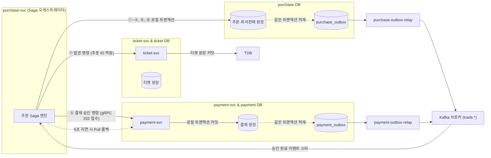
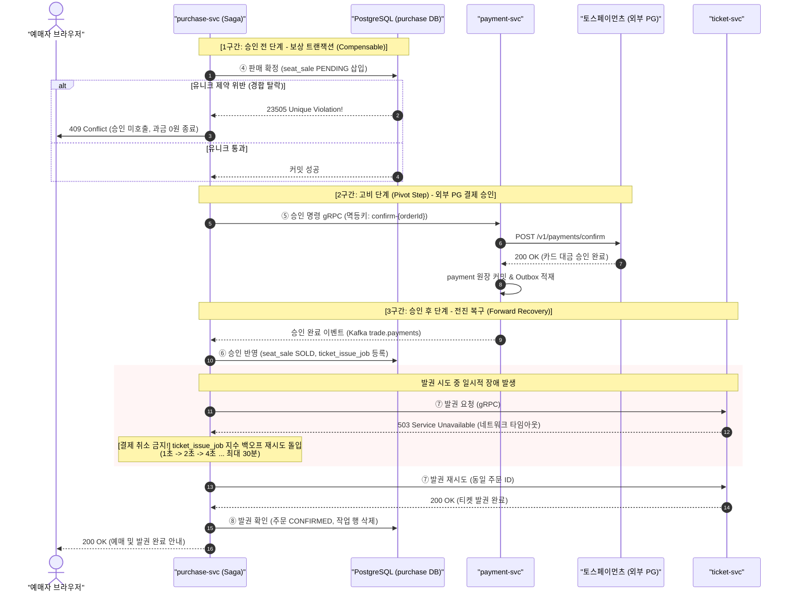
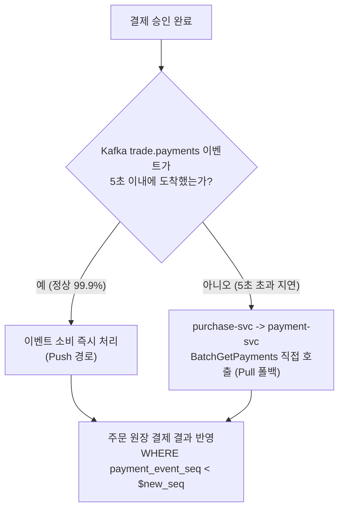

# DB 설계 편 5: 일관성과 트랜잭션 경계 (Transaction Boundaries & Eventual Consistency)

- **핵심 아키텍처 원칙**: 단일 서비스/단일 DB 단위의 로컬 ACID 트랜잭션 한정, 2PC(2단계 커밋) 배제 및 Saga 오케스트레이션, Transactional Outbox와 멱등 수신자 기반 최종 일관성, 고비 단계(Pivot Step) 전후 복구 전략 분리
- **관련 설계 정본**: [docs/data.md](../../data.md) §4(데이터 일관성 스펙트럼 및 트랜잭션 경계 1~15번), §1(저장소 지도), [docs/features/payment.md](../../features/payment.md) §2·§3, [ADR-0113](../../adr/0113-order-state-with-append-only-history-event-sourcing-only-for-ops-commands.md), [ADR-0116](../../adr/0116-single-polling-outbox-relay-drop-debezium-place-pgbouncer-schema-registry.md), [ADR-0140](../../adr/0140-payment-result-pull-fallback-when-kafka-is-late.md), [ADR-0142](../../adr/0142-consumer-key-concurrency-held-events-client-required-settings.md), [ADR-0106](../../adr/0106-forward-recovery-after-payment-approval-ticket-issue-retry.md), [ADR-0028](../../adr/0028-postgres-no-sharding-cell-scaling.md)
- **함께 읽기**: [한 판 문서](../01-system-design.md) 9단계, [분야 편 11: 결제](../fields/11-payment.md), [DB 설계 편 3: 핵심 테이블과 관계](03-core-tables.md), [DB 설계 편 4: 같은 좌석을 두 번 팔지 않기](04-no-double-sale.md), [결정 카드 D-08](../decisions/D08-payment-two-phase-forward-recovery.md)

---

## 1. 면접관의 질문

> **면접관**: "주문은 purchase, 결제는 payment, 티켓은 ticket 서비스에 있고 데이터베이스도 물리적으로 완전히 분리되어 있습니다. 데이터가 서로 어긋나지 않게 분산 트랜잭션을 어떻게 처리하며, 트랜잭션 경계는 어디서 끊습니까? 외부 결제사 승인 후 발권이 실패하면 어떻게 복구하나요?"

면접관은 다음 세 가지 Staff 엔지니어링 역량을 확인한다:
1. **분산 트랜잭션에 대한 현실적 판단**: 마이크로서비스 환경에서 2PC(2-Phase Commit)의 치명적 결함을 이해하고, 비동기 Saga 및 Transactional Outbox 패턴을 능숙하게 설계할 수 있는가?
2. **트랜잭션 경계의 엄밀성**: 어디까지를 로컬 ACID로 묶고 어디부터를 최종 일관성(Eventual Consistency)으로 넘길지 비즈니스적/기술적 기준을 명확히 제시할 수 있는가?
3. **고비 단계(Pivot Step) 기반 복구 설계**: 취소가 불가능한 외부 결제 승인을 중심으로 '승인 전 롤백(보상 트랜잭션)'과 '승인 후 전진 복구(Forward Recovery)'를 구분하여 일관성을 사수할 수 있는가?

---

## 2. 단순한 답과 깨지는 곳

### 단순한 답 (The Naive Approach)
> "주문, 결제, 티켓 DB를 XA 기반 2단계 커밋(2PC)으로 묶어 하나의 글로벌 분산 트랜잭션으로 커밋합니다. 또는 분산 락을 잡고 주문 $\to$ 결제 $\to$ 티켓 발권을 동기 HTTP/gRPC로 순차 호출하며, 각 서비스는 자기 DB에 커밋한 직후 애플리케이션 코드에서 Kafka에 이벤트를 즉시 발행합니다. 발권이 실패하면 즉시 결제를 취소합니다."

### 어디서 깨지는가 (Failure Scenarios)

| 단순한 설계 | 극단적 부하/장애 상황에서의 붕괴 양상 | 아키텍처적 인과관계 및 정본 근거 |
| :--- | :--- | :--- |
| **2단계 커밋 (2PC / XA) 적용** | 분산 트랜잭션 코디네이터가 참여 노드들에게 준비(Prepare)를 묻고 합의하는 동안 모든 DB 행에 락이 묶인다. | 네트워크 RTT 증폭으로 트랜잭션 처리 시간이 수 밀리초에서 수 초로 폭증하며, 코디네이터 노드 장애 시 전체 DB가 락에 갇혀 멈춘다. 가용성이 극단적으로 떨어진다. (ADR-0028) |
| **동기 HTTP 체인 호출** | 주문 $\to$ 결제 $\to$ 발권이 동기 HTTP로 줄줄이 연결되면, 중간 네트워크 순단이나 일시 타임아웃 발생 시 전체 흐름이 깨진다. | 결제사는 돈을 뺐는데 주문 서비스는 타임아웃을 맞아 실패로 처리하는 불일치가 발생하고, 스레드 풀이 고갈된다. (K7 결함) |
| **DB 커밋 후 앱에서 Kafka 직접 발행** | `db.commit()` 성공 직후 `kafka.send()`를 호출하는 이른바 **이중 쓰기(Dual Write) 문제**가 발생한다. | DB 커밋 직후 서버 프로세스가 강제 종료(OOM, 배포 등)되면 이벤트가 영구 유실되고, 반대로 Kafka 발행 후 DB 커밋이 롤백되면 존재하지 않는 유령 이벤트가 발행된다. |
| **결제 승인을 동기 gRPC로 대기** | 주문 서비스가 결제 서비스의 승인 결과를 동기 gRPC로 무한정 대기한다. | 토스/포트원 등 외부 PG사의 승인 지연(네트워크 지연 시 최대 60초)에 모든 gRPC 커넥션과 워커 스레드가 결박되어 결제 접수 p99 150ms 예산(NFR-005)을 완전히 초과한다. (ADR-0140) |
| **발권 실패 시 무조건 결제 취소** | 티켓 서비스 일시 장애로 발권 API가 500을 뿜으면 즉시 외부 결제를 자동 취소 환불한다. | 사용자는 어렵게 티켓팅에 성공해 결제까지 마쳤는데 일시적인 내부 네트워크 오류로 표가 강제 취소되고 좌석이 다른 사람에게 넘어가 극심한 고객 민원이 폭증한다. (ADR-0106) |

---

## 3. 아키텍처 해법: 로컬 ACID + Transactional Outbox + Saga 오케스트레이션

PEAKET은 **"ACID 트랜잭션은 단 하나의 서비스, 단 하나의 데이터베이스 인스턴스 안으로 엄격히 한정한다"**는 대원칙을 고수한다. 서비스 경계를 넘나드는 데이터 정합성은 **Saga 오케스트레이션**, **Transactional Outbox 패턴**, **Kafka 비동기 릴레이**, **멱등 수신자(Idempotent Consumer)**의 조합으로 달성한다.



---

### 3.1 분산 데이터 일관성 스펙트럼

데이터의 비즈니스 중요도와 트래픽 특성에 따라 요구되는 일관성 수준을 차등화하여 시스템 복잡도를 최적화했다:

| 데이터 영역 | 일관성 수준 | 구체적 보장 메커니즘 |
| :--- | :---: | :--- |
| **좌석 판매 확정 (Hard Sale)** | **강한 일관성 (Strong)** | PostgreSQL 부분 유니크 인덱스 + 로컬 ACID 트랜잭션 |
| **좌석 임시 선점 (Soft Hold)** | **빠른 판정 + 최종 일관성** | Redis Lua 단일 스레드 직렬화 $\to$ Stream $\to$ Kafka $\to$ DB 감사 원장 적재 |
| **결제 승인 원장 및 환불** | **강한 일관성 + 멱등성** | 결제 DB 로컬 트랜잭션 + PG사 멱등키(`confirm-{orderId}`) + `payment.order_id UNIQUE` |
| **티켓 소유권 및 현장 입장** | **강한 일관성** | 티켓 DB 로컬 트랜잭션 + 비관적 행 잠금(`SELECT ... FOR UPDATE`) |
| **대기 순번, 관제 지표, 카탈로그** | **최종 일관성 (Eventual)** | CloudFront CDN 엣지 캐시, Redis 캐시, 1초 주기 백그라운드 집계 |

---

### 3.2 구매 길(Purchase Flow) 8단계 트랜잭션 경계

주문 생성부터 최종 발권까지의 전 과정은 **독립된 8개의 로컬 ACID 트랜잭션**으로 명확히 쪼개진다. purchase-svc가 전체 Saga를 중앙에서 지휘한다:

| 순번 | 실행 서비스 | 대상 DB | 단일 로컬 ACID 트랜잭션에 담는 작업 | 응답 및 후속 조치 |
| :---: | :--- | :--- | :--- | :--- |
| **①** | purchase-svc | purchase DB | `purchase_order` 행 생성, `order_idempotency` 기록, `order_event` 1번(CREATED), Outbox 적재 | 클라이언트에 201 Created 반환 |
| **②** | purchase-svc | purchase DB | `payment_attempt` READY 행 생성, 기존 활성 시도 SUPERSEDED 처리 (주문당 1건 강제) | 결제창 SDK 오픈 |
| **③** | purchase-svc | purchase DB | `payment_attempt` ACCEPTED 전이, 결제 인증 정보 저장, 주문 Saga 시작 명령, Outbox 적재 | 클라이언트에 202 Accepted 반환 |
| **④** | purchase-svc | purchase DB | `seat_sale` PENDING 행 삽입, `purchase_quota` 조건부 갱신, 주문 RESERVED 전이, Outbox 적재 | 유니크 통과 주문만 승인 호출 |
| **⑤** | payment-svc | payment DB | 외부 PG사 승인 API 완료 후 `payment` 원장 INSERT, `payment_event`, Outbox 적재 | `payment.order_id UNIQUE`로 이중 승인 차단 |
| **⑥** | purchase-svc | purchase DB | `seat_sale` SOLD 전이, 주문 APPROVED 전이, 발권 작업 `ticket_issue_job` INSERT, Outbox 적재 | 발권 gRPC 즉시 호출 |
| **⑦** | ticket-svc | ticket DB | `ticket` 테이블 행 생성 (주문 ID 기반 멱등 키 검증으로 중복 발권 차단) | ISSUED 상태 반환 |
| **⑧** | purchase-svc | purchase DB | 주문 CONFIRMED 전이, `ticket_issue_job` 삭제 완료, Outbox 적재 | 사용자에게 예매 완료 최종 노출 |

---

### 3.3 결제 승인 고비 단계(Pivot Step)와 전진 복구 (Forward Recovery)

Saga 패턴에서 **외부 PG 결제 승인은 실제 고객의 돈이 출금되는 되돌리기 가장 어려운 '고비 단계(Pivot Step)'**다. PEAKET은 고비 단계를 기준으로 전후 복구 전략을 명확히 양분했다:



- **승인 전 단계 (Compensable Transaction)**:
  - `seat_sale`에 `PENDING` 행을 삽입하다 유니크 제약에 걸리거나 결제창 인증 유효시간이 지나면, 즉시 트랜잭션을 롤백하고 주문을 FAILED로 마감한다. 고객 카드 승인이 발생하기 전이므로 환불할 금액이 전혀 없다.
- **승인 고비 단계 (Pivot Step)**:
  - 외부 결제사 호출 중 네트워크 응답이 끊기면 동일한 멱등키(`confirm-{orderId}`)로 재호출한다. 결제사 응답을 끝내 확인하지 못하면 상태를 `UNKNOWN`으로 두고 결제사 대사 조회를 통해 확정한다.
- **승인 후 단계 (Forward Recovery - 전진 복구, ADR-0106)**:
  - **돈이 이미 빠져나간 뒤에는 절대 자동 결제 취소를 실행하지 않는다.**
  - 티켓 서비스가 일시 다운되어 발권이 실패하더라도, 동일 트랜잭션에서 `ticket_issue_job` 테이블에 재시도 작업을 등록하고 1초, 2초, 4초... 최대 60초 간격으로 지수 백오프 재시도를 감행한다 (최대 30분 허용).
  - 결제 승인 후 60초 이내에 발권되지도 않고 재시도 큐에도 들어가지 못한 결제 건은 즉시 시스템 최고 장애(SEV1) 경보를 발령한다.

---

### 3.4 Transactional Outbox 및 단일 폴링 릴레이 설계 (ADR-0116)

이중 쓰기(Dual Write) 문제를 원천 제거하기 위해 모든 도메인 이벤트는 비즈니스 데이터와 동일한 DB 트랜잭션 내에서 `outbox` 테이블에 삽입된다:

```sql
-- DDL: Outbox 테이블 구조
CREATE TABLE purchase_outbox (
    id UUID PRIMARY KEY,            -- UUIDv7 (시간순 정렬)
    seq BIGSERIAL NOT NULL,         -- 엄격한 단조증가 시퀀스
    topic TEXT NOT NULL,            -- Kafka 대상 토픽 (trade.orders 등)
    msg_key TEXT NOT NULL,          -- 파티셔닝 키 (orderId 등)
    payload BYTEA NOT NULL,         -- Avro 바이너리 직렬화 데이터
    headers JSONB,                  -- 추적 Trace ID 및 메타데이터
    sent_at TIMESTAMPTZ             -- 발행 완료 시각 (NULL이면 미전송)
);

CREATE INDEX idx_outbox_unsent ON purchase_outbox (seq) WHERE sent_at IS NULL;
```

#### 단일 폴링 릴레이 (Single Polling Relay) 채택 근거
PEAKET은 복잡한 Debezium CDC(Change Data Capture) 대신 **Kubernetes Lease 기반의 단일 활성 폴링 릴레이(Single Polling Relay)**를 채택했다:
1. **Debezium/WAL CDC 배제 이유**:
   - PostgreSQL 복제 슬롯(Replication Slot)에 의존하는 CDC는 컨슈머 장애 시 WAL(Write-Ahead Log)이 디스크에 무한 축적되어 DB 전체 스토리지를 고갈시키는 치명적 위험이 있다.
   - Kafka Connect 클러스터 운영 오버헤드와 JVM 런타임 관리가 추가된다.
2. **100ms 폴링 릴레이의 안전성**:
   - 쿠버네티스 Lease를 획득한 단 1개의 릴레이 파드가 100ms 주기로 `SELECT ... WHERE sent_at IS NULL ORDER BY seq LIMIT 500 FOR UPDATE`를 실행한다.
   - Kafka 프로듀서의 `acks=all` 응답을 확인한 후 동일 트랜잭션에서 `sent_at = NOW()`를 찍는다.
   - **순서 보장**: Outbox INSERT는 비즈니스 트랜잭션의 가장 마지막 문장으로 실행되므로, 동일 비즈니스 엔티티를 수정한 앞 트랜잭션이 커밋된 후에만 뒤 트랜잭션의 `seq`가 채번되어 **커밋 순서와 이벤트 순서가 100% 일치**한다.

---

### 3.5 Push + Pull 폴백 메커니즘 (`BatchGetPayments`, ADR-0140)

Kafka 이벤트 브로커가 네트워크 폭주나 점검으로 인해 지연되더라도 핵심 예매 흐름은 중단되지 않는다:



- **5초 타임아웃 Pull 폴백**: 결제 접수 후 5초가 지나도록 Kafka 승인 이벤트가 오지 않으면, purchase-svc는 payment-svc의 gRPC `BatchGetPayments`를 호출하여 승인 결과를 직접 당겨온다.
- **쓰기 인스턴스 직접 조회**: payment-svc는 읽기 복제본(Replica)의 복제 지연으로 방금 승인된 결과를 놓치는 일이 없도록, 마스터(쓰기) 인스턴스에서 원장을 직접 조회한다.
- **순번 기반 멱등 반영**:
  ```sql
  UPDATE purchase_order 
  SET status = 'APPROVED', payment_event_seq = $event_seq 
  WHERE id = $order_id AND payment_event_seq < $event_seq;
  ```
  - Push 이벤트와 Pull 결과 조회가 동시에 도달하더라도, `payment_event_seq` 순번 대조를 통해 나중에 도착한 중복 요청은 0행 업데이트로 안전하게 무시된다.

---

## 4. 트레이드오프와 버린 대안 (Tradeoffs & Alternatives)

| 설계 결정 | 얻는 것 (Gains) | 치르는 값 (Costs) |
| :--- | :--- | :--- |
| **단일 DB 로컬 ACID + Saga** | 2PC 분산 잠금 비용 제거, 독립적인 서비스 배포 및 스키마 변경, p99 수 초 지연 방지 | 최종 일관성 도달 전까지 서비스 간 데이터 불일치 구간 발생, 보상 및 전진 복구 로직 구현 필요 |
| **단일 폴링 Outbox 릴레이** | WAL 누수로 인한 DB 디스크 고갈 위험 원천 제거, 로컬과 운영 환경의 100% 동일한 코드 베이스 유지 | 폴링 주기(100ms)만큼의 기본 이벤트 전파 지연 발생, `sent_at` UPDATE로 인한 DB 쓰기 I/O 증가 |
| **승인 후 전진 복구 (Forward Recovery)** | 일시적 네트워크 장애로 인한 예매 티켓 강제 취소 방지, 티켓팅 고객 경험 및 금융 신뢰 보호 | 발권 지연 발생 시 재시도 큐 운영 및 모니터링 부담, 최대 30분간 상태 대기 발생 가능 |
| **Push + Pull 결제 결과 폴백** | Kafka 클러스터 전면 장애 시에도 결제 승인 결과 확정 프로세스가 중단 없이 지속 | Kafka 지연 시 payment DB 쓰기 인스턴스로의 직접 조회 트래픽 추가 유입 |

### 버린 대안

1. **데이터베이스 샤딩 및 분산 2PC (ADR-0028)**:
   - 판매 확정은 초당 약 28 TPS, 결제 승인 피크는 300 TPS 수준으로 단일 대형 Aurora PostgreSQL 인스턴스(r7g.xlarge) 하나로 충분히 처리 가능한 부하 범위다. 조기 샤딩과 2PC는 시스템 가용성만 떨어뜨리는 명백한 오버엔지니어링이다.
2. **Debezium 기반 CDC 릴레이 (ADR-0116)**:
   - Debezium은 고성능이지만 복제 슬롯 장애 시 DB WAL 파일이 테라바이트 단위로 누적되어 데이터베이스를 다운시키는 운영상 시한폭탄이다. 100ms 폴링으로도 NFR 요구치를 여유 있게 만족하므로 단순한 폴링을 선택했다.
3. **PostgreSQL LISTEN/NOTIFY 연동**:
   - 이벤트 발생 즉시 릴레이를 깨우기 위해 `LISTEN/NOTIFY`를 검토했으나, 커넥션을 지속 점유해야 하므로 PgBouncer 트랜잭션 풀링 환경과 충돌한다.
4. **발권 실패 시 즉시 결제 취소 (ADR-0106)**:
   - 오픈 정각 티켓팅에서 카드사 결제까지 마친 티켓을 단순 내부 발권 지연으로 취소하는 것은 비즈니스적으로 용납될 수 없다. 사용자의 티켓은 반드시 지켜내야 한다.

---

## 5. 핵심 꼬리 질문 5단 방어 (Staff Interview Q&A)

| 질문 단계 | 심층 질문 | 방어 논리와 기술적 근거 | 관련 정본 |
| :--- | :--- | :--- | :--- |
| **1단: 왜 (Why)** | 분산 마이크로서비스 환경에서 데이터 정합성을 맞출 때 왜 2PC(2단계 커밋)를 절대 배제했습니까? | 2PC는 모든 참여 노드가 커밋 준비를 마칠 때까지 리소스에 잠금을 유지하므로, 네트워크 지연이나 노드 지연 시 p99 응답 시간이 초 단위로 폭증합니다. 특히 코디네이터가 다운되면 참여 노드들이 인-다우트(In-doubt) 상태에 빠져 락을 풀지 못하는 치명적 가용성 결함이 있습니다. 따라서 가용성과 응답 속도가 최우선인 티켓팅 플랫폼에서는 로컬 ACID와 비동기 Saga 최종 일관성이 유일한 해법입니다. | ADR-0028, `docs/data.md` §4 |
| **2단: 대안 (Alternatives)** | Outbox 릴레이에서 업계 표준인 Debezium CDC 대신 왜 100ms 폴링 릴레이를 선택했습니까? | Debezium은 PostgreSQL 복제 슬롯을 사용하므로, Kafka 다운이나 컨슈머 지연 발생 시 DB의 WAL 로그가 디스크가 찰 때까지 무한정 쌓여 DB 전체가 크래시되는 치명적 사고 위험이 있습니다. 또한 로컬 개발 환경과 운영 환경의 파이프라인을 일치시키기 어렵습니다. PEAKET의 피크 쓰기 부하는 단일 인스턴스에서 100ms 폴링으로도 p99 200ms 이내에 충분히 소화 가능하므로, 운영 안전성이 뛰어난 단일 폴링 방식을 채택했습니다. | ADR-0116 |
| **3단: 장애 대응 (Resilience)** | 결제 승인 직후 티켓 발권 서비스가 완전히 다운되면 결제를 취소해야 하지 않나요? 왜 전진 복구입니까? | 사용자는 피 말리는 대기열과 좌석 경합을 뚫고 카드 결제까지 마쳤습니다. 이때 내부 발권 서비스의 일시 장애로 결제를 취소해버리면 좌석이 타인에게 넘어가 고객에게 돌이킬 수 없는 피해를 줍니다. 결제 승인이라는 고비(Pivot Step)를 넘었으므로, 티켓 시스템이 복구될 때까지 `ticket_issue_job`을 통해 지수 백오프로 끈질기게 재시도하여 기어코 발권을 완수하는 전진 복구(Forward Recovery)가 금융/커머스 도메인의 정석입니다. | ADR-0106, NFR-006 |
| **4단: 수치 근거 (Numbers)** | Kafka가 멈춰서 Push 대신 Pull 폴백(`BatchGetPayments`)이 대량 발생하면 payment DB가 버틸 수 있나요? | 결제 접수 피크 부하는 초당 300 TPS 수준입니다. Pull 폴백은 단건 조회가 아니라 `order_id` 최대 100건을 한 번에 묶는 배치 쿼리(`BatchGetPayments`)로 실행되므로, 최악의 경우에도 payment DB 쓰기 인스턴스에 가해지는 쿼리 부하는 초당 3~5 QPS에 불과합니다. db.r7g.large 인스턴스의 처리 용량(수천 QPS) 대비 0.5% 미만이므로 DB에 무리를 주지 않습니다. | ADR-0140, `docs/architecture.md` §9.1 |
| **5단: 실측과 검증 (Verification)** | 분산 트랜잭션 구간에서 메시지 중복이나 순서 뒤집힘이 발생해도 일관성이 유지됨을 어떻게 검증했나요? | 실제 Kafka 클러스터 장애 주입 테스트(ST-T18)에서 컨슈머 강제 종료 및 파티션 리밸런싱을 유발한 결과, 멱등 컨슈머와 `payment_event_seq < $new_seq` 조건부 갱신을 통해 데이터 누락 0건, 중복 반영 0건, 순서 뒤집힘 0건을 검증했습니다. 또한 텔레메트리 5,600/s와 거래 300/s 동시 부하 상황에서 `acks=all` 프로듀서 p99 지연시간이 7.8ms로 예산 내에 안착함을 확인했습니다. | ADR-0176 결정 5, ADR-0142 |

---

## 6. 30초 아키텍처 브리핑 (Staff Engineer Summary)

> "PEAKET의 분산 트랜잭션 아키텍처는 **'로컬 ACID 트랜잭션의 엄격한 격리'**와 **'결제 승인 고비(Pivot Step) 중심의 복구 이원화'**로 요약됩니다.  
> 2PC 분산 락을 전면 배제하고 모든 DB 쓰기를 단일 서비스의 로컬 트랜잭션으로 한정하며, 서비스 간 상태 전파는 비즈니스 데이터와 동일 트랜잭션에 기록되는 **Transactional Outbox 패턴과 100ms 단일 폴링 릴레이**로 보장합니다.  
> 특히 외부 결제 승인을 고비 단계(Pivot Step)로 정의하여, 승인 전 실패는 `PENDING` 행을 롤백하는 무과금 보상 트랜잭션으로 종결하고, 승인 후 발권 장애는 절대 취소하지 않고 `ticket_issue_job`을 통해 기어코 발권을 완수하는 **전진 복구(Forward Recovery)**를 단행함으로써 데이터 무결성과 비즈니스 신뢰를 완벽히 사수합니다."

---

## 7. 정본에서 읽을 곳

1. [docs/data.md](../../data.md) §4: 일관성 스펙트럼 및 트랜잭션 경계 1~15번 매트릭스
2. [docs/data.md](../../data.md) §4의 7번(Outbox 릴레이 아키텍처), 15번(보류 테이블)
3. [docs/features/payment.md](../../features/payment.md) §2(결제 시퀀스 플로우) 및 §3 전이 표(T1~T26)
4. [ADR-0116](../../adr/0116-single-polling-outbox-relay-drop-debezium-place-pgbouncer-schema-registry.md): 단일 폴링 Outbox 릴레이 채택 및 Debezium 배제
5. [ADR-0140](../../adr/0140-payment-result-pull-fallback-when-kafka-is-late.md): Kafka 지연 시 결제 결과 Pull 폴백 메커니즘
6. [ADR-0106](../../adr/0106-forward-recovery-after-payment-approval-ticket-issue-retry.md): 결제 승인 후 티켓 발권 전진 복구
7. [ADR-0142](../../adr/0142-consumer-key-concurrency-held-events-client-required-settings.md): 키 단위 병렬 컨슈머 및 멱등 처리
8. [ADR-0028](../../adr/0028-postgres-no-sharding-cell-scaling.md): 단일 인스턴스 스케일업 및 2PC/샤딩 배제
