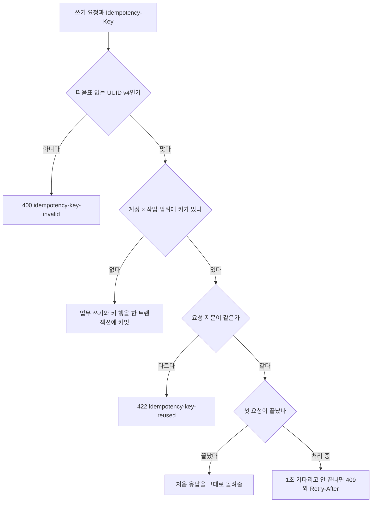

# DB 설계 편 6: 동시에 고칠 때: 잠금, 펜싱 토큰, 멱등

- **기준 시점**: ADR-0177까지, 2026-11-01
- **맡는 정본**: [docs/data.md](../../data.md) §5(동시성 경합 표), §2의 '기본 키·유일·검사 규칙'과 멱등 기록 표, §3의 펜싱·세대·멱등 키, §4의 7·14·15번, [docs/api/guidelines.md](../../api/guidelines.md) §4, [ADR-0056](../../adr/0056-admission-leader-fencing-and-admission-person-recheck.md), [ADR-0086](../../adr/0086-query-index-rules-plan-diagnostics-data-pattern-gaps.md), [ADR-0109](../../adr/0109-delivery-jobs-in-postgres-drop-bullmq-cache-redis-key-classes-noeviction.md), [ADR-0146](../../adr/0146-data-retention-gaps-idempotency-records-log-retention.md)
- **규범이 아니다**: 정본을 풀어 쓴 해설이다. 숫자와 규칙이 정본과 다르면 정본이 맞다([ADR-0177](../../adr/0177-walkthrough-explain-in-interview.md)).
- **앞뒤 편**: 앞은 [DB 설계 편 5 일관성과 트랜잭션 경계](05-consistency-transactions.md), 뒤는 [DB 설계 편 7 인덱스와 쿼리](07-indexes-queries.md)다. 좌석 경합 자체는 [DB 설계 편 4](04-no-double-sale.md)와 [분야 편 10 좌석](../fields/10-seat-hold.md)이 다룬다.
- **측정 전이다**: 서비스 수준 측정(NFR 목표를 운영 규모로 잰 것)은 아직 없어 성능 숫자는 설계 목표값이고 `[실측 전]`을 붙였다. 기반 PoC(wbs 0.5.1, 본 개발 전에 위험한 부분만 먼저 재 보는 시험)는 2026-11-01에 PC 한 대에서 쟀다([ADR-0176](../../adr/0176-foundation-poc-results.md), 성능 장부 docs/perf-ledger.md §5). 그 숫자는 '실측(PC)'이고 운영 규모 증거가 아니다. 공용 멱등 모듈과 Outbox 릴레이·Lease 코드는 `packages/platform`에 있다(BUILD_ORDER FND-080).

## 1. 면접관의 질문

> **면접관**: "여러 요청이 같은 데이터를 동시에 고치면 어떻게 막나요? 잠금을 쓰나요, 버전을 쓰나요? 네트워크 때문에 같은 요청이 두 번 오면요?"

면접관은 경합(여러 요청이 같은 데이터를 동시에 노리는 일)마다 알맞은 장치를 고르는지, '잠금을 쥔 줄 알았던 쪽'이 늦게 쓰는 경우까지 생각하는지, 다시 보낸 요청을 한 번으로 만드는지 본다.

## 2. 단순한 답

- 고칠 행은 모두 `SELECT … FOR UPDATE`(읽은 행을 잠가 다른 트랜잭션이 못 고치게 하는 SQL, 비관적 잠금)로 잠그거나, 모든 표에 버전 칸을 두고 저장할 때 판이 바뀌었으면 다시 한다(낙관적 잠금). 트랜잭션은 여러 변경을 한꺼번에 반영하거나 한꺼번에 취소하는 DB 작업 단위다.
- 한 대만 일해야 하는 작업은 Redis(메모리에 데이터를 두는 빠른 저장소) 락이나 리더 선출로 하나를 고르고, 쓰기 직전에 '아직 내가 리더인가'를 확인한다.
- 같은 요청이 두 번 오면 앱이 먼저 조회해 막고, 멱등키(여러 번 와도 결과가 한 번과 같게 하는 키)는 Redis에 둔다.
- 순서가 중요한 번호는 DB 시퀀스로 매긴다.

## 3. 어디서 깨지나

| 단순한 답 | 깨지는 곳 | 근거 |
| --- | --- | --- |
| 인기 좌석을 행 잠금으로 | 한 좌석에 1,000명이 잠금을 줄 서서 p99(요청 100건 중 99건이 끝나는 시간)가 수 초로 오른다. 목표는 50ms다 | ADR-0014, NFR-003 |
| 쓰기 직전 Lease 재확인만 | Lease(정해진 시간 동안만 유효한 권한)를 확인한 뒤 멈춘 옛 리더가 깨어나 쓰는 것을 막지 못한다. 선출을 Redis 락으로 바꿔도 쓰는 쪽이 세대를 보지 않으면 같은 틈이 남는다 | ADR-0056 '검토한 대안' 1·2 |
| 멱등키를 스크립트 밖에서 먼저 조회 | 옛 키 `s:idem:{key}`는 좌석 키와 다른 칸이라 Lua 전에 따로 읽었고, 그사이 같은 키의 동시 요청을 막지 못했다 | docs/features/seat-hold.md §3 |
| 멱등 기록을 Redis에만 | 재시작·장애 조치 때 기록을 잃으면 같은 요청을 두 번 처리할 수 있다 | ADR-0146 '검토한 대안' |
| 순서 번호를 DB 시퀀스로 | 번호 순서와 커밋 순서가 어긋나 번호로 이어 받는 쪽이 빠뜨릴 수 있다 | ADR-0086 '검토한 대안' |

## 4. 지금 설계

### 4.1 경합마다 장치를 고른다

docs/data.md §5의 경합 표가 쓰는 장치를 여섯으로 묶었다.

| 장치 | 언제 쓰나 | 예(표·키) |
| --- | --- | --- |
| 차례로 돌리기 | 한 키에 요청이 몰리고 응답이 빨라야 할 때 | 좌석 홀드·1인 보유 수·홀드 멱등키를 Lua 하나로, 대기열 순번은 카운터를 1 올리는 `INCR` |
| 유일 제약 | 같은 것이 두 번 생기면 안 될 때 | `seat_sale` 활성 부분 유니크, `payment.order_id` UNIQUE, `webhook_receipt`, `approval_vote` |
| 조건부 갱신(비교하고 쓰기) | 수량·상태·판 번호(바뀔 때마다 커지는 번호)를 조건이 맞을 때만 바꿀 때 | `purchase_quota`, 주문 상태 전이, `sale_control`·`pg_switch`·`event_sale`의 판 번호 |
| 행 잠금 | 한 요청 안에서 상태를 다시 보고 여러 행을 함께 바꿀 때 | 티켓 양도·취소·스캔, 미수금 상계, 계정 병합 |
| 펜싱 토큰·세대 | 늦게 온 옛 쓰기나 옛 리더를 거를 때 | 홀드 펜싱 토큰, 리더 세대 `q:{event:E}:leader`, 회차 세대 `s:{event:E}:epoch` |
| 멱등 기록 | 같은 요청·호출·사건이 다시 올 때 | `Idempotency-Key`, `confirm-{orderId}`, `eventKey`(사건마다 붙는 고유 키) |

### 4.2 차례로 돌리기: Lua는 잠금이 없다

- Lua 스크립트(Redis 안에서 다른 명령과 섞이지 않고 한 번에 도는 짧은 프로그램)는 샤드(데이터를 나눠 맡은 서버)에서 하나씩 차례로 돈다. 같은 회차의 키를 `{event:E}` 해시 태그(키를 같은 칸에 모으는 표시)로 한 샤드에 모으면, 좌석·보유 수·멱등키를 한 연산에서 보고 쓴다(docs/data.md §5 첫 행).
- 대가는 샤드 처리량이다. Lua는 도는 동안 그 샤드의 다른 명령을 모두 막으므로, 요청 좌석 수만큼의 작업만 하고 큰 컬렉션을 훑지 않는다(docs/data.md §3).

### 4.3 유일 제약과 조건부 갱신

- **마지막 방어선은 물리 제약이다**: 이중 환급은 `order_cancellation`의 `UNIQUE (order_id, ticket_id) WHERE status <> 'VOIDED'`가 막는다. 팬 취소와 일괄 환불 작업은 `INSERT … ON CONFLICT DO NOTHING`으로 넣고, 이미 있으면 그 취소를 이어서 처리한다. 결제사 멱등키 `cancel-{cancellationId}`가 취소 행마다 달라서 이 제약이 마지막이다(docs/data.md §2).
- **승인자 둘**: `approval_vote`에 `UNIQUE (request_id, approver_id)`와 `CHECK (approver_id <> requester_id)`를 건다. 같은 사람 두 번과 요청자 본인 승인을 DB가 막는다(ADR-0086).
- **비교하고 쓰기**: 1인 한도는 `used + n ≤ limit_count`일 때만, 주문 상태는 '지금 상태가 그대로일 때만', 판매 일시정지 `sale_control`은 판 번호가 지금보다 클 때만 쓴다. 굿즈 재고는 `stock >= quantity`일 때만 깎는다(docs/data.md §4).

### 4.4 행 잠금을 쓰는 곳과 규칙

| 경합 | 장치 | 근거 |
| --- | --- | --- |
| 같은 티켓의 이중 양도, 수락과 만료·철회 | `SELECT … FOR UPDATE` 안에서 상태와 기한을 다시 확인한다. 2개 세션이 동시에 요청하면 1건만 성공하고 나머지는 409다 | docs/data.md §5, offline-gate O-T12 |
| 같은 티켓의 취소·양도·스캔 | 행 잠금으로 처리 순서를 정한다. 입장 시작부터 마감까지 돌려주기·양도 수락·회수를 막는다 | docs/data.md §5, ADR-0051 |
| 사람이 화면에서 읽고 나중에 저장(CS·관리 화면) | `ticket.version` 칸으로 본 판과 지금 판을 견준다 | 기술 검토 낮음-071, docs/data.md §2 |
| 같은 미수금을 두 정산서가 상계 | `partner_receivable` 행 잠금 안에서 남은 금액을 보고 이동 기록을 덧붙인다 | docs/data.md §5 |
| 알림·웹훅 발송 작업 | 짧은 트랜잭션에서 `FOR UPDATE SKIP LOCKED`(남이 잠근 행은 건너뛰고 고르기)로 고르고 임대 시각 `lease_until`(이 시각까지 이 워커가 맡는다는 표시)을 쓴 뒤 커밋하고 보낸다. 잠금을 쥔 채 바깥 호출을 하지 않는다. 보내다 죽으면 임대가 끝난 뒤 다른 워커가 같은 `webhook-id`로 다시 보낸다 | ADR-0109, V-T24 |
| 보류 표의 같은 업무 키 | `pg_advisory_xact_lock`(트랜잭션 동안만 쥐는 이름 붙은 잠금) 아래에서 '아직 보류 중인지 보고 넣기'를 한다 | docs/data.md §4의 15번 |

- **잠금을 오래 쥐지 않는다**: DB 역할 기본값으로 핫패스(요청이 가장 많이 지나는 경로) 역할(purchase·payment·identity)은 `statement_timeout` 1초, `idle_in_transaction_session_timeout` 10초다. 트랜잭션에만 걸 값은 첫 문장의 `SET LOCAL`로 건다. PgBouncer(연결 풀) 트랜잭션 풀링이라 세션 `SET`은 쓰지 않는다(docs/architecture.md §5).
- **Outbox(보낼 사건을 같은 트랜잭션에 적어 두는 표) 릴레이는 `SKIP LOCKED`를 쓰지 않는다**: 리더가 바뀌는 순간 옛 리더가 잡은 앞 묶음을 건너뛰고 뒤 사건을 먼저 보낼 수 있어서다(ADR-0116). 발송 작업은 순서가 필요 없어 쓰고, 릴레이는 순서가 필요해 쓰지 않는다.

### 4.5 펜싱 토큰과 세대

펜싱 토큰은 계속 커지기만 하는 번호다. 쓰는 쪽이 번호를 싣고, 받는 쪽이 '내가 본 것보다 작으면 버린다'. 잠금이나 Lease가 끝난 줄 모르고 늦게 쓰는 쪽을 받는 쪽이 거른다.

| 번호 | 누가 올리나 | 누가 거르나 |
| --- | --- | --- |
| 홀드 펜싱 토큰 | 홀드 Lua가 회차마다 늘 커지게 발급한다. `seat_hold` 기본 키 `(event_id, seat_id, fencing_token)`에 든다 | 원장 적재와 좌석 변경 전파가 더 작은 토큰의 옛 사건을 버린다(S-T5) |
| 리더 세대 `q:{event:E}:leader` | admission-ctrl(입장 인원 조절기)이 Lease를 얻을 때 `leaseTransitions`를 1 올려 쓴다 | 리더의 쓰기 Lua가 '내 세대 < 저장된 세대'면 아무것도 쓰지 않고 `FENCED`. 받은 파드(앱이 도는 단위)는 바로 멈추고 대기로 돌아간다(Q-T30) |
| 회차 세대 `seatEpoch` | 좌석 Redis 주 노드(쓰기를 받는 원본 노드)가 바뀌면 Lua 하나로 max(세대 + 1, Redis `TIME`의 초) | 브라우저가 세대가 바뀌면 구독 구역을 모두 다시 받는다. 구역 번호 `s:{event:E}:secver`는 같은 세대 안에서만 견준다(S-T26) |
| 대기표 세대 | 대기열 Redis 장애 전환 뒤 카운터를 건너뛰고 대기표에 새 세대를 새긴다. 건너뛴 구간은 `q:{event:E}:skipped` | 입장 확정이 세대로 가른다. 건너뛴 구간의 번호라도 그 구간의 세대 이하 대기표는 장애 전에 받은 진짜 대기자로 받는다(docs/data.md §3·§5) |

- 회차 세대를 `세대 + 1`만이 아니라 Redis 시각과 견주는 까닭은, 장애 전에 복제되지 못한 '올리기'를 잃어도 값이 되돌아가지 않게 하려는 것이다(ADR-0121 결정 5).
- 남는 한계: 세대는 노드 시계에 기댄다. 시계가 장애 조치 시간보다 크게 뒤로 가면 화면이 주기 스냅샷(5초·30초)까지 틀릴 수 있다(ADR-0121).

### 4.6 멱등: 세 겹

| 겹 | 키 | 둔 곳과 수명 |
| --- | --- | --- |
| 요청 | `Idempotency-Key`(따옴표 없는 UUID v4). 범위는 '부른 계정 × 작업' | 홀드는 좌석 Redis `s:{event:E}:idem:{account}:{key}`(홀드의 유효 시간 TTL 7분, Lua 안에서 확인). 주문 생성·결제 시도 시작·결제 접수는 `order_idempotency`(기본 키 `(account_id, operation, idempotency_key)`, 24시간 `[가정]`). 그 밖은 서비스 DB의 `idempotency_record`(24시간 `[가정]`) |
| 결제사 호출 | 승인 `confirm-{orderId}`, 취소 `cancel-{cancellationId}` | 결제사가 정한다(토스페이먼츠 15일, 포트원 3시간). 다시 보내는 창은 3시간 안으로 묶고, 넘기면 단건 조회로 그전 상태를 먼저 본다 |
| 사건 받기 | `eventKey`. 현장 스캔은 단말이 만든 스캔 ID | 받는 서비스가 거른다. 웹훅은 `webhook_receipt` 유일 제약 |

- **요청 지문**: SHA-256(메서드 + 실제 경로 + 본문 바이트)다. 헤더는 넣지 않는다. 요청 서명·추적 헤더는 다시 보낼 때마다 새로 만들기 때문이다(docs/api/guidelines.md §4).
- **같은 트랜잭션의 첫 쓰기**: 공용 모듈 `IdempotencyStore.run(tx, 요청, { execute, replay })`가 키 행을 업무 쓰기와 같은 트랜잭션의 첫 쓰기로 넣는다. 키 행 문장만 `lock_timeout` 1초 `[가정]`로 묶는다. 그래서 같은 키의 두 번째 요청은 첫 요청의 키 행 커밋을 기다리고, 처음 커밋한 결과만 같은 상태 코드와 본문으로 돌려받는다.
- **저장하지 않는 실패**: 아무것도 바꾸지 않고 끝난 실패(검증 오류, 경합 409, 한도 초과 422, 429, 5xx)는 적지 않는다. 같은 키로 다시 보내면 다시 처리한다.
- **홀드에는 '처리 중'이 없다**: Lua가 차례로 돌아 같은 키의 두 요청도 좌석을 한 번만 잡고 같은 응답을 받는다. 같은 키·같은 본문의 두 요청을 동시에 1,000번 보내 보유 수가 한 번만 느는지 S-T24로 본다.

### 4.7 순서가 중요한 번호

- 스캐너 변경 `scanner_seq`, 감사 체인 `audit_chain_head`는 같은 트랜잭션에서 카운터 행을 `UPDATE … RETURNING`으로 올려 번호를 받는다. 번호 순서가 커밋 순서와 같아 이어 받는 쪽이 빠뜨리지 않는다(docs/data.md §2).
- 주문 이력 `order_event.seq`는 주문 행의 `event_seq`를 같은 UPDATE에서 올려 매긴다(ADR-0113).

## 5. 트레이드오프와 버린 길

| 정한 것 | 얻는 것 | 치르는 값 |
| --- | --- | --- |
| 핫 키는 Lua로 차례로 | 잠금과 교착이 없고 한 번의 왕복으로 판정한다 | 샤드 하나의 처리량이 상한이다 |
| 발송 작업은 DB 원장 + `SKIP LOCKED` | 작업과 결과의 원본이 DB 하나라 장애 조치·메모리 정리에 작업을 잃지 않는다 | 재시도·지연·임대 코드를 직접 짜고, 공유 클러스터에 쓰기가 는다(낱건 발송은 피크에도 초당 수백 건 아래 `[추정]`, 대량 발송은 받는 사람 500명을 조각 하나로 묶어 보낸다, ADR-0109 상태 줄) |
| 펜싱 토큰·세대 | 늦게 온 쓰기와 옛 리더를 받는 쪽이 거른다 | 리더 쓰기마다 Lua 하나가 늘고, 세대는 시계에 기댄다 |
| 멱등 기록을 업무 DB에 | 재시작·장애 조치에도 기록을 잃지 않는다 | 쓰기 요청마다 키 행 하나와 정비 시간 삭제가 는다 |
| 유일 확인 표·카운터 행·승인 자식 표 | 이중 환급, 일련번호 빠짐, 같은 승인자 두 번을 DB 규칙이 막는다 | 표와 인덱스가 늘고 쓰기마다 INSERT가 조금 는다(ADR-0086) |

**버린 길**(각 ADR의 '검토한 대안'):

- **선점 키를 `WAIT`로 복제본까지 쓴 뒤 대기표 발급**: 진입 피크(초당 20만 건) 요청마다 복제 응답을 기다린다. Redis 문서도 장애 전환에서 잃을 수 있다고 한다(ADR-0056).
- **입장 확정 때 PostgreSQL로 사람별 중복 확인**: 대기열 경로에 DB를 넣지 않는다는 원칙과 어긋난다(ADR-0056). 대신 사람별 입장 키 `q:adm:{pid}:E`를 Lua로 본다.
- **세대 없이 구역 번호를 처음부터 다시 세기**: 브라우저가 '같거나 작으면 버린다'로 새 델타(바뀐 좌석만 담은 메시지)를 버린다(ADR-0121).

## 6. 꼬리 질문

| 질문 | 답의 요지 | 근거 |
| --- | --- | --- |
| 낙관적 잠금과 비관적 잠금 중 무엇을 쓰나요? | 둘 다 쓰되 쓰임을 나눈다. 서버 한 요청 안의 경합은 행 잠금, 사람이 읽고 나중에 저장하는 화면은 버전 칸이다. 인기 좌석은 둘 다 아니고 Lua다 | 기술 검토 낮음-071, docs/data.md §5 |
| 펜싱 토큰이 없으면 무엇이 틀리나요? | Lease를 확인한 뒤 멈췄던 옛 리더가 깨어나 serving(지금 들여보내는 번호) 전진이나 리더 상태를 쓰거나, 늦게 온 옛 홀드 사건이 원장의 최신 상태를 덮는다 | ADR-0056, seat-hold §3 |
| 같은 키에 본문이 다르면요? | 422 `idempotency-key-reused`다. 클라이언트 버그로 보고 자동으로 다시 보내지 않는다 | docs/api/guidelines.md §4 |
| 첫 요청이 아직 처리 중이면요? | 1초 `[가정]` 기다려 그 응답을 돌려주고, 안 끝나면 409 `idempotency-request-in-progress`와 `Retry-After: 1` `[가정]`다. 409는 오류율에 넣지 않는다 | docs/api/guidelines.md §4 |
| 남은 좌석 수를 숫자 한 칸에 두고 예매마다 1씩 빼면 안 되나요? | 모든 예매가 그 한 칸 앞에 줄 서고, 동시에 고치면 두 장이 팔렸는데 하나만 줄어드는 갱신 유실이 생긴다. 그래서 그런 숫자를 두지 않는다. 남은 좌석은 판매 대상 좌석 수에서 좌석 비트맵(좌석마다 한 비트로 잡힘·팔림을 표시)의 켜진 비트 수를 빼서 그때그때 센다. 회차 판매 상태(`event_sale`)는 예매마다 빼는 값이 아니라 1초 `[가정]`마다 한 파드가 센 값이고, 좌석맵은 구역마다 숫자 대신 많음·적음·매진을 보인다 | docs/data.md §5, ADR-0180 결정 10 |
| 실제로 해 봤나요? | 멱등 모듈·Outbox 릴레이·Lease는 공용 코드로 만들었다. 서비스 수준의 경합 시험(S-T24, Q-T30, S-T5, S-T26, O-T12)은 아직 돌리지 않았다. 기반 PoC가 좌석 샤드 하나(S-T27)에서 PoC 홀드·만료 Lua가 회차마다 늘리는 순번으로 서버 실행 순서를 봤고, 모든 유효 측정에서 오버셀 0, 짝이 맞지 않는 놓기 0이었다. 실제 Kafka로 키 단위 소비(ST-T18)를 돌려 소비자 추가·강제 종료에서도 빠짐 0, 두 번 반영 0, 순서 뒤집힘 0이었다(실측(PC)) | ADR-0176 결정 3·5, docs/walkthrough/00-status.md |

## 7. 내 말로 설명하기

> "경합마다 장치를 따로 고릅니다. 인기 좌석처럼 한 키에 요청이 몰리면 Redis Lua로 차례로 처리해서 잠금 자체를 없앱니다. 두 번 생기면 안 되는 것은 유일 제약이 마지막에 막고, 수량이나 상태는 조건이 맞을 때만 바꾸는 조건부 갱신을 씁니다. 티켓 양도처럼 한 요청 안에서 상태를 다시 보고 여러 행을 바꿔야 하면 행 잠금을 짧게 쥐고, 사람이 화면을 오래 보는 곳만 버전 칸을 견줍니다. 리더나 늦게 온 사건처럼 '자기가 아직 주인인 줄 아는 쪽'은 펜싱 토큰과 세대로 받는 쪽이 거릅니다. 같은 요청이 두 번 오면 계정과 작업 범위의 멱등키와 요청 지문으로 처음 커밋한 응답을 돌려주고, 그 키는 업무 쓰기와 같은 트랜잭션에 적습니다. 결제사 호출과 Kafka 사건에도 각자 멱등키가 있어 세 겹으로 막습니다."

- **꼭 넣을 말 1**: 핫 키는 잠금이 아니라 '차례로 돌리기'(Lua)다.
- **꼭 넣을 말 2**: 잠금이나 Lease만으로는 늦게 쓰는 옛 주인을 못 막는다. 받는 쪽이 펜싱 토큰으로 거른다.
- **꼭 넣을 말 3**: 멱등은 요청·결제사 호출·사건의 세 겹이고, 요청 키는 업무 쓰기와 같은 트랜잭션에 둔다.

## 8. 정본에서 읽을 곳

1. [docs/data.md](../../data.md) §5의 동시성 경합 표 전체
2. [docs/data.md](../../data.md) §2의 '서비스마다 둔 멱등 기록 표'와 '기본 키·유일·검사 규칙'
3. [docs/api/guidelines.md](../../api/guidelines.md) §4의 키 규칙 표와 공용 멱등 모듈
4. [docs/data.md](../../data.md) §3의 `q:{event:E}:leader`·`s:{event:E}:idem:{account}:{key}`·`s:{event:E}:epoch` 행
5. [ADR-0056](../../adr/0056-admission-leader-fencing-and-admission-person-recheck.md) '검토한 대안'과 결정 1~3
6. [ADR-0121](../../adr/0121-seat-redis-failover-defer-purchase-drop-db-hold-path.md) 결정 4·5와 '남는 한계'
7. [ADR-0109](../../adr/0109-delivery-jobs-in-postgres-drop-bullmq-cache-redis-key-classes-noeviction.md) '검토한 대안', [ADR-0086](../../adr/0086-query-index-rules-plan-diagnostics-data-pattern-gaps.md) '검토한 대안'

## 9. 정본에서 찾은 어긋남

정본끼리 견주어 찾은 것이다(2026-11-01). 두 줄 모두 그 뒤 정본에서 고쳤다.

| 어긋난 곳 | 내용 | 지금 읽는 법 |
| --- | --- | --- |
| docs/data.md §4의 4번과 §1 ticket 행 | 티켓 양도 트랜잭션이 행 잠금과 `version` 낙관적 잠금을 함께 쓴다고 적어, 낮음-071(ADR-0134)의 나눔과 달랐다. 고침(2026-11-01 정합 점검) | 지금 정본은 양도 트랜잭션을 행 잠금으로 적고, `version` 칸 비교는 사람이 읽고 나중에 저장하는 CS·관리 흐름에만 쓴다고 적는다 |
| docs/data.md §5의 1인 한도 행과 §2 `purchase_quota` 칸 | 조건을 `used + qty <= limit`로 적어 칸 이름 `limit_count`와 달랐다. 고침(2026-11-01 정합 점검) | 지금 정본은 `used + qty <= limit_count`다 |
