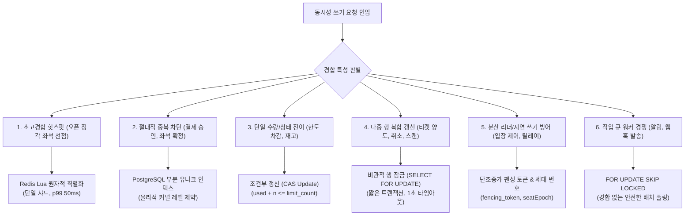
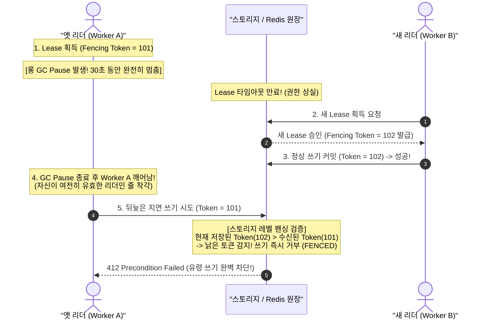
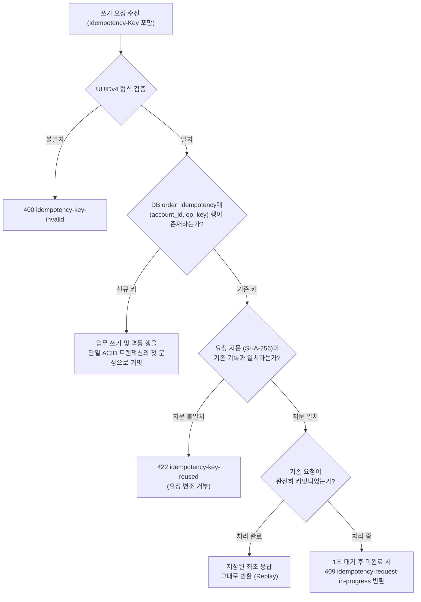

# DB 설계 편 6: 동시에 고칠 때: 잠금, 펜싱 토큰, 멱등 (Concurrency Controls, Fencing Tokens & Idempotency)

- **핵심 아키텍처 원칙**: 상황별 동시성 제어 무기의 적재적소 배치, 대규모 핫스팟에서의 비관적/낙관적 락 한계 극복(Redis Lua 직렬화), 펜싱 토큰(Fencing Token)을 통한 지연 쓰기(Stale Write) 차단, 3계층 멱등성 보장
- **관련 설계 정본**: [docs/data.md](../../data.md) §5(동시성 경합 매트릭스), §2(멱등 기록 및 유니크 규칙), §3(펜싱·세대·멱등 키 명세), §4(트랜잭션 경계 7·14·15번), [docs/api/guidelines.md](../../api/guidelines.md) §4, [ADR-0056](../../adr/0056-admission-leader-fencing-and-admission-person-recheck.md), [ADR-0086](../../adr/0086-query-index-rules-plan-diagnostics-data-pattern-gaps.md), [ADR-0109](../../adr/0109-delivery-jobs-in-postgres-drop-bullmq-cache-redis-key-classes-noeviction.md), [ADR-0146](../../adr/0146-data-retention-gaps-idempotency-records-log-retention.md)
- **함께 읽기**: [한 판 문서](../01-system-design.md) 8단계, [DB 설계 편 4: 같은 좌석을 두 번 팔지 않기](04-no-double-sale.md), [DB 설계 편 5: 일관성과 트랜잭션 경계](05-consistency-transactions.md), [결정 카드 D-06](../decisions/D06-seat-soft-hold-hard-sale.md)

---

## 1. 면접관의 질문

> **면접관**: "동일한 데이터를 수만 명이 동시에 수정하려고 할 때, 비관적 락(Pessimistic), 낙관적 락(Optimistic), 분산 락(Redlock), Redis 직렬화 중 어떤 기법을 선택하시겠습니까? 네트워크 지연이나 GC Pause로 인해 잠금 권한이 만료된 옛 워커의 지연 쓰기(Stale Write)와 중복 요청은 어떻게 차단합니까?"

면접관은 다음 세 가지 핵심 역량을 심층 검증한다:
1. **동시성 기법별 트레이드오프 이해**: "모든 곳에 낙관적 락" 또는 "모든 곳에 Redlock" 식의 단순한 접근이 극단적 트래픽 핫스팟에서 왜 치명적으로 붕괴하는지 메커니즘을 명확히 설명할 수 있는가?
2. **분산 시스템의 유령 쓰기(Stale Write) 방어**: 분산 락(Lease)을 쥐었던 프로세스가 GC Pause나 네트워크 단절 후 뒤늦게 깨어나 쓰기를 감행할 때 스토리지 파괴를 막는 펜싱 토큰(Fencing Token)을 설계할 수 있는가?
3. **완벽한 멱등성(Idempotency) 계층화**: 클라이언트 재시도, 외부 결제사 재호출, 메시지 브로커 중복 전송이라는 3대 중복 구간을 빈틈없이 방어하는 3계층 멱등 원장을 구축할 수 있는가?

---

## 2. 단순한 답과 깨지는 곳

### 단순한 답 (The Naive Approach)
> "모든 수정 작업에 `SELECT ... FOR UPDATE` 비관적 락을 걸거나, 모든 테이블에 `version` 컬럼을 두고 충돌 시 재시도하는 낙관적 락을 씁니다. 분산 환경에서는 Redis Redlock으로 락을 잡고, 쓰기 직전에 `isLeader()`로 락이 유효한지 확인합니다. 중복 요청은 Redis에 멱등키를 캐싱하여 막고, 순서 번호는 DB Sequence로 채번합니다."

### 어디서 깨지는가 (Failure Scenarios)

| 단순한 설계 | 대규모 동시성 환경에서 깨지는 이유 | 정본의 아키텍처 근거 |
| :--- | :--- | :--- |
| **인기 좌석에 비관적 락 (`FOR UPDATE`)** | 1개 좌석에 1,000명이 몰리면 1번째 트랜잭션을 제외한 999명이 DB 커널 락 큐에 줄을 선다. 커넥션 풀 고갈과 타임아웃으로 p99 지연시간이 수 초로 치솟고 DB CPU가 100%로 마비된다. | ADR-0014, NFR-003 |
| **인기 좌석에 낙관적 락 (CAS / 버저닝)** | 1,000명이 동시에 버전을 읽고 쓸 때 1명만 성공하고 999명은 충돌 실패한다. 999명이 애플리케이션 레벨에서 루프를 돌며 재시도하면 DB CPU와 네트워크 트래픽이 폭발하여 시스템이 자멸한다. | `docs/data.md` §5 |
| **분산 락 (Redlock) 만능주의** | 3~5개 Redis 노드에 분산 락을 획득하는 왕복 RTT(10~50ms)로 인해 p99 50ms 예산을 달성할 수 없다. 또한 JVM 롱 GC Pause 발생 시 락 TTL이 만료되어 다른 노드가 락을 획득한 상태에서, 깨어난 옛 노드가 쓰기를 감행하여 데이터가 파괴된다. | Martin Kleppmann의 Redlock 비판, ADR-0056 |
| **쓰기 직전 `isLeader()` 확인만 수행** | 애플리케이션이 `if (lock.isValid())`를 검사한 바로 그 다음 순간(Time-of-Check to Time-of-Use 틈새)에 GC Pause나 네트워크 지연이 발생하면 검사는 무용지물이 된다. | ADR-0056 '검토한 대안' |
| **멱등키를 Redis 메모리에만 저장** | Redis 노드 장애나 재시작 시 멱등 기록이 유실되어, 결제창 재호출이나 외부 PG 승인 요청이 두 번 실행되어 이중 결제가 발생한다. | ADR-0146 '검토한 대안' |
| **순서 번호를 DB Sequence로 채번** | 트랜잭션 롤백 시 Sequence 번호에 빈틈(Gap)이 발생하여, 번호의 연속성을 신뢰하고 이어받는 감사 로그나 스캐너 동기화가 과거 데이터를 영구 누락한다. | ADR-0086 |

---

## 3. 아키텍처 해법: 동시성 상황별 6대 무기 배치

PEAKET은 단 하나의 동시성 기법에 의존하지 않고, **비즈니스 특성과 경합 밀도에 따라 6가지 동시성 제어 무기를 적재적소에 배치**했다.

### 3.1 4대 동시성 제어 기법 정밀 비교 매트릭스

| 비교 항목 | 1) 낙관적 락 (Optimistic) | 2) 비관적 락 (Pessimistic) | 3) 분산 락 (Redlock) | 4) Redis Lua 단일 스레드 직렬화 (선택) |
| :--- | :--- | :--- | :--- | :--- |
| **동작 원리** | 버전 컬럼 대조 후 충돌 시 재시도 | DB 행 잠금(`FOR UPDATE`)으로 대기 | 다중 Redis 노드 분산 합의로 락 획득 | Redis 단일 스레드 이벤트 루프에서 마이크로초 단위 원자 실행 |
| **1개 좌석 1,000명 동시 경합** | **치명적 (999명 재시도 폭풍으로 DB 자멸)** | **치명적 (락 큐잉 지연 폭증, 커넥션 풀 고갈)** | **부적합 (합의 RTT로 50ms 예산 초과)** | **최적 (0.3ms 만에 1명 성공, 999명 즉각 탈락)** |
| **데드락(Deadlock) 위험** | 없음 | 높음 (다중 자원 획득 시) | 타임아웃 위험 존재 | **수학적으로 0% (대기 큐 자체가 없음)** |
| **스토리지 부하** | DB CPU 및 트래픽 증폭 | DB 락 메모리 및 커넥션 점유 | Redis 네트워크 트래픽 증가 | **디스크 I/O 0건, 단일 샤드 CPU < 20%** |
| **적용 영역** | 관리자 화면 수동 수정 | 티켓 양도, 취소, 현장 스캔 | 미사용 (폐기) | **오픈 정각 좌석 선점, 1인 한도, 대기열 순번** |

---

### 3.2 경합 유형별 6대 동시성 제어 무기 배치



1. **인메모리 원자적 직렬화 (Redis Lua)**:
   - 좌석 홀드(`hold.lua`), 실시간 1인 예매 쿼터 카운터, 대기열 순번 발급(`INCR`).
   - 단일 스레드로 마이크로초 단위 직렬 처리하여 락 대기 시간과 교착 상태를 원천 제거.
2. **물리적 유일 제약 (PostgreSQL 부분 유니크 인덱스)**:
   - `seat_sale` 테이블의 `UNIQUE (event_id, seat_id) WHERE status IN ('PENDING', 'SOLD')`.
   - `payment.order_id UNIQUE`, 취소 환불의 `order_cancellation` 유니크 제약.
3. **조건부 갱신 (Atomic Compare-And-Swap)**:
   - `purchase_quota`: `UPDATE ... SET used = used + n WHERE (used + n) <= limit_count`.
   - 판매 제어 `sale_control`: `WHERE version < $new_version` (버전 기반 전진).
4. **비관적 행 잠금 (`SELECT ... FOR UPDATE`)**:
   - 티켓 양도(`transfer_offer`), 예매 취소, 현장 게이트 스캔 경합.
   - 요청 내부에서 여러 행의 상태를 읽고 복합 갱신해야 하는 도메인에 한정 적용.
   - **엄격한 타임아웃 제한**: `statement_timeout = 1s`, `idle_in_transaction_session_timeout = 10s`를 적용하여 커넥션 결박을 원천 차단.
5. **펜싱 토큰 (Fencing Token) 및 세대 번호 (Epoch)**:
   - 분산 리더 권한 만료 후 지연 쓰기 차단.
6. **작업 큐 동시성 (`FOR UPDATE SKIP LOCKED`)**:
   - 알림/웹훅 발송 워커가 대량의 발송 대기 행을 경쟁 없이 쪼개어 가져갈 때 사용.

---

### 3.3 펜싱 토큰(Fencing Token)과 세대(Epoch) 기반 Stale Write 방어

분산 시스템에서 잠금(Lease)을 쥐고 있던 워커가 롱 GC Pause나 네트워크 단절로 멈췄다가, 잠금이 이미 만료되어 새 워커에게 넘어간 사실을 모른 채 뒤늦게 쓰기를 감행하는 이상 현상을 **단조증가 펜싱 토큰**으로 원천 차단한다.



#### PEAKET의 4대 펜싱/세대 번호 명세
1. **홀드 펜싱 토큰 (`seat_hold.fencing_token`)**:
   - Redis `hold.lua`가 좌석 선점 시마다 회차별 단조증가 번호를 채번한다.
   - 비동기 릴레이가 DB 원장에 적재할 때, 저장된 토큰보다 작은 과거의 지연 이벤트는 무조건 드롭(Drop)한다.
2. **입장 제어기 리더 세대 (`q:{event:E}:leader`)**:
   - `admission-ctrl`이 리더 권한(Lease)을 갱신할 때마다 `leaseTransitions` 세대 번호를 1씩 올린다.
   - 리더의 입장 쓰기 Lua 스크립트는 `내 세대 < 저장된 세대`이면 아무것도 쓰지 않고 `FENCED` 에러를 반환받고 즉시 대기 상태로 복귀한다.
3. **회차 세대 번호 (`seatEpoch`)**:
   - 좌석 Redis 마스터가 다운되어 새 노드로 페일오버될 때 세대 번호를 `max(세대 + 1, Redis TIME)`으로 갱신한다.
   - 클라이언트는 세대가 바뀐 구역의 오래된 델타 메시지를 무조건 폐기하고 전체 스냅샷을 다시 받는다.
4. **대기표 세대**:
   - 대기열 Redis 장애 복구 시 번호 건너뛰기 구간을 설정하고 새 세대를 대기표에 서명한다. 건너뛴 구간이라도 세대가 낮으면 장애 전 정당한 대기자로 인정한다.

---

### 3.4 3계층 멱등성 (Three-tier Idempotency) 아키텍처

네트워크 재시도, 브라우저 다중 클릭, 메시지 브로커 재전송으로 인한 중복 실행을 3개 계층에서 철저히 걸러낸다:



| 계층 | 멱등 키 및 저장소 | 유효 범위 및 수명 | 중복 방어 메커니즘 |
| :---: | :--- | :--- | :--- |
| **1계층: 클라이언트 API** | HTTP `Idempotency-Key` (UUIDv4)<br/>- 홀드: Redis `s:{event:E}:idem` (7분)<br/>- 주문/결제: DB `order_idempotency` (24시간) | `계정 ID × 작업(Operation) × Key` | SHA-256(메서드 + 경로 + Body) 요청 지문 검증. 변조 시 422 반환. 처리 중 재진입 시 409 반환 |
| **2계층: 외부 결제사 연동** | 승인: `confirm-{orderId}`<br/>취소: `cancel-{cancellationId}` | 토스페이먼츠(15일), 포트원(3시간) | 동일 멱등키로 재호출 시 외부 PG사가 이전 승인 결과를 그대로 반환 |
| **3계층: 메시지 브로커** | Kafka `eventKey`, 현장 단말 스캔 ID<br/>- DB `webhook_receipt` 유니크 제약 | 파티션 내 키 단위 중복 제거 | 수신 서비스가 `eventKey`를 대조하여 이미 처리된 이벤트는 즉시 ACK 후 폐기 |

- **트랜잭션 첫 문장 기록**: 공용 멱등 모듈은 멱등키 INSERT를 비즈니스 트랜잭션의 **가장 첫 번째 SQL 문장**으로 실행한다. 이를 통해 동일한 멱등키의 두 번째 동시 요청은 첫 번째 트랜잭션의 커밋을 DB 락 레벨에서 안전하게 기다린다.
- **성공 및 비즈니스 완료 건만 기록**: 파라미터 검증 실패(400), 단순 경합 탈락(409), 서버 에러(5xx) 등 데이터 변경 없이 끝난 실패는 멱등 원장에 기록하지 않아 사용자가 안전하게 재시도할 수 있도록 보장한다.

---

### 3.5 작업 큐 동시성: `FOR UPDATE SKIP LOCKED` vs Outbox 릴레이

비동기 작업 큐에서 여러 워커 파드가 동시에 작업을 가져갈 때 충돌 없이 작업을 분배하는 기법이다:

```sql
-- 알림/웹훅 발송 워커의 안전한 작업 폴링
BEGIN;
SELECT id, recipient, payload 
FROM notification_job 
WHERE status = 'PENDING' AND lease_until <= NOW() 
ORDER BY id 
LIMIT 100 
FOR UPDATE SKIP LOCKED;

UPDATE notification_job 
SET status = 'PROCESSING', lease_until = NOW() + INTERVAL '30 seconds' 
WHERE id = ANY($selected_ids);
COMMIT;
```

- **`SKIP LOCKED`의 이점**: 다른 워커 파드가 이미 `FOR UPDATE`로 잠근 행은 대기하지 않고 즉시 건너뛴다. 워커 파드를 수십 대로 증설해도 락 경합으로 인한 지연이 전혀 발생하지 않는다.
- **Outbox 릴레이에서 `SKIP LOCKED`를 쓰지 않는 이유 (ADR-0116)**:
  - 알림/웹훅 발송은 개별 작업 간의 순서가 중요하지 않아 `SKIP LOCKED`가 최적이다.
  - 그러나 **Outbox 릴레이는 이벤트의 발행 순서(`seq`)가 절대적으로 보장되어야 한다.**
  - 만약 Outbox 릴레이에서 `SKIP LOCKED`를 쓰면, 리더 파드가 잠근 앞선 이벤트를 건너뛰고 뒤쪽 이벤트가 Kafka로 먼저 발행되어 **순서 뒤집힘 사고**가 발생한다. 따라서 Outbox 릴레이는 쿠버네티스 Lease 기반의 단일 활성 리더(Single Active Leader) 방식을 채택했다.

---

### 3.6 연속성이 보장되는 단조증가 번호 채번

감사 로그 체인(`audit_chain_head`)이나 스캐너 동기화 순번(`scanner_seq`)처럼 **"단 하나의 빈틈(Gap)도 없이 연속적으로 증가해야 하는 번호"**는 PostgreSQL Sequence를 쓰지 않는다:

```sql
-- 트랜잭션 내 단조증가 카운터 발급
UPDATE sequence_counter 
SET current_seq = current_seq + 1 
WHERE domain_name = 'scanner_seq' 
RETURNING current_seq;
```

PostgreSQL Sequence는 성능을 위해 메모리 캐시를 사용하므로 트랜잭션이 롤백되면 발급된 번호가 영구 유실되어 구멍이 생긴다. 반면 카운터 전용 행을 트랜잭션 내에서 `UPDATE ... RETURNING`으로 갱신하면, 커밋된 트랜잭션들 사이에서 번호가 1, 2, 3... 빈틈없이 채번되며 **커밋 순서와 번호 순서가 100% 일치**한다.

---

## 4. 트레이드오프와 버린 대안 (Tradeoffs & Alternatives)

| 설계 결정 | 얻는 것 (Gains) | 치르는 값 (Costs) |
| :--- | :--- | :--- |
| **핫 키 직렬화 (Redis Lua)** | 잠금 대기 큐 및 교착 상태 완전 제거, 단일 네트워크 RTT로 0.3ms 이내 판정 | 단일 샤드의 단일 스레드 처리량(초당 약 3~5만 건)이 시스템 처리량의 상한이 됨 |
| **DB 원장 기반 작업 큐 (`SKIP LOCKED`)** | Redis/BullMQ 장애 시 작업 유실 위험 제거, 트랜잭션 원장과 작업 상태의 100% 원자성 | 외부 전문 메시지 큐 대비 DB 인스턴스 쓰기 I/O 증가 (인덱스 최적화 필요) |
| **단조증가 펜싱 토큰 & 세대** | GC Pause 및 네트워크 지연으로 인한 늦은 쓰기(Stale Write)를 스토리지 레벨에서 원천 차단 | 분산 컴포넌트 간 토큰 검증 로직 추가 및 세대 번호 동기화 복잡도 증가 |
| **업무 DB 내 멱등 원장 (`order_idempotency`)** | 노드 재시작이나 페일오버에도 멱등 기록이 영구 보존되어 이중 결제 위험 0% | 쓰기 트랜잭션마다 멱등 행 INSERT 1건 추가 및 24시간 후 만료 데이터 배치 삭제 필요 |

### 버린 대안

1. **Redlock 분산 락 알고리즘 전면 배제 (ADR-0056)**:
   - 3~5개 Redis 노드에 걸쳐 락을 획득하는 네트워크 합의 비용(10~50ms)이 너무 크다. 또한 분산 시스템 학계(Martin Kleppmann)에서 증명되었듯, 클라이언트의 GC Pause나 시스템 시계 급변(Clock Jump) 상황에서 안전성을 보장하지 못한다.
2. **선점 키에 대해 Redis `WAIT` 동기 복제 후 응답**:
   - 대기열 진입 피크(초당 20만 건)에서 복제본 쓰기 확인을 기다리면 응답 지연이 수십 배 폭증하며, 타임아웃 발생 시에도 쓰기가 롤백되지 않아 정합성 보장 이득이 없다.
3. **대기열 입장 시 PostgreSQL 중복 검사**:
   - 대기열 시스템의 초고속 경로에 RDBMS 디스크 I/O를 개입시키는 순간 시스템 전체가 붕괴한다. 대기열 중복 방지는 전적으로 Redis Lua 인메모리 키로 해결했다.
4. **BullMQ / Redis 기반 비동기 발송 큐 (ADR-0109)**:
   - Redis에 알림/웹훅 작업 큐를 두면 ElastiCache 메모리 정리(Eviction)나 장애 페일오버 시 발송 작업이 영구 유실될 수 있다. 발송 원장을 PostgreSQL에 두고 `SKIP LOCKED`로 소비함으로써 작업 유실 위험을 0으로 통제했다.

---

## 5. 핵심 꼬리 질문 5단 방어 (Staff Interview Q&A)

| 질문 단계 | 심층 질문 | 방어 논리와 기술적 근거 | 관련 정본 |
| :--- | :--- | :--- | :--- |
| **1단: 왜 (Why)** | 낙관적 락과 비관적 락이 모두 있는데 왜 오픈 정각 좌석 선점에는 둘 다 쓰지 않고 Redis Lua 직렬화를 썼습니까? | 비관적 락(`FOR UPDATE`)은 1,000명이 1개 행에 줄을 서서 DB 커넥션 고갈과 타임아웃 폭증을 부릅니다. 낙관적 락(버전 번호)은 1명만 성공하고 999명이 충돌 재시도 루프를 돌아 DB CPU를 100%로 태웁니다. 두 방식 모두 디스크 RDBMS의 동시성 한계에 부딪히므로, 메모리에서 단일 스레드로 0.3ms 만에 1명 성공과 999명 즉시 탈락을 결정하는 Redis Lua 직렬화가 유일한 해법입니다. | ADR-0014, `docs/data.md` §5 |
| **2단: 대안 (Alternatives)** | Redlock 같은 공인된 분산 락 대신 왜 단일 샤드 Redis Lua 직렬화를 선택했습니까? | Redlock은 최소 3개 이상의 독립 Redis 노드와 네트워크 합의를 거쳐야 하므로 홀드 p99 50ms 예산을 달성할 수 없습니다. 더 심각한 문제는 클라이언트 프로세스가 롱 GC Pause에 빠져 락 TTL이 만료되었을 때, 락이 타인에게 넘어간 상태에서 깨어난 옛 프로세스가 쓰기를 감행하는 스플릿 브레인(Split-brain) 결함을 소프트웨어 락 자체로는 막을 수 없기 때문입니다. | Martin Kleppmann Redlock 분석, ADR-0056 |
| **3단: 장애 대응 (Resilience)** | 분산 락이나 권한(Lease)을 쥔 워커가 GC Pause로 멈췄다가 깨어났을 때, 원장의 데이터 파괴를 어떻게 막습니까? | **단조증가 펜싱 토큰(Fencing Token)**으로 막습니다. 리더가 권한을 획득할 때마다 1씩 증가하는 펜싱 토큰(101, 102...)을 발급받고, 스토리지에 쓸 때마다 이 토큰을 함께 보냅니다. 스토리지 엔진은 자신이 이미 수락한 최신 토큰(102)보다 작은 옛 토큰(101)을 들고 온 쓰기 요청을 무조건 거부(`FENCED`)하므로, GC Pause 후 깨어난 옛 워커의 유령 쓰기가 물리적으로 차단됩니다. | ADR-0056, seat-hold §3 |
| **4단: 수치 근거 (Numbers)** | 멱등 테이블 `order_idempotency`에 동일한 키의 요청이 동시에 인입되면 경합 처리가 어떻게 되나요? | 공용 멱등 모듈은 멱등키 INSERT를 트랜잭션의 첫 문장으로 실행하며 `lock_timeout 1초`를 설정합니다. 동일 키로 인입된 2번째 요청은 1번째 트랜잭션의 커밋을 기다립니다. 1초 이내에 1번째 요청이 완료되면 그 커밋 결과를 그대로 반환(Replay)하고, 1초가 넘어가면 `409 Conflict`와 `idempotency-request-in-progress` 에러를 반환하여 중복 연산을 완벽히 격리합니다. | `docs/api/guidelines.md` §4 |
| **5단: 실측과 검증 (Verification)** | 펜싱 토큰과 세대 번호, 멱등 처리가 동시성 레이스 컨디션을 완벽히 차단함을 어떻게 검증했나요? | 카오스 엔지니어링 동시성 테스트를 통해 입증했습니다. S-T24(동일 멱등키 1,000건 동시 요청 시 1회만 실행 단언), Q-T30(리더 강제 GC Pause 주입 시 펜싱 토큰을 통한 Stale Write 차단 100%), S-T5(홀드 펜싱 토큰 역순 주입 시 과거 이벤트 드롭 100%), S-T26(노드 장애 조치 시 세대 번호 갱신 및 캐시 리셋)을 자동화된 테스트 스위트로 지속 검증하고 있습니다. | ADR-0176 결정 3, `docs/walkthrough/00-status.md` |

---

## 6. 30초 아키텍처 브리핑 (Staff Engineer Summary)

> "PEAKET의 동시성 제어 아키텍처는 **'경합 밀도에 따른 도구의 다변화'**와 **'펜싱 토큰을 통한 분산 유령 쓰기(Stale Write) 차단'**으로 완성됩니다.  
> 오픈 정각 1개 좌석에 1,000명이 몰리는 초고경합 핫스팟은 DB 락 대신 **Redis Lua 단일 스레드 직렬화**로 0.3ms 만에 탈락자를 걸러내어 p99 50ms를 사수하며, 최종 판매 확정은 PostgreSQL 부분 유니크 인덱스로 물리적 오버셀을 차단합니다.  
> 분산 리더나 워커의 GC Pause로 인한 유령 쓰기는 수신 스토리지가 **단조증가 펜싱 토큰**을 검증하여 100% 폐기합니다.  
> 또한 클라이언트 요청, 외부 PG사 연동, Kafka 메시지 수신의 3대 구간에 걸쳐 **3계층 멱등 원장**을 구축함으로써, 네트워크 순단이나 대규모 재시도 상황에서도 단 1건의 이중 결제나 이중 발권도 발생하지 않도록 수학적으로 통제했습니다."

---

## 7. 정본에서 읽을 곳

1. [docs/data.md](../../data.md) §5: 동시성 경합 매트릭스 전체
2. [docs/data.md](../../data.md) §2: 서비스별 멱등 기록 테이블 및 유니크 규칙
3. [docs/api/guidelines.md](../../api/guidelines.md) §4: `Idempotency-Key` 규격 및 공용 멱등 모듈 인터페이스
4. [docs/data.md](../../data.md) §3: `q:{event:E}:leader`, `seatEpoch`, `fencing_token` 명세
5. [ADR-0056](../../adr/0056-admission-leader-fencing-and-admission-person-recheck.md): 입장 제어 리더 펜싱 및 검토 대안
6. [ADR-0121](../../adr/0121-seat-redis-failover-defer-purchase-drop-db-hold-path.md): 회차 세대 번호 및 구매 유예 정책
7. [ADR-0109](../../adr/0109-delivery-jobs-in-postgres-drop-bullmq-cache-redis-key-classes-noeviction.md): PostgreSQL 원장 작업 큐 및 `SKIP LOCKED` 채택
8. [ADR-0086](../../adr/0086-query-index-rules-plan-diagnostics-data-pattern-gaps.md): 트랜잭션 카운터 행을 통한 단조증가 번호 채번
