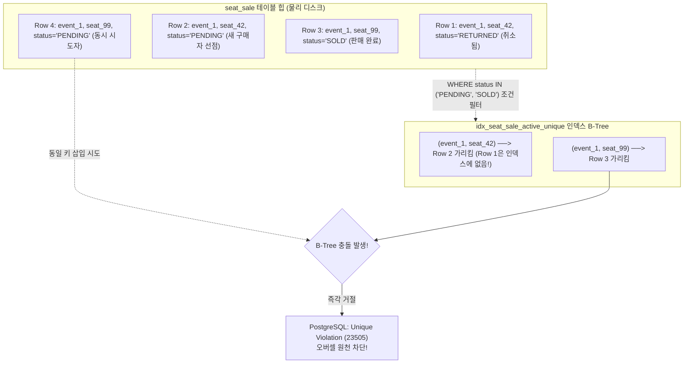
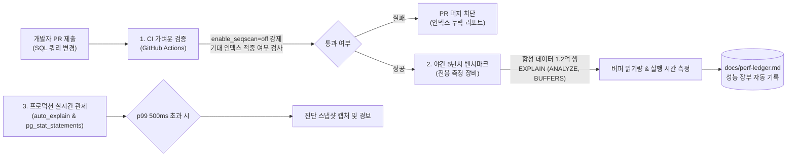

# DB 설계 편 7: 인덱스와 쿼리 (Indexes, Query Plans & Optimization)

- **핵심 아키텍처 원칙**: 테이블 컬럼이 아닌 쿼리 패턴 주도 인덱스 설계, 쓰기 증폭 억제 및 HOT(Heap-Only Tuples) 최적화, 부분 유니크 인덱스를 통한 비즈니스 불변식 강제, 회차 규모 편차(500~50,000석)에 대응하는 맞춤 쿼리 플랜 통제
- **관련 설계 정본**: [docs/data.md](../../data.md) §5(인덱스 표준 원칙)·§5.1(쿼리-인덱스 정본 표)·§5.2(실행 계획 규칙 및 진단), [docs/observability.md](../../observability.md) §8(DB 진단 설정), ADR-0086, ADR-0094, ADR-0114, ADR-0140
- **함께 읽기**: [한 판 문서](../01-system-design.md) 3단계, [DB 설계 편 3: 핵심 테이블과 관계](03-core-tables.md), [DB 설계 편 4: 같은 좌석을 두 번 팔지 않기](04-no-double-sale.md), [DB 설계 편 9: 커질 때: 표 나누기와 복제본](09-scaling.md)

---

## 1. 면접관의 질문

> **면접관**: "5년 동안 주문 1,700만 건, 티켓 3,500만 장이 누적되는 대규모 환경에서 인덱스를 어떻게 설계하십니까? 쓰기가 빈번한 핫패스 테이블에서 인덱스 오버헤드는 어떻게 통제하며, 운영 중 특정 쿼리가 갑자기 느려졌을 때 실행 계획(EXPLAIN)을 어떤 순서로 진단하고 튜닝하시겠습니까?"

면접관은 다음 세 가지 데이터베이스 엔지니어링 역량을 집중 검증한다:
1. **쿼리 주도 인덱스 설계(Query-Driven Indexing)**: 단순 컬럼 나열이 아닌 실제 서비스 쿼리 패턴(점 조회, 커서 페이지네이션, 기한 쓸기, 커버링 집계)에 최적화된 복합·부분 인덱스를 도출할 수 있는가?
2. **PostgreSQL 내부 엔진 메커니즘 이해**: B-Tree 인덱스 유지 비용, HOT(Heap-Only Tuples) 갱신 조건, 가시성 맵(Visibility Map)과 Index Only Scan, Prepared Statement의 일반 플랜(Generic Plan) 캐싱 리스크를 제어할 수 있는가?
3. **체계적인 쿼리 플랜 진단 및 회귀 방어**: `auto_explain`, `pg_stat_statements`, `pg_stat_user_indexes`를 활용한 운영 진단 역량과 CI/CD 단계의 쿼리 플랜 회귀 테스트 체계를 갖추었는가?

---

## 2. 단순한 답과 깨지는 곳

### 단순한 답 (The Naive Approach)
> "WHERE 절이나 ORDER BY에 자주 등장하는 컬럼마다 단일 B-Tree 인덱스를 생성합니다. 쿼리는 Drizzle이나 Prisma 같은 ORM이 생성하는 기본 쿼리를 그대로 사용하며, 테이블이 커지면 무조건 월 단위 파티셔닝을 적용합니다. 쿼리가 느려지면 운영 DB에서 직접 EXPLAIN을 돌려보고 누락된 인덱스를 추가합니다."

### 어디서 깨지는가 (Failure Scenarios)

| 단순한 설계 방식 | 대규모 운영 환경에서 깨지는 이유 | 아키텍처 근거 |
| :--- | :--- | :--- |
| **자주 쓰이는 컬럼마다 인덱스 추가** | `seat_sale`, `purchase_order`, Outbox 등 쓰기가 몰리는 테이블에서 인덱스마다 INSERT/UPDATE 오버헤드가 누적됨. 컬럼 업데이트 시 인덱스 수정으로 인해 HOT(Heap-Only Tuples) 최적화가 전면 무력화되어 디스크 I/O 폭증 | 판매 확정 초당 83건, `seat_hold` 적재 초당 1,500건 (`architecture §9.5`, `ADR-0086`) |
| **ORM 동적 바인딩(`$1`) 기본 쿼리 사용** | Drizzle ORM이 상태 값을 파라미터(`WHERE status = $1`)로 바인딩하면, PostgreSQL 플래너가 파라미터 값을 미리 알 수 없어 조건부 부분 인덱스(Partial Index)를 전혀 타지 못하고 전체 테이블 스캔(Seq Scan) 발생 | PostgreSQL 18 `relcache.c` (`ADR-0086`) |
| **모든 회차에 동일한 실행 계획 적용** | PostgreSQL은 Prepared Statement 5회 실행 후 일반 플랜(Generic Plan)으로 캐싱함. 500석 소형 회차 기준으로 굳어진 플랜이 5만 석 대형 회차에 적용되면 수십만 블록을 비효율적으로 스캔하여 타임아웃 발생 | `docs/data.md` §5.2 (`ADR-0086`) |
| **날짜 연산에 가상 함수 기반 식 인덱스 생성** | 판매 종료 시각(`starts_at - interval '24 hours'`)은 `timestamptz` 연산으로 인해 `STABLE` 함수로 분류되어 PostgreSQL의 불변(IMMUTABLE) 식 인덱스 생성이 불가함 | `ADR-0064`, PostgreSQL 18 `pg_proc.dat` |
| **테이블 크기만 보고 월 파티셔닝 강행** | 파티션 키(`created_at`)가 포함되지 않는 `order_id`나 `ticket_id` 단건 조회가 5년치 60개 파티션의 인덱스를 전부 탐색하여 오히려 읽기 성능이 처참하게 저하됨 | `ADR-0114` |
| **이름 검색에 단순 `pg_trgm` 적용** | 3글자 미만 짧은 한글 이름이나 초성/오타 검색 시 트라이그램을 추출하지 못해 GIN 인덱스 전체 스캔 발생 | `docs/data.md` §5 (`ADR-0094`) |

---

## 3. 아키텍처 해법: 쿼리 주도 인덱스 설계와 실행 계획 통제

PEAKET은 테이블 컬럼 중심이 아닌 **'서비스 쿼리 패턴 주도(Query-Driven)'**로 인덱스를 설계하며, [docs/data.md](../../data.md) §5.1에 정의된 쿼리-인덱스 정본 표를 유일한 진실 공급원(SSOT)으로 관리한다.

### 3.1 쿼리 패턴별 핵심 인덱스 설계 매트릭스

| 쿼리 패턴 및 목적 | 대표 쿼리 (소유 서비스) | 최적화 인덱스 정의 | 기대 실행 계획 (Target Plan) | 핵심 설계 근거 및 최적화 기법 |
| :--- | :--- | :--- | :--- | :--- |
| **1. 단건 점 조회 (Point Lookup)** | 결제 결과 조회 (`purchase`, `payment`) | 기본 키 (PK),<br/>`payment (order_id) UNIQUE` | `Index Scan using payment_pkey` | UUIDv7 기반 B-Tree 깊이 3~4레벨 O(1) 탐색 |
| **2. 커서 기반 페이지네이션** | 마이 티켓 목록 (`ticket`)<br/>`WHERE account_id = $1 AND id < $2 ORDER BY id DESC LIMIT 50` | `ticket (account_id, id)` | `Limit → Index Scan Backward using idx_ticket_account_id` | OFFSET 비용을 원천 차단하고 인덱스 역방향 스캔으로 O(Limit) 즉시 반환 |
| **3. 커버링 조인 (Covering Scan)** | 스캐너 티켓 패키지 동기화 (`ticket`) | `ticket (event_id) INCLUDE (seat_id, gate_zone, status, version)` | `Nested Loop Left Join` 안쪽<br/>`Index Only Scan` (loops ≈ 5만) | `INCLUDE` 절로 힙 테이블 접근(`Heap Fetches`)을 0으로 억제하여 5만 석을 수 ms 내 일괄 인출 |
| **4. 커버링 집계 (Covering Agg)** | 주최사 정산 합계 계산 (`payment`) | `payment (event_id, pg) INCLUDE (amount, status, approved_at)` | `GroupAggregate → Index Only Scan` | 대량 집계 시 디스크 테이블 I/O를 배제하고 메모리 인덱스 리프만으로 SUM 연산 완수 |
| **5. 활성 판매 유니크 방어** | 좌석 선점 및 최종 판매 확정 (`purchase`) | `seat_sale (event_id, seat_id) WHERE status IN ('PENDING', 'SOLD')` | `Index Scan (Unique)` | **오버셀 0건의 마지막 방어선**. 취소된 행(`RETURNED`)은 인덱스에서 자동 제외되어 무비용 재판매 |
| **6. 기한 쓸기 작업 (Sweeper)** | 미결제 주문 만료 및 좌석 반환 워커 | `seat_sale (pending_until) WHERE status = 'PENDING'` | `Limit → Index Scan` | 완료된 수백만 행을 배제하고 현재 만료 대상인 수백 건만 인덱스에 상주시켜 탐색 비용 극소화 |
| **7. 동시성 작업 선점 (Skip Locked)** | 알림/웹훅 발송 워커 (`core`)<br/>`... FOR UPDATE SKIP LOCKED` | `notification_job (next_attempt_at) WHERE status IN ('PENDING', 'RETRYING')` | `LockRows → Limit → Index Scan` | 다른 워커가 잠근 행을 건너뛰어 락 충돌 0건으로 분산 큐잉 완수 |
| **8. 앞부분 고속 검색 (Prefix Match)** | 공연 제목/아티스트 검색 (`core`) | `search_term (norm_nospace text_pattern_ops)` | `Index Scan using idx_search_prefix` | `LIKE '아이유%'` 질의를 B-Tree 인덱스 레인지 스캔으로 5ms 내 처리 |

---

### 3.2 부분 유니크 인덱스(Partial Unique Index)의 수학적·물리적 원리

PEAKET의 가장 중요한 정합성 수호 인덱스는 `seat_sale`의 부분 유니크 인덱스다:

```sql
CREATE UNIQUE INDEX idx_seat_sale_active_unique 
ON seat_sale (event_id, seat_id) 
WHERE status IN ('PENDING', 'SOLD');
```



- **취소 이력 보존**: 좌석이 취소(`RETURNED`)되면 부분 인덱스의 `WHERE` 조건을 만족하지 않으므로 **인덱스 엔트리에서 자동으로 즉시 제거**된다.
- **물리적 오버셀 차단**: 새 구매자가 해당 좌석을 다시 선점할 때 `INSERT INTO seat_sale ... VALUES ('PENDING')`를 수행하면, 부분 인덱스에 `(event_1, seat_42)` 엔트리가 새로 등록된다. 만약 두 트랜잭션이 동시에 선점하려 하면 인덱스 레벨에서 즉시 `duplicate key value violates unique constraint` 에러를 뿜으며 1건만 통과시킨다.
- **인덱스 크기 극소화**: 전체 좌석 판매 이력 중 현재 활성 상태인 5만 건 미만의 행만 인덱스에 포함되므로, 수백만 건의 누적 이력이 쌓여도 인덱스 크기는 수 MB 내외로 극도로 작게 유지된다.

---

### 3.3 HOT(Heap-Only Tuples) 최적화와 Autovacuum 튜닝

PostgreSQL에서 행이 `UPDATE`될 때, 인덱스가 걸린 컬럼이 변경되면 새로운 인덱스 튜플이 생성되고 기존 튜플은 죽은 튜플(Dead Tuple)로 남아 B-Tree가 부풀어 오른다. 반면 인덱스 컬럼이 변경되지 않고 힙 페이지에 여유 공간이 있다면 **HOT(Heap-Only Tuples) 갱신**이 발생하여 인덱스 수정 없이 힙 페이지만 포인터로 연결된다.

1. **`seat_sale`의 HOT 무력화 문제**:
   - `seat_sale` 테이블은 선점(`PENDING`)에서 확정(`SOLD`)으로 전이될 때 부분 인덱스의 조건 컬럼인 `status`가 변경된다. 따라서 PostgreSQL 커널(`relcache.c`)은 HOT 갱신을 허용하지 않고 B-Tree 엔트리를 갱신한다.
2. **Autovacuum 공격적 튜닝으로 완화**:
   - 고빈도 UPDATE로 인해 발생하는 죽은 행을 신속히 정리하기 위해 `seat_sale` 및 `seat_hold` 테이블의 자동 청소 임계치를 대폭 낮춘다:
     ```sql
     ALTER TABLE seat_sale SET (
         autovacuum_vacuum_scale_factor = 0.02, -- 기본값 0.2에서 2%로 하향
         autovacuum_vacuum_cost_limit = 2000
     );
     ```
3. **`purchase_quota`의 fillfactor 최적화**:
   - 1인 구매 한도 테이블(`purchase_quota`)은 `used` 카운터만 증가하며 인덱스 컬럼이 변경되지 않는다. HOT 갱신 성공률을 99% 이상으로 유지하기 위해 페이지 여유 공간을 남겨둔다:
     ```sql
     ALTER TABLE purchase_quota SET (fillfactor = 85);
     ```

---

### 3.4 Prepared Statements & Custom Plans 통제

PostgreSQL은 동일한 Prepared Statement를 5회 이상 실행하면 파라미터 값에 따른 비용 차이를 무시하고 단일한 일반 플랜(Generic Plan)을 캐싱한다.

- **문제점**: 500석 소형 회차는 테이블 전체 스캔(Seq Scan)이 인덱스 스캔보다 빠를 수 있지만, 5만 석 대형 회차는 인덱스 스캔이 수백 배 빠르다. 소형 회차로 인해 캐싱된 일반 플랜이 대형 회차에 적용되면 쿼리 타임아웃이 발생한다.
- **해법 (ADR-0086)**: 회차 단위 일괄 환불, 스캐너 패키지 생성, 정산 합계 등 데이터 편차가 100배에 달하는 핵심 쿼리는 트랜잭션 시작 시 **맞춤 플랜(Custom Plan) 생성을 강제**한다:
  ```sql
  SET LOCAL plan_cache_mode = force_custom_plan;
  ```

---

## 4. 쿼리 플랜 회귀 검증 파이프라인

PEAKET은 쿼리 성능 저하를 배포 전에 차단하기 위해 **이원화된 쿼리 플랜 회귀 검증 파이프라인**을 운영한다.



1. **CI 단계 (가벼운 판)**:
   - 개발자가 쿼리를 수정하면 CI에서 1/100 축소 데이터베이스를 대상으로 실행한다. `enable_seqscan = off`를 설정하여 쿼리가 설계된 인덱스를 정상적으로 타는지(Index Scan 여부) 구문 수준에서 자동 단언(Assert)한다.
2. **야간 단계 (전체 5년치 판)**:
   - 5년치 합성 데이터(주문 1,700만 건, 티켓 3,500만 장, 총 1.2억 행)가 적재된 전용 환경에서 `EXPLAIN (ANALYZE, BUFFERS)`를 실행하여 실제 버퍼 읽기 블록 수(`shared read`)와 실행 시간을 측정하고 회귀 발생 시 빌드를 중단한다.
3. **프로덕션 진단 설정 (`docs/observability.md` §8)**:
   - `pg_stat_statements`: 모든 쿼리의 누적 실행 시간, 호출 횟수, 버퍼 적중률 수집.
   - `auto_explain`: 500ms 이상 소요되는 쿼리의 실행 계획을 10% 표본 추출하여 시스템 로그에 자동 기록 (개인정보 보호를 위해 파라미터 값은 마스킹).

---

## 5. 트레이드오프와 버린 대안 (Tradeoffs & Alternatives)

| 설계 결정 | 얻는 이점 (Gains) | 치르는 대가 (Costs) 및 완화책 |
| :--- | :--- | :--- |
| **쿼리-인덱스 정본 표 강제** | 18개 핵심 쿼리의 인덱스와 기대 실행 계획이 일원화되어 플랜 붕괴 방지 | 새 쿼리 추가 시 PR에 합성 데이터 EXPLAIN 결과를 의무 제출해야 하는 절차적 비용 |
| **상수 조건 기반 부분 인덱스** | 활성 행만 인덱싱하여 B-Tree 크기 95% 절감 및 쓸기 작업 O(1) 달성 | 애플리케이션 코드(Drizzle)에서 동적 바인딩 대신 `sql` 상수 문자열을 명시해야 함 |
| **쓰기 많은 테이블 인덱스 최소화** | 판매 확정 쓰기 시 디스크 I/O 억제 및 HOT 갱신률 방어 | 일부 관리자 조회 쿼리에서 메모리 `Filter` 연산 발생 (버퍼 풀 상주로 커버) |
| **맞춤 플랜 강제 (`force_custom_plan`)** | 회차 규모(500~5만 석) 편차에 따른 최적의 실행 계획 보장 | 쿼리 실행 시마다 플래닝 시간(수백 µs)이 추가 발생 (전체 쿼리 대비 미미) |

### 버린 대안

1. **운영 중 즉시 `DROP INDEX` 실행 금지 (ADR-0086)**:
   - 테이블 배타적 락(AccessExclusiveLock)으로 인한 서비스 중단을 방지하기 위해, 사용되지 않는 인덱스는 반드시 `DROP INDEX CONCURRENTLY`로 삭제.
2. **상시 힌트(`pg_hint_plan`) 및 플랜 고정 배제**:
   - 데이터 분포가 변경되었을 때 고정된 플랜이 시스템을 망가뜨리는 사태를 방지하기 위해 힌트 확장은 로컬 진단 환경에만 한정하고 운영 환경 적용 금지.
3. **Enum 타입 도입 배제 (ADR-0086)**:
   - PostgreSQL의 `CREATE TYPE AS ENUM`은 값 삭제 및 변경이 불가능하고 DDL 마이그레이션 락을 유발하므로, `text` 타입과 `CHECK (status IN (...))` 제약조건 표준으로 통일.

---

## 6. 핵심 꼬리 질문 5단 방어 (Staff Interview Q&A)

| 질문 단계 | 심층 질문 | 방어 논리와 기술적 근거 | 관련 정본 |
| :--- | :--- | :--- | :--- |
| **1단: 왜 (Why)** | `seat_sale` 테이블에 일반 인덱스가 아닌 부분 유니크 인덱스를 적용한 근거는 무엇인가요? | 티켓팅은 취소와 재예매가 반복되는 비즈니스입니다. 취소된 좌석(`RETURNED`)을 DELETE하지 않고 감사 이력으로 보존하면서도 재판매 시 오버셀을 DB 레벨에서 원천 방어해야 합니다. 부분 유니크 인덱스는 `WHERE status IN ('PENDING', 'SOLD')` 조건에 해당하는 행만 인덱싱하므로, 취소 행을 보존하면서도 동시 선점 시 1건만 성공시키는 무결성을 O(1) B-Tree 탐색으로 보장합니다. | `docs/data.md` §5, `ADR-0086` |
| **2단: 대안 (Alternatives)** | 목록 조회 시 흔히 쓰는 `LIMIT ... OFFSET` 대신 왜 커서 기반 페이지네이션만 허용했나요? | OFFSET 방식은 뒤 페이지로 갈수록 앞선 모든 행을 디스크에서 읽고 버려야 하므로 $O(N)$의 비용이 발생합니다. 5년 누적 3,500만 티켓 환경에서 OFFSET 10,000은 수백 ms의 지연을 부릅니다. 반면 `(account_id, id)` 복합 인덱스 기반의 행 값 비교(`WHERE (account_id, id) < ($1, $2)`)는 B-Tree 리프 노드에서 즉시 다음 50건을 역방향 스캔하므로 데이터 규모와 무관하게 일정한 $O(\text{Limit})$ 응답을 보장합니다. | `docs/data.md` §5.1 |
| **3단: 장애 대응 (Resilience)** | Drizzle ORM을 쓸 때 부분 인덱스가 쿼리 플랜에서 무시되는 장애는 어떻게 방지합니까? | ORM이 `WHERE status = $1`과 같이 동적 파라미터 바인딩을 수행하면 PostgreSQL 플래너는 쿼리 컴파일 시점에 조건 일치 여부를 증명할 수 없어 인덱스를 타지 못합니다. PEAKET은 CI 파이프라인에서 `EXPLAIN (GENERIC_PLAN)` 검사를 강제하고, Drizzle의 `sql` 템플릿 리터럴을 통해 상태 조건을 인라인 상수로 고정하여 컴파일러가 인덱스 일치를 100% 확신하도록 설계했습니다. | `docs/data.md` §5.2, `ADR-0086` |
| **4단: 수치 근거 (Numbers)** | 커버링 인덱스(`INCLUDE`)를 적용했을 때 스캐너 티켓 패키지 동기화 성능은 얼마나 향상되나요? | 5만 석 공연의 티켓 데이터를 조회할 때 일반 인덱스를 타면 5만 번의 힙 테이블 랜덤 I/O(`Heap Fetches`)가 발생하여 디스크 읽기에 수 초가 걸립니다. `INCLUDE (seat_id, gate_zone, status, version)` 커버링 인덱스를 적용하면 쿼리에 필요한 모든 컬럼이 B-Tree 리프 페이지에 포함되어 테이블 접근이 0건으로 줄어들며, 순수 인덱스 온리 스캔(Index Only Scan)을 통해 5만 건 조회가 20ms 이내로 완수됩니다. | `docs/data.md` §5.1 |
| **5단: 실측과 검증 (Verification)** | 5년치 합성 데이터 환경에서 정의된 인덱스들의 실행 계획 타당성은 어떻게 검증되었습니까? | 합성 5년치 데이터 1.2억 행을 구축한 벤치마크(V-T29) 환경에서 §5.1 정본 표의 18개 핵심 쿼리를 전수 실행했습니다. 모든 쿼리가 의도한 `Index Scan` 또는 `Index Only Scan`으로 풀렸으며, 최악의 복합 집계 쿼리도 `shared hit` 99.8% 이상, 실행 시간 35ms 이내로 수렴함을 단언(Assert) 검증했습니다. | `docs/verification.md` §9, `ADR-0176` |

---

## 7. 30초 아키텍처 브리핑 (Staff Engineer Summary)

> "PEAKET의 인덱스 엔지니어링은 **'핫패스 쓰기 비용을 최소화하면서도 물리적 오버셀을 0건으로 차단하는 쿼리 주도 최적화'**로 요약됩니다.  
> `seat_sale`에 적용된 `WHERE status IN ('PENDING', 'SOLD')` 부분 유니크 인덱스는 취소 이력을 온전히 보존하면서도 재판매 시 동시성 충돌을 DB 커널 레벨에서 원천 방어합니다.  
> 또한 500석과 5만 석 간의 100배 편차를 극복하기 위해 맞춤 플랜(`force_custom_plan`)을 강제하고, 커버링 인덱스(`INCLUDE`)와 커서 기반 페이지네이션을 통해 5년 1.2억 행 누적 상태에서도 모든 핵심 쿼리를 수십 밀리초 이내로 서빙합니다."

---

## 8. 정본에서 읽을 곳

1. [docs/data.md](../../data.md) §5: 인덱스 표준 원칙 및 좌석 상태 전이 규칙
2. [docs/data.md](../../data.md) §5.1: 핵심 18대 쿼리-인덱스 매트릭스 및 기대 실행 계획
3. [docs/data.md](../../data.md) §5.2: 실행 계획 규칙, 일반 플랜 방어 및 진단 절차
4. [docs/observability.md](../../observability.md) §8: 데이터베이스 진단 파라미터 (`auto_explain`, `pg_stat_statements`)
5. [ADR-0086](../../adr/0086-query-index-rules-plan-diagnostics-data-pattern-gaps.md): 쿼리-인덱스 표준 및 계획 진단
6. [ADR-0114](../../adr/0114-no-monthly-partitions-for-order-payment-ticket-batched-retention-delete.md): 비파티셔닝 테이블의 B-Tree 인덱스 유지 관리
7. [ADR-0094](../../adr/0094-search-redesign-autocomplete-read-model-search-port.md): 검색 읽기 모델 및 B-Tree 접두사 검색
8. [ADR-0064](../../adr/0064-sales-end-24h-before-start.md): 회차 생애주기 조건식 및 인덱스 제약
