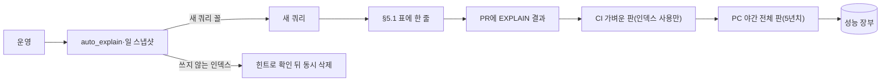

# DB 설계 편 7: 인덱스와 쿼리

- **기준 시점**: ADR-0177까지, 2026-11-01
- **맡는 정본**: [docs/data.md](../../data.md)의 §5 인덱스 표준 단락과 '좌석 상태 전이' 줄, §5.1 쿼리-인덱스 표, §5.2 실행 계획 규칙과 진단, [ADR-0086](../../adr/0086-query-index-rules-plan-diagnostics-data-pattern-gaps.md). 함께 읽는 결정은 [ADR-0114](../../adr/0114-no-monthly-partitions-for-order-payment-ticket-batched-retention-delete.md)(주문·결제·티켓 표를 나누지 않는 결정)과 [ADR-0094](../../adr/0094-search-redesign-autocomplete-read-model-search-port.md)(검색 읽기 모델)다.
- **규범이 아니다**: 정본을 풀어 쓴 해설이다. 숫자와 규칙이 정본과 다르면 정본이 맞다([ADR-0177](../../adr/0177-walkthrough-explain-in-interview.md)).
- **앞뒤 편**: 앞은 [DB 설계 편 6](06-concurrency.md)(동시에 고칠 때: 잠금, 펜싱 토큰, 멱등), 뒤는 [DB 설계 편 8](08-redis-keys.md)(Redis 키 설계)다.

## 1. 면접관의 질문

> **면접관**: "주문이 5년에 1,700만 건, 티켓이 3,500만 장 쌓입니다. 인덱스는 어떻게 정하고, 쿼리가 느려지면 무엇부터 보시겠어요?"

면접관은 인덱스(책 뒤의 찾아보기처럼 행을 빨리 찾게 하는 구조)를 칸이 아니라 쿼리에서 출발해 정하는지 본다. 인덱스가 쓰기에 치르는 값을 아는지, 실행 계획(DB가 쿼리를 어떤 순서와 방법으로 처리할지 세운 계획)을 근거로 말하는지도 본다.

## 2. 단순한 답

> "WHERE에 자주 나오는 칸마다 B-tree 인덱스를 겁니다. 쿼리는 ORM이 만든 것을 그대로 쓰고, 표가 커지면 달마다 파티션으로 나눕니다. 느려지면 그때 EXPLAIN을 보고 인덱스를 더합니다."

B-tree는 값을 정렬해 나무 모양으로 둔 기본 인덱스다. ORM은 코드의 객체를 SQL로 바꿔 주는 도구이고, 이 설계에서는 Drizzle(SQL 모양 그대로 쓰는 쿼리 빌더, ADR-0037)이 그 자리에 있다. EXPLAIN은 실행 계획을 보여 주는 명령이다. 작은 서비스라면 이 답으로 충분하다. 이 설계에서는 쓰기가 몰리는 표, 회차마다 100배 다른 크기, 한글 검색, 측정 환경에서 맞지 않는다.

## 3. 어디서 깨지나

| 단순한 답 | 깨지는 곳 | 숫자와 근거 |
| --- | --- | --- |
| 자주 거르는 칸마다 인덱스 | 쓰기가 많은 표(`seat_hold`, `seat_sale`, `purchase_order`, `payment`, 보낼 사건을 먼저 적어 두는 Outbox)는 인덱스마다 쓰기 비용이 는다. 인덱스가 걸린 칸을 바꾸면 HOT 갱신(인덱스는 두고 같은 페이지에 새 행만 쓰는 가벼운 갱신)이 되지 않는다 | 3년차 판매 확정 최대 초당 약 83건, 홀드(좌석을 잠시 잡아 두기) 원장 쓰기 초당 약 1,500건 `[추정]`(docs/architecture.md §9.5). `status` 전이는 부분 유니크 인덱스의 조건 열이라 HOT가 막힌다(PostgreSQL 18 `relcache.c`) |
| ORM이 만든 쿼리 그대로 | Drizzle은 값을 `$1` 같은 자리표시자로 바꾼다. 부분 인덱스(조건에 맞는 행만 담은 인덱스)는 계획을 세울 때 조건과 맞춰 보므로 `status = $1`이면 쓰지 못한다 | PostgreSQL 18 문서(ADR-0086 맥락) |
| 같은 문장은 같은 계획 | prepared statement(미리 분석해 이름을 붙여 둔 쿼리)는 처음 5번 맞춤 계획(넘겨받은 값을 보고 세운 계획)을 쓴 뒤 일반 계획(값과 관계없이 쓰는 계획)과 견준다. 작은 회차에서 굳은 계획이 큰 회차에 맞지 않을 수 있다 | 회차 크기 500석~5만 석(docs/data.md §5.2) |
| 판매 종료 시각에 식 인덱스 | 판매 종료는 `starts_at - 24시간`인데 `timestamptz - interval`은 STABLE(한 문장 안에서만 결과가 같은 함수)이라 식 인덱스(계산한 값에 거는 인덱스)에 쓸 수 없다 | PostgreSQL 18 `pg_proc.dat`, ADR-0064 |
| 외래 키면 인덱스도 있다 | PostgreSQL은 참조하는 쪽 열에 인덱스를 자동으로 만들지 않는다. 보존 기한이 지난 행을 지울 때 자식 행을 훑게 된다 | 나눠 지우기는 1만 건 `[가정]`씩, 정비 시간 04:00~06:00(ADR-0114 결정 3) |
| 표가 커지면 월 파티션 | 파티션(큰 표를 기간 등으로 나눈 조각) 키로 거르지 않는 조회는 파티션 수만큼 인덱스를 찾는다. 유일 확인 표, 떼어 내기 순서, 부모 표 ANALYZE(열마다 흔한 값과 분포를 모으는 명령)가 따라붙는다 | 5년치는 한 표로 감당할 크기이고 큰 B-tree도 깊이 3~4단 `[추정]`(ADR-0114 결정 1) |
| 이름 검색은 pg_trgm | pg_trgm(3글자 조각으로 비슷한 문자열을 찾는 확장)은 조각을 못 뽑는 패턴이면 인덱스 전체를 훑고, 짧은 한글 이름의 오타에 약하다 | '루멘'과 '루맨'의 유사도 0.2, 기본 기준 0.3(docs/data.md §5) |
| 느려지면 그때 EXPLAIN | 운영에서 처음 보면 늦다. 그런데 합성 5년치는 수십 GB `[추정]`라 CI(코드를 올릴 때마다 도는 자동 검사)의 GitHub 러너 디스크(SSD 14GB)에 들어가지 않는다 | docs/data.md §5.2 |

## 4. 지금 설계

### 4.1 원칙: 쿼리 먼저, 표 하나에 모은다

- docs/data.md §5.1 쿼리-인덱스 표가 '쿼리 → SQL 꼴 → 인덱스 → 기대 계획 → 진단'의 정본이다(ADR-0086 결정 6 ①). 새 쿼리는 이 표에 한 줄을 더하고, PR(코드 변경 요청)에 합성 데이터로 뜬 `EXPLAIN (ANALYZE, BUFFERS)` 결과를 붙인다.
- 합성 데이터는 5년치 주문 약 1,700만 건·티켓 약 3,500만 장, 대형 회차 5만 석이다. 표의 기대 계획은 모두 `[실측 전]`이다.
- docs/data.md §5가 표준으로 정한 인덱스는 넷이다.
  - `seat_sale (event_id, seat_id) WHERE status IN ('PENDING','SOLD')`: 활성 판매 유일 부분 인덱스. 오버셀(같은 좌석이 두 사람에게 팔리는 일)의 마지막 방어선이다(DB 설계 편 4).
  - `seat_hold (event_id, seat_id) WHERE status = 'HELD'`: 홀드 원장의 활성 홀드 유일 부분 인덱스.
  - `event_seat_price (event_id, seat_id)`: 회차·좌석별 등급 정본의 기본 키.
  - `search_term`의 `norm_nospace`·`jamo`·`chosung`에 둔 앞부분 일치용 B-tree(`text_pattern_ops`, `LIKE '…%'`를 인덱스로 찾게 하는 비교 방식).

### 4.2 쿼리 꼴마다 고른 인덱스

docs/data.md §5.1의 18줄 가운데 꼴이 다른 것을 골랐다.

| 꼴 | 쿼리(서비스) | 인덱스 | 기대 계획(측정 전) |
| --- | --- | --- | --- |
| 하나 찾기 | 결제 결과 조회(purchase·payment) | 기본 키, `payment (order_id)` 유일 | `Index Scan` |
| 커서 목록 | 마이 티켓(ticket) `WHERE account_id = $1 AND id < $2 ORDER BY id DESC LIMIT 50` | `ticket (account_id, id)` | `Limit → Index Scan Backward` |
| 커버링 조인 | 스캐너 패키지(ticket) | `ticket (event_id) INCLUDE (seat_id, gate_zone, status, version)`, `device_key (ticket_id) INCLUDE (key_id, public_key) WHERE revoked_at IS NULL` | `Nested Loop Left Join`, 안쪽 Index Only Scan(loops ≈ 5만) |
| 커버링 집계 | 정산 합계(payment) | `payment (event_id, pg) INCLUDE (amount, status, approved_at)` | `GroupAggregate → Index Only Scan` |
| 회차 일괄 | 회차 취소 일괄 환불(purchase) | `purchase_order (event_id, id) WHERE status IN (<환급 대상 상태>)` | `Limit → Index Only Scan` |
| 기한 쓸기 | 상태 쓸기 작업(각 서비스) | `payment (status_changed_at) WHERE status = 'UNKNOWN'`, `seat_sale (pending_until) WHERE status = 'PENDING'`, Outbox `(seq) WHERE sent_at IS NULL` 등 | `Limit → Index Scan`(끝난 행은 인덱스에 없다) |
| 작업 가져가기 | 알림 발송 워커(core) `… FOR UPDATE SKIP LOCKED` | `notification_job (next_attempt_at) WHERE status IN ('PENDING','RETRYING')` | `LockRows → Limit → Index Scan` |
| 조건부 갱신 | 판매 확정·결제 접수(purchase) | `purchase_quota` 기본 키 | `Update → Index Scan using purchase_quota_pkey`(HOT 갱신) |
| 인덱스를 더하지 않는 곳 | 주문 만료 안전망(purchase) | 기본 키만. '만든 지 1일~90분 `[가정]`'을 UUIDv7 경계로 바꿔 범위로 읽는다 | `Limit → Index Scan using purchase_order_pkey`, 상태는 Filter |
| 앞부분 검색 | 공연 검색(core, 읽기 전용 복제본) | `search_term` B-tree. 중간 일치는 훑고, NFR-028(검색 응답 목표)을 넘으면 두 글자 조각 확장 pg_bigm을 먼저 넣는다 | 앞부분 `Index Scan`, 중간 일치 `Seq Scan`(행 수만 개) |

- **계획 노드**: `Index Scan`은 인덱스로 찾아 표를 읽고, `Index Only Scan`은 표를 건너뛰며, `Seq Scan`은 표 전체를 훑는다. `Filter`는 읽은 뒤 버리는 조건, `loops`는 안쪽 노드를 되풀이한 수다. 커서 목록은 마지막으로 본 행 다음부터 읽는 쪽 나누기다.
- **기한 쓸기**: 대기 상태만 담은 부분 인덱스 `(기한) WHERE status = '대기 상태'`를 쓴다(ADR-0086 결정 6 ③). 끝난 행은 인덱스에서 빠져 인덱스가 작다.
- **작업 가져가기**: `FOR UPDATE SKIP LOCKED`는 남이 잠근 행을 건너뛰는 잠금이다. 짧은 트랜잭션(모두 하거나 모두 하지 않는 DB 쓰기 단위)에서 고르고 임대 시각(이 시각까지 그 워커가 맡는다는 표시)을 쓴 뒤 커밋한다(ADR-0109). UUIDv7은 시각이 앞에 든 ID라 '언제 만들었나'를 기본 키 범위로 읽는다.

표 아래 규칙 셋도 같은 무게다(docs/data.md §5.1).

- **외래 키를 참조하는 쪽 열에는 인덱스를 둔다**: 나눠 지우기, 부모 행 삭제, 파티션 떼어 내기가 이 인덱스로 자식 행을 찾는다.
- **쓰기가 많은 표는 인덱스를 아낀다**: 주문 만료 안전망은 새 인덱스 없이 Filter로 거른다. CS 처리함(`cs_case (next_due_at, id) WHERE status <> 'RESOLVED'`)도 종류는 Filter로 거르고, 버린 행(`Rows Removed by Filter`)이 결과의 10배를 넘으면 그때 `(kind, next_due_at, id)`를 더한다.
- **커버링 인덱스(`INCLUDE`)는 잘 바뀌지 않는 표에 둔다**: 쿼리에 필요한 칸을 모두 담아 표를 다시 읽지 않게 하는 인덱스다. 대상은 티켓, 기기 키, 스캔 기록, 후기다. 가시성 맵(페이지의 모든 행이 모두에게 보이는지 적은 비트)이 켜진 페이지만 표를 건너뛰기 때문이다. 상태가 계속 바뀌는 `seat_sale`·`seat_hold`에는 효과가 작다.

HOT가 막히는 `seat_hold`는 표별 `autovacuum_vacuum_scale_factor`(죽은 행, 곧 고치거나 지워서 더는 보이지 않는 옛 행이 얼마나 쌓이면 자동 청소를 돌릴지)를 0.02 `[가정]`(기본 0.2)로 낮춘다. `fillfactor`(페이지를 덜 채워 새 행을 쓸 자리를 남기는 설정)는 인덱스 밖 열만 바꾸는 갱신(`purchase_quota.used` 등)에 쓴다(docs/data.md §5).

### 4.3 실행 계획 규칙

docs/data.md §5.2의 규칙이다.

| 규칙 | 무엇을 | 왜 |
| --- | --- | --- |
| 부분 인덱스 조건은 상수 | 상태 값(`'HELD'` 등)은 Drizzle의 `sql` 상수 조각으로 쓰고, PR 검토 때 `EXPLAIN (GENERIC_PLAN)`으로 일반 계획에서도 쓰이는지 본다 | `$1`로 쓴 조건은 부분 인덱스를 쓰지 못한다 |
| 식 인덱스 | IMMUTABLE(입력이 같으면 늘 같은 결과) 함수만 쓴다. 판매 종료는 `starts_at > now() + interval '24 hours'`처럼 열을 그대로 두고 비교한다. 생성 열에 인덱스가 필요하면 STORED로 만든다 | 18의 기본인 가상 생성 열에는 인덱스를 만들 수 없다 |
| 커서 목록 | `(<등호 열>, 정렬값, id)` 인덱스와 `(정렬값, id) < ($1, $2)` 행 값 비교로 읽는다. 커서 정렬 칸은 NOT NULL이다 | 행 값 비교는 NULL이 섞이면 결과가 NULL이다. 방향이 섞인 정렬(후기 별점 순)은 정렬을 받아들인다 |
| 맞춤 계획 강제 | 일괄 환불 대상 고르기, 스캐너 패키지, 정산 합계는 트랜잭션 첫 문장에 `SET LOCAL plan_cache_mode = force_custom_plan`을 둔다 | 회차 크기에 따라 좋은 계획이 다르다 |
| 정렬·해시 메모리 | 배치·마감·정산 DB 역할만 `work_mem`을 64MB `[가정]`로 올린다. 핫패스(요청이 가장 많이 지나는 경로) 역할은 기본 4MB다 | 쿼리 하나가 정렬·해시마다 이만큼 쓸 수 있다 |
| 힌트와 가상 인덱스 | `pg_hint_plan`(계획을 사람이 정하는 힌트 확장) 1.8.0과 `hypopg`(만들지 않은 인덱스로 계획을 보는 확장) 1.4.2는 로컬 측정 환경(운영 전 시험 환경인 스테이징은 띄울 때)에만 넣고, 운영·데모에는 넣지 않는다 | PostgreSQL에는 힌트와 인덱스 숨기기가 없어 진단에만 쓴다 |
| 인덱스 지우기 | `idx_scan`·`last_idx_scan` 확인 → 힌트로 '없을 때' 계획 확인 → 정비 시간에 `DROP INDEX CONCURRENTLY`(쓰기를 막지 않고 지우기) | 지운 인덱스를 되돌리려면 다시 만들어야 한다 |

### 4.4 느린 쿼리를 찾는 길

- **진단 설정**(docs/observability.md §8): 쿼리별 통계를 모으는 `pg_stat_statements`의 `track_planning`을 켠다. 느린 쿼리의 계획을 로그에 남기는 `auto_explain`은 500ms `[가정]` 넘는 쿼리의 계획을 10% `[가정]` 표본으로 남기고 매개변수 값은 남기지 않는다. 임시 파일 기록 `log_temp_files`는 10MB `[가정]`이고, 잠금 대기 기록 `log_lock_waits`를 켠다.
- **일 스냅샷**: 정비 잡(정해진 시간에 도는 관리 작업)이 매일 `pg_stat_user_tables`·`pg_stat_user_indexes`를 `stat_snapshot` 표에 남기고 90일 `[가정]` 뒤 지운다. 큰 표 순차 스캔, `idx_scan = 0` 인덱스, 죽은 행 수, HOT 비율을 본다.
- **계획 읽는 순서**: ① 추정과 실제 행 수(10배 넘게 다르면 통계부터) ② `Buffers`의 `read` ③ `loops`(시간·행 수는 한 번 평균, Buffers는 합계) ④ `Rows Removed by Filter` ⑤ `Heap Fetches` ⑥ `Subplans Removed` ⑦ 계획 시간 ⑧ 일반 계획.
- **계획 회귀 시험 두 판**(기술 검토 낮음-169): 전체 판은 로컬 측정 PC(메모리 32GB)의 야간 작업이 5년치로 금지 노드(큰 표의 순차 스캔 등)와 비용 변화를 보고 성능 장부(측정 결과를 모으는 문서)에 남긴다. 가벼운 판은 스키마를 바꾸는 PR마다 CI가 축소 데이터(1/100 `[가정]`)에서 `enable_seqscan`을 끄고 기대한 인덱스를 쓰는지만 본다.

## 5. 트레이드오프와 버린 길

| 정한 것 | 얻는 것 | 치르는 값 |
| --- | --- | --- |
| 쿼리-인덱스 표를 정본으로 | 핵심 쿼리마다 인덱스, 기대 계획, 진단 방법이 한곳에 있다 | 새 쿼리마다 표 한 줄과 EXPLAIN 결과를 붙인다. 표와 인덱스가 늘어 쓰기마다 INSERT가 조금 는다(ADR-0086 대가) |
| 대기 상태만 담은 부분 인덱스 | 끝난 행이 없어 작고, 쓸기가 `Limit → Index Scan`으로 끝난다 | 조건을 상수로 쓰고, 상태 목록을 SQL과 글자까지 같게 맞춘다 |
| 쓰기 많은 표의 인덱스 아끼기 | 쓰기 비용과 HOT 갱신을 지킨다 | 일부 조회는 Filter로 거르고 버린 행 수를 지켜본다 |
| 주문·결제·티켓 표를 나누지 않기 | 유일·외래 키가 보통 규칙이고, 조회가 인덱스 하나만 찾는다 | 큰 DELETE가 WAL(DB가 바꾼 내용을 먼저 적는 기록)·죽은 행·복제 지연을 만들고, 5년치 인덱스가 하나로 크다(ADR-0114) |
| 계획 회귀 시험 두 판 | CI가 러너 디스크 안에서 돈다 | CI는 비용 변화를 보지 못하고, 5년치 판단은 PC 한 대의 야간 결과다 |

버린 길과 이유는 정본에서 옮겼다.

- **인덱스를 바로 지우기**: 되돌리려면 다시 만들어야 한다(ADR-0086).
- **힌트·계획 고정을 평소에 쓰기**: 데이터와 통계가 바뀌어도 계획이 따라가지 않는다(ADR-0086). Aurora 쿼리 계획 관리는 K3 측정(판매 확정 DB 부하 시험) 뒤 대형 회차 핵심 쿼리에만 검토한다.
- **enum 타입**: 있는 값을 뺄 수 없다. 상태 칸은 `CHECK (… IN (…))`로 두고, 부분 인덱스 조건을 바꿀 때는 새 인덱스 동시 생성 → 계획 확인 → 옛 인덱스 동시 삭제 순서다(ADR-0086 결정 10 ①).
- **5년치 통계를 축소 데이터에 얹기**: 플래너(실행 계획을 세우는 DB 부분)가 실제 페이지 수로 행 수를 다시 어림해 작은 표에서는 큰 표의 계획이 나오지 않는다(docs/data.md §5.2).
- **주문·결제·티켓 월 파티션**: 이득을 잰 적이 없다(ADR-0114). 다시 고르는 조건은 DB 설계 편 9가 다룬다.
- **pg_trgm + Redis 후보 캐시**: 조합 중 글자·초성·한/영 실수를 맞히지 못하고, 무작위 입력이 Redis 키와 DB 질의를 늘린다. Elasticsearch·OpenSearch는 대상이 1~2만 건이고 검색어 대부분이 이름이라 얻는 것이 적다(ADR-0094).
- **MySQL**: 부분 유니크 인덱스가 없고, 트랜잭션 안에서 멈춘 연결을 끊는 서버 쪽 시간 초과와 트랜잭션 안의 DDL(표 구조를 바꾸는 문장)이 없다(ADR-0083 결정 1 ①·③·④). 잠금 대기 최솟값 1초라는 근거 ②는 DB 비상 홀드 경로를 없애 더는 근거가 아니다(ADR-0083 상태 줄, ADR-0121).

## 6. 꼬리 질문

| 질문 | 답의 요지 | 근거 |
| --- | --- | --- |
| 부분 인덱스가 계획에 안 잡혀요. 왜죠? | Drizzle이 상태 값을 `$1`로 바꾸면 계획을 세울 때 조건이 맞는지 모른다. `sql` 상수 조각으로 쓰고 `EXPLAIN (GENERIC_PLAN)`으로 본다 | docs/data.md §5.2 |
| 상태 칸에 그냥 인덱스를 걸면요? | 쓸기는 대기 행 몇 개만 찾으므로 그 상태만 담은 부분 인덱스가 작다. 바뀌는 칸이 인덱스에 들면 HOT 갱신도 막힌다 | docs/data.md §5·§5.1 |
| 같은 쿼리가 큰 회차에서만 느리면요? | 처음 5번 뒤 일반 계획으로 굳었을 수 있다. 회차 단위 일괄 작업 셋은 맞춤 계획을 강제한다 | ADR-0086 결정 6 ⑧ |
| `seat_sale`에 커버링 인덱스를 걸면요? | 상태가 계속 바뀌어 가시성 맵이 꺼진 페이지가 많아 표를 다시 읽는다(`Heap Fetches`). 효과는 작고 쓰기 비용만 는다 | ADR-0086 결정 6 ⑤ |
| OFFSET은 쓰지 않나요? | 목록은 커서가 기본이다. 내 문의는 계정당 행이 적어 OFFSET(앞의 행 수만큼 건너뛰는 쪽 나누기) 비용이 작고, 검색은 `LIMIT 20 OFFSET`을 받아들인다 | docs/data.md §5.1 |
| 쓰지 않는 인덱스는 어떻게 지우나요? | 일 스냅샷의 `idx_scan = 0`과 `last_idx_scan`을 보고, 힌트로 없을 때 계획을 본 뒤 동시 삭제한다. 숨기기 기능이 없어서다 | docs/data.md §5.2 |
| 운영에서 갑자기 느려지면요? | `auto_explain` 표본과 `pg_stat_statements`로 쿼리를 찾고, 행 수 추정 → Buffers → loops → 버린 행 순으로 읽는다 | docs/observability.md §8 |
| 실제로 계획을 떠 봤나요? | 아니다. 서비스 코드가 아직 없고 서비스 수준 측정도 아직 없다. 성능 장부의 기록은 PC 한 대에서 잰 기반 PoC(Redis·HTTP 어댑터·Kafka, ADR-0176)뿐이라 PostgreSQL 실행 계획은 없다. 5년치 계획 회귀와 나눠 지우기 측정(V-T29)은 wbs 2.12.1에서 한다 | [현황 한 장](../00-status.md), docs/perf-ledger.md §5 |

## 7. 내 말로 설명하기

> "인덱스는 칸이 아니라 쿼리에서 정합니다. 쿼리마다 SQL 꼴, 인덱스, 기대 실행 계획, 진단 방법을 한 표에 적고, 새 쿼리는 5년치 합성 데이터의 실행 계획을 붙여야 들어옵니다. 쓰기가 많은 좌석·주문·결제 표는 인덱스를 아낍니다. 인덱스마다 쓰기 비용이 늘고, 인덱스가 걸린 칸을 바꾸면 가벼운 갱신이 안 되기 때문입니다. 기한을 쓸어 담는 작업은 대기 상태 행만 담은 부분 인덱스로 작게 두고, ORM이 상태 값을 매개변수로 바꾸지 않게 상수로 씁니다. 회차가 500석에서 5만 석까지 달라 회차 단위 일괄 작업은 매번 맞춤 계획을 세웁니다. 운영에서는 느린 쿼리의 계획을 표본으로 남기고 매일 인덱스 사용 통계를 찍습니다. 아직 측정 전입니다."

- **꼭 넣을 말 1**: 쿼리-인덱스 표가 정본이고, 새 쿼리는 실행 계획 증거와 함께 들어온다.
- **꼭 넣을 말 2**: 쓰기가 많은 표는 인덱스를 아끼고, 쓸기는 상수 조건의 부분 인덱스로 한다.
- **꼭 넣을 말 3**: 회차 크기 100배 차이 때문에 일괄 작업은 맞춤 계획을 강제하고, 모든 계획은 아직 `[실측 전]`이다.

## 8. 정본에서 읽을 곳

1. [docs/data.md](../../data.md) §5: '좌석 상태 전이' 줄, 인덱스 표준 단락, 알려진 한계 줄
2. docs/data.md §5.1: 쿼리-인덱스 표 18줄과 아래 규칙 셋
3. docs/data.md §5.2: 서비스 템플릿 DB 설정부터 계획 회귀 시험까지
4. [ADR-0086](../../adr/0086-query-index-rules-plan-diagnostics-data-pattern-gaps.md): 상태 줄을 먼저 읽는다. 본문 결정 4 ①(자식 표 나누기), 6 ⑩(힌트를 스테이징에만), 7 마지막 줄(계획 회귀를 CI에서)은 상태 줄의 2026-10-28 기록(ADR-0114, 낮음-169)대로 고쳐 읽는다
5. [ADR-0114](../../adr/0114-no-monthly-partitions-for-order-payment-ticket-batched-retention-delete.md) 결정 1·3·6
6. [ADR-0094](../../adr/0094-search-redesign-autocomplete-read-model-search-port.md)와 docs/features/search.md §2.2

## 9. 정본에서 찾은 어긋남

| 어긋난 곳 | 내용 | 지금 읽는 법 |
| --- | --- | --- |
| docs/data.md §5.2 '커서 목록'과 §2 `cs_case.next_due_at` | §5.2는 커서 정렬 칸을 NOT NULL로 둔다. CS 처리함 커서는 `(next_due_at, id)`인데, §2의 `next_due_at`은 '진행 경과 기한과 결과 기한 중 이른 것'인 STORED 생성 열이고 NOT NULL 표시가 없다. `progress_due_at`은 분쟁·미보고 스캐너만 적고, 모든 종류에 `result_due_at`이 있는지는 정본에 없다 | §5.2 규칙대로 NOT NULL로 읽는다. 기한이 없는 종류를 어떻게 둘지는 정본에 고를 근거가 없어 열린 일 93번(docs/review/open-items.md)으로 올라갔다 |
