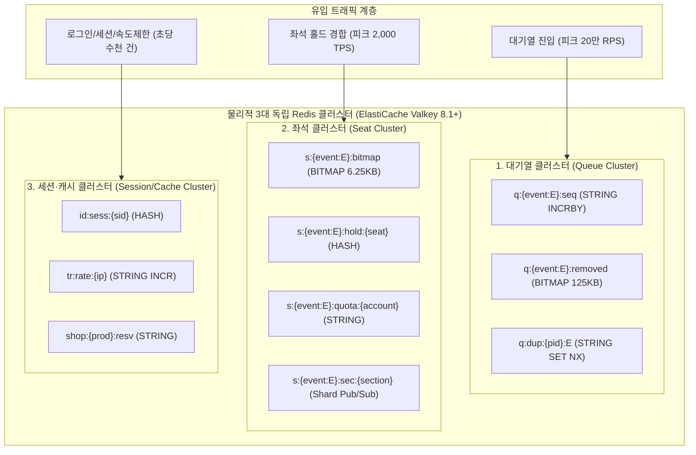
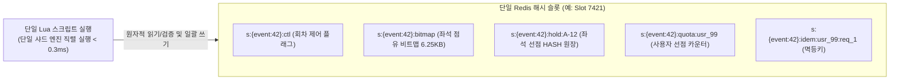
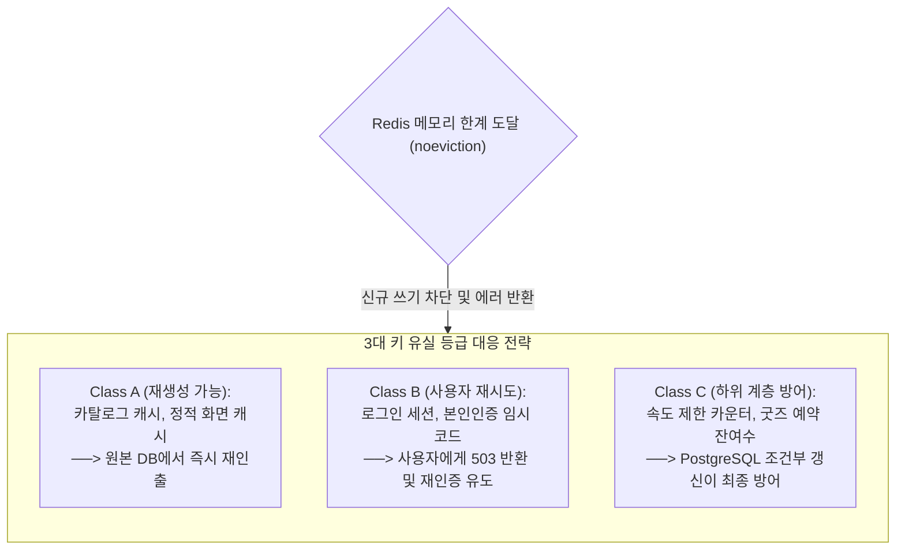

# DB 설계 편 8: Redis 키 설계 (Redis Key Namespaces, Data Structures & Memory Policies)

- **핵심 아키텍처 원칙**: 3대 물리 클러스터(Queue, Seat, Session/Cache) 완전 격리, 해시 태그(`{event:E}`) 기반의 단일 샤드 원자적 Lua 실행, `maxmemory-policy noeviction`을 통한 무음 유실 방어, 비트맵 및 마이크로 배치를 활용한 메모리·네트워크 극소화
- **관련 설계 정본**: [docs/data.md](../../data.md) §1(저장소 지도)·§3(Redis 키 설계 정본 표 및 유실 등급)·§4(일관성 요구), [docs/infra.md](../../infra.md) §4·§6(ElastiCache 사양 및 RPO/RTO), ADR-0002, ADR-0082, ADR-0086, ADR-0109, ADR-0121, ADR-0176, ADR-0179
- **함께 읽기**: [한 판 문서](../01-system-design.md) 3단계, [DB 설계 편 2: 저장소 고르기](02-choose-stores.md), [DB 설계 편 4: 같은 좌석을 두 번 팔지 않기](04-no-double-sale.md), [DB 설계 편 12: 전체 지도](12-whole-map.md)

---

## 1. 면접관의 질문

> **면접관**: "초당 20만 진입과 피크 2,000 TPS 좌석 경합을 처리하는 Redis의 키 네임스페이스와 자료구조는 어떻게 설계되어 있습니까? 분산 Redis 클러스터 환경에서 여러 키를 원자적으로 조작하기 위해 해시 태그(Hash Tag)는 어떻게 쓰며, 메모리가 고갈되거나 마스터 노드가 다운되었을 때 데이터 유실은 어떻게 통제합니까?"

면접관은 다음 세 가지 인메모리 엔지니어링 역량을 집중 검증한다:
1. **클러스터 토폴로지 및 샤딩 원자성 제어**: Redis Cluster의 16,384개 해시 슬롯 환경에서 크로스 슬롯(Cross-Slot) 에러 없이 다중 키 원자적 연산을 수행하기 위한 해시 태그(`{...}`) 설계 능력이 있는가?
2. **도메인 특화 자료구조 선택 역량**: 100만 명 대기열에 무거운 Sorted Set을 쓰지 않고 왜 String `INCRBY`와 비트맵을 채택했는지, 좌석 상태를 왜 6.25KB 비트맵으로 압축했는지 정량적으로 증명할 수 있는가?
3. **인메모리 고가용성 및 메모리 방어 전략**: `volatile-lru` 대신 `noeviction`을 선택한 비즈니스적 이유와, 마스터 장애 페일오버 시 발생하는 비동기 복제 유실을 상위 계층에서 어떻게 흡수하는지 아는가?

---

## 2. 단순한 답과 깨지는 곳

### 단순한 답 (The Naive Approach)
> "단일 Redis 클러스터에 `서비스:종류:ID` 형태로 키를 저장합니다. 대기열은 100만 명을 통째로 Sorted Set(ZSET)에 넣고 매초 `ZRANK`로 순위를 반환합니다. 좌석 홀드와 사용자 한도 확인은 MULTI/EXEC이나 파이프라인으로 묶어서 처리합니다. 메모리가 차면 기본 정책인 `volatile-lru`로 오래된 캐시부터 지우고, 마스터가 죽어도 비동기 복제본이 있으니 안전합니다."

### 어디서 깨지는가 (Failure Scenarios)

| 단순한 설계 방식 | 대규모 운영 환경에서 깨지는 이유 | 아키텍처 근거 |
| :--- | :--- | :--- |
| **단일 Redis 클러스터 공유** | 티켓 오픈 순간 몰아치는 20만 RPS의 대기열 순번 발급 트래픽이 좌석 예매 및 로그인 세션 응답 지연으로 전파되어 전체 서비스 마비 | `docs/data.md` §1 |
| **대기열에 Sorted Set (`ZADD`/`ZRANK`) 사용** | 100만 개 엔트리를 가진 거대 ZSET 키는 1개 해시 슬롯에 고정되어 분산이 불가능함. 초당 5.4만 건의 `ZRANK` 조회가 단일 CPU 코어를 100% 점유하여 즉각 다운 | `ADR-0002`, `architecture §9.1` |
| **임의의 키들을 MULTI/EXEC이나 파이프라인으로 결합** | Redis 클러스터에서 서로 다른 해시 슬롯에 속한 키들은 트랜잭션(`MULTI/EXEC`)이나 Lua 스크립트로 묶을 수 없어 `CROSSSLOT Keys in request don't hash to the same slot` 에러 발생 | Redis 클러스터 스펙, `ADR-0082` |
| **기본 메모리 정책(`volatile-lru`) 방치** | 메모리 부족 시 TTL이 걸려 있는 좌석 홀드 락, 1인 예매 한도 키, 봇 차단 카운터가 조용히 증발(Eviction)하여 오버셀 및 한도 초과 예매 발생 | `ADR-0109` |
| **Lua 스크립트 내에서 대량 키 순회 (`SMEMBERS`)** | Redis 싱글 스레드 특성상 Lua 스크립트 실행 중 해당 샤드의 모든 명령이 블로킹됨. 1만 건 이상의 컬렉션 순회 시 `lua-time-limit`(5초)를 초과하여 노드 강제 재부팅 유발 | `ADR-0086`, `docs/data.md` §3 |
| **표준 Pub/Sub으로 좌석 변경 브로드캐스트** | 표준 `PUBLISH`는 클러스터 내 모든 샤드 노드로 메시지를 전체 복제하므로 인터 노드 네트워크 트래픽 폭증 발생 | `data.md §3` |

---

## 3. 아키텍처 해법: 3대 클러스터 격리와 해시 태그 아키텍처

PEAKET은 도메인 격리와 장애 전파 차단을 위해 **3개의 물리적 독립 Redis 클러스터**를 운영한다.

### 3.1 3대 독립 클러스터의 역할 및 제원

| 클러스터 명칭 | 소유 서비스 | 물리 토폴로지 | 담당 네임스페이스 및 핵심 키 | 격리 목적 및 RPO / RTO |
| :--- | :--- | :--- | :--- | :--- |
| **대기열 클러스터** (Queue) | queue-svc, admission-ctrl | 3 샤드 $\times$ 1 복제본 다중 AZ (노드 기반) | `q:{event:E}:*` 순번 카운터, 셔플 결과, 탈락 비트맵, 1인 1순번 | 대기열 정각 폭주(20만 RPS)가 좌석 예매 엔진으로 번지는 것을 원천 차단. **RPO 수백 ms, RTO 30초** |
| **좌석 클러스터** (Seat) | purchase-svc (realtime-gw는 구독만) | 3 샤드 $\times$ 1 복제본 다중 AZ (노드 기반) | `s:{event:E}:*` 좌석 비트맵, 홀드 해시, 1인 한도, 구매 세션 | 좌석 예매 핫패스 초고속 원자적 처리. 단일 샤드 Lua 스크립트로 오버셀 원천 차단. **RPO 수백 ms, RTO 30초** |
| **세션·캐시 클러스터** (Session/Cache) | identity, core, trust, shop 등 | 3 샤드 $\times$ 1 복제본 다중 AZ (노드 기반) | `id:*`, `scanner:*`, `tr:*`, `shop:*` 사용자 세션, 속도 제한, 봇 판정 피처 | 여러 서비스가 키 접두사와 ACL로 안전하게 공유. 메모리 고갈 방지 `noeviction` 강제. **RPO 비동기 복제분, RTO 30초** |

---

### 3.2 해시 태그(Hash Tag)를 통한 단일 샤드 원자적 Lua 실행

Redis Cluster는 키 이름 전체를 해시하여 16,384개 슬롯에 분산하지만, 키 이름에 중괄호 `{...}`가 있으면 **괄호 내부의 문자열만 해시**하여 동일한 슬롯에 강제 배치한다.

#### 회차 단위 해시 태그 (`{event:E}`)
좌석 선점 트랜잭션은 다음 5가지 검증과 변경을 1개의 원자적 Lua 스크립트로 완결해야 한다:
1. 회차가 현재 판매 중인가? (`s:{event:E}:ctl`)
2. 해당 좌석이 비어 있는가? (`s:{event:E}:bitmap` GETBIT)
3. 1인당 구매 한도를 초과하지 않는가? (`s:{event:E}:quota:{account}`)
4. 동일 요청 멱등키가 존재하는가? (`s:{event:E}:idem:{account}:{key}`)
5. 좌석을 선점 상태로 변경하고 만료 큐에 등록 (`s:{event:E}:hold:{seat}`, `s:{event:E}:expiry`)

모든 키에 동일한 `{event:E}` 해시 태그를 부여함으로써, **이 5개 키는 물리적으로 동일한 단일 샤드의 동일 해시 슬롯에 상주**하게 된다. 따라서 네트워크 홉(Hop)이나 분산 락 없이 단 1회의 Lua 스크립트 호출로 p99 50ms 이내에 완벽한 원자적 홀드가 완료된다.

---

### 3.3 핵심 자료구조 및 메모리 최적화 기법

| 자료구조 | 대표 키 패턴 | 크기 및 계산 근거 | 고른 이유 및 아키텍처적 이점 |
| :--- | :--- | :--- | :--- |
| **String (`INCRBY`)** | `q:{event:E}:seq` | 수십 바이트 | $O(1)$ 대기열 채번. 진입 서버 파드가 2ms/500건 단위로 메모리에서 모아 단 1회의 `INCRBY`로 발급 (`ADR-0179`) |
| **String (`SET NX`)** | `q:dup:{pid}:E`, `s:jti:{jti}` | 수십 바이트 | 조건부 원자적 쓰기로 1인 1순번 보장 및 중복 요청 0건 차단 |
| **Bitmap** | `s:{event:E}:bitmap` `q:{event:E}:removed` | **좌석: 6.25 KB** ($50,000 / 8$) **대기 탈락: 125 KB** ($1,000,000 / 8$) | 5만 석 전체의 판매 여부를 단 6.25 KB에 압축. `GETBIT`/`SETBIT`으로 단 1바이트 낭비 없이 $O(1)$ 초고속 점유 검사 |
| **Hash** | `s:{event:E}:hold:{seat}` | 약 200~300 바이트 | 좌석 소유자, holdId, 펜싱 토큰, 선점 만료 시각 등 복합 필드를 단일 구조에 응집 |
| **Sorted Set (ZSET)** | `s:{event:E}:expiry`, `q:{event:E}:slots` | 수백~수천 엔트리 수준 | 만료 시각(score) 순으로 자동 정렬하여 만료된 좌석을 효율적으로 회수. 100만 대기열에는 절대 사용 금지 |
| **Shard Pub/Sub** | `s:{event:E}:sec:{section}` | 메시지당 수백 바이트 | 일반 Pub/Sub과 달리 `SPUBLISH`를 사용하여 해당 해시 슬롯이 위치한 샤드 노드에만 전파하여 클러스터 네트워크 포화 방지 |

---

## 4. 메모리 고갈 방어 정책: `noeviction`과 3대 유실 등급

PEAKET의 모든 Redis 클러스터는 `maxmemory-policy noeviction`을 강제한다 (ADR-0109). 메모리가 한계에 도달했을 때 키를 조용히 삭제(Eviction)하여 데이터 무결성이 깨지는 것보다, 즉시 쓰기 에러(OOM)를 발생시키고 경보를 울리는 것이 안전하기 때문이다.

### 4.1 세션·캐시 클러스터 키 유실 등급 매트릭스

| 등급 | 대표 키 네임스페이스 | 데이터 유실 시 파급 효과 | 시스템 최종 방어선 | 쓰기 실패 시 장애 대응 |
| :---: | :--- | :--- | :--- | :--- |
| **Class A** (다시 만든다) | `catalog:prod:*` `web:isr:*` | 단순 캐시 미스 발생으로 DB 조회 일시 증가 | PostgreSQL 원본 DB 및 원 서버 | 캐시 바이패스하여 원본 DB 직접 조회 |
| **Class B** (사람이 재시도) | `id:sess:{sid}` `auth:code:{pid}` | 사용자의 로그인이 일시 해제되거나 인증 코드 재발송 필요 | identity DB의 리프레시 토큰 원장 및 본인확인 재시도 | 클라이언트에 503 및 `Retry-After` 응답, 재로그인 유도 |
| **Class C** (다른 층이 방어) | `tr:rate:{ip}` `shop:{prod}:resv` | 분산 속도 제한이 일시 해제되거나 재고 예약 상태 흔들림 | 게이트웨이 로컬 인메모리 버킷 및 PostgreSQL `stock >= qty` 원자적 갱신 | 로컬 인메모리 한도로 버티며 RDBMS 제약조건으로 최종 방어 |
| **두지 않음** | 비동기 알림/웹훅 작업 | 작업 유실 시 고객 공지 누락 및 결제 승인 통보 실패 | **PostgreSQL 원장 테이블 (`notification_job`)** `FOR UPDATE SKIP LOCKED` 워커 큐 채택 | Redis 인메모리 큐(BullMQ) 전면 배제 (`ADR-0109`) |

---

## 5. 트레이드오프와 버린 대안 (Tradeoffs & Alternatives)

| 설계 결정 | 얻는 이점 (Gains) | 치르는 대가 (Costs) 및 완화책 |
| :--- | :--- | :--- |
| **`noeviction` 메모리 정책** | 좌석 홀드 락이나 1인 한도가 조용히 증발하는 대형 사고 원천 차단 | 메모리 관리 실패 시 서비스 쓰기 거부 발생 (메모리 70% SEV3, 85% SEV2 사전 경보 체계 운영) |
| **회차 해시 태그 `{event:E}`** | 5개 키에 대한 단일 샤드 원자적 Lua 실행 보장 (p99 50ms) | 특정 인기 대형 공연 회차가 단일 샤드로 집중되는 핫스팟 위험 (사전 슬롯 배치 규칙으로 완화) |
| **비트맵 기반 좌석 점유** | 5만 석을 단 6.25 KB로 표현하여 대역폭 및 메모리 99% 절감 | 좌석별 세부 메타데이터(가격 등)는 별도 Hash로 분리 관리해야 함 |
| **Shard Pub/Sub (`SPUBLISH`)** | 노드 간 불필요한 브로드캐스트 복제 트래픽 완전 제거 | 구독 클라이언트가 해당 샤드 노드에 직접 접속해야 하는 연결 관리 복잡도 |

### 버린 대안

1. **대기열 순번 관리에 Sorted Set 채택 배제 (ADR-0002)**:
   - 100만 명의 대기자가 몰릴 때 단일 ZSET 키는 샤딩이 불가능하여 CPU를 100% 고갈시킨다. 단조증가 String 카운터(`INCRBY`)와 탈락자 비트맵(125 KB)으로 대체.
2. **Redis 기반 비동기 작업 큐 (BullMQ) 배제 (ADR-0109)**:
   - Redis 페일오버나 메모리 압박 시 결제 완료 통보 및 웹훅 발송 작업이 영구 유실될 수 있다. RPO 0을 보장하는 PostgreSQL `FOR UPDATE SKIP LOCKED` 기반 워커 큐로 전환.
3. **AWS ElastiCache Serverless 도입 배제 (ADR-0086)**:
   - 서버리스 구성에서는 `SLOWLOG`, `LATENCY DOCTOR`, 노드별 엔진 로그 수집이 불가능하여 고난도 동시성 트러블슈팅이 불가능함. 노드 기반 클러스터 모드로 확정.

---

## 6. 핵심 꼬리 질문 5단 방어 (Staff Interview Q&A)

| 질문 단계 | 심층 질문 | 방어 논리와 기술적 근거 | 관련 정본 |
| :--- | :--- | :--- | :--- |
| **1단: 왜 (Why)** | 좌석 홀드 키에 왜 회차 ID 기반의 해시 태그 `{event:E}`를 강제했나요? | Redis Cluster는 해시 슬롯이 다르면 여러 키를 하나의 트랜잭션이나 Lua 스크립트로 묶을 수 없습니다. 좌석 홀드는 '좌석 비트맵 검사', '1인 한도 확인', '홀드 해시 기록', '멱등키 검증'을 단일 원자적 연산으로 끝내야 합니다. `{event:E}` 태그를 통해 회차 관련 모든 키를 동일한 단일 샤드 해시 슬롯에 모아, $O(1)$ 시간 내에 오버셀 없는 원자적 실행을 완벽히 보장했습니다. | `ADR-0082`, `docs/data.md` §3 |
| **2단: 대안 (Alternatives)** | 여러 회차가 동시에 오픈될 때 특정 Redis 샤드로 트래픽이 몰리는 핫스팟(Hotspot)은 어떻게 해결합니까? | 해시 태그는 동일 회차의 키들을 한 슬롯에 모을 뿐, 그 슬롯이 3개 샤드 중 어디로 갈지는 CRC16 해시가 결정합니다. 5개 회차가 열리면 비둘기집 원리에 의해 특정 샤드에 2개 이상의 대형 회차가 겹칠 수 있습니다. PEAKET은 오픈 승인 단계에서 대형 회차들의 해시 태그를 사전 검사하여 서로 다른 샤드 주 노드에 분산 배치되도록 관리 슬롯 테이블을 강제합니다. | `ADR-0176`, `docs/architecture.md` §9.2 |
| **3단: 장애 대응 (Resilience)** | Redis 좌석 클러스터의 마스터 노드가 죽어 레플리카로 페일오버될 때 비동기 복제 지연으로 마지막 쓰기가 유실되면 어떻게 됩니까? | 페일오버 동안 purchase-svc는 해당 회차의 구매 요청을 503(`Retry-After: 2`)으로 최대 30초간 유예합니다. 복구 직후 일부 Redis 홀드 키가 유실되더라도, 최종 판매 확정은 PostgreSQL의 `UNIQUE (event_id, seat_id) WHERE status IN ('PENDING', 'SOLD')` 제약조건이 최종 수호하므로 오버셀은 0건으로 완벽히 차단됩니다. | `ADR-0014`, `ADR-0121` |
| **4단: 수치 근거 (Numbers)** | 5만 석 회차의 좌석 비트맵 6.25 KB와 대기열 순번 발급의 처리량 계산 근거는 무엇인가요? | 5만 석은 50,000 비트이며 $50,000 / 8 = 6,250 \text{ 바이트} \approx 6.25 \text{ KB}$로 단 1회의 TCP 패킷에 완벽히 실립니다. 또한 오픈 순간 20만 RPS 진입 시 개별 `INCR` 호출은 Redis 싱글 스레드를 포화시키므로, 각 API 파드가 2ms 동안 들어온 요청을 인메모리에서 최대 500건씩 배치 집계하여 `INCRBY` 단 1회로 호출함으로써 Redis CPU 점유율을 80% 이상 절감합니다. | `ADR-0002`, `ADR-0179` |
| **5단: 실측과 검증 (Verification)** | 1개 샤드에 동시 5개 회차(피크 합산 6,000 TPS)가 몰리는 최악의 조건에서 Redis의 한계 성능은 어떻게 검증되었습니까? | 기반 PoC(S-T27) 환경에서 단일 샤드에 6,000 TPS의 복합 Lua 스크립트를 주입하는 부하 테스트를 수행했습니다. 오버셀은 0건이었으며 순수 Lua 엔진 실행 시간 p99는 75.3µs, 샤드 엔진 CPU 점유율은 38% 수준으로 안정적이었습니다. 다만 10ms 초과 SLOWLOG가 만료 회수 작업에서 간헐적으로 발생하여, 배치 만료 단위를 100석으로 제한하는 최적화를 도출했습니다. | `ADR-0176`, `docs/perf-ledger.md` §5 |

---

## 7. 30초 아키텍처 브리핑 (Staff Engineer Summary)

> "PEAKET의 Redis 아키텍처는 **'3대 물리 클러스터(대기열, 좌석, 세션)의 완전 격리'**와 **'해시 태그 기반 단일 샤드 초고속 원자적 Lua 실행'**을 핵심 축으로 합니다.  
> 100만 대기열에는 Sorted Set 대신 String `INCRBY` 마이크로 배치와 125 KB 비트맵을 적용하여 CPU 포화를 원천 차단했고, 5만 석 좌석 상태는 6.25 KB 비트맵과 `{event:E}` 단일 슬롯 원자적 검증으로 p99 50ms 이내에 오버셀 0건을 달성했습니다.  
> 또한 메모리 부족 시 무음 데이터 유실을 방지하기 위해 `noeviction`을 전면 강제하고, RPO 0이 필수적인 비동기 워커 큐는 Redis가 아닌 PostgreSQL `SKIP LOCKED`로 완전히 전환했습니다."

---

## 8. 정본에서 읽을 곳

1. [docs/data.md](../../data.md) §3: Redis 키 설계 정본 표 (전체 67개 키 네임스페이스 및 생애주기)
2. [docs/data.md](../../data.md) §3: 세션·캐시 클러스터 키 유실 등급 (Class A, B, C) 및 대응표
3. [docs/infra.md](../../infra.md) §4·§6: ElastiCache Valkey 8.1+ 클러스터 사양 및 RPO/RTO 기준
4. [ADR-0014](../../adr/0014-soft-hold-hard-sale.md): 해시 태그 및 단일 샤드 Lua 설계
5. [ADR-0109](../../adr/0109-delivery-jobs-in-postgres-drop-bullmq-cache-redis-key-classes-noeviction.md): BullMQ 배제 및 `noeviction` 정책
6. [ADR-0002](../../adr/0002-queue-sequence-incr-over-sorted-set.md): 대기열 순번 발급과 비트맵 설계
7. [ADR-0179](../../adr/0179-entry-number-per-pod-batch.md): 파드 2ms 마이크로 배치를 통한 Redis 부하 절감
8. [ADR-0176](../../adr/0176-foundation-poc-results.md): 단일 샤드 6,000 TPS 부하 및 SLOWLOG 실측 검증
