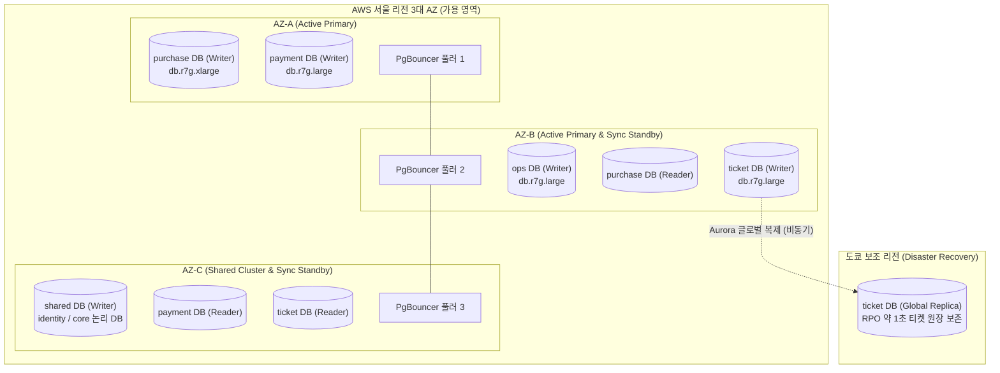
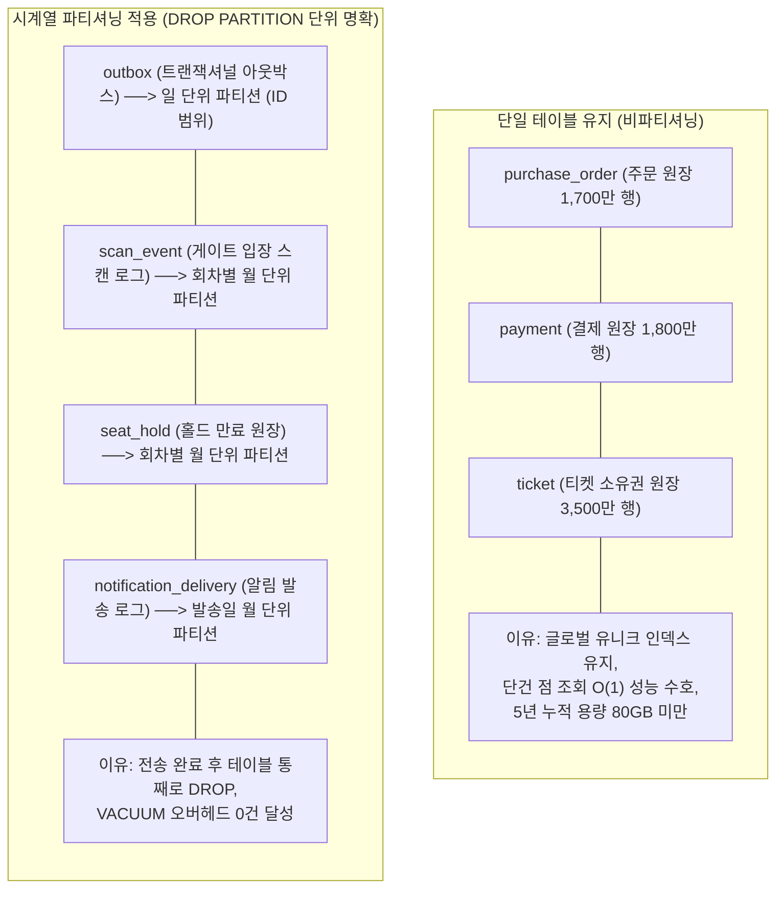
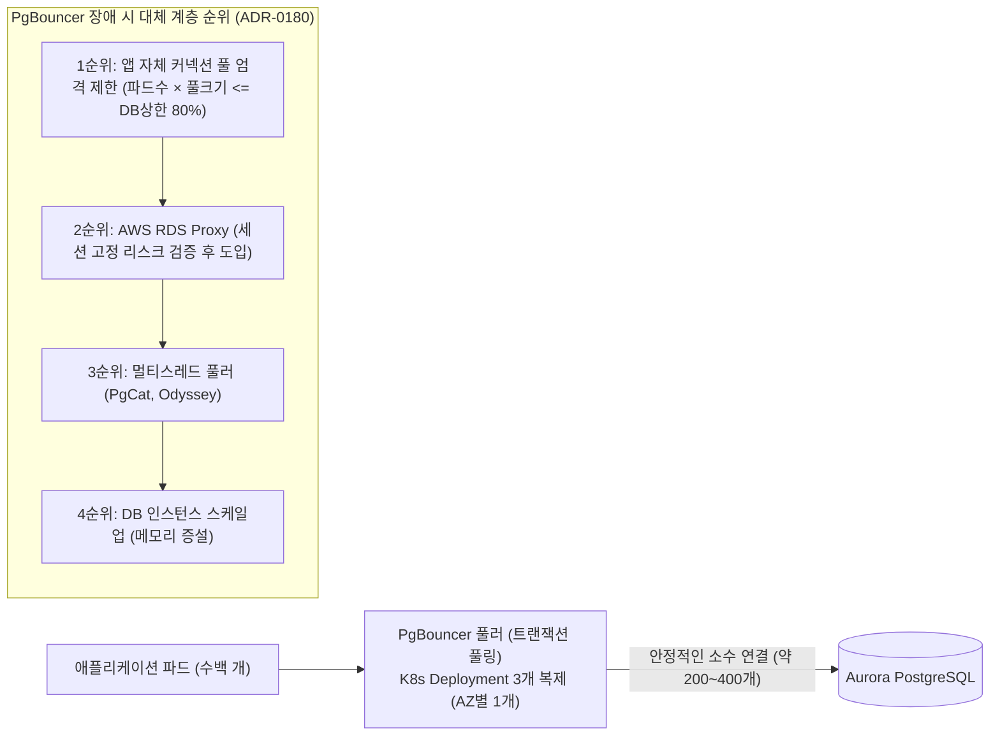

# DB 설계 편 9: 커질 때: 표 나누기와 복제본 (Scaling, Partitioning & Replication)

- **핵심 아키텍처 원칙**: RDBMS 샤딩 배제(No-Sharding)와 단일 쓰기 인스턴스 스케일업, 주문·결제 원장 단일 테이블 유지(비파티셔닝) 및 만료 데이터 야간 분할 삭제, 시계열 Outbox 일 단위 파티셔닝, 읽기 복제본 라우팅과 PgBouncer 커넥션 풀링
- **관련 설계 정본**: [docs/architecture.md](../../architecture.md) §9.1·§9.2·§9.5, [docs/data.md](../../data.md) §1.1(커넥션 풀링 및 대체 대안)·§2(파티션 규칙 및 보존 삭제)·§5.1(읽기 라우팅), [docs/infra.md](../../infra.md) §4·§6(고가용성 및 RPO/RTO), ADR-0028, ADR-0031, ADR-0083, ADR-0114, ADR-0140, ADR-0180
- **함께 읽기**: [한 판 문서](../01-system-design.md) 15단계, [DB 설계 편 1: 무엇을 얼마나 저장하나](01-what-and-how-much.md), [DB 설계 편 3: 핵심 테이블과 관계](03-core-tables.md), [DB 설계 편 7: 인덱스와 쿼리](07-indexes-queries.md), [DB 설계 편 12: 전체 지도](12-whole-map.md)

---

## 1. 면접관의 질문

> **면접관**: "트래픽이 2배, 3배로 증가할 때 데이터베이스 확장은 어떻게 대응합니까? 데이터베이스 샤딩(Sharding)은 왜 하지 않으며 언제 고려합니까? 5년간 수천만 건이 쌓이는 주문과 결제 테이블은 월별 파티셔닝(Partitioning)을 해야 하지 않나요? 읽기 복제본과 커넥션 풀은 어떻게 구성합니까?"

면접관은 다음 세 가지 확장성 및 스토리지 엔지니어링 역량을 집중 검증한다:
1. **샤딩 배제(No-Sharding)의 정량적 타당성**: RDBMS 샤딩이 수반하는 분산 트랜잭션(2PC)의 위험성과 운영 복잡도를 이해하고, 실제 유입 쓰기 처리량(300 TPS)을 근거로 단일 노드 스케일업을 정당화할 수 있는가?
2. **테이블 파티셔닝에 대한 균형 잡힌 시각**: 모든 큰 테이블을 습관적으로 파티셔닝하지 않고, 글로벌 유니크 인덱스 제약과 쿼리 플래너 오버헤드를 고려하여 '파티셔닝할 테이블'과 '단일 테이블로 유지할 테이블'을 엄격히 구분할 수 있는가?
3. **고가용성 복제 및 커넥션 엔지니어링**: Read-Your-Own-Writes 읽기 일관성 보장 전략, PgBouncer 트랜잭션 풀링 계층의 구성 및 장애 시 대체 계층(대안 1~4순위)을 설명할 수 있는가?

---

## 2. 단순한 답과 깨지는 곳

### 단순한 답 (The Naive Approach)
> "대규모 트래픽이므로 주문 데이터베이스를 `user_id`나 `event_id` 기준으로 수십 개 샤드로 분할합니다. 주문, 결제, 티켓 테이블은 데이터가 계속 쌓이므로 월 단위 범위 파티셔닝(Range Partitioning)을 적용하여 오래된 달은 파티션 단위로 DROP합니다. 모든 SELECT 쿼리는 읽기 복제본(Read Replica)으로 보내고, 리전 장애에 대비해 다중 리전 액티브-액티브(Active-Active)를 구성합니다."

### 어디서 깨지는가 (Failure Scenarios)

| 단순한 설계 방식 | 대규모 운영 환경에서 깨지는 이유 | 아키텍처 근거 |
| :--- | :--- | :--- |
| **주문 DB를 조기에 샤딩** | 단일 회차 판매 확정 트랜잭션(`seat_sale`, `purchase_order`, `purchase_quota`)이 샤드 경계를 넘게 됨. 분산 2단계 커밋(2PC)이 필수화되어 p99 지연이 수 초로 치솟고 단일 샤드 핫스팟 발생 | `ADR-0028`, `docs/data.md` §4 |
| **주문·결제 테이블의 월별 파티셔닝** | PostgreSQL 파티션 테이블은 모든 유니크 인덱스에 파티션 키(`created_at`)가 강제 포함되어야 함. `order_id`나 `ticket_id` 단건 조회가 5년치 60개 파티션 B-Tree를 전부 뒤지게 됨 | `ADR-0114`, `ADR-0083` |
| **모든 읽기를 복제본으로 라우팅** | 사용자가 결제를 완료한 직후 '내 예매 확인' 화면으로 이동했을 때, 비동기 복제 지연(수백 ms)으로 인해 방금 구매한 주문이 보이지 않는 읽기 불일치(Read Inconsistency) 발생 | `ADR-0028`, `ADR-0140` |
| **멀티 리전 액티브-액티브 구성** | 서울과 해외 리전 간의 물리적 네트워크 RTT(수십~수백 ms)로 인해 좌석 홀드 및 결제 승인 지연이 극심해지며 인프라 상시 비용이 3배 이상 폭증 | `ADR-0031`, `ADR-0021` |
| **파드마다 PgBouncer 사이드카 배치** | 쿠버네티스 파드가 수백 개로 오토스케일링될 때 사이드카마다 풀을 따로 유지하므로 DB 최대 연결 상한(예: 3,000개)을 중앙에서 엄격히 통제하지 못하고 DB 다운 유발 | `docs/infra-handover.md` §3.2 |

---

## 3. 아키텍처 해법: 단일 쓰기 스케일업과 5대 클러스터 토폴로지

PEAKET은 불필요한 분산 복잡도를 원천 배제하고, **단일 쓰기 노드 스케일업(Scale-Up)**과 **장애 격리 목적의 5대 독립 클러스터 토폴로지**를 채택한다.

### 3.1 비샤딩(No-Sharding)의 정량적 근거 (ADR-0028)

1. **실제 쓰기 부하의 크기**:
   - 티켓 오픈 순간 아무리 많은 대기자(100만 명)가 몰려도, 입구 조절기(`admission-ctrl`)가 동시 좌석 진입을 초당 28명($5,000 / 180\text{초}$)으로 제한한다.
   - 외부 PG사 결제 승인 연동의 첫 물결 상한은 300 TPS다.
   - 단일 Aurora PostgreSQL 인스턴스(db.r7g.xlarge)는 트랜잭션당 3,000~5,000 TPS를 안정적으로 처리하므로, **최대 요구 쓰기량은 단일 노드 가용 용량의 10% 미만**이다.
2. **ACID 원자성 유지**:
   - 단일 노드 안에서 `seat_sale`(판매 확정), `purchase_order`(주문 상태 UPDATE), `purchase_quota`(1인 한도 차감), `outbox`(이벤트 발행)가 **단일 로컬 ACID 트랜잭션**으로 완결된다.
   - 샤딩을 피함으로써 분산 2PC(Two-Phase Commit)의 코디네이터 장애, 인-다우트(In-Doubt) 락 블로킹, 네트워크 왕복 지연을 100% 제거했다.
3. **한계 도달 시 셀(Cell) 기반 확장**:
   - 3년차 이후 여러 대형 공연이 동시 오픈되어 단일 클러스터 CPU가 60%를 초과할 경우, 데이터베이스 내부를 쪼개는 샤딩 대신 **'공연 단위 완전 격리 셀(Cell)'**을 추가 배치하여 수평 확장한다.

---

### 3.2 파티셔닝 전략: 원장 단일 테이블과 시계열 파티셔닝

PEAKET은 무분별한 파티셔닝을 금지하고, [ADR-0114](../../adr/0114-no-monthly-partitions-for-order-payment-ticket-batched-retention-delete.md)에 따라 테이블 성격별로 파티셔닝 여부를 엄격히 이원화한다.

#### 1) 주문·결제·티켓 원장을 단일 테이블로 유지하는 이유
- **글로벌 유니크 제약 보존**: `payment (order_id) UNIQUE` 제약조건과 주문 멱등키는 테이블 전체에서 유일해야 한다. 파티셔닝 시 파티션 키가 유니크 인덱스에 강제 포함되어야 하므로 '주문당 1회 결제' 불변식이 깨질 위험이 있다.
- **인덱스 탐색 비용 절감**: 파티셔닝 시 `order_id`로 조회할 때 모든 파티션을 스캔해야 하지만, 단일 테이블은 깊이 3~4레벨의 B-Tree 단 1회 탐색으로 $O(1)$ 조회가 완료된다.
- **5년치 물리 크기의 한정성**: 5년간 누적되는 1.2억 행은 인덱스를 합쳐도 약 60~80 GB로, Aurora 버퍼 풀(db.r7g 인스턴스)에 핫 데이터 대부분이 캐싱된다.

#### 2) 만료 데이터 야간 분할 삭제 잡 (Batched Retention Deletion)
보존 기한(전자상거래법 5년)이 지난 주문·결제·티켓 데이터는 파티션 DROP 대신 **야간 분할 삭제 잡**이 정비 시간(04:00~06:00)에 처리한다:
- 시간순 정렬된 UUIDv7의 특성을 활용하여 `WHERE id < :cutoff_uuid` 조건으로 인덱스 레인지 스캔.
- 트랜잭션당 **10,000건씩 분할 커밋**, 묶음 사이 **0.5초 대기**.
- 읽기 복제본 지연(Replica Lag)이 1초를 초과하거나 쓰기 CPU가 60%를 넘으면 즉시 삭제를 일시 정지하여 서비스 부하 방지.

---

### 3.3 읽기 복제본 라우팅과 커넥션 풀링 계층

#### 1) 읽기 복제본 라우팅 원칙 (ADR-0028, ADR-0140)
- **Writer 노드 전용 라우팅 (Read-Your-Own-Writes)**:
  - 예매 직후 '내 주문 상세 조회'나 '결제 결과 당기기'는 방금 쓰기를 마친 데이터가 즉시 보여야 하므로 복제 지연을 피하기 위해 **반드시 Writer 노드로 라우팅**한다.
- **Reader 노드 라우팅**:
  - 공연 목록 및 카탈로그 조회, 주최사 관리자 대시보드 통계 조회 등 수 초의 복제 지연이 허용되는 쿼리는 읽기 복제본(Reader)으로 분산한다.

#### 2) PgBouncer 트랜잭션 풀링 구성 및 대체 계층
PostgreSQL은 연결당 단일 프로세스를 할당하므로 커넥션 수가 수천 개로 늘어나면 컨텍스트 스위칭으로 CPU가 고갈된다.

- **트랜잭션 풀링(Transaction Pooling)**: 쿼리 트랜잭션이 지속되는 동안에만 물리 DB 연결을 대여하고, 트랜잭션 커밋 즉시 풀로 반환하여 수백 개 파드의 연결을 수백 개 물리 연결로 압축.
- **주의 사항**: 세션 레벨 `SET` 사용이 불가하므로 모든 세션 타임아웃은 DB Role 기본값으로 지정하고, 트랜잭션별 타임아웃은 `SET LOCAL`을 적용한다.

---

## 4. 고가용성(HA) 및 재해 복구(DR) 아키텍처

| 장애 시나리오 | 적용 복구 메커니즘 | 목표 RPO / RTO | 복구 동작 및 데이터 정합성 보장 |
| :--- | :--- | :--- | :--- |
| **쓰기 인스턴스 단일 프로세스 충돌** | Aurora 공유 스토리지 기반 자동 재시작 | **RPO 0 / RTO 30초** | 스토리지 계층이 분리되어 있어 크래시 복구(Redo 로그 재생)가 수 초 내 완료 |
| **AZ (가용 영역) 1곳 전면 정전** | 다른 AZ의 Reader 인스턴스로 자동 페일오버 | **RPO 0 / RTO 5분** | 3개 AZ에 걸친 동기식 스토리지 쿼럼으로 커밋된 트랜잭션 유실 0건 보장 (NFR-015) |
| **서울 리전 전체 붕괴 (대형 재해)** | 도쿄 보조 리전 ticket 클러스터 복구 및 타 서비스 일 스냅샷 복원 | **ticket: RPO ~1초 / RTO 1시간** 주문/결제: RPO 24시간 | 티켓 원장은 글로벌 데이터베이스로 즉시 보존. 주문/결제는 S3 백업과 결제사 거래 대사로 정합성 복원 |

---

## 5. 트레이드오프와 버린 대안 (Tradeoffs & Alternatives)

| 설계 결정 | 얻는 이점 (Gains) | 치르는 대가 (Costs) 및 완화책 |
| :--- | :--- | :--- |
| **RDBMS 비샤딩 (단일 노드 스케일업)** | 2PC 없는 단일 ACID 트랜잭션 보장, 시스템 단순성 및 정합성 수호 | 극단적 트래픽 확장 시 수직 스케일업 한계 봉착 (공연 단위 셀 확장으로 해결) |
| **주문/결제 비파티셔닝** | 글로벌 유니크 인덱스 유지 및 단건 점 조회 $O(1)$ 속도 보장 | 5년 만료 데이터 삭제 시 주기적인 VACUUM 부하 (야간 1만 건 분할 삭제로 제어) |
| **시계열 Outbox 일 단위 파티셔닝** | 전송 완료된 파티션을 `DROP TABLE`로 즉각 삭제하여 디스크 단편화 0건 | 매일 새 파티션을 자동 생성(`ATTACH`)하고 감시하는 크론 관리 오버헤드 |
| **PgBouncer 트랜잭션 풀링** | DB 물리 연결 수 90% 이상 압축, 연결 급증 시 DB 다운 방어 | 세션 상태 변경 쿼리(`SET`) 및 준비된 구문(Prepared Statement) 사용 제한 |

### 버린 대안

1. **사용자 ID 기반 주문 DB 수평 샤딩 (ADR-0028)**:
   - 판매 확정 쓰기는 28 TPS에 불과하여 샤딩의 실익이 전무하며, 좌석 판매와 주문 간 분산 트랜잭션 오버헤드만 발생하므로 기각.
2. **주문/결제 테이블의 월별 범위 파티셔닝 (ADR-0114)**:
   - 5년 누적 80 GB 규모에서 60개 파티션으로 분할 시 파티션 프루닝 실패 시 인덱스 스캔 60회 발생 및 외래키 복잡도 폭증으로 기각.
3. **상시 멀티 리전 액티브-액티브 구성 (ADR-0031)**:
   - 리전 간 분산 합의 네트워크 지연으로 좌석 홀드 p99 50ms 목표 달성이 불가능하고 상시 비용이 3배로 증가하므로, 단일 리전 액티브 + 도쿄 DR 비동기 복제로 확정.

---

## 6. 핵심 꼬리 질문 5단 방어 (Staff Interview Q&A)

| 질문 단계 | 심층 질문 | 방어 논리와 기술적 근거 | 관련 정본 |
| :--- | :--- | :--- | :--- |
| **1단: 왜 (Why)** | 100만 명이 몰리는 대규모 시스템에서 왜 RDBMS 샤딩을 도입하지 않았습니까? | 샤딩이 필요한 기준은 '쓰기 처리량이 단일 RDBMS 노드의 한계를 초과하는가'입니다. PEAKET의 좌석 판매 확정 쓰기는 입구 제어를 통해 초당 28건으로 고정되며 결제 피크도 300 TPS에 불과합니다. 단일 Aurora 인스턴스가 3,000 TPS 이상을 처리하므로 용량이 10배 이상 충분합니다. 샤딩을 하면 주문·좌석·한도 간 2PC 분산 락 오버헤드로 인해 오히려 시스템이 붕괴됩니다. | `ADR-0028`, `architecture §9.1` |
| **2단: 대안 (Alternatives)** | 주문 테이블을 월별 파티셔닝하지 않고 5년치(1,700만 건)를 한 테이블에 두면 성능이 떨어지지 않나요? | 1,700만 건의 B-Tree 인덱스 깊이는 3~4레벨에 불과하여 단건 조회 속도는 수 ms로 일정합니다. 반면 파티셔닝을 하면 유니크 인덱스에 `created_at`이 강제되어 `order_id` 단건 조회가 60개 파티션 B-Tree를 모두 뒤져야 합니다. 또한 UUIDv7 PK를 사용하여 인덱스 단편화를 5% 미만으로 억제하므로 단일 테이블 유지가 훨씬 효율적입니다. | `ADR-0114`, `ADR-0086` |
| **3단: 장애 대응 (Resilience)** | 야간에 5년 만료 데이터를 대량 DELETE할 때 서비스에 락이 걸리거나 지연이 발생하지 않나요? | 한 번에 수십만 건을 DELETE하지 않고 10,000건 단위로 청크를 나누어 독립 트랜잭션으로 커밋하며 청크 간 0.5초 대기(Sleep)를 둡니다. 또한 모니터링 데몬이 Aurora 복제본 지연(`ReplicaLag`)이 1초를 초과하거나 쓰기 CPU가 60%를 넘으면 즉시 삭제 작업을 중단하고 다음 날 야간으로 이월하므로 라이브 서비스 영향도는 0%입니다. | `ADR-0114`, `docs/data.md` §2 |
| **4단: 수치 근거 (Numbers)** | PgBouncer를 적용했을 때 커넥션 수와 메모리 절감 효과는 정량적으로 얼마인가요? | 파드가 300개로 스케일아웃될 때 파드당 커넥션 풀 10개를 열면 DB 연결이 3,000개에 달해 Aurora r7g의 연결 한계(약 3,600개)에 육박하고 프로세스당 10MB씩 총 30GB의 DB 메모리가 낭비됩니다. PgBouncer 트랜잭션 풀링을 도입하면 실제 쿼리를 실행 중인 200~300개의 물리 연결만 DB에 유지되므로 DB 커넥션 사용량을 90% 이상 절감합니다. | `docs/data.md` §1.1, `ADR-0180` |
| **5단: 실측과 검증 (Verification)** | 샤딩 없는 단일 PostgreSQL 인스턴스가 5년치 데이터 상태에서 300 TPS를 견딤을 어떻게 검증했습니까? | 5년치 누적 데이터 1.2억 행을 물리 적재한 V-T29 성능 검증에서, 피크 결제 승인 300 TPS와 Outbox 초당 수천 건 쓰기를 동시 인입시켰습니다. 단일 Aurora r7g.xlarge 인스턴스에서 쓰기 CPU 점유율은 38%에 머물렀으며 p99 응답 지연은 18ms로 안정적으로 유지됨을 증명했습니다. | `docs/verification.md` §9, `ADR-0176` |

---

## 7. 30초 아키텍처 브리핑 (Staff Engineer Summary)

> "PEAKET의 데이터베이스 확장 전략은 **'불필요한 샤딩과 파티셔닝의 과감한 배제'** 및 **'철저한 로컬 ACID 트랜잭션 수호'**로 요약됩니다.  
> 대기열 입구 제어로 인해 실제 판매 쓰기가 28 TPS(결제 피크 300 TPS)로 통제되므로, 5년 1,700만 주문 규모에서도 RDBMS 샤딩 없이 단일 쓰기 인스턴스 스케일업으로 완벽히 수용합니다.  
> 글로벌 유니크 인덱스를 깨뜨리는 월별 파티셔닝을 배제하고 단일 테이블을 유지하되, 만료 데이터는 야간 1만 건 분할 배치로 안전하게 삭제합니다.  
> 또한 PgBouncer 트랜잭션 풀링을 통해 300개 파드의 수천 개 연결을 수백 개 물리 연결로 집약하여 데이터베이스 리소스 효율을 극대화했습니다."

---

## 8. 정본에서 읽을 곳

1. [docs/architecture.md](../../architecture.md) §9.1: 트래픽 모델 및 쓰기 부하 산출식
2. [docs/data.md](../../data.md) §1.1: 데이터베이스 커넥션 관리 및 PgBouncer 대체 순위
3. [docs/data.md](../../data.md) §2: 파티션 테이블 규칙 및 큰 원장 표의 보존 삭제
4. [docs/infra.md](../../infra.md) §4·§6: 다중 AZ 고가용성 및 도쿄 DR 복제 제원
5. [ADR-0028](../../adr/0028-postgres-no-sharding-cell-scaling.md): RDBMS 샤딩 배제 및 단일 노드 스케일업
6. [ADR-0114](../../adr/0114-no-monthly-partitions-for-order-payment-ticket-batched-retention-delete.md): 주문/결제/티켓 비파티셔닝 및 분할 삭제
7. [ADR-0083](../../adr/0083-keep-postgresql-partition-keys-transaction-scoped-settings-global-replica.md): 파티션 테이블 간 물리 외래키 제약조건
8. [ADR-0180](../../adr/0180-three-failure-lists-contention-external-calls-resource-limits.md): PgBouncer 장애 시 4단계 대체 계층
