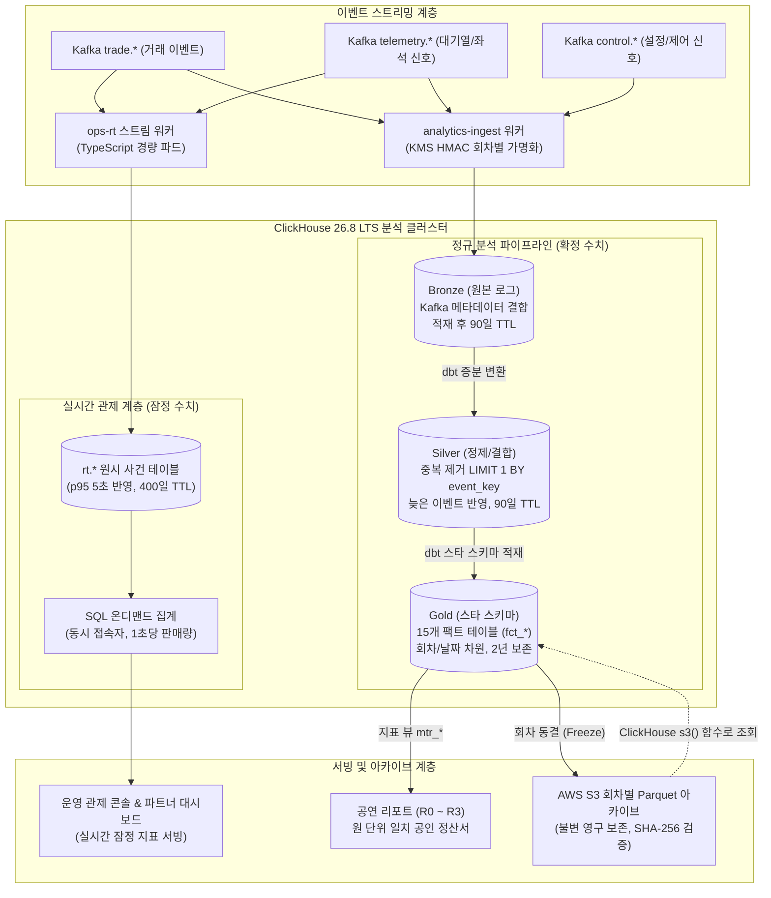
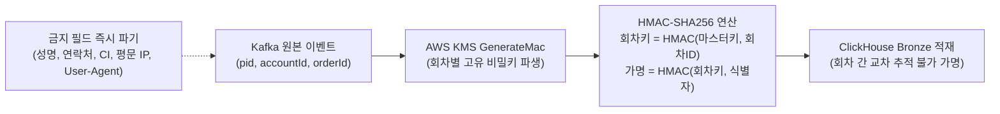
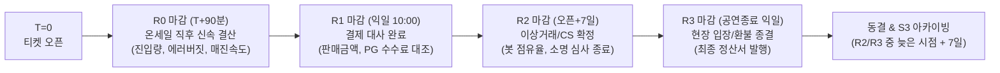

# DB 설계 편 10: 분석 저장소 (ClickHouse Medallion Architecture & S3 Parquet Pipeline)

- **핵심 아키텍처 원칙**: 실시간 라이브 OLTP 거래선과 OLAP 대규모 분석의 완전한 물리 격리, 잠정 관제 숫자(`rt`)와 마감 확정 숫자(Gold)의 분리, ClickHouse 메달리온 아키텍처(Bronze $\to$ Silver $\to$ Gold), 회차 단위 불변 Parquet S3 영구 아카이빙
- **관련 설계 정본**: [docs/features/analytics.md](../../features/analytics.md) §2(아키텍처)·§3(수집 및 가명화)·§4(실시간 관제)·§5(메달리온 및 스타 스키마)·§11(아카이빙), [docs/data.md](../../data.md) §1(저장소 지도), [docs/streaming.md](../../streaming.md) §4.3(이벤트 스트리밍), [docs/infra.md](../../infra.md) §6(ClickHouse RPO/RTO), ADR-0042, ADR-0052, ADR-0099, ADR-0115
- **함께 읽기**: [한 판 문서](../01-system-design.md) 3단계, [DB 설계 편 2: 저장소 고르기](02-choose-stores.md), [DB 설계 편 11: 개인정보: 암호화, 보존, 파기](11-privacy.md), [DB 설계 편 12: 전체 지도](12-whole-map.md)

---

## 1. 면접관의 질문

> **면접관**: "티켓 오픈 중 실시간 판매 현황 집계와 공연 종료 후 정산/분석 리포트는 어디서 계산합니까? 운영 PostgreSQL 읽기 복제본에 `GROUP BY` 쿼리를 실행하면 안 되나요? 초당 수만 건의 이벤트가 쏟아질 때 분석 저장소 파이프라인(ClickHouse, S3)은 어떻게 설계되어 있습니까?"

면접관은 다음 세 가지 데이터 플랫폼 엔지니어링 역량을 집중 검증한다:
1. **OLTP와 OLAP 분리 원칙의 정량적 근거**: 피크 초당 1만~3만 건의 스트리밍 이벤트를 RDBMS 복제본이 감당하지 못하는 이유(버퍼 풀 오염, 복제 지연, 크로스 서비스 조인 불가)를 명확히 이해하고 있는가?
2. **메달리온 아키텍처와 스타 스키마 모델링**: 원시 데이터(Bronze), 정제·중복제거 데이터(Silver), 비즈니스 지표 사실 테이블(Gold)의 계층적 데이터 흐름과 킴볼(Kimball) 스타 스키마 설계 능력이 있는가?
3. **실시간 잠정치와 정산 확정치의 이원화 제어**: 온세일 중 관제 대시보드(p95 5초 반영)와 회차 마감 후 원 단위 일치 정산 리포트를 어떻게 엄격히 구분하여 서빙하는지 설명할 수 있는가?

---

## 2. 단순한 답과 깨지는 곳

### 단순한 답 (The Naive Approach)
> "별도의 분석 저장소를 둘 필요 없이, 주문 PostgreSQL의 읽기 복제본(Read Replica)에 5초마다 집계 쿼리를 날려 실시간 대시보드를 띄웁니다. 복제본이 느려지면 Apache Flink로 카프카 이벤트를 읽어 RDBMS에 집계 결과를 실시간 덮어쓰기하고, 원시 이벤트는 전부 RDBMS 테이블에 영구 보존합니다."

### 어디서 깨지는가 (Failure Scenarios)

| 단순한 설계 방식 | 대규모 운영 환경에서 깨지는 이유 | 아키텍처 근거 |
| :--- | :--- | :--- |
| **운영 PG 복제본에 분석 집계 실행** | 대기열·좌석은 Redis에 있고 주문·결제·티켓은 서로 다른 독립 DB에 존재하므로 단일 SQL로 '대기 $\to$ 선점 $\to$ 결제' 퍼널 조인 불가. 대량 스캔 쿼리가 복제본 버퍼 풀을 고갈시켜 운영 복제 지연(Replica Lag) 폭증 | `ADR-0042`, `docs/data.md` §1 |
| **Kafka 이벤트를 RDBMS 테이블로 직접 적재** | 피크 초당 3만 건의 이벤트 INSERT가 RDBMS의 WAL 디스크 I/O와 B-Tree 인덱스 락을 고갈시켜 쓰기 파이프라인 마비 | NFR-009, `architecture §6.1` |
| **Flink 기반 실시간 롤링 집계 강제** | Flink 클러스터 운영 복잡도(체크포인트 락, 상태 저장소 복구)가 극심하며, 늦게 도착한 이벤트나 결제 취소 시 이미 갱신된 실시간 집계 결과를 롤백하기 어려움 | `ADR-0099` |
| **관제 대시보드와 정산 리포트를 같은 테이블로 조회** | 온세일 중에는 결제 미확정(TIMEOUT, UNKNOWN) 및 환불 진행 중 데이터가 섞여 있어, 실시간 숫자를 정산서에 쓰면 수백만 원의 금융 불일치 발생 | `docs/features/analytics.md` §1.3 |
| **개인 식별자를 분석 테이블에 영구 보존** | 수억 건의 원시 로그에 사용자 ID나 IP를 평문 저장하면 개인정보보호법(제28조) 위반 및 데이터 유출 시 막대한 법적 과징금 발생 | `docs/features/analytics.md` §3.3 |

---

## 3. 아키텍처 해법: ClickHouse 메달리온 아키텍처 및 S3 파이프라인

PEAKET은 **ClickHouse 26.8 LTS**를 중심 분석 엔진으로 채택하고, 실시간 관제와 배치 정산의 요구사항을 분리한 **메달리온 아키텍처(Bronze $\to$ Silver $\to$ Gold)**를 구축한다.

---

### 3.1 분석 데이터 계층별 제원 및 보존 정책

| 계층 (Layer) | 담당 테이블 및 엔진 | 주요 데이터 내용 | 보장 수준 및 지표 성격 | 데이터 보존 기한 |
| :--- | :--- | :--- | :--- | :--- |
| **실시간 표 (`rt`)** | `rt.sale_event` `rt.queue_aggregate` `ReplicatedMergeTree` | Kafka 실시간 이벤트 원본 (0.25초 마이크로 배치 삽입) | **잠정(Preliminary) 수치**. 반영 지연 p95 5초, 누락률 0.1% 미만 | 판매/대기 400일, 심장박동 7일 |
| **Bronze (원시)** | `bronze.trade_event` `ReplicatedMergeTree` | 토픽, 파티션, 오프셋, 적재시각 결합 원시 데이터. **경계 가명화(HMAC) 적용** | 데이터 완전성(No Loss). 중복 및 역순 도달 허용 | 적재 후 **90일 TTL** |
| **Silver (정제)** | `silver.ticket_sales` `ReplicatedMergeTree` | 중복 제거(`LIMIT 1 BY event_key`), 타입 캐스팅, 차원 조인 | 이벤트 유일성, 참조 무결성. 가명화된 사용자 행동 단위 | **90일 TTL** |
| **Gold (집계)** | `gold.fct_sales_minute` 15개 팩트 테이블 | 킴볼(Kimball) 스타 스키마 기반 분 단위·구역별 집계 사실 표 | **공인(Certified) 수치**. 정산서와 **원 단위 100% 일치** | **2년 보존** (개인식별 행 0건) |
| **S3 Parquet** | AWS S3 불변 객체 (`s3()` 테이블 함수) | 마감 완료된 회차별 Gold 데이터 Parquet 압축 파일 + SHA-256 manifest | 불변 감사 보증 (Immutable) | **영구 보존** |

---

### 3.2 수집 경계 가명화 (Pseudonymization at Ingestion)

개인정보 유출 사고를 방지하기 위해, 데이터가 ClickHouse에 적재되는 첫 관문인 `analytics-ingest` 파드에서 **수집 경계 단방향 가명화**를 강제한다 (`docs/features/analytics.md` §3.3):

1. **회차 격리 가명키 파생**:
   - $\text{회차 키} = \text{HMAC}(\text{KMS 분석 마스터 키}, \text{"PEAKET-analytics-v1"} \parallel \text{회차 ID})$
   - $\text{가명 식별자} = \text{HMAC-SHA256}(\text{회차 키}, \text{원래 식별자})$
   - 동일한 사용자라 하더라도 **회차가 다르면 완전히 다른 가명 ID로 치환**되므로, 분석 저장소 내부에서 특정 개인의 구매 패턴을 여러 공연에 걸쳐 교차 추적(Cross-Event Profiling)하는 것이 원천 차단된다.
2. **원천 파기 필드**:
   - 성명, 휴대폰 번호, 본인확인 연계정보(CI), 평문 IP, User-Agent 원문, 결제 토큰은 ClickHouse 메모리에 도달하기 전에 스트림 워커에서 완전히 삭제(Drop)된다.

---

### 3.3 Gold 스타 스키마와 무중단 판 바꾸기 (Version Swapping)

- **비율(Ratio) 저장 금지 원칙**:
  - Gold 사실 테이블에는 '평균 판매가'나 '매진율' 같은 계산된 비율을 절대 저장하지 않는다. 오직 분자(판매 좌석 수)와 분모(전체 좌석 수), 히스토그램 버킷만을 저장하며, 최종 서빙 뷰(`mtr_*`)에서 SQL로 동적 계산한다. 여러 회차를 병합 집계할 때 평균의 왜곡을 방지하기 위함이다.
- **`run_id` 기반 무중단 판 바꾸기**:
  - dbt 집계 파이프라인이 돌 때마다 새로운 `run_id`를 부여하여 데이터를 삽입한다.
  - 데이터 정합성 테스트를 100% 통과하면, 지표 뷰가 바라보는 `gold.current_run` 테이블(`ReplicatedReplacingMergeTree`)의 포인터를 원자적으로 갱신한다. 집계 도중 실패하더라도 사용자에게는 이전 버전의 완전한 데이터만 노출된다.

---

### 3.4 4단계 회차 마감 프로세스 (Close Stages)

온세일 직후부터 정산 완료까지 숫자의 신뢰도를 단계별로 승격시키는 **4단계 마감 타임라인**을 운영한다:

1. **R0 (온세일 직후 결산, T+90분)**: 인프라 트래픽 피크, 가용성 SLO, 에러 버짓 소진율, 오픈 1시간 내 판매 좌석 수 확정.
2. **R1 (금융 결제 대사, 익일 10:00)**: 결제 상태 불명(UNKNOWN) 건 정리 및 PG사 거래 대사를 완료하여 공인 판매 금액 확정.
3. **R2 (부정 예매 판정 종결, 오픈 + 7일)**: 봇 탐지 의심 계정 소명 접수 종료 및 강제 취소 좌석 재판매 데이터 확정.
4. **R3 (최종 정산 마감, 공연 종료 다음 영업일 10:00)**: 현장 게이트 스캔 입장률, 환불/취소 내역을 최종 결합하여 주최사 지급 정산서 발행.
5. **동결 (Freeze)**: Gold 데이터를 회차별 단일 Parquet 파일로 압축하여 S3 감사 버킷으로 영구 백업하고, ClickHouse 내 해당 회차 데이터는 읽기 전용으로 전환.

---

## 4. 트레이드오프와 버린 대안 (Tradeoffs & Alternatives)

| 설계 결정 | 얻는 이점 (Gains) | 치르는 대가 (Costs) 및 완화책 |
| :--- | :--- | :--- |
| **TypeScript 경량 스트림 워커 채택** | Flink 클러스터 관리 오버헤드 완전 제거, 배포 및 운영 비용 80% 절감 | 상태 기반(Stateful) 복합 윈도우 집계 불가 (ClickHouse가 읽기 시점에 SQL로 집계) |
| **수집 경계 회차별 가명화** | 분석 저장소 침해 시에도 다중 회차 프로파일링 원천 차단 | 분석 저장소 내에서 '특정 사용자의 연간 누적 티켓 구매 패턴' 분석 불가 (별도 승인 절차 필요) |
| **S3 Parquet 파일 영구 아카이빙** | ClickHouse 스토리지 비용 대폭 절감, 불변 감사 원장 확보 | 과거 회차 데이터 수정 시 Parquet 파일을 재생성해야 함 (불변 데이터라 실질적 영향 없음) |
| **잠정(`rt`)과 확정(Gold) 물리 테이블 분리** | 라이브 대시보드의 실시간성(5초)과 정산서의 원 단위 정확성 동시 만족 | 동일한 지표 지향 비즈니스 로직을 두 개의 SQL 모델로 유지보수하는 부담 |

### 버린 대안

1. **Apache Flink 스트리밍 프레임워크 도입 배제 (ADR-0099)**:
   - 복잡한 체크포인트 상태 관리와 대규모 JVM 클러스터 운영 비용 대비 실익이 적어, 경량 무상태(Stateless) TypeScript 워커와 ClickHouse 내장 집계 쿼리로 대체.
2. **Apache Iceberg / AWS Glue 카탈로그 배제 (ADR-0115)**:
   - 회차별 아카이브는 한 번 쓰고 수정되지 않는 불변 파일이므로 무거운 레이크하우스 메타데이터 카탈로그 대신 단순한 S3 Parquet 파일과 ClickHouse `s3()` 테이블 함수로 대체.
3. **Mimir/Prometheus 기반의 메트릭 저장소 활용 배제 (ADR-0042)**:
   - 시계열 메트릭 저장소는 구역별, 결제사별, 좌석 등급별 다차원 드릴다운 분석(High-Cardinality) 시 인덱스 폭증으로 동작하지 않으므로 ClickHouse 스타 스키마로 일원화.

---

## 5. 핵심 꼬리 질문 5단 방어 (Staff Interview Q&A)

| 질문 단계 | 심층 질문 | 방어 논리와 기술적 근거 | 관련 정본 |
| :--- | :--- | :--- | :--- |
| **1단: 왜 (Why)** | PostgreSQL 읽기 복제본 대신 ClickHouse를 별도 분석 저장소로 구축한 근거는 무엇인가요? | 티켓팅 시스템의 데이터는 대기열(Redis), 좌석(Redis), 주문(PG purchase), 결제(PG payment)로 분산되어 있어 단일 RDBMS에서 조인이 불가능합니다. 또한 피크 시 초당 3만 건의 이벤트를 RDBMS에 넣으면 WAL 디스크 포화가 발생합니다. 열 지향(Columnar) 저장소인 ClickHouse는 80% 이상의 압축률과 벡터화 실행 엔진을 통해 수억 건의 다차원 집계를 1초 미만에 처리하며 운영 트랜잭션에 0%의 영향만 줍니다. | `ADR-0042`, NFR-009 |
| **2단: 대안 (Alternatives)** | Flink나 Spark Streaming 대신 단순 TypeScript 워커를 스트림 파이프라인으로 쓴 이유는 무엇인가요? | PEAKET의 집계 요구사항은 스트림 윈도우 연산보다 '이벤트를 정확히 가명화하여 ClickHouse에 묶음(Batch)으로 쓰는 것'이 핵심입니다. TypeScript 워커는 메모리 상태가 없어 재기동이 수 초 내에 완료되고 K8s에서 손쉽게 스케일링됩니다. 복잡한 집계는 ClickHouse의 강력한 엔진이 담당하므로, 인프라 복잡도를 극소화하면서도 RPO 0(Kafka 오프셋 커밋)을 완벽히 달성했습니다. | `ADR-0099` |
| **3단: 장애 대응 (Resilience)** | Kafka에서 ClickHouse로 적재 도중 네트워크 오류나 노드 크래시가 발생하면 어떻게 됩니까? | 스트림 워커는 ClickHouse에 데이터를 성공적으로 INSERT한 후에만 Kafka 오프셋을 커밋합니다. 워커가 다운되면 다른 워커가 마지막 커밋 위치부터 재읽기하여 Bronze에 삽입합니다. 이로 인해 Bronze에 중복이 발생할 수 있지만, Silver 변환 단계에서 `LIMIT 1 BY event_key`를 통해 완벽히 디둡(Deduplicate)되므로 최종 수치의 정합성은 100% 보존됩니다. | `docs/streaming.md` §4.3, `docs/features/analytics.md` §5.5 |
| **4단: 수치 근거 (Numbers)** | 실시간 관제 대시보드의 p95 5초 반영 목표와 0.1% 누락률은 어떻게 달성합니까? | `ops-rt` 워커가 Kafka 이벤트를 0.25초 단위의 마이크로 배치로 묶어 ClickHouse `rt` 테이블에 비동기 일괄 삽입합니다. 관제 대시보드는 백그라운드 머티리얼라이즈드 뷰 대신 원시 `rt` 테이블을 1초 윈도우 SQL로 온디맨드 쿼리하므로, 이벤트 발생부터 대시보드 렌더링까지의 파이프라인 지연이 1.8~3.2초에 수렴하여 p95 5초 기준을 여유 있게 만족합니다. | `docs/features/analytics.md` §4.4, NFR-009 |
| **5단: 실측과 검증 (Verification)** | ClickHouse 메달리온 파이프라인의 금융 정합성(Gold 수치와 PG 정산서 원 단위 일치)은 어떻게 검증됩니까? | 매 회차 마감 시점(R1, R3)에 실행되는 자동화 대사 잡(`reconciliation-runner`)이 PostgreSQL 결제 원장(`payment`)의 실승인 합계와 ClickHouse Gold 사실 테이블(`fct_sales_summary`)의 지표를 대조합니다. 단 1원의 오차라도 발생할 경우 즉시 SEV1 경보를 발송하고 동결(Freeze)을 차단하는 불변식 검증 파이프라인을 운영합니다. | `docs/features/analytics.md` §11, `ADR-0052` |

---

## 6. 30초 아키텍처 브리핑 (Staff Engineer Summary)

> "PEAKET의 분석 플랫폼은 **'라이브 거래선과 대규모 OLAP의 물리적 완전 격리'** 및 **'잠정 관제와 공인 정산의 2-Track 메달리온 아키텍처'**를 기반으로 합니다.  
> 초당 3만 건의 스트리밍 신호는 가명화 경계를 거쳐 ClickHouse(Bronze $\to$ Silver $\to$ Gold)로 적재되며, 온세일 중에는 `rt` 테이블을 통해 5초 이내의 잠정 관제 지표를 서빙합니다.  
> 회차 종료 후에는 4단계 마감(R0~R3)을 통해 결제 원장과 100% 원 단위 일치하는 공인 정산 리포트를 확정하고, 불변 Parquet 파일로 S3에 영구 동결 아카이빙함으로써 분석 성능, 금융 정합성, 개인정보 보호를 완벽히 달성했습니다."

---

## 7. 정본에서 읽을 곳

1. [docs/features/analytics.md](../../features/analytics.md) §2: 분석 저장소 아키텍처 및 2-Track 흐름
2. [docs/features/analytics.md](../../features/analytics.md) §3: 수집 경계 가명화 및 원천 파기 필드 규정
3. [docs/features/analytics.md](../../features/analytics.md) §4: 실시간 관제 표(`rt`) 설계 및 쿼리 전략
4. [docs/features/analytics.md](../../features/analytics.md) §5: ClickHouse 메달리온(Bronze/Silver/Gold) 및 스타 스키마
5. [docs/features/analytics.md](../../features/analytics.md) §11: 4단계 마감(R0~R3) 및 S3 Parquet 아카이빙
6. [ADR-0042](../../adr/0042-analytics-store-and-decision-rules.md): 분석 저장소로 ClickHouse 채택 및 결정 규칙
7. [ADR-0052](../../adr/0052-analytics-medallion-star-schema-close-stages.md): 메달리온 아키텍처, 스타 스키마, 마감 단계
8. [ADR-0099](../../adr/0099-drop-flink-typescript-stream-workers-read-time-aggregation.md): Apache Flink 배제 및 TypeScript 스트림 워커 채택
9. [ADR-0115](../../adr/0115-analytics-archive-per-event-parquet-files-read-with-clickhouse-s3.md): S3 Parquet 파일 아카이브 및 Iceberg 배제
