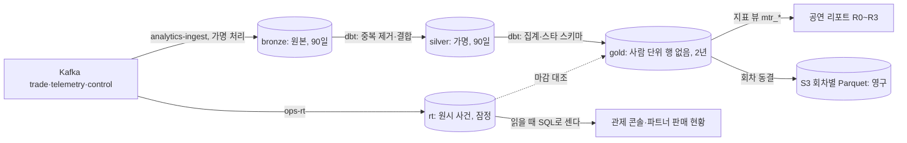

# DB 설계 편 10: 분석 저장소

- **기준 시점**: ADR-0177까지, 2026-11-01
- **맡는 정본**: [docs/features/analytics.md](../../features/analytics.md) §2·§3·§4·§5·§11, [docs/data.md](../../data.md) §1의 ClickHouse·S3 행, [docs/streaming.md](../../streaming.md) §4.3, [docs/infra.md](../../infra.md) §6의 ClickHouse 행, [ADR-0042](../../adr/0042-analytics-store-and-decision-rules.md), [ADR-0052](../../adr/0052-analytics-medallion-star-schema-close-stages.md), [ADR-0099](../../adr/0099-drop-flink-typescript-stream-workers-read-time-aggregation.md), [ADR-0115](../../adr/0115-analytics-archive-per-event-parquet-files-read-with-clickhouse-s3.md)
- **규범이 아니다**: 정본을 풀어 쓴 해설이다. 숫자와 규칙이 정본과 다르면 정본이 맞다([ADR-0177](../../adr/0177-walkthrough-explain-in-interview.md)).
- **앞뒤 편**: 앞은 [DB 설계 편 9](09-scaling.md)(커질 때), 뒤는 [DB 설계 편 11](11-privacy.md)(개인정보). ClickHouse 표를 하나씩 보려면 [표 사전 ②](14-table-dictionary-redis-clickhouse.md) §5를 본다
- **측정 전이다**: 서비스 수준 측정(NFR 목표를 운영 규모로 잰 것)은 아직 없어 신선도·조회 시간 같은 성능 숫자는 설계 목표값이고 `[실측 전]`을 붙였다. 기반 PoC(wbs 0.5.1, 본 개발 전에 위험한 부분만 먼저 재 보는 시험)는 2026-11-01에 PC 한 대에서 쟀다([ADR-0176](../../adr/0176-foundation-poc-results.md), 성능 장부 docs/perf-ledger.md §5). 그 숫자는 '실측(PC)'이고 운영 규모 증거가 아니며, ClickHouse는 재지 않았다.

## 1. 면접관의 질문

> **면접관**: "온세일 중 판매 현황과 공연이 끝난 뒤 리포트는 어디서 계산하나요? 주문 DB에 바로 `GROUP BY`를 걸면 안 되나요?"

거래 DB와 분석 저장소를 왜 나누는지, 실시간 숫자와 확정 숫자를 어떻게 다루는지, 중복·늦은 이벤트·개인정보를 어떻게 처리하는지를 본다.

## 2. 단순한 답

- 주문 PostgreSQL(표로 데이터를 두는 관계형 데이터베이스)의 읽기 복제본에 집계 쿼리를 건다.
- 더 빠르게 하려면 Kafka(이벤트를 순서대로 쌓아 두고 나눠 주는 메시지 시스템) 이벤트로 머티리얼라이즈드 뷰(넣을 때마다 미리 합산해 두는 뷰)를 만들고, 관제 화면과 리포트가 같은 표를 본다.
- 원시 이벤트는 다시 볼 수 있게 계속 쌓는다.

## 3. 어디서 깨지나

- **양**: 한 회차에 초당 이벤트 3만 건이 몰려도 관제 반영 p95(백 건 중 아흔다섯 건이 이 시간 안) 5초 미만, 누락률 0.1% 미만이 목표다(NFR-009) `[실측 전]`. 거래 DB에 걸면 분석 부하가 라이브 거래 쪽에 번진다. 분석 저장소는 거래 데이터 평면의 부하에 영향을 주면 안 된다는 것이 제약이다(ADR-0042 맥락).
- **데이터가 흩어져 있다**: 대기열·좌석은 Redis(메모리 저장소), 주문·결제·티켓은 서로 다른 PostgreSQL 클러스터에 있고 논리 DB끼리 조인을 금지한다(docs/data.md §1). 대기 → 입장 → 홀드 → 주문 → 결제 퍼널이 한 쿼리로 엮이지 않는다.
- **숫자가 늦게 확정된다**: 결제 상태 불명 정리 1시간 [가정], 봇 표본 검토는 종료 뒤, 환불은 공연일까지, 입장은 공연 당일이다(docs/features/analytics.md §1.3).
- **중복이 들어온다**: Kafka는 '적어도 한 번' 전달이다. 머티리얼라이즈드 뷰는 삽입 묶음마다 도는 트리거라 중복 전달분을 함께 더하고 조인한 차원의 변경을 반영하지 않는다. ReplacingMergeTree(같은 키의 행을 병합 때 하나로 줄이는 엔진)는 병합 시점을 보장하지 않는다(analytics §5.5).
- **개인정보와 지표 저장소의 한계**: 사람 단위 원시 행을 영구히 쌓으면 가명정보를 오래 둘 이유 없이 붙잡는다. 지표 장기 저장소 Mimir로는 퍼널·등급·구역·실패 사유를 나눠 보지 못한다(ADR-0042).

## 4. 지금 설계

### 4.1 두 길: 잠정과 확정

분석 저장소는 ClickHouse(대량 이벤트 집계에 강한 분석용 데이터베이스) 26.8 LTS와 S3(파일 저장소)의 회차별 Parquet(열 단위로 저장하는 공개 파일 형식) 아카이브다. 원칙은 '결정을 실행할 수 있는 속도보다 빠른 숫자는 쓰지 않는다'이다. 판매 정책·파트너 권고·운영 기본값은 마감된 확정 숫자로만 정하고, 실시간 숫자는 온세일(판매가 열리는 시각 앞뒤로 접속이 몰리는 기간) 중 운영 명령과 '잠정' 표시에만 쓴다. 두 길은 같은 지표 정의를 쓰되 표를 섞지 않는다(ADR-0052 결정 1).

| 층 | 담는 것 | 보장하는 것 | 개인 식별 | 보존 |
| --- | --- | --- | --- | --- |
| 실시간 표 `rt` | `ops-rt`가 싣는 원시 사건. 누적과 1초 칸은 읽을 때 센다 | 잠정. 반영 p95 5초, 누락률 0.1% 미만 | 없다 | 판매류·대기열·홀드 400일, 판정 90일, 심장 박동 7일 [가정] |
| `bronze` | 원본과 적재 정보(토픽, 토픽을 나눈 칸인 파티션, 읽은 위치인 오프셋, 적재 시각). 가명 처리와 금지 필드 제거만 한다 | 빠짐이 없다(오프셋 대조). 중복·순서는 보장하지 않는다 | 회차별 가명 | 적재 뒤 90일 |
| `silver` | 중복 제거, 형 변환, 늦은 이벤트, 기준 자료 결합 | 이벤트 키 유일, 참조 무결성 | 회차별 가명 | 90일 |
| `gold` | 스타 스키마 집계 사실 표, 공통 차원, 지표 뷰 | 지표 사전과 일치, 판매 금액은 정산서와 원 단위 일치 | 없다 | 2년 |
| 아카이브 | 동결된 회차 골드. 회차·표마다 Parquet 파일 하나와 manifest | 바뀌지 않는다(SHA-256 대조) | 없다 | 영구 |

### 4.2 싣기: 원본 그대로, 회차별 가명

- **작업자**: Flink(스트림 처리 엔진) 대신 Kafka를 계속 읽어 저장소에 쓰는 TypeScript 작업자 `analytics-ingest`·`ops-rt`·`trust-reassess`를 쓴다(ADR-0099). 상태가 없고 쓰기 성공 뒤에만 읽은 위치를 커밋해, 다시 떠도 빈 구간이 생기지 않는다.
- **토픽**: `trade.*`, `telemetry.queue`·`telemetry.purchase`·`telemetry.trust-verdicts`, `control.settings`를 싣는다. 행동 신호 `telemetry.behavior`와 브라우저 체감 성능 기록은 싣지 않는다(analytics §3.1).
- **가명**: `pid`·`accountId`·`purchaseSessionId`·`orderId` 같은 식별값을 적재 때 바꾼다. 회차 키 = `HMAC(분석 가명 키, "PEAKET-analytics-v1" ‖ 회차 ID)`이고 가명 = `HMAC-SHA256(회차 키, 식별값)`이다. HMAC은 비밀 키로 만든 위조 확인용 값이고, 회차 키는 키 보관 서비스 KMS의 `GenerateMac`으로 회차마다 한 번 만든다. 같은 사람도 회차가 다르면 가명이 달라 분석 저장소 안에서 회차를 넘어 잇지 못한다. 여러 회차에 걸친 봇 판별은 trust-svc가 한다(analytics §3.3).
- **버리는 칸**: 이름, 연락처, 이메일, 연계정보, IP, User-Agent 원문, 결제 토큰, 계좌 정보, 그리고 부정 예매 조사용 칸(`journeyId`·`contactRef`·`deviceRef` 등)이다. 조사 칸은 회차가 달라도 값이 같아 회차를 넘는 연결과 조사 저장소로 잇는 키가 되기 때문이다.
- **멈추는 쪽으로 실패**: KMS 호출이 실패하면 적재를 멈추고 원문을 싣지 않는다. 밀린 메시지는 Kafka 보관(7일 이상 [가정]) 안에서 다시 읽는다.
- **파일 원천**: 회차 기준 자료·운영 기록·비용·SLO(팀이 정한 서비스 품질 목표) 결과는 원천 서비스가 분석 수집 버킷에 쓰고, 마감 실행기 `close-runner`가 `s3()` 표 함수로 싣는다. 모르는 칸이 하나라도 있으면 그 파일을 싣지 않는다(analytics §3.2).

### 4.3 ClickHouse 물리 설계

| 층 | 엔진과 정렬 | 파티션과 TTL | 쓰기 |
| --- | --- | --- | --- |
| 브론즈 | ReplicatedMergeTree, `ORDER BY (event_id, occurred_at)` | `toYYYYMMDD(loaded_at)`, `loaded_at + 90일` | 비동기 일괄 삽입, 중복 허용 |
| 실버 | ReplicatedMergeTree, `ORDER BY (event_id, event_key)` | `toYYYYMM(open_date)`, 90일 | dbt(SQL 변환 모델을 짜고 시험하는 도구) delete+insert, 중복 제거는 `LIMIT 1 BY event_key` |
| 골드 | ReplicatedMergeTree, 회차가 앞인 정렬 키 | `toYYYYMM(open_date)`, 2년 | dbt 판 바꾸기 |
| 실시간 표 | 원시 표 다섯(`rt.sale_event`·`rt.queue_aggregate`·`rt.hold_attempt`·`rt.verdict`·`rt.pulse`) | 사건 시각 월 파티션(`rt.pulse`만 일) | 0.25초 [가정] 묶음 비동기 삽입, 중복 허용 |

TTL은 저장한 값을 쓸 수 있는 시간이다. `rt.sale_event`는 `ORDER BY (event_id, source, event_key)`, `TTL toDateTime(occurred_at) + INTERVAL 400 DAY`이고 사람 식별값 칸이 없다(docs/streaming.md §4.3). 판매 좌석·금액은 원시 사건을 `eventKey`로 중복을 지우고 골드와 같은 규칙의 SQL로 읽을 때 세므로, 원천 유실이 없으면 골드와 차이가 0이다(analytics §4.4). 복제는 2벌을 서로 다른 AZ(같은 리전 안의 따로인 데이터센터 묶음)에 두고, 복제를 조율하는 Keeper는 셋(정족수 2)이다.

### 4.4 골드: 스타 스키마와 판 바꾸기

- **스타 스키마**: 가운데 사실 표(측정값)와 둘레의 차원 표(나눠 볼 기준)다. 킴볼의 4단계(업무 과정, 한 행이 무엇인지 정하는 그레인, 차원, 사실)로 설계했고 사실 표는 15개다. 예로 F2 `fct_sales_minute`는 회차 × 등급 × 구역 × 결제사 × 오픈 기준 분이 한 행이다. 회차와 날짜는 모든 사실 표의 공통 차원이다.
- **비율은 저장하지 않는다**: 분자·분모와 히스토그램 버킷을 저장하고 지표 뷰가 계산한다. 회차를 합칠 때 평균이 틀리지 않게 하려는 것이다.
- **원자 단위는 실버에만**: 구매 세션 1행 같은 가장 작은 단위는 실버에 90일 둔다. 2년 골드에 사람 단위 행을 두지 않으려는 대가로, 90일 뒤에는 새 기준으로 지난 회차를 다시 나눠 보지 못한다(analytics §5.4).
- **판 바꾸기**: 골드는 실행마다 `run_id`를 붙여 넣고, 시험을 통과하면 회차별 현재 판 표 `gold.current_run`(`ReplicatedReplacingMergeTree`, 지표 뷰가 `FINAL`로 읽는다)을 바꾼다. 도중에 실패해도 반쯤 지워진 회차가 보이지 않는다(ADR-0086).

### 4.5 마감 단계와 대조

마감 실행기는 10분마다 [가정] 도는 쿠버네티스 CronJob(정해진 주기로 도는 작업)이고 Airflow는 쓰지 않는다.

| 단계 | 시점 [가정] | 확정되는 것 |
| --- | --- | --- |
| R0 | 온세일 윈도우 종료(T+60분) + 30분 | 진입·입장·판매 좌석, 홀드 경합, SLO와 에러 버짓(목표가 허용하는 실패의 총량) |
| R1 | 다음 영업일 10시 | 매진 시각, 결제 결과와 실패 사유, 판매 금액, 인프라 비용 |
| R2 | 오픈 + 7일 | 봇 점유율 하한, 이의 제기 인용률, CS 건수 |
| R3 | 회차 종료 다음 영업일 10시 | 현장 입장률, 환불·양도, 정산서 대조 |
| 동결 | R2와 R3 중 늦은 시점 + 7일 | 회차 골드를 아카이브로 내보내고 더 고치지 않는다 |

마감마다 같은 지표를 실시간 표와 골드로 계산한다. 판매 좌석·금액은 차이 0, 퍼널은 0.1% [가정] 이내가 기준이고, 넘으면 그 결정 규칙은 '판정 보류'다. R3 판매 대금은 정산서와 0원 차이여야 하고, 어긋나면 정산 대사와 같은 절차로 조사한다(NFR-026, analytics §7). R2 뒤에도 파는 회차는 날짜별 판매 사실 F15 `fct_sales_daily`에 매일 전날 판매분을 쌓는다.

### 4.6 아카이브: 회차별 Parquet 파일

- **쓰기**: 동결 때 현재 판 골드를 표마다 Parquet 파일 하나로 `INSERT INTO FUNCTION s3(…, 'Parquet') SELECT …`한다. 경로는 `s3://peaket-analytics-archive-<환경>/gold/<표>/open_month=<YYYY-MM>/event_id=<회차>/run_id=<판>.parquet`이다. 다 쓰면 `gold.archive_manifest`(경로, 행 수, SHA-256, 스키마 판 등)와 `manifest.json`에 적고, manifest가 있는 회차만 '아카이브됨'이다.
- **다시 돌리면**: 이미 있는 파일에는 쓰지 않으므로 행 수와 SHA-256을 확인하고 건너뛴다. 다르면 경보 SEV3(경보 등급, 숫자가 작을수록 무겁다. `kind` hygiene)다.
- **읽기**: 뷰 `archive.<표>`가 `s3()`로 읽고 `_path`가 manifest에 있는 행만 내며, 2년보다 오래된 회차와의 비교에 쓴다. 버킷은 버전 관리와 도쿄 복제를 켜고, 마감 실행기는 쓰기만 하고 지우지 못한다(ADR-0115).

### 4.7 사용자, 상한, 같은 서버의 다른 DB

적재(`bronze_writer`·`rt_writer`), 변환(`an_transform`), 읽기(`an_ops_reader`·`an_rt_reader` 등) 주체마다 사용자를 나눈다. 화면 읽기 사용자는 `readonly=1`로 쿼리마다 10초·2GiB를 넘지 못하고 1분에 300개(Grafana 120개)를 넘으면 거절된다 [가정]. 관제 읽기 `an_rt_reader`는 `force_primary_key = 1`과 1초 [가정] 상한이다(analytics §11).

같은 ClickHouse에 법정 접속기록 DB(3개월), 행동 신호 원시 표 `trust.behavior_raw`(30일), 부정 예매 조사 저장소 `inv`(그 회차 공연일 + 30일 [가정])가 함께 있다. 분석 사용자는 `inv` 권한이 없고 `inv` 사용자는 분석 DB 권한이 없으며, 두 갈래를 잇는 키와 파일을 두지 않는다(ADR-0171).

### 4.8 잃으면 다시 만든다

목표는 RPO(잃어도 되는 시간 폭) 1일, RTO(복구에 걸려도 되는 시간) 1시간이다. 하루 1회 S3 스냅샷(7일 [가정])을 복원하고, 그 뒤 구간은 Kafka를 다시 읽어 브론즈를 채운 뒤 dbt로 실버·골드를 다시 만든다. 동결된 회차는 아카이브를 그대로 읽는다(docs/infra.md §6).

## 5. 트레이드오프와 버린 길

| 정한 것 | 얻는 것 | 치르는 값 |
| --- | --- | --- |
| 실시간 표와 골드를 나누기 | 관제는 빠르고 결정은 확정 숫자로 한다 | 같은 지표를 두 길로 계산하고 대조해야 한다 |
| 스트림 작업자 + 조회 시점 집계 | 한 언어로 끝나고, 판매 숫자가 확정 숫자와 같은 사건·키·SQL에서 나온다 | 읽을 때 계산 비용이 ClickHouse에 걸린다(대형 회차 판매 사건 약 27만 개, 한 번에 수십 ms [추정]) |
| 회차별 가명, 골드는 집계만 | 회차를 넘는 추적이 없고 가명정보가 90일 뒤 사라진다 | 사람 단위 지표가 없고 90일 뒤 다시 나눠 보지 못한다 |
| 아카이브는 Parquet 파일 | 카탈로그와 정리 작업이 없다 | 파일 목록과 스키마 판을 manifest로 직접 관리한다 |

**버린 길**

- **Flink 잡 셋(이전 설계)**: 자바 코드와 빌드가 생겨 규칙이 세 언어에 나뉘고 운영 자원이 CPU 15.5개·31GiB [가정]였다. Flink SQL·관리형 Flink도 실행 기반이 같다(ADR-0099).
- **Kafka Connect 싱크 + 뷰 합산**: 회차별 KMS 가명 처리에 자바 변환기가 필요하고, 처리 못 한 메시지 토픽이 원문을 한 벌 더 만들며, 뷰가 중복을 두 번 더한다(ADR-0099).
- **ClickHouse만(Kafka 엔진 + 뷰)**: 가명 처리 전 식별값이 ClickHouse에 들어간다(ADR-0099). **RisingWave**는 운영할 분산 시스템이 하나 늘고 KMS 가명 처리를 안에서 못 한다.
- **원시 삽입에 뷰로 마트를 만들고 실시간을 흡수(ADR-0042 원안)**: 중복이 합산되고 차원 변경이 반영되지 않으며 잠정과 확정이 섞인다(ADR-0052).
- **스트림 하나로 확정까지**: 며칠 뒤 확정되는 숫자를 스트림 상태로 붙들어야 하고 재처리 비용이 크다. **넓은 표 하나**는 그레인이 달라 대기 인원 같은 값을 잘못 더한다. **Airflow**는 운영 부담이 이득보다 크다(ADR-0052).
- **S3에만 싣고 Athena로 조회**: 리포트가 수십 분 이상 늦고 고빈도 쿼리 비용이 크다(ADR-0042).
- **Iceberg(여러 엔진이 같은 표를 함께 읽고 쓰게 하는 표 형식) 표 + Glue 카탈로그**: 카탈로그와 정리 작업을 운영하고, 26.8의 Iceberg 쓰기는 Beta이며, 읽는 엔진이 하나뿐이다. **골드를 오래 두고 매일 백업**은 '바뀌지 않음'을 권한으로만 지키고, 백업에 가명 사건·원시 IP가 함께 들어 7일만 둔다(ADR-0115).

**바꿀 조건**: 회차당 조회 p95가 0.25초 [가정]를 넘어 중복에 안전한 숫자의 미리 합산으로도 모자라거나, 순서 패턴(CEP)·세션 창이나 여러 흐름을 시간으로 맞붙이는 실시간 기능이 필요하거나, 입력이 초당 수십만 건이 되면 스트리밍 엔진을 다시 비교한다(ADR-0099 결정 9). 다른 엔진이 아카이브를 표로 읽거나, 행을 고쳐야 하거나, 비교 조회가 10초 [가정]를 넘으면 Iceberg를 다시 본다(ADR-0115 결정 5).

## 6. 꼬리 질문

| 질문 | 답의 요지 | 근거 |
| --- | --- | --- |
| 관제 숫자와 리포트 숫자가 다르면요? | 확정(골드)을 믿는다. 관제 숫자는 고쳐 쓰지 않고 차이를 데이터 품질 절에 남긴다. 판매 좌석·금액 기준은 차이 0이다 | analytics §4.4, NFR-026 |
| 같은 이벤트가 두 번 오면요? | 브론즈·`rt`는 받아 두고, 실버는 `LIMIT 1 BY event_key`, 실시간은 읽을 때 `eventKey`로 지운다 | analytics §5.5 |
| 왜 머티리얼라이즈드 뷰를 안 쓰나요? | 중복 전달분을 더하고 차원 변경을 반영하지 않는다. 중복에 안전한 숫자의 미리 합산에만 쓴다 | ADR-0052, ADR-0099 |
| 리포트를 다시 돌리면 결과가 바뀌나요? | 재실행 단위는 회차다. 실버는 지우고 다시 넣고 골드는 새 판으로 바꾼다. 여러 번 돌려도 같다 | analytics §4.3 |
| 아카이브를 왜 Iceberg로 안 했나요? | 회차마다 한 번 쓰고 ClickHouse 하나가 읽는다. 표 형식의 강점을 안 쓰는데 카탈로그와 Beta 쓰기가 따라온다 | ADR-0115 |

## 7. 내 말로 설명하기

> "분석은 거래 데이터베이스에서 떼어 ClickHouse로 옮겼습니다. 길은 둘입니다. 온세일 중 관제는 스트림 작업자가 원시 사건을 실시간 표에 싣고 읽을 때 SQL로 셉니다. 공연 리포트는 원본을 브론즈에 싣고, dbt로 중복을 지운 실버, 스타 스키마 집계인 골드를 만든 뒤 마감 단계 R0부터 R3까지 차례로 확정합니다. 정책 결정은 확정 숫자로만 하고, 마감 때 두 길의 판매 좌석과 금액이 0 차이인지 대조합니다. Kafka의 중복은 뷰나 병합이 아니라 이벤트 키로 지웁니다. 개인정보는 적재할 때 회차마다 다른 키로 가명 처리해 회차를 넘어 잇지 못하게 했고, 사람 단위 행은 실버까지 90일만 둡니다. 동결한 회차의 골드는 S3에 회차별 Parquet 파일로 영구 보관합니다."

- **꼭 넣을 말**: "잠정(rt)과 확정(골드)은 다른 표, 마감 때 차이 0을 대조한다"
- **꼭 넣을 말**: "중복은 엔진이 아니라 `eventKey`와 SQL로 지운다"
- **꼭 넣을 말**: "회차별 가명, 사람 단위 행은 90일, 골드·아카이브는 집계만"

## 8. 정본에서 읽을 곳

1. [docs/features/analytics.md](../../features/analytics.md) §1.2·§1.3(역할 원칙과 신선도), §2(두 길과 층 표)
2. 같은 문서 §3.3(가명 처리와 금지 필드), §4.2·§4.4(마감 단계, 실시간 대비 대조)
3. 같은 문서 §5.5(ClickHouse 물리 설계와 아카이브), §11(사용자 표), 그리고 [docs/streaming.md](../../streaming.md) §4.3(`rt` 표 정의)
4. [ADR-0052](../../adr/0052-analytics-medallion-star-schema-close-stages.md)의 상태 줄과 '대안', [ADR-0099](../../adr/0099-drop-flink-typescript-stream-workers-read-time-aggregation.md)의 '검토한 대안'과 결정 9, [ADR-0115](../../adr/0115-analytics-archive-per-event-parquet-files-read-with-clickhouse-s3.md)의 결정 1·5

## 9. 정본에서 찾은 어긋남

| 어긋난 곳 | 내용 | 지금 읽는 법 |
| --- | --- | --- |
| docs/features/analytics.md §5.5 실버 행 | 브론즈 TTL은 `loaded_at + 90일`로 기준 칸이 있지만 실버 TTL은 '90일'만 적고 기준 칸이 없다. 실버는 마감마다 delete+insert로 다시 넣으므로 넣은 시각이 기준이라면 90일이 다시 시작될 수 있다. §4.3과 §11은 '적재 뒤 90일'(가명정보 처리 기간)이라 적는다 | '적재 뒤 90일'로 읽는다. 기준 칸은 정본에 없어 열린 일 95번(docs/review/open-items.md)으로 올라갔다 |
| docs/infra-handover.md §3.2 ClickHouse 행, docs/infra.md §6 ClickHouse 백업 행 | infra-handover §3.2의 담는 것 칸과 infra §6의 백업 설명이 2026-10-31에 더한 조사 저장소 `inv`(원문 IP 포함)를 적지 않았다. docs/data.md §1 ClickHouse 행에는 있었다. 고침(2026-11-01 정합 점검) | 지금 infra-handover §3.2는 같은 ClickHouse의 별도 DB `inv`를 적는다. infra §6은 `inv`가 일 백업에 드는지 정하지 않았다고 적고, 그 판단은 열린 일 97번이다 |
