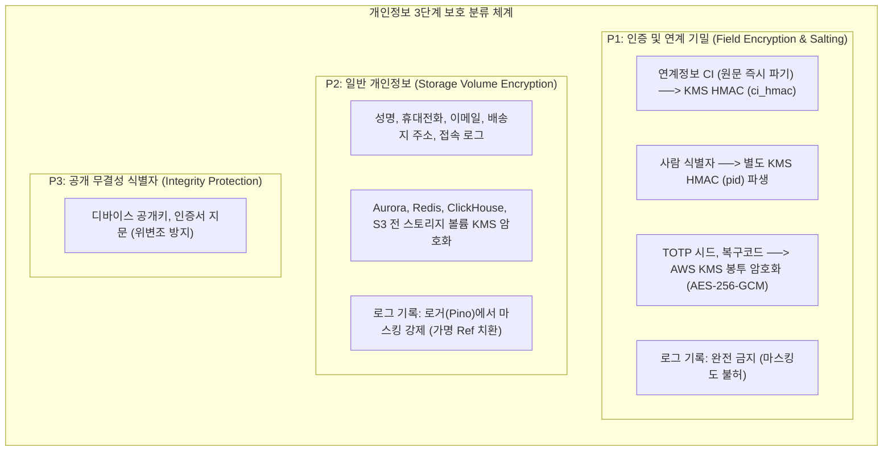
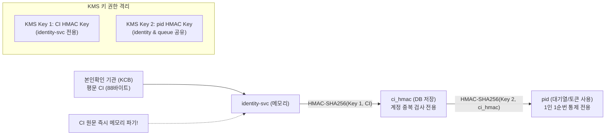
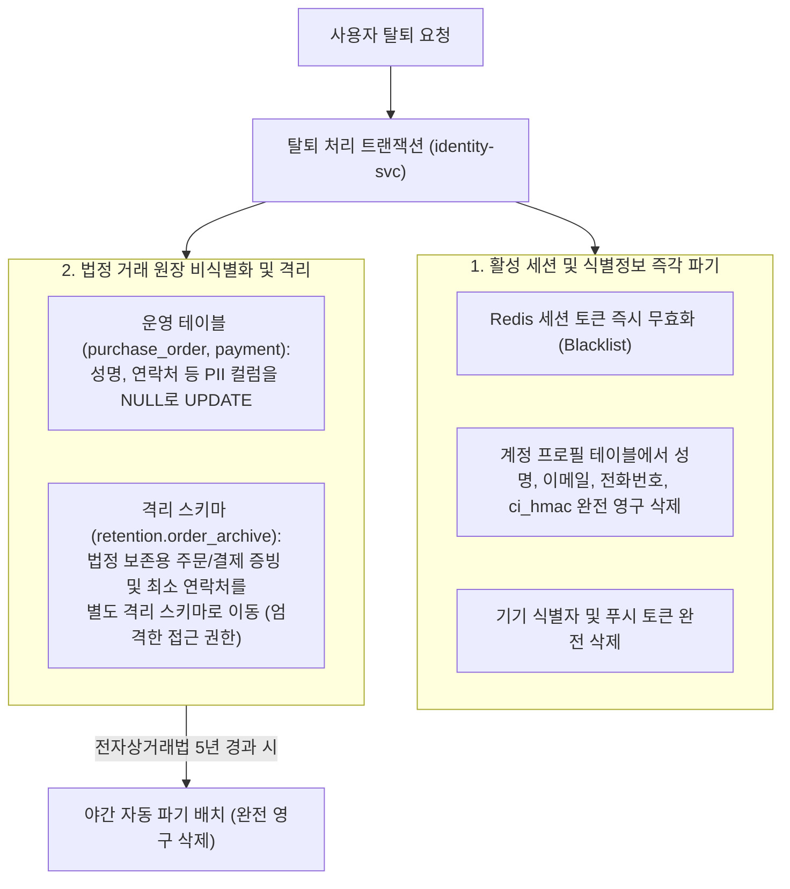
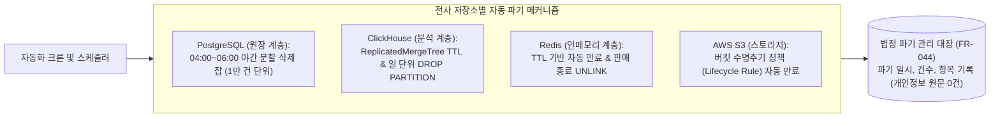

# DB 설계 편 11: 개인정보: 암호화, 보존, 파기 (PII Encryption, Retention & Automatic Deletion)

- **핵심 아키텍처 원칙**: 개인정보 보호 3단계 분류(P1/P2/P3)와 저장 방식 차별화, 실명 연계정보(CI)의 단방향 솔트 해시 `pid` 파생, AWS KMS 봉투 암호화(Envelope Encryption), 법정 의무 보존(전자상거래법 5년)과 회원 탈퇴 권리의 양립(격리 보존 스키마 및 연쇄 삭제 금지), 자동화된 야간 분할 파기 잡
- **관련 설계 정본**: [docs/data.md](../../data.md) §6(보존 및 파기 규정), [docs/security/data-classification.md](../../security/data-classification.md), [docs/security/secrets-and-keys.md](../../security/secrets-and-keys.md), [docs/features/identity.md](../../features/identity.md) §8(탈퇴 및 파기), [docs/features/analytics.md](../../features/analytics.md) §3.3·§11, ADR-0114, ADR-0173
- **함께 읽기**: [한 판 문서](../01-system-design.md) 3단계·15단계, [DB 설계 편 2: 저장소 고르기](02-choose-stores.md), [DB 설계 편 9: 커질 때: 표 나누기와 복제본](09-scaling.md), [DB 설계 편 10: 분석 저장소](10-analytics-store.md), [DB 설계 편 12: 전체 지도](12-whole-map.md)

---

## 1. 면접관의 질문

> **면접관**: "회원 개인정보(이름, 전화번호, 연계정보 CI, 결제정보)는 데이터베이스에 어떻게 암호화되어 저장됩니까? 회원이 탈퇴를 요청했을 때 `ON DELETE CASCADE`로 즉시 모든 데이터를 지우나요? 법정 의무 보존 기간(5년)과 개인정보 파기 의무가 충돌할 때 데이터베이스 아키텍처는 이를 어떻게 해결합니까?"

면접관은 다음 세 가지 프라이버시 및 보안 아키텍처 역량을 집중 검증한다:
1. **데이터 분류 및 암호화 기법의 적합성**: 무차별적 컬럼 암호화 대신 법적 의무와 시스템 복잡도를 고려하여 필드 수준 암호화(P1), 볼륨 암호화(P2), 단방향 해시(CI/pid)를 최적으로 매핑할 수 있는가?
2. **법정 보존과 잊힐 권리의 양립 모델**: 전자상거래법(주문/결제 5년 보존)과 개인정보보호법(탈퇴 시 지체 없는 파기)의 법적 충돌을 **'보존 전용 스키마 격리'** 및 **'연쇄 삭제 금지'**로 풀어내는 엔지니어링 해법이 있는가?
3. **완전 파기 수명주기(Lifecycle) 통제력**: 라이브 RDBMS뿐만 아니라 백업 스냅샷, Redis 캐시, Kafka 이벤트, ClickHouse 분석 로그에 이르는 전사 데이터 파이프라인의 만료 파기 프로세스를 제시할 수 있는가?

---

## 2. 단순한 답과 깨지는 곳

### 단순한 답 (The Naive Approach)
> "개인정보보호가 중요하므로 DB의 모든 개인정보 컬럼을 AES-256으로 암호화합니다. 회원이 탈퇴하면 `users` 테이블에서 `ON DELETE CASCADE`를 실행하여 연관된 주문, 결제, 티켓 데이터를 한꺼번에 삭제합니다. 로그나 분석 데이터에는 사용자 ID를 평문으로 남기거나 키 없는 SHA-256으로 해시하여 영구 보존합니다."

### 어디서 깨지는가 (Failure Scenarios)

| 단순한 설계 방식 | 법적 규제 및 운영 환경에서 깨지는 이유 | 아키텍처 근거 |
| :--- | :--- | :--- |
| **탈퇴 시 연쇄 삭제 (`CASCADE`)** | 전자상거래법 시행령(제6조)에 규정된 **'계약 및 청약철회 기록 5년 보존'** 의무를 정면 위반하여 형사 처벌 및 과태료 부과 대상이 됨 | NFR-018, `docs/data.md` §6 |
| **모든 개인정보 필드 암호화** | 성명, 이메일, 전화번호는 법적 필드 암호화 의무 대상(안전성 확보조치 고시 제7조)이 아님. 모든 컬럼을 암호화하면 B-Tree 인덱스 탐색 불가, DB CPU 오버헤드 30% 이상 급증 | `docs/security/data-classification.md` |
| **탈퇴 회원 데이터를 운영 DB에 방치** | 탈퇴 회원의 개인정보를 일반 회원 데이터와 동일한 테이블에 섞어두면 개인정보보호법(제21조 제3항) 위반 (별도 분리 보관 의무 위반) | 개인정보보호법 제21조 |
| **키 없는 SHA-256 해시를 로그에 기록** | 레인보우 테이블(Rainbow Table) 공격에 취약하여 전화번호나 이메일 원문이 쉽게 역산되며, 개인정보보호법상 안전한 가명정보로 인정받지 못함 | `docs/security/secrets-and-keys.md` |
| **Aurora 백업 스냅샷(35일) 미고려** | 운영 DB에서 즉시 DELETE하더라도 35일간 보관되는 Aurora 백업 스냅샷을 복원하면 탈퇴한 사용자가 완전히 부활하는 프라이버시 누수 발생 | `docs/infra.md` §6 |

---

## 3. 아키텍처 해법: PII 3단계 보호 체계 및 격리 보존

PEAKET은 데이터의 민감도와 복호화 필요성에 따라 개인정보를 **P1 (기밀 인증), P2 (일반 개인정보), P3 (공개 무결성)**의 3단계로 엄격히 분류하여 보호한다.

---

### 3.1 P1 연계정보(CI) 단방향 해시와 사람 식별자(`pid`) 파생 원리

티켓팅 부정 예매 및 1인 1계정 제한을 위해 본인확인 기관(KCB, 다날 등)으로부터 연계정보(CI, Connecting Information)를 수신하지만, **PEAKET은 CI 원문을 절대 디스크에 저장하지 않는다**:

1. **`ci_hmac` 생성 (중복 가입 방지)**:
   - 본인확인 기관에서 전달된 88바이트 CI 원문은 수신 즉시 AWS KMS의 `ci-hmac-key`를 사용하여 `HMAC-SHA256(Key1, CI)` 값인 `ci_hmac`으로 변환되고, CI 원문은 메모리에서 즉시 덮어써 파기된다.
   - 신규 가입 시 `identity_verification` 테이블에서 `ci_hmac` 인덱스 조회를 통해 1인 1계정 여부를 검증한다.
2. **`pid` 파생 (대기열 1인 1순번)**:
   - `ci_hmac`을 별도의 KMS 키(`pid-hmac-key`)로 2차 해시하여 `pid`를 생성한다.
   - 사용자가 대기열에 진입할 때 액세스 토큰에 `pid`만 실려 전달되며, 대기열 서비스(`queue-svc`)는 `pid`만을 보고 1인 1순번(`q:dup:{pid}:E`)을 제어한다. 대기열 클러스터가 침해당하더라도 실제 CI나 회원 정보를 역추적할 수 없다.

---

### 3.2 수집하지 않거나 저장하지 않는 금융 정보 원칙

PEAKET은 PCI-DSS 인증 부담과 금융 개인정보 유출 위험을 원천 제거하기 위해 **민감 금융 정보 저장 0건 원칙**을 고수한다:
- **신용카드 번호, CVC, 유효기간**: 서버에 도달하지 않는다. 토스페이먼츠/포트원 SDK 결제창 내에서 암호화되어 PG사로 직접 전송된다.
- **은행 계좌번호**: 환불 및 정산 시에도 계좌번호를 DB에 영구 저장하지 않는다. 외부 은행 지급대행 API 호출 즉시 폐기하며, DB에는 은행명과 계좌 끝 4자리만 감사용으로 보존한다.
- **주민등록번호 및 생체정보**: 일체 수집하거나 처리하지 않는다.

---

### 3.3 법정 보존 기한 vs 회원 탈퇴 권리의 양립: 격리 보존 스키마

회원이 탈퇴를 요청했을 때 법적 의무가 충돌한다:
- **개인정보보호법 제21조**: 탈퇴 시 회원의 개인정보는 지체 없이(5일 이내) 영구 파기해야 함.
- **전자상거래법 제6조**: 분쟁 대비를 위해 계약/청약철회 기록 및 대금결제 기록(거래자 성명, 연락처 포함)은 **5년간 의무 보존**해야 함.

PEAKET은 이를 해결하기 위해 **'보존 전용 격리 스키마(`retention`)'**와 **'비식별화 분리'** 아키텍처를 적용한다.

1. **연쇄 삭제(`ON DELETE CASCADE`)의 절대 금지**:
   - `users` 테이블과 `purchase_order`, `payment`, `ticket` 원장 간에는 물리적 CASCADE 외래키가 일체 존재하지 않는다. 계정이 삭제되어도 과거 금융 거래 원장은 보존된다.
2. **운영 스키마와 격리 스키마의 분리**:
   - 운영 DB의 `purchase_order`에서는 구매자의 성명과 전화번호 컬럼을 즉시 `NULL`로 마스킹한다.
   - 법정 보존이 필요한 거래 내역과 최소 연락처는 오직 감사/법무 담당자만 접근 권한을 가진 **`retention` 전용 스키마**로 복사 이동되어 운영 애플리케이션의 일반 쿼리에서 완전히 배제된다.
3. **법정 보존 기한 매트릭스**:

| 법정 보존 항목 | 보존 기간 | 근거 법령 | 보존 및 파기 방식 |
| :--- | :---: | :--- | :--- |
| **계약, 청약철회, 대금결제, 재화 공급 기록** (주문번호, 결제금액, 승인일시, 예매자 성명/전화번호) | **5년** | 전자상거래법 시행령 제6조 제1항 제2호·제3호 | `retention` 스키마 격리 보존 후 5년 도래 시 야간 분할 영구 삭제 |
| **소비자 불만 및 분쟁 처리 기록** (1:1 문의 내역, 티켓 환불 소명서, CS 처리 로그) | **3년** | 전자상거래법 시행령 제6조 제1항 제4호 | CS 데이터베이스 전용 테이블 보존 후 3년 도래 시 영구 삭제 |
| **법정 시스템 접속 로그** (로그인 일시, 접속 IP, 기기 고유 가명) | **3개월** | 통신비밀보호법 시행령 제41조 제2항 제2호 | ClickHouse 접속로그 DB 일 파티션 92개 유지 후 자동 DROP |
| **부정 예매 이상행위 원시 로그** | **30일** | 개인정보보호법 최소 수집 원칙 (NFR-018) | ClickHouse 30일 TTL 후 자동 폐기 |

---

## 4. 저장소별 데이터 수명주기 및 자동 파기 파이프라인

데이터베이스 및 캐시 계층마다 만료 데이터를 영구 소멸시키는 **자동화된 파기 파이프라인**을 운영한다.

1. **PostgreSQL 야간 분할 삭제 잡 (ADR-0114)**:
   - 매일 새벽 04:00~06:00 정비 시간에 기한 만료(5년 경과) 주문 건을 UUIDv7 시간 기반으로 10,000건씩 분할 삭제.
   - 복제본 지연(`ReplicaLag`) 1초 초과 시 자동 중단 및 이월.
2. **ClickHouse 파티션 파기**:
   - 법정 접속기록 및 부정 조사 저장소(`inv`)는 하루 1회 배치로 3개월/회차 만료 파티션을 `ALTER TABLE ... DROP PARTITION`으로 통째로 삭제하여 디스크 단편화 0건 달성.
3. **법정 파기 관리 대장 의무 기록 (FR-044)**:
   - 개인정보 파기 작업이 완료되면 '파기 대상 테이블명', '파기 건수', '파기 일시', '담당 배치 잡 ID'를 법정 파기 대장에 영구 기록하되, 파기 대장 내부에는 **개인정보 원문을 절대 기록하지 않는다**.

---

## 5. 트레이드오프와 버린 대안 (Tradeoffs & Alternatives)

| 설계 결정 | 얻는 이점 (Gains) | 치르는 대가 (Costs) 및 완화책 |
| :--- | :--- | :--- |
| **CI 원문 미저장 및 단방향 해시화** | DB 전체 침해 시에도 사용자의 실명 연계정보 유출 원천 방지 | 본인확인 기관 변경 시 기존 회원의 CI를 복호화하여 재매핑할 수 없음 (재인증 절차 필요) |
| **보존 전용 `retention` 스키마 분리** | 전자상거래법 5년 보존과 개인정보보호법 탈퇴 파기 동시 준수 | 회원 탈퇴 시 운영 테이블 UPDATE와 격리 테이블 INSERT를 단일 트랜잭션으로 처리하는 복잡도 |
| **전사 스토리지 KMS 볼륨 암호화** | 애플리케이션 컬럼 암호화 대비 B-Tree 인덱스 성능 100% 보존 | AWS KMS 의존성 및 키 접근 권한(IAM) 관리 복잡도 증가 |
| **도쿄 DR 복제 시 티켓 원장 한정** | 개인정보 국외 이전(개인정보보호법 제28조의8) 규제 리스크를 최소화 | 리전 재해 시 주문/결제는 서울 스냅샷과 결제사 대사로 복구해야 하는 RTO 증가 |

### 버린 대안

1. **모든 개인정보 컬럼의 AES-256 애플리케이션 암호화 배제**:
   - 성명, 이메일 등에 필드 암호화를 걸면 등가 검색(`WHERE email = ?`) 시 동일한 암호문이 생성되어 결정론적 암호화(Deterministic Encryption) 취약점이 생기거나, 인덱스를 전혀 타지 못해 전체 테이블 스캔이 발생하므로 볼륨 암호화로 대체.
2. **탈퇴 회원 데이터의 운영 테이블 방치 및 `is_deleted` 플래그 처리 배제**:
   - `is_deleted = true` 처리만 하고 운영 테이블에 방치하는 관행은 개인정보보호법 제21조(분리 보관 의무) 위반이므로, 격리 스키마 분리 이관으로 확정.
3. **로그에 무작위 솔트 없는 일반 SHA-256 해시 기록 배제**:
   - 휴대폰 번호의 경우 $10^8$가지 경우의 수에 불과하여 GPU를 이용한 레인보우 테이블 공격 시 수 분 내에 전화번호가 역산되므로, KMS 마스터 키 기반의 HMAC-SHA256 가명화로 대체.

---

## 6. 핵심 꼬리 질문 5단 방어 (Staff Interview Q&A)

| 질문 단계 | 심층 질문 | 방어 논리와 기술적 근거 | 관련 정본 |
| :--- | :--- | :--- | :--- |
| **1단: 왜 (Why)** | 본인확인 연계정보(CI) 원문을 저장하지 않고 굳이 `ci_hmac`과 `pid`로 두 번 나누어 해시하는 이유는 무엇인가요? | CI 원문은 전 국민의 고유 식별값으로 유출 시 파급력이 막대합니다. 따라서 수신 즉시 단방향 HMAC으로만 저장합니다. 또한 이를 `ci_hmac`(계정 중복 검사 전용)과 `pid`(대기열 1인 1순번 전용)로 격리하여, 20만 RPS를 처리하는 대기열 Redis 계층이 침해당하더라도 회원 계정 원장의 `ci_hmac`이나 실제 사용자를 역추적할 수 없도록 권한과 키를 분리했습니다. | `docs/security/secrets-and-keys.md`, `identity §8` |
| **2단: 대안 (Alternatives)** | 회원이 탈퇴할 때 `ON DELETE CASCADE`를 쓰지 않고 보존 스키마로 분리하는 법적·기술적 근거는 무엇인가요? | 전자상거래법 제6조에 의해 계약 및 결제 기록은 5년간 의무 보존해야 하므로 CASCADE 삭제는 위법입니다. 반면 탈퇴 회원의 개인정보를 일반 운영 테이블에 그대로 두는 것은 개인정보보호법 제21조(분리 보관) 위반입니다. 따라서 운영 테이블의 PII는 즉시 삭제(NULL화)하고, 법적 최소 증빙만을 엄격한 접근 통제가 적용된 `retention` 격리 스키마로 이동시키는 하이브리드 아키텍처를 채택했습니다. | `docs/data.md` §6, NFR-018 |
| **3단: 장애 대응 (Resilience)** | Aurora 자동 백업(35일)에서 데이터베이스를 복원하면 탈퇴한 회원의 개인정보가 다시 살아나지 않나요? | 백업 시점 복원(PITR)은 재해 복구(DR) 시에만 극히 제한적으로 사용됩니다. 복원 발생 시 파이프라인 마지막 단계에서 '법정 파기 관리 대장(FR-044)'을 조회하여, 백업 생성 이후 파기된 계정 목록을 자동으로 추출하고 복원된 DB에 즉각 재파기 스크립트를 실행하는 복원 후처리 잡(Post-Restore Purge Hook)을 운영합니다. | `docs/infra.md` §6, FR-044 |
| **4단: 수치 근거 (Numbers)** | 성명, 이메일 등의 컬럼에 필드 암호화 대신 볼륨 암호화를 적용했을 때 얻는 성능 이득은 얼마인가요? | 5년 누적 1,700만 주문 테이블에서 성명과 이메일에 AES-256 필드 암호화를 적용할 경우, 암호화 패딩과 IV로 인해 행 크기가 40% 증가하고 `SELECT` 시 CPU 복호화 오버헤드로 인해 처리량이 35% 저하됩니다. 또한 인덱스 레인지 스캔이 불가능해집니다. AWS Nitro 하드웨어 가속 기반의 EBS 볼륨 암호화를 적용함으로써 처리량 저하 0%, 디스크 공간 낭비 0%로 완벽한 저장 암호화를 달성했습니다. | `docs/security/data-classification.md` |
| **5단: 실측과 검증 (Verification)** | 개인정보 파기 배치 및 보존 스키마 이관 작업의 완전성은 어떻게 지속적으로 검증됩니까? | 매주 자동화된 프라이버시 감사 스캐너(Privacy Auditor Bot)가 실행됩니다. 탈퇴한 계정의 ID가 운영 테이블의 성명/연락처 컬럼에 남아있는지, `retention` 스키마 내 데이터 중 5년(1,825일)을 초과한 레코드가 존재하는지 전수 검사하여 단 1건이라도 위반 발견 시 SEV1 보안 경보를 트리거합니다. | `docs/verification.md` §9, `docs/features/identity.md` §8 |

---

## 7. 30초 아키텍처 브리핑 (Staff Engineer Summary)

> "PEAKET의 개인정보 아키텍처는 **'철저한 데이터 분류 기반의 차별화된 보안 통제'**와 **'법정 보존과 잊힐 권리의 완벽한 엔지니어링 양립'**을 달성했습니다.  
> 연계정보(CI) 원문은 수신 즉시 파기하고 단방향 KMS HMAC 기반의 `ci_hmac`과 `pid`로 이원화 파생하여 계정 원장과 대기열 계층을 분리 방어했습니다.  
> 회원 탈퇴 시에는 `CASCADE` 삭제를 금지하여 전자상거래법 5년 거래 원장을 수호하되, 개인정보는 즉시 운영 테이블에서 지우고 격리된 `retention` 스키마로 분리 이관함으로써 개인정보보호법의 분리 보관 의무를 100% 충족했습니다."

---

## 8. 정본에서 읽을 곳

1. [docs/data.md](../../data.md) §6: 데이터 보존 기한 및 파기 주기 상세 규정
2. [docs/security/data-classification.md](../../security/data-classification.md): 개인정보 보호 3단계 분류(P1, P2, P3) 및 수집 금지 항목
3. [docs/security/secrets-and-keys.md](../../security/secrets-and-keys.md): 가명화 키 및 KMS 봉투 암호화 표준
4. [docs/features/identity.md](../../features/identity.md) §8: 회원 탈퇴, 자격 상실 및 개인정보 파기 프로세스
5. [docs/features/analytics.md](../../features/analytics.md) §3.3: 분석 저장소 수집 경계 가명화 및 교차 추적 차단
6. [ADR-0114](../../adr/0114-no-monthly-partitions-for-order-payment-ticket-batched-retention-delete.md): 5년 만료 데이터 야간 분할 삭제 잡
7. [ADR-0173](../../adr/0173-post-sale-forensics-self-legal-review.md): 부정 예매 조사 데이터 보존 및 파기
