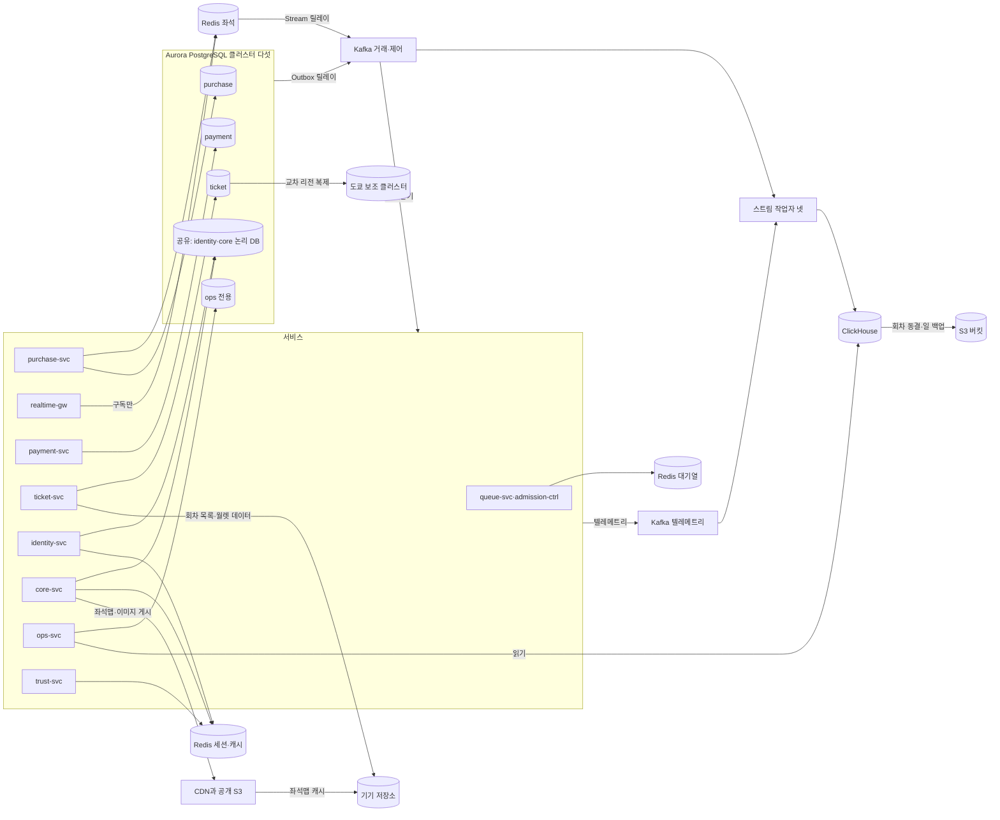
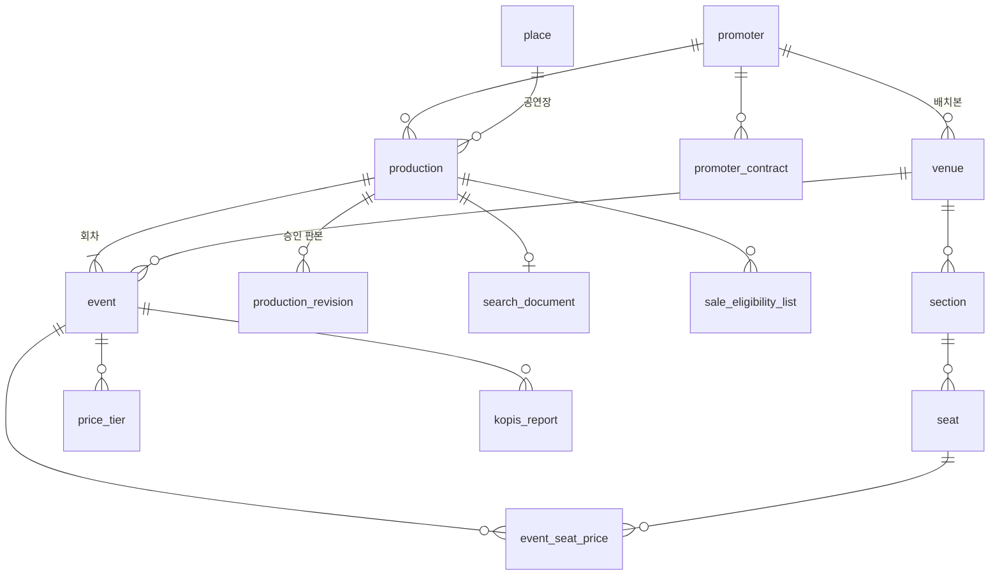
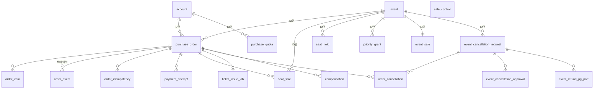
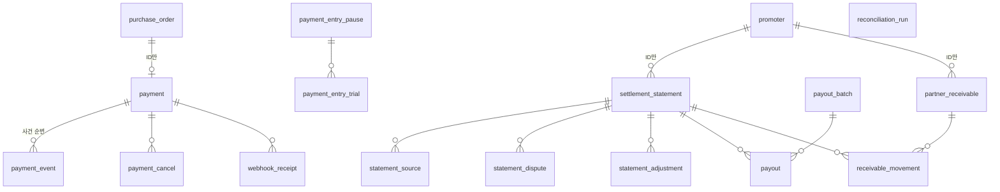
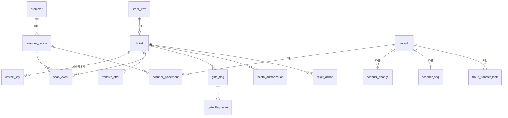
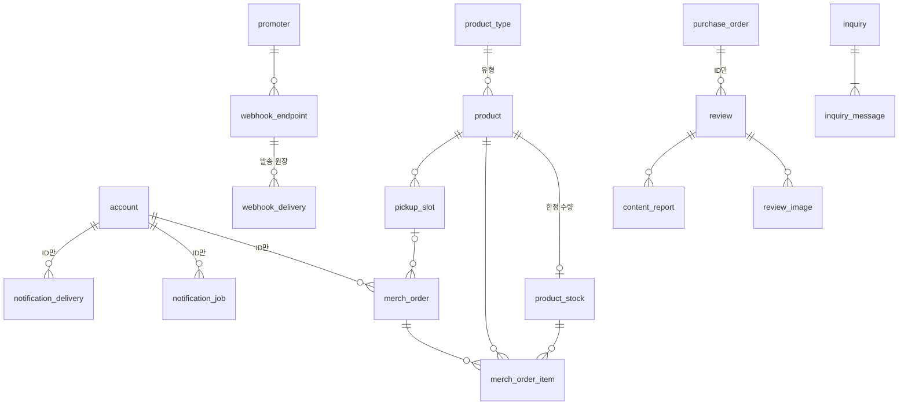
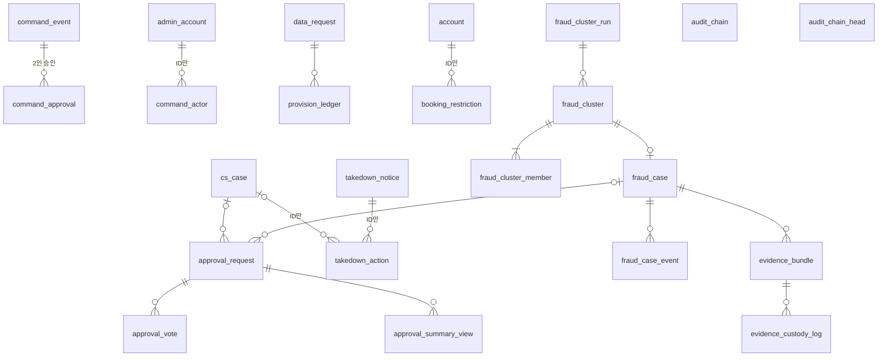

# DB 설계 편 12: 전체 지도 — 저장소와 표를 한눈에

- **기준 시점**: ADR-0177까지, 2026-11-02. 2026-11-03에 새 계정 표 셋과 표·키 수, 순번 묶음(ADR-0179)을 고쳤다
- **지금 판의 근거**: [docs/data.md](../../data.md) §1·§2·§3·§4, [docs/infra.md](../../infra.md) §4·§6, [docs/architecture.md](../../architecture.md) §3.1·§3.2·§9.1, [docs/streaming.md](../../streaming.md) §1·§11, [docs/features/analytics.md](../../features/analytics.md) §2·§3·§5·§11, [docs/features/payment.md](../../features/payment.md) §2
- **규범이 아니다**: 정본을 풀어 쓴 해설이다. 숫자와 규칙이 정본과 다르면 정본이 맞다([ADR-0177](../../adr/0177-walkthrough-explain-in-interview.md)).
- **함께 읽기**: DB 설계 편 [1](01-what-and-how-much.md)·[2](02-choose-stores.md)·[3](03-core-tables.md)·[4](04-no-double-sale.md)·[5](05-consistency-transactions.md)·[6](06-concurrency.md)·[7](07-indexes-queries.md)·[8](08-redis-keys.md)·[9](09-scaling.md)·[10](10-analytics-store.md)·[11](11-privacy.md), 표 사전 [13 PostgreSQL](13-table-dictionary-postgres.md)·[14 Redis·ClickHouse·S3·기기](14-table-dictionary-redis-clickhouse.md), [한 판 문서](../01-system-design.md) 3단계·15단계

DB 설계 편 1~11이 질문 하나씩 잘라 본 데이터를 한 장에 다시 모은다. 표마다 칸과 키마다 수명은 표 사전 13·14에 두고, 여기서는 어느 저장소에 어떤 묶음이 있고 묶음 사이를 무엇이 잇는지만 본다.

## 1. 한 장 그림

저장소는 일곱 종류다. 메모리에 두는 빠른 저장소 Redis, 표로 데이터를 두는 관계형 데이터베이스 PostgreSQL(AWS가 운영해 주는 판 Aurora), 사건을 순서대로 쌓아 여러 곳에 나눠 주는 메시지 시스템 Kafka, 대량 분석용 데이터베이스 ClickHouse, 파일 저장소 S3, 사용자 가까이에서 파일로 대신 답하는 전송망 CDN, 브라우저·스캐너 안의 기기 저장소다. 클러스터는 함께 움직이는 서버 묶음이고, 논리 DB는 한 클러스터 안에서 서비스마다 따로 둔 데이터베이스다.

| 상자 | 한 줄 설명 | 근거 |
| --- | --- | --- |
| Redis 대기열 | 순번, 1인 1순번 키, 로비 참가자, 셔플 결과, 빠진 번호 비트맵(값 하나를 1비트로 적은 표), 입장 자리 | data.md §1 |
| Redis 좌석 | 좌석 비트맵, 홀드(결제하는 동안 좌석을 잠시 잡아 두기), 1인 보유 수, 구매 세션, 변경 채널. realtime-gw는 채널 구독만 한다 | data.md §1 |
| Redis 세션·캐시 | 로그인 세션, 요청 수 제한 카운터, 읽기 캐시, 봇 판정 피처. 여러 서비스가 키 접두사와 권한으로 나눠 쓴다 | data.md §1 |
| Aurora 다섯 | purchase(주문·판매), payment(결제·정산), ticket(티켓·입장), ops 전용(운영 명령·감사·CS 곧 고객 지원), 공유(identity·core 논리 DB). 공유 클러스터의 논리 DB끼리도 교차 참조와 외래키(다른 표의 행을 가리키는 칸과 그 제약) 조인을 금지한다 | data.md §1 |
| 도쿄 보조 클러스터 | ticket만 다른 리전(데이터센터가 모인 지역)에 읽기 인스턴스 1대로 복제한다. 티켓 원장 보존(RPO, 잃어도 되는 시간 폭이 약 1초)과 복구 기준점이고, 리전 장애 당일 읽는 서비스는 없다 | data.md §1, infra §6 |
| Kafka 둘 | 거래·제어 클러스터(`trade.*`, `control.*`)와 텔레메트리 클러스터(`telemetry.*`, `investigation.requests`). 핵심 제어 명령은 Kafka가 아니라 제어 gRPC(서비스끼리 함수를 부르듯 호출하는 통신 방식)로 간다. 관측 전용 셋째 클러스터는 데이터를 두지 않아 뺐다 | data.md §1, ADR-0143 |
| Outbox·Stream 릴레이 | Outbox는 보낼 사건을 상태를 바꾸는 같은 트랜잭션(모두 반영하거나 모두 취소하는 작업 단위)으로 표에 적었다가 릴레이가 100ms `[가정]`마다 보내는 방식이다. 좌석 Redis는 Stream 키가 같은 구실을 한다 | data.md §3·§4의 7 |
| 스트림 작업자 넷 | Kafka를 읽어 ClickHouse에 쓰는 `analytics-ingest`·`ops-rt`·`trust-reassess`·`inv-ingest`. 파일은 마감 실행기 `close-runner`가 싣는다 | streaming §1, analytics §3.2 |
| ClickHouse | `rt`(관제 잠정 숫자), `bronze`·`silver`·`gold`(분석), `trust`, `inv`(부정 예매 조사), 법정 접속기록 DB | data.md §1 |
| S3·CDN·기기 | S3는 아카이브·백업·법정 사본·증거(§6). CDN은 좌석맵·랭킹·이미지 같은 공개 파일. 기기 저장소는 IndexedDB(브라우저 안의 저장소)의 월렛 서명 데이터, 꺼낼 수 없는 기기 개인키, 스캐너 회차 목록과 스캔 큐 | data.md §1 |

감사 기록 사본이 S3 감사 앵커 버킷에 남는 선(infra §6)은 선 수를 25개 안에 두려고 뺐다.

## 2. 숫자로 본 전체

센 방법: PostgreSQL은 data.md §2 일곱 ERD(표와 관계를 그린 그림)의 표 152개다. 칸을 적은 상자(`이름 {`) 147개에, 칸 정의 없이 관계선에만 나오는 다섯(`price_tier`·`event_seat_price`는 ②, `webhook_receipt`는 ④, `ticket_addon`은 ⑤, `product_stock`은 ⑥)을 더했다. DB는 data.md §1로 나눴다. 서비스마다 두는 공통 표(Outbox, 같은 요청을 한 번만 처리하게 남기는 멱등 기록 `idempotency_record`, 보류 표 `held_event`, 병합 대응표 `merged_account`)와 ERD 밖의 `pg_switch`는 넣지 않았다(§11). Redis는 data.md §3 키 표의 줄 수이고, 키가 둘 적힌 줄도 한 줄로 셌다. ClickHouse는 정본이 이름을 적은 표만 셌다. 성능 숫자는 서비스 수준으로 잰 적이 없어 `[실측 전]`이고, '실측(PC)'은 기반 PoC(본 개발 전에 위험한 부품만 먼저 재 보는 시험)를 PC 한 대에서 잰 숫자다([ADR-0176](../../adr/0176-foundation-poc-results.md)).

| 저장소·논리 DB | 표·키 수 | 소유 서비스 | 성격 | 가장 바쁜 것 | 잃으면 |
| --- | --- | --- | --- | --- | --- |
| PG identity(공유) | 21(① 전부) | identity-svc | 계정·본인확인·동의·관리 계정 원장 | 오픈 직전 로그인·토큰 갱신(`session`), 숫자는 정본에 없음 | AZ(같은 리전 안 독립 데이터센터) 장애에 RPO 0, RTO(복구에 걸려도 되는 시간) 5분 |
| PG core(공유) | 49(② 25 + ⑥ 23 + `takedown_action`) | core-svc | 공연·배치 설정 자료, 굿즈 주문·발송 원장, 후기·문의, 검색 읽기 모델(검색용으로 따로 만든 표) | 공연 정보 읽기. CDN·캐시가 먼저 받는다 | 위와 같다 |
| PG purchase | 17(③ 전부) | purchase-svc | 주문·판매·1인 한도·홀드 원장·취소 | 판매 확정 초당 약 28건, `seat_hold` 적재 초당 약 500건 `[실측 전]` | AZ는 위와 같다. 리전 장애는 일 스냅샷(하루 한 번 찍은 전체 사본, RPO 24시간)과 결제사 대사(두 기록을 한 건씩 맞춰 보기) |
| PG payment | 15(④ 전부) + `pg_switch` | payment-svc | 결제·취소·정산·지급·미수금 원장 | 결제 접수 피크 300 TPS(초당 처리 건수) `[실측 전]` | purchase와 같다 |
| PG ticket | 13(⑤ 전부) | ticket-svc | 티켓 소유권·입장 원장 | `scan_event`. 판정 지연을 재는 부하 조건이 게이트당 분당 60명(NFR-010) | AZ는 위와 같다. 리전 장애에도 도쿄에 RPO 약 1초로 남는다 |
| PG ops(전용) | 37(⑦에서 `takedown_action` 뺀 것) | ops-svc | 명령·감사·승인·CS·법적 요청·조사 기록 | 명령 접수 p95(100건 중 95건이 끝나는 시간) 500ms(NFR-008) `[실측 전]` | RPO 0·RTO 5분. `command_event` 일 WORM(고칠 수 없는) 사본, `audit_chain` 5분 앵커 |
| Redis 대기열 | 31줄(`q:`) | queue-svc, admission-ctrl | 대기 상태와 사본. 영구 백업이 없다 | `q:{event:E}:seq` 키 하나에 초당 최대 20만 건의 번호 떼기. 순수 `INCR`은 p99(100건 중 99건이 끝나는 시간)가 기준 안이었지만(실측(PC)) 실제 진입 Lua는 넘어, 진입 서버 파드마다 2ms 묶음 `INCRBY`로 바꿨다(ADR-0179) | RPO 수백 ms 이내, RTO 30초 |
| Redis 좌석 | 19줄(`s:`) | purchase-svc, realtime-gw(구독) | 홀드의 빠른 판정. 확정은 PG | 홀드 피크 초당 1,000~2,000건 `[실측 전]` | 위와 같다. 그 회차 구매를 503으로 미룬다 |
| Redis 세션·캐시 | 17줄(`tr:` 9, `id:` 3, `scanner:` 2, `sup:` 2, `shop:` 1)과 이름 없이 적힌 묶음 | 여러 서비스 | 세션·캐시·판정 피처·짧은 코드 | 정본에 숫자 없음 | 키마다 유실 등급 A·B·C(§5) |
| CH `rt` | 원시 표 5, 뷰 3 | `ops-rt`가 쓰고 ops-svc가 읽는다 | 관제 잠정 숫자 | 입력 합계 초당 약 1만 건, `rt.hold_attempt` 대형 회차당 약 720만 행 `[추정]` | ClickHouse 전체 RPO 1일·RTO 1시간 |
| CH 분석 세 층 | 브론즈 이름 있는 표 11, 실버 7, 골드 사실 15·차원 12·관리 2 | 스트림 작업자, 마감 실행기 | 원본(가명: 추가 정보 없이는 누구인지 모르게 바꾼 값) → 정리본 → 집계본 | 토픽 10개를 싣는다 | 스냅샷 복원 뒤 Kafka를 다시 읽는다 |
| CH `trust`·`inv`·접속기록 | 1, 4, 표 이름은 정본에 없음 | `trust-reassess`, `inv-ingest`, 로그 파이프라인 | 행동 신호 원시, 실명 조사 기록, 법정 접속기록 | 정본에 숫자 없음 | `inv`의 백업 포함 여부는 열린 일 97번 |
| S3 | 버킷 묶음 9 | 데이터 작업, core-svc 등 | 아카이브·백업·법정 사본·공개 파일 | — | 버전 관리, 백업 버킷은 다른 리전 복제 |
| 기기 저장소 | 항목 9 | 클라이언트 | 오프라인 입장과 기기 키 | — | 재인증 뒤 재발급, 입장 시작 뒤엔 부스 재발급 |

숫자 출처: PG 쓰기량은 architecture §9.1·ADR-0028, Redis는 architecture §9.1, ClickHouse 입력은 streaming §11, RPO·RTO는 infra §6이다.

## 3. PostgreSQL 일곱 묶음

data.md §2는 한 그림의 글자 수 한도 때문에 ERD를 업무 묶음 일곱으로 나눴다(ADR-0138). 묶음은 DB 단위가 아니어서 ⑦의 `takedown_action`은 core DB에 있다. 그림은 이름만 그렸고, 선 이름 'ID만'은 다른 DB라 외래키 없이 ID만 두는 관계다. 다른 묶음의 표는 이음 상자로만 넣었다. '(칸 정의 없음)'은 관계선에만 나오는 다섯이다. 칸은 표 사전 13의 같은 번호 묶음에 있다.

### ① 계정과 관리 계정(identity DB, 21)

팬 계정, 로그인 수단, 본인확인 결과(연계정보, 곧 본인확인 기관이 주는 사람마다 하나인 값의 HMAC과 사람 식별자 `pid`. HMAC은 비밀 키로 만든 되돌릴 수 없는 확인 값이다), 동의, 세션, 기기를 담는다. 2026-11-03에 세션 생성 멱등 키(10분 `[가정]`), 발급한 리프레시 토큰 해시(재사용 탐지), 본인확인 건의 세 표가 더해졌다. 관리 계정과 그 인증 수단, 현장 스태프 배정과 스캐너 세션도 있다. 원장은 `account`와 `identity_verification`이다.

```mermaid
erDiagram
    account ||--o{ session : ""
    session ||--o{ session_create_key : ""
    session ||--o{ refresh_token_hash : ""
    account ||--o{ device : ""
    account ||--o| identity_verification : "본인확인"
    account ||--o{ verification_attempt : ""
    account ||--|{ account_provider : "로그인 수단"
    account ||--o{ consent : ""
    account ||--o{ account_merge : ""
    account ||--o{ account_hold : ""
    account ||--o{ account_contact_ref : ""
    account ||--o{ identity_conflict_attempt : ""
    account |o--o{ restricted_ci_hold : ""
    account ||--o{ booth_reverification : ""
    account ||--o{ staff_assignment : ""
    event ||--o{ staff_assignment : "ID만"
    staff_assignment ||--o{ scanner_session : ""
    scanner_device ||--o{ scanner_session : "ID만"
    admin_account }o--|| promoter : "ID만"
    admin_account ||--o{ admin_passkey : ""
    admin_account ||--o{ admin_recovery_code : ""
    admin_account ||--o{ admin_designation : ""
```

모든 표: `account`, `identity_verification`, `verification_attempt`, `account_provider`, `account_merge`, `account_hold`, `consent`, `session`, `refresh_token_hash`, `session_create_key`, `device`, `account_contact_ref`, `identity_conflict_attempt`, `restricted_ci_hold`, `admin_account`, `admin_passkey`, `admin_recovery_code`, `admin_designation`, `booth_reverification`, `staff_assignment`, `scanner_session`

### ② 공연·회차·좌석 배치와 판매자(core DB, 25)

공연(`production`, 회차 묶음)과 회차(`event`), 배치(`venue` → `section` → `seat`), 회차별 등급, 판매자와 계약 조건, 판매 승인 판본, 판매 자격 명단, 홈 구성, 검색 읽기 모델을 담는다. 기준 표는 `event`다. 한 행이 자기 좌석 재고를 가진 회차 하나이고 Redis `{event:E}` 키 묶음의 단위와 같다(data.md §2). 25개라 배치·승인의 중심만 그렸다.

모든 표: `event`, `production`, `production_artist`, `artist`, `place`, `search_alias`, `search_document`, `search_term`, `search_removal`, `search_version`, `venue`, `section`, `home_banner`, `home_theme`, `home_theme_item`, `promoter`, `seat`, `kopis_report`, `sale_eligibility_list`, `sale_eligibility_member`, `production_revision`, `promoter_contract`, `seller_profile_change`, `price_tier`(칸 정의 없음), `event_seat_price`(칸 정의 없음)

### ③ 주문과 좌석 판매(purchase DB, 17)

주문의 지금 상태와 덧붙이기만 하는 이력, 좌석 판매 행, 1인 한도 행, 홀드 원장, 결제 시도, 발권 재시도, 취소·회차 취소·배상, 판매 일시정지와 회차 판매 상태를 담는다. 원장은 `purchase_order`(+`order_event`)와 `seat_sale`이고, 같은 좌석을 두 번 팔지 않게 하는 부분 유니크 인덱스(조건에 맞는 행끼리만 같은 값을 막는 색인)가 `seat_sale`에 있다([DB 설계 편 4](04-no-double-sale.md)).

모든 표: `purchase_order`, `order_idempotency`, `order_event`, `seat_sale`, `seat_hold`, `priority_grant`, `purchase_quota`, `sale_control`, `event_sale`, `payment_attempt`, `ticket_issue_job`, `order_cancellation`, `event_cancellation_request`, `event_refund_pg_part`, `compensation`, `order_item`, `event_cancellation_approval`

### ④ 결제와 정산(payment DB, 15)

결제 원장과 사건 순번, 웹훅(상대 서버가 우리 주소를 불러 알려 주는 방식) 수신 기록, 취소, 결제사별 새 결제 진입 정지, 결제사 대사, 정산서와 그 판의 계산 원본 목록·이의·조정, 지급 묶음·지급 건, 미수금을 담는다. 원장은 `payment`(+`payment_event`)와 `settlement_statement`·`payout`이다. 주문당 결제 1건은 `payment.order_id` 유일 제약이 지킨다.

모든 표: `payment`, `payment_event`, `payment_entry_pause`, `payment_entry_trial`, `payment_cancel`, `settlement_statement`, `statement_source`, `statement_dispute`, `statement_adjustment`, `payout_batch`, `payout`, `partner_receivable`, `receivable_movement`, `reconciliation_run`, `webhook_receipt`(칸 정의 없음)

### ⑤ 티켓과 현장 입장(ticket DB, 13)

티켓(보유자와 결제자를 따로 둔다)과 부가 상품, 기기 공개키, 양도 요청, 게이트 스캔 기록, 스캐너 기기와 배치, 회차별 변경 일련번호와 카운터, 이상 표시, 부스 재발급 허용, 부정 예매 양도 잠금을 담는다. 원장은 `ticket`과 `scan_event`이고, 도쿄 보조 클러스터는 이 DB에만 있다.

모든 표: `ticket`, `transfer_offer`, `fraud_transfer_lock`, `device_key`, `scan_event`, `scanner_device`, `scanner_placement`, `scanner_change`, `gate_flag`, `booth_authorization`, `scanner_seq`, `gate_flag_scan`, `ticket_addon`(칸 정의 없음)

### ⑥ 굿즈·알림·후기·문의(core DB, 23)

상품 정의(유형별 속성은 JSON 칸 `attributes jsonb`)와 한정 재고, 굿즈 주문, 알림 발송 작업·중복 키·발송 기록, 대량 발송, 파트너 웹훅 발송 원장, 후기·사진·신고, 문의·소명, 찜·Web Push 구독을 담는다. 원장은 `merch_order`(+`merch_order_item`)와 발송 원장 `notification_job`·`notification_delivery`·`webhook_delivery`다. 발송 작업을 Redis가 아닌 DB에 두는 이유는 ADR-0109다. 23개라 중심만 그렸다.

모든 표: `review`, `review_image`, `content_report`, `inquiry`, `inquiry_message`, `appeal`, `merch_order`, `merch_order_item`, `product`, `pickup_slot`, `product_type`, `webhook_endpoint`, `webhook_delivery`, `notification_job`, `notification_delivery`, `notification_subscription`, `notification_dedup`, `fraud_appeal_notice`, `wish`, `push_subscription`, `notification_broadcast`, `notification_broadcast_chunk`, `product_stock`(칸 정의 없음)

### ⑦ 운영·CS·감사·법적 요청(ops DB 37, core DB 1)

운영 명령 사건과 승인, 감사 해시 체인과 체크포인트, 승인 업무, CS 처리함, 예매 제한, 추가 검증 이의 심사, 법적 요청과 보안 사고, 접속기록 점검, 결정·가명정보 처리 기록, 관제 알림·경보 기록, 부정 예매 조사(기록 고정 → 후보 묶음 → 사건 → 증거 묶음)를 담는다. 원장은 `command_event`와 `audit_chain`이고, `command_event`는 이벤트 소싱(사건만 저장하고 상태는 사건에서 다시 만드는 방식)을 쓰는 유일한 곳이다(ADR-0113). 38개라 중심만 그렸다.

모든 표: `takedown_notice`, `provision_ledger`, `takedown_action`(core DB), `command_event`, `audit_chain`, `audit_checkpoint`, `data_request`, `data_request_approval`, `security_incident`, `incident_filing`, `access_review`, `access_finding`, `admin_data_access`, `verification_case`, `approval_request`, `approval_summary_view`, `cs_case`, `booking_restriction`, `decision_record`, `demand_forecast`, `pseudonymization_log`, `audit_chain_head`, `ops_push_event`, `ops_presence`, `ops_alert_record`, `approval_vote`, `command_approval`, `fraud_snapshot`, `fraud_cluster`, `fraud_cluster_run`, `fraud_cluster_member`, `fraud_case`, `fraud_case_event`, `fraud_graph_node`, `external_post`, `evidence_bundle`, `evidence_custody_log`, `command_actor`

**ERD 밖 공통 표**: Outbox(서비스 여섯, 큰 표를 하루치씩 나눈 조각인 일 파티션), `idempotency_record`(ticket·purchase·core·payment·ops, 24시간 `[가정]`), `held_event`(Kafka를 소비하는 각 서비스), `merged_account`(병합 사건을 받은 서비스)다(data.md §2 '서비스마다 둔 멱등 기록 표', §4의 7·9·15).

## 4. 묶음 사이를 잇는 ID

트랜잭션 하나는 한 서비스의 한 DB 안에서만 한다(data.md §4). 그래서 DB를 건너는 칸에는 외래키 없이 ID만 있고, Outbox 사건·gRPC·바뀌지 않는 값의 복사·고아 행(가리키는 대상이 없는 행) 지표로 맞춘다. '판 번호'는 상태를 바꿀 때마다 올리는 번호이고, 받는 쪽은 지금보다 큰 판만 반영한다.

| ID | 만드는 곳 | 가리키는 곳 | 외래키가 없는 이유와 맞추는 법 | 근거 |
| --- | --- | --- | --- | --- |
| `account_id` | identity `account` | purchase `purchase_order`·`purchase_quota`, ticket `ticket`(보유자·결제자), core `wish`·`review`, ops `booking_restriction` | 'identity 논리 DB라 외래키 없음'. 병합은 `identity.accounts-merged` 사건을 받은 서비스가 맞춘다. 찜·알림 신청 같은 지금 값은 대표 계정으로 고치고, 원장은 고치지 않고 `merged_account`에 적는다. 병합 전 `CheckAccountMerge` gRPC로 막는 사유를 묻는다 | data.md §2 ⑥, §4의 9 |
| `pid` | identity `identity_verification` | 대기열 `q:dup:{pid}:E`·`q:adm:{pid}:E`, `tr:hp:{pid}`, 액세스 토큰(로그인 뒤 요청마다 싣는 서명된 증표), ClickHouse `inv` | 다른 PostgreSQL DB에는 칸이 없고 키 이름과 액세스 토큰에 실린다. 조사 저장소 `inv`에는 그대로, 분석에는 회차마다 다른 가명으로 싣는다 | data.md §2 ①·'부정 예매 사후 조사의 표'·§3·§6, analytics §3.3 |
| `event_id` | core `event` | purchase `seat_sale`·`event_sale`, payment `payment`·`settlement_statement`, ticket `ticket`·`scan_event`, ops `decision_record`·`fraud_case` | 'core 논리 DB라 외래키 없음'. Kafka 파티션 키(토픽을 나눈 칸을 고르는 키)이자 Redis 해시 태그(한 회차의 키를 한 슬롯에 모으는 표시)다. `payment.event_id`는 복사한다. 분석은 core가 오픈 30분 전에 내는 기준 자료 파일로 받는다 | data.md §1·§2, architecture §3.2, analytics §3.2 |
| `production_id` | core `production` | core 안의 `event`·`wish`·`search_document` | 다른 DB로는 회차 ID로 간다. Kafka 키도 회차다. 검색의 판매 상태는 purchase `event_sale` 사건을 공연 단위로 모은 값이다 | architecture §3.2, data.md §2 ② |
| `promoter_id` | core `promoter` | identity `admin_account`, payment `settlement_statement`·`partner_receivable`, ticket `scanner_device` | 'core 논리 DB라 외래키 없음'. 수수료율은 판매 승인 때 `event.commission_rate_bp`로 복사한다. `trade.settlements` 키가 파트너 ID다 | data.md §2 '복사한 칸 목록', docs/features/settlement.md §10 |
| `order_id` | purchase `purchase_order` | payment `payment.order_id`(유일), core `review.basis_order_id`, ticket(발권 멱등) | 'purchase 논리 DB라 외래키 없음'. 결제는 gRPC와 `trade.payments`로 맞추고, 5초 `[가정]` 늦으면 `BatchGetPayments`로 당긴다. ticket DB에 주문 ID를 둘 칸은 정본에 없다(열린 일 92번, [DB 설계 편 3](03-core-tables.md) §9) | data.md §4의 2·3, payment §2 |
| `ticket_id` | ticket `ticket` | purchase `order_item`·`order_cancellation`·`priority_grant`, identity `booth_reverification` | 'ticket DB라 외래 키 없음'. 발권 뒤 purchase가 채운다. 취소는 purchase가 이끄는 Saga(단계별로 처리하고 실패하면 앞 단계를 되돌리는 방식)로 맞춘다 | data.md §2 ③, §4의 8 |
| `scanner_device_id` | ticket `scanner_device` | identity `scanner_session` | 'ticket 논리 DB라 외래키 없음' | data.md §2 ① |
| `device_ref` | identity `device`(로그인 때) | `tr:*:{deviceRef}`, ClickHouse `inv_behavior`, ops 조사 | 같은 함수 `invRef(라벨, 값)`로 만든 가명이라 값이 같다. 분석 적재는 이 칸을 버려 분석과 조사를 잇지 않는다 | data.md §2 '부정 예매 사후 조사의 표', analytics §3.3 |
| `cs_case.id` | ops `cs_case` | core `inquiry`·`content_report`·`appeal`·`takedown_action`의 `case_id` | 'ops 논리 DB라 외래키 없음'. core의 Outbox 사건 `support.cases-requested`로 ops가 건을 만들고, 결과는 core 내부 API로 반영한다. 고아 행 수를 하루 한 번 센다 | architecture §3.1, data.md §2 |
| `fraud_case.id` | ops `fraud_case` | identity `restricted_ci_hold`, purchase `priority_grant`·`order_cancellation`, ticket `ticket.fraud_lock_case_id`, core `appeal`·`fraud_appeal_notice` | 'ops 논리 DB라 외래키 없음'. ops가 gRPC(`SetRestrictedCiHold`, `SetFraudAppealView` 등)로 알리고 받는 쪽은 큰 판만 반영한다 | data.md §2 ①·③·⑤·⑥ |
| `booking_restriction.id` | ops `booking_restriction` | 사본 `q:rst:{account}`·`s:rst:{account}`·`sup:rst:{account}`, core `appeal` | 원본은 ops DB 하나다. `SetBookingRestriction`(queue-svc·purchase-svc)과 `SetBookingRestrictionView`(core-svc) gRPC를 받은 서비스가 큰 판만 사본에 쓴다 | data.md §1·§3 |

## 5. Redis 세 클러스터

세 클러스터는 모두 ElastiCache(AWS가 운영해 주는 Redis 호환 저장소) Valkey 8.1 이상이고, 샤드(키를 나눠 맡는 주 노드와 복제본 묶음) 3개 × 복제본 1개, 다중 AZ, 비동기 복제다(infra §4). 대기열 폭주가 좌석으로, 좌석 장애가 대기열로 번지지 않게 나눴다. 해시 태그 덕에 Lua 스크립트(Redis 안에서 한 번에 도는 짧은 프로그램) 하나가 한 회차의 여러 키를 원자적으로(중간 상태 없이) 바꾼다. 키마다 수명은 표 사전 14와 [DB 설계 편 8](08-redis-keys.md)에 있다.

| 클러스터 | 키 묶음(줄 수) | 꼭 알 키 | 장애 조치로 잃는 것 | 지키는 것 |
| --- | --- | --- | --- | --- |
| 대기열 27 | 회차 단위 `q:{event:E}:*` 19, 사람·토큰 단위 7(`q:dup`·`q:lobby`·`q:adm`·`q:arr`·`q:appeal`·`q:prio`·`q:rst`), `q:{admission}:*` 1 | `seq`(순번), `q:dup:{pid}:E`(1인 1순번), `serving`(현재 입장 번호), `removed`(빠진 번호 125KB), `slots`(입장 자리) | 복제 안 된 마지막 쓰기. 순번이 겹칠 수 있다 | 새 주 노드가 순번을 건너뛰고 세대(장애 조치마다 올리는 번호)를 올린다(`skipped`). 입장 확정 때 `q:adm`으로 다시 본다. 리더(여러 복제 가운데 일을 맡은 하나)의 세대 `leader`가 옛 리더 쓰기를 거절한다(ADR-0056) |
| 좌석 19 | 회차 단위 `s:{event:E}:*` 15, `s:ctl:events` 1, `s:jti`·`s:session`·`s:rst` 3 | `bitmap`(6.25KB), `hold:{seat}`(소유자·펜싱 토큰·만료), `quota:{account}`, `stream`, `epoch`(회차 세대). 펜싱 토큰은 늦게 온 옛 요청이 최신 값을 덮지 못하게 커지는 번호다 | 마지막 홀드. 구역별 일련번호(`secver`)가 되돌아갈 수 있다 | `seat_sale` 부분 유니크가 마지막에 막는다. 장애 조치 동안 구매를 503으로 미루고 DB로 홀드를 주지 않는다. 일련번호는 세대로 가른다. 통째로 비면 `seat_sale`·홀드 원장으로 다시 만든다(RB-06, ADR-0121) |
| 세션·캐시 17 | `tr:` 9, `id:` 3, `scanner:` 2, `sup:` 2, `shop:` 1 | 사용자 세션(이름은 정본에 없음), `tr:block:{deviceRef}`(90일 `[가정]`), `scanner:dpop:{jti}`(스캐너 증명 한 번만 받기), `shop:{product:P}:resv`(재고 예약 15분 `[가정]`) | 키마다 다르다 | A는 원본 DB를 다시 읽고, B는 사람이 다시 하고(세션은 리프레시 토큰으로), C는 다른 층이 지킨다(굿즈는 `product_stock` 조건부 갱신). `noeviction`에 모든 키 TTL(정한 유효 시간)이다(ADR-0109) |

알림·웹훅 발송 작업은 다시 만들 원본이 없어 Redis가 아니라 core DB 원장에 둔다(data.md §3, ADR-0109).

## 6. ClickHouse와 S3

분석은 원본 브론즈, 정리본 실버, 집계본 골드 세 층이고, 골드는 스타 스키마(측정값 표와 나눠 볼 기준 표로 짠 모양)다. dbt는 SQL 변환을 짜고 시험하는 도구다. 잠정(`rt`)과 확정(골드)은 다른 표에 두고 마감 때 대조한다(ADR-0052). 자세한 것은 [DB 설계 편 10](10-analytics-store.md)과 표 사전 14다.

| DB | 들어오는 것 | 나가는 것 | 보존 | 표 |
| --- | --- | --- | --- | --- |
| `rt` | `ops-rt`가 원시 사건을 싣는다 | ops-svc가 읽을 때 센다(관제, 파트너 판매 현황) | 판매류·대기열·홀드 400일, 판정 90일, 심장 박동 7일 `[가정]` | `rt.sale_event`·`queue_aggregate`·`hold_attempt`·`verdict`·`pulse`, 매개변수 뷰 셋 |
| `bronze` | `analytics-ingest`가 토픽 10개를 가명으로, `close-runner`가 수집 파일을 싣는다 | dbt | 적재 뒤 90일 | `brz_<원천>`, `brz_ref_*`, `brz_ops_*`, `brz_cost`, `brz_slo_snapshot`, `brz_intake_log`, `brz_rejected` |
| `silver` | dbt가 중복을 지운다 | 골드, 가명정보 취급자, 연구 갈래 | 90일(기준 칸은 열린 일 95번) | `slv_purchase_session` 외 여섯 |
| `gold` | dbt가 집계하고 판을 바꾼다 | 공연 리포트, 비교 대시보드, 파트너 요약, 랭킹 | 2년 | F1~F15, 차원 12, `current_run`·`archive_manifest`, 지표 뷰 `mtr_*` |
| `archive` | 표가 없다. 뷰가 S3 Parquet(열 단위 압축 파일)을 `s3()`로 읽는다 | 2년보다 오래된 비교 | 영구 | 뷰 `archive.<표>` |
| `trust` | `trust-reassess` | trust-svc | 30일 | `trust.behavior_raw` |
| `inv` | `inv-ingest`가 실명 계정·원문 IP를 싣는다 | ops-svc 조사 모듈만. 분석과 권한을 나눈다 | 공연일 + 30일 `[가정]` | `inv_request`·`inv_step`·`inv_behavior`·`inv_link` |
| 접속기록 DB | identity·게이트웨이 로그 | 수사·신고기관 대응 | 3개월 | 정본에 없음 |

S3 버킷은 정본에 흩어져 있어 한 표로 모았다. Object Lock은 정한 기간 누구도 지우거나 덮지 못하게 잠그는 기능이다.

| 버킷 | 담는 것 | 보존·잠금 | 근거 |
| --- | --- | --- | --- |
| 분석 아카이브 `peaket-analytics-archive-<환경>` | 동결된 회차 골드의 Parquet와 manifest(경로·행 수·해시 목록) | 영구, 도쿄 복제, 지우기 권한이 없다 | analytics §5.5, ADR-0115 |
| 분석 수집 `peaket-analytics-intake` | 기준 자료·운영 기록 코드·비용·SLO(서비스 품질 목표) 결과 파일 | 개인정보가 없다 | analytics §3.2 |
| 공연 리포트 | 리포트 파일 | 원시 개인정보 금지 | data.md §1 |
| 백업 전용 | 저장소 백업(키 관리 서비스 KMS의 키로 암호화하는 SSE-KMS) | 다른 리전 복제, 원시 IP가 든 ClickHouse 백업 7일 `[가정]` | data.md §1, infra §6 |
| 접속기록 사본 | 법정 접속기록 하루 파티션 | Object Lock 준수 모드, 3개월 + 7일 `[가정]` | data.md §1 |
| 감사 앵커 | `command_event` 일 사본, `audit_chain` 앵커, 접속기록 해시 앵커, 비상 런북 기록 | Object Lock 7년 | infra §6, ADR-0053 |
| 공개 게시 | 감사 체크포인트와 서명 | Object Lock 컴플라이언스 7년 | [ADR-0075](../../adr/0075-public-audit-anchor-signed-merkle-checkpoints.md) |
| 증거 | 부정 예매 증거 묶음, 외부 게시물 캡처 | 법적 보존 + 기본 30일 `[가정]`, 리전 복제를 하지 않는다 | infra §6·§9 |
| 공개 정적 객체(CDN 원본) | 좌석맵, 랭킹, 이미지 파생본, 대기 상태 대체 경로 | 좌석맵은 새 이름으로 내 오래 캐시 | data.md §1 |

## 7. 한 사람의 표 여행

팬 한 명이 가입해 입장하고 그 대금이 정산되기까지다. 각 줄은 '단계 → 저장소·표/키 → 무엇을 쓰나 → 근거'다.

1. **가입·로그인** → identity `account`·`account_provider`·`consent`·`session`·`device`, 세션 Redis → 계정, 동의, 리프레시 토큰(로그인을 이어 가는 토큰)의 해시, 기기 가명 → data.md §2 ①
2. **본인확인** → identity `identity_verification` → `ci_hmac`과 `pid`(첫 본인확인 때 한 번) → data.md §2 ①
3. **찜·알림 신청** → core `wish`·`notification_subscription`·`push_subscription` → 공연 찜, 오픈 알림 → data.md §2 ⑥
4. **로비 입장** → `tr:devshare:{deviceRef}:E`(봇 판정), `q:dup:{pid}:E`·`q:{event:E}:lobby_members` → 1인 1장 선점, 참가 토큰 해시 → data.md §3
5. **오픈·대기** → `q:lobby:{hash}`(셔플 결과) 또는 `q:{event:E}:seq`, 리더가 올리는 `serving`, CDN 대기 상태 파일 → 순번과 차례 → data.md §3
6. **입장 확정** → `q:adm:{pid}:E`·`slots`·`admitted` → 1인 1순번 재확인, 입장 자리 5분 → data.md §3
7. **구매 세션** → 좌석 Redis `s:jti:{jti}`·`s:session:{sid}` → 입장 토큰 한 번만 쓰기 → data.md §3
8. **좌석 홀드** → `bitmap`·`hold:{seat}`·`expiry`·`quota:{account}`·`idem:{account}:{key}`, 바뀐 좌석만 보내는 채널 `sec:{section}` → Lua 하나로 빈자리·한도·멱등 → data.md §3
9. **홀드 원장** → `s:{event:E}:stream` → `trade.seats` → purchase `seat_hold` → 비동기 적재, 장애 뒤 다시 만들기의 입력 → data.md §2 ③
10. **주문 생성** → purchase `purchase_order`·`order_item`·`order_event`(1번)·`order_idempotency`·Outbox는 DB 트랜잭션 하나로 커밋하고 201을 돌려준다. 좌석 Redis의 `s:{event:E}:ordered`는 이 트랜잭션 밖에서 홀드 Hash를 고치는 같은 Lua가 넣는다 → data.md §4의 1, §3
11. **결제 시도** → purchase `payment_attempt` READY → payment-svc가 결제사와 결제창 값을 준다 → payment §2
12. **결제 접수·판매 예약** → `payment_attempt` ACCEPTED·`order_event`·Outbox, Saga가 `seat_sale` PENDING + `purchase_quota` → 202 뒤 DB 예약, 유니크 위반이면 FAILED로 두고 과금하지 않는다 → data.md §4의 1·2
13. **결제 승인** → payment `payment`·`payment_event`·Outbox, 웹훅은 `webhook_receipt` → 승인과 사건 순번 → data.md §4의 3
14. **결과 반영** → purchase `seat_sale` SOLD, 주문 APPROVED, `payment_event_seq`, `ticket_issue_job` → 한 트랜잭션, 반영한 순번 이하는 건너뛴다 → data.md §4의 2
15. **발권** → ticket `ticket`(주문 ID로 멱등), purchase 주문 CONFIRMED·`ticket_issue_job` 삭제·`order_item.ticket_id` → 승인 뒤엔 결제를 취소하지 않고 다시 발권 → payment §2, ADR-0106
16. **알림** → core `notification_dedup`·`notification_job`·`notification_delivery`(90일 `[가정]`) → docs/features/notify.md §4
17. **관제·분석** → `rt.sale_event`, `bronze`(가명), `inv_*`(실명) → streaming §1
18. **입장용 휴대폰 등록** → ticket `device_key`·`scanner_change`(`scanner_seq`), 기기 IndexedDB 개인키 → 공개키만 서버로 → data.md §4의 4
19. **현장 입장** → 스캐너 IndexedDB 큐 → ticket `scan_event`·`gate_flag`·`gate_flag_scan`·`scanner_change` → 오프라인 판정 뒤 서버가 맞춘다 → data.md §4의 14
20. **후기** → core `review`(`basis_order_id`), gRPC `CheckReviewEligibility` → 쓸 때 자격 재확인 → data.md §4, architecture §3.2
21. **정산** → payment `reconciliation_run` → `settlement_statement` → ops `approval_request`(PAYOUT_BATCH) → payment `payout_batch`·`payout` → 확정·상계·지급 건을 한 트랜잭션으로, 골드 R3가 정산서와 원 단위 대조 → data.md §4의 13, analytics §7

**갈래: 예매 취소와 환불**

1. **접수** → purchase `idempotency_record`·`order_cancellation`·`order_event`·Outbox → 진행 중 취소가 있으면 이어 간다 → data.md §4의 8
2. **티켓** → ticket 상태 변경, `device_key` 폐기 + `scanner_change` → data.md §4의 8
3. **좌석** → `seat_sale` RETURNED, `purchase_quota` 되돌림, 좌석 Redis 비트맵 복원 → 다시 팔 수 있다 → data.md §4의 8
4. **결제** → payment `payment_cancel`(`cancel-{cancellationId}`) → 입장 시작 뒤 접수분은 입장 기록 마감 뒤로 미룬다 → data.md §4의 8, POL-032

## 8. 이 지도를 그리는 순서(면접 화이트보드)

1. **가운데 PostgreSQL 여섯 상자**: 원장이 여기 있고 나머지는 여기서 다시 만들 수 있다. 처리량이 아니라 격리로 나눴고 대가는 비용과 조인 금지다.
2. **상자마다 원장 표 하나**(`seat_sale`, `payment`, `ticket`, `command_event`, `account`, `event`): 152개를 다 그리지 않고 나머지는 원장을 지키는 자식 표라고 말한다.
3. **왼쪽 Redis 셋**: Redis가 먼저 거르고 PG 부분 유니크가 막는다. 대가는 장애 조치 때 잃는 마지막 쓰기다.
4. **상자 사이 선에 ID만**: 서비스마다 따로 배포할 수 있지만 고아 행을 지표로 봐야 한다.
5. **아래 Kafka와 Outbox**: 사건을 잃지 않지만 릴레이 지연과 '적어도 한 번' 전달이라 받는 쪽이 멱등해야 한다.
6. **오른쪽 ClickHouse**: `rt`와 `gold`를 따로 적고, 같은 지표를 두 번 계산해 대조하는 비용을 말한다. `inv`는 분석과 잇지 않는다.
7. **가장자리 S3·CDN·기기**: 공개 파일은 CDN이, 기기 개인키는 기기만 갖는다. 기기가 지워지면 재발급이다.
8. **ticket 옆 도쿄, 그리고 §7의 길**: 리전 장애 때 티켓만 약 1초 RPO로 남는다는 선택을 말하며 한 사람의 길을 짚는다.

## 9. 꼬리 질문

| 단 | 질문 | 답의 요지 | 근거 |
| --- | --- | --- | --- |
| 1 | 왜 DB를 이렇게 나눴나요? | 격리다. purchase는 판매 확정을 한 트랜잭션으로, payment는 결제 비밀과 결제사 장애를, ticket은 현장 가용성을, ops는 로그인 몰림 속 명령 접수를 지킨다. identity·core는 비용 때문에 클러스터만 함께 쓴다 | data.md §1, [ADR-0028](../../adr/0028-postgres-no-sharding-cell-scaling.md) 상태 줄 |
| 2 | ops를 공유에 두거나 샤딩하면요? | ops를 공유에 남기면 NFR-008이 로그인 몰림에 묶여 버렸다. 공연 ID 샤딩(여러 저장소에 나눠 담기)은 2PC(여러 저장소가 함께 확정하는 커밋) 비용과 대형 공연 샤드 몰림 때문에 버렸다. CPU 60%·연결 70% `[가정]`면 더 나누고 30% `[가정]` 아래 쌍은 합치기 후보다 | [ADR-0102](../../adr/0102-control-plane-direct-grpc-dedicated-pool-ops-db-audit-chain-worker-break-glass.md)·ADR-0028 '검토한 대안'·상태 줄 |
| 1 | DB 사이 조인은요? | 하지 않는다. 바뀌지 않는 값은 복사하고 바뀌는 값은 사건이나 gRPC로 묻는다. 퍼널처럼 여러 DB를 엮는 질문은 ClickHouse에서 구매 세션과 주문으로 잇는다 | data.md §1·§2, analytics §3.3 |
| 3 | 고아 행은 생기지 않나요? | 생길 수 있어 하루 한 번 센다. 사건은 Outbox에 남아 잃지 않고, 처리 못 한 사건은 `held_event`로 순서를 지킨다 | data.md §2, §4의 7·15, [ADR-0142](../../adr/0142-consumer-key-concurrency-held-events-client-required-settings.md) |
| 1 | 표 152개는 많지 않나요? | 여섯 DB에 나뉘어 가장 많은 core도 49개다. 2인 승인 자식 표, 판본 이력, 일련번호 카운터처럼 규칙을 DB가 지키게 하려고 뺀 표가 많다. ops 37개는 대부분 법정·감사·조사 기록이다 | data.md §2 '기본 키·유일·검사 규칙' |
| 4 | 가장 큰 표와 바쁜 곳은요? | 5년치 티켓 약 3,500만·주문 약 1,700만 행을 나누지 않는다. `rt.hold_attempt`는 대형 회차당 약 720만 행 `[추정]`이다. 바쁜 곳은 순번 키 초당 20만, 홀드 1,000~2,000, 판매 확정 약 28(입장 자리 5,000 ÷ 180초), 결제 300 TPS `[실측 전]`이다 | [ADR-0114](../../adr/0114-no-monthly-partitions-for-order-payment-ticket-batched-retention-delete.md), streaming §11, architecture §9.1 |
| 3 | 리전 전체가 멈추면요? | 판매를 멈춘다. 티켓은 도쿄에 약 1초 RPO로, 주문·결제는 일 스냅샷과 결제사 대사로 복원한다. 당일 입장은 오프라인 판정이다. RTO 24시간 안이 목표다 | infra §6, [ADR-0031](../../adr/0031-environments-and-region-dr.md) |
| 2 | 하나만 남긴다면요? | PostgreSQL이다. 좌석 Redis는 `seat_sale`과 홀드 원장으로, ClickHouse는 스냅샷과 Kafka로, 캐시는 원본으로 다시 만든다. 반대로 PG 하나로 홀드까지 하면 행 잠금 경합으로 p99가 수 초다 | infra §6, [ADR-0014](../../adr/0014-soft-hold-hard-sale.md) '검토한 대안' |
| 3 | Kafka가 멈추면요? | 사건은 Outbox에 남았다가 이어 나가 늦어질 뿐이다. 결제 결과가 늦으면 `BatchGetPayments`로 당긴다 | data.md §4의 2·7, [ADR-0143](../../adr/0143-settings-commands-pg-switch-over-grpc-applied-version-outbox.md) |
| 5 | 실제로 재 봤나요? | 서비스 수준은 아니다 `[실측 전]`. 기반 PoC는 PC 한 대 부품 측정이다. 규칙 모델 검사(모든 실행 순서를 기계로 훑는 검사)에서 부분 유니크를 뺀 변형은 같은 좌석을 두 번 예약하는 반례를 냈고, 정본 그대로의 명세도 홀드 만료와 판매 예약이 엇갈리는 반례를 내 OPEN[15]로 올라갔다. 큰 원장 나눠 지우기(V-T29)는 아직이다 | ADR-0176, docs/verification.md §2.6 |

## 10. 30초·3분 설명

**30초**

> "데이터는 성격에 따라 나눴습니다. 돈, 좌석, 티켓 소유권은 PostgreSQL 원장에 서비스마다 따로 둡니다. 클러스터는 purchase, payment, ticket, ops 전용, identity와 core의 공유 클러스터 다섯이고 표는 152개입니다. 대기열과 좌석은 Redis가 먼저 거르고, 판매 확정은 PostgreSQL 부분 유니크 인덱스가 마지막에 막습니다. DB 사이에는 ID만 두고 Outbox와 Kafka로 맞춥니다. 관제와 분석은 ClickHouse, 오래 둘 집계와 법정 사본은 S3입니다."

**3분**

> "가운데는 PostgreSQL입니다. 주문과 좌석 판매는 purchase, 결제와 정산은 payment, 티켓과 입장은 ticket, 운영 명령과 감사는 ops 전용 클러스터, 계정은 identity, 공연과 굿즈와 알림은 core입니다. identity와 core는 비용 때문에 클러스터를 함께 쓰지만 논리 DB와 계정은 따로입니다. 판매 확정 초당 약 28건, 결제 피크 300 TPS로 셈해 처리량은 하나로도 되지만, 결제사 장애와 현장 입장과 로그인 몰림이 서로 번지지 않게 다섯으로 나눴습니다. 아직 재지는 않았습니다.
> 표는 일곱 묶음 152개입니다. 묶음마다 원장은 한두 개로, `purchase_order`와 상태 이력, `seat_sale`, `payment`와 사건 순번, `ticket`과 `scan_event`, `command_event`와 감사 해시 체인입니다. 나머지는 2인 승인이나 판본 이력처럼 규칙을 DB가 지키게 뺀 자식 표입니다.
> 왼쪽은 Redis 셋입니다. 대기열은 순번과 1인 1순번, 좌석은 비트맵과 홀드와 보유 수, 세션·캐시는 로그인 세션과 봇 판정 피처입니다. 장애 조치 때 마지막 쓰기를 잃을 수 있어서 좌석은 부분 유니크 인덱스가 막고, 대기열은 순번을 건너뛰고 세대를 올립니다.
> DB 사이에는 외래키가 없습니다. `account_id`, `event_id`, `order_id`, `ticket_id`만 두고, 상태를 바꾸는 트랜잭션에 Outbox 사건을 적어 Kafka로 보냅니다. 계정을 합쳐도 원장은 고치지 않고 대응표로 묶습니다.
> 오른쪽은 ClickHouse입니다. 관제의 잠정 숫자는 `rt`, 리포트의 확정 숫자는 브론즈·실버·골드로 만들고 마감 때 대조합니다. 조사 저장소 `inv`는 분석과 잇지 않습니다. 동결한 회차와 법정 사본, 감사 앵커는 S3입니다.
> 리전 전체가 멈추면 판매를 멈추고, 티켓은 도쿄에 약 1초 RPO로 남고 주문과 결제는 일 스냅샷과 결제사 대사로 복원합니다."

## 11. 정본에서 찾은 어긋남

전체 지도를 그리며 정본끼리 다르게 적은 곳을 찾았다. 아래는 2026-11-02 기준이다. 같은 날 정합 점검으로 정본을 고친 줄은 '무엇이 다른가'를 '고침'으로 시작하고, 정본에 값이 없어 docs/review/open-items.md(소유자가 정할 빈칸 목록)에 올린 것은 '지금 읽는 법'에 '열린 일 N번'으로 적었다.

| 곳 | 무엇이 다른가 | 지금 읽는 법 |
| --- | --- | --- |
| docs/data.md §2 머리와 ERD ②·④·⑤·⑥ | 고침(2026-11-02 정합 점검): 머리는 '표마다 컬럼은 한 그림에만 적는다'였는데 `price_tier`·`event_seat_price`·`webhook_receipt`·`ticket_addon`·`product_stock`은 어느 그림에도 칸이 없었다 | §2 머리가 이 다섯 표를 적고 칸은 아직 정하지 않았다고 쓴다. 실제 표로 읽어 143 + 5 = 148로 센다. 칸은 열린 일 101번 |
| docs/data.md §1·§4의 3과 ERD ④ | 고침(2026-11-02 정합 점검): `pg_switch`는 ERD에 없고, Outbox·`idempotency_record`·`held_event`·`merged_account`도 글로만 있었다. 뒤의 둘은 어느 DB가 두는지 목록이 없었다 | §2 머리가 그림 밖 표의 자리를 적는다: `pg_switch`는 payment DB, `held_event`는 Kafka를 소비하는 서비스 DB마다, `merged_account`는 §4의 9 ②의 기록을 가진 서비스 DB마다다. `pg_switch`의 칸은 열린 일 101번 |
| docs/data.md §2 ERD 관계선 | 고침(2026-11-02 정합 점검): `account` → `purchase_order`처럼 DB를 건너는 선이 외래키 선과 똑같이 그려지고, '외래키 없음'은 일부 선에만 적혀 있었다 | §2 머리대로 두 표가 §1에서 다른 DB에 있으면 표시가 없어도 ID만 담는 연결로 읽는다. 이 편 그림은 'ID만'을 붙였다 |
| docs/data.md §2 ERD ⑦ | 묶음 이름은 운영이지만 `takedown_action`은 core DB다. §2 머리가 'DB는 §1이 정본'이라 적어 규칙 위반은 아니다 | 묶음 번호로 DB를 짐작하지 않는다 |
| docs/data.md §2 칸 주석 | 따로 된 클러스터인 purchase·ticket·ops에도 'purchase 논리 DB라', 'ops 논리 DB라'처럼 공유 클러스터의 말을 쓴다. ops는 2026-10-28까지 실제로 논리 DB였다 | '그 서비스의 DB'로 읽는다 |
| docs/data.md §1 세션·캐시 행과 §3 키 표 | §1의 사용자 세션, 전역 레이트 리밋, 읽기 모델 캐시, 웹 앱 서버 화면 캐시, 굿즈 재고 차감 카운터와, 유실 등급 표의 관리 계정 로그인 출발지 값(키 이름은 wbs 3.5.1에서 정한다)은 §3 키 표에 이름 줄이 없고 유실 등급 표에만 묶음으로 나온다 | 있는 키로 읽되 이름은 '정본에 없음'(열린 일 101번). 키 표 17줄은 이 묶음을 빼고 센 값이다 |
