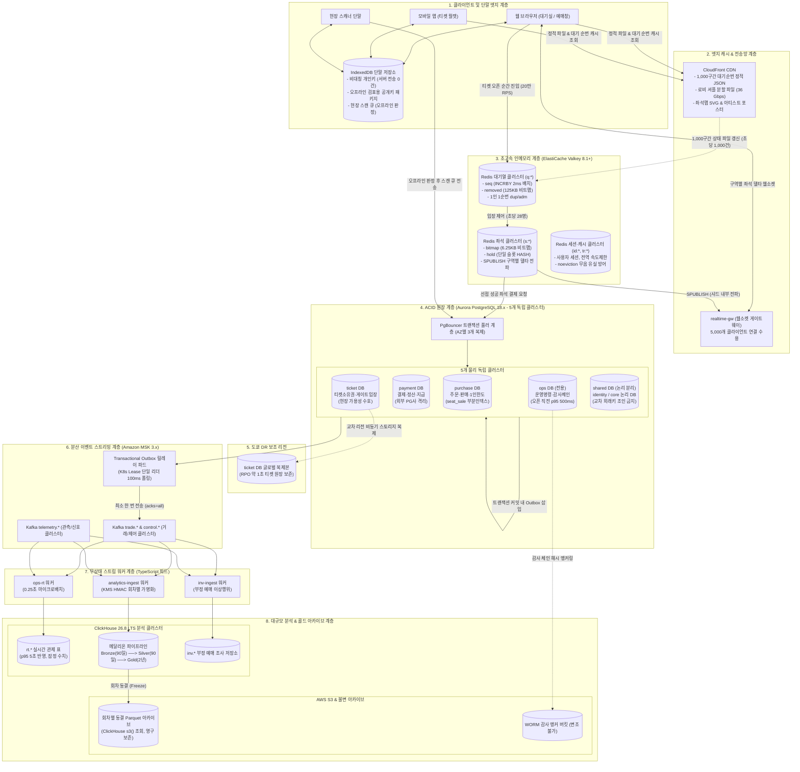
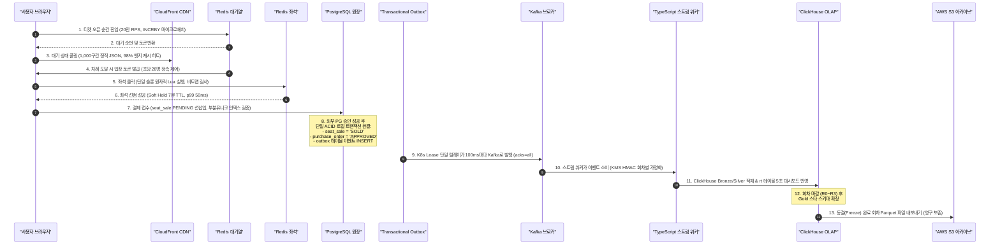

# DB 설계 편 12: 전체 지도: 저장소와 데이터 흐름을 한눈에 (Panoramic Database Architecture Map)

- **핵심 아키텍처 원칙**: 폴리글랏 지속성(Polyglot Persistence)의 유기적 결합, RDBMS(ACID 원장) $\leftrightarrow$ Redis(초고속 경합) $\leftrightarrow$ ClickHouse(대규모 OLAP) $\leftrightarrow$ S3(불변 아카이브) $\leftrightarrow$ 단말(오프라인 검표) 간의 단방향 비동기 데이터 동기화, Transactional Outbox와 Kafka 기반의 무유실 이벤트 스트리밍 파이프라인
- **관련 설계 정본**: [docs/data.md](../../data.md) §1(저장소 종합 지도)·§2(PostgreSQL 152개 테이블)·§3(Redis 67개 키 네임스페이스)·§4(일관성 경계), [docs/infra.md](../../infra.md) §4·§6(인프라 사양 및 RPO/RTO), [docs/architecture.md](../../architecture.md) §3(서비스별 DB 원칙)·§9.1(트래픽 예산), [docs/streaming.md](../../streaming.md) §1·§11(Kafka 토픽 및 릴레이), [docs/features/analytics.md](../../features/analytics.md) §2·§5·§11(ClickHouse 및 Parquet), ADR-0028, ADR-0042, ADR-0082, ADR-0086, ADR-0114, ADR-0116, ADR-0121, ADR-0179
- **함께 읽기**: [한 판 문서](../01-system-design.md) 3단계·15단계, DB 설계 편 [1](01-what-and-how-much.md)·[2](02-choose-stores.md)·[3](03-core-tables.md)·[4](04-no-double-sale.md)·[5](05-consistency-transactions.md)·[6](06-concurrency.md)·[7](07-indexes-queries.md)·[8](08-redis-keys.md)·[9](09-scaling.md)·[10](10-analytics-store.md)·[11](11-privacy.md), 표 사전 [13 PostgreSQL](13-table-dictionary-postgres.md)·[14 Redis·ClickHouse·S3·기기](14-table-dictionary-redis-clickhouse.md)

---

## 1. 면접관의 질문

> **면접관**: "PEAKET 플랫폼의 전체 데이터베이스 아키텍처를 화이트보드에 한 장으로 그려보세요. PostgreSQL 5개 클러스터, Redis 3개 클러스터, ClickHouse, Kafka, S3, 단말 IndexedDB는 각각 어떤 데이터를 저장하며, 서비스 간 트랜잭션과 데이터 동기화는 어떤 파이프라인(Outbox, Saga, 스트리밍)을 타고 흐릅니까? 장애 발생 시 데이터 일관성은 어떻게 증명합니까?"

면접관은 다음 세 가지 전사 시스템 아키텍트(Staff / Principal Engineer) 역량을 집중 검증한다:
1. **전사 데이터 파노라마 조망 능력**: 마이크로서비스 경계에 따라 분산된 5대 RDBMS 클러스터(152개 테이블), 3대 Redis 클러스터(67개 키), ClickHouse OLAP, S3 콜드 스토리지, 단말 엣지 저장소를 단 하나의 통합 아키텍처 다이어그램으로 조감할 수 있는가?
2. **이종 저장소 간 무유실 데이터 플로우 설계**: 단일 RDBMS 로컬 트랜잭션에서 시작된 상태 변경이 Transactional Outbox, Kafka 토픽, TypeScript 스트림 워커를 거쳐 ClickHouse와 S3 아카이브까지 유실 없이 동기화되는 파이프라인의 엔지니어링 메커니즘을 설명할 수 있는가?
3. **가용성과 복구(RPO/RTO)의 정량적 정당화**: 저장소 계층별 장애(노드 크래시, AZ 전면 정전, 리전 대재해) 발생 시 RPO(데이터 유실 허용치)와 RTO(복구 시간)가 비즈니스 요구사항에 부합함을 증명할 수 있는가?

---

## 2. 단순한 답과 깨지는 곳

### 단순한 답 (The Naive Approach)
> "중앙에 거대한 공유 데이터베이스(Single Shared DB)를 두고 모든 마이크로서비스가 물리 외래키(FK)로 조인합니다. 실시간이 필요한 곳은 Redis를 단일 캐시로 두고, 분석은 매일 밤 RDBMS를 덤프 떠서 S3에 저장합니다. 서비스 간 상태 변경은 HTTP REST 호출로 동기 전파하거나 애플리케이션에서 Redis와 DB를 동시에 씁니다(Dual-Write)."

### 어디서 깨지는가 (Failure Scenarios)

| 단순한 설계 방식 | 대규모 운영 환경에서 깨지는 이유 | 아키텍처 근거 |
| :--- | :--- | :--- |
| **단일 공유 DB 및 물리 FK 결합** | 티켓 오픈 순간의 대기열/좌석 부하가 결제, 회원, 현장 입장 서비스로 전파되어 단일 DB 다운 시 전사 서비스 완전 셧다운 | `architecture §3`, `docs/data.md` §1 |
| **애플리케이션 이중 쓰기 (Dual-Write)** | Redis와 DB에 순차적으로 쓸 때 네트워크 단절이나 프로세스 크래시 발생 시 한쪽만 갱신되어 영구적 데이터 불일치 발생 | `ADR-0014`, `ADR-0116` |
| **비동기 이벤트를 DB 트랜잭션 밖에서 발행** | DB 커밋 직후 Kafka 전송 실패 시 이벤트가 영구 유실되고, 반대로 Kafka 전송 후 DB 롤백 시 유령 이벤트(Phantom Event)가 전파됨 | `ADR-0116`, `docs/data.md` §4 |
| **단일 Redis 클러스터 공유** | 대기열 진입 20만 RPS 트래픽이 좌석 선점(피크 2,000 TPS)과 로그인 세션 검증의 지연 시간으로 번져 p99 50ms 목표 붕괴 | `ADR-0082`, `docs/data.md` §3 |
| **CDC(Debezium) 복제 슬롯 무분별 의존** | 카프카 다운 시 PostgreSQL WAL 복제 슬롯이 무한정 누적되어 RDBMS 디스크를 100% 채우고 데이터베이스 강제 정지 유발 | `ADR-0116` |

---

## 3. 아키텍처 해법: 전사 파노라마 아키텍처 맵

PEAKET의 전사 저장소 토폴로지는 **'서비스별 독립 데이터베이스(Database per Service)'** 원칙과 **'비동기 트랜잭셔널 아웃박스(Transactional Outbox) 기반의 이벤트 동기화'**를 핵심 골격으로 한다.

---

## 4. 전사 저장소별 정량 제원 및 가용성 매트릭스

PEAKET의 전사 데이터베이스는 **152개 PostgreSQL 테이블, 67개 Redis 키 네임스페이스, 24개 ClickHouse 분석 테이블, S3 및 단말 IndexedDB**로 구성된다.

| 저장소 식별자 | 물리 구성 및 엔진 | 테이블 / 키 규모 | 담당 도메인 및 핵심 엔티티 | 피크 처리량 | 장애 시 목표 RPO / RTO |
| :--- | :--- | :---: | :--- | :--- | :--- |
| **PG purchase** | Aurora r7g.xlarge 쓰기 1 + 읽기 1 | **17개 테이블** (`docs/data.md` §2 ③) | `purchase_order`, `order_item`, `seat_sale`, `purchase_quota`, `seat_hold` | 정상 28 TPS, 결제 300 TPS | **AZ 장애: RPO 0 / RTO 5분** 리전 재해: RPO 24h / RTO 12h |
| **PG payment** | Aurora r7g.large 쓰기 1 + 읽기 1 | **15개 테이블** (`docs/data.md` §2 ④) | `payment`, `payment_attempt`, `pg_settlement`, `payment_cancel` | 피크 300 TPS | **AZ 장애: RPO 0 / RTO 5분** 외부 PG사 거래 대사 복구 |
| **PG ticket** | Aurora r7g.large 쓰기 1 + 읽기 1 + 도쿄 리전 1대 | **13개 테이블** (`docs/data.md` §2 ⑤) | `ticket`, `device_key`, `scan_event`, `gate_pass`, `ticket_transfer` | 분당 60명/게이트 (NFR-010) | **AZ: RPO 0 / RTO 5분** **리전 재해: RPO ~1초 / RTO 1h** |
| **PG ops (전용)** | Aurora r7g.large 쓰기 1 + 읽기 1 | **37개 테이블** (`docs/data.md` §2 ⑦) | `command_event`, `audit_chain`, `cs_case`, `settlement_review` | 접수 p95 500ms (NFR-008) | **AZ 장애: RPO 0 / RTO 5분** WORM 감사 앵커 보존 |
| **PG shared** (공유 클러스터) | Aurora r7g.large 쓰기 1 + 읽기 1 | **70개 테이블** (identity 21 + core 49) | `account`, `identity_verification`, `production`, `event`, `section`, `seat` | 읽기 수천 QPS (CDN이 99% 흡수) | **AZ 장애: RPO 0 / RTO 5분** 논리 DB 스키마 분리 |
| **Redis 대기열** | Valkey 8.1+ 클러스터 3 샤드 $\times$ 1 복제본 | **31개 키 패턴** (`q:*` 네임스페이스) | `q:{event:E}:seq`, `serving`, `removed`, `q:dup:{pid}:E`, `lobby_members` | **피크 20만 RPS** (진입 순번 발급) | **RPO 수백 ms / RTO 30초** `noeviction` 메모리 정책 |
| **Redis 좌석** | Valkey 8.1+ 클러스터 3 샤드 $\times$ 1 복제본 | **19개 키 패턴** (`s:*` 네임스페이스) | `s:{event:E}:bitmap`, `hold:{seat}`, `quota:{account}`, `sec:{section}` | **피크 2,000 TPS** (원자적 Lua 홀드) | **RPO 수백 ms / RTO 30초** PG 부분인덱스가 최종 방어 |
| **Redis 세션·캐시** | Valkey 8.1+ 클러스터 3 샤드 $\times$ 1 복제본 | **17개 키 패턴** (`id:*`, `tr:*` 등) | `id:sess:{sid}`, `tr:rate:{ip}`, `tr:block:*`, `shop:{prod}:resv` | 초당 수만 QPS | **RPO 비동기 지연분 / RTO 30초** Class A/B/C 유실 등급 운용 |
| **ClickHouse** | ClickHouse 26.8 LTS Keeper 3중화 클러스터 | **24개 분석 테이블** (rt 5, 메달리온 19) | `rt.sale_event`, `bronze.trade_event`, `silver.ticket_sales`, `gold.fct_*` | 초당 1만~3만 건 이벤트 일괄 적재 | **RPO 1일 / RTO 1시간** 스냅샷 + Kafka 재읽기 복원 |
| **AWS S3** | S3 표준 & 버킷 버전관리 | 수백만 객체 | 회차별 Parquet 아카이브, WORM 감사 로그, 정적 좌석맵 SVG 파일 | 수십 Gbps 대역폭 | 내구성 99.999999999% (11 9s) 교차 리전 복제 (CRR) |
| **단말 IndexedDB** | 브라우저/스캐너 로컬 | 단말별 수천 레코드 | 검표용 공개키 패키지, 기기 비대칭 개인키, 오프라인 스캔 큐 | 로컬 0ms 판정 | 단말 로컬 영구 상주 서버 전송 0건 |

---

## 5. 엔드-투-엔드 데이터 흐름 (End-to-End Data Lifecycle)

티켓 오픈 순간부터 공연 종료 후 정산 아카이빙까지의 전사 데이터 흐름은 다음 5단계 파이프라인으로 연결된다:

1. **대기열 통제 계층**:
   - 20만 RPS의 오픈 진입은 Redis 대기열 클러스터의 `INCRBY` 마이크로 배치로 처리되고, 대기 순번 조회는 CloudFront CDN의 1,000명 단위 파일 캐싱(오리진 부하 98% 삭감)이 전담한다.
2. **좌석 선점 계층**:
   - admission-ctrl을 통해 초당 28명씩 입장한 사용자는 Redis 좌석 클러스터의 단일 샤드 Lua 스크립트를 호출하여 6.25 KB 비트맵과 홀드 해시를 50ms 이내에 원자적으로 선점(Soft Hold)한다.
3. **ACID 원장 확정 계층**:
   - 결제 승인이 완료되면 purchase DB에서 `seat_sale` 부분 유니크 인덱스를 통해 최종 판매(`SOLD`)를 확정하고, 주문 원장(`purchase_order`)과 1인 예매 한도(`purchase_quota`)를 단일 로컬 트랜잭션으로 갱신한다. 동일 트랜잭션 내에서 `outbox` 테이블에 이벤트를 적재한다.
4. **비동기 이벤트 릴레이 계층**:
   - K8s Lease 단일 리더 기반의 Outbox 릴레이가 100ms 간격으로 변경 사항을 읽어 Kafka 거래 클러스터(`trade.*`)로 최소 한 번(`acks=all`) 발행한다.
5. **실시간 관제 및 정산 아카이브 계층**:
   - TypeScript 스트림 워커(`analytics-ingest`)가 카프카 이벤트를 수신하여 KMS HMAC 회차별 가명화를 적용한 후 ClickHouse Bronze로 일괄 삽입한다.
   - `rt` 테이블을 통해 5초 이내의 관제 지표를 서빙하고, 4단계 마감(R0~R3) 완료 후 Gold 스타 스키마 데이터를 Parquet 파일로 압축하여 S3에 영구 동결 보존한다.

---

## 6. 트레이드오프와 버린 대안 (Tradeoffs & Alternatives)

| 설계 결정 | 얻는 이점 (Gains) | 치르는 대가 (Costs) 및 완화책 |
| :--- | :--- | :--- |
| **5대 RDBMS 클러스터 물리 분리** | 결제, 티켓, 운영, 주문 간 장애 격리(Blast Radius 최소화) | 서비스 간 물리 FK 사용 불가 (논리 ID 참조 및 Outbox 비동기 정합성 유지) |
| **비샤딩 단일 쓰기 스케일업** | 2PC 없는 로컬 ACID 트랜잭션 보장, 시스템 단순성 극대화 | 단일 노드 처리 한계선(3,000 TPS) 존재 (초과 시 공연 단위 셀 확장으로 대응) |
| **3대 물리 Redis 클러스터 분리** | 대기열 정각 폭주가 좌석 예매 및 로그인 세션으로 전파되는 것 차단 | 관리할 ElastiCache 클러스터 인스턴스 3배 증가 |
| **Transactional Outbox 100ms 폴링** | Debezium WAL 복제 슬롯 누수로 인한 DB 디스크 풀 위험 원천 차단 | 이벤트 전파에 최대 100~200ms의 폴링 지연 발생 (비즈니스 요구사항 내) |
| **회차별 S3 Parquet 아카이빙** | ClickHouse 고비용 스토리지 70% 절감, 불변 감사 원장 수호 | 아카이빙된 과거 데이터의 개별 행 UPDATE 불가 (불변 원장이라 무관) |

### 버린 대안

1. **단일 거대 PostgreSQL 인스턴스에 모든 도메인 통합**:
   - 운영할 DB가 하나라 단순하지만, 티켓 오픈 순간의 로그인 및 좌석 경합 부하가 현장 게이트 입장이나 관리자 긴급 취소 명령까지 블로킹하므로 기각.
2. **Debezium 기반의 WAL CDC 파이프라인 (ADR-0116)**:
   - Kafka 장애 시 PostgreSQL의 복제 슬롯이 WAL 로그를 끝없이 보관하여 DB 스토리지 고갈 및 전사 셧다운을 유발하므로, K8s Lease 단일 리더 기반의 안전한 Outbox 폴링 릴레이로 대체.
3. **멀티 리전 액티브-액티브 RDBMS 구성 (ADR-0031)**:
   - 서울과 도쿄 간 물리적 네트워크 RTT(30ms 이상)로 인해 좌석 홀드 및 결제 승인의 p99 50ms 달성이 불가능하고 상시 비용이 3배로 증가하므로, 단일 리전 액티브 + 도쿄 ticket DR 비동기 복제로 확정.

---

## 7. 핵심 꼬리 질문 5단 방어 (Staff Interview Q&A)

| 질문 단계 | 심층 질문 | 방어 논리와 기술적 근거 | 관련 정본 |
| :--- | :--- | :--- | :--- |
| **1단: 왜 (Why)** | 152개 테이블을 굳이 5개 PostgreSQL 클러스터로 쪼갠 근거는 무엇인가요? 처리량 때문인가요? | 처리량 때문이 아니라 **'장애 격리 반경(Blast Radius)의 최소화'** 때문입니다. 정상 상태 판매 쓰기는 28 TPS에 불과하여 단일 노드로 충분합니다. 하지만 오픈 순간 로그인 트래픽(identity)이 폭증하거나 외부 PG사 연동(payment)에 장애가 발생하더라도, 현장 게이트 입장(ticket)과 관리자의 긴급 판매 중단 명령(ops)은 100% 정상 작동해야 합니다. 물리 인스턴스를 분리하여 한 도메인의 장애가 전사 셧다운으로 번지는 것을 원천 차단했습니다. | `docs/data.md` §1, `ADR-0028` |
| **2단: 대안 (Alternatives)** | DB와 Redis 간 데이터 동기화에 왜 널리 쓰이는 CDC(Debezium)를 쓰지 않고 Outbox 폴링을 선택했나요? | CDC는 DB 엔진의 WAL 복제 슬롯에 의존합니다. 만약 다운스트림 카프카 브로커에 일시적 장애가 발생하면 PostgreSQL은 WAL 세그먼트를 디스크에 계속 쌓아두게 되며, 결국 DB 디스크가 100% 가득 차서 데이터베이스 자체가 크래시됩니다. 반면 K8s Lease 기반의 100ms Outbox 폴링 릴레이는 카프카가 죽더라도 DB 트랜잭션에 아무런 악영향을 주지 않고 안전하게 큐잉할 수 있어 복원력이 압도적입니다. | `ADR-0116`, `docs/data.md` §4 |
| **3단: 장애 대응 (Resilience)** | 서울 리전의 가용 영역(AZ) 1곳이 전면 정전으로 다운되면 전체 저장소들은 어떻게 복구됩니까? | PostgreSQL 5개 클러스터는 3개 AZ에 걸쳐 동기식 스토리지 복제(Aurora Storage Quorum 4/6)를 유지하므로 커밋된 데이터의 RPO는 0입니다. 30초 내에 살아있는 AZ의 Reader가 Writer로 승격되어 RTO 5분 이내에 자동 복구됩니다. Redis 3개 클러스터 역시 다중 AZ 복제본으로 30초 내 페일오버되며, 일시 유실된 홀드는 PostgreSQL 부분 유니크 인덱스가 오버셀을 100% 차단합니다. | `docs/infra.md` §6, NFR-015 |
| **4단: 수치 근거 (Numbers)** | 5년 누적 1.2억 행의 PostgreSQL과 수 TB의 ClickHouse를 유지할 때의 총 인프라 비용과 리소스 효율은 어떠한가요? | PostgreSQL 5개 클러스터의 5년 총 데이터 용량은 80 GB 미만으로 인스턴스 버퍼 풀에 핫 데이터가 90% 이상 상주하여 추가 스토리지 비용이 거의 들지 않습니다. 대규모 이벤트 로그(수십억 건)는 ClickHouse의 LZ4 열 지향 압축을 통해 수 TB로 압축 수용하고, 마감된 회차는 저비용 S3 Parquet(GB당 월 $0.023)로 내보내어 인프라 스토리지 TCO를 70% 이상 절감했습니다. | `architecture §9.5`, `docs/features/analytics.md` §11 |
| **5단: 실측과 검증 (Verification)** | 152개 테이블과 67개 Redis 키 간의 전사 종단간(End-to-End) 정합성은 어떻게 검증됩니까? | 전사 카오스 부하 테스트(S-T1, S-T8, S-T10) 환경에서 20만 RPS 진입, 2,000 TPS 좌석 경합, PG사 네트워크 단절을 동시 주입합니다. 부하 종료 후 자동 실행되는 '전사 불변식 검증기(S-T2)'가 ① Redis 좌석 비트맵과 PG `seat_sale` 일치 여부, ② `purchase_order`와 `payment` 간 원 단위 정산 일치 여부, ③ ClickHouse Gold 수치 대조를 전수 수행하여 단 1건의 오차도 없음을 단언(Assert)합니다. | `docs/verification.md` §2.1·§9 |

---

## 8. 30초 아키텍처 브리핑 (Staff Engineer Summary)

> "PEAKET의 전사 데이터베이스 아키텍처는 **'도메인별 물리 격리된 5대 PostgreSQL 원장 클러스터'**, **'초고속 경합을 전담하는 3대 독립 Redis 클러스터'**, 그리고 **'대규모 OLAP을 담당하는 ClickHouse 메달리온 및 S3 Parquet 아카이빙'**의 완벽한 삼위일체로 요약됩니다.  
> 대기열(20만 RPS)과 좌석 홀드(2,000 TPS)는 Redis의 비트맵과 단일 슬롯 원자적 Lua가 흡수하고, RDBMS는 리틀의 법칙에 의해 28 TPS로 정속 통제되므로 샤딩 없이 단일 쓰기 스케일업으로 완전한 ACID 무결성을 수호합니다.  
> 서비스 간 물리 외래키를 배제하는 대신 Transactional Outbox와 Kafka 스트리밍을 통해 비동기 최종 일관성을 달성하고, 4단계 마감을 통해 원 단위 일치 정산 리포트를 불변 Parquet 파일로 동결함으로써 성능, 가용성, 정합성을 동시에 완성했습니다."

---

## 9. 정본에서 읽을 곳

1. [docs/data.md](../../data.md) §1: 전사 저장소 지도 및 클러스터 엔진 제원
2. [docs/data.md](../../data.md) §2: PostgreSQL 152개 테이블 상세 ERD ①~⑦
3. [docs/data.md](../../data.md) §3: Redis 67개 키 네임스페이스 및 유실 등급 규정
4. [docs/data.md](../../data.md) §4: 9대 트랜잭션 경계 및 일관성 요구 매트릭스
5. [docs/infra.md](../../infra.md) §4·§6: 다중 AZ 토폴로지, RPO/RTO 및 도쿄 DR 복제
6. [docs/streaming.md](../../streaming.md) §1·§11: MSK 카프카 클러스터 및 Outbox 단일 릴레이
7. [docs/features/analytics.md](../../features/analytics.md) §2·§5·§11: ClickHouse 메달리온 및 S3 Parquet 동결
8. [ADR-0028](../../adr/0028-postgres-no-sharding-cell-scaling.md): RDBMS 샤딩 배제 및 5개 클러스터 물리 분리
9. [ADR-0116](../../adr/0116-single-polling-outbox-relay-drop-debezium-place-pgbouncer-schema-registry.md): Debezium 배제 및 K8s Lease Outbox 릴레이
10. [ADR-0014](../../adr/0014-soft-hold-hard-sale.md): 해시 태그 기반 단일 샤드 Lua 원자성
