# DB 설계 편 13: 표 사전 ① — PostgreSQL 표 전부

- **기준 시점**: ADR-0177까지, 2026-11-02. 2026-11-03에 새 계정 표 셋을 더했다
- **지금 판의 근거**: [docs/data.md](../../data.md) §2(ERD, 일곱 그림)·§1·§4·§5·§6, 표마다 그 표를 쓰는 기능 설계 문서와 ADR
- **규범이 아니다**: 해설서는 정본을 풀어 쓴 것이고 새 결정을 담지 않는다. 숫자와 규칙이 정본과 다르면 정본이 맞고, 해설서를 고친다([ADR-0177](../../adr/0177-walkthrough-explain-in-interview.md)).
- **함께 읽기**: [DB 설계 편 12 '전체 지도'](12-whole-map.md)(먼저 읽는다), [DB 설계 편 3 '핵심 표와 관계'](03-core-tables.md), [표 사전 ②](14-table-dictionary-redis-clickhouse.md)(Redis 키·ClickHouse 표)

## 1. 읽는 법

이 편은 docs/data.md §2의 PostgreSQL 표 152개(칸을 적은 표 147개와 그림에 이름만 있는 상자 다섯 `price_tier`·`event_seat_price`·`webhook_receipt`·`ticket_addon`·`product_stock`)를 하나도 빼지 않고 풀이한다. 순서와 묶음은 정본 ERD의 일곱 그림(①~⑦)을 그대로 따른다. 그래서 정본 그림을 펴 놓고 나란히 읽을 수 있다.

- **먼저 [전체 지도](12-whole-map.md)를 본다**: 어느 저장소에 어떤 묶음이 있고 묶음끼리 무엇으로 잇는지 한눈에 본 다음, 이 사전에서 표 하나하나를 찾는다.
- **묶음마다 같은 순서다**: 이 묶음이 하는 일 → 관계 그림(표 이름과 관계만) → 표마다 한 줄(담는 것, 왜 따로 두나, 키·핵심 칸, 누가 쓰고 읽나, 근거) → 주된 기록의 흐름 → 헷갈리기 쉬운 것.
- **'왜 따로 두나'가 `—`인 표**: 정본이 그 표를 따로 둔 이유를 적지 않은 것이다. 해설서가 이유를 지어내지 않는다.
- **'논리 DB'**: 같은 Aurora 클러스터 안에서도 서비스마다 논리 DB(한 DB 서버 안에서 따로 나눈 데이터베이스)와 역할이 다르다. 논리 DB가 다르면 외래키(다른 표의 행을 가리키며 그 행이 있어야만 들어가게 하는 제약)를 걸 수 없어 ID만 적는다. 무엇으로 맞추는지는 [전체 지도](12-whole-map.md) §4에 있다.
- **면접에서 쓰는 법**: "이 표는 왜 있나요?"에는 '담는 것'과 '왜 따로 두나'를, "이 표가 없으면요?"에는 '왜 따로 두나'를, "누가 이 표를 고치나요?"에는 '누가 쓰고 읽나'를 답한다.

## 2. ① 계정과 관리 계정

이 묶음이 하는 일: 팬 계정과 그 로그인 수단·세션·기기, 휴대폰 본인확인, 가입 동의, 계정 병합, 부정 예매 조사용 연결 값, 관리 계정(파트너·운영자·CS)과 그 인증 수단, 현장 스태프 배정과 스캐너 로그인을 기록한다. 모두 identity-svc(계정·로그인·본인확인을 맡는 서비스)가 공유 Aurora(아마존이 운영해 주는 관계형 데이터베이스) 클러스터의 identity 논리 DB(물리 서버는 함께 쓰되 서비스마다 따로 둔 데이터베이스와 전용 DB 계정)에 둔다. 원장(사실의 원본 기록)은 팬 쪽이 `account`, 관리 쪽이 `admin_account`다. 다른 묶음은 `account_id`·`admin_account_id`만 들고 가리키고, 이 묶음도 회차(core)는 `event_id`, 파트너(core)는 `promoter_id`, 스캐너 기기(ticket)는 `scanner_device_id`, 부정 예매 사건(ops)은 `fraud_case_id`로만 가리킨다. 논리 DB끼리는 외래 키(다른 표의 행을 가리키는 칸에 거는 제약)와 조인을 금지하기 때문이다(data.md §1). 기능의 정본은 [docs/features/identity.md](../../features/identity.md)다.

그림의 `||--o{`는 앞 표 한 행에 뒤 표 행이 0개 이상, `||--o|`는 0개나 1개, `||--|{`는 1개 이상이라는 뜻이다. `event`·`promoter`·`scanner_device`는 다른 묶음의 표이고, 선 이름의 'ID만'은 다른 DB라 외래 키 없이 ID만 둔다는 뜻이다.

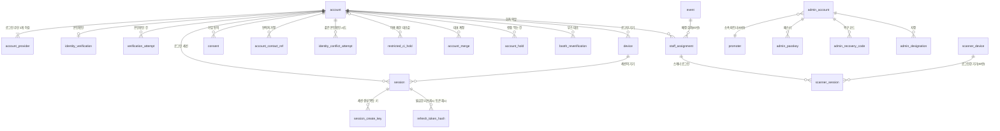

| 표 | 논리 DB | 담는 것 | 왜 따로 두나 | 키·핵심 칸 | 누가 쓰고 읽나 | 근거 |
| --- | --- | --- | --- | --- | --- | --- |
| `account` | identity | 팬 계정 하나: 상태, 닉네임·이메일·휴대폰, 회원 코드(판매 자격 명단과 양도 받는 사람 찾기에 쓴다), 저장된 예매자 성명·번호, 14세 이상 확인 여부, 알림 언어 | 팬 계정의 원장이다. 다른 서비스는 이 ID만 든다. 병합된 계정 행도 지우지 않고 MERGED로 남겨, 그 소셜 수단의 다음 로그인을 대표 계정으로 보낸다(ADR-0038) | `id` PK(기본 키: 행 하나를 가리키는 칸), `status` ACTIVE·WITHDRAWAL_PENDING(탈퇴 유예: 결제 결과·가상계좌 지연 환급을 기다리는 동안)·MERGED·DELETED, `merged_into_account_id`(사슬을 펴 한 단계만 잇는다), `member_code` UNIQUE(같은 값이 두 행에 없게 막는 유일 제약), `locale` ko·en·ja·zh. 탈퇴하면 프로필을 5일 안에 파기한다 | identity-svc 계정·세션·토큰 구성 요소가 쓴다. core-svc(공연 정보·알림·굿즈·후기·문의를 맡는 서비스) 알림 발송 워커가 gRPC(서비스끼리 함수를 부르듯 호출하는 통신) `BatchGetRecipients`로 상태·본인확인 여부·언어를 읽는다(원본을 복사해 읽기만 받는 읽기 전용 복제본에서) | data §2 ①, §2 '계정 병합 사슬', FR-001, FR-017, POL-033, ADR-0038, ADR-0073 |
| `identity_verification` | identity | 계정의 휴대폰 본인확인 결과: 연계정보(본인확인 기관이 사람마다 하나씩 주는 식별값) HMAC과 키 판(키의 버전), pid와 키 판, 확인 시각, 처리 출처 기록 | 매 접속의 '로그인'과 법적 신원을 한 번 증명하는 '본인확인'을 나눈다(identity.md §1). `ci_hmac` UNIQUE로 한 사람이 계정을 여럿 만들지 못하게 하고, 첫 본인확인 때 한 번 계산한 pid를 저장해 토큰 발급 때 KMS를 부르지 않는다(ADR-0050) | `account_id` PK(계정당 하나), `ci_hmac` UNIQUE(HMAC: 비밀 키로 만든 대조용 해시. KMS(암호 키를 맡아 대신 계산해 주는 AWS 서비스) 키로 만들고, 보존 중인 모든 키 판으로 조회한다), `pid`(연계정보 HMAC을 별도 키로 다시 해시한 사람 식별값. 토큰에 싣는다), `pid_prev`(pid 키 전환 기간만), `source_record`(출처·시기·목적·대상, 1년 이상). 탈퇴하면 바로 파기한다 | identity-svc 휴대폰 본인확인 구성 요소가 쓴다. purchase-svc(주문·좌석 판매를 맡는 서비스)가 주문 때 `IdentityService`로 유효한지 다시 묻는다 | data §2 ①, §6 '본인확인 연계정보', FR-002, POL-001, ADR-0006, ADR-0050, ADR-0055 |
| `verification_attempt` | identity | 휴대폰 본인확인 한 건(본인확인 건 ID `verificationId`): 시작한 계정, 목적, 결과를 보인 뒤 돌아갈 주소, 상태, 결과를 받는 기한, 확정 시각 | 본인확인은 시작과 결과 확정이 따로 오는 요청이라, 받은 결과가 이 계정이 시작한 바로 그 건의 것인지 묶어 본다. 확정은 건 ID를 함께 받아 결과 값의 건 ID가 다르면 FAILED이고, 같은 건을 다시 확정하면 같은 결과를 준다(identity.md §5 '본인확인 시험 어댑터와 첫 구현') | `id` PK(시작 응답이 주는 `verificationId`), `account_id` FK(다른 계정의 결과 확정·조회는 404), `purpose` FIRST·REVERIFY·MINOR_CONTRACT(MINOR_CONTRACT는 그 단계가 붙기 전까지 시작에서 400), `next`(같은 출처 경로만 받는 safeNext 규칙), `status` PENDING·VERIFIED·CANCELLED·FAILED·DUPLICATE_ACCOUNT, `expires_at`(시작 + 10분 [가정]. 지나면 결과를 받지 않는다), `completed_at`(확정 시각. 결과는 1일 [가정] 조회하고 지운다) | identity-svc 본인확인 기능이 시작·결과 확정 때 쓰고 조회 때 읽는다. 지난 건 지우기는 정비 잡(BUILD_ORDER BAS-060)이다 | data §2 ①, identity.md §5·§11, FR-002, 추천 적용 2026-11-03(PRF-040) |
| `account_provider` | identity | 계정에 연결된 소셜 로그인 수단 하나(제공자, 제공자 쪽 사용자 ID, 연결 시각) | 한 계정이 카카오·네이버·구글 수단을 여럿 가질 수 있고, 같은 제공자 계정이 두 PEAKET 계정에 붙지 않게 한다(FR-048, ADR-0038) | `UNIQUE (provider, provider_user_id)`, `account_id` FK(외래 키). 기본 키는 정본에 없음 | identity-svc가 로그인·수단 추가·해제 때 쓴다. 병합 트랜잭션(모두 하거나 모두 하지 않는 DB 쓰기 단위)이 대표 계정으로 옮긴다 | data §2 ①, §4의 9, FR-001, FR-048, POL-034, ADR-0038 |
| `account_merge` | identity | 계정 병합 한 건: 대표·흡수 계정, 흡수 계정이 쓰던 제공자, 옮긴 항목별 개수, 요청·승인·완료 시각 | 병합 감사 이력이다. 흡수 계정의 이메일·닉네임은 바로 지우므로, 두 계정을 이어 볼 근거로 이 이력과 `merged_into_account_id`를 남긴다(identity.md §2.1) | `id` PK, `primary_account_id`·`merged_account_id` FK, `moved_summary` jsonb(JSON을 이진 형식으로 담는 칸). 대표 계정이 탈퇴할 때까지 보존한다 | identity-svc 계정 연결·병합 구성 요소가 병합 트랜잭션에서 쓴다 | data §2 ①, §4의 9, §6 '계정 연동 및 계정 병합 기록', FR-048, POL-034, ADR-0038 |
| `account_hold` | identity | ops-svc(관제·CS·감사를 맡는 서비스)가 연 이의 제기·분쟁·소명(예매 제한·양도 회수·부정 예매 의심의 대상이 된 팬이 사정을 설명하는 절차) 건 가운데 계정 병합을 막는 것의 상태 | 병합을 막는 사유마다 데이터 주인이 다르다. ops-svc가 가진 사유는 ops-svc가 알려, identity-svc가 병합 때 자기 데이터처럼 본다(ADR-0148 결정 5) | `source_ref` UNIQUE(ops 건 ID라 멱등: 같은 요청이 여러 번 와도 한 번 처리한 것과 같다), `kind` VERIFICATION_APPEAL·DISPUTE·APPEAL, `state` OPEN·CLOSED(CLOSED는 30일 [가정] 남겨 늦게 온 '열림'을 무시한다), `source_version`(ops 건 상태의 판 번호. 저장한 판보다 클 때만 반영). 기본 키는 정본에 없음 | ops-svc가 `SetAccountHold`로 알리면 identity-svc가 쓴다. 병합 확인 때 identity-svc가 읽는다 | data §2 ①, POL-034, ADR-0148 |
| `consent` | identity | 가입 화면(SCR-005)과 계정 설정(SCR-017)에서 받은 동의 한 건: 종류, 고지 문안의 판, 마케팅 수신 채널, 동의 시각 | 법적 동의 기록이다. 예매·굿즈 택배 주문·현장 스태프 배정의 동의는 이 표가 아니라 그 기록의 `consent_version`과 시각으로 남긴다(ADR-0089) | `id` PK, `kind` TERMS·PRIVACY_REQUIRED·PRIVACY_PHONE·MARKETING. 새 판에 다시 동의하면 행을 더한다. 선택 동의를 철회하면 그 종류 행을, 탈퇴하면 모두, 병합되면 흡수 계정 행을 지운다 | identity-svc 계정·세션·토큰 구성 요소가 쓴다 | data §2 ①, §6 '법적 동의 기록', FR-017, POL-034, ADR-0089 |
| `session` | identity | 팬 로그인 세션 하나: 리프레시 토큰 해시와 토큰 패밀리, 바로 앞 토큰 해시, 절대·유휴 만료, 종료 시각, 로그인 때의 위험 판정 | 리프레시 토큰(짧은 액세스 토큰을 다시 받는 데 쓰는 긴 수명 토큰) 원문은 쿠키에만 두고 DB에는 SHA-256(되돌릴 수 없는 고정 길이 해시) 값만 둔다. 쓸 때마다 새 토큰으로 바꾸고, 폐기한 옛 토큰이 다시 오면 탈취로 보고 그 패밀리의 세션을 모두 끝낸다(identity.md §3) | `id` PK, `account_id`·`device_id` FK, `refresh_hash`, `refresh_family`, `prev_refresh_hash`·`rotated_at`·`refresh_used`(응답을 잃은 뒤의 재시도를 30초 [가정] 받아 준다), `absolute_expires_at`·`idle_expires_at`, `login_verdict` ALLOW·CHALLENGE·UNKNOWN(trust-svc(봇 판정을 맡는 서비스)의 로그인 위험 판정). 토큰 해시는 세션이 만료되거나 로그아웃하면 바로 지운다(data §6). 그 뒤 행을 남길지는 정본에 없음(열린 일 101번) | identity-svc 계정·세션·토큰 구성 요소가 쓴다. 강제 종료는 identity DB Outbox(보낼 사건을 같은 트랜잭션으로 표에 먼저 적고 나중에 보내는 방식)로 `control.sessions-terminated`를 낸다. Redis(메모리에 데이터를 두는 빠른 저장소) 세션·캐시 클러스터에 참조 세션 캐시가 있다 | data §2 ①, §6 '세션 토큰', POL-019, ADR-0011, ADR-0143 |
| `refresh_token_hash` | identity | 세션에 발급한 리프레시 토큰 하나의 해시: 해시, 세션, 토큰 패밀리, 발급 시각, 만료 | `session` 행에는 지금 토큰과 바로 앞 토큰의 해시만 있다. 두 대 이상 앞의 토큰, 유예가 지난 바로 앞 토큰, 재시도로 폐기한 토큰이 다시 와도 알아보려고 발급한 해시를 모두 남긴다. 알아본 예전 토큰이면 탈취로 보고 그 패밀리의 활성 세션을 모두 끝낸다(사유 `REFRESH_REUSE`, identity.md §3 '토큰 수명주기 구현') | `hash` PK(리프레시 토큰의 SHA-256), `session_id` FK, `refresh_family`(세션 하나에 하나. `CreateSession`을 다시 보내 받은 새 토큰도 같은 패밀리), `issued_at`, `expires_at`(그 세션의 절대 만료. 세션이 끝나면(로그아웃·만료·재사용 탐지) 그 세션의 행을 바로 지우고, 이 시각은 지우기를 놓친 행의 마지막 한도다. data §6 보존 표대로이고 2026-11-03에 바로잡았다. 지우는 코드는 BUILD_ORDER BOT-030) | identity-svc가 리프레시 토큰을 줄 때(세션 생성과 팬 토큰 갱신) 쓰고, 팬 토큰 갱신 `POST /v1/identity/access-tokens`의 판정 때 읽는다. 재사용을 찾으면 세션을 끝내는 트랜잭션에서 identity Outbox에 세션 종료 사건을 적는다 | data §2 ①, identity.md §3, POL-019, ADR-0143, 추천 적용 2026-11-03(PRF-030) |
| `session_create_key` | identity | 웹 앱 서버가 보낸 세션 생성(gRPC `CreateSession`) 멱등 키 하나: 키, 요청 지문(제공자와 제공자 쪽 사용자 ID), 만든 세션, 처음 응답의 '새 계정' 여부, 만든 시각 | 앱 서버가 데드라인을 넘겨 다시 보내도 세션과 기기 기록이 한 번만 생기게 한다. identity에는 리프레시 토큰의 해시만 있어 같은 토큰을 다시 줄 수 없으므로, 같은 키로 다시 오면 같은 세션에 토큰을 다시 발급하고 그 세션의 리프레시 토큰 해시를 바꿔 앞서 준 토큰을 못 쓰게 한다(identity.md §2) | `key` PK(로그인 진행 쿠키의 state를 앱 서버 전용 키로 HMAC한 값. 로그인 시도마다 하나), `provider`·`provider_user_id`(같은 키에 다른 값이 오면 ALREADY_EXISTS), `session_id` FK, `new_account`(같은 키로 다시 오면 같은 값), `created_at`(10분 [가정]이 지난 행은 쓰지 않고 지운다) | identity-svc 세션 생성(gRPC `SessionService`)이 쓰고 읽는다. 같은 키가 처리 중이면 그 행의 잠금이 풀릴 때까지 기다린다 | data §2 ①, identity.md §2 '웹 앱 서버 경로와 첫 구현 범위', 추천 적용 2026-11-03(PRF-020) |
| `device` | identity | 계정에 묶인 로그인 기기 하나: 기기 가명(원래 값을 알 수 없게 비밀 키로 바꾼 값), 키 회전 이음 기간의 옛 가명, 묶은 시각 | 로그인한 기기 목록과 새 기기 알림에 쓴다. 2026-10-31부터 trust-svc 판정의 기기 가명과 같은 값이라, 부정 예매 조사에서 '판정받은 기기'와 '계정의 기기'를 잇는다. 원문 `deviceId`는 두지 않는다(ADR-0171 결정 4) | `id` PK, `account_id` FK, `device_ref`(조사용 가명 invRef: 키 판 접두어 + base64url(바이트를 주소에 쓸 수 있는 글자로 바꾼 것)(HMAC-SHA256(라벨 키, 값))), `device_ref_prev`. 기기 연결 해제·탈퇴 때 행을 지운다 | identity-svc가 로그인 때 쓴다(라벨 키를 받지 못하면 그 로그인의 기기 행은 쓰지 않는다). 조사 적재 작업자 `inv-ingest`가 `BatchGetInvestigationRefs`로 읽는다 | data §2 ①, §1, §6, identity.md §9.1, ADR-0171 |
| `account_contact_ref` | identity | 계정의 휴대폰 번호와 로그인 이메일을 조사용 가명으로 바꾼 값(종류마다 한 행) | 부정 예매 후보 묶음의 연락처 신호(FR-072)를 원문 없이 만든다. purchase-svc가 주문 예매자 번호로 같은 식을 계산하므로 '본인확인 번호'와 '다른 계정 주문의 예매자 번호'가 같으면 같은 값이 된다(identity.md §9.1) | `(account_id, kind)` PK, `kind` PHONE·EMAIL, `ref`(휴대폰은 E.164(나라 번호를 붙인 국제 표기), 이메일은 소문자·앞뒤 빈칸 제거로 맞춘 값의 invRef). 번호·이메일이 바뀌면 다시 계산하고 탈퇴 때 지운다 | identity-svc가 쓴다(계산하지 못하면 작업이 원문으로 나중에 다시 계산한다). `inv-ingest`만 `BatchGetInvestigationRefs`로 읽는다 | data §2 ①, §6, FR-072, POL-046, ADR-0171 |
| `identity_conflict_attempt` | identity | 이미 다른 계정에서 본인확인한 사람이 또 본인확인을 시도한 기록(시도한 계정, 이미 확인한 계정, 시각) | 본인확인 409(요청이 지금 상태와 충돌한다는 HTTP 응답. 여기서는 이미 다른 계정에서 본인확인) 때 남겨 명의 대여·사들인 계정 후보의 연결 신호로 쓴다. 사람이 확인한 라벨이 아니어서 이 기록만으로 막거나 제한하지 않는다(identity.md §5·§9.1) | `id` PK, `attempted_account_id`, `existing_account_id`(연계정보·`ci_hmac`은 싣지 않는다). 1년 [가정] 뒤 지운다 | identity-svc가 409 때 쓴다. `inv-ingest`가 읽는다 | data §2 ①, §6, FR-072, POL-046, ADR-0171 |
| `restricted_ci_hold` | identity | 부정 예매로 소명 요청이나 이용 제한을 받은 사람의 연계정보 HMAC, 상태, 끝 시각, 다시 가입한 계정 | 탈퇴해도 이 행은 `until`까지 남겨, 같은 연계정보로 다시 가입한 계정에 제한을 잇는다. 탈퇴 때 연계정보를 바로 파기하는 POL-033의 예외다(ADR-0171 결정 5, 법률 확인 36번) | `(ci_hmac, fraud_case_id)` PK(`fraud_case_id`는 ops DB라 외래 키를 걸지 않는다), `state` CASE_OPEN·RESTRICTED(풀리면 행을 지운다), `until` NOT NULL(CASE_OPEN은 그 회차 공연일 + 30일 [가정], RESTRICTED는 건 날 + 1년 [가정] 이하), `carried_account_id`, `version` | ops-svc가 `SetRestrictedCiHold`로 알리면 identity-svc가 쓴다. 새 계정의 본인확인 때 보존 중인 모든 키 판으로 견주고, RESTRICTED면 `until`까지 그 계정 토큰에 구매 권한 `ticket:buy`를 싣지 않는다. `until`이 지나면 정비 작업이 지운다 | data §2 ①, §6, POL-033, POL-046 ⑥, ADR-0171, ADR-0173 |
| `admin_account` | identity | 파트너·운영자·CS 관리 계정 하나: 역할, 소속 파트너, 상태, 업무 이메일·표시 이름, 초대 토큰 해시, 비밀번호 PHC, TOTP 시드 암호문, 실패 수 셋과 잠금 상태, 판 | 팬은 소셜 로그인만 써서 비밀번호를 두지 않고, 강한 다중 인증은 소수의 관리 계정에 모은다(identity.md §1). 그래서 비밀번호·TOTP(인증 앱이 시간에 따라 새로 만드는 일회용 코드)·잠금을 가진 관리 계정을 팬 계정과 따로 둔다 | `id` PK, `role` 7종, `CHECK ((role IN ('partner_admin','partner_member')) = (promoter_id IS NOT NULL))`(종류별 필수 칸), `email` UNIQUE(삭제하지 않은 계정끼리), `status` INVITED·ACTIVE·INVITE_EXPIRED·REMOVED, `password_phc`(PHC: 알고리즘·반복 횟수·솔트를 함께 적는 해시 문자열. 해시를 여러 번 되풀이해 느리게 만든 pbkdf2-sha256 600,000회 이상), `lock_kind` NONE·TIMED·PROTECT, `version`(역할 변경의 If-Match: 읽은 판이 지금 판과 같을 때만 받는 HTTP 머리). 삭제하면 ID·역할·삭제 시각만 남기고 3년 뒤 지운다 | identity-svc 관리 계정 인증 구성 요소가 로그인 때 쓴다. 관리 계정 관리는 ops-svc가 `AdminAccountService`로 부른다. 팀 계정 목록 `GET /v1/partner/team-accounts`가 읽는다 | data §2 ①, §2 '종류별 필수 칸', FR-021, FR-028, POL-020, ADR-0033, ADR-0157, ADR-0163 |
| `admin_passkey` | identity | 관리 계정에 등록한 패스키 하나: WebAuthn 자격 ID, 공개키, 서명 횟수 | 패스키(기기 안의 키로 서명해 인증하는 WebAuthn 방식)는 TOTP를 대신하지 않고, 위험한 작업(위험 운영 명령, 2인 승인의 승인, 정산 계좌 변경, 권한·역할 변경, 명단 내려받기, 수사기관 제공 자료의 추출 요청·승인) 앞의 단계 인증에 쓴다(identity.md §6). 만든 사이트에서만 쓰여 실시간 중계 피싱에 TOTP보다 강하다(기술 검토 중간-051) | `credential_id` PK, `admin_account_id` FK, `public_key`(공개키라 평문으로 두고 무결성만 지킨다. P3은 밖에 드러나도 기밀성이 침해되지 않는 공개 식별자 등급), `sign_count`. 등록 해제·계정 삭제 때 지운다 | identity-svc 관리 계정 인증 구성 요소가 쓰고 읽는다 | data §2 ①, §1, FR-021, POL-020 |
| `admin_recovery_code` | identity | 관리 계정의 비상 복구 코드 하나의 해시 | 2단계 인증에서 인증 앱 코드 대신 넣을 수 있는 일회용 코드다(auth-controls.md §3.1). 법령상 암호화가 의무인 P1 항목이라 일방향 해시로 둔다 | `id` PK, `admin_account_id` FK, `code_phc`(PBKDF2-HMAC-SHA256 솔트 해시에 KMS HMAC 페퍼(DB 밖에 둔 비밀 키로 더한 값)). 한 번 쓰거나 다시 발급하면 바로 지운다 | identity-svc 관리 계정 인증 구성 요소 | data §2 ①, §6 '관리자 계정 비밀번호, 비상 복구 코드', ADR-0050 |
| `admin_designation` | identity | 관리 계정에 붙인 지정 한 건: 접속기록 점검자·가명정보 취급자·부정 거래 조사관, 지정 근거, 지정한 사람, 지정·해제 시각 | 지정은 역할이 아니라 사람에게 붙는 표시다(identity.md §6). 토큰에 싣지 않고 ops-svc가 요청마다 묻는다. 한 계정이 조사관과 가명정보 취급자를 함께 갖지 못하게 해 조사·연구 두 갈래를 잇지 않는다(ADR-0171) | `id` PK, `kind` ACCESS_REVIEWER·PSEUDONYM_HANDLER·FRAUD_INVESTIGATOR, 살아 있는(`revoked_at`이 빈) 행은 `(admin_account_id, kind)`마다 하나. 지정 때 대상 `admin_account` 행을 `SELECT … FOR UPDATE`(읽으면서 행을 잠그는 쿼리)로 잠그고 검사한다. 함께 둘 수 없는 지정을 90일 [가정] 안에 거둔 기록이 있어도 막는다. 해제 행은 3년 뒤 지운다 | ops-svc 관리 계정 API가 `SetAdminDesignation`으로 부르면 identity-svc가 쓴다. ops-svc가 `GetAdminDesignations`로 묻고 5초 [가정] 캐시한다 | data §2 ①, §6, ADR-0171 결정 7, docs/security/authz-matrix.md §3.7 |
| `booth_reverification` | identity | 현장 부스 재발급 때 한 본인확인 대조 결과(계정, 티켓, 일치 여부, 시각) | 입장 시작 뒤 재발급은 부스에서만 한다. 관객이 다시 본인확인하면 결과의 `ci_hmac`을 보유 계정 값과 견주고, 연계정보 원문은 버리고 대조 결과만 남긴다(identity.md §6.1). 부스 재발급 분쟁 소명용이다 | `id` PK, `account_id` FK, `ticket_id`(ticket 논리 DB라 외래 키를 걸지 않는다), `ci_matched`. 회차 종료 뒤 1년 [가정] 보존 | identity-svc 휴대폰 본인확인 구성 요소가 `POST /v1/identity/booth-reverifications`에서 쓴다. 같을 때 준 대조 토큰(5분)을 ticket-svc(티켓·현장 입장을 맡는 서비스)가 받아 부스 코드를 만든다 | data §2 ①, §6 '부스 본인확인 대조 기록', ADR-0050, ADR-0051 |
| `staff_assignment` | identity | 회차 하나에 배정한 현장 스태프 한 명: 계정, 회차, 역할, 초대 이메일·토큰 해시, 유효 시간, 상태, 수락 시각과 동의 문안의 판 | 현장 스태프는 따로 된 관리 계정이 아니라 본인확인을 마친 PEAKET 계정에 회차 단위 역할을 붙인 것이다. 역할은 입장 시작 3시간 전부터 공연 종료(`event.ends_at`) 2시간 뒤까지만 유효하다(ADR-0030·0051) | `id` PK, `UNIQUE (event_id, account_id)`, `role` gate_staff·gate_lead, `status` INVITED·ASSIGNED·REVOKED·ENDED·EXPIRED(근무 중은 저장하지 않고 ASSIGNED + 유효 시간 안으로 계산한다), `invite_email`은 수락·만료 때 파기, `consent_version`. 회차 종료 1년 뒤 파기 | 파트너가 gw-partner(파트너 콘솔 요청이 들어오는 게이트웨이)로 초대하고 identity-svc 현장 스태프·스캐너 로그인 구성 요소가 쓴다. 수락 때 본인확인과 이메일 일치를 보고 ASSIGNED로 바꾼다 | data §2 ①, §6 '현장 스태프 권한 배정 이력', FR-046, POL-031, ADR-0030, ADR-0051, ADR-0089 |
| `scanner_session` | identity | 스캐너 기기 하나에 스태프 한 명이 로그인한 세션: 배정, 기기, 승인한 휴대폰 세션, 역할, 대리 승인 여부, 만료·마지막 연락·종료 시각 | 스캐너는 기기 키 증명(DPoP: 요청마다 기기 키로 서명한 증명을 붙이는 표준)과 사람 쪽 기기 승인 로그인을 함께 쓴다. 세션은 기기와 계정마다 하나이고, ticket-svc 스캐너 경로 가드가 요청마다 이 세션이 유효한지 identity-svc에 묻는다(ADR-0051 결정 4) | `id` PK(CSPRNG(암호용 난수 생성기) 128비트 이상), `staff_assignment_id` FK, `scanner_device_id`(ticket 논리 DB라 외래 키를 걸지 않는다), `role`, `proxy`(책임자 대리 승인), `expires_at`(역할 유효 끝), `terminated_at`(교대·해제·폐기·만료) | identity-svc가 기기 승인 때 만든다(같은 기기·같은 계정의 이전 세션은 끝낸다). ticket-svc 가드가 결과를 5초 [가정] 캐시하고, ops-svc가 `ListActiveScannerSessions`로 기기 목록에 합친다 | data §2 ①, FR-046, ADR-0051, ADR-0148 |

흐름 한 줄씩:

- **가입과 로그인**: 소셜 로그인 → `account`와 `account_provider` 생성 → 로그인마다 `session`(리프레시 토큰 해시)을 만들고(앱 서버가 다시 보내도 `session_create_key`로 한 번만), 기기마다 `device`(기기 가명) 행을 둔다 → 가입 화면의 동의를 `consent`에 적는다 → 리프레시 토큰을 줄 때마다 그 해시를 `refresh_token_hash`에 남긴다.
- **본인확인**: 시작하면 `verification_attempt` 한 건이 열린다(10분 [가정] 안에 결과를 받는다) → 결과의 연계정보를 HMAC으로 바꿔 보존 중인 모든 키 판으로 중복을 본다 → 처음이면 `identity_verification`에 `ci_hmac`과 pid를 저장하고 다음 토큰부터 `ticket:buy`·pid를 싣는다 → 이미 다른 계정이면 409와 `identity_conflict_attempt` 한 줄 → 살아 있는 `restricted_ci_hold`가 있으면 `carried_account_id`를 적고, RESTRICTED면 `ticket:buy`를 싣지 않는다.
- **계정 병합**: 막는 사유를 본다(`account_hold`, 다른 서비스는 `CheckAccountMerge`) → 한 트랜잭션에서 흡수 `account`를 MERGED로, `account_provider`를 대표 계정으로 옮기고, `account_merge`와 Outbox `identity.accounts-merged`를 쓴다 → 각 서비스는 주문·결제 같은 원장의 `account_id`를 고치지 않고 자기 DB의 `merged_account` 대응표를 채운다(data §4의 9).
- **탈퇴**: 결제 결과나 지연 환급을 기다리면 `account`가 WITHDRAWAL_PENDING → 세션을 모두 끝내고 프로필·`identity_verification`·`account_contact_ref`·`device`·`consent`를 5일 안에 파기 → `restricted_ci_hold`만 `until`까지 남는다.
- **현장 스태프**: 파트너 초대로 `staff_assignment` INVITED → 수락(본인확인, 이메일 일치, 동의 둘) ASSIGNED → 스캐너 기기 승인 때 `scanner_session` 생성 → 교대·해제·폐기·만료 때 `terminated_at`.
- **관리 계정**: 초대로 `admin_account` INVITED(초대 토큰 24시간) → 수락하면 ACTIVE(비밀번호·TOTP 등록, 그때 비상 복구 코드 `admin_recovery_code`를 받는다) → 단계 인증용 `admin_passkey`를 따로 등록하고, 필요하면 `admin_designation`을 붙인다 → 삭제하면 REMOVED로 ID·역할·삭제 시각만 3년 남긴다.

헷갈리기 쉬운 것:

- **기기 표 셋**: `device`(identity)는 로그인한 브라우저의 가명 기록이고 키를 가졌다는 증명이 아니다(architecture §3.1). `device_key`(ticket)는 입장용 휴대폰 등록 때 넣는 월렛 기기 공개키다. `scanner_device`(ticket)는 운영자가 등록한 게이트 스캐너 기기 원장이다(data §1, §4의 4).
- **`session`의 해시 칸과 `refresh_token_hash`**: `session`은 지금 토큰(`refresh_hash`)과 바로 앞 토큰(`prev_refresh_hash`)만 들어 '응답을 잃은 뒤의 재시도'(바로 앞 토큰, 회전 뒤 30초 [가정] 안, 새 토큰 미사용)를 가린다. `refresh_token_hash`는 그 세션에 발급한 해시를 모두 들어 그보다 오래된 토큰이 다시 온 것을 알아본다. 둘 다 원문 없이 SHA-256만 둔다.
- **`session`과 `scanner_session`**: `session`은 팬 계정의 리프레시 토큰 세션이다. `scanner_session`은 현장 스태프 배정(`staff_assignment`)과 스캐너 기기에 묶인 세션이고 역할 유효 시간이 끝나면 함께 끝난다. 현장 스태프는 `admin_account`가 아니라 본인확인을 마친 팬 계정이다.
- **`identity_conflict_attempt`와 `restricted_ci_hold`**: 앞의 것은 '같은 사람이 다른 계정으로 본인확인을 시도했다'는 조사 신호일 뿐이고 아무것도 막지 않는다. 뒤의 것은 사람이 정한 부정 예매 소명 요청·이용 제한을 탈퇴 뒤 다시 가입한 계정에 잇는 대조값이고, RESTRICTED면 구매 권한을 빼고 그 밖의 일에는 쓰지 않는다.
- **`account_merge`·`merged_account`·`account_hold`**: `account_merge`는 identity의 병합 감사 이력이다. `merged_account`는 병합 사건을 받은 각 서비스가 자기 DB에 두는 흡수 → 대표 대응표다(이 묶음의 표가 아니다). `account_hold`는 병합을 막는 ops 쪽 사유의 사본이다. Redis의 `id:merge:*`는 10분짜리 병합 제안 캐시다.

## 3. ② 공연·회차·좌석 배치와 판매자

이 묶음이 하는 일: 무엇을 언제 어디서 누가 파는지를 기록한다. 공연(회차 묶음)과 회차, 실제 공연장과 아티스트, 좌석맵(틀·배치본·구역·좌석)과 회차별 가격 등급, 판매자(파트너)와 그 계약·변경 요청, 판매 승인 판본, 판매 자격 명단, 홈 구성, 검색 읽기 모델(검색에 맞게 미리 모아 둔 사본 표), 공연예술통합전산망 전송 기록이다. core-svc(catalog 모듈)가 공유 클러스터의 core 논리 DB에 둔다. 원장은 판매 승인 단위인 `production`과, 대기열·좌석·주문·결제·티켓·정산이 모두 묶이는 회차 `event`다. 다른 묶음은 `event_id`·`seat_id`·`promoter_id`·`production_id`만 들고 가리키고(purchase `seat_sale`, ticket `ticket` 등), 회차의 판매 상태는 purchase-svc가 사건으로 알려 온다(data §2 ②). 검색 부분의 정본은 [docs/features/search.md](../../features/search.md)다.

그림이 커서 둘로 나눈다. (가)는 공연·회차·좌석 배치·판매자, (나)는 검색·홈·판매 자격 명단이다. `price_tier`·`event_seat_price`는 data.md §2 ②에 관계선만 있고 칸 정의가 없는 표다(아래 표의 두 행과 '헷갈리기 쉬운 것'). `admin_account`는 ① 묶음의 표다. (가)의 `venue` 틀 복제 선과 (나)의 검색 표 선(공연 → `search_document` 선은 빼고)은 정본 그림에 없다. 칸(`template_venue_id`·`target_id`·`alias_of`)과 docs/features/search.md §2.2를 보고 더했다. (나)의 'ID만'은 다른 DB라서(`admin_account`)이거나, 같은 core DB 안이지만 가리키는 대상의 종류가 여럿이라서(`target_id`) 외래 키 없이 ID만 둔다는 뜻이다.

(가) 공연·회차·좌석 배치·판매자

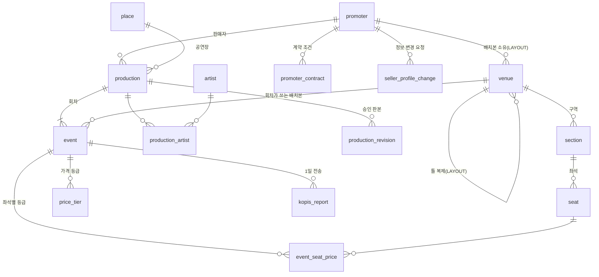

(나) 검색·홈·판매 자격 명단

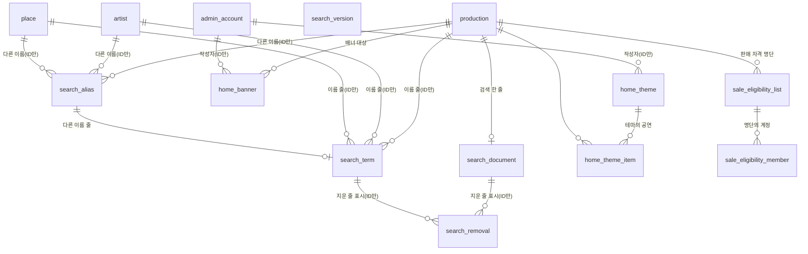

| 표 | 논리 DB | 담는 것 | 왜 따로 두나 | 키·핵심 칸 | 누가 쓰고 읽나 | 근거 |
| --- | --- | --- | --- | --- | --- | --- |
| `event` | core | 회차(공연의 한 번) 하나: 공연·파트너·배치본, 오픈·입장 시작·공연 시작·종료 예정·입장 기록 마감 시각, 로비 셔플·동시 도착 묶음 설정, 좌석 배정 방식, 1인 한도, 판매 정책, 결제사 지정, 상태, 규모, 고정한 수수료율 | 대기열·좌석·홀드·주문·결제·티켓·정산서·현장 입장이 모두 회차 단위라 그 기준 행이다(ADR-0093 결정 6). 판매 전·중·종료는 칸 없이 `open_at`·`starts_at`으로 계산하고, 판매 종료는 `starts_at` − 24시간이다(ADR-0064) | `id` PK, `production_id`·`venue_id` FK, `promoter_id`(테넌트(파트너사마다 자기 데이터만 보게 나눈 단위) 검사용 사본), `status` SCHEDULED·CANCELLED·POSTPONED, `CHECK (lobby_shuffle OR open_batch)`, `scale` LARGE·MEDIUM·SMALL(승인 전 NULL), `commission_rate_bp`(판매 승인 때 복사, 1/10,000 단위인 만분율), `sale_policy` jsonb(규칙 문법을 나무 구조로 적은 DSL AST) | core-svc catalog가 쓴다(파트너 공연 등록·회차 더하기, 판매 승인 반영). 다른 서비스는 `event_id`만 든다. 대기열·구매 경로는 공연의 승인 상태를 함께 실은 읽기 모델(자주 읽는 값을 미리 모아 둔 사본)로 읽는다(ADR-0093 결정 7) | data §2 ②, §2 '복사한 칸 목록', ADR-0060, ADR-0064, ADR-0093, ADR-0118 |
| `price_tier` | core | 회차가 정하는 가격 등급. 파트너가 공연 등록 위저드(SCR-021) 2단계에서 등급 이름과 가격을 넣고 순서를 정한다(design/d5 예: R ₩154,000 · S ₩132,000 · A ₩110,000, 위에 있는 등급이 공연 상세에서 먼저 보인다) | — (따로 둔 이유는 정본에 없다. 파트너가 등록하는 항목이라는 것만 있다, FR-022) | 정본 ERD에 칸 정의 없음(이름만 있는 상자, 열린 일 101번). 관계선은 `event` → `price_tier`(이름 defines) 하나로, 회차 한 행에 등급 행이 0개 이상이다 | core-svc catalog 모듈이 '가격 등급'을 맡는다(architecture §3.1). 주문 때 `order_item.unit_price`로 복사하는 원본이 '등급 가격'이다(data §2 '복사한 칸 목록'. 그 값을 이 표에서 읽는지는 정본에 없음). 좌석·주문·홀드 시도 사건은 등급 `tierId`를 싣는다 | data §1(공유 클러스터의 '가격 티어'), §2 ② 관계선, §2 '복사한 칸 목록', FR-022, DB 설계 편 3 §4.1 |
| `event_seat_price` | 정본에 없음(열린 일 102번) | 회차·좌석마다 한 행인 등급 정본: 그 회차에서 어느 좌석이 어느 등급인지 | 배치(`seat`, `section.default_tier`)는 한 공연의 회차가 함께 쓰지만, 판매 등급은 회차가 정한다. `section.default_tier`는 구역 기본 등급이고 회차의 판매 등급은 이 표가 정한다(data §2 ② `section`) | 정본 ERD에 칸 정의 없음(이름만 있는 상자, 열린 일 101번). 관계선은 `event` → `event_seat_price`(이름 maps seat to tier)와 `seat` → `event_seat_price` 둘이고, 둘 다 한 행에 0개 이상이다. 기본 키 `(event_id, seat_id)`(data §5 표준 인덱스). 2026-10-28에 좌석 Redis 장애 때의 비상 홀드 경로를 없애 잠금 대상이 아니다(ADR-0121 결정 7) | 쓰는 서비스는 정본에 없음. 회차별 좌석맵 파일이 배치·좌석 두 층과 이 등급을 한 파일에 싣는다(data §2 '좌석맵은 두 층'). 없앤 비상 경로에서는 purchase-svc가 이 행을 좌석 ID 순으로 `SELECT … FOR UPDATE`했다(ADR-0121 맥락). DB는 §1 저장소 지도에 없고, 그림은 ② 묶음인데 seat-hold.md §11은 purchase 표들과 같은 PostgreSQL 줄에 적는다 | data §2 ② 관계선·`section.default_tier`, §2 '좌석맵은 두 층', §5, ADR-0121, docs/features/seat-hold.md §11, DB 설계 편 3 §4.1·§4.4 |
| `production` | core | 공연(같은 파트너가 같은 공연장에서 같은 배치본으로 여는 회차의 묶음) 하나: 파트너, 공연장, 공연명·장르·관람 연령·러닝타임·설명, 공연예술통합전산망 항목, 판매 승인 상태와 재승인 대기 변경분, 휠체어석 확인 | 회차만 두면 같은 이름의 다른 공연(재공연, 다른 파트너)을 가르지 못하고, 회차에 묶음 키만 두면 공연 정보가 회차마다 복제돼 어긋날 수 있다. 두 안 모두 판매 승인 단위 문제가 남는다(ADR-0093 '검토한 대안'). 판매 승인·카드·찜·후기 보기·랭킹은 공연 단위다 | `id` PK, `promoter_id`·`place_id` FK, `genre` 정본 7개, `sale_review` DRAFT·SUBMITTED·APPROVED·REJECTED·SUSPENDED(판매 중지, 2인 승인), `sale_approved_at`(NULL이면 비공개), `pending_revision`·`accessible_seating_check` jsonb | core-svc catalog가 쓴다. 판매 승인 결과는 ops-svc가 `RecordSaleReviewResult`로 공연 단위로 알린다 | data §2 ②, FR-022, FR-023, FR-052, POL-037, ADR-0093, ADR-0123 |
| `production_artist` | core | 공연과 아티스트를 잇는 한 줄과 보이는 순서 | 공연과 아티스트는 여러 대 여러로 잇는다. 아티스트를 공연의 글자 칸으로 두면 같은 아티스트의 다른 공연 찾기·아티스트 필터·별칭이 안 되고, 표기가 조금만 달라도 다른 아티스트가 된다(ADR-0093 결정 4, '검토한 대안') | `(production_id, artist_id)` PK, `sort_order` | core-svc catalog가 공연 등록·판매 승인 때 쓴다 | data §2 ②, ADR-0093 |
| `artist` | core | 아티스트 하나의 대표 이름(활동명)과 만든 관리 계정 | 같은 아티스트가 표기만 달라 둘로 갈라지지 않게, 판매 승인 때 운영자가 기존 아티스트에 잇거나 새로 만든다(ADR-0093 결정 4) | `id` PK, `name`, `created_by` | 운영자가 판매 승인 화면에서 ops-svc → core-svc `CatalogAdminService`(`CreateArtist`)로 만든다 | data §2 ②, ADR-0093, ADR-0148 결정 7 |
| `place` | core | 실제 공연장 한 곳: 이름, 도로명 주소, 시·도, 운영 상태 | 배치본(`venue` LAYOUT)은 공연마다 하나라 같은 공연장의 공연을 묶지 못한다. 공연장 필터·홈 공연장 줄·공연장 별칭·공연 상세의 주소가 이 행을 가리킨다(ADR-0093 결정 3, '검토한 대안') | `id` PK, `status` ACTIVE·CLOSED, `created_by`(감사 로그) | 운영자가 만들고 고친다(`CatalogAdminService` `CreatePlace`·`UpdatePlace`). 파트너는 등록 때 고르거나 새 공연장을 요청한다 | data §2 ②, ADR-0093, ADR-0148 결정 7 |
| `search_alias` | core | 공연·아티스트·공연장의 다른 이름(영문 표기·옛 이름) 하나와 출처·사유·지운 시각 | 다른 이름으로도 찾게 하되 화면에 보이는 이름은 바꾸지 않는다. 검색에만 쓴다(ADR-0093 결정 5) | `id` PK, `target_kind` PRODUCTION·ARTIST·PLACE, `target_id`(종류가 여럿이라 외래 키를 걸지 않는다), `source` PARTNER(공연당 5개 [가정])·OPERATOR, `reason`, `removed_at` | 파트너가 공연 등록 때 공연의 다른 이름을 적고, 운영자도 공연의 다른 이름을 고친다(`PUT /v1/ops/productions/{productionId}/aliases`. 판매 승인 뒤에도 고치고 재승인 대상이 아니다). 아티스트·공연장의 다른 이름은 운영자가 판매 승인 화면에서 쓴다(모두 사유 필수, 감사 로그) | data §2 ②, search §2.1, ADR-0093, ADR-0094 |
| `search_document` | core | 검색 읽기 모델의 공연 한 줄: 공연명·장르·공연장·아티스트, 대표 회차, 다음 오픈, 판매 상태, 기간, 최저가, 관심도, 바꾼 판 | 결과 한 줄을 공연으로 묶어 거르고 정렬하려고 둔다. 따로 된 읽기 저장소 대신 같은 DB에 두고 카탈로그를 바꾸는 같은 트랜잭션에서 고쳐, 판매 승인 취소를 바로 반영한다(ADR-0094, ADR-0113 '검토한 대안' 라) | `production_id` PK, `sale_status` UPCOMING·ON_SALE·SOLD_OUT·ENDED(일시 매진 회차는 ON_SALE로 센다), `representative_event_id`, `updated_version` B-tree(행을 정렬해 빨리 찾는 기본 인덱스) | core-svc catalog가 같은 트랜잭션에서 쓰고, 판매 상태는 purchase-svc `EventSaleChanged` 사건을 공연 단위로 모아 쓴다. 공연 검색은 읽기 전용 복제본에서 읽는다 | data §2 ②, §5.1 '공연 검색', ADR-0094, ADR-0122 |
| `search_term` | core | 검색 이름 한 줄: 종류와 대상, 화면 이름, 다른 이름이면 원래 이름, 정규화한 값·띄어쓰기 없앤 값·낱자·초성, 바꾼 판 | 3글자 조각 인덱스(pg_trgm)는 짧은 한글 이름과 오타에 약하다. 그래서 앱이 미리 계산한 정규화·낱자·초성 칸의 앞부분 일치로 찾는다(data §5, ADR-0094). 파드(서버 실행 단위)마다 메모리에 둔 자동완성 사전도 이 표로 만든다 | `id` PK, `kind` PRODUCTION·ARTIST·PLACE, `norm_nospace`·`jamo`·`chosung` B-tree를 `text_pattern_ops`(앞부분 일치용 연산자 묶음)로, `updated_version` | core-svc catalog가 같은 트랜잭션에서 쓴다. 검색 질의와 자동완성 사전 갱신(10초 [가정])이 읽기 전용 복제본에서 읽는다 | data §2 ②, §5, §5.1, NFR-028, ADR-0094 |
| `search_removal` | core | 읽기 모델에서 지운 줄의 표시(종류, 대상, 지운 판, 지운 시각) | 지운 줄은 '판 뒤에 바뀐 줄' 조회에 나오지 않아, 자동완성 사전이 지운 것을 알 길이 없다(기술 검토 중간-089). 검색 질의는 이 표를 읽지 않는다 | `(version, kind, target_id)` PK(판이 앞), `kind` DOCUMENT·TERM. 하루 [가정] 지나면 1분 정리 작업이 지운다 | 줄을 지우는 core-svc 트랜잭션이 같이 쓴다(판매 승인 취소, 회차 전부 취소, 다른 이름 삭제, 이름 변경). 자동완성 사전 갱신이 읽는다 | data §2 ②, §5.1 '자동완성 사전 증분 갱신', ADR-0094 |
| `search_version` | core | 검색 읽기 모델의 판 번호 한 줄 | 사전이 '어디까지 반영했나'를 판으로 안다. 번호 순서와 커밋 순서를 같게 하려고 시퀀스(DB가 매기는 번호 생성기)를 쓰지 않고, 같은 트랜잭션에서 `UPDATE … RETURNING`으로 1 올린다(ADR-0086) | 한 줄, `version`. 기본 키는 정본에 없음 | 세 검색 표를 바꾸는 core-svc 트랜잭션마다 올린다. 자동완성 사전이 한 읽기 전용 트랜잭션(`REPEATABLE READ`: 한 시점의 스냅숏으로 읽는 격리 수준)에서 먼저 읽는다 | data §2 ②, §5.1, ADR-0086, ADR-0094 |
| `venue` | core | 좌석맵의 틀(TEMPLATE) 또는 그 틀을 복제한 공연용 배치본(LAYOUT) 하나: 캔버스 크기, 무대·통로 도형, 배치 판, 도형 잠금 시각, 템플릿 칸 | 파트너가 틀을 복제해 공연마다 배치본을 만들고, 같은 공연의 회차는 그 배치본을 함께 쓴다. 틀을 고쳐도 이미 만든 배치본은 바뀌지 않고, 다른 파트너의 배치본은 보이지도 고쳐지지도 않는다(data §2 '좌석맵의 소유 단위') | `id` PK, `kind` TEMPLATE·LAYOUT, `CHECK ((kind = 'TEMPLATE') = (template_code IS NOT NULL))`·`CHECK (kind <> 'LAYOUT' OR promoter_id IS NOT NULL)`, `layout_version`(좌석맵 파일 이름에 든다), `geometry_locked_at`(가장 이른 오픈 시각. 그 뒤 도형·좌표·좌석 추가·삭제 잠금), `template_code` 10종 | TEMPLATE 10행은 배포 때 넣고 파트너는 읽기만 한다. LAYOUT은 파트너 좌석맵 에디터(`PUT /v1/partner/productions/{productionId}/seatmap`)로 core-svc catalog가 쓴다 | data §2 ②, §2 '좌석맵 템플릿', ADR-0063, ADR-0066, ADR-0086 |
| `section` | core | 배치본의 구역 하나: 이름·층, 다각형 도형, 에디터 도구 값과 좌석 채우기 규칙, 라벨 위치, 기본 등급, 기본 입장 게이트 | 좌석맵의 배치 층이다. 팬 화면은 구역 도형으로 전체 배치를 먼저 그리고, 확대하면 그 범위 구역의 좌석을 그린다(data §2 '좌석맵은 두 층') | `id` PK, `venue_id` FK, `shape` jsonb(공연장 좌표계 다각형), `editor_meta` jsonb(팬 화면은 쓰지 않는다), `default_tier`(회차의 판매 등급은 `event_seat_price`가 정한다), `gate_zone` | core-svc catalog가 좌석맵 저장 때 쓴다. 회차별 좌석맵 파일에 실려 CDN(사용자 가까이에서 파일을 대신 주는 전송망)으로 나간다 | data §2 ②, §1 'S3 공개 정적 객체', ADR-0063, ADR-0066 |
| `home_banner` | core | 홈 배너 하나: 대상 공연, 배너 원본 키, 대체 텍스트, 순서, 노출 기간, 작성·수정 운영자 | 홈 구성은 운영자가 정하고 대상은 판매 승인된 공연뿐이다. 노출 기간 밖이거나 판매 승인이 취소된 공연은 피드에서 빠진다(data §2 '홈 구성', ADR-0063) | `id` PK, `production_id`(누르면 대표 회차 상세), `alt_text` 필수, `display_from`·`display_until`, `created_by`. 노출이 끝나고 30일 [가정] 뒤 이미지 파생본을 지운다 | 운영자가 관제 콘솔 SCR-068에서 저장하면 ops-svc가 권한(operator 1인)·감사 로그를 처리하고 `CatalogAdminService`(`PublishHomeLayout`)로 core-svc catalog에 반영한다. 홈 피드가 읽는다 | data §2 ②, §6 '홈 구성', POL-043, ADR-0063, ADR-0148 결정 7 |
| `home_theme` | core | 홈 테마 줄 하나: 이름, 순서, 노출 기간, 작성·수정 운영자 | 홈 구성(배너·테마)의 테마 줄이다(ADR-0063). 줄에 든 공연은 `home_theme_item`에 둔다 | `id` PK, `sort_order`, `display_from`·`display_until`, `created_by` | `home_banner`와 같다 | data §2 ②, §6 '홈 구성', POL-043, ADR-0063 |
| `home_theme_item` | core | 테마에 든 공연 하나와 순서 | 테마 하나가 공연 여러 개를 담는다. 판매 승인된 공연만 넣는다(ADR-0093) | `theme_id` FK, `production_id`, `sort_order`. 기본 키는 정본에 없음 | `home_banner`와 같다 | data §2 ②, ADR-0063, ADR-0093 |
| `promoter` | core | 파트너(판매자) 한 곳: 판매자 신원정보 7항목(상호·대표자·주소·전화·이메일·사업자등록번호·통신판매업 신고번호), 진위 확인 시각, 결제사 지급대행 등록 칸, 정산 은행과 계좌 끝 4자리, 계좌 변경 시각, 계약 수수료율 | PEAKET은 통신판매중개자(직접 팔지 않고 거래를 알선하는 사업자)라 판매 당사자인 파트너의 신원정보를 공연 상세·결제 직전·예매 확인서에 보인다(POL-037, FR-053). 정산은 결제사 지급대행이라 계좌번호 전체를 두지 않는다(ADR-0047) | `id` PK, `toss_seller_status` APPROVAL_REQUIRED·PARTIALLY_APPROVED·KYC_REQUIRED(고객확인 서류 필요)·APPROVED, `payout_account_last4`, `payout_account_changed_at`(변경 뒤 3영업일 지급 보류), `commission_rate_bp`(지금 계약값). 계약 종료 뒤 5년 보존 | core-svc catalog가 판매자 신원정보를 가진다. 결제사 등록은 core-svc가 payment-svc에 요청하고, payment-svc가 돌려준 은행·끝 4자리·결제사 ID·셀러 상태를 둔다 | data §2 ②, §6 '판매자 신원정보', FR-053, POL-037, ADR-0047, ADR-0060 |
| `seat` | core | 배치본 구역의 좌석 하나: 열·번호, 휠체어석 여부, 입장 게이트, 좌표 | 좌석맵의 좌석 층이다. 한 공연의 회차가 모두 같은 배치본을 쓰므로 좌석 행을 회차마다 복제하지 않고, 회차별 판매는 purchase DB `seat_sale`이 맡는다. 좌석 ID와 비트맵 인덱스가 판매·홀드 기록과 이어져 오픈 뒤에는 추가·삭제·좌표를 바꾸지 않는다(data §2 '좌석맵의 소유 단위') | `id` PK, `section_id` FK, `row_label`·`number`, `wheelchair`, `gate_zone`(발권 때 `ticket.gate_zone`으로 복사), `x`·`y`(공연장 좌표계) | core-svc catalog가 좌석맵 에디터·가져오기로 쓴다. 회차별 좌석맵 파일에 실린다 | data §2 ②, §2 '복사한 칸 목록', ADR-0063, ADR-0066 |
| `kopis_report` | core | 공연예술통합전산망(KOPIS) 하루 전송 한 건: 날짜, 회차, 원장 대조 해시, 결과, 보낸 시각 | 공연법이 정한 10개 항목을 1일 단위로 보내야 한다. 고의로 빠뜨리거나 조작해 보내면 과태료 대상이라 원장 대조값과 함께 기록을 남긴다(transfer-refund.md §2.4) | `report_date`, `event_id`, `payload_hash`, `status` SENT·FAILED·RETRYING. 기본 키는 정본에 없음 | core-svc 일 단위 작업이 대사(두 기록을 맞대어 어긋난 곳을 찾는 일)가 끝난 원장을 모아 보내고 쓴다. 다음 날까지 실패하면 CS 처리함과 경보로 알린다 | data §2 ②, §1, FR-054, docs/features/transfer-refund.md §2.4 |
| `sale_eligibility_list` | core | 공연의 판매 자격 명단(팬클럽 선예매 대상) 하나: 명단 키, 표시 이름, 인원 수, 올린 파일의 SHA-256, 잠금·파기 시각 | 팬클럽 회원 여부는 파트너 관리자가 올린 PEAKET 회원 코드 명단으로 판정한다. 휴대폰 번호 명단보다 받는 정보가 적은 쪽을 골랐다(ADR-0062 결정 37). 올린 파일은 저장하지 않는다 | `id` PK, `production_id`, `key`(규칙의 `buyer.lists` 값), `member_count`(올릴 때마다 다시 센다), `locked_at`(판매 시작 24시간 전 [가정]), `destroy_due_at`(판매 기간 끝 + 1일 [가정]) | 파트너 관리자가 올리고 core-svc가 쓴다. 대기열 Redis 사본 `q:{event:E}:elig:{listKey}`로 로비·진입 때 확인한다 | data §2 ②, §2 '복사한 칸 목록', §6 '판매 자격 명단', POL-011, ADR-0062 |
| `sale_eligibility_member` | core | 명단에 든 계정 하나 | 회원 코드를 계정 ID로 바꾼 집합만 둔다(data §6) | `list_id` FK, `account_id`. 기본 키는 정본에 없음. 판매 기간 끝 + 1일 [가정]에 DB·Redis에서 파기한다 | core-svc가 명단을 올릴 때 쓴다. 대기열 사본의 원본이다 | data §2 ②, §6 '판매 자격 명단', ADR-0062 |
| `production_revision` | 정본에 없음(열린 일 102번) | 판매 승인한 공연의 승인 판본(판 번호, 승인한 내용, 승인자, 시각) | 바뀌는 기준 정보의 판본 이력이 없었다(ADR-0086 맥락). 지금 값은 `production`·`event`에 두고 승인한 내용은 판마다 여기 남긴다. 회차 단위 `event_revision`에서 공연 단위로 바꿨다(ADR-0093) | `(production_id, revision_no)` PK, `approved_content` jsonb, `approved_by`, `approved_at` | 판매 승인 때 남긴다. 쓰는 모듈은 정본에 없음 | data §2 '판본 이력', ADR-0086 결정 10, ADR-0093 |
| `promoter_contract` | core | 파트너 계약 조건(수수료율)과 유효 기간 한 줄, 계약 변경 승인 업무 ID | 수수료율이 언제 어떤 값이었는지 남기는 판본 이력이다. 기간이 겹치는 두 계약을 DB가 막는다(ADR-0086 결정 10) | `UNIQUE (promoter_id, valid_during WITHOUT OVERLAPS)`(기간이 겹치는 행을 막는 유일 제약, PostgreSQL 확장 기능 `btree_gist` 필요), `valid_during` tstzrange(시각 범위형), `approval_id` | 판매 승인 때 `event.commission_rate_bp`로, 상품을 처음 게시할 때 `product.commission_rate_bp`로 복사한다. 관제 콘솔 파트너사·계약 관리(SCR-065)의 API는 아직 없다(proto README §4) | data §2 '판본 이력'·'복사한 칸 목록', ADR-0060, ADR-0086 |
| `seller_profile_change` | 정본에 없음(열린 일 102번) | 판매자 정보 변경 요청 한 건: 바꿀 항목과 새 값, 근거 서류 참조, 상태, 요청·결정 시각 | PEAKET 운영자가 확인해 반영할 때까지 화면에는 지금 정보가 보여야 해서 요청을 따로 둔다. 상호나 대표자를 바꾸면 운영자가 판매자 정보를 다시 확인한다(openapi `/v1/partner/seller-profile/change-requests`) | `id` PK, `promoter_id`, `changes` jsonb(파일 없이 참조만), `status` IN_REVIEW·APPLIED·REJECTED(openapi 값, ADR-0087). 검토 중인 요청이 있으면 새 요청은 409 | 파트너 관리자(`partner_admin`)만 요청하고 PEAKET 운영자가 확인해 반영한다. 지금 값은 `promoter`에 있다 | data §2 '판본 이력', FR-052, POL-037, POL-039, ADR-0066, ADR-0086, ADR-0087 |

흐름 한 줄씩:

- **공연 등록**: 파트너가 `production`과 첫 `event`들을 함께 만든다(`POST /v1/partner/productions`) → 공연장 `place`를 고르고, 아티스트를 `production_artist`로 잇고, 공연의 다른 이름을 `search_alias`에 적는다.
- **좌석맵**: TEMPLATE `venue`를 복제해 공연용 LAYOUT `venue`와 그 `section`·`seat`를 만든다 → 그 공연의 회차가 모두 `event.venue_id`로 같은 배치본을 가리킨다 → 저장마다 `layout_version`이 올라 새 이름의 좌석맵 파일로 나간다.
- **판매 승인**: `production.sale_review` SUBMITTED → 운영자가 승인하면 ops-svc가 `RecordSaleReviewResult`로 알린다 → APPROVED, `production_revision` 판본, 회차마다 `event.scale`, `promoter`의 수수료율을 `event.commission_rate_bp`로 복사 → 같은 트랜잭션에서 `search_document`·`search_term`을 고치고 `search_version`을 올린다.
- **판매 중**: 가장 이른 오픈 시각에 `venue.geometry_locked_at` 잠금 → 판매 상태는 purchase-svc `event_sale`의 `EventSaleChanged`를 받아 `search_document.sale_status`로 모은다 → 매일 `kopis_report`를 보낸다.
- **내리기**: 판매 중지(SUSPENDED)면 한 트랜잭션으로 비공개·검색과 홈에서 빼기를 쓴다 → 판매 중지나 회차 전부 취소로 공연이 검색에서 빠지면 같은 트랜잭션에서 지운 줄을 `search_removal`에 적는다 → 판매 자격 명단은 판매 기간 끝 + 1일 [가정]에 파기한다.

헷갈리기 쉬운 것:

- **`production`과 `event`**: 공연 정보·판매 승인·좌석맵(배치본)·카드·찜·후기 보기·랭킹은 공연 단위다. 대기열·좌석·주문·결제·티켓·정산서·현장 입장·오픈 알림·후기 쓰기 자격은 회차 단위다. 공연 상세 화면의 주소는 회차(`/events/[id]`)다(ADR-0093 결정 6).
- **`place`와 `venue`**: `place`는 실제 장소다. `venue`는 좌석맵의 틀(이름에 특정 공연장 이름을 쓰지 않는다)이나 공연마다 하나인 배치본이다. 공연이 `place_id`를 가리키고, 배치본은 공연장을 가리키지 않는다(ADR-0093 결정 3).
- **판매 상태가 넷**: `event.status`는 기본값 SCHEDULED와 취소·연기만 담는다. `production.sale_review`는 판매 승인이다. 판매 전·중·종료는 `open_at`·`starts_at`으로 계산한다. 일시 매진·매진을 가르는 회차 판매 상태는 purchase DB `event_sale`(UPCOMING·ON_SALE·ALL_HELD·SOLD_OUT·ENDED)이 원본이고, `search_document.sale_status`는 그것을 공연 단위로 모은 사본이다.
- **등급과 수수료율**: 등급을 정하는 곳은 셋이다. `section.default_tier`는 구역의 기본 등급일 뿐이다. `price_tier`는 회차가 정하는 등급 목록(이름과 가격)이고, `event_seat_price (event_id, seat_id)`는 그 회차에서 좌석마다 어느 등급인지 정하는 정본이다(data §2 ② `section`, §5). 뒤의 둘은 정본 ERD에 칸이 없는 이름만 있는 상자라, 등급 이름·가격 칸과 두 표를 잇는 칸은 정본에 없다(열린 일 101번). 이 묶음에서는 수수료율도 셋이다(굿즈 상품은 ⑥ 묶음 `product.commission_rate_bp`로 따로 복사한다). `promoter.commission_rate_bp`는 지금 계약값, `promoter_contract`는 그 이력, `event.commission_rate_bp`는 판매 승인 때 고정한 사본이다.

## 4. ③ 주문과 좌석 판매

**이 묶음이 하는 일**: 팬이 좌석을 사는 기록이다. 주문, 좌석 판매, 1인 한도, 결제 시도, 발권 대기, 예매 취소, 회차 취소와 배상, 판매를 막거나 알리는 상태를 적는다. 표는 모두 purchase-svc가 가진 purchase DB(Aurora PostgreSQL 클러스터)에 있다. 원장(빠짐없이 적어 두고 다른 기록의 기준이 되는 기록)은 주문의 지금 상태 `purchase_order`와 그 이력 `order_event`, 좌석이 팔렸는지를 정하는 `seat_sale`이다. 다른 묶음과는 외래 키(다른 표의 행을 가리키는 칸과 그 제약) 없이 ID로만 잇는다. 회차는 `event_id`(② core), 사람은 `account_id`(① identity), 결제는 `payment.order_id`(④ payment), 티켓은 `order_item.ticket_id`(⑤ ticket)다. 핵심 표의 키는 [DB 설계 편 3](03-core-tables.md), 같은 좌석을 두 번 팔지 않는 법은 [DB 설계 편 4](04-no-double-sale.md), 흐름은 분야 편 [10 좌석 홀드](../fields/10-seat-hold.md)와 [11 결제](../fields/11-payment.md)가 다룬다.

그림의 `||--o{`는 앞 표 한 행에 뒤 표 행이 0개 이상, `||--o|`는 0개나 1개, `||--||`는 꼭 하나라는 뜻이다. `account`·`event`는 ①·② 묶음의 표다. `sale_control`은 범위가 회차 하나이거나 플랫폼 전체라 선이 없다.

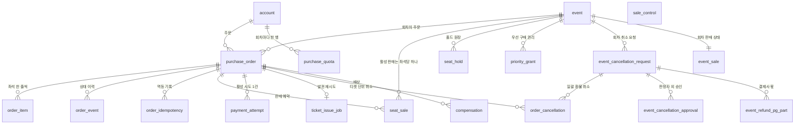

| 표 | 논리 DB | 담는 것 | 왜 따로 두나 | 키·핵심 칸 | 누가 쓰고 읽나 | 근거 |
| --- | --- | --- | --- | --- | --- | --- |
| `purchase_order` | purchase | 주문 하나의 지금 상태, 서버가 계산한 금액, 예매자 성명·휴대폰 번호, 동의 문안의 판 | 주문 원장이다. 주문 읽기는 이 행 하나로 끝나고, 지난 상태는 `order_event`가 맡는다(ADR-0113). 5년 누적이 약 1,700만 건이라 한 표로 감당해 나누지 않는다(ADR-0114) | `id` PK(UUIDv7: 앞부분이 만든 시각이라 시간순으로 커지는 ID), `status` 13값(CREATED부터 EXPIRED까지), `amount`, `event_seq`, `payment_event_seq`(반영한 마지막 결제 사건 순번), `buyer_name`·`buyer_phone`(5년, 탈퇴하면 보존 전용 스키마 `retention.order_buyer`로 이동) | purchase-svc booking 모듈의 주문 전이 함수 하나만 상태를 바꾼다. 결제 결과는 `WHERE payment_event_seq < 받은 순번`으로 한 번만 반영한다. 주문 만료 안전망은 ID 범위로, 회차 취소 일괄 환불 작업은 회차와 주문 ID 커서로 읽는다 | data §2 ③·§4의 1·§6, FR-011, ADR-0113, ADR-0114, ADR-0146 |
| `order_idempotency` | purchase | 주문 생성·결제 시도 시작·결제 접수 요청의 멱등 기록(같은 요청이 여러 번 와도 한 번만 처리하려고 남기는 기록) | 같은 키로 다시 온 요청에 처음 결과를 그대로 돌려주고, 같은 키에 본문이 다르면 422로 가린다. Redis(메모리에 데이터를 두는 빠른 저장소)에만 두면 재시작·장애 조치 때 기록을 잃어 같은 요청을 두 번 처리할 수 있다(data §2) | PK `(account_id, operation, idempotency_key)`(키 범위는 계정 × 작업), `operation` CREATE_ORDER·START_PAYMENT·ACCEPT_PAYMENT, `request_hash`(요청 지문 SHA-256), `order_id`, `result_id`, `(created_at)` 인덱스로 24시간 [가정] 뒤 삭제 | purchase-svc의 주문 API 셋이 대상 행을 바꾸는 같은 트랜잭션에 쓴다. 정비 잡(정비 시간 04:00~06:00에 도는 관리 작업)이 지운다 | data §2 ③·'서비스마다 둔 멱등 기록 표'·§6, ADR-0083, ADR-0146 |
| `order_event` | purchase | 주문 상태가 바뀔 때마다 덧붙이는 이력 한 행(이전·새 상태, 원인, 행위자, 시각) | 상태를 덮어쓰기만 하면 그 시각의 상태를 되짚을 수 없다. FR-031이 주문 ID로 이력을 시간 순서로 추적하라고 요구한다. 이벤트 소싱(사건만 저장하고 상태는 사건을 다시 돌려 얻는 방식)은 아니고 '상태 + 덧붙이기 이력'이다(ADR-0113) | PK `(order_id, seq)`, `seq`는 주문마다 1부터 빈틈 없이 늘고 `purchase_order.event_seq`를 올리는 같은 UPDATE에서 매긴다, `from_status`·`to_status`·`cause`·`actor`, 5년(부모와 같은 묶음에서 삭제) | 주문 전이 함수가 상태 UPDATE와 같은 트랜잭션에서 덧붙인다. 정비 잡이 매일 마지막 이력과 지금 상태를 대조하고 어긋나면 SEV3(장애 심각도 등급, 숫자가 작을수록 심각)다. `trade.orders`의 `firstInStage`를 이 이력으로 정한다 | data §2 ③·§4의 1, FR-031, ADR-0113 |
| `seat_sale` | purchase | 회차·좌석·주문마다 판매 예약 한 행(PENDING·SOLD·RETURNED) | 같은 좌석이 두 사람에게 팔리는 오버셀을 막는 마지막 방어선이다. 앱 코드의 확인이 아니라 부분 유니크 인덱스(조건에 맞는 행끼리만 같은 값을 막는 인덱스)가 두 번째 판매를 거절한다. 반환된 좌석은 RETURNED로 남고 다시 팔 수 있다 | PK `(event_id, seat_id, order_id)`, `UNIQUE (event_id, seat_id) WHERE status IN ('PENDING','SOLD')`, `pending_until`(가상계좌 PENDING 기한 = 입금 기한 + 10분 [가정], `WHERE status = 'PENDING'` 부분 인덱스로 쓸기) | purchase-svc의 Saga(여러 서비스에 걸친 일을 단계별로 처리하고 실패하면 앞 단계를 되돌리는 방식)가 결제 접수 뒤 PENDING을 넣고, 승인으로 SOLD, 취소로 RETURNED로 바꾼다. 비트맵 다시 만들기(RB-06)와 회차 판매 상태 판정이 읽는다 | data §2 ③·§4의 2·§5, FR-011, ADR-0014, ADR-0086 |
| `seat_hold` | purchase | 홀드(결제하는 동안 좌석을 잠시 잡아 두는 것) 하나의 감사 이력: 계정, 펜싱 토큰, 상태, 종류, 잡은 시각, 만료 시각 | 지금 잡힌 홀드는 좌석 Redis에 있고 이 표는 그 이력이다. 좌석 Redis 전체 장애 뒤 비트맵을 다시 만드는 입력이고(ADR-0121), 부정 예매 사후 조사의 동시 홀드 판정과 리플레이가 `held_at`을 쓴다(ADR-0171) | PK `(event_id, seat_id, fencing_token)`(펜싱 토큰: 홀드 순서대로 커지는 번호), `status` HELD·RELEASED·EXPIRED(HELD는 `(event_id, seat_id)` 부분 유니크), `kind` FAN·PRIORITY, 회차 ID 범위 월 파티션(큰 표를 범위로 나눈 조각), 회차 판매 종료 + 90일 [가정] 뒤 파티션째 삭제 | purchase-svc 홀드 원장 적재가 Redis Stream → Kafka(사건을 순서대로 쌓아 여러 곳에 나눠 주는 메시지 시스템) `trade.seats`로 받아 비동기로 쓰고, 펜싱 토큰으로 뒤바뀐 순서를 바로잡는다. 비트맵 다시 만들기가 만료 전 HELD를 읽는다 | data §2 ③·§5·§6, FR-010, ADR-0086, ADR-0121, ADR-0171 |
| `priority_grant` | purchase | 부정 예매 표 취소에 이의가 인정된 계정이 원래 가격으로 다시 살 수 있는 우선 구매 권리 하나 | 취소한 표를 무상으로 되살리지 않고, 원래 가격·취소 수수료 없이 다시 살 기회를 준다(POL-046 ⑦). 한 권리에 진행 중인 주문은 하나이고, 결제가 실패하면 OFFERED 그대로 기한 안에서 다시 시도한다 | `id` PK, `fraud_case_id`(ops DB라 외래 키를 걸지 않는다), `cancelled_ticket_id` UNIQUE(표마다 권리 하나), `grant_kind` SAME_SEAT·SAME_TIER, `price`, `status` OFFERED·USED·EXPIRED·WITHDRAWN, `expires_at`(48시간 [가정]과 입장 시작 가운데 이른 때), `active_order_id`. USED는 주문과 함께 5년, 쓰이지 않고 끝난 권리는 사건 종료 뒤 3년 [가정] | ops-svc가 `GrantPriorityPurchase`를 부르면 purchase-svc가 만들고, 좌석을 우선 구매 보류(`seat_hold` kind PRIORITY)로 48시간 [가정] 잡는다. 대기열 사본 `q:prio`는 ops-svc가 따로 보낸다 | data §2 ③·§6, seat-hold §5, POL-046, FR-073, ADR-0171 |
| `purchase_quota` | purchase | 계정·회차마다 산 매수(`used`)와 한도(`limit_count`) | 여러 탭·기기에서 동시에 사도 1인 한도를 넘지 않게 한다. 좌석 Redis의 보유 수를 장애 조치로 잃어도 이 조건부 갱신이 한도를 넘는 판매를 거절한다(seat-hold §4) | PK `(account_id, event_id)`, `used + n ≤ limit_count`일 때만 UPDATE. 인덱스 밖 칸만 바꿔 HOT 갱신(인덱스를 고치지 않는 가벼운 갱신)이 된다 | purchase-svc가 판매 확정 트랜잭션에서 올리고 예매 취소 때 되돌린다. 비트맵 다시 만들기가 계정별 보유 수를 셀 때 읽는다. 계정 병합 뒤에는 `merged_account`로 묶어 센다 | data §2 ③·§4의 2·8·9·§5, POL-011, ADR-0086 |
| `sale_control` | purchase | 범위(PLATFORM 또는 회차 ID)마다 판매 일시정지·판매 중지 여부와 판 번호 한 행 | 정지는 메시지가 아니라 상태다. 원본을 DB에 두어, 명령 뒤에 확장·재시작으로 뜬 파드(쿠버네티스에서 도는 서비스 한 벌)도 정지를 안다(ADR-0103). 일시정지(명령 3)와 판매 중지(ADR-0123)는 칸을 따로 두고 하나라도 참이면 막는다 | PK `scope`, `paused`, `suspended`, `suspension_ref`(판매 중지·재개 승인 업무), `version`(판 번호: 바뀔 때마다 하나씩 느는 번호, 지금보다 클 때만 쓴다), `command_id`, `changed_at` | ops-svc가 제어 gRPC(서비스끼리 함수를 부르듯 호출하는 통신)로 보낸 명령을 purchase-svc가 쓴다. 파드는 이 표를 읽어야 준비 상태가 되고 2초 [가정]마다 다시 맞춘다. 좌석 Redis 사본 `s:{event:E}:ctl`을 홀드 Lua(Redis 안에서 한 번에 도는 스크립트)가 읽어 423을 낸다 | data §1·§2 ③, seat-hold §3, ADR-0103, ADR-0123 |
| `event_sale` | purchase | 회차의 판매 상태(UPCOMING·ON_SALE·ALL_HELD·SOLD_OUT·ENDED)와 마지막 판정의 좌석 숫자 | 매진·일시 매진은 좌석 수의 정본이 있는 purchase-svc가 판정한다(ADR-0122). 홈·검색의 공연 판매 상태가 이 값을 공연 단위로 모은다 | PK `event_id`, `status`, `version`(판 번호, 바뀔 때마다 1 올리는 조건부 쓰기), `sellable_seats`·`available`·`held`·`paying`, `first_sold_out_at`(분석의 매진 시각), `reopen_count` | purchase-svc 판정 작업이 1초 [가정]마다 세어 상태가 바뀌면 쓰고, 같은 트랜잭션의 Outbox(보낼 사건을 같은 트랜잭션으로 표에 먼저 적어 두고 나중에 보내는 방식)로 `trade.seats` `EventSaleChanged`를 낸다. core-svc가 받아 `search_document.sale_status`를 만든다 | data §2 ②·③, seat-hold §4, docs/planning/03 §2.15, ADR-0122 |
| `payment_attempt` | purchase | 주문의 결제 시도 하나: 고정한 결제사(PG: 온라인 결제를 대신 처리해 주는 결제사)와 결제창 참조 | 결제창을 다시 열면 시도가 여러 번 생긴다. 시도마다 결제사와 결제창 값을 고정하고 활성 시도를 하나로 지킨다(ADR-0044). 결제 원장은 ④의 `payment`다 | `id` PK, `order_id`(활성 READY·ACCEPTED 부분 유니크), `pg` TOSS·PORTONE·SIMULATOR, `pg_order_ref`(토스 orderId 또는 포트원 paymentId), `status` READY·ACCEPTED·SUPERSEDED·EXPIRED(READY는 만든 지 40분 [가정] 뒤 EXPIRED) | purchase-svc가 결제 시도 시작에서 만들고 이전 READY를 같은 트랜잭션에서 SUPERSEDED로 바꾼다. 결제 접수 때 ACCEPTED로 바꾼다. `payment.attempt_id`가 이 행을 가리킨다 | data §2 ③·④·§4의 1, FR-011, ADR-0044, ADR-0107 |
| `ticket_issue_job` | purchase | 결제 승인 뒤 아직 발권되지 않은 주문 하나(발권 재시도 큐) | 승인은 되돌리기 어려운 고비 단계라, 승인 뒤 발권이 실패해도 결제를 취소하지 않고 같은 주문 ID로 다시 발권한다(ADR-0106) | PK `order_id`, `attempts`, `next_attempt_at`(1초에서 두 배씩 최대 60초 간격 [가정]), `issue_due_at`(승인 + 30분 [가정]), `last_error`. 행이 적은 작은 표다 | purchase-svc가 승인 결과 트랜잭션(SOLD·APPROVED)에서 넣고 발권(CONFIRMED)·보상(COMPENSATED)과 같은 트랜잭션에서 지운다. 60초 [가정] 넘게 남으면 SEV2와 `ISSUE_DELAYED`, 발권 기한을 넘기면 SEV1과 CS 처리함(고객 문제 건을 모아 처리하는 운영 화면) 건이다 | data §2 ③·§4의 2·§5.1, FR-012, ADR-0106 |
| `order_cancellation` | purchase | 티켓 하나의 예매 취소·환급 한 건: 사유, 공제율, 환급액, 상태 | 결제사 멱등키 `cancel-{cancellationId}`는 취소 행마다 다르다. 그래서 '티켓당 진행 중 취소 하나' 유일 제약이 이중 환급을 막는 마지막 방어선이다(data §2) | `id` PK, `order_id` FK, `UNIQUE (order_id, ticket_id) WHERE status <> 'VOIDED'`, `event_cancellation_request_id`, `reason` 7종(USER·EVENT_CANCELLED·EVENT_POSTPONED·ACCOUNT_WITHDRAWAL·EXCEPTION·MINOR_CONTRACT_CANCEL·FRAUD), `deduction_bp`(1% = 100), `refund_amount`(공용 함수 한 곳에서 계산), `status` REQUESTED·REFUND_PENDING·REFUNDED·VOIDED, 5년 | purchase-svc가 팬 취소와 일괄 환불 작업에서 `INSERT … ON CONFLICT DO NOTHING`으로 넣고, 이미 있으면 그 취소를 이어 처리한다. 이어 ticket-svc가 키를 폐기하고 payment-svc가 결제사 취소를 부른다 | data §2 ③·§4의 8·12·§6, FR-047, POL-032, ADR-0086 |
| `event_cancellation_request` | purchase | 회차 하나의 취소·연기 요청: 귀책 판정, 미리보기, 진행 수 | 회차 취소·연기는 파트너 요청 → 운영자의 귀책 판정 → 2인 확정을 거쳐야 한다(POL-032·038). 확정 뒤 그 회차 주문을 한꺼번에 환급하는 작업의 머리 행이다 | `id` PK, `promoter_id`, `kind` CANCEL·POSTPONE, `fault` ORGANIZER·FORCE_MAJEURE·CONTENT_CHANGE, `judged_by`(commander), `dry_run` jsonb(대상 주문 수·환급·배상 총액·결제사별 건수), `status` 9값(REQUESTED부터 REJECTED까지. 멈춘 PAUSED와 연기 뒤 환급 신청 기간 REFUND_WINDOW도 있다), `done_count`·`failed_count`(화면용) | 파트너가 `POST /v1/partner/events/{eventId}/cancellation`으로 요청하고(멱등 기록은 ops DB, data §2) commander(운영 명령을 내리는 운영자 역할)가 판정한다. purchase-svc 일괄 환불 작업이 묶음마다 진행 수를 올린다. 진행률의 원본은 `order_cancellation`을 요청별로 센 값이다 | data §2 ③·§4의 12·'복사한 칸 목록', FR-055, POL-032, ADR-0046, ADR-0086 |
| `event_refund_pg_part` | purchase | 일괄 환불 작업을 결제사별로 나눈 몫 하나의 상태 | 결제사 하나가 실패율·연속 실패·서킷 브레이커(계속 실패하는 호출을 잠시 끊는 장치) 열림에 닿으면 그 몫만 멈추고 다른 결제사 몫은 계속하려고 둔다(기술 검토 중간-045). 되돌릴 수 없는 돈의 이동이라 자동으로 다시 시작하지 않는다 | PK `(request_id, pg)`, `state` RUNNING·PAUSED·COMPLETED, `pause_reason` AUTO_FAILURE_RATE·AUTO_CONSECUTIVE_FAILURES·AUTO_CIRCUIT_OPEN·AUTO_REJECT_RATE·MANUAL, `paused_by`·`resumed_by`·`reason`, `paused_at`(1시간 [가정]마다 다시 알리는 기준) | purchase-svc 일괄 환불 작업이 쓴다. commander가 `PauseEventRefundJob`·`ResumeEventRefundJob`(사유 필수)으로 멈추고 연다 | data §2 ③, transfer-refund §5, FR-055 |
| `compensation` | purchase | 회차 취소·연기의 배상금(실제 결제 금액의 10%) 지급 한 건 | 결제 취소로는 결제액을 넘겨 돌려줄 수 없어 계좌 입금으로 따로 보낸다(transfer-refund §6). 계좌번호는 저장하지 않고 끝 4자리와 송금 결과만 남긴다 | `id` PK, `order_id`, `event_id`, `base_amount`, `amount`, `receivable_id`(payment DB의 미수금), `status` ACCOUNT_PENDING·REQUESTED·PAID·FAILED, `account_last4`, `payout_ref`, 5년 | 판정이 주최 측 귀책·공연 내용 변경인 회차의 결제자가 대상이다. 결제자가 SCR-043에서 계좌를 넣으면 payment-svc 배상 송금 포트(`CompensationTransferPort`)가 보낸다. 보낸 돈은 `partner_receivable`(원인 COMPENSATION_ADVANCE)로 돌려받는다 | data §2 ③·§6, transfer-refund §6, FR-056, ADR-0046 |
| `order_item` | purchase | 주문의 좌석 한 줄: 좌석, 등급, 주문 때 가격, 발권된 티켓 | 주문 때 가격을 복사해 두어(역정규화: 읽기를 위해 같은 값을 일부러 여러 곳에 두기) 티켓 단위 환급을 그때 값으로 계산한다(data §2 '복사한 칸 목록') | PK `(order_id, line_no)`, `seat_id`, `tier`, `unit_price`, `ticket_id`(발권 뒤 채운다. ticket DB라 외래 키가 없다) | purchase-svc가 주문 때 쓰고 발권 뒤 `ticket_id`를 채운다 | data §2 ③·'복사한 칸 목록', ADR-0083, ADR-0086, ADR-0114 |
| `event_cancellation_approval` | purchase | 회차 취소 요청에 판정자가 아닌 사람이 한 승인 하나 | 승인자를 JSON 배열이 아니라 자식 표에 두면 '같은 사람 두 번 승인·판정자 본인 승인'을 DB 제약이 막는다(ADR-0086 결정 10) | PK `(request_id, approver_id)`, `judged_by`, `CHECK (approver_id <> judged_by)`, `approved_at` | 판정자 외 1인이 승인하면 넣는다(2인 확정). 확정 뒤 일괄 환불 작업이 시작한다 | data §2 ③·'기본 키·유일·검사 규칙', FR-055, POL-038, ADR-0086 |

**흐름 한 줄씩**

- 주문 생성: `order_idempotency` 행, `purchase_order`(CREATED), `order_event` 1번, Outbox를 한 트랜잭션으로 쓰고 201을 돌려준다. 좌석마다 `order_item`에 주문 때 가격이 남는다.
- 결제 시도와 접수: `payment_attempt` READY를 만들며 이전 READY를 SUPERSEDED로 바꾼다. 결제 접수는 활성 시도를 ACCEPTED로 바꾸고 주문 사건과 Outbox를 같은 트랜잭션에 쓴 뒤 202를 돌려준다.
- 판매 확정: Saga가 `seat_sale` PENDING(좌석 ID 오름차순), `purchase_quota` 조건부 갱신, 주문 전이를 한 트랜잭션으로 쓴다. 결제 승인이 실패하거나 결제 제한 시간이 지나면 PENDING을 지운다.
- 승인 뒤: `seat_sale` SOLD, 주문 APPROVED, `ticket_issue_job`, Outbox를 한 트랜잭션에 쓰고 발권을 부른다. 발권되면 CONFIRMED와 큐 행 삭제를 함께 쓴다. 결제를 접수하지 않은 CREATED·AUTHENTICATED 주문은 조건부 UPDATE로 EXPIRED가 된다.
- 취소: `order_cancellation` → ticket-svc의 키 폐기·상태 변경 → `seat_sale` RETURNED, `purchase_quota` 되돌림, Redis 비트맵 복원 → payment-svc의 `payment_cancel` 순서다. 회차 취소면 `event_cancellation_request`가 2인 확정(`event_cancellation_approval`)된 뒤 결제사 몫(`event_refund_pg_part`)마다 같은 취소 행을 만들고, 배상 대상이면 `compensation`을 더한다.
- 홀드: 좌석 Redis에서 일어난 홀드·해제가 `trade.seats`를 거쳐 `seat_hold`에 늦게 쌓인다.

**헷갈리기 쉬운 것**

- `seat_hold`와 `seat_sale`: 홀드 원장은 Redis에서 이미 일어난 일을 비동기로 옮긴 감사 이력이고 판매를 막지 않는다. `seat_sale`은 판매 확정 트랜잭션에서 바로 넣는 행이고 부분 유니크 인덱스로 두 번째 판매를 거절한다.
- `sale_control`과 `event_sale`: 둘 다 판 번호를 가진 상태 행이다(`sale_control`은 플랫폼 전체 범위 행도 있다). `sale_control`은 운영 명령이나 판매 중지 승인으로 건 정지이고 홀드·결제 진입을 막는다. `event_sale`은 좌석 수로 계산한 판매 상태이고 검색·화면에 알린다.
- `order_cancellation`, `event_cancellation_request`, `compensation`: 첫째는 티켓 하나의 취소·환급, 둘째는 회차 전체의 요청(확정되면 그 아래에 취소 행을 여럿 만든다), 셋째는 결제액 밖에서 따로 보내는 배상금이다.
- `order_idempotency`와 `idempotency_record`: 둘은 같은 꼴이다. purchase DB에서 주문 생성·결제 시도 시작·결제 접수는 `order_idempotency`에, 예매 취소·지연 환급 계좌 입력·배상금 계좌 입력은 `idempotency_record`에 남긴다. 홀드 요청의 멱등은 좌석 Redis `s:{event:E}:idem:*`가 맡는다(data §2).

## 5. ④ 결제와 정산

**이 묶음이 하는 일**: 돈이 들어오고 나가는 기록이다. 들어오는 쪽은 결제사 승인과 취소, 나가는 쪽은 파트너(공연 주최사) 정산과 지급(결제사 지급대행: 결제사가 PEAKET 대신 파트너 정산 계좌로 판매 대금을 보내는 서비스)이다. 표는 payment-svc의 payment DB에 있다(`statement_dispute`·`statement_adjustment`는 어느 DB에 두는지 정본이 따로 적지 않았다). 결제 비밀 키와 결제사 통신 장애를 다른 서비스와 떼어 두려는 것이다(data §1). 원장은 결제 `payment`와 그 사건 `payment_event`, 정산 쪽의 `settlement_statement`·`payout`·`partner_receivable`과 그 이동 기록 `receivable_movement`다. 주문과는 `payment.order_id`(③), 파트너와는 `promoter_id`(② core), 회차와는 `event_id`로 잇는다. 흐름은 분야 편 [11 결제](../fields/11-payment.md)와 [12 양도·환불·정산](../fields/12-transfer-refund-settlement.md), 결정 카드 [D30 결제사 지급대행](../decisions/D30-payout-via-pg-agency.md)이 다룬다.

`promoter`(②)와 `purchase_order`(③)는 다른 묶음의 표다. `webhook_receipt`는 칸 정의 없이 이름만 있는 상자다. `reconciliation_run`은 결제사·날짜 단위 기록이라 선이 없다.

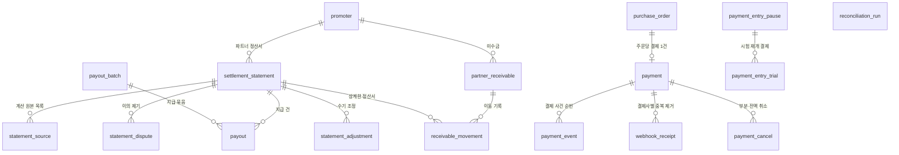

| 표 | 논리 DB | 담는 것 | 왜 따로 두나 | 키·핵심 칸 | 누가 쓰고 읽나 | 근거 |
| --- | --- | --- | --- | --- | --- | --- |
| `payment` | payment | 주문 하나의 결제 원장: 결제사, 결제사 결제 참조, 금액, 상태, 가상계좌(결제사가 입금용으로 발급한 계좌 번호) 안내, 승인 시각 | 결제 비밀 키와 결제사 장애를 다른 도메인과 떼어 둔다(data §1). 승인 요청은 주문당 한 번이라, 표를 나누지 않고 `order_id`에 UNIQUE를 바로 건다(ADR-0114) | `id` PK(UUIDv7), `order_id` UNIQUE, `event_id`(주문에서 복사), `attempt_id`, `pg`, `status` ACCEPTED·AWAITING_DEPOSIT·APPROVED·UNKNOWN(결과 모름)·FAILED·PARTIAL_CANCELED·CANCELED, `idempotency_key` `confirm-{orderId}`, 가상계좌 칸(필드 암호화, 입금 확정·만료 때 삭제), `payment_method_ref`·`card_bin`, 대기 상태 부분 인덱스 둘, 5년 | payment-svc가 결제 접수부터 승인·취소까지 쓴다. purchase-svc가 `BatchGetPayments`(결과 당기기)로 쓰기 인스턴스에서 읽고, 정산 합계와 일일 대사가 읽는다 | data §2 ④·§4의 3·§5.1·§6, FR-011, ADR-0044, ADR-0114, ADR-0140 |
| `payment_event` | payment | 결제 상태가 바뀔 때마다 덧붙이는 사건 한 행과 그 순번 | 결제마다 늘어나기만 하는 순번이 있어야, 주문 쪽이 사건(Kafka)과 당기기 어느 길로 결과를 받아도 같은 결과를 두 번 반영하지 않는다(ADR-0140, ADR-0146 결정 2) | PK `(payment_id, seq)`, `event_key`(중복 제거 키), `type`, `exported`(CONFIRM_SENT 같은 내부 표시는 내보내지 않는다), `occurred_at`, 5년(부모와 같은 묶음에서 삭제) | payment-svc가 상태 전이·Outbox와 같은 트랜잭션에 쓴다. `trade.payments`의 `eventSeq`와 `BatchGetPayments`의 `event_seq`가 이 값이고, purchase의 `payment_event_seq`가 받는다 | data §2 ④·§4의 3, ADR-0140, ADR-0146 |
| `payment_entry_pause` | payment | 결제사·채널마다 새 결제 진입 정지의 단계와 사유 한 행 | 결제사 장애로 새 결제 진입을 멈추면 새 결제가 없어 회복을 알 수 없다. 정지 중에도 생기는 신호(확인 호출, 시험 재개)로 다시 열려고 단계를 한곳에 둔다. 옛 판정자의 늦은 쓰기는 판 번호로 거절한다(ADR-0105) | PK `(pg, channel)`(채널 상한 때문이면 채널, 결제사 장애면 ALL), `stage` OPEN·PROBING·TRIAL(열림·확인 호출·시험 재개), `reason` PG_FAILURE·CHANNEL_WAIT, `actor`, `since`, `version` | Lease(정해진 시간 동안만 유효한 권한)로 뽑은 payment-svc 정지 판정자 하나가 쓴다. 모든 파드가 1초 [가정]마다 읽어 결제 시도 시작과 `GetNewPaymentPause`에 쓴다. commander는 명령 6 해제로 바로 연다 | data §1·§2 ④, payment §9, ADR-0105 |
| `payment_entry_trial` | payment | 시험 재개 때 받은 결제 하나와 첫 승인 결과 | 시험 재개는 새 결제 시도의 5% [가정]만 받는다. 받은 결제의 첫 승인 호출 20건 [가정] 가운데 5초 [가정] 안에 결론이 난 비율이 95% [가정] 이상이면 모두 연다(payment §9) | PK `order_id`, `pg`, `admitted_at`, `first_result` APPROVED·DECLINED·FAILED·UNKNOWN(재시도 큐 건 제외), `first_result_at`, 회차 판매 종료 뒤 삭제 | payment-svc가 시험 재개로 받은 주문을 넣고, 정지 판정자가 20건을 센다 | data §2 ④, payment §9·§10, ADR-0105 |
| `payment_cancel` | payment | 결제 하나의 부분·전액 취소 한 건 | 취소마다 결제사 멱등키 `cancel-{cancellationId}`를 고정해, 응답이 늦어 다시 보내도 결제사가 한 번만 취소한다(data §4·§5) | `id` PK, `payment_id` FK, `amount`, `idempotency_key`, `status` REQUESTED·CANCEL_PENDING·CANCELED·FAILED, `created_at`, `canceled_at`, `(payment_id) INCLUDE (amount, status)`(커버링 인덱스: 표를 읽지 않고 인덱스만으로 답하는 인덱스) | 예매 취소 오케스트레이션의 마지막 단계에서 payment-svc가 결제사 취소 API를 부르고 쓴다. 입장 시작 뒤 접수한 취소는 입장 기록 마감 뒤로 미룬다. 정산 합계가 읽는다 | data §2 ④·§4의 8·§5.1, FR-047, POL-032, ADR-0086 |
| `settlement_statement` | payment | 파트너·결제사(·결제 상점)별 회차 정산서나 주간 상품 정산서 한 판 | 파트너에게 알린 금액을 덮어쓰지 않으려고, 다시 계산하면 판본을 올린 새 판을 만들고 옛 판은 SUPERSEDED로 남긴다(기술 검토 중간-043). 정산서 하나만으로 `int`를 넘을 수 있어 금액은 `bigint`다(25억 원 정산서) | `id` PK, `promoter_id`, `kind` EVENT·PRODUCT(`CHECK ((kind = 'EVENT') = (event_id IS NOT NULL))`), `pg`·`pg_store` STANDARD·ESCROW, 금액 칸(`gross_amount`·`refund_amount`·`commission_amount`·`commission_vat`·`offset_amount`·`payout_amount`), `revision`·`supersedes_id`, `excluded_payments`, `status` 10값(CALCULATED부터 SUPERSEDED까지), `hold_reason`, `dispute_due_at`(통지 뒤 2영업일), `payout_date`, 5년 | payment-svc가 회차 종료 다음 영업일 06시에 대사가 끝난 원장으로 계산한다. 파트너가 SCR-027에서 읽고, 지급 묶음이 확정 정산서를 모은다 | data §2 ④·'기본 키·유일·검사 규칙'·§6, settlement §4, FR-062, POL-039, ADR-0047, ADR-0086 |
| `statement_source` | payment | 정산서 한 판이 계산에 넣은 승인(GROSS) 하나나 환급(REFUND) 하나와 그 금액 | 판이 무엇을 썼는지 남기지 않으면 계산 시각이 없어 늦게 온 승인과 대사로 뺀 결제를 가릴 수 없다. 판매 대금은 GROSS 줄의 합, 환급은 REFUND 줄의 합이다. 정산 돈 불변식 M4(한 결제의 환급이 두 정산서에 들어가지 않음)와 M5(판매 대금 = 그 판이 쓴 대사 완료 승인 합)가 이 목록으로 센다(settlement §4.1, verification §2.5) | PK `(statement_id, source_id)`(`source_id`는 GROSS면 `payment.id`, REFUND면 `payment_cancel.id`), `kind` GROSS·REFUND, `payment_id`(REFUND도 원래 결제), `amount` bigint. 다시 계산한 새 판은 자기 목록을 새로 갖고 옛 판(SUPERSEDED)의 목록은 그대로 남는다 | payment-svc 정산 계산 트랜잭션이 정산서 행과 함께 넣고 고치지 않는다. 불변식 검사기(`services/invariant-checker`)가 읽는다 | data §2 ④, settlement §4.1, verification §2.5(추천 적용 2026-11-02, wbs 1.2.3) |
| `statement_dispute` | 정본에 없음(열린 일 102번) | 파트너가 정산서에 낸 이의 하나: 사유 코드, 설명, 결과 | 이의가 오면 그 정산서만 멈추고(DISPUTED) CS 처리함에 '정산 이의' 건이 생긴다. 처리 결과(조정·기각)를 이의마다 남긴다(settlement §4.2) | `id` PK, `statement_id`, `reason_code` GROSS_AMOUNT·REFUND_AMOUNT·COMMISSION·OFFSET·OTHER, `detail`(2,000자), `submitted_by`·`submitted_at`, `result` ADJUSTED·DISMISSED, `resolved_at` | 파트너가 `POST /v1/partner/settlements/{statementId}/disputes`로 낸다. 이 요청의 멱등 기록은 payment DB에 둔다(data §2 '서비스마다 둔 멱등 기록 표'). 기각은 `/v1/ops/settlements/{statementId}/dispute-dismissal`이다 | data §2 ④, settlement §4.2, FR-062, POL-039 |
| `statement_adjustment` | 정본에 없음(열린 일 102번) | 정산서 하나에 더한 수기 조정 한 줄: 금액(+면 지급을 늘리고 −면 줄인다), 사유, 근거 | 계산 규칙 밖의 보정(원장 오류, 계약 수수료율 정정, 합의한 차감, 받아들인 이의)은 원래 계산 행을 고치지 않고 조정 행으로 더한다(settlement §4.3). 정산서 금액 칸은 수기 조정으로만 바뀐다(data §2 '복사한 칸 목록') | `id` PK, `statement_id`, `approval_id`(수기 조정 승인 업무), `reason_code` 8종, `dispute_id`(이의 인정이면), `amount` bigint, `evidence_note`(2,000자), `applied_at` | `cs_lead`(CS 책임자)가 근거를 붙여 요청하고 commander가 승인한다(2인, POL-038). 요청의 멱등 기록은 ops DB에 둔다(data §2). 경로는 `/v1/ops/settlements/{statementId}/adjustments`다 | data §2 ④·'복사한 칸 목록', settlement §4.3, POL-038 |
| `payout_batch` | payment | 지급일·결제사·결제 상점별로 확정 정산서를 모은 지급 묶음 하나 | 지급 묶음은 되돌릴 수 없는 일괄 작업이라 승인 업무(2인)로 처리한다(settlement §5.1, POL-038). 묶을 때 본 결제사 잔액과 그 출처를 남겨, 잔액이 모자라 지급일을 미룬 근거로 쓴다 | `id` PK, `pg`·`pg_store`, `payout_date`, `total_amount`·`statement_count`, `approval_id`, `portone_bulk_payout_id`, `pg_balance_krw`·`pg_balance_source`(PG_API·OPERATOR_CONSOLE)·`pg_balance_ledger_krw`(포트원만), `status` PREPARED·PENDING_APPROVAL·APPROVED·SUBMITTED·COMPLETED·PARTIAL_FAILED, 5년 | payment-svc가 지급일 전 영업일 09시에 만든다. operator(운영자)가 포트원 콘솔에서 본 잔액을 적고, 2인이 승인한다(`/v1/ops/payout-batches`) | data §2 ④·§6, settlement §5.1, FR-062, ADR-0047, ADR-0108 |
| `payout` | payment | 정산서 하나를 결제사 지급 요청 단위로 나눈 지급 건 하나 | 지급한 돈은 결제사가 되돌려 주지 않아 중복 지급을 막아야 한다. `ref_payout_id` 유일 제약과 고정한 결제사 멱등키가 맡는다(data §4) | `id` PK, `batch_id`, `statement_id`, `seq`, `amount` bigint(10억 원 미만), `ref_payout_id` UK(정산서 ID-순번), `pg_payout_id`, `status` REQUESTED·IN_PROGRESS·COMPLETED·FAILED·CANCELED, `pg_transfer_id`·`transfer_check` MATCHED·MISMATCH·MISSING(포트원 출금 대사), 5년 | 묶음이 승인되면 payment-svc가 정산서를 10억 원 미만 건으로 나눠 요청한다. 상태는 서명을 확인한 웹훅(상대 서버가 우리 주소를 불러 알려 주는 방식)과 조회로만 바꾼다 | data §2 ④·§4의 13·§6, settlement §5, FR-062, ADR-0047, ADR-0108 |
| `partner_receivable` | payment | 파트너에게서 돌려받을 돈(미수금) 한 건: 원인, 금액, 남은 금액 | 결제사는 이미 지급한 돈을 되돌려 주지 않아, 지급 뒤 환불·카드 이의제기·배상금 미리 지급·감액 조정으로 0 아래가 된 정산서를 PEAKET이 먼저 부담하고 돌려받는다(settlement §7). 행 잠금 안에서 상계(줄 돈에서 받을 돈을 빼고 남는 만큼만 주고받는 것)해 같은 미수금을 두 정산서가 상계하지 않는다 | `id` PK, `promoter_id`, `cause` REFUND_AFTER_PAYOUT·CHARGEBACK·COMPENSATION_ADVANCE·NEGATIVE_STATEMENT, `pg`(같은 결제사 정산서에서만 상계, 배상은 null), 수수료 몫 칸, `amount`·`remaining`, `status` OPEN·OFFSET·GUARANTEE·BILLED·CLOSED·WRITTEN_OFF, `(promoter_id, id) WHERE status = 'OPEN'`, 5년 | payment-svc가 정산서를 확정할 때 `FOR UPDATE`로 잠그고 상계한다. 운영자가 `/v1/ops/receivables`로 본다. `trade.settlements`에 RECEIVABLE_OPENED·RECEIVABLE_CLOSED를 낸다 | data §2 ④·§4의 13·§5·§5.1, settlement §7, FR-062, ADR-0046, ADR-0047 |
| `receivable_movement` | payment | 미수금 하나의 상계·보증 충당·청구 회수·손실 처리·되돌림 한 건 | 덧붙이기만 하고 고치거나 지우지 않는다. 지급이 실패하거나 정산서를 다시 계산해도 상계를 지우지 않고 되돌림 행을 더한다. 남은 금액을 '금액 − 이동 기록 합'으로 함께 고쳐 불변식 검사가 둘이 같은지 본다(기술 검토 중간-043) | `id` PK, `receivable_id`, `statement_id`(상계·되돌림만), `kind` OFFSET·GUARANTEE·COLLECTED·WRITE_OFF·REVERSAL, `amount`(양수), `reverses_id`(REVERSAL만), `created_at`, 5년 | payment-svc가 상계와 같은 트랜잭션에 쓴다. 정산서 `offset_amount`는 그 판의 OFFSET 합과 같다. SCR-027의 '미수금 상계 내역'과 이의 사유 `OFFSET`이 이 기록을 근거로 보인다 | data §2 ④·§5·§6, settlement §7 |
| `reconciliation_run` | payment | 결제사·거래 날짜 하나의 일일 대사(두 기록을 맞대어 어긋난 곳을 찾는 일) 실행 결과 | 정산서 계산과 공연예술통합전산망 전송은 대사가 끝난 원장만 쓴다. 정산은 판매 기간의 모든 날짜가 DONE인지 먼저 확인한다(ADR-0086) | `id` PK, `pg` TOSS·PORTONE, `recon_date`(KST), `status` RUNNING·DONE·FAILED, `matched_count`·`mismatch_count`, `finished_at` | 일일 대사 배치가 매일 자정(대형·중형 온세일 윈도우면 그 뒤, 늦어도 04시 [가정]) 결제사 거래 조회와 결제 원장을 맞춘다. 어긋난 건은 UNKNOWN 해소(결과 모르는 결제를 조회로 정하는 처리)로 넘긴다 | data §1·§2 ④, payment §8, ADR-0044, ADR-0086 |
| `webhook_receipt` | payment | 결제사가 보낸 웹훅 하나의 수신 기록(결제사별 고유 식별자) | 결제사 웹훅은 중복되거나 순서가 뒤바뀌어 올 수 있다. 같은 식별자로 다시 온 웹훅은 유니크 제약으로 한 번만 처리한다(data §5). 웹훅은 보조 신호라, 먼저 받은 웹훅을 적재해 두고 Saga가 UNKNOWN을 풀 때 교차 검증에 참고한다(payment §4.2) | 정본 ERD에 칸 정의 없음(이름만 있는 상자, 열린 일 101번). 결제사별 고유 식별자에 UNIQUE: 토스는 헤더 `tosspayments-webhook-transmission-id`(`transmission_id`), 포트원은 서명을 검증한 `webhook-id`. `payment` 한 건에 여러 행이 딸린다 | payment-svc가 `POST /v1/webhooks/toss`·`POST /v1/webhooks/portone`(gw-partner 경로)으로 받아 쓴다. 들어온 경로의 결제사와 결제 기록의 결제사가 다르면 반영하지 않는다(ADR-0044). 결제 상태는 웹훅이 아니라 결제사 단건 조회 결과로만 바꾼다 | data §1·§2 ④·§4의 3·§5, payment §4.2·§5, FR-041, ADR-0044 |

**흐름 한 줄씩**

- 결제: 결제 접수 뒤 `payment`가 주문당 하나 생기고 승인 요청은 `confirm-{orderId}` 멱등키로 보낸다. 승인이면 APPROVED, 가상계좌면 AWAITING_DEPOSIT, 결과를 모르면 UNKNOWN이고, 바뀔 때마다 `payment_event`와 Outbox를 같은 트랜잭션에 쓴다.
- 대사: 매일 자정 `reconciliation_run`이 결제사별 하루치를 맞춘다. 결제사 장애 때는 `payment_entry_pause`가 새 결제 진입을 멈추고 `payment_entry_trial`로 시험해 다시 연다.
- 정산서: 회차 종료 다음 영업일 06시에 `settlement_statement`가 CALCULATED로 생기고(그 판이 넣은 승인·환급은 같은 트랜잭션에서 `statement_source`에 한 줄씩) NOTIFIED가 된다. 2영업일 안에 이의(`statement_dispute`)가 오면 DISPUTED, 고칠 금액은 승인을 거친 `statement_adjustment`로 더하고, 이의가 없으면 CONFIRMED다.
- 지급: 지급일 전 영업일 09시에 `payout_batch`가 생기고 2인 승인 뒤 정산서마다 `payout`(10억 원 미만 건)을 결제사에 요청한다.
- 미수금: 지급 뒤 환불·카드 이의제기·배상금 미리 지급은 `partner_receivable`(OPEN)이 되고, 같은 파트너의 다음 정산서 상계 → 보증 → 청구 순서로 돌려받으며 그때마다 `receivable_movement`를 덧붙인다.

**헷갈리기 쉬운 것**

- `payment_event`와 `webhook_receipt`: `payment_event`는 우리 결제 상태가 바뀐 사건과 순번이고 밖으로 내보낸다. `webhook_receipt`는 결제사가 보낸 웹훅을 결제사별 식별자(토스 `transmission_id`, 포트원 `webhook-id`)의 유니크 제약으로 한 번만 받는 수신 기록이다. 웹훅으로 상태를 바로 바꾸지 않고 결제사 단건 조회 결과로만 바꾼다.
- `payment_entry_pause`와 `pg_switch`: 둘 다 새 결제를 다루는 payment DB 상태다. `payment_entry_pause`는 결제사 장애 때 정지 판정자가 자동으로 거는 진입 정지와 그 단계다. `pg_switch`는 운영 명령 6으로 범위(회차 또는 플랫폼)마다 대체 결제사로 바꾸는 상태이고 ERD에는 없다(data §1·§4의 3, ADR-0143).
- `excluded_payments`와 `statement_source`: 앞의 것은 대사 불일치로 이번 계산에서 뺀 결제 ID 목록(정산서 칸)이고, 뒤의 것은 그 판이 실제로 넣은 승인·환급의 줄(자식 표)이다. 불변식 검사는 뒤의 것으로 센다.
- `statement_dispute`와 `statement_adjustment`: 이의는 파트너의 문제 제기이고 금액을 바꾸지 않는다. 금액을 바꾸는 것은 승인 업무를 거친 조정 행뿐이다. 이의를 받아들이면 같은 사유 코드와 `dispute_id`를 단 조정이 생긴다.
- `partner_receivable.remaining`과 `receivable_movement`: 남은 금액은 빨리 읽으려는 값이고, 어떻게 돌려받았는지는 이동 기록에만 있다. ③의 `compensation`도 미수금 ID만 들고 회수 방법은 이동 기록에 맡긴다.

## 6. ⑤ 티켓과 현장 입장

**이 묶음이 하는 일**: 발권된 티켓의 소유와 현장 입장을 적는다. 표는 모두 ticket-svc의 ticket DB에 있다. 이 DB는 티켓 원장을 잃지 않으려고 다른 리전(도쿄)의 읽기 복제본에 늘 동기화하고, 그 복제본이 RPO(장애 때 잃어도 되는 데이터의 시간 폭) 약 1초의 복구 기준점이다(data §1). 원장은 보유자·결제자·상태를 가진 `ticket`과 게이트 스캔 기록 `scan_event`다. 주문과는 `order_item.ticket_id`(③), 회차는 `event_id`(②), 사람은 `account_id`(①), 현장 스태프 배정·스캐너 세션·부스 본인확인 대조는 identity의 `staff_assignment`·`scanner_session`·`booth_reverification`(①)으로 잇는다. 흐름은 분야 편 [13 오프라인 현장 입장](../fields/13-offline-gate.md)과 결정 카드 [D22](../decisions/D22-offline-gate-device-key-qr.md)가 다룬다.

`order_item`(③), `event`·`promoter`(②)는 다른 묶음의 표다. `ticket_addon`은 칸 정의 없이 이름만 있는 상자다.

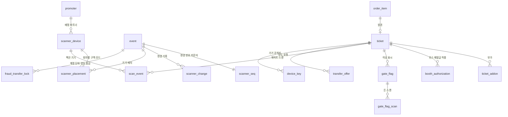

| 표 | 논리 DB | 담는 것 | 왜 따로 두나 | 키·핵심 칸 | 누가 쓰고 읽나 | 근거 |
| --- | --- | --- | --- | --- | --- | --- |
| `ticket` | ticket | 좌석 한 장의 티켓: 보유자, 결제자, 회차·좌석, 입장 구역, 상태, 부정 예매 양도 잠금 | 양도하면 보유자(`account_id`)가 바뀌어도 결제자(`payer_account_id`)는 남는다. 환불과 후기 자격이 결제자를 기준으로 한다. 양도·취소·스캔이 부딪치면 행 잠금(한 트랜잭션이 행을 잡은 동안 다른 쪽이 기다리게 하는 것)이 순서를 정한다(data §4) | `id` PK(UUIDv7), `status` ISSUED·ACTIVE·TRANSFER_PENDING·CANCEL_REQUESTED·REFUNDED·FLAGGED·VOIDED, `gate_zone`(발권 때 복사, 바뀌면 `scanner_change`로 알린다), `fraud_lock_case_id`·`fraud_lock_version`, `version`(사람이 화면에서 읽고 나중에 저장하는 CS·관리 흐름에만), 인덱스 `(account_id, id)`·`(event_id) INCLUDE (seat_id, gate_zone, status, version)`·`(payer_account_id, event_id)` | purchase-svc가 `IssueTickets`로 발권을 부르면 ticket-svc가 만든다. 마이 티켓, 스캐너 목록, core-svc의 후기 자격 확인이 ticket-svc를 거쳐 읽는다 | data §1·§2 ⑤·§4의 4·§5.1, FR-012, FR-013, ADR-0114 |
| `transfer_offer` | ticket | 티켓 하나의 양도 요청: 보낸 사람(결제자), 받는 사람(본인확인 회원), 상태, 기한 | 같은 티켓을 두 번 양도하는 사기와, 수락과 만료·철회의 경합을 막으려고 티켓 행 잠금 안에서 상태와 기한을 다시 본다(data §5). 회차 취소·연기·부정 예매 잠금 때는 시스템이 철회한다 | `id` PK, `ticket_id` FK, `from_account_id`·`to_account_id`, `status` OFFERED·ACCEPTED·REJECTED·WITHDRAWN·EXPIRED·RECLAIMED, `withdraw_reason` SENDER·ACCOUNT_DELETED·DEPOSIT_ERROR·EVENT_CANCELLED·EVENT_POSTPONED·FRAUD_LOCK, `expires_at`(48시간과 양도 마감 가운데 이른 때, `WHERE status = 'OFFERED'` 부분 인덱스로 만료 쓸기), 5년 | ticket-svc가 양도 요청·수락·거절·철회를 받는다(멱등 기록은 ticket DB `idempotency_record`). 수락은 보유자 변경·옛 키 폐기·상태 전이·Outbox를 한 트랜잭션에 쓴다 | data §2 ⑤·§4의 10·§5·§5.1, FR-013, FR-060, POL-017, ADR-0046 |
| `fraud_transfer_lock` | ticket | 부정 예매 사건 하나가 회차 하나에서 계정 하나에 건 양도 잠금 | 잠금은 계정 단위다. 그 계정이 그 회차에서 결제한 표는 지금 표와 앞으로 발권할 표 모두 잠기고, 최대 기한도 계정마다 따로다(data §2 ⑤). 잠금은 양도만 막고 돌려주기와 입장은 막지 않는다 | PK `(case_id, event_id, account_id)`(`case_id`는 ops DB라 외래 키가 없다), `locked`(false면 풀린 것이고 행은 지우지 않는다), `version`(같은 사건 안에서만 비교), `expires_at`(그 계정의 첫 소명 요청 + 14일 [가정], 연장하지 않는다), 사건 종료와 그 회차 공연일 + 30일 [가정] 가운데 늦은 때까지 보존 | ops-svc만 `TransferLockService.SetTransferLock`을 부르고 ticket-svc가 쓴다. ticket-svc가 min(최대 기한, 입장 시작)에 스스로 푼다 | data §2 ⑤·§6, transfer-refund §4.1, POL-046, FR-073, ADR-0171, ADR-0173 |
| `device_key` | ticket | 티켓에 묶인 기기 공개키 하나와 폐기 시각 | 입장 QR은 팬 기기 안의 개인키로 서명하고, 서버에는 공개키(서명을 확인만 하는 키)만 둔다. 재발급·양도·돌려주기·회수·예매 취소 때 옛 키를 폐기 목록에 올려 그 기기의 QR을 끊는다(data §6) | `id` PK, `ticket_id` FK, `key_id`(공개키 SPKI SHA-256 앞 8바이트, QR v1), `public_key`(ECDSA P-256), `reason` ISSUE·REISSUE·TRANSFER·BOOTH, `registered_at`, `revoked_at`, `(ticket_id) INCLUDE (key_id, public_key) WHERE revoked_at IS NULL` | 팬이 '입장용 휴대폰 등록'(`POST /v1/tickets/{id}/device-keys`)을 누르면 ticket-svc가 넣는다. 넣거나 폐기하면 같은 트랜잭션에서 `scanner_change`에 적는다. 스캐너 목록이 유효 키를 읽는다 | data §2 ⑤·§4의 4·§5.1·§6, FR-012, ADR-0050, ADR-0051 |
| `scan_event` | ticket | 스캐너가 찍어 올린 게이트 스캔 기록 하나: 방향, 방법, 결과, 사유, 시각, 일련번호 | 통신이 끊겨도 입장이 이어지게 기기가 먼저 판정하고 나중에 올린다. ID를 기기가 만들어 다시 올려도 한 번만 저장된다. 중복 입장 분쟁의 증적으로 5년 둔다(data §2·§4의 14, docs/security/data-classification.md) | PK `(event_id, id)`(`id`는 기기가 만든 UUIDv7), `direction` IN·OUT, `method` QR·OVERRIDE·VERIFY, `result` PASS·REJECT·CHECK, `known_seq`·`device_seq`(두 칸 버전 벡터: 판정 때 반영한 서버 변경 번호와 기기 번호), `flag` 7값, `staff_account_id`(1년 뒤 삭제), 회차 ID 범위 월 파티션, 그 파티션 회차들의 입장 기록 마감 가운데 가장 늦은 때부터 5년 | 스캐너 PWA(설치형 앱처럼 쓰는 웹 앱)가 `POST /v1/scanner/scans`로 올리면 ticket-svc가 저장하고 서버 판정 표로 다시 판정한다 | data §2 ⑤·§4의 14·§6, FR-036, FR-067, ADR-0051, ADR-0083 |
| `scanner_device` | ticket | 현장 스캐너 기기 하나의 등록 원장: 배정 파트너, 이름, 상태, 자격 종류와 지문 | 스캐너 세션과 배정은 identity 데이터이고 기기 원장은 ticket 데이터라, ticket-svc의 스캐너 경로 가드가 기기 상태를 직접 본다(offline-gate §6.2). 기기 키 지문의 수명은 기기 상태로 관리한다 | `id` PK, `promoter_id`, `name`, `status` ACTIVE·REVOKED·RETIRED, `credential_type` DEVICE_KEY(기본, DPoP: 요청마다 기기 안의 키로 서명한 짧은 증명을 붙이는 표준)·MTLS_CERT, `credential_thumbprint`, `cert_expires_at`(MTLS_CERT만), `enrolled_by`(operator), `revoked_at`·`revoke_reason` | 운영자가 SCR-053(`GET·POST /v1/ops/scanner-devices`, `…/revocation`)에서 등록·폐기한다. 스캐너 요청마다 가드가 읽는다 | data §2 ⑤, offline-gate §6.1, FR-065, ADR-0051 |
| `scanner_placement` | ticket | 회차 하나에서 기기 하나의 게이트 구역과 모드(입장 IN·퇴장 OUT) | 티켓마다 입장 구역을 정해 다른 구역 스캐너에 찍힌 티켓을 거절한다. 서로 다른 문의 기기를 같은 구역으로 두는 실수를 줄이려고 배치는 책임자만 바꾼다(offline-gate §7) | `event_id`, `scanner_device_id`, `gate_zone`, `mode` IN·OUT(OUT은 재입장 허용 회차만, 아니면 422), `set_by`(파트너 또는 `gate_lead`), `set_at`. 기본 키는 그림에 표시가 없다(열린 일 101번) | 파트너(SCR-037)나 현장 책임자 `gate_lead`(SCR-052)가 `PUT …/device-placements/{deviceId}`로 정하고, 일반 스태프는 403이다. 바뀌면 변경분으로 그 기기에 간다 | data §2 ⑤, offline-gate §6.2, FR-066, ADR-0051 |
| `scanner_change` | ticket | 회차의 스캐너에 알릴 변경 하나와 회차별 일련번호 | 스캐너는 시각이 아니라 일련번호로 '그다음부터'의 변경분을 받는다. 번호를 커밋 순서대로 매겨 변경이 빠지지 않는다(offline-gate §6.3) | PK `(event_id, seq)`, `kind` KEY_REGISTERED·KEY_REVOKED·TICKET_STATUS·SCAN_STATE·POLICY·PLACEMENT·FLAG·SESSION_TERMINATED, `payload` jsonb(개인정보를 담지 않고 판 번호 `v`를 넣는다), 회차 ID 범위 월 파티션, 입장 기록 마감 + 1년 [가정] 뒤 삭제 | ticket-svc가 키 등록·폐기, 스캔 판정, 배치·정책 변경과 같은 트랜잭션에 쓴다. 스캐너가 `GET /v1/scanner/events/{eventId}/changes?after`로 읽는다 | data §2 ⑤·§4의 4·14·§5.1, FR-035, FR-036, ADR-0051, ADR-0086 |
| `gate_flag` | ticket | 서버 판정이 붙인 이상 표시 하나와 처리 결과 | 오프라인 스캔은 늦게 올라와, 현장에서 못 본 중복 입장·취소 뒤 입장 같은 일이 생긴다. 서버가 판정 표로 다시 판정해 표시하고 현장 책임자나 CS가 확인한다(FR-067) | `id` PK, `event_id`, `ticket_id` FK, `kind` DUPLICATE·NO_EXIT·AFTER_CANCEL·OUT_OF_SESSION·AFTER_CLOSE·OVERRIDE_REVIEW, `awareness` CONCURRENT·KNOWN(중복 입장일 때), `status` OPEN·OK·SUSPECT·UNDETERMINED, `resolved_by`, `note`(개인정보 금지) | ticket-svc가 스캔 수신 트랜잭션에서 쓴다. 현장 책임자가 `GET /v1/scanner/events/{eventId}/flags`와 `POST /v1/scanner/flags/{flagId}/resolution`으로 처리한다 | data §2 ⑤·§4의 14, offline-gate §7.2, FR-067, ADR-0051 |
| `booth_authorization` | ticket | 입장 시작 뒤 현장 부스에서 티켓 하나의 새 키 등록을 허용한 기록 | 입장 시작 뒤에는 월렛에서 재발급하지 않고 부스에서만 한다. 본인확인 결과가 보유 계정과 같을 때만 그 티켓의 BOOTH 등록을 10분 동안 허용한다(offline-gate §9.1, ADR-0051 결정 11) | `id` PK, `ticket_id` FK, `booth_code_hash`(8자 코드의 SHA-256), `reverification_id`(identity 부스 본인확인 대조), `status` PENDING·ALLOWED·USED·EXPIRED, `allowed_by`(`gate_lead`), `allowed_at`, `expires_at`(허용 뒤 10분) | 팬이 `POST /v1/tickets/{id}/booth-requests`로 요청하고(티켓당 하루 3회 [가정]), 현장 책임자가 SCR-052에서 부스 코드 QR을 찍어 허용한다(`POST /v1/scanner/booth-authorizations`). 월렛이 reason `BOOTH`로 새 키를 넣는다 | data §2 ⑤, offline-gate §9.1, FR-066, ADR-0050, ADR-0051 |
| `scanner_seq` | ticket | 회차마다 스캐너 변경의 마지막 일련번호 한 행 | DB 시퀀스로 매기면 번호를 먼저 받은 트랜잭션이 나중에 커밋될 수 있다. 그러면 더 큰 번호를 먼저 받아 간 스캐너가 작은 번호의 변경을 놓친다(offline-gate §6.3, ADR-0086) | PK `event_id`, `last_seq`(변경을 적는 트랜잭션에서 `UPDATE … RETURNING`으로 올리는 카운터, 시퀀스 금지) | ticket-svc가 `scanner_change`를 쓸 때 올린다. 스캐너 전체 목록은 REPEATABLE READ(트랜잭션의 첫 조회 때 찍은 상태만 끝까지 보는 격리 수준) 트랜잭션 하나에서 `last_seq`와 내용을 함께 읽는다 | data §2 ⑤·'기본 키·유일·검사 규칙'·§4의 14, FR-036, ADR-0086 |
| `gate_flag_scan` | ticket | 이상 표시 하나에 든 스캔 기록 하나의 짝 | ADR-0086 결정 10 ④(JSON 설계 규칙)가 JSON 배열 `gate_flag.scan_event_ids`를 이 자식 표로 바꿨다 | PK `(flag_id, scan_event_id)`, `ticket_id`(보존 삭제 때 티켓으로 찾는다), `event_id` | ticket-svc가 `gate_flag`와 같은 트랜잭션에 쓴다 | data §2 ⑤·'기본 키·유일·검사 규칙'·§4의 14, FR-067, ADR-0086, ADR-0114 |
| `ticket_addon` | ticket | 용어 사전이 '티켓 연동 부가 상품'(유효한 입장 티켓을 가진 예매자에게만 파는 공연장 주차권, VIP 라운지 이용권, 패스트 트랙 패키지)의 표준 영문 표기로 두는 이름이다. 행 하나가 무엇인지는 정본에 없다(열린 일 101번) | — | 정본 ERD에 칸 정의 없음(이름만 있는 상자, 열린 일 101번). `ticket` 한 장에 여러 행이 딸린다. 티켓처럼 나누지 않고 티켓과 같은 묶음에서 나눠 지우는 대상이다(ADR-0114) | 정본에 없음 | data §2 ⑤, docs/planning/03 §4, ADR-0083, ADR-0086, ADR-0114 |

`ticket_addon`과 core의 상품 표가 어떻게 나뉘는지도 정본에 없다(열린 일 101번). 티켓 연동 부가 상품의 정의는 core `product`(`ticket_linked`와 연결 회차)에 있고(ADR-0101), 그 주문의 멱등 기록도 core DB에 둔다(data §2).

**흐름 한 줄씩**

- 발권: 승인 뒤 purchase-svc가 `IssueTickets`를 부르면 `ticket`(ISSUED)이 생기고, 결제자는 주문에서 복사한다. purchase 쪽 `order_item.ticket_id`가 채워진다.
- 입장용 휴대폰 등록: 팬이 누르면 `device_key`(ISSUE)와 `scanner_change`(KEY_REGISTERED, 번호는 `scanner_seq`에서)를 한 트랜잭션에 쓴다.
- 양도: `transfer_offer` OFFERED → 수락 때 티켓 행 잠금 안에서 보유자 변경, 옛 키 `revoked_at`, ACCEPTED, Outbox를 한 트랜잭션에 쓴다. 새 보유자는 TRANSFER 키를 따로 등록한다.
- 근무 준비: 스캐너는 `scanner_device`로 기기를, `scanner_placement`로 구역·모드를 확인받고, 티켓·유효 키·입장 상태 목록과 `last_seq`를 한 스냅샷(어느 시점의 전체 상태를 찍어 둔 것)으로 받는다. 그 뒤 `scanner_change`를 번호로 이어 받는다.
- 입장: 스캐너가 기기 안에서 판정하고 `scan_event`를 올린다. ticket-svc는 티켓 행을 잠그고 판정 표로 입장 상태를 고친 뒤 `gate_flag`(+`gate_flag_scan`)와 `scanner_change`를 같은 트랜잭션에 쓴다. 입장 기록 마감이 취소 접수 티켓의 환급과 이상 표시를 Outbox로 넘긴다.

**헷갈리기 쉬운 것**

- `scan_event`, `scanner_change`, `scanner_seq`: `scan_event`는 기기가 올린 원본 스캔(5년)이다. `scanner_change`는 서버가 스캐너들에 내려보내는 변경 기록(입장 기록 마감 + 1년 [가정])이고, 다른 스캐너의 입장 상태도 이 표의 SCAN_STATE로 퍼진다. `scanner_seq`는 그 변경 번호를 매기는 카운터 한 행이다.
- `scanner_device`, `scanner_placement`, identity `scanner_session`: 기기 자체의 등록·폐기(ticket), 그 기기의 회차별 구역·모드(ticket), 그 기기에 로그인한 스태프의 세션(identity)이다.
- `booth_authorization`과 identity `booth_reverification`: 대조 기록은 본인확인 결과가 보유 계정과 같은지를 identity에 남긴 것(회차 종료 뒤 1년 [가정])이다. 허용 기록은 그 대조 뒤 현장 책임자가 새 키 등록을 10분 동안 연 것이고 ticket에 있다.
- `ticket.fraud_lock_case_id`와 `fraud_transfer_lock`: 티켓 칸은 그 표 한 장의 잠금이다(빈 값이면 잠기지 않았다). `fraud_transfer_lock`은 계정·회차 단위 기록이라 앞으로 발권할 표까지 잠그고 계정마다 최대 기한을 둔다.

## 7. ⑥ 굿즈·알림·후기·문의

**이 묶음이 하는 일**: 티켓 밖에서 팬과 파트너가 남기는 기록을 모은다. 굿즈·부가 상품의 정의와 주문은 core-svc shop 모듈이, 관람 후기·사진·신고는 review 모듈이, 고객 문의와 소명은 support 모듈이, 알림·찜·웹 푸시 구독과 파트너 웹훅(일이 생기면 우리 서버가 파트너 서버 주소를 불러 알리는 방식) 발송은 notify 모듈과 발송 워커(쌓인 일을 꺼내 처리하는 프로그램) 둘(`core-notify-sender`·`core-webhook-dispatcher`)이 맡고, 23개 표가 모두 공유 Aurora(AWS가 운영해 주는 PostgreSQL 호환 데이터베이스) 클러스터의 core 논리 DB(한 DB 서버 안에서 서비스마다 따로 나눈 데이터베이스)에 있다([docs/data.md](../../data.md) §1·§2 ⑥, 알림은 [docs/features/notify.md](../../features/notify.md)). 원장(그 업무에서 기준이 되는 기본 기록) 구실은 굿즈 쪽에서 `merch_order`·`merch_order_item`(대금결제·재화 공급 기록으로 5년)이, 알림 쪽에서 용어 사전이 '발송 원장'이라 부르는 `notification_job`·`notification_delivery`·`webhook_delivery`가 한다. 다른 묶음과는 ID로 잇는다: 계정 `account_id`(① identity 논리 DB라 외래키(가리키는 행이 있어야만 넣게 하는 제약) 없음), 공연·회차·판매자 `production_id`·`event_id`·`promoter_id`(② 같은 core 논리 DB), 후기 근거 주문 `basis_order_id`(③ purchase DB), 상품 정산서 `statement_id`(④ payment DB), CS 처리함 건 `case_id`·소명 대상 `target_id`·부정 예매 사건 `case_id`(⑦ ops DB)다.

**그림 1. 굿즈·후기·문의·소명**

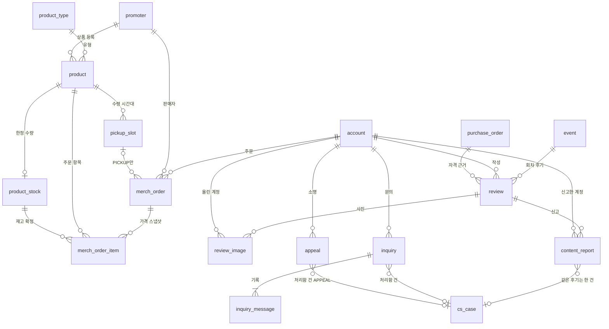

**그림 2. 알림·찜·파트너 웹훅**

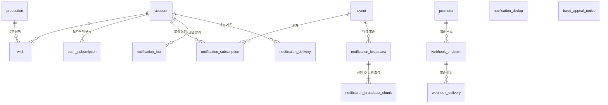

두 그림의 `account`·`production`·`event`·`promoter`·`purchase_order`·`cs_case`는 다른 묶음의 표다(정본 ⑥ 그림의 '다른 그림에서 컬럼을 적은 표'). 이 가운데 `account`·`purchase_order`·`cs_case`로 가는 선은 논리 DB를 건너므로 외래키 없이 ID만 둔다. `notification_dedup`·`fraud_appeal_notice`는 정본 그림에 관계선이 없어 상자만 둔다.

| 표 | 논리 DB | 담는 것 | 왜 따로 두나 | 키·핵심 칸 | 누가 쓰고 읽나 | 근거 |
| --- | --- | --- | --- | --- | --- | --- |
| `review` | core | 관람 후기 한 편(회차, 작성 계정, 자격 근거 주문, 별점 1~5, 본문)이다 | 작성 자격(그 회차 `ends_at`이 지났고, 그 회차 티켓의 결제자이고, 취소·환불·무효가 아닌 티켓이 하나 이상 남은 계정)은 ticket DB에 있다. 논리 DB 사이 조인이 금지라 쓸 때마다 ticket-svc에 묻고(gRPC `CheckReviewEligibility`, 서비스끼리 함수처럼 부르는 내부 호출), 확인한 주문을 `basis_order_id`로 남긴다. 쓰기는 회차 단위, 보기는 공연 단위로 모은다 | `id` PK(기본 키). `event_id` 외래키(같은 core DB). DELETED가 아닌 행에서 `(event_id, account_id)` 유일(한 계정 한 회차 하나). `body`는 grapheme(눈에 한 글자로 보이는 단위) 10~1,000자 [가정]. `status` VISIBLE·HIDDEN·DELETED. DELETED면 본문·별점·사진 키·계정 ID를 바로 비운다. 부분 인덱스(조건에 맞는 행만 담는 인덱스. 인덱스는 행을 빨리 찾게 하는 찾아보기 구조) `(event_id, created_at, id) WHERE status <> 'DELETED'`, 요약용 `(event_id) INCLUDE (rating) WHERE status = 'VISIBLE'` | core-svc review 모듈이 쓰고, 공개 목록·요약은 gw-fan(팬 요청이 들어오는 입구 서버)으로 읽는다. ops-svc(관제·CS 콘솔 뒤의 운영 서비스)가 신고 처리와 노출 차단을 `ApplyModeration`으로 반영한다. 계정 병합을 확정하기 전 core-svc가 `CheckAccountMerge`로 흡수 계정의 후기 수를 답하고, 0이 아니면 병합을 막는다 | data §2 ⑥·'관람 후기', §4의 9, §5.1, §6, FR-016, POL-042, ADR-0063, ADR-0066, ADR-0086, ADR-0093, ADR-0148 |
| `review_image` | core | 후기에 붙이는 사진 한 장의 기록(파생본 키 2개, 가로·세로, 순서, 사진 설명)이다 | 팬이 사진을 후기보다 먼저 올리므로(`review_id` NULL) 후기 행과 따로 둔다. 원본은 비공개 격리 위치에서 검사·다시 인코딩한 뒤 바로 지워 원본 키를 두지 않고, 메타데이터(촬영 위치 포함)를 지운 파생본(다시 만든 공개용 이미지) 키만 둔다 | `id` PK. `review_id`는 붙이기 전 NULL. `status` UPLOADED·SCANNING·READY·REJECTED·DELETED, `reject_reason` UNSUPPORTED_TYPE·TOO_LARGE·TOO_SMALL·MALWARE. `sort` 0~2(후기당 최대 3장 [가정]). `thumb_key`(240px [가정])·`view_key`(긴 변 1,280px [가정]). 붙이지 않은 사진은 24시간 [가정] 뒤 지운다 | review 모듈이 받기·결과 반영·파생본 게시를 하며 쓴다. 디코딩·검사·다시 인코딩은 DB 자격 증명이 없는 별도 배포 `image-worker`가 한다. 파생본은 S3(AWS의 파일 저장소) 공개 정적 객체에 두고, 후기를 가리면 함께 가리고 지우면 함께 지운다 | data §2 ⑥·'후기 사진', §1 S3 공개 정적 객체 행, §6, POL-042, ADR-0066, 기술 검토 중간-068 |
| `content_report` | core | 후기 하나에 대한 신고 한 건(신고 계정, 사유 8종 중 하나, 자세한 내용, 권리 침해 본인 여부, 결과 받을 곳)이다 | 같은 후기는 계정당 한 번이고 하루 10건 [가정]까지다. 같은 후기의 신고는 CS 처리함(운영 쪽에서 사람이 판단할 건을 모으는 곳) 건 하나로 모으고 신고 수·사유별 수를 센다. 신고자는 글쓴이·다른 팬·파트너에게 보이지 않는다 | `id` PK. `(target_id, reporter_account_id)` 유일. `target_kind` REVIEW. `category` SCALPING·MACRO·ABUSE·RIGHTS·ILLEGAL_FILMING·SPAM·OFF_TOPIC·OTHER. `status` RECEIVED·IN_REVIEW·RESOLVED, `outcome` NO_ACTION·TEMP_BLOCKED·BLOCKED. `case_id`(ops DB, 외래키 없음, 하루 한 번 고아 행 수 지표). `purge_at` 처리 뒤 1년 [가정] | review 모듈이 받아 Outbox(보낼 사건을 같은 트랜잭션(모두 하거나 모두 하지 않는 DB 쓰기 단위)으로 DB 표에 먼저 적어 두고 나중에 보내는 방식)로 `support.cases-requested`를 낸다. ops-svc가 `INSERT … ON CONFLICT DO NOTHING`(이미 있으면 넣지 않는 SQL)과 `cs_case`의 부분 유일 제약으로 건을 하나만 만들고, `GetReportedReview`로 상세를 읽는다(신고한 계정은 싣지 않는다) | data §2 ⑥·'게시물 신고'·'다형 참조의 중복 막기', §6, FR-070, POL-044, ADR-0066 |
| `inquiry` | core | 팬의 1:1 고객 문의 한 건(접수 번호, 유형 12종, 관련 주문, 제목, 상태)이다 | ops-svc는 팬 요청을 직접 받지 않는다(독립 제어 평면). 그래서 문의는 core-svc support 모듈이 갖고, ops-svc는 Outbox 사건(본문 없음)으로 CS 처리함 건만 만든다. 닫힌 뒤 3년 보존은 전자상거래법 시행령 §6①4호의 소비자 불만·분쟁 처리 기록 기준이다(일반 문의까지 이 기록으로 보는 것은 해석, POL-027) | `id` PK. `number` Q-YYMM-NNNN [가정]. `category`는 openapi `InquiryCategory` 12종(`RESALE_POST_REPORT`는 ADR-0173). `status` RECEIVED·IN_PROGRESS·ANSWERED·CLOSED. `case_id`(ops DB, 외래키 없음). `fan_viewed_at` 뒤의 답변·진행 경과가 '새 답변'이다. `closed_at`(답변 뒤 14일 [가정] 동안 추가 문의가 없거나 담당자가 닫을 때), `purge_at` 닫힌 뒤 3년. 인덱스 `(account_id, created_at)` | support 모듈이 gw-fan으로 받아 쓴다(계정당 하루 10건 [가정], 본인만 보고 남의 문의는 없는 문의와 같은 404). ops-svc가 `SupportCaseService`의 `GetInquiryRecord`로 읽고 `CloseInquiry`로 닫는다. 탈퇴 때 `title`을 `retention.inquiry_text`로 옮긴다 | data §2 ⑥·'고객 문의', §5.1, §6, FR-057, FR-069, POL-027, ADR-0066, ADR-0173 |
| `inquiry_message` | core | 문의 기록 한 줄(첫 문의·추가 문의·진행 경과·답변 가운데 하나)이다 | 문의 본문도 첫 기록(FAN·MESSAGE)이고, 추가 문의·진행 경과·답변이 같은 문의에 시간 순서대로 쌓인다. 담당자는 '피켓 고객센터'로만 보이고 개인 식별자는 ops-svc 감사 기록에만 둔다 | `id` PK. `inquiry_id` 외래키. `author_kind` FAN·AGENT·SYSTEM, `kind` MESSAGE·PROGRESS·ANSWER. `body` 2,000자까지(팬 글은 10자 이상 [가정])이고 첨부는 받지 않는다 | 팬 글은 support 모듈이 쓴다. 답변·진행 경과는 ops-svc가 권한과 감사 로그를 처리한 뒤 support 내부 API `AddInquiryReply`로 넣고 팬에게 알린다. 탈퇴 때 팬이 쓴 `body`를 `retention.inquiry_text`로 옮긴다 | data §2 ⑥·'고객 문의', §6, FR-069, ADR-0066 |
| `appeal` | core | 예매 제한·양도 회수·부정 예매 조사 대상이 된 팬의 소명(사정을 설명하는 글) 한 건이다 | 소명의 대상(`booking_restriction`, 양도 회수 승인 업무 `approval_request`, `fraud_case`)은 ops DB에 있지만 ops-svc는 팬 요청을 받지 않는다. 그래서 문의와 같은 길로 support 모듈이 core DB에 두고 대상은 ID만 적는다(ADR-0164 결정 7) | `id` PK. `kind` RESTRICTION·RECLAIM·FRAUD_CASE. `target_id`(ops DB, 외래키 없음). `status` SUBMITTED·DECIDED·INVALID(대상 아님·기한 경과). `result` LIFTED·KEPT·NOT_RECLAIMED·RECLAIMED·ACCEPTED·REJECTED. `case_id`(ops DB). `body`는 처리를 마치고 3년 뒤 파기 | support 모듈이 `POST /v1/appeals`로 받아 쓰고, 같은 트랜잭션의 Outbox로 `support.cases-requested`(kind `APPEAL`)를 낸다. ops-svc가 건을 만들고 support 내부 API로 대상·계정을 읽어 원본과 맞추며, 맞지 않으면 INVALID로 닫게 하고 결과(`result`)도 적는다. 탈퇴 때 `body`를 `retention.appeal_body`로 옮긴다 | data §2 ⑥·'소명', §6, POL-038, POL-046, ADR-0164, ADR-0171 |
| `merch_order` | core | 굿즈·부가 상품 주문 한 건(판매자, 수령 방식, 상태, 재고 예약 만료, 결제 상점, 택배 수령인 정보, 고른 수령 시간대)이다 | 한 주문은 한 판매자·한 수령 방식이다(POL-016). 재고 예약 만료 시각을 DB에 적어 두어, 결제하지 않고 떠난 주문을 EXPIRED로 끝내고 Redis(메모리에 데이터를 두는 빠른 저장소) 재고를 돌린다. 예약을 Redis 키 수명으로만 두면 키가 사라져도 재고가 돌아오지 않고 돌려놓을 수량도 알 수 없다(ADR-0107 '검토한 대안') | `id` PK(UUIDv7: 앞부분이 만든 시각이라 시간순으로 커지는 ID). `fulfillment` DELIVERY·PICKUP·WALLET. `status` CREATED·AWAITING_DEPOSIT·PAID·EXPIRED·FAILED. `stock_reserved_until`(주문 + 15분 [가정], 결제 접수 때 승인 기한까지 연장)과 부분 인덱스 `WHERE status = 'CREATED'`. `pickup_slot_id`는 PICKUP일 때만(CHECK(행마다 값 조건을 거는 제약) [가정]). `pg_store` STANDARD·ESCROW(택배만 에스크로 상점. 에스크로는 결제대금예치). `recipient_name`·`recipient_phone`·`delivery_address`·`consent_version`은 DELIVERY만 | core-svc shop 모듈이 쓴다. 승인은 shop이 payment-svc `ConfirmPayment`를 부르고, 만료 작업이 1초 [가정]마다 지난 예약을 조건부로 EXPIRED로 바꾼다. 탈퇴 때 수령인 칸을 `retention.merch_order_recipient`(5년)로 옮긴다. 계정 병합 때 `account_id`를 고치지 않고 `merged_account`로 묶어 읽는다 | data §2 ⑥, §4의 5·9, §5.1, §6, FR-015, POL-014, POL-016, POL-037, ADR-0089, ADR-0107, ADR-0160 |
| `merch_order_item` | core | 주문 안의 상품 한 줄(수량, 단가, 수수료율, 고른 옵션, 배송·수령·반품 상태, 정산 기준일)이다 | 주문 때 가격·수수료율·고른 옵션을 복사해 두어(스냅샷: 그 시점 값을 떠 둔 것), 상품 정산서를 계산하는 payment-svc가 core의 상품 표를 읽지 않고 이 칸으로 계산한다(ADR-0101). 배송·반품 상태와 정산 기준일도 항목 칸이다 | `id` PK. `order_id`·`product_id` 외래키(같은 core DB). `unit_price`·`commission_rate_bp`(만분율)·`option_snapshot`은 주문 시점 값이라 바뀌지 않는다. `status` READY·SHIPPED·DELIVERED·PICKED_UP·LOCKED·RETURN_REQUESTED·RETURN_RECEIVED·DISPUTED·CANCELLED·REFUNDED. `delivered_at`·`picked_up_at`(반품 기한의 기준). `settle_eligible_at`(정산 기준일), `statement_id`(들어간 상품 정산서) | shop 모듈이 쓴다(송장·반품 도착은 판매자, 부가 상품의 반품 도착은 CS가 확인). 결제 승인 직전 `product_stock`을 `stock >= quantity` 조건부로 깎아 재고를 확정한다. payment-svc가 항목마다 결제 금액·수량·처음 배송비·수수료율·정산 기준일·반품 상태를 넘겨받는다(넘기는 경로는 shop 상세 설계 때 정한다) | data §2 ⑥·'복사한 칸 목록'·'상품 정의', §4의 5, POL-016, POL-039, ADR-0062, ADR-0101, settlement §4.5 |
| `product` | core | 굿즈와 티켓 연동 부가 상품(주차권·VIP·패스트 트랙 등) 하나의 정의다. 공통 칸에 유형마다 다른 속성 `attributes jsonb`(JSON을 이진 형식으로 담는 칸)를 더한다 | 2026-10-28까지 MongoDB(문서 형태로 저장하는 데이터베이스)에 있었다. 옮긴 뒤 운영할 저장소가 하나 줄고 상품·재고·주문·Outbox가 한 트랜잭션이 된다. 유형마다 표를 두면 새 유형마다 DDL(표 구조를 바꾸는 SQL)과 배포가 생기고, 속성 하나를 행 하나로 두는 표(EAV)는 함께 거르는 쿼리가 복잡하고 느리다(ADR-0101 '검토한 대안') | `id` PK(UUIDv7). `type` 외래키 → `product_type.code`. `status` DRAFT·PUBLISHED·HIDDEN(판매 전·중·품절은 판매 기간과 재고로 계산). `price` CHECK ≥ 0. `CHECK (ticket_linked = (linked_event_id IS NOT NULL))`. `commission_rate_bp`는 처음 게시할 때 고정, DRAFT가 아니면 필수. `attributes`에 GIN 인덱스(값 안의 키·값마다 색인을 만드는 인덱스) `jsonb_path_ops`. `version`은 낙관적 잠금(읽은 뒤 판 번호, 곧 고칠 때마다 커지는 번호가 그대로일 때만 고치는 방식). 한정 수량은 `limited_qty`, 재고는 `product_stock` | shop 모듈이 파트너 상품 빌더(SCR-023) 요청으로 쓰고, 같은 트랜잭션의 Outbox 사건으로 웹 앱 서버가 `product:{id}` 태그를 무효화한다. 저장 전에 유형별 Zod 스키마(코드로 쓴 값 검사 규칙)로 검사하고, 매일 [가정] 속성 검증 잡이 다시 검사한다 | data §2 ⑥·'상품 정의'·'복사한 칸 목록', FR-014, FR-024, POL-016, ADR-0062, ADR-0101, [D-25](../decisions/D25-drop-mongodb.md) |
| `product_stock` | core | 한정 수량(`product.limited_qty`)이 있는 상품의 재고다. PostgreSQL 쪽에서 판매를 확정하는 재고이고, `product`와 1:0..1로 딸린다 | Redis 재고 차감 카운터와 재고 예약은 지워져도 다른 층이 마지막을 지키는 키(유실 등급 C)다. 지워지면 이 표와 예약 중인 주문으로 다시 만들고, 이 표의 조건부 갱신(`stock >= quantity`)이 초과 판매를 막는다(ADR-0109 결정 4). 상품 정의가 MongoDB에 있을 때는 상품 정의와 이 재고 행을 한 트랜잭션으로 쓰지 못했다(ADR-0101) | 정본 ERD에 칸 정의 없음(이름만 있는 상자, 열린 일 101번). 정본 문장에 보이는 것은 조건부 갱신식 `stock >= quantity`의 `stock`, `product`와의 1:0..1 관계, `merch_order_item`과의 '재고 확정' 관계뿐이다 | core-svc shop 모듈이 상품을 처음 만들 때 상품 행·Outbox 행과 한 트랜잭션으로 넣는다. 주문 때는 Redis에서 먼저 깎고, 결제 승인 직전에 이 표를 조건부로 깎아 확정한다. 접수 전에 끝난 만료는 이 표에서 돌릴 것이 없고, 접수 뒤의 실패(FAILED)는 Redis와 이 표 두 곳의 재고를 돌린다. Redis 재고를 다시 만들 때 원본으로 읽는다 | data §2 ⑥(이름만)·'상품 정의', §3 세션·캐시 키 유실 표, §4의 5, FR-015, ADR-0101, ADR-0107, ADR-0109 |
| `pickup_slot` | core | 현장 수령 주문이 고르는 수령 시간대 하나(상품, 받는 회차, 시작·끝, 티켓 소지자 전용 여부)다 | openapi `MerchOrderCreatePickup`의 `pickupSlotId`가 가리킬 곳으로 최소한만 둔 [가정] 엔터티다. 굿즈 상세 설계 때 다듬는다 | `id` PK. `product_id` 외래키. `event_id`(같은 core DB). 마지막 시간대가 끝날 때까지 받지 않으면 다음 영업일에 취소·전액 환급한다. `ticket_holders_only`가 참이면 그 공연 티켓을 가진 계정만 고른다(혜택이지 구매 자격이 아니다). 조건에 맞지 않으면 422 `pickup-slot-unavailable` | shop 모듈이 주문 때 검사한다. 시간대를 만드는 쪽은 정본에 없고(열린 일 102번), 화면이 시간대 목록을 읽는 경로도 아직 없다(wbs 0.2.3) | data §1 공유 클러스터 행, §2 ⑥, FR-015, POL-016, openapi `MerchOrderCreatePickup` |
| `product_type` | core | 상품 유형 목록의 한 행(코드, 최신 스키마 판, 쓰는지 여부)이다. MERCH·PARKING·VIP·FAST_LANE 등 | 다른 상태·종류 칸은 `CHECK (… IN (…))`로 지키지만 상품 유형만은 이 참조 표를 외래키로 가리킨다. 새 유형을 CHECK 목록에 더하면 그것이 DDL이 되기 때문이다. 새 유형은 스키마 파일·화면 설정·행 하나로 끝난다 | `code` PK. `latest_schema_version`, `enabled`. 배포 때 넣는 읽기 전용 행이다(좌석맵 템플릿과 같은 방식) | 배포 때 넣는다. shop 모듈과 상품 빌더 화면이 유형별 스키마(`@peaket/validation`)와 함께 쓴다 | data §2 ⑥·'허용 값 검사'·'상품 정의', ADR-0101 |
| `webhook_endpoint` | core | 파트너가 등록한 웹훅 받을 주소 하나(주소, 서명 비밀 위치, 구독한 이벤트 종류, 상태)다 | 서명 비밀 원문은 DB에 두지 않고 Secrets Manager(AWS의 비밀 값 보관 서비스) 위치만 둔다. 비밀을 다시 발급하면 24시간 옛 비밀로도 함께 서명하려고 옛 비밀 위치와 끝 시각 칸을 둔다(ADR-0053, ADR-0155) | `id` PK. `url`은 https만. `event_types`(이벤트 8종 가운데 고른 것). `status` ACTIVE·DISABLED, `disabled_reason` PARTNER·FAILING(5일 [가정] 동안 성공 없이 DEAD(끝내 실패한 발송)가 50건 [가정]을 넘을 때). `secret_prev_ref`·`secret_prev_until`. `version`은 PATCH의 `If-Match` 판 | notify 모듈이 gw-partner(파트너 요청 입구)의 `/v1/partner/webhooks`로 쓴다(조회는 파트너 사용자, 고치기·비밀 재발급은 파트너 관리자). `core-webhook-dispatcher`가 읽어 서명해 보낸다. 다른 파트너의 엔드포인트는 404다 | data §2 ⑥, FR-025, FR-040, ADR-0053, ADR-0062, ADR-0109, ADR-0155, notify §9 |
| `webhook_delivery` | core | 엔드포인트 하나에 사건 하나를 보내는 일과 그 결과다. 작업이자 기록이다 | 예전에는 세션·캐시 Redis 위 작업 큐(BullMQ)에 있어, 메모리가 차거나 장애 조치로 복제분을 잃으면 재시도 중인 웹훅과 실패 보관함(DLQ, 끝내 실패한 일을 모아 두는 곳)이 사라졌고 다시 만들 원본이 없었다. 파트너 화면 SCR-025 ③을 받칠 곳도 없었다(ADR-0109) | PK `(endpoint_id, event_key)`. `event_key`는 Standard Webhooks(웹훅 머리·서명 형식 표준)의 `webhook-id`이고 다시 보내도 같다. `id` UNIQUE(다시 보내기 경로의 deliveryId). `status` PENDING·RETRYING·SUCCEEDED·DEAD. `next_attempt_at` 부분 인덱스 `WHERE status IN ('PENDING','RETRYING')`. `lease_until`(임대: 워커가 일을 맡았다고 적어 두는 짧은 시간). `payload`는 thin 본문 `{type, timestamp, data}`(개인정보·계정 ID·좌석 번호 없음)이고 응답 본문은 두지 않는다. `finished_at` 뒤 30일 [가정]에 지운다 | notify 모듈의 Kafka(사건을 순서대로 쌓아 두고 나눠 주는 메시지 시스템) 소비자가 사건을 받은 트랜잭션에서 `INSERT … ON CONFLICT DO NOTHING`으로 쓴다. `core-webhook-dispatcher`가 `FOR UPDATE SKIP LOCKED`(다른 워커가 잠근 행은 건너뛰고 고르는 잠금)로 임대를 걸어 가져간다. 파트너 콘솔이 발송 이력을 읽고, 다시 보내기로 PENDING으로 되돌린다 | data §2 ⑥, §5, §6, FR-025, FR-040, ADR-0109, notify §9, [D-24](../decisions/D24-redis-roles-and-db-jobs.md) |
| `notification_job` | core | 팬에게 보낼 알림 하나(종류, 대상, 계정, 채널, 문구 변수)를 보낼 때까지만 두는 작업 행이다 | BullMQ 큐를 버리고 core DB 원장으로 옮긴 표다(ADR-0109). 문구 변수만 두고 받는 주소·전화번호·본문은 넣지 않는다(보낼 때 identity-svc에서 읽는다) | `dedup_key` PK(`notification_dedup`과 같은 중복 키). `status` PENDING·RETRYING·DEAD. `next_attempt_at`(시각을 잡은 안내와 60초 모아 보내기도 이 값으로 미룬다)과 부분 인덱스 `WHERE status IN ('PENDING','RETRYING')`. `lease_until` 2분 [가정]. `expires_at`이 지나면 보내지 않는다. `vars`는 허용 목록 스키마의 값만, 1KB [가정]까지. DEAD 행을 언제 지우는지는 정본에 없다(열린 일 103번) | notify 모듈의 Kafka 소비자가, 부정 예매 소명 알림은 support 모듈이 쓴다. `core-notify-sender`가 50개씩 임대를 걸어 가져가 보내고, 결과를 `notification_delivery`에 쓰는 트랜잭션에서 행을 지운다. 대량 발송의 이메일 단계도 신청마다 이 행을 만든다 | data §2 ⑥, §5.1, §6, FR-040, ADR-0078, ADR-0109, notify §4.1·§12 |
| `notification_delivery` | core | 낱건 알림을 보낸 결과 한 줄(중복 키, 종류, 대상, 계정, 채널, 상태, 시각, 발송 대행 메시지 ID)이다 | 작업 행은 보내면 지우므로 결과는 여기 남긴다. 받는 주소·전화번호·본문은 넣지 않고, 법정 통지를 보낸 사실은 그 건의 처리 기록에 따로 남는다 | PK `(dedup_key, sent_at)`. `sent_at`으로 달마다 나눈 파티션(큰 표를 기간으로 쪼갠 조각) 표다. `channel` EMAIL·WEB_PUSH·ALIMTALK·SMS·CONSOLE. `status`의 값 목록은 정본에 없다(열린 일 101번). 90일 [가정] 뒤 파티션째 지운다 | `core-notify-sender`가 결과를 쓴다. 웹 푸시 대량 발송은 받는 사람마다 쓰지 않고 조각 합계만 남긴다. 읽는 곳은 정본에 없다(열린 일 101번) | data §2 ⑥·'파티션 표 규칙', §6, ADR-0062, ADR-0086, ADR-0109, notify §4.1·§4.2 |
| `notification_subscription` | core | 팬의 오픈 알림·취소표 알림 신청 한 건(계정, 회차, 종류, 밤 웹 푸시 여부, 보낸 횟수, 상태)이다 | 오픈 사전 알림 신청(FR-004)과 취소표 알림 신청(FR-018)을 회차마다 받는다. 대량 발송이 이 표의 신청 ID 범위로 조각을 나눈다. 받는 주소는 두지 않는다 | `id` PK. `(account_id, event_id, kind)` 유일(다시 신청하면 그 행을 ACTIVE로 되돌리고 `sent_count`를 0으로 한다). `kind` OPEN·CANCELLATION. `status` ACTIVE·ENDED(취소표만), `end_reason` SENT_MAX·BOOKED·SALE_ENDED. 인덱스 `(event_id, kind, id)`. 끄면 지우고, 오픈 알림은 `open_at`이, 남은 행은 회차 `ends_at`이 지나면 지운다. 탈퇴하면 바로 지운다 | notify 모듈이 `/v1/events/{eventId}/subscriptions`로 쓴다(계정당 살아 있는 신청 200건 [가정]). 대량 발송 계획이 이 표의 신청 ID로 조각을 나누고, 조각 처리는 읽기 전용 복제본(원본을 복사해 읽기만 받는 DB)에서 읽는다. 수요 예측에는 회차별 구독 수만 넘긴다. 계정 병합 때 대표 계정으로 옮기고 겹치면 하나만 남긴다 | data §2 ⑥, §5.1, §6, FR-004, FR-018, POL-034, ADR-0078, ADR-0089, notify §3.1·§3.2 |
| `notification_dedup` | core | 낱건 알림의 중복 키 하나와 넣은 시각이다 | `notification_delivery`를 발송 시각으로 나누면서 기본 키에 `sent_at`이 들어가(파티션 표의 기본 키는 파티션 키를 담아야 한다), 중복 키만으로 유일을 걸 수 없다. 그래서 7일 [가정] 보존하는 이 유일 확인 표가 중복 막기를 맡는다(ADR-0086) | `dedup_key` PK(`종류:대상:사건·버전:계정:채널`). `created_at` 7일 [가정] 뒤 지운다 | 사건을 받은 트랜잭션에서 notify 모듈(부정 예매 소명 알림은 support 모듈)이 `INSERT … ON CONFLICT DO NOTHING`으로 먼저 넣고, 들어갔을 때만 `notification_job`을 적는다 | data §2 ⑥·'파티션 표 운영 규칙', §5, §6, ADR-0086, ADR-0109, notify §4.1·§4.3 |
| `fraud_appeal_notice` | core | 계정·부정 예매 사건마다 마지막으로 알린 상태(반영한 판, 갈래, 소명·이의 상태, 알린 취소·제외 표 수, 이용 제한 끝, 우선 구매 권리 ID, 양도 잠금 상태)다 | 소명 화면용 사본(`sup:far:{account}`)은 세션·캐시 Redis에 있어 DB 트랜잭션에 묶을 수 없다. 그래서 알림 판단은 이 표와 견주어 한다. Redis 값이 지워져도 '첫 반영'으로 잘못 보지 않아 같은 알림을 다시 보내지 않는다 | PK `(account_id, case_id)`(`case_id`는 ops DB `fraud_case.id`, `account_id`는 identity, 둘 다 외래키 없음). `version`은 반영한 `SetFraudAppealView` 판(사본이 바뀔 때마다 커지는 번호)이고, 더 큰 판만 알림을 판단한다. `party` PAYER(결제자)·HOLDER(받은 사람). `notified_lock_active`는 PAYER만, `notified_excluded_count`는 HOLDER만 쓴다. 사건이 끝나고 이의 창이 닫힌 뒤 30일 [가정]에, 탈퇴하면 바로 지운다 | core-svc support 모듈이 ops-svc의 `SetFraudAppealView`를 받아, 한 core DB 트랜잭션에서 바뀐 것을 찾아 알림 작업(`notification_job`·`notification_dedup`)을 적고 이 행을 그 판으로 고친다. 그다음 Redis 사본을 쓴다 | data §2 ⑥, POL-046, ADR-0171, ADR-0173, notify §4.5, data-classification |
| `wish` | core | 팬이 찜한 공연 하나(계정, 공연, 찜한 시각)다 | 찜은 회차가 아니라 공연(회차 묶음) 단위다(FR-019, ADR-0093) | PK `(account_id, production_id)`. `created_at`(찜한 최근 순 목록의 기준). 계정당 1,000개 [가정]. 해제·탈퇴 때 행을 지운다 | notify 모듈이 `PUT`·`DELETE /v1/productions/{productionId}/wish`로 쓴다(멱등: 같은 요청을 여러 번 보내도 결과가 같은 성질. 마지막 저장이 이긴다). `GET /v1/wishes`가 읽고, 홈 피드는 개인 값을 싣지 않아 로그인한 브라우저가 따로 부른다. 계정 병합 때 대표 계정으로 옮긴다 | data §2 ⑥, §4의 9, FR-019, POL-034, ADR-0093, notify §3.3 |
| `push_subscription` | core | 브라우저 하나의 웹 푸시 구독 정보(구독 주소, 암호화 공개키 `p256dh`, 인증 비밀값, 푸시 서비스 종류, 만료)다 | 웹 푸시는 브라우저가 준 구독 주소와 암호화 키로 본문을 암호화해 보낸다(RFC 8291). 한 계정에 구독이 여럿일 수 있다(10개 [가정]). 구독 주소는 개인정보로 다뤄 경로·로그에 넣지 않고, 해제 경로에는 해시만 쓴다 | `id` PK. `endpoint` UNIQUE, `endpoint_hash`(SHA-256, 해제 경로의 `subscriptionKey`) UNIQUE. `service` FCM·MOZILLA·APPLE·WNS(등록 때 호스트 허용 목록으로 정한다). 인덱스 `(account_id)`. 계정당 10개 [가정]를 넘으면 가장 오래된 것부터 지운다. 해제·로그아웃·404·410·VAPID(보내는 서버를 증명하는 서명 키) 불일치 403·탈퇴 때 지운다 | notify 모듈이 `POST /v1/push-subscriptions`로 쓰고, 로그인마다 지금 계정에 다시 묶는다(`bound_at`). `core-notify-sender`가 `account_id = ANY(...)`로 읽어 보내고, 404·410을 받으면 지운다 | data §2 ⑥, §5.1, FR-004, ADR-0155, notify §3.4·§10 |
| `notification_broadcast` | core | 한 회차·단계·판의 대량 발송 한 번(보낼 창, 쓸모 기한, 계획 때 마지막 신청 ID, 상태, 합계)이다 | 인기 회차 오픈 알림은 신청자가 수십만~100만 명 [가정]이다. 받는 사람마다 행을 쓰면 로비가 열리는 몇 분 동안 공유 Aurora 쓰기 인스턴스에 초당 수천 행이 더해지는데, 그때 같은 클러스터가 로그인 몰림도 받는다. 그래서 대량 발송은 받는 사람마다 행을 만들지 않는다(ADR-0155) | `id` PK. `(event_id, phase, version)` 유일(같은 사건을 다시 받거나 계획을 두 번 세워도 발송은 하나). `phase` OPEN_EMAIL·OPEN_VERIFY_PUSH·OPEN_LOBBY_PUSH·CANCEL_PUSH·CANCEL_EMAIL. `status` SCHEDULED·RUNNING·DONE·CANCELLED. `id_upper`(그 뒤 신청은 낱건으로 보낸다). 합계 `target_count`·`sent_count`·`skipped_count`·`failed_count`·`expired_count`. 끝난 뒤 30일 [가정]에 조각과 함께 지운다 | notify 모듈의 계획 작업이 쓴다. 오픈 시각·판매 상태가 바뀌면 그 트랜잭션 안에서 계획을 고친다(같은 core 논리 DB라 Kafka를 거치지 않는다). `core-notify-sender`가 조각을 끝낼 때 합계를 더한다 | data §2 ⑥, §6, FR-004, FR-018, ADR-0155, notify §4.2·§5 |
| `notification_broadcast_chunk` | core | 대량 발송의 조각 하나(신청 ID 범위 500개 [가정], 보낼 시각, 상태, 임대, 체크포인트, 조각 합계)다 | 조각마다 보낼 시각을 창 안에 HMAC(비밀 키로 만든 위조 확인용 값)으로 흩어, 먼저 신청한 사람이 먼저 받지 않고 전체 속도가 '받는 수 ÷ 창 길이'가 된다. 임대와 체크포인트(`sent_upto`, 어디까지 보냈는지 적어 둔 값)로 워커가 죽어도 다른 워커가 이어 보낸다 | PK `(broadcast_id, chunk_no)`. 범위 `[id_from, id_to)`. `slot_at`(창 시작 + HMAC mod 창 길이)과 부분 인덱스 `WHERE status IN ('PENDING','RUNNING')`. `status` PENDING·RUNNING·DONE·EXPIRED·CANCELLED. `lease_until` 2분 [가정]. `sent_upto`는 100개 [가정]마다 쓴다. `gone_count`는 404·410으로 지운 웹 푸시 구독 수. 계정 ID·받는 주소·본문은 두지 않는다 | 계획 작업이 만든다. `core-notify-sender`가 `slot_at <= now()`인 조각을 `ORDER BY slot_at LIMIT 1 FOR UPDATE SKIP LOCKED`로 골라 보낸다. 남은 쓸모 기한이 60초 [가정]보다 짧은 조각은 EXPIRED로 끝낸다 | data §2 ⑥, §5.1, §6, ADR-0109, ADR-0155, notify §4.2 |

**흐름**

- **굿즈 주문**: `merch_order` CREATED(Redis 재고 차감·예약과 `stock_reserved_until` = 주문 + 15분 [가정]) → 결제 접수 때 예약을 승인 기한(인증 + 10분)까지 늘린다 → 결제 승인 직전 `product_stock`을 `stock >= quantity` 조건부로 깎는다 → PAID. 예약이 지나도록 결제가 끝나지 않으면 만료 작업이 조건부로 EXPIRED로 바꾸고 Redis 재고만 돌린다. 그 뒤 `merch_order_item`이 배송·수령·반품 상태를 밟고, 정산 기준일(`settle_eligible_at`)을 지나 상품 정산서(`statement_id`)에 들어간다.
- **후기**: 사진을 먼저 올린다(`review_image` UPLOADED, `review_id` NULL) → `image-worker` 검사(SCANNING) → READY(파생본 2종 게시, 원본 삭제) → 후기를 쓸 때 ticket-svc로 자격을 확인하고 `review` VISIBLE과 `basis_order_id`를 쓴다 → 자기 사진을 붙인다(`attached_at`) → 지우면 DELETED로 바꿔 본문·별점·사진 키·계정 ID를 비우고 사진도 지운다.
- **신고**: 다른 팬의 `content_report` RECEIVED → Outbox `support.cases-requested` → ops-svc가 같은 후기를 건 하나(`CONTENT_REPORT`, 권리를 침해받은 본인이면 `RIGHTS_REQUEST`)로 모은다 → 담당자 처리를 `ApplyModeration`으로 반영해 `review` HIDDEN(조치 기록은 ⑦ `takedown_action`) → 신고는 RESOLVED와 `outcome`을 받고, 처리 뒤 1년 [가정]에 지운다. 불법 촬영물 사유는 확인할 때까지 바로 가린다(`FILMING_HOLD`).
- **문의와 소명**: `inquiry` RECEIVED와 첫 `inquiry_message`(FAN·MESSAGE) → Outbox(본문 없음) → ops-svc가 CS 처리함 건(`INQUIRY`·`DISPUTE`·`MINOR_CONTRACT_CANCEL`)을 만든다 → 답변을 `AddInquiryReply`로 넣어 `inquiry_message`(AGENT·ANSWER), ANSWERED → 14일 [가정] 동안 추가 문의가 없으면 CLOSED → 닫힌 뒤 3년에 파기. `appeal`은 SUBMITTED → 건 `APPEAL` → ops-svc가 대상을 확인해 INVALID로 닫거나 `result`를 적는다.
- **낱건 알림**: Kafka 사건 → 같은 트랜잭션에서 `notification_dedup`에 넣는다 → 들어갔을 때만 `notification_job` PENDING → `core-notify-sender`가 임대를 걸어 보낸다 → `notification_delivery`를 쓰고 작업 행을 지운다. 실패면 RETRYING, 마지막 시도까지 실패하면 DEAD와 SEV3(장애 경보 등급, 숫자가 작을수록 심각)다.
- **대량 발송과 파트너 웹훅**: 계획 작업이 `notification_broadcast`와, `notification_subscription` ID 범위로 나눈 `notification_broadcast_chunk`(PENDING)를 만든다 → `slot_at`에 RUNNING → 100개 [가정]마다 체크포인트 → DONE, 합계를 발송 행에 더한다. 웹훅은 구독한 엔드포인트마다 `webhook_delivery` PENDING → 서명해 보낸다 → SUCCEEDED. 실패면 1분·5분·30분·2시간·6시간·12시간 [가정]에 다시 보내고, 끝까지 실패하면 DEAD → 끝난 뒤 30일 [가정]에 지운다.

**헷갈리기 쉬운 것**

- **`notification_job`·`notification_delivery`·`notification_dedup`**: 셋 다 같은 `dedup_key`를 쓴다. 작업은 보낼 때까지만 있고 보내면 지운다. 기록은 결과를 90일 [가정] 남기며 달마다 나눈다. 중복 키는 7일 [가정] 동안 같은 알림을 두 번 만들지 않게 하는 유일 확인만 한다.
- **`notification_subscription`·`wish`·`push_subscription`**: 신청은 '이 회차의 오픈·취소표를 알려 달라'이고, 찜은 공연 단위 관심 목록이며, 푸시 구독은 알림을 받을 브라우저 주소다. 오픈 알림은 이메일을 늘 보내고, 웹 푸시는 그 계정에 살아 있는 푸시 구독이 있을 때만 보낸다(notify §3.1).
- **`webhook_delivery`와 ④ `webhook_receipt`**: 앞은 우리가 파트너 서버로 보내는 웹훅의 발송 원장(core DB)이고, 뒤는 결제사가 우리에게 보낸 웹훅의 수신 멱등 기록(payment DB)이다. 둘 다 사건 키로 중복을 거르지만 방향이 반대다.
- **`inquiry`·`appeal`·`content_report`**: 셋 다 core에 있고 같은 Outbox 사건 `support.cases-requested`로 ops-svc의 CS 처리함 건(⑦ `cs_case`)이 된다. 문의는 대화 기록이 여러 줄이고, 소명은 대상(ops DB의 예매 제한·승인 업무·사건)을 ID로만 가리키며 결과를 ops-svc가 적고, 신고는 후기마다 계정당 한 번이고 같은 후기는 건 하나로 모인다. 부정 예매 소명의 알림 상태는 `appeal`이 아니라 `fraud_appeal_notice`가 따로 기억한다.

## 8. ⑦ 운영·CS·감사·법적 요청

**이 묶음이 하는 일**: 관제와 운영 사무의 기록을 모은다. 운영 명령과 그 감사, 승인 업무·CS 처리함·예매 제한, 법정 조치(기관 통보·자료 요청·보안 사고·접속기록 점검), 관제 화면을 돕는 표와 분석 결정 기록, 부정 예매 사후 조사의 표 38개다. 그 가운데 37개를 ops-svc가 ops 전용 Aurora(AWS가 운영해 주는 PostgreSQL 호환 데이터베이스) 클러스터의 ops 논리 DB에 두고, 후기를 가리는 조치 기록 `takedown_action` 하나만 공유 클러스터의 core 논리 DB(후기 모듈)에 있다([docs/data.md](../../data.md) §1, [ADR-0102](../../adr/0102-control-plane-direct-grpc-dedicated-pool-ops-db-audit-chain-worker-break-glass.md)). 원장(지우지 않고 쌓아 두는 기본 기록) 구실은 운영 명령 사건 `command_event`와 감사 체인 `audit_chain`, 사람이 판단하는 일의 `approval_request`·`cs_case`, 부정 예매 사건 `fraud_case`·`fraud_case_event`가 한다. 다른 묶음과는 ID로만 잇는다: 계정 `account_id`와 관리 계정 `admin_account_id`(① identity 논리 DB), 회차 `event_id`와 후기 `review_id`(② ⑥ core 논리 DB), CS 처리함 건의 `target_ref`(core의 문의·후기·소명 ID)이고, 다른 DB를 가리키는 ops의 칸은 외래키(가리키는 행이 있어야만 넣게 하는 제약) 없이 ID만 둔다(data.md §1 공유 클러스터 행).

38개 표를 다섯 갈래로 나눠 그림·표·흐름을 따로 둔다. 갈래 안의 표 순서는 정본 ⑦ 그림의 순서다. 그림에 이름만 나오는 `account`·`admin_account`(①), `event`(②), `review`(⑥)는 칸이 다른 묶음에 있다(정본 ⑦ 그림의 '다른 그림에서 컬럼을 적은 표'). 그림의 선은 관계를 보일 뿐이고, 논리 DB를 건너는 선은 외래키가 아니다. 관제 쪽 해설은 [분야 편 16](../fields/16-control-tower.md)과 [결정 카드 D21](../decisions/D21-command-approval-and-audit-anchor.md), 조사 쪽은 [분야 편 17](../fields/17-analytics-forensics.md)이 맡는다.

### 8.1 운영 명령과 감사

운영 명령은 이 시스템에서 이벤트 소싱(상태를 덧붙이기만 하는 사건으로 정하는 방식)을 쓰는 유일한 곳이다([ADR-0113](../../adr/0113-order-state-with-append-only-history-event-sourcing-only-for-ops-commands.md)). 명령 사건과 감사 체인 행을 한 트랜잭션(모두 하거나 모두 하지 않는 DB 쓰기 단위)에 쓰고, 기록을 고치거나 지우면 검증에서 드러나게 한다([docs/features/control-tower.md](../../features/control-tower.md) §7).

**그림 1. 운영 명령과 감사**

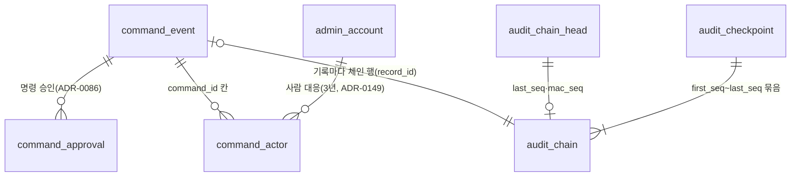

정본 ⑦ 그림의 선은 첫째와 셋째 둘뿐이다. 나머지 넷은 칸(`command_actor.command_id`, `audit_chain.record_id`, `audit_chain_head.last_seq`, `audit_checkpoint.first_seq`·`last_seq`)으로 이은 관계를 이 그림에서 더한 것이다.

| 표 | 논리 DB | 담는 것 | 왜 따로 두나 | 키·핵심 칸 | 누가 쓰고 읽나 | 근거 |
| --- | --- | --- | --- | --- | --- | --- |
| `command_event` | ops | 운영 명령 하나에 생긴 일(사유 입력, 승인, 보냄, ack(받는 쪽이 그 판을 적용했다는 응답), 연장, 사후 검토 등)을 일어난 차례대로 한 행씩 쌓는다 | 명령의 상태를 이 사건으로 정한다. 콘솔 목록·검색에 쓰는 지금 상태는 같은 트랜잭션에서 고치는 명령 상태 표에 두고, 그 표는 사건에서 다시 만들 수 있는 사본이다. 감사의 원본은 사건과 체인이다(ADR-0113) | `command_id`·`seq`(기본 키 표시는 정본에 없음, 열린 일 101번), `type`, `actor_ref`(기록마다 새로 만드는 무작위 참조)·`actor_role`(그때의 역할 `viewer`·`operator`·`commander`·`system`), `reason`, `dry_run`(실행 전 영향 미리 보기 결과), `acked_at`. 명령 2(입장 일시정지)의 연장 `EXTENDED`와 명령 11(자동 제어 멈춤)의 사후 검토 `POST_REVIEW_SUBMITTED`·`POST_REVIEW_CONFIRMED`도 같은 `command_id`의 사건이다. 영구 보존 | ops-svc 명령 접수가 명령 상태 표·체인 행과 한 트랜잭션에 쓴다. 감사 로그와 인시던트 리플레이(SCR-031)가 읽는다. 만료 차단 정리 작업 `waf-block-expirer`는 이 표를 읽지 못하고, 명령 상태 표의 명령 4 행만 보이는 보기 `waf_block_expiry_v`만 읽는다 | data §2 ⑦·§4의 6·§6, FR-030, FR-031, NFR-017, ADR-0113, ADR-0149 |
| `audit_chain` | ops | 감사 기록 하나마다 한 행을 둔다: 빈틈 없는 번호, 기록 종류·ID, 기록 해시(내용이 한 바이트라도 바뀌면 값이 달라지는 지문), 키 건 해시 | 기록을 몰래 고치거나 지우면 드러나게 하는 키 건 해시 체인(비밀 키를 섞은 해시 HMAC을 앞 행 값과 이어 만든 사슬)이다(ADR-0053). 기록 트랜잭션은 KMS(키를 맡아 두고 대신 계산해 주는 AWS 서비스)를 부르지 않고 mac을 비운 채 커밋한다. 그래서 KMS가 늦거나 멈춰도 명령은 커밋된다(ADR-0102) | `seq` PK(빈틈 없는 번호), `record_type`·`record_id`, `record_sha256`(기록 정규화 값의 SHA-256), `mac`(HMAC(감사 체인 키, `PEAKET-audit-v1`, seq, 직전 mac, 기록 해시)), 빈 행을 찾는 부분 인덱스(조건에 맞는 행만 담는 인덱스) `WHERE mac IS NULL`, `leaf_salt`(잎 솔트: 32바이트 비공개 난수, 기록을 파기할 때 함께 파기) | 기록 트랜잭션이 행을 넣는다. 체인 작업자 하나(ops-svc 안에서 Lease(정해진 시간 동안만 유효한 권한)로 고른 하나)가 커밋 뒤 `seq` 순서로 mac을 채운다. 가장 오래된 빈 행이 1분 [가정]을 넘으면 SEV2(장애 경보 등급, 숫자가 작을수록 심각)다. 서울 KMS가 답하지 않으면 도쿄 복제 키로 계산한다 | data §2 ⑦·§4의 6, NFR-017, ADR-0053, ADR-0075, ADR-0102 |
| `audit_checkpoint` | ops | 감사 기록 묶음을 요약해 서명한 체크포인트 하나: 번호 범위, 머클 루트(여러 기록의 해시를 둘씩 묶어 올라가 얻은 값 하나), 직전 체크포인트 해시, 서명, 공개 타임스탬프 증명 | 외부인도 '그 기록이 그 시각에 있었다'를 확인하게 하는 공개 앵커다. 블록체인을 직접 운영하지 않고 요약값만 공개 장부(OpenTimestamps, 비트코인)에 고정한다(ADR-0075) | `no` PK, `first_seq`·`last_seq`·`leaf_count`, `merkle_root`(RFC 9162 머클 트리 해시, 잎은 `PEAKET-audit-leaf-v1`·seq·기록 해시·잎 솔트), `prev_checkpoint_hash`, `access_log_day_anchor`(일 체크포인트에만), `closed_events`(회차 마감 체크포인트에만), `checkpoint_hash`(RFC 8785 정규화 JSON의 SHA-256), `signature`(KMS ECDSA P-256), `ots_state` `PENDING`·`COMPLETE`, `ots_proof`, `published_at`. 7년 보존 | 감사 앵커 잡이 매일 00:10과 온세일 윈도우가 끝난 뒤 10분 안에 [가정] 만들어 서명하고 공개 게시 버킷에 쓴다. 외부인은 공개 검증 도구 `audit-verify`로 확인한다. 게시가 6시간 [가정] 넘게 밀리면 SEV3다 | data §2 ⑦·§6, NFR-017, ADR-0075 |
| `audit_chain_head` | ops | 감사 체인의 머리 행 하나: 마지막 번호, mac을 채운 마지막 번호와 그 mac이다 | DB 시퀀스는 빈틈이 생기고 커밋 순서와 어긋날 수 있다. 그래서 같은 트랜잭션에서 이 행을 `UPDATE … RETURNING`으로 올려 빈틈 없는 번호를 얻는다(ADR-0086) | `id` PK(한 행), `last_seq`(기록 트랜잭션이 올린다), `mac_seq`·`last_mac`(체인 작업자만 올린다. 기록 트랜잭션은 `last_mac`을 읽지 않는다, ADR-0102) | 명령 기록 트랜잭션이 `last_seq`를, 체인 작업자가 `mac_seq`·`last_mac`을 쓴다 | data §2 ⑦·§2 '순서가 중요한 일련번호'·§4의 6, ADR-0086, ADR-0102 |
| `command_approval` | ops | 2인 승인(요청자와 다른 사람의 승인이 있어야 실행하는 규칙) 명령의 승인 한 건: 승인자·요청자의 가명 참조, 승인자 역할, 시각이다 | 승인을 JSON 배열이 아니라 자식 표로 두어 '같은 사람 두 번 승인·요청자 본인 승인 금지'를 DB가 지키게 한다(ADR-0086). 사람 칸이 가명 참조라 그 검사는 `command_actor`의 유일 제약이 한다(ADR-0149) | `(command_id, approver_ref)` PK, `approver_role`, `requester_ref`, `approved_at`. 영구 보존 | 두 번째 승인(`POST /v1/ops/commands/{commandId}/approvals`) 때 ops-svc가 쓴다. 감사 로그 화면(SCR-031)이 읽는다 | data §2 ⑦·§2 '승인자는 자식 표'·§6, FR-030, ADR-0086, ADR-0149 |
| `command_actor` | ops | 명령 기록의 가명 참조 하나를 관리 계정으로 잇는 대응 행: 명령, 요청자·승인자 구분, 관리 계정 ID다 | 퇴직한 사람의 계정 ID를 영구 기록에 둘 근거를 찾지 못했고, 기록 칸을 나중에 고치면 기록 해시가 맞지 않아 검증 묶음으로 증명할 수 없다. 그래서 기록에는 처음부터 가명 참조와 역할만 적고, 사람과의 대응은 지울 수 있는 이 표에 둔다(ADR-0149) | `actor_ref` PK, `command_id`, `side` `REQUESTER`·`APPROVER`, `admin_account_id`, `UNIQUE (command_id, admin_account_id)`(같은 사람 두 번·요청자 본인 승인 금지), `recorded_at`(3년 [가정] 뒤 행을 지운다), `delete_hold_ref`(수사 요청·진행 중 분쟁이 가리키면 걸어 두는 삭제 보류 근거) | ops-svc가 명령을 기록할 때 쓴다. 감사 화면은 3년 안에만 이 표로 사람을 보이고, 그 뒤에는 "operator(대응 지움)"처럼 역할만 보인다. 일 단위 작업이 지우고, 삭제 보류는 commander가 걸고 푼다 | data §2 ⑦·§2 '승인자는 자식 표'·§6, NFR-017, ADR-0149 |

**흐름**

- **명령 하나**: 운영자가 사유를 넣는다 → `command_event` 사건, 명령 상태 표, `audit_chain` 행(mac은 비우고 번호는 `audit_chain_head`에서 받는다)을 한 트랜잭션에 쓴다 → 2인 명령이면 두 번째 승인이 `command_approval`과 `command_actor`에 남는다 → 전달 경로(제어 gRPC, 설정 사건 `control.settings`, WAF API 등)로 보내고, 제어 gRPC로 받는 쪽의 ack도 같은 `command_id`의 사건으로 더한다(data §4의 6, control-tower §4·§5).
- **체인과 공개 앵커**: 체인 작업자가 `seq` 순서로 mac을 채우고 `audit_chain_head.mac_seq`를 올린다 → 5분마다 mac을 채운 마지막 값을 S3 Object Lock(정한 동안 누구도 지우거나 덮어쓰지 못하게 하는 기능)에 앵커로 남긴다 → 매일과 회차 마감 때 `audit_checkpoint`를 만들어 서명하고 공개 타임스탬프에 고정해 게시한다(data §4의 6).
- **사람 대응 지우기**: `command_actor` 행은 3년 [가정] 뒤 지운다. 기록·체인·체크포인트는 고치지 않으므로 지운 뒤에도 해시 체인과 공개 증명이 그대로 검증된다(ADR-0149).

**헷갈리기 쉬운 것**

- **`audit_chain`·`audit_chain_head`·`audit_checkpoint`**: 체인은 기록마다 한 행인 안쪽 변조 탐지이고, 머리는 번호와 마지막 mac을 든 한 행이며, 체크포인트는 그 번호 범위를 묶어 서명해 밖에 게시한 요약이다. 체크포인트가 증명하는 것은 '게시한 뒤 바뀌지 않았다'이고, 처음부터 기록하지 않거나 거짓으로 기록한 것은 막지 못한다(control-tower §7).
- **`command_event`와 명령 상태 표**: 원본은 덧붙이기만 하는 사건이다. 명령 상태 표는 같은 트랜잭션에서 고치는 사본이라 사건으로 다시 만들 수 있다. 명령 상태 표는 data.md §2 그림에 표 이름과 칸이 없다. §2 머리가 그림 밖의 ops DB 표로 자리만 적고, data.md §4의 6·control-tower §7·ADR-0113에도 '명령 상태 표'라는 말로만 나온다.
- **`command_approval`과 `command_actor`**: 승인했다는 사실(가명 참조, 역할, 시각)은 영구 기록이고, 그 가명 참조가 누구인지는 대응 표에 3년 [가정]만 남는다.

### 8.2 승인 업무·CS 처리함·예매 제한

사람이 판단해야 하는 일이 들어오는 곳이다. CS 처리함 건(`cs_case`)은 처리할 일의 줄이고, 돈이나 권리를 바꾸는 실행은 승인 업무(`approval_request`)로 승인을 받은 뒤에 한다([docs/features/transfer-refund.md](../../features/transfer-refund.md) §7). ops-svc는 팬 요청을 직접 받지 않으므로, 문의·신고·소명은 core-svc가 받아 Outbox(보낼 사건을 같은 트랜잭션으로 표에 먼저 적어 두는 방식) 사건 `support.cases-requested`로 넘기고, 추가 검증 이의는 DB가 없는 queue-svc가 같은 토픽으로 바로 낸다.

**그림 2. 승인 업무·CS 처리함·예매 제한**

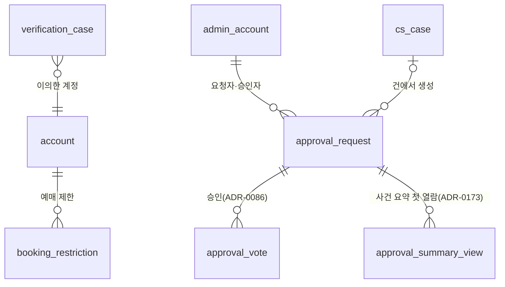

| 표 | 논리 DB | 담는 것 | 왜 따로 두나 | 키·핵심 칸 | 누가 쓰고 읽나 | 근거 |
| --- | --- | --- | --- | --- | --- | --- |
| `verification_case` | ops | 추가 검증(봇 의심으로 격리된 사람에게 더 거는 확인)에 낸 이의 하나와 그 심사 결과다 | queue-svc는 DB가 없어 이의 글을 대기열 Redis `q:appeal:{pid}:E`에 판매 종료 + 7일 [가정]만 둔다. 자동화된 결정의 설명과 재검토 요구에 답하려면 원본이 공연이 끝난 뒤 1년 남아야 해서 ops-svc가 이 표로 옮긴다(docs/features/bot-defense.md §12, data-classification '이상 징후 위험 점수 및 이의 제기 심사 기록' 행) | `id` PK, `account_id`, `reason_category`(판정 사유 범주), `status`, `appeal_result`(인정·기각). `status`의 값은 정본에 없다(열린 일 101번). 공연이 끝난 뒤 1년 보존 | 건이 생기면 ops-svc가 queue-svc `GetVerificationAppeal`로 글을 읽어 옮기고, 결과를 `ResolveVerificationAppeal`로 돌려준다(인정이면 `PASSED`, 기각이면 그 대기 참여를 `BLOCKED`로 끝낸다). CS 처리함(SCR-045)이 읽는다 | data §2 ⑦, FR-020, POL-006, bot-defense §12, queue-admission §7 |
| `approval_request` | ops | 승인 업무 하나: 종류, 대상, 금액, 사유, 확인한 증빙 종류, 필요한 승인 수, 상태, 기한이다 | 정책 밖 환불, 양도 회수, 예매 제한, 지급 묶음, 부정 예매 조치처럼 돈과 권리를 바꾸는 일은 요청자와 다른 사람의 승인 뒤에만 실행한다(POL-038). 실행은 승인 ID를 멱등키(같은 요청이 여러 번 와도 한 번만 처리하게 하는 키)로 대상 서비스에 보낸다(data §4의 11) | `id` PK, `kind` 12가지(`SYSTEM_FAULT_REFUND`부터 `SALE_SUSPENSION`·`SALE_RESUMPTION`·`FRAUD_ACTION`까지), `target_ref`, `fraud_action`(`FRAUD_ACTION`만: `CANCEL_TICKETS`·`RESTRICT`·`LIFT_RESTRICTION`), `requested_role`(`COMMANDER_ROLE_CHANGE`만), `amount` bigint(지급 묶음 합계를 담는다), `evidence_checked`(증빙 종류만, 내용·파일은 넣지 않는다), `required_approvals` 1·2, `status` `REQUESTED`·`PENDING_APPROVAL`·`APPROVED`·`REJECTED`·`ESCALATED`·`EXECUTING`·`DONE`·`FAILED`·`WITHDRAWN`·`EXPIRED`, `close_reason`, `due_at`(종류별 만료, 정하지 않은 종류는 요청 뒤 5영업일 [가정]). 3년 보존 | 종류마다 요청하는 쪽이 다르다(CS 담당자 `cs_agent`, CS 책임자 `cs_lead`, 시스템의 남용 표시, 파트너, operator, transfer-refund §3.2). `FRAUD_ACTION`은 사건의 조치 요청 경로로만 만든다. 승인은 `approval_vote`에 쌓고, 실행은 ops-svc가 상태를 `EXECUTING`으로 바꾸며 감사 사건·Outbox와 한 트랜잭션에 쓴다. 실패하면 `FAILED`와 CS 처리함 건이 남는다 | data §2 ⑦·§4의 11·§6, FR-058, FR-059, POL-038, ADR-0073, ADR-0086 |
| `approval_summary_view` | ops | 부정 예매 조치(`FRAUD_ACTION`)의 승인 자격자마다 그 업무의 사건 요약을 처음 연 시각이다 | 형식적인 결재만 있으면 자동화된 결정으로 볼 수 있어, 승인자가 스스로 정보를 보고 판단한 흔적을 남긴다(자동화된 결정 안내서 pp.7–8, ADR-0173). 스스로 연 기록이 없는 승인자가 승인하면 409 `fraud-summary-not-viewed`다 | `(approval_id, admin_account_id)` PK, `first_viewed_at`(다시 열어도 바꾸지 않는다) | 승인 자격자가 `GET /v1/ops/approval-requests/{approvalId}`(`fraudCaseSummary`)를 처음 부를 때 ops-svc가 쓰고, 승인할 때 확인한다. 같은 값이 사건 기록 `ACTION_APPROVED`에도 들어간다 | data §2 ⑦, POL-038 ⑪, ADR-0173 |
| `cs_case` | ops | CS 처리함 건 하나: 종류, 대상, 진행 경과·결과 기한, 상태, 담당자, 판 번호다 | 사람이 판단할 일(결제 상태 불명, 환급 실패, 문의, 게시물 신고, 소명, 정산 대사 차이 등)을 기한 순으로 한곳에 모은다(FR-057). 같은 후기의 신고가 건 둘이 되지 않게 다형 참조(종류에 따라 다른 표의 ID를 담는 칸)에 부분 유니크 인덱스(조건에 맞는 행끼리만 같은 값을 막는 인덱스)를 건다 | `id` PK, `kind` 28가지(`INQUIRY`·`CONTENT_REPORT`·`RIGHTS_REQUEST`·`APPEAL`·`VERIFICATION_APPEAL`·`PORTONE_LEDGER_MISMATCH`·`FRAUD_OBJECTION_COMPENSATION` 등), `target_ref`(문의 ID, 후기 ID, 소명 ID, 포트원 이체 ID 등. 하루 한 번 고아 행(가리키는 대상이 없는 행) 수를 센다), `progress_due_at`·`result_due_at`, `next_due_at`(둘 가운데 이른 것, 다른 칸에서 계산해 저장하는 STORED 생성 열. 두 기한이 모두 없는 종류의 값은 정하지 않았다, 열린 일 93번), `status` `OPEN`·`IN_PROGRESS`·`RESOLVED`, 열린 `CONTENT_REPORT`·`RIGHTS_REQUEST`·`PORTONE_LEDGER_MISMATCH`의 `UNIQUE (kind, target_ref)`, 목록 인덱스 `(next_due_at, id) WHERE status <> 'RESOLVED'`, `assignee`, `version`(상태·결과가 바뀔 때마다 1 오르는 판 번호). 3년 보존 | ops-svc가 자동 등록 조건과 `support.cases-requested`(core-svc와 queue-svc가 낸다)로 만들고, 신고는 `INSERT … ON CONFLICT DO NOTHING`으로 받아 같은 후기를 한 건에 모은다. CS 담당자·cs_lead·operator가 처리함(SCR-045)에서 다루고, 건에서 바로 승인 업무를 만들 수 있다 | data §2 ⑦·§2 '다형 참조의 중복 막기'·§5.1·§6, FR-057, ADR-0062, ADR-0066, ADR-0086, ADR-0108 |
| `booking_restriction` | ops | 계정 하나의 예매 제한: 사유 코드, 확인한 사람, 시작·끝, 소명 기한, 상태, 판 번호다 | 취소·양도 남용(POL-038 ⑤)과 부정 예매(사유 `FRAUD`, POL-046 ⑥)로 예매를 막는 원본이다. 막는 일은 대기열·좌석 Redis의 사본(`q:rst:{account}`·`s:rst:{account}`)이 하고, 늦게 온 사본 변경은 판 번호로 거른다 | `id` PK, `account_id`, `reason_code`(`FRAUD`면 걸기·풀기 모두 2인 승인), `fraud_case_id`(`FRAUD`일 때 그 사건), `confirmed_by`(cs_lead, `FRAUD`면 승인한 commander), `starts_at`·`ends_at`, `appeal_due_at`(1일 이상), `status` `ACTIVE`·`LIFTED`·`EXPIRED`, `version`(계정마다 늘어나기만 한다). 연계정보·pid는 넣지 않는다. 제한이 끝나거나 탈퇴한 날부터 3년 뒤 파기 | 승인 업무 실행으로 ops-svc가 쓰고, `SetBookingRestriction`으로 queue-svc·purchase-svc 두 곳에 보낸다(둘 다 반영해야 Done). 공연 상세·계정 설정이 읽는 화면용 사본 `sup:rst:{account}`는 core-svc support가 `SetBookingRestrictionView`로 받는다 | data §2 ⑦·§6, FR-061, POL-038 ⑤, POL-046 ⑥, ADR-0089, ADR-0171 |
| `approval_vote` | ops | 승인 업무에 대한 승인 한 건: 승인자, 요청자, 시각, 판단 이유, 범위에서 뺀 계정·표다 | 2인 승인의 '같은 사람 두 번·요청자 본인 승인 금지'를 앱 코드가 아니라 DB 제약이 지키게 자식 표로 둔다(ADR-0086) | `(request_id, approver_id)` PK·UNIQUE, `requester_id`와 `CHECK (approver_id <> requester_id)`(CHECK: 행마다 조건을 DB가 검사하는 규칙), `approved_at`, `reason`(1~1000자, `FRAUD_ACTION`이면 NOT NULL), `exclude_account_ids`·`exclude_ticket_ids`(`FRAUD_ACTION`만, 뺀 것은 그 요청에서 반려한 것으로 본다) | 승인자가 `POST /v1/ops/approval-requests/{approvalId}/approvals`를 부를 때 ops-svc가 쓴다 | data §2 ⑦·§5 '같은 승인 업무에 승인 두 번' 행, FR-058, POL-038 ⑪, ADR-0086, ADR-0173 |

**흐름**

- **예매 제한**: 시스템이 남용을 표시한다(`cs_case` `ABUSE_FLAG`) → 승인 업무 `BOOKING_RESTRICTION`은 요청이 시스템 표시이고 승인이 `cs_lead`의 확인이다(transfer-refund §3.2) → `approval_vote` → `EXECUTING` → `booking_restriction` `ACTIVE`와 판 번호 → queue-svc·purchase-svc 두 사본이 반영되면 `DONE`(transfer-refund §7.2 T14).
- **승인 업무의 상태**: `REQUESTED` → `PENDING_APPROVAL`(1영업일 무응답이면 `ESCALATED`) → `APPROVED` → 실행 직전 재인증(중요한 작업 직전에 다시 로그인 확인) → `EXECUTING` → `DONE` 또는 `FAILED`. 실패는 원인을 고친 뒤 승인자가 같은 승인을 다시 불러 같은 승인 ID로 다시 실행한다. 요청자가 거두면 `WITHDRAWN`, 대상이 바뀌거나 기한이 지나면 `EXPIRED`다.
- **소명과 추가 검증 이의**: 팬의 소명(`POST /v1/appeals`)은 core `appeal`과 Outbox로 `cs_case` `APPEAL`이 되고, ops-svc가 원본(예매 제한·승인 업무·부정 예매 사건)과 맞춰 본다. 추가 검증 이의는 `q:appeal:{pid}:E` → `cs_case` `VERIFICATION_APPEAL` → `verification_case`로 옮긴 뒤 결과를 queue-svc에 돌려준다.

**헷갈리기 쉬운 것**

- **`cs_case`와 `approval_request`**: 처리함 건은 '사람이 볼 일'의 줄이고 끝은 `RESOLVED`다. 승인 업무는 돈·권리를 바꾸는 실행의 승인이고 끝은 `DONE` 등이다. 건 하나에서 승인 업무를 만들 수 있고(`approval_request` ← `cs_case`), 승인 업무 실행이 실패하면 거꾸로 건(`APPROVAL_EXECUTION_FAILED`)이 생긴다.
- **`booking_restriction`과 그 사본, ① `restricted_ci_hold`**: 원본은 이 표 하나이고 Redis의 `q:rst`·`s:rst`가 막는 일을, `sup:rst`가 화면 표시를 맡는다. 이 표에는 연계정보가 없어 탈퇴 뒤 다시 가입한 계정에 제한이 이어지지 않는다. 사유 `FRAUD`만은 identity DB의 `restricted_ci_hold`(연계정보 HMAC)가 제한 끝까지 남아 다시 가입한 계정에도 잇는다(data §6).
- **`cs_case`(`VERIFICATION_APPEAL`)와 `verification_case`**: 처리함 건은 기한과 담당자를 가진 할 일이고, `verification_case`는 이의 글과 판정 사유 범주·결과의 원본(1년 보존)이다.
- **`approval_vote`와 8.1 `command_approval`**: 둘 다 2인 승인 자식 표다. 승인 업무의 승인자는 관리 계정 ID(`approver_id`)라 이 표의 CHECK·UNIQUE가 검사하고, 운영 명령의 승인자는 가명 참조라 `command_actor`가 검사한다.

### 8.3 법적 요청·보안 사고·접속기록 점검

법정 조치 화면(SCR-032)의 표다. 법이 기한을 정해 두어 시각 칸이 많다. 요청서·공문 원본은 격리 버킷에서 악성 코드 검사를 거친 뒤, 제출 파일은 승인 뒤 시스템이 만들어 감사 저장소의 파일로 둔다. 표에는 그 SHA-256(해시를 계산하는 방법의 하나)과 상태·기한을 둔다(control-tower §9).

**그림 3. 법적 요청·보안 사고·접속기록 점검**

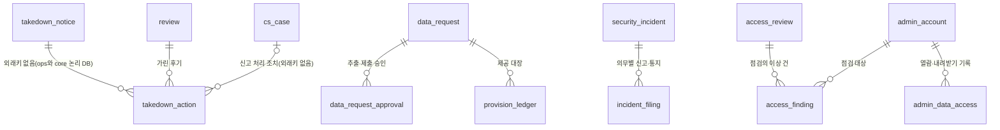

| 표 | 논리 DB | 담는 것 | 왜 따로 두나 | 키·핵심 칸 | 누가 쓰고 읽나 | 근거 |
| --- | --- | --- | --- | --- | --- | --- |
| `takedown_notice` | ops | 신고기관(한국콘텐츠진흥원)·수사기관이 공문으로 통보한 불법 거래 게시물 건 하나다 | 공문을 받은 때부터 24시간(문화체육관광부 고시 사항이면 10시간, 고시는 확인 필요) 법정 처리 기한을 세는 대장이다(공연법 시행령 §3의3, POL-024). 법정 통보는 ops에, 후기를 가리는 조치는 core 후기 모듈에 두고 둘 사이에 외래키를 두지 않는다(ADR-0087 결정 15) | `id` PK(칸은 openapi `ComplianceNotice`와 같다), `requester` `AGENCY`·`POLICE`, `agency_name`, `received_at`(기한을 세는 기준), `deadline` `H24`·`H10`, `due_at`, `review_ids`(통보에 적힌 후기 ID 목록), `summary`, `status` `OPEN`·`TAKEN_DOWN`·`WITHDRAWN`, `taken_down_at`·`withdrawn_at` | operator 이상이 등록하고(`POST /v1/ops/compliance/notices`) 명령 10(부정거래 게시물 노출 차단)으로 가린다(`POST /v1/ops/compliance/notices/{noticeId}/takedown`). 기한 2시간 전까지 조치하지 않았으면 SEV2다. CS 담당자는 건 요약만 본다 | data §2 ⑦, FR-033, POL-024, ADR-0087, ADR-0166 |
| `provision_ledger` | ops | 기관에 자료를 낸 기록 한 줄: 낸 시각, 받은 기관·부서, 낸 방법, 파일 SHA-256, 보존 끝이다 | 통신비밀보호법·전기통신사업법이 요구하는 제공 대장이다. 통신사실확인자료는 7년, 통신이용자정보는 1년 보존하고, 반기 보고와 대장 내용 통보에 쓸 현황 통계도 이 대장에서 만든다(control-tower §9) | `id` PK(칸은 openapi `DataRequestSubmissionCreate`와 같다), `request_id` FK, `submitted_at`, `recipient`, `channel`, `file_sha256`(`data_request.submission_sha256`과 같아야 한다. 다르면 422), `retain_until`(제공한 날부터 7년 또는 1년) | operator 이상이 제출 기록을 남기면 생긴다(`POST /v1/ops/compliance/data-requests/{requestId}/submission`, 전이 P8) | data §2 ⑦·§6, FR-034, POL-025, ADR-0166 |
| `takedown_action` | core | 후기 하나를 가린 조치 한 건: 근거, 본문 지문, 가린 시각, 끝·복원 시각이다 | 후기를 가리는 근거가 다섯이라 어느 조치로 가렸는지 남긴다. 후기의 저장 값은 `HIDDEN` 하나이고 어느 것인지는 이 표로 구별한다(docs/planning/03 후기 상태). 통보로 숨긴 후기의 법정 차단 조치 증적은 3년 보존한다 | `id` PK, `notice_id`(`NOTICE`·`SAME_CONTENT`일 때, 외래키 없음), `review_id` FK, `reason` `NOTICE`·`SAME_CONTENT`·`RIGHTS_TEMP`·`POLICY`·`FILMING_HOLD`, `content_fingerprint`(NFKC 정규화(모양이 같은 글자를 한 가지 부호로 맞추는 것) 뒤 공백·문장부호를 뺀 본문의 SHA-256, 같은 내용 새 후기 자동 숨김에 쓴다), `case_id`(신고 처리 조치의 CS 처리함 건. 외래키는 걸지 않고, 신고자 정보는 넣지 않는다), `hidden_at`, `ends_at`(`RIGHTS_TEMP` 임시조치는 30일 이내, 지나면 다시 보인다), `restored_at`(통보 철회 때 같은 `notice_id` 전체 복원) | core-svc review 모듈이 쓴다. 명령 10과 CS 담당자의 신고 처리는 ops-svc가 core-svc `ApplyModeration`으로 부르고, 불법 촬영물 신고의 즉시 가림(`FILMING_HOLD`)은 core-svc가 신고를 받을 때 스스로 건다 | data §2 ⑦·§6, FR-033, POL-024, POL-044, ADR-0066, ADR-0087 |
| `data_request` | ops | 신고기관·수사기관의 자료 제공 요청서 하나와 그 추출·제출 진행이다 | 요청서를 점검표(법적 근거·목적·범위·기한, 통신사실확인자료면 법원 허가서)로 검증하고, 요청자가 아닌 commander의 승인 뒤에만 꼭 필요한 최소 범위를 뽑아 내게 하는 원본이다(소유자 결정 2026-10-30, open-items 68번) | `id` PK, `requester` `AGENCY`·`POLICE`, `kind` `REPORT`·`CDR`·`SUBSCRIBER`, `legal_basis_checked`, `status` `RECEIVED`·`REFUSED`·`PENDING_APPROVAL`·`APPROVED`·`EXTRACTED`·`SUBMITTED`(전이 P1~P8), `extraction_scope`(항목·기간·사유와 항목별 행 수), `extraction_requested_by`, `approval_expires_at`(요청 뒤 24시간 [가정]과 제출 기한 가운데 이른 때), `submission_sha256`, `submitted_at`, `retain_until`(7년 또는 1년, 제출을 기록하면 제공한 날부터 다시 센다) | operator 이상이 등록하고 추출을 요청하며, 시스템이 승인된 범위의 행만 뽑아 제출 파일을 만든다. operator·commander가 상세를 열면 `admin_data_access`에 남는다. 증거 묶음의 기관 제출(`AUTHORITY`)은 이 요청이 있어야 한다 | data §2 ⑦·§6, FR-034, POL-025, ADR-0173 |
| `data_request_approval` | ops | 자료 추출 요청에 대한 결정 한 건: 승인, 범위를 고쳐 다시 요청, 제공하지 않음, 만료다 | 요청자 ≠ 결정자를 DB의 CHECK 제약이 지키게 하려는 표다. 승인 대기의 모양은 2인 명령과 같지만, 기관 요청은 기한이 날 단위이고 승인자가 원본과 범위를 읽어야 해서 대기 만료가 2인 명령의 10분이 아니라 24시간 [가정]이다(control-tower §9) | `id` PK, `request_id` FK, `requester_id`, `decider_id`(`CHECK (decider_id <> requester_id)`, 만료는 null), `decision` `APPROVED`·`REJECTED_REVISE`·`REJECTED_DECLINE`·`EXPIRED`, `reason`(거부면 필수), `decided_at` | 요청자가 아닌 commander가 재인증(패스키 포함)해 승인하거나 거부하고, 만료 행은 시스템이 쓴다 | data §2 ⑦, FR-034, POL-025 |
| `security_incident` | ops | 침해사고나 개인정보 유출등 하나: 종류, 인지 시각, 대상 수, 해당 판단, 상태다 | 신고·통지 기한이 모두 인지 시각부터 세어지므로(정보통신망법 §48의3, 개인정보 보호법 §34) 기한을 추적할 원본이 필요하다(FR-063). 판단이 서지 않으면 신고·통지하는 쪽으로 간다 | `id` PK, `kind` `INTRUSION`·`PERSONAL_DATA`·`PERSONAL_DATA_POSSIBLE`, `aware_at`(모든 기한의 기준), `affected_count`(모르면 null), `sensitive_or_unique`, `external_access`, `outage_started_at`·`outage_ended_at`(관제 지표가 채운다), `decided_by`, `decision` `APPLICABLE`·`UNDECIDED`·`NOT_APPLICABLE`, `decided_at`, `status` `OPEN`·`CLOSED`. 2년 이상 [가정] | 운영자가 등록하면 바로 SEV1로 띄운다. 해당 판단은 commander가 하고, 종결(`POST …/incidents/{incidentId}/closure`)은 operator 이상이 한다. viewer·CS 담당자는 건 요약만 본다 | data §2 ⑦·§6, FR-063, ADR-0049, ADR-0166 |
| `incident_filing` | ops | 보안 사고 하나의 법정 의무별 신고·통지 한 줄: 의무, 기한, 한 시각, 기관·방법, 요약이다 | 사고 하나에 의무가 여럿(24시간 신고, 추가 확인 24시간 신고, 이용자 통지, 14일 피해구제, 72시간 통지·신고 등)이라 의무마다 기한과 이행을 따로 남긴다 | `id` PK, `incident_id` FK, `duty` 8가지(`KISA_REPORT_24H`·`ADDITIONAL_24H`·`USER_NOTICE`·`RELIEF_14D`·`SUBJECT_NOTICE_72H`·`PIPC_REPORT_72H`·`POSSIBILITY_NOTICE_72H`·`NOT_LEAKED_NOTICE`), `due_at`, `done_at`, `channel`, `summary`(개인정보 원문은 넣지 않는다). 2년 이상 [가정] | 운영자가 신고·통지마다 적는다(`POST /v1/ops/compliance/incidents/{incidentId}/filings`). 24시간 기한은 22시간, 72시간 기한은 60시간이 지나면 SEV2로 다시 알린다 | data §2 ⑦·§6, FR-063, ADR-0049 |
| `access_review` | ops | 한 달의 접속기록 정기 점검 하나: 대상 기간, 점검자, 기한, 끝낸 시각이다 | 내부 관리계획이 고른 월 1회 점검을 빈틈 없이 이어 했다는 기록이다(개인정보의 안전성 확보조치 기준 제8조 제2항, FR-064). 대상 기간을 지난 정기 점검을 시작한 때부터 이번 점검을 시작한 때까지로 잇는다 | `id` PK, `period` `YYYY-MM`, `window_from`·`window_to`, `reviewer`(개인정보 보호책임자가 지정한 commander, `admin_designation` `ACCESS_REVIEWER`), `due_at`(그달 말일), `completed_at`. 2년 이상 [가정] | 지정 commander가 점검하고 완료를 적는다(`POST /v1/ops/compliance/access-reviews/{reviewId}/completion`). 말일까지 끝나지 않으면 SEV3 `access_review_overdue`다 | data §2 ⑦·§6, FR-064, internal-management-plan §4.1·§4.5 |
| `access_finding` | ops | 점검에서 나온 이상 건 하나: 규칙, 대상 관리 계정, 확인한 사유(소명), 사후조치다 | 이상 건마다 사유 확인과 사후조치(보고, 회수·파기 요청, 권한 회수)를 기록해야 해서 건 단위로 둔다. 점검자 자신의 건은 다른 commander가 종결한다 | `id` PK, `review_id` FK, `rule` `REPEAT_DOWNLOAD`·`BULK_DOWNLOAD`·`OFF_HOURS`·`OUTSIDE_IP`·`OUT_OF_SCOPE`·`INV_CASE_VOLUME`·`INV_EXPORT_VOLUME`·`MANUAL_REVIEW`(사람이 찾은 이상), `subject_account_id`, `detected_at`, `reason`, `action` `NONE`·`REPORTED`·`RECALLED`·`DELETED`·`ACCESS_REVOKED`·`INCIDENT`, `self_review_demo`(데모 환경의 '자기 점검(시연)', 스테이징·운영에서는 늘 false), `closed_at` | 시스템이 매일 이상 탐지로 올리고, 점검자가 종결한다(`POST /v1/ops/compliance/access-findings/{findingId}/resolution`). 유출이 의심되면 보안 사고로 등록한다. 열린 건 수는 `access_finding_open{rule}`로 보인다 | data §2 ⑦·§6, FR-064, internal-management-plan §4.2·§4.4 |
| `admin_data_access` | ops | 관리 계정이 개인정보를 연 일 하나: 가린 값 열기, 명단 내려받기, 법정 자료 추출, 조사 화면 조회다 | 관리자 접속기록이다. 여러 사람이 든 명단은 사람마다 적지 않고 다시 만들 조건(회차, 거른 조건, 시각)을 남겨, 그때의 명단을 주문 상태 이력으로 다시 만든다. '처리한 정보주체 정보'를 사람마다 적어야 하는지 정해지기 전까지의 방법이다(고시 제2조 제3호, [확인 필요], internal-management-plan §4.5) | `id` PK(표 이름은 [가정]), `admin_account_id`, `actor_role`, `action` `VIEW_UNMASKED`·`DOWNLOAD`·`DATA_EXPORT`, `target_kind`(`ATTENDEE_LIST`·`SHIPPING_LIST`·`FAN_PROFILE`·`DATA_REQUEST` 등), `event_id`·`filter`·`occurred_at`(명단 재현 조건 셋, 개인정보 원문은 넣지 않는다), `reason`(먼저 적어야 연다), `target_count`, `format` `CSV`·`XLSX`·`PDF`, `source_ip`. 최소 2년 보존 | ops-svc가 열람·내려받기마다 쓴다. 부정 거래 조사관 지정이 없어 거절된 조사 경로 호출도 권한 밖 조회 시도로 남는다. 접속기록 점검이 이 기록으로 이상을 센다 | data §2 ⑦·§6, FR-064, ADR-0171 |

**흐름**

- **기관 통보**: `takedown_notice` `OPEN`(타이머 시작) → 명령 10 → core `takedown_action` `NOTICE`(같은 내용으로 새로 쓴 후기는 `SAME_CONTENT`로 자동 숨김) → `TAKEN_DOWN`과 증적 보고서 → 통보가 정식으로 철회되면 `WITHDRAWN`이고, 같은 `notice_id`의 조치를 모두 `restored_at`으로 되살린다.
- **자료 요청**: `data_request` `RECEIVED`(점검표 통과, 실패면 `REFUSED`) → 추출 요청으로 `PENDING_APPROVAL` → `data_request_approval` `APPROVED` → `EXTRACTED`(제출 파일과 SHA-256) → 제출 기록으로 `SUBMITTED`와 `provision_ledger` 행이 생기고 보존 끝을 제공한 날부터 다시 센다(control-tower §9 '자료 요청의 상태').
- **보안 사고**: `security_incident` 등록(`aware_at`) → commander 해당 판단 → 의무마다 `incident_filing`(`due_at` → `done_at`) → `CLOSED`.
- **접속기록 점검**: 매일 규칙이 `admin_data_access`와 접속기록 DB의 관리 계정 줄에서 이상을 찾아 `access_finding`을 만든다 → 매월 `access_review`에서 사유와 사후조치로 종결한다.

**헷갈리기 쉬운 것**

- **`takedown_notice`와 `takedown_action`**: 통보는 기관 공문의 대장이고(ops), 조치는 후기마다 가린 기록이다(core). 조치의 근거는 통보만이 아니다. 게시물 신고 처리(`RIGHTS_TEMP`·`POLICY`)와 불법 촬영물 신고 가림(`FILMING_HOLD`)도 같은 표에 남고, 그때는 `notice_id` 대신 `case_id`를 채운다.
- **`data_request_approval`과 8.2 `approval_request`**: 자료 추출 승인은 승인 업무의 종류가 아니라 따로 둔 표다. 승인자는 commander 한 사람이고, 대기는 24시간 [가정]이나 제출 기한에 만료되어 `RECEIVED`로 돌아간다.
- **`data_request`와 `provision_ledger`의 보존 끝**: 둘 다 `retain_until`이 있다. 요청 행은 받은 요청서의 보존이고, 대장 행은 실제로 낸 제공의 기록이다. 제출을 기록하면 요청의 보존 끝도 제공한 날부터 다시 센다.
- **`admin_data_access`와 `access_finding`**: 앞은 열람·내려받기 하나하나의 원천 기록이고, 뒤는 그 원천에서 규칙이나 사람이 찾아 올린 이상 건이다. 로그인·재인증 같은 관리 계정의 접속 줄은 ClickHouse 접속기록 DB에 있고, ops-svc가 매일 관리 계정 줄만 감사 저장소로 옮긴다(control-tower §7).

### 8.4 관제 화면 보조와 분석 기록

관제 콘솔의 실시간 알림을 파드 사이에 나르는 표 둘과 경보 기록 표, 그리고 공연 리포트에서 나온 결정 기록·수요 예측·가명정보 처리 기록이다. 모두 회차(`event_id`, core)를 외래키 없이 가리킨다.

**그림 4. 관제 화면 보조와 분석 기록**

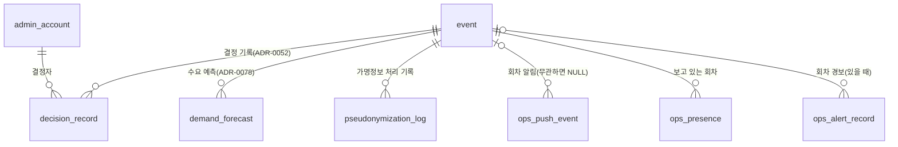

정본 ⑦ 그림에 `ops_push_event`·`ops_presence`·`ops_alert_record`의 선은 없다. 이 그림의 세 선은 각 표의 `event_id` 칸으로 이은 것이다.

| 표 | 논리 DB | 담는 것 | 왜 따로 두나 | 키·핵심 칸 | 누가 쓰고 읽나 | 근거 |
| --- | --- | --- | --- | --- | --- | --- |
| `decision_record` | ops | 공연 리포트를 보고 내린 결정 하나: 계기(회차·걸린 결정 규칙·마감 단계), 분석 요약, 근거 강도, 결정, 기대 효과, 되돌릴 조건, 확인 결과다 | 결정 기록과 다음 회차 리포트의 대조로 '데이터 → 결정 → 확인' 고리를 닫으려는 표다(ADR-0052, POL-040) | `id` PK, `event_id`(외래키 없음), `trigger_rule`, `trigger_stage` `R0`~`R3`(공연 리포트의 마감 단계, R0은 잠정이고 R1~R3에서 데이터 영역별로 확정된다), `kind` `OPERATING_DEFAULT`·`PRODUCT`·`SALES_POLICY`·`BOT_POLICY`·`PARTNER_RECOMMENDATION`·`TARGET`, `summary`(개인정보 금지), `evidence_strength` `WEAK`·`MEDIUM`·`STRONG`, `expected_effect`, `revert_condition`, `ref`(ADR·POL 번호나 설정 변경 ID), `partner_response`, `status` `AWAITING_CHECK`·`CHECKED`·`WITHDRAWN`, `check_result` `MET`·`NOT_MET`·`INCONCLUSIVE`, `decided_by`(외래키 없음). 결정이 유효한 동안 두고, 철회·대체된 기록은 5년 [가정] 뒤 파기 | commander가 쓰고(`POST /v1/ops/decisions`) viewer 이상이 읽는다. 파트너는 자기 소속 회차의 '파트너 권고'만 본다. 확인 결과는 시스템이 기대 효과 지표를 계산해 제안하고 commander가 확정한다 | data §2 ⑦·§6, FR-068, POL-040, ADR-0052 |
| `demand_forecast` | ops | 회차 하나의 수요 예측 한 번: 계산 시각·계기, 구독 수, 비율, 예상 진입 인원, 제안 등급이다 | 수요 예측이 없던 자리를 머신러닝이 아닌 비율 식(오픈 알림 구독 수 × 구독 대비 진입 비율)으로 채운다. 판매 승인의 규모 등급 제안과 사후 오차 대조(지표 31 '수요 예측 오차')에 쓴다(ADR-0078 결정 1) | `id` PK, `event_id`(외래키 없음), `computed_at`, `trigger` `SALE_REVIEW`·`DAILY`·`T_MINUS_30`, `subscribers`(core-svc가 넘긴 수, 계정은 없다), `ratio_median`·`ratio_upper`(75번째 백분위), `sample_count`(비율에 쓴 지난 회차 수, 10 미만이면 기본 비율), `expected_median`·`expected_upper`, `suggested_scale` `LARGE`·`MEDIUM`·`SMALL` | ops-svc가 판매 승인 때, 오픈 전 매일 09:00 [가정], T-30분에 계산한다. 비율은 분석 저장소의 골드 뷰 `mtr_demand_ratio`를 `an_ops_reader`로 읽어 구한다. 판매 승인 화면(SCR-048)이 보이고, 분석 브론즈 `brz_ops_forecast`로도 넘긴다 | data §2 ⑦, ADR-0078, docs/features/analytics.md 지표 31 |
| `pseudonymization_log` | ops | 회차·목적마다 가명정보를 처리한 기록: 목적, 항목, 분석 가명 키 판, 이용 내역, 처리 시작, 파기 예정·파기 시각이다 | 가명정보(추가 정보 없이는 누구인지 알 수 없게 바꾼 정보)의 처리 기록을 남기고 파기한 날부터 3년 이상 두라는 법 의무를 채운다(개인정보 보호법 §28의4③, 시행령 §29의5②). 통계작성과 과학적 연구는 처리 기간을 따로 세므로 다른 줄로 남긴다(ADR-0173) | `id` PK, `event_id`, `purpose` `STATISTICS`·`SCIENTIFIC_RESEARCH`, `items`(pid, 계정 ID, 대기 참여·입장 토큰·세션·주문·티켓·홀드 ID), `key_version`, `usage`(적재 건수, 마감 단계, 실버 조회 요약), `processed_from`, `destroy_due_at`(적재 뒤 90일), `destroyed_at`. 개인정보 원문은 넣지 않는다 | ops-svc가 회차마다 통계작성 줄을 남기고, 연구 내보내기(`POST /v1/ops/research-exports`)와 그 거절 때 과학적 연구 줄을 남긴다 | data §2 ⑦·§6, ADR-0052, ADR-0173, analytics §11 |
| `ops_push_event` | ops | 관제 콘솔에 밀어 보낼 사건 하나: 순번, 종류, 회차, 받을 역할, 본문이다 | ops-svc 파드는 자기에게 붙은 SSE(서버가 브라우저로 한 방향으로 계속 보내는 통신) 연결만 든다. 그래서 한 파드에서 생긴 사건을 다른 파드의 연결로 나를 길이 필요하다. 공유 Redis 대신 명령을 쓰는 자기 DB 표로 해 새 부품이 없고, 순번이 곧 다시 붙기의 기준이 된다(ADR-0100 결정 4) | `seq` PK(늘어나기만 하는 순번 = SSE 이벤트 id, 다시 붙을 때 브라우저가 보내는 `Last-Event-ID`의 기준), `kind` `command`·`approval`·`alert`·`autoAction`, `event_id`(회차와 무관하면 NULL), `roles`, `body`, `created_at`(1시간 [가정] 지나면 정비 작업이 지운다) | 원래 기록(명령 상태·승인 대기·경보 수신·자동 조치의 시작과 끝)을 쓰는 같은 트랜잭션이 쓴다. 파드마다 0.5초 [가정]마다 마지막으로 읽은 `seq` 뒤를 읽어 `/v1/ops/live` 흐름으로 보낸다. 1시간보다 오래된 번호로 다시 붙으면 `reset`을 보내 화면이 REST로 다시 읽는다 | data §2 ⑦, ADR-0100, ADR-0102 |
| `ops_presence` | ops | 운영자 한 사람이 지금 보고 있는 회차와 화면이다 | 여러 운영자가 같은 회차를 볼 때 누가 접속해 있는지 보여 주려는 표다(control-tower §12) | `(account_ref, event_id)` PK(두 회차를 보면 두 행), `role`, `screen`, `last_seen_at`(15초 [가정]마다 고쳐 쓴다. 45초 [가정] 안의 행만 접속 중) | SSE 흐름을 든 파드가 연결마다 쓴다. 파드마다 5초 [가정]마다 회차별로 45초 안의 행을 모아 `presence`로 보낸다 | data §2 ⑦, ADR-0100 |
| `ops_alert_record` | ops | ops-svc가 받은 경보 하나: 경보 지문, 상태, 등급, 종류, 회차·여정·원인 의존성, 런북(장애 때 따라 하는 절차서) 주소, 접힌 상위 경보다 | 콘솔 경보 패널의 원천이다. 월 경보 위생 보고·분기 탐지 경로 집계·분석 마감 R0~R3을 덮으려고 13개월 [가정] 둔다(ADR-0146 결정 5) | `id` PK(UUIDv7: 앞부분이 만든 시각이라 시간순으로 커지는 ID), `alert_id`(Alertmanager 경보 지문: 같은 경보면 늘 같은 값), `UNIQUE (alert_id, starts_at)`, `status` `FIRING`·`RESOLVED`, `severity` `SEV1`·`SEV2`·`SEV3`, `kind`, `event_id`, `journey`, `dependency`, `runbook_url`(비었으면 `ops_alert_runbook_missing_total`을 올린다), `folded_under`(억제한 상위 경보), `starts_at`·`ends_at`, `received_at`(13개월 [가정] 뒤 정비 시간에 지운다) | ops-svc가 Alertmanager(경보를 모아 묶고 보내는 도구)의 웹훅(일이 생기면 상대 서버가 우리 주소를 불러 알리는 방식, 메시 신원 alertmanager만)으로 받아 쓰고, 30초 [가정]마다 경보 목록 API를 읽어 `folded_under`를 채운다. CronJob `alert-hygiene-report`가 읽기 전용 내부 조회로 그달 집계를 읽는다 | data §2 ⑦, ADR-0145 결정 9, ADR-0146 결정 5 |

**흐름**

- **콘솔 알림**: 명령 상태가 바뀌면 같은 트랜잭션에서 `ops_push_event` 행이 생긴다 → 각 파드가 0.5초 [가정]마다 읽어 자기 SSE 연결로 보낸다 → 끊겼다 다시 붙으면 `Last-Event-ID` 뒤를 다시 보낸다.
- **경보**: Alertmanager 웹훅 → `ops_alert_record` `FIRING`(같은 경보는 `(alert_id, starts_at)`로 한 행) → 콘솔 위쪽 경보 배너 → `RESOLVED` → 13개월 [가정] 뒤 지운다.
- **수요 예측과 결정**: 판매 승인 때 `demand_forecast` `SALE_REVIEW` → 오픈 전 매일 `DAILY` → `T_MINUS_30` → R1에 실제 진입 인원과 견준다(지표 31). 공연 리포트의 결정 규칙이 걸리면 commander가 `decision_record` `AWAITING_CHECK`를 남기고, 확인할 회차가 지나면 `CHECKED`(`MET`·`NOT_MET`·`INCONCLUSIVE`)가 되고, 철회하면 `WITHDRAWN`이다.
- **가명정보**: 적재(`processed_from`) → 90일 뒤 `destroy_due_at`에 파기 → `destroyed_at` → 그날부터 3년 이상 이 기록을 둔다.

**헷갈리기 쉬운 것**

- **`ops_push_event`와 `ops_alert_record`**: 앞은 파드 사이로 사건을 나르는 1시간 [가정]짜리 전달 표이고, 뒤는 경보 자체의 13개월 [가정] 기록이다. 경보 하나가 오면 기록 표에 남고, 콘솔로는 전달 표의 `alert` 사건으로 간다.
- **`pseudonymization_log`와 8.3 `admin_data_access`**: 앞은 분석·연구용 가명정보 처리의 법정 기록이고, 뒤는 관리 계정이 실명 개인정보를 연 접속기록이다. 근거 법 조항도 보존 기간도 다르다.
- **`decision_record`와 ADR**: 운영 기본값·제품 개선은 결정 기록으로 남기고, 구조가 바뀌거나 판매 정책 기본값·목표 수치를 바꾸면 ADR(아키텍처 결정과 그 이유를 남긴 기록)도 함께 남긴다(analytics §10).

### 8.5 부정 예매 조사

온세일이 끝난 뒤 실제 기록으로 부정 예매(매크로·대기열 우회·명의 대여처럼 약관이 정한 사유로 산 예매)를 찾고, 사람이 소명(의심받은 사람이 정상 구매라고 해명하는 절차)과 2인 승인을 거쳐 조치하는 조사 갈래다([ADR-0171](../../adr/0171-post-sale-forensics-in-launch-scope.md), [docs/features/forensic-replay.md](../../features/forensic-replay.md) §6.7). 원천은 ClickHouse 조사 저장소 `inv`(실명 계정·원문 IP, 그 회차 공연일 + 30일 [가정])이고, ops DB에는 고정 해시·후보·사건·증거의 메타데이터를 둔다. 사건 ID는 다른 DB의 칸이 외래키 없이 가리킨다: ticket `ticket.fraud_lock_case_id`·`fraud_transfer_lock.case_id`, purchase `priority_grant.fraud_case_id`·`order_cancellation.fraud_case_id`, identity `restricted_ci_hold.fraud_case_id`, core `appeal`(kind `FRAUD_CASE`)·`fraud_appeal_notice.case_id`다.

**그림 5. 부정 예매 조사**

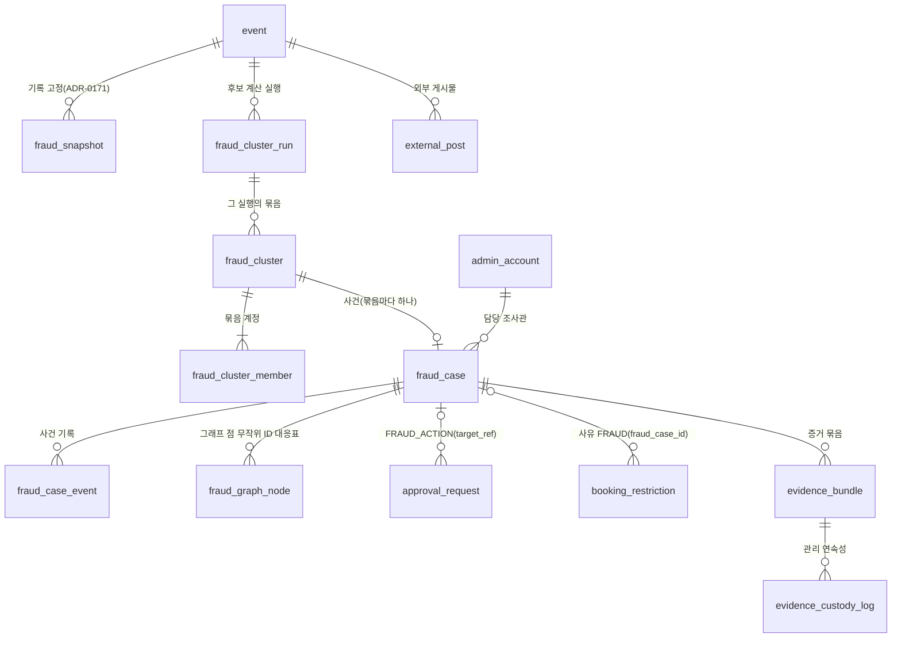

`fraud_case`에서 `booking_restriction`으로 가는 선은 정본 ⑦ 그림에 없고, `booking_restriction.fraud_case_id` 칸으로 이은 것이다.

| 표 | 논리 DB | 담는 것 | 왜 따로 두나 | 키·핵심 칸 | 누가 쓰고 읽나 | 근거 |
| --- | --- | --- | --- | --- | --- | --- |
| `fraud_snapshot` | ops | 회차 하나의 조사용 기록을 고정한 판 하나: 고정 시각, 판 해시, 표마다의 해시·행 수, 직전 판 해시다 | '그 시각까지 들어온 기록이 이것이었다'를 나중에 증명하려는 표다(FR-072). 판 해시에 직전 판 해시를 넣어 판들이 사슬로 이어지고, 표마다의 해시가 있어 다시 계산이 어긋나면 어느 표인지 바로 안다 | `(event_id, version)` PK(판매 종료까지 다시 고정할 때마다 판이 오르고, 지난 판은 지우지 않는다), `frozen_at`, `inv_hash`(SHA-256, 계산법은 forensic-replay §6.7.2), `table_hashes`(`inv_request`·`inv_step`·`inv_behavior`·`inv_link`), `prev_hash`(판 1은 NULL), `row_counts`, `range_from`(판 N은 직전 판 `frozen_at` 뒤에 적재된 행), `late`(30분 [가정] 기다린 뒤 고정한 '늦은 적재') | ops-svc 조사 모듈이 온세일 윈도우 끝(T+60분), 판매 종료까지 1시간 [가정]마다, 외부 게시물 등록 뒤 10분 [가정] 안에 `inv`를 읽어 만든다. 같은 값을 관제 감사 기록에도 남긴다. 열린 사건이 있는 회차는 하루 한 번 [가정] 다시 계산해 견주고, 다르면 SEV2와 보안 사고 기록이다 | data §2 ⑦·§6, FR-072, ADR-0171 결정 6 |
| `fraud_cluster` | ops | 후보 묶음 하나(이름은 달라도 한 사람이나 한 조직이 쓰는 것으로 보이는 계정 모음): 생성 판, 규칙 판, 점수 범주, 계정 수, 산 표 수와 1인 한도, 공유 속성, 근거 신호다 | 후보는 조치가 아니라 조사의 출발점이다. 후보만으로는 팬 계정·티켓 상태가 바뀌지 않고, 조사관이 사건을 만들 때 일이 시작된다(forensic-replay §6.7.3) | `id` PK, `event_id`, `generation`(후보 계산 판, 첫 계산이 1), `rule_version`, `score_band` `HIGH`·`MEDIUM`·`LOW`(점수 원값은 두지 않는다), `account_count`, `purchase_count`(취소 제외), `limit_per_person`(계산 때 복사), `shared_attributes`, `signals`, `snapshot_version`, `created_at` | 후보 계산이 고정 판이 생길 때마다 쓴다. 지정 조사관이 사건 목록(SCR-070)에서 본다 | data §2 ⑦·§6, FR-072, ADR-0171 |
| `fraud_cluster_run` | ops | 후보 계산 실행 시도 하나: 계기, 입력(고정 판·규칙 판), 결과 지문, 묶음 수, 상태다 | 같은 입력이면 같은 결과가 나와야 해서(결정적 계산) 입력과 결과 지문을 남긴다. 자동 다시 시도와 조사관의 다시 돌리기가 새 시도 행이라 실패 이력이 남는다 | `(event_id, generation, attempt)` PK, `trigger` `SCHEDULED`·`SNAPSHOT`·`AUTO_RETRY`·`MANUAL`, `failure_reason`(오류 범주, 원문 오류는 로그에만), `snapshot_version`, `rule_version`, `result_fingerprint`(묶음과 신호를 정렬해 RFC 8785(JSON을 한 가지 모양으로 적는 규칙)로 적은 JSON의 SHA-256), `cluster_count`, `status` `RUNNING`·`DONE`·`FAILED`, `started_at`·`finished_at` | 후보 계산이 실행마다 쓴다. 실패하면 같은 판으로 자동 세 번 [가정] 다시 하고, 다 실패하면 SEV3와 함께 조사관의 다시 돌리기(`POST /v1/ops/events/{eventId}/fraud-cluster-runs`)가 열린다 | data §2 ⑦·§6, FR-072, ADR-0171 |
| `fraud_cluster_member` | ops | 묶음에 든 계정 하나와 그 계정의 소명·양도 잠금·조치 통지·이의 진행이다 | — (정본이 따로 둔 이유를 적지 않았다. 칸을 보면 소명 기한·양도 잠금 기한·이의 결과가 계정마다 있다). 조사관이 뺀 계정도 행을 지우지 않고 뺀 시각만 적는다 | `(cluster_id, account_id)` PK(identity 계정이라 외래키 없음), `signals`, `ticket_count`, `added_by` `SYSTEM`·`INVESTIGATOR`, `removed_at`, `appeal_requested_at`·`appeal_due_at` 등 소명 칸, `lock_expires_at`(첫 소명 요청 + 14일 [가정]이고 늘리지 않는다. ticket `fraud_transfer_lock.expires_at`과 같은 값), `appeal_result` `NOT_REQUESTED`·`PENDING`·`SUBMITTED`·`ACCEPTED`·`REJECTED`·`EXPIRED`, `action_notified_at`(이의 창 30일 [가정]의 시작), `objection_result` `NONE`·`SUBMITTED`·`ACCEPTED`·`REJECTED`, `appeal_id`·`objection_appeal_id`(core `appeal.id`, 외래키 없음) | 후보 계산이 `SYSTEM`으로, 조사관이 `INVESTIGATOR`로 계정을 더하거나 뺀다(`PATCH /v1/ops/fraud-cases/{caseId}`). 소명·이의 판단도 조사관이 같은 경로로 이유와 함께 적는다 | data §2 ⑦·§6, FR-073, POL-046 ③·⑦, ADR-0171, ADR-0173 |
| `fraud_case` | ops | 부정 예매 사건 하나: 상태, 사유 범주, 담당 조사관, 소명 기한, 취소 마감, 승인 업무, 조사관 의견, 정답 라벨(다음 회차 규칙 판의 정답으로 쓰는 결과 표시)이다 | 조사관이 후보 묶음 하나에서 만들고 소명 → 2인 승인 → 조치 → 이의의 상태 모형(전이 C1~C17, forensic-replay §6.7.4)을 따른다. 연락처·IP 원문 없이 판단과 이유만 남아 닫힌 뒤 3년 [가정] 두므로, 증거 묶음이 지워진 뒤에 온 이의·분쟁도 이 기록으로 설명한다(ADR-0173 결정 7) | `id` PK, `event_id`, `cluster_id` UNIQUE(묶음마다 사건 하나), `status` `INVESTIGATING`·`APPEAL_PENDING`·`DECISION_PENDING`·`ACTIONED`·`CLEARED`·`OBJECTED`·`REVERSED`, `reason_category` `MACRO_BOT`·`QUEUE_BYPASS`·`CAPTCHA_BYPASS`·`ACCOUNT_LENDING`·`LIMIT_EVASION`, `assignee_id`, `appeal_due_at`(3일 [가정], 24시간 [가정] 아래로 내리지 않는다), `cancel_deadline_at`(판매 종료 − 재판매 준비 2시간 [가정]), `approval_id`(한 사건에 열린 조치 승인 업무는 하나), `investigator_opinion`, `outcome_label` `BOT`·`HUMAN`·`NONE`, `version`(`If-Match`와 `SetTransferLock.version`), `created_at`·`closed_at` | 지정 조사관(`FRAUD_INVESTIGATOR` 지정이 있는 commander·cs_lead)이 만들고(`POST /v1/ops/fraud-cases`) 고친다. 승인자는 조사 경로를 부르지 않고 승인 업무 상세의 사건 요약만 본다 | data §2 ⑦·§6, FR-073, POL-046, ADR-0171, ADR-0173 |
| `fraud_case_event` | ops | 사건에 생긴 일 하나다: 만들기, 계정 더하기·빼기, 메모, 소명 요청·접수·판단, 잠금 걸기·풀기, 조치 요청·승인·반려·만료, 이의 접수·결정, 우선 구매 부여, 보상 건 생성, 증거 묶음 생성 등 21가지 | 누가 무엇을 왜 판단했는지를 고치거나 지우지 않고 남겨, 이의·분쟁·기관 제출 때 사건 경과를 그대로 보인다 | `(case_id, seq)` PK(고치거나 지우지 않는다), `kind`(`CREATED`부터 `EVIDENCE_CREATED`까지), `actor_id`(시스템이면 NULL), `detail`(대상 계정·티켓과 이유. 연락처·IP 원문은 넣지 않는다. `LOCK_RELEASED`는 잠금이 풀린 까닭 일곱 가운데 하나, `ACTION_APPROVED`는 승인자의 판단 이유·뺀 범위·요약 첫 열람 시각을 싣는다), `occurred_at` | ops-svc가 사건의 일마다 덧붙인다. 증거 묶음의 `case.json`이 이 기록을 담는다 | data §2 ⑦·§6, FR-073, ADR-0171, ADR-0173 |
| `fraud_graph_node` | ops | 사건의 연결 그래프 점 하나와 그 점이 가리키는 실제 값의 대응이다 | 응답의 점 ID는 계정 ID·가명·IP·ASN(인터넷 주소 묶음을 운영하는 망 번호)에서 계산하지 않고(키 없는 해시 금지) 사건마다 서버가 만든 무작위 값을 쓴다. 그래서 점과 실제 값의 대응을 둘 곳이 필요하다(ADR-0171) | `(case_id, node_id)` PK(`node_id`는 UUIDv4 무작위 값), `kind` `ACCOUNT`·`DEVICE`·`PAYMENT_METHOD`·`CONTACT`·`IP`·`ASN`, `ref_value`(계정 ID, 조사용 가명, ASN 번호. IP 점은 비운다), `source_request_id`(IP 점만: 그 IP가 든 `inv_request` 한 줄의 요청 ID), `created_at`. 같은 사건의 같은 값은 같은 `node_id`를 다시 쓰고, 사건 기록과 같이 지운다 | ops-svc가 그래프를 처음 만들 때 쓴다(`GET /v1/ops/fraud-cases/{caseId}/graph`). 원문 IP 열기(`POST /v1/ops/fraud-cases/{caseId}/ip-reveals`)는 `source_request_id`로 `inv_reader`가 `inv`의 그 행에서 읽는다 | data §2 ⑦, FR-073, ADR-0171 |
| `external_post` | ops | 외부 되팔이 게시물 수집본 하나의 메타데이터: 주소, 수집·게시 시각, 출처, 게시물이 말하는 좌석, 캡처 위치·해시, 검사 상태, 맞은 티켓이다 | 자동 수집 없이 신고와 조사관의 수동 등록으로만 받고(ADR-0171 결정 4, ADR-0173 결정 9), 좌석 대조로 되팔 목적의 근거(규칙 R6 '외부 게시물과 좌석 대조')를 만든다. 원본 캡처는 S3 증거 버킷에 두고 이 표에는 객체 키와 해시만 둔다 | `id` PK, `event_id`, `url`, `site`, `captured_at`, `source` `REPORT`·`MANUAL`, `report_case_id`(`REPORT`면 문의 유형 `RESALE_POST_REPORT`의 `INQUIRY` 건만, 아니면 등록이 422. 신고자 정보는 두지 않는다), `claimed_seats`, `posted_at`, `mask_regions`(보기용 사본에서 칠한 상자), `capture_key`, `capture_sha256`, `scan_status` `PENDING`·`CLEAN`·`THREAT`, `matched_ticket_ids`, `registered_by` | 지정 조사관이 등록한다(`POST /v1/ops/external-posts`). 판매 종료 전에 등록하면 10분 [가정] 안에 기록 고정 판이 더해진다. 사건에 쓰이지 않은 수집본은 그 회차 공연일 + 30일 [가정]에 파기 작업이 캡처와 함께 지운다 | data §2 ⑦·§6, FR-072, ADR-0171, ADR-0173 |
| `evidence_bundle` | ops | 조치한 사건의 증거 묶음 하나: 상태, 고정 판 해시, 목록 파일 해시, 쓴 질의, S3 위치, 보존 이유와 끝이다 | 조사 저장소 `inv`가 그 회차 공연일 + 30일 [가정]에 지워지므로, 분쟁·수사에 필요한 근거를 그 전에 떼어 보존한다(FR-074). 원문 IP가 든 조사 기록이라 보존 이유가 끝나면 짧게 지운다(ADR-0173 결정 7) | `id` PK, `case_id`, `status` `BUILDING`·`SEALED`·`DISPOSED`, `snapshot_hash`(`fraud_snapshot.inv_hash`), `manifest_sha256`(봉인부터), `queries`, `s3_prefix`(증거 버킷: 객체마다 법적 보존(legal hold: 풀기 전까지 지우지 못하게 하는 표시), 버킷 기본 보존 준수 모드 30일 [가정]), `hold_reason` `DISPUTE`·`INVESTIGATION`·`OBJECTION`, `hold_end_requested_by`·`hold_end_confirmed_by`(요청자와 달라야 한다는 검사 제약), `hold_end_basis`, `hold_ended_at`(이 시각 + 30일 [가정] 뒤 파기. 이의 기간 뒤 분쟁·수사가 없으면 조치한 날 + 1년 [가정]) | 사건이 처음 `ACTIONED`가 되면 시스템이, 그 뒤에는 조사관이 사유를 적어 만든다. 보존 끝은 조사관이 요청하고 요청자가 아닌 commander가 확인한다. 파기 작업이 법적 보존을 풀고 지운 뒤 `DISPOSED`로 바꾼다 | data §2 ⑦·§6, FR-074, ADR-0171, ADR-0173 |
| `evidence_custody_log` | ops | 증거 묶음 하나가 거친 일 한 줄이다: 만들기, 봉인, 열람, 내보내기, 보존 이유 바꾸기, 보존 끝 요청과 확인, 파기 | 관리 연속성(증거가 누구 손을 거쳤는지 끊김 없이 남긴 기록)을 해시 사슬로 지켜, 중간 행을 빼거나 고치면 검증에서 드러나게 한다 | `(bundle_id, seq)` PK(고치거나 지우지 않는다), `action` `CREATED`·`SEALED`·`VIEWED`·`EXPORTED`·`HOLD_CHANGED`·`HOLD_END_REQUESTED`·`HOLD_ENDED`·`DISPOSED`, `actor_id`, `reason`(내보내기는 필수), `export_kind` `AUTHORITY`·`PROMOTER`·`COMPLAINT`(`EXPORTED`만), `data_request_id`(`AUTHORITY`일 때 접수된 기관 요청), `prev_hash`, `row_hash`(SHA-256(앞 행 해시 ‖ 이 행)), `occurred_at` | ops-svc가 묶음의 일마다 덧붙이고, 같은 일을 관제 감사 기록에도 남긴다. 내보내기는 `POST /v1/ops/evidence-bundles/{bundleId}/exports`다 | data §2 ⑦·§6, FR-074, ADR-0171, ADR-0173 |

**흐름**

- **고정과 후보**: 온세일 윈도우 끝(T+60분)에 `fraud_snapshot` 판 1 → `fraud_cluster_run`(`SCHEDULED`) → `fraud_cluster`와 `fraud_cluster_member`(`SYSTEM`) → 판매 종료까지 판이 더해질 때마다 새 실행과 새 생성 판이 생긴다.
- **사건과 소명**: 조사관이 묶음에서 `fraud_case` `INVESTIGATING`을 만든다(C1) → 소명 요청으로 `APPEAL_PENDING`(C3)이 되고, 같은 처리에서 ticket-svc가 그 계정들의 표에 양도 잠금을 건다(`lock_expires_at`) → 소명 기한 뒤 조치 요청으로 `DECISION_PENDING`(C5)이 되고, 같은 트랜잭션에서 `approval_request` `FRAUD_ACTION`이 생긴다.
- **승인과 실행**: 승인 자격 commander가 사건 요약을 열고(`approval_summary_view`) 판단 이유를 적어 승인한다(`approval_vote`) → 표 취소는 운영자 취소와 전액 환급, 이용 제한은 identity `restricted_ci_hold`를 먼저 RESTRICTED로 둔 뒤 `booking_restriction` `FRAUD`를 건다 → `ACTIONED`(C7).
- **증거와 이의**: 처음 `ACTIONED`가 되면 `evidence_bundle` `BUILDING` → `SEALED`(`manifest_sha256`)이고, 묶음의 일은 모두 `evidence_custody_log`에 남는다 → 이의가 오면 `OBJECTED`(C10) → 조치 계정이 모두 인정되고 되돌림이 끝나면 `REVERSED`, 기각이 남으면 `ACTIONED`다. 사건의 모든 일은 `fraud_case_event`에 덧붙는다.

**헷갈리기 쉬운 것**

- **`fraud_cluster`와 `fraud_case`**: 묶음은 계산이 낸 후보이고 조치가 아니다. 사건은 조사관이 묶음 하나에서 만들고(`cluster_id` UNIQUE), 계정 목록은 그 묶음의 `fraud_cluster_member` 행이다. 새 생성 판이 계정을 더 찾아도 사건의 목록은 저절로 바뀌지 않는다.
- **`fraud_cluster_run`의 `generation`과 `attempt`**: 생성 판은 입력(고정 판·규칙 판)이 같으면 같은 번호이고, 시도는 그 판 안에서 몇 번째 실행인지다. 같은 판을 다시 돌리면 결과 지문이 같아야 한다.
- **`fraud_snapshot.inv_hash`와 `evidence_bundle.manifest_sha256`**: 앞은 `inv` 행들을 판마다 묶은 해시로 '고정한 뒤 바뀌지 않았다'를 보이고, 뒤는 증거 묶음 목록 파일의 해시로 받는 쪽이 흔한 도구로 다시 계산한다. forensic-replay §6.7.2는 기록 고정 해시가 처음부터 잘못 들어온 기록은 막지 못한다고 적는다.
- **`fraud_case_event`와 `evidence_custody_log`**: 둘 다 덧붙이기만 하는 기록이다. 앞은 사건의 판단 기록이라 닫힌 뒤 3년 [가정] 두고, 뒤는 증거 묶음이 누구 손을 거쳤는지의 해시 사슬이라 증거 묶음과 함께 파기한다(data §6).

## 9. ERD 밖의 표

ERD 그림은 업무 표를 그리고, 아래는 정본 글에서 정의한 표다. 서비스 DB마다 같은 꼴로 하나씩 두는 표(멱등 기록: 같은 요청을 여러 번 받아도 한 번 처리한 것과 같은 결과를 돌려주려고 남기는 기록, Outbox: 보낼 사건을 상태를 바꾸는 쓰기와 함께 적어 두는 표, 보류 표, 병합 대응표, 통계 스냅샷, 마이그레이션 실행 기록)는 꼴마다 한 줄로 쓰고, 그 표를 두는 논리 DB(한 DB 서버 안에서 서비스마다 따로 둔 데이터베이스)를 '논리 DB' 칸에 모두 적었다. 정본이 이름을 붙이지 않은 표는 정본이 부르는 설명 이름으로 적고 '키·핵심 칸'에 `정본에 표 이름 없음`을 붙였다. 풀어 쓴 해설은 Outbox가 [결정 카드 D10](../decisions/D10-order-history-polling-outbox.md), `pg_switch`가 [결정 카드 D18](../decisions/D18-control-as-state-grpc.md), `held_event`가 [분야 편 18](../fields/18-streaming.md)에 있다.

| 표 | 논리 DB | 담는 것 | 왜 따로 두나 | 키·핵심 칸 | 누가 쓰고 읽나 | 근거 |
| --- | --- | --- | --- | --- | --- | --- |
| `idempotency_record` | ticket·purchase·core·payment·ops(DB마다 하나) | `Idempotency-Key`(같은 요청을 다시 보내도 한 번만 처리되게 클라이언트가 붙이는 키)를 받은 쓰기 하나의 키, 요청 지문, 다시 돌려줄 결과를 적는다. 맡는 작업은 ticket 양도 요청·수락·거절·철회와 돌려주기, purchase 예매 취소·지연 환급 계좌·배상금 계좌 입력, core 부가 상품·굿즈 주문과 후기 쓰기·신고·문의, 파트너의 회차 더하기·판매자 정보 변경 요청, payment 정산서 이의 제기, ops 운영 명령·문의 답변·승인 업무 요청·회차 취소 요청·정산서 수기 조정·지급 묶음 확인·결정 기록이다 | openapi(REST API 계약 문서)가 키를 요구하는 쓰기 29곳 가운데 좌석 홀드와 주문 세 작업 밖의 것을 맡는다. 키와 지문을 대상 행을 바꾸는 같은 트랜잭션(모두 반영하거나 모두 취소하는 DB 쓰기 단위)에 적어야, 처음 커밋한 결과만 같은 상태 코드와 본문으로 돌려주고 같은 키에 본문이 다르면 422(요청 내용이 맞지 않는다는 응답)로 가린다. 대상 표의 자연 유일 제약(예: 진행 중 취소 1건)만으로는 다른 본문을 가리지 못한다. Redis(메모리에 두는 빠른 저장소)에만 두면 재시작·장애 조치 때 기록을 잃어 같은 요청을 두 번 처리할 수 있다 | 기본 키 `(account_ref, operation, idempotency_key)`(부른 팬 계정이나 관리 계정, 작업, 소문자로 맞춘 UUID v4), `request_hash bytea`(메서드·실제 경로·본문 바이트의 SHA-256, 32바이트), `result_ref`(커밋할 때 채운다), `created_at`. `operation`은 그 서비스의 작업 목록으로 `CHECK`한다. 24시간 [가정] 뒤 정비 시간(04:00~06:00)에 `(created_at)` 인덱스로 찾아 지운다 | 요청을 받아 자기 DB의 상태를 바꾸는 서비스가 쓰고 읽는다. 표 정의는 `packages/platform`의 `idempotencyRecordTable(작업 목록)`으로 서비스마다 같게 만든다. 작업마다 받는 서비스는 openapi 작업 설명에 적어 맞춘다 [가정, wbs 0.3.2]. 지우기는 정비 잡(파티션 만들기·지난 행 지우기 같은 DB 정비를 하는 작업)이 한다 | data.md §2 '서비스마다 둔 멱등 기록 표', §1 서비스 DB 행, §5.1 '상태 쓸기 작업', ADR-0146 결정 1, docs/api/guidelines.md §4 |
| Outbox 표(정본에 표 이름 없음) | purchase·payment·ticket·identity·core·ops(DB마다 하나) | 상태를 바꾼 트랜잭션이 함께 적은 '보낼 사건' 한 행씩이다: Kafka(사건을 순서대로 쌓아 두고 여러 곳에 나눠 주는 메시지 시스템) 토픽, 메시지 키, 값 바이트, 추적 머리, 보낸 시각 | 상태 변경과 보낼 사건을 같은 DB 트랜잭션에 적어 둘이 함께 커밋되게 하는 Outbox 방식이다(용어 사전). Kafka나 릴레이(Outbox 표를 짧은 주기로 읽어 Kafka로 보내는 작은 작업자)가 멈춰도 사건은 표에 남았다가 돌아오면 이어 나간다. 설정형 명령의 `control.settings`(ops)와 세션 종료의 `control.sessions-terminated`(identity)도 이 표로 보낸다(ADR-0143 결정 3) | `id uuid`(UUIDv7: 만든 시각이 앞 48비트에 들어 시간순으로 커지는 ID. 기본 키이자 파티션(큰 표를 나눈 조각) 키), `seq bigint`(시퀀스 `outbox_seq`, 보내는 순서), `topic`, `msg_key`, `payload bytea`(공용 Avro(값을 바이너리로 줄이는 직렬화 형식) 인코더가 만든 Confluent 형식 바이트. 릴레이는 바꾸지 않는다), `headers jsonb`(W3C 추적 머리), `sent_at`. 보내지 않은 행은 부분 인덱스(조건에 맞는 행만 담는 인덱스) `(seq) WHERE sent_at IS NULL`로 찾는다. ID 범위로 하루씩 나눈 파티션이고, 7일 앞까지 미리 만들며 3일 [가정] 지난 파티션은 정비 시간에 떼어 지운다. 보내지 않은 행이 남은 파티션은 지우지 않고 SEV2(장애 심각도 등급, 숫자가 작을수록 심각)다 | 서비스가 트랜잭션의 마지막 문장으로 `writeOutbox(tx, 시계, 메시지들)`로 넣는다. 서비스마다 둔 쿠버네티스 배포 `<서비스>-outbox-relay`(복제 2, 쿠버네티스 Lease(정해진 시간 동안만 유효한 권한)로 리더 하나만 보낸다)가 DB 역할 `<서비스>_outbox_relay`(읽기와 `sent_at` 고치기만)로 100ms [가정]마다 `FOR UPDATE`로 500행씩 `seq` 순서로 읽어 Kafka에 보내고, 모든 복제본의 확인(`acks=all`)을 기다린 뒤 `sent_at`을 적는다. `outbox_relay_lag_seconds{service}`가 5초 [가정]를 1분 넘게 넘으면 SEV2다 | data.md §4의 7번 '트랜잭셔널 아웃박스 릴레이', §2 '파티션 표 규칙', §1, ADR-0116, ADR-0143 결정 3, docs/planning/03-policies-glossary.md §4 'Outbox' |
| `held_event` | Kafka를 소비하는 각 서비스 DB(정본이 든 예: purchase의 주문 Saga(여러 서비스에 걸친 일을 단계별로 처리하는 흐름)·홀드 원장 적재, core의 알림) | 받는 쪽이 처리하지 못해 옮겨 둔 Kafka 사건 하나와, 같은 업무 키(주문 ID 등)라서 함께 멈춰 둔 뒤 사건들 | 한 메시지에서 계속 실패하면 그 파티션, 곧 인기 회차의 결제 확정 전부가 그 뒤에서 막힌다. 그래서 다시 해도 같은 결과일 실패(검증 실패, 상태 전이 불가, 코드 예외)를 5회 [가정] 겪은 사건을 이 표로 옮기고 다른 키는 계속 처리한다. Kafka 데드 레터 토픽(처리 실패 메시지를 옮겨 두는 토픽)은 가명 처리 전 식별값이 토픽에 한 벌 더 생기지 않게 두지 않는다. 저장소 연결 실패·시간 초과는 보류하지 않고 그 파티션을 멈춰 기다린다 | `topic`·`partition`·`kafka_offset`·`event_key`·`business_key`·`error`(오류 요약)·`msg_key`·`record_at`·`value bytea`·`headers`·`held_at`·`reprocessed_at`. 유일 `(topic, partition, kafka_offset)`과 `(topic, event_key)`(값이 있을 때), 보류 중인 키는 부분 인덱스 `(topic, business_key, partition, kafka_offset) WHERE reprocessed_at IS NULL`로 찾는다. 넣기와 다시 처리는 업무 키 잠금(`pg_advisory_xact_lock`, 트랜잭션 동안만 쥐는 이름 붙은 잠금) 아래에서 한다. 다시 처리한 행은 7일 [가정] 뒤 지운다. 사건 값이 그대로 들어 그 DB와 같은 보호 등급으로 다룬다 | 서비스 소비자(공용 소비 모듈)가 넣는다. 보류가 1건이라도 있으면 결제·주문 토픽은 SEV2, 그 밖은 SEV3이고 `consumer_held_events{service, topic}`로 센다. 사람이 원인을 고친 뒤 런북(장애 대응 절차서) RB-11 '보류 사건 다시 처리'로 업무 키마다 들어온 순서대로 다시 넣는다. 지우기는 정비 잡이 한다 | data.md §4의 15번 '처리 못 한 사건의 보류', §1 purchase 행, ADR-0142 결정 2, docs/observability.md §3 |
| `merged_account` | purchase·core·payment·ticket(data.md §4의 9번이 드는 사건·원장 기록을 가진 서비스 DB마다) | 계정 병합으로 흡수된 계정이 어느 대표 계정에 들었는지 한 행씩 | 사건·원장·법정 보존 기록(주문·`order_event`·주문 취소, 굿즈 주문, 결제 원장·`payment_event`·정산, 스캔 기록)은 원래 `account_id`를 고치지 않는다. 덧붙이기만 하는 기록이라는 전제, 전자상거래법 §6의 5년 보존 기록, 봇·부정 조사의 '실제로 산 계정'을 지키려는 것이다. 대신 이 대응표로 계정 묶음을 만든다 | `absorbed_account_id` PK(기본 키), `representative_account_id`, `merged_at`. 보존 기간은 정본에 없다 | 각 서비스가 `identity.accounts-merged` 사건을 받아 채운다. '내 주문' 조회와 소유 확인은 `account_id = ANY(대표 계정 + 흡수 계정 ID들)`로 하고, 병합 뒤 core-svc shop과 purchase-svc의 1인 한도 검사도 이 묶음으로 센다 | data.md §4의 9번 '계정 병합 오케스트레이션', docs/features/identity.md §2.1, ADR-0038 상태 줄, ADR-0148 결정 6 |
| `stat_snapshot` | 서비스 DB마다(정본은 '서비스 DB의'라고만 적는다) | 정비 잡이 하루 한 벌 찍은 PostgreSQL 표·인덱스 사용 통계(`pg_stat_user_tables`·`pg_stat_user_indexes`) | 진단 설정의 하나로, 큰 표의 순차 스캔, 한 번도 쓰이지 않은 인덱스(`idx_scan = 0`), 죽은 행 수, HOT 비율(인덱스를 고치지 않고 같은 페이지 안에서 끝난 갱신의 비율)을 보려고 남긴다 | 찍은 시각·종류·표와 인덱스 이름, 스캔·행·갱신·HOT 갱신 수와 크기. 표·인덱스 이름과 수만 들고 업무 값은 없다. 칸 이름은 정본에 없다. 90일 [가정] 뒤 지운다 | 정비 잡(서비스별 Outbox 릴레이 프로세스 안에서 Lease 리더가 도는 작업)이 한국 시각 하루 한 번 쓴다. 관측 화면의 DB 위생 패널이 읽는다 | data.md §5.2 '진단 설정', §2 '파티션 표 규칙'(정비 잡), docs/observability.md §3 '서비스 템플릿의 운영 확인', docs/security/asvs/delivery.md |
| 마이그레이션 실행 기록 표 | 서비스 DB마다 | 그 DB에서 어떤 마이그레이션(표 구조를 바꾸는 SQL 파일)을 실행했는지의 기록 | — | `정본에 표 이름 없음`. 칸도 정본에 없다. 정본은 '실행 기록은 같은 기록 표에 남긴다'고만 적는다 | 서비스마다 둔 마이그레이션 잡(배포 전에 ArgoCD PreSync 훅으로 도는 작업)의 `packages/platform` 실행기가 파일마다 트랜잭션을 걸어 실행하고 적는다. 잡은 DDL(표 구조를 바꾸는 SQL) 역할로 PgBouncer(앱과 DB 사이의 연결 풀)를 거치지 않고 직접 붙고, `pg_advisory_lock`으로 같은 DB에서 두 실행이 겹치지 않게 한다 | docs/devops.md §7.2 '트랜잭션 밖 단계'·'실행 잠금과 권한', wbs 0.3.4 |
| `pg_switch` | payment | 대체 결제사 전환(운영 명령 6)의 적용 상태를 범위(회차 하나 또는 플랫폼 전체)마다 한 행과 판 번호(그 범위에서 늘어나기만 하는 수)로 둔다 | 전환은 Kafka 설정 사건이 아니라 제어 gRPC(gRPC는 서비스끼리 함수를 부르듯 호출하는 통신이고, 제어 gRPC는 운영 명령만 받는 그 통로다)로 오고, 받은 상태를 payment DB에 둔다. 그래서 결제사 장애와 Kafka 장애가 겹쳐도 전환이 퍼진다. 새 파드(쿠버네티스에서 앱이 도는 가장 작은 단위)도 이 표를 읽어야 준비 상태가 되므로 늘린 파드가 옛 결제사로 보내지 않는다 | 범위마다 한 행, 판 번호. 판 번호가 지금보다 클 때만 쓰는 조건부 UPDATE 하나로 쓴다. 칸 이름은 정본에 없다(열린 일 101번. control-tower §5도 칸 목록이 아직 정본에 없다고 적는다) | payment-svc 제어 수신(`ControlReceiver/ApplyControl`)이 ops-svc의 명령을 받아 쓴다. 결제사 선택기가 새 결제 시도마다 읽고, 모든 파드가 2초 [가정]마다 다시 읽어 맞춘다. 같은 명령으로 admission-ctrl 리더는 대기열 Redis `q:{event:E}:ctl`에 적는다 | data.md §1 payment 행, §4의 3번, docs/features/control-tower.md §5 '제어 상태', docs/features/payment.md §2.2 '장애 시 전환', ADR-0143 결정 1 |
| `retention.order_buyer` | purchase(보존 전용 스키마 `retention` [가정]. 스키마는 DB 안에서 표를 묶는 이름 공간이다) | 탈퇴한 회원 주문의 예매자 성명·휴대폰 번호(`purchase_order.buyer_name`·`buyer_phone`에서 옮긴 값) | 법령 때문에 지우지 않는 탈퇴 회원의 주문·결제 기록(5년)은 다른 개인정보와 나눠 둔다(개인정보 보호법 제21조 제3항, 표준 개인정보 보호지침 제11조 제1항 '물리적 또는 기술적 방법으로 분리'). 원래 행에는 주문 ID·금액·상태처럼 정산·대사(두 기록을 맞대어 어긋난 곳을 찾는 일)에 필요한 칸만 남는다 | 원래 행의 ID(기본 키), 옮긴 칸, 옮긴 시각, 지울 시각. 주문과 같은 5년. 표 이름은 [가정]이다 | 탈퇴 처리 잡이 한 트랜잭션에서 칸을 옮기고 원래 칸을 비운다. 서비스 역할(앱의 DB 사용자)은 이 스키마를 읽지 못하고, DB마다 하나인 `<서비스>_retention_reader` [가정]가 분쟁·소비자 불만 처리와 수사기관 요청(POL-025) 때 사유를 적고 읽는다(접속기록 점검 대상). 기한이 지나면 정비 잡이 지운다 | data.md §6 '탈퇴 회원 거래 기록의 보존 전용 스키마', docs/security/internal-management-plan.md §5 |
| `retention.merch_order_recipient` | core(`retention` [가정]) | 탈퇴한 회원 굿즈 주문의 수령인 성명·연락처·배송 주소(`merch_order.recipient_name`·`recipient_phone`·`delivery_address`에서 옮긴 값) | `retention.order_buyer`와 같다(주문·결제 기록 5년) | 칸 구성은 `retention.order_buyer`와 같다. 5년(data-classification '굿즈 배송지'). 표 이름은 [가정]이다 | `retention.order_buyer`와 같다(탈퇴 처리 잡이 옮기고, `<서비스>_retention_reader` [가정]만 읽고, 정비 잡이 지운다) | data.md §6 '탈퇴 회원 거래 기록의 보존 전용 스키마', docs/security/internal-management-plan.md §5 |
| `retention.inquiry_text` | core(`retention` [가정]) | 탈퇴한 회원 고객 문의의 제목과 팬이 쓴 본문(`inquiry.title`, `inquiry_message.body`에서 옮긴 값) | 소비자 불만·분쟁 처리 기록(3년)을 다른 개인정보와 나눠 둔다. 법 근거는 `retention.order_buyer`와 같다 | 칸 구성은 `retention.order_buyer`와 같다. 닫힌 뒤 3년(data-classification '고객 문의'). 표 이름은 [가정]이다 | `retention.order_buyer`와 같다 | data.md §6 '탈퇴 회원 거래 기록의 보존 전용 스키마', docs/security/internal-management-plan.md §5 |
| `retention.appeal_body` | core(`retention` [가정]) | 탈퇴한 회원 소명(예매 제한·양도 회수·부정 예매 사건의 대상이 된 팬의 사정 설명)의 본문(`appeal.body`에서 옮긴 값) | `retention.inquiry_text`와 같다(분쟁 처리 기록 3년) | 칸 구성은 `retention.order_buyer`와 같다. 처리를 마치고 3년(data-classification '소명 본문'). 표 이름은 [가정]이다 | `retention.order_buyer`와 같다 | data.md §6 '탈퇴 회원 거래 기록의 보존 전용 스키마', docs/security/internal-management-plan.md §5 |
| 명령 상태 표 | ops | 운영 명령마다 지금 상태 한 행(관제 콘솔의 목록·검색용) | 명령의 상태는 ⑦ `command_event`를 차례로 적용해 정한다(이벤트 소싱: 상태를 덧붙이기만 하는 사건으로 정하는 방식). 이 표는 같은 트랜잭션에서 고치는 사본이라 사건에서 다시 만들 수 있고, 감사의 원본은 사건과 감사 체인이다. 명령 하나의 사건은 많아야 수백 개 [추정]라 주기적 스냅샷은 따로 두지 않고, 따로 떨어진 읽기 저장소(CQRS)도 두지 않는다 | `정본에 표 이름 없음`. 명령마다 한 행. 칸 목록은 정본에 없고, 아래 보기로 보이는 명령 4 행의 칸이 명령 ID·대역·만료 시각·상태다. 보존 기간은 정본에 없다 | ops-svc 명령 접수가 `command_event`·`command_approval`·`audit_chain` 행과 한 트랜잭션에 쓴다. 관제 콘솔의 목록·검색이 읽는다. 만료 차단 정리 작업은 이 표를 직접 읽지 못한다 | data.md §4의 6번, docs/features/control-tower.md §7, docs/architecture.md §3.3 '명령 접수', ADR-0113 결정 3·5 |
| `waf_block_expiry_v` | ops | 명령 상태 표에서 명령 4(IP 차단) 행의 명령 ID·대역·만료 시각·상태만 보이는 읽기 전용 보기(view: 표의 일부 행·칸만 골라 보이게 이름 붙여 둔 질의) | 만료한 WAF(웹 요청을 걸러 막는 AWS 방화벽) 차단은 ops-svc가 아니라 따로 뗀 작업이 거둔다(소유자 결정 2026-10-30, open-items 70번 ①). 그 작업이 명령 기록을 읽거나 고치지 못하게, 이 보기 하나의 읽기 권한만 준다 | 보기와 DB 사용자 이름은 추천 적용 2026-10-30이다. DB 사용자 `waf_block_expirer`는 이 보기의 SELECT만 가진다(명령 상태 표·`command_event`·감사 체인의 읽기·쓰기 권한 없음) | CronJob(정해진 주기로 도는 쿠버네티스 작업) `waf-block-expirer`가 1분 [가정]마다 읽고, 만료가 지난 차단의 대역 가운데 아직 만료되지 않은 다른 명령 4에 들지 않은 대역만 관제용 IP 집합(WAF가 막을 IP 대역 목록)에서 뺀다. ops-svc는 다음 조회 때 빠진 것을 보고 명령을 AUTO_EXPIRED로 적는다. 작업의 마지막 성공이 5분 [가정]보다 오래되면 SEV2다 | data.md §4의 6번, docs/features/control-tower.md §5, ADR-0162 결정 3 |
| 파기 감사 로그 | ops(ops 전용 Aurora(AWS가 운영해 주는 PostgreSQL 호환 DB) 클러스터) | 파기 잡이 지울 때마다 남기는 한 줄: 대상(계정·행·파티션 ID), 종류(탈퇴·보존 기간 만료), 실행 시각. 개인정보 원문은 넣지 않는다 | 백업에서 복원하면 복원 시점 뒤에 실행된 파기를 이 기록으로 다시 적용해야 서비스에 붙일 수 있다. 그래서 복원하는 클러스터와 다른 곳(ops 전용 Aurora)에 두고, 파기 잡이 돌 때마다 S3 Object Lock(정한 기간 동안 지우거나 고칠 수 없게 잠그는 기능) 사본(도쿄 복제, 국외 이전 국-05)에도 쓴다. 파기 결과를 남기는 법정 기록이기도 하다(FR-044, 표준 개인정보 보호지침 제10조 제3항) | `정본에 표 이름 없음`(data.md §6 끝 문단과 data-classification 모두 '파기 감사 로그'라 부른다). 다시 적용에 쓰는 대상 ID는 가장 긴 백업 상한(35일)보다 긴 40일 [가정] 두고, 그 뒤에는 파기한 사실(종류·건수·시각)만 남긴다 | 보존 삭제·탈퇴 처리를 하는 파기 잡이 쓴다. 조사 저장소 파기 작업 `inv-partition-purge`는 DB 사용자 `ops_purge_writer`(이 로그에 INSERT만)로 지운 회차·표·행 수·시각을 넣는다. 복원 절차 RB-10이 읽어 다시 적용하고, 다시 적용한 건수가 기록 건수와 같을 때만 서비스에 붙인다. 개인정보 보호책임자가 달마다 이 로그로 만든 파기 결과 요약을 확인한다 | docs/security/data-classification.md '백업 보존 상한과 파기', data.md §6 끝 문단·§2 '부정 예매 사후 조사의 표', docs/security/internal-management-plan.md §5, FR-044 |
| 이미지 작업 표 | core | 공연 이미지·홈 배너·후기 사진 원본 하나를 처리해 달라는 작업과 그 결과(상태·파생본 키·폭·높이·거절 사유) | core-svc는 받은 원본을 디코딩(파일을 풀어 화소로 읽는 일)하지 않고 격리 버킷(공개하지 않는 S3 위치)에 넣은 뒤 이 표에 작업을 적는다. 실제 처리는 DB·Kafka·Redis 자격 증명이 없는 `image-worker`가 한다. 꾸민 이미지가 디코더 취약점을 터뜨려도 core-svc의 DB 자격 증명에 닿지 않게 하려는 것이다(기술 검토 중간-068). 알림 발송 작업과 같은 방식이다(ADR-0109) | `정본에 표 이름 없음`(ADR-0148 결정 8은 '작업 원장'이라 부른다). 칸과 보존 기간은 정본에 없다. 처리는 원본 키로 멱등하다(같은 원본은 같은 결과) | core-svc가 적고, core-svc 작업 워커가 집어 gRPC `ImageService.ProcessImage`로 `image-worker`에 맡긴 뒤 결과를 DB에 반영한다. 처리가 기한 30초 [가정]를 넘기면 작업 원장에서 다시 맡기고, 악성 코드 검사 결과가 아직 없어 `SCAN_PENDING`이면 1분 [가정] 뒤 다시 맡긴다. core-svc는 돌아온 파생본 키의 접두사와 폭·높이 범위를 다시 확인한다 | docs/security/asvs/catalog-review.md v5.0.0-5.4.3 행, ADR-0148 결정 8, docs/architecture.md §3.1 |

**헷갈리기 쉬운 것**

- **③ `order_idempotency`와 `idempotency_record`**: 꼴이 같다(계정 × 작업 × 키, 요청 지문, 24시간 [가정]). 주문 생성·결제 시도 시작·결제 접수 세 작업은 purchase의 `order_idempotency`가 맡고, 같은 꼴이라 이름을 그대로 둔다. 좌석 홀드의 키는 DB가 아니라 좌석 Redis `s:{event:E}:idem:*`에 둔다. 나머지 키 요구 쓰기는 요청을 받은 서비스의 `idempotency_record`다. 다른 서비스로 넘기는 호출은 gRPC 멱등 키를 따로 싣는다.
- **Outbox와 `held_event`**: 둘 다 서비스 DB에 Kafka 사건을 담지만 방향이 반대다. Outbox는 보내는 쪽 DB에 '아직 보내지 않은 사건'을 두고 릴레이가 Kafka로 내보낸다(3일 [가정] 지난 파티션째 지운다). `held_event`는 받는 쪽 DB에 '받았지만 처리하지 못한 사건'을 두고 사람이 RB-11로 다시 넣는다(다시 처리 뒤 7일 [가정]).
- **⑦ `command_event`, 명령 상태 표, `waf_block_expiry_v`**: 사건이 원본이고, 상태 표는 같은 트랜잭션의 사본이며, 보기는 그 사본에서 명령 4의 네 칸만 여는 창이다. 정리 작업은 보기만 읽고 명령을 적지 못한다. 명령을 AUTO_EXPIRED로 적는 것은 ops-svc다.
- **`pg_switch`, ④ `payment_entry_pause`, ② 회차 칸 `pg_primary`·`pg_fallback`, ③ `sale_control`**: `pg_switch`는 명령 6 '대체 결제사 전환'의 적용 상태다. `payment_entry_pause`는 결제사·채널별 새 결제 진입 정지 단계(OPEN·PROBING·TRIAL)다(ADR-0105). 회차의 기본·대체 결제사 지정은 명령 12로 core가 `event`의 칸에 둔다. `sale_control`은 같은 '받는 쪽 제어 상태'의 purchase 쪽(명령 3 판매 일시정지)이다.
- **① `account_merge`와 `merged_account`**: `account_merge`는 identity가 병합을 확정할 때 남기는 병합 이력이고, `merged_account`는 그 사건을 받은 서비스가 자기 DB에 둔 흡수 → 대표 대응표다. 지금의 소유·상태 값(찜·오픈 알림 구독·배송지)은 대응표 없이 `account_id`를 대표 계정으로 고친다.
- **`retention.*`와 원래 표**: 탈퇴하면 개인 식별 칸만 옮기고 원래 행(주문 ID·금액·상태)은 남는다. payment·ticket에는 보존 전용 표가 없다(이름·연락처·글 칸이 없다). 같은 클러스터 안의 스키마·역할 분리가 '기술적 방법'으로 충분한지는 [확인 필요]다(POL-027, 법률 검토 wbs 7.4.1). 법률 검토가 물리적 분리를 요구하면 보존 전용 클러스터로 옮긴다.
- **표가 아닌 것**: Outbox 릴레이의 리더를 고르는 Lease는 DB 표가 아니라 쿠버네티스 Lease 객체다(ADR-0116). `outbox_seq`는 시퀀스(번호를 내주는 DB 객체)다. 월 파티션 `<표>_pYYYYMM`과 Outbox 일 파티션은 표의 조각이라 따로 세지 않는다. `ops_event`는 DB 표가 아니라 로그 줄이다(data.md §2 '부정 예매 사후 조사의 표'). `payment_per_order`는 2026-10-22~10-28에만 있던 유일 확인 표이고, `payment.order_id` UNIQUE로 바꿔 없앴다(ADR-0114).
- **정본이 자리만 말한 것**: 관리 계정의 로그인·재인증·로그아웃 줄은 ops-svc가 매일 접속기록 DB에서 읽어 감사 저장소에 덧붙이지만 표 이름이 정본에 없다(docs/features/control-tower.md §7). ⑦ `admin_data_access`는 개인정보 열람·내려받기 기록이라 그 줄과 다르다. 결제사 채널 상한을 넘은 승인 명령이 승인 기한 안에서 기다리는 payment-svc의 승인 재시도 큐도 어디에 두는지 정본에 없다. ③ `ticket_issue_job`은 그와 다른 purchase의 발권 재시도 큐다.

## 10. 정본에서 찾은 어긋남

표 사전을 쓰며 정본끼리 다르게 적은 곳과 정본에 없는 값을 찾았다. 아래는 2026-11-02 기준이다. 같은 날 정합 점검으로 정본을 고친 줄은 '무엇이 다른가'를 '고침'으로 시작하고, 정본에 값이 없어 docs/review/open-items.md(소유자가 정할 빈칸 목록)에 올린 것은 '지금 읽는 법'에 '열린 일 N번'으로 적었다. 정본이 더 바뀌면 이 표를 바꾼다.

| 곳 | 무엇이 다른가 | 지금 읽는 법 |
| --- | --- | --- |
| docs/data.md §2 머리 ↔ 그림의 이름만 있는 상자 | 고침(2026-11-02 정합 점검): §2 머리는 '표마다 컬럼은 한 그림에만 적는다'였는데 `price_tier`·`event_seat_price`·`webhook_receipt`·`ticket_addon`·`product_stock` 다섯은 관계선에만 있고 칸을 적은 그림이 없었다 | §2 머리가 다섯 표를 적고 칸은 아직 정하지 않았다고 쓴다. 다섯 표는 있다고 읽고, 칸은 열린 일 101번 |
| docs/data.md §2 '관람 후기' 단락 ↔ §4의 9·ADR-0148 결정 3 | 고침(2026-11-02 정합 점검): 후기 단락(ADR-0063)은 계정을 합칠 때 흡수 계정의 후기를 DELETED로 바꾼다고 했다 | 후기 단락도 흡수 계정에 후기가 있으면 병합을 막는다고 쓴다(POL-034, §4의 9) |
| docs/data.md §1 ops 행 ↔ `appeal` | 고침(2026-11-02 정합 점검): §1 ops 행은 담는 것에 '예매 제한과 소명'을 넣었다 | ops 행은 예매 제한 `booking_restriction`을 두고, 소명 글은 core DB `appeal`에 둔다고 쓴다 |
| docs/data.md §1 ops 행의 조사 표 목록 | 고침(2026-11-02 정합 점검): `fraud_cluster_run`·`fraud_graph_node`가 빠져 있었다 | ops 행에 둘 다 있다 |
| `event_seat_price`의 논리 DB | data.md §2는 ② 묶음(core) 그림에 둔다. ADR-0121 맥락의 없앤 비상 경로와 docs/features/seat-hold.md §11은 purchase 표와 같은 줄에 둔다. §1 저장소 지도에는 없다 | 정본에 없음(열린 일 102번) |
| `event_cancellation_request`를 쓰는 서비스 | data.md §1·§2 ③과 transfer-refund §10은 purchase DB에 둔다. transfer-refund §5 흐름 그림은 ops-svc가 REQUESTED를 갖고, data.md §2 멱등 기록 표는 회차 취소 요청을 ops에 남긴다 | 표는 purchase DB, 쓰는 서비스는 정본에 없음(열린 일 102번) |
| `statement_dispute`·`statement_adjustment`의 논리 DB | data.md §1 payment 행과 settlement §10 어디에도 없다 | 정본에 없음(열린 일 102번) |
| `ticket_addon`이 담는 것 | 용어 사전(planning/03 §4)은 '티켓 연동 부가 상품'의 영문 표기로 두고 ADR-0114는 ticket DB에 둔다. 상품 정의는 core `product`(ADR-0101)에 있다. 표가 무엇을 담는지와 core와의 경계가 없다 | 정본에 없음(열린 일 101번) |
| docs/data.md §6 '세션 토큰' 행 ↔ §2 ① `session` | §6은 만료·로그아웃 때 토큰을 바로 지운다고 하고, `session`에는 `terminated_at` 칸이 있어 행이 남는지 분명하지 않다 | 토큰 해시를 지운다고만 읽는다. 행을 남길지는 열린 일 101번 |
| ADR-0086 결정 10 ⑤ | 본문이 아직 `event_revision`이라고 쓴다. 상태 줄(2026-10-27, ADR-0093·0094)과 data.md는 `production_revision`으로 바꿨으므로 정본끼리의 어긋남이 아니라 상태 줄로 고쳐 읽는 옛 본문이다 | 상태 줄대로 `production_revision`으로 읽는다 |
| docs/features/seat-hold.md §11 | 고침(2026-11-02 정합 점검): PostgreSQL 행이 '주문 이벤트 저장소'라고 적어 data.md §1·ADR-0113의 '상태 이력, 이벤트 소싱 아님'과 맞지 않았다 | seat-hold §11도 주문 상태 이력 `order_event`(이벤트 소싱 아님)로 쓴다 |
| `verification_case`의 자리 | 고침(2026-11-02 정합 점검): ops DB라는 근거는 bot-defense §12·§14, queue-admission §7 등에 있었지만, 표가 어느 DB에 있는지의 정본인 data.md §1 ops 행에 없었다 | ops 행이 봇 판정 이의 심사 기록으로 적어 ops로 읽는다. §2 ⑦ `status`의 값은 열린 일 101번 |
| '명령 상태 표'·보기 `waf_block_expiry_v` | 고침(2026-11-02 정합 점검): 둘 다 data.md §4의 6, control-tower §5·§7, ADR-0113·0162에만 나오고 §2 ⑦ 그림에도 §2 글에도 자리가 없었다 | §2 머리가 둘을 ops DB의 그림 밖 표·보기로 적는다. 이 편은 §9 'ERD 밖의 표'에 적었다. `command_event`의 기본 키는 열린 일 101번 |
| `booking_restriction` 보존 행 | 고침(2026-11-02 정합 점검): data.md §6 '예매 제한 기록' 행은 '탈퇴 뒤 다시 가입한 계정에는 제한이 이어지지 않는다'고만 썼다 | 그 행이 예외를 적는다: 사유 `FRAUD`만 identity `restricted_ci_hold`로 이어진다(POL-033 예외, POL-046 ⑥) |
| ERD의 DB를 건너는 선 | 고침(2026-11-02 정합 점검): 다른 논리 DB의 표로 가는 관계선이 같은 DB 안의 외래키 선과 똑같이 그려지고, '외래키 없음' 표시는 일부 선에만 있었다 | data.md §2 머리대로 논리 DB가 다르면 표시가 없어도 외래키가 없다고 읽는다([전체 지도](12-whole-map.md) §4) |
| `pg_switch`·`held_event`·`merged_account` | 고침(2026-11-02 정합 점검): `pg_switch`는 ERD ④에 없고, `held_event`·`merged_account`는 두는 DB 목록이 없었다 | data.md §2 머리가 자리를 적는다(`pg_switch`는 payment DB, `held_event`는 Kafka를 소비하는 서비스 DB마다, `merged_account`는 §4의 9 ②의 기록을 가진 서비스 DB마다). 이 편은 §9 'ERD 밖의 표'에 적었다 |
| docs/data.md §2 ⑤ `scanner_placement` | 기본 키 표시가 없다 | 정본에 없음(열린 일 101번) |
| `pg_switch`의 칸 | 고침(2026-11-02 정합 점검): docs/features/control-tower.md §5는 '표 정의는 docs/data.md'라고 적었지만, data.md §1·§4의 3에는 칸 목록이 없었다 | control-tower §5도 칸 목록이 아직 정본에 없다고 쓴다. 칸은 열린 일 101번 |
| FR-044 파기 기록의 이름 | 고침(2026-11-02 정합 점검): docs/data.md §6은 '법정 파기 관리 대장'(영구 기록), docs/security/data-classification.md는 '파기 감사 로그'(대상 ID는 40일 뒤 사실만)라 불렀다 | 둘 다 '파기 감사 로그'다. 다시 적용에 쓰는 대상 ID는 40일 [가정] 뒤 지우고 파기한 사실만 남는다고 읽는다 |
| docs/data.md §2 ⑤ `transfer_offer.withdraw_reason` | 고침(2026-11-02 정합 점검): 값이 여섯인데 '뒤의 넷은 시스템 철회'라고 적어, `FRAUD_LOCK`을 더한 뒤 어느 넷인지 모호했다 | 'SENDER 말고 다섯은 시스템 철회'로 읽는다(`FRAUD_LOCK`도 시스템이 철회한다, transfer-refund §4.1) |
| docs/data.md §1 ticket 행·공유 클러스터 행 ↔ §4의 7 | 고침(2026-11-02 정합 점검): §4의 7 '배치'는 ticket·identity도 Outbox를 쓰는 서비스로 세는데, §1의 두 행(과 ops 행)에는 Outbox가 없었다 | 세 행 모두 Outbox 테이블을 적는다(§4의 7, 이 편 §9 Outbox 행) |
| docs/data.md §2 '소명' 단락·§1 ops 행 ↔ ⑥ `appeal.kind` | 고침(2026-11-02 정합 점검): 소명 대상을 예매 제한·양도 회수 둘로만 적었다 | 두 곳 모두 부정 예매 사건(`fraud_case`, `appeal.kind` `FRAUD_CASE`)을 더해 셋으로 쓴다 |
| docs/data.md §1 공유 클러스터 행 | 고침(2026-11-02 정합 점검): `notification_subscription`·`notification_dedup`·`fraud_appeal_notice`를 이름으로 적지 않고 '알림 구독'으로만 적었다 | 세 표를 이름으로 적어 core에 있다고 쓴다 |
| 공연 별칭을 쓰는 쪽 | 고침(2026-11-02 정합 점검): ADR-0093 결정 5, docs/features/search.md §2.1, `search_alias.source`는 파트너만 쓰는 것으로 읽혔고, core.proto의 `SetProductionAliases`(`PUT /v1/ops/productions/{productionId}/aliases`)는 운영자도 바꾸게 했다 | search §2.1과 ADR-0093 상태 줄대로 파트너가 등록 때 적고, 운영자도 판매 승인 뒤까지 고친다(재승인 대상 아님)고 읽는다 |
| docs/features/identity.md §1 파트너 행 ↔ §6 | 고침(2026-11-02 정합 점검): §1의 패스키 쓰는 곳은 셋인데 §6 다중 인증 행 목록은 더 많았다. 어긋남이 아니라 적은 범위가 달랐다 | identity §1이 파트너 작업만 적었고 운영자 몫까지 모은 목록은 §6이라고 밝힌다. 모두 보려면 §6대로 읽는다 |
| 증거 묶음 파기 주체 | 고침(2026-11-02 정합 점검): data.md `evidence_bundle.hold_ended_at` 설명은 '정비 잡', forensic-replay §6.7.6은 '파기 작업'이라고 썼다 | 둘 다 '파기 작업'(법적 보존 풀기와 지우기를 할 수 있는 유일한 신원)으로 읽는다 |
| 목표 수치 변경 기록 | 고침(2026-11-02 정합 점검): analytics §10.2는 목표 수치를 바꾼 기록을 ADR로만 두었는데, data.md `decision_record.kind`에는 `TARGET`이 있었다 | analytics §10.2대로 결정 기록(종류 `TARGET`) + ADR로 읽는다 |

정본에 없어 '정본에 없음'으로 둔 것: `production_revision`·`seller_profile_change`의 논리 DB(열린 일 102번), `notification_job`의 DEAD 행을 지우는 때(열린 일 103번), `notification_delivery.status`의 값 목록과 읽는 곳(열린 일 101번), `pickup_slot` 행을 만드는 쪽(열린 일 102번), `staff_assignment`에 파트너 칸이 없어 기기 승인 때 파트너를 대조하는 법(docs/api/proto/README.md §4가 열린 빈칸으로 적는다).
