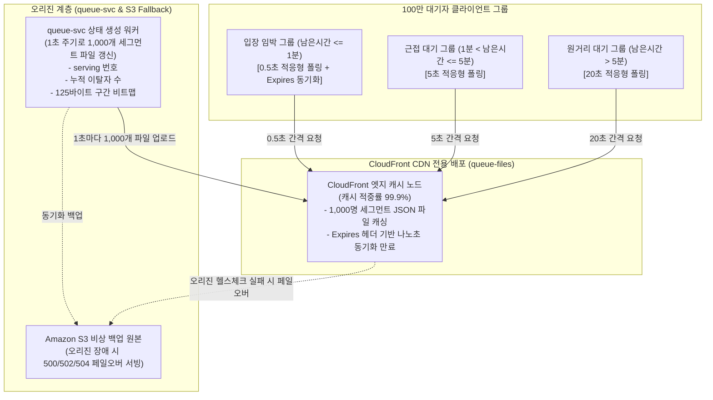
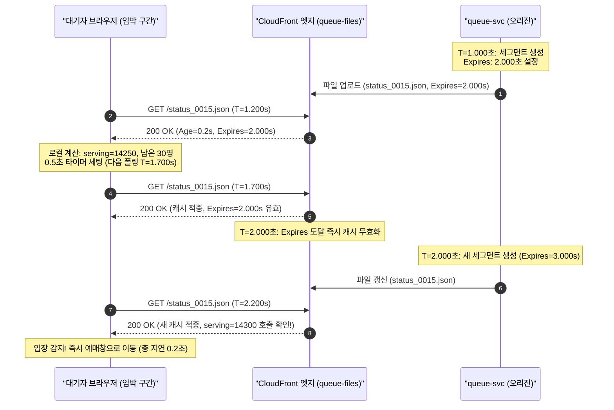

# D-01: 100만 대기자 상태 조회에서 왜 SSE/WebSocket이 아닌 CDN 정적 파일과 적응형 폴링을 선택했는가?

- **핵심 아키텍처 원칙**: 대기자 수와 오리진 부하의 완전한 디커플링(Decoupling), 엣지 캐시 적중률 극대화, 쓰임새별 쿼터 격리
- **관련 설계 정본**: [ADR-0003](../../adr/0003-waiting-room-adaptive-polling.md), [ADR-0058](../../adr/0058-cdn-distributions-quotas-and-shuffle-fetch-spread.md), [ADR-0110](../../adr/0110-latency-budgets-nfr002-nfr004-aligned-expiry-100ms-batches-ms-clock.md), [ADR-0144](../../adr/0144-edge-load-balancer-shared-fate-separation-and-failure-response.md), [docs/features/queue-admission.md](../../features/queue-admission.md) §4·§9
- **함께 읽기**: [한 판 문서](../01-system-design.md) 5단계, [분야 편 9 '대기열·입장'](../fields/09-queue-admission.md), [분야 편 20 '인프라·배포'](../fields/20-infra-devops.md), [결정 카드 D-02](D02-queue-number-incr.md)

---

## 1. 풀려던 문제와 한계

인기 콘서트 오픈 시각 직후 100만 명의 대기자가 "내 앞 대기자가 몇 명 남았고 언제 입장 가능한가?"를 실시간으로 확인하려 한다. 이 읽기 트래픽 폭주 상황에서 직면하는 물리적 한계는 다음과 같다.

### 1) 지속 연결(SSE / WebSocket) 유지 시의 소켓 고갈과 인프라 비용 폭탄
- **커널 소켓 메모리 고갈**: 100만 개의 TCP 연결을 유지하려면 운영체제 커널 수준에서 소켓당 송수신 버퍼(최소 16KB~32KB)와 애플리케이션 연결 컨텍스트(약 20KB~32KB)가 필요하다. 100만 소켓 유지만으로 순수 메모리 약 **40GB~64GB**가 상시 점유된다.
- **연결 한도 및 컴퓨팅 비용**: 리눅스 파일 디스크립터(FD) 한도와 단일 인스턴스당 포트/스레드 스위칭 오버헤드로 인해 게이트웨이 파드당 감당 가능한 연결은 1만~2만 개 수준이다. 즉, 100만 연결 유지를 위해 입구 서버 파드만 **50~100대 이상** 증설해야 한다.
- **로드 밸런서(ALB) LCU 비용**: AWS Application Load Balancer는 활성 연결 수와 새 연결 수에 비례하여 LCU(Load Balancer Capacity Unit)를 과금한다. 100만 활성 지속 연결을 1~2시간 유지하는 것만으로 시간당 수백~수천 LCU가 소모되어 막대한 인프라 비용이 낭비된다.
- **불필요한 실시간성**: 대기 번호 50만 번의 사용자에게 차례는 20~30분 뒤에나 온다. 이 사용자에게 1초 미만 단위로 실시간 푸시를 전송하는 것은 순수한 자원 낭비다.

### 2) 사용자별 개별 API 폴링(v0 방식, `ZRANK`)의 오리진 붕괴
- 100만 명이 매 5초마다 자신의 순위를 묻는 개별 REST API를 호출하면, 오리진 게이트웨이에 **초당 200,000 RPS**의 읽기 요청이 직접 내리꽂힌다.
- 응답 데이터가 사용자마다 고유하므로 CDN 엣지에서 캐시할 수 없으며, Redis의 Sorted Set에 대해 초당 20만 번의 `ZRANK`가 실행되어 단일 Redis 슬롯의 CPU가 1초 만에 100%로 포화되어 서비스 전체가 다운된다.

### 3) CloudFront 단일 배포 쿼터 소진 및 서비스 공유 위험(Shared Fate)
- AWS CloudFront 배포 1개의 기본 계정 쿼터는 초당 요청 **25만 RPS**, 대역폭 **150 Gbps**다.
- 오픈 시점(T=0)에는 공연 상세 페이지 조회 피크(초당 30만 RPS, NFR-007), 진입 순번 발급(초당 20만 RPS, NFR-001), 셔플 결과 JSON 파일 다운로드(약 36GB), 100만 대기자의 상태 조회가 한꺼번에 몰아친다.
- 단일 배포로 이를 통합 처리하면 대기열 조회 트래픽이 공연 상세 조회나 결제 API의 쿼터를 잠식하여 사이트 전체가 응답 불가(504 Gateway Timeout)에 빠진다.

---

## 2. 후보 기술 비교

| 평가 항목 | 후보 1: SSE/WebSocket 지속 연결 | 후보 2: 개별 API 폴링 (`ZRANK`, v0) | 후보 3: 정적 구간 파일 + CDN 적응형 폴링 (선택) | 후보 4: 임박 구간도 `max-age=1` 상대 만료 | 후보 5: 단일 CDN 배포 + 쿼터 통합 상향 |
| :--- | :--- | :--- | :--- | :--- | :--- |
| **오리진 부하** | 극심 (100만 연결 유지 파드 50~100대 필요) | 치명적 (초당 20만 RPS 직접 유입, Redis 포화) | **완전 격리 (대기자 수 무관, 초당 약 1,000 RPS 고정)** | 완전 격리 (초당 약 1,000 RPS) | 폭주 위험 (25만 RPS 쿼터 초과 시 전체 장애) |
| **CDN 캐시 적중률** | 0% (L7 지속 연결로 캐싱 불가) | 0% (응답 데이터가 사용자마다 고유) | **99.9% 이상 (엣지에서 100% 흡수)** | 99.9% 이상 | 99.9% |
| **임박 반영 지연 (NFR-002)** | < 1초 (최우수) | 1~5초 (폴링 주기 의존) | **p99 1.5~1.6초 달성 (`Expires` 절대 동기화)** | p99 2.2초 (캐시 나이 누적으로 목표 미달) | p99 1.5~1.6초 |
| **서버/인프라 비용** | 매우 높음 (LCU 폭탄 + 파드 100대) | 매우 높음 (대규모 Redis 클러스터 필요) | **매우 낮음 (CDN 요청료 약 273달러/70분)** | 매우 낮음 | 낮음 |
| **장애 격리성 (Blast Radius)** | 취약 (소켓 서버 다운 시 100만 재연결 폭풍) | 극히 취약 (오리진 다운 시 전면 마비) | **탁월 (오리진 장애 시 S3 사본 엣지 서빙)** | 탁월 | 취약 (단일 배포 장애 시 결제/대기 전면 마비) |
| **최종 판정** | **탈락 (ADR-0003)** | **탈락 (v0 실패 기준선)** | **최종 채택** | **탈락 (ADR-0110)** | **탈락 (ADR-0058, ADR-0144)** |

---

## 3. 고른 이유와 아키텍처 다이어그램

PEAKET은 **"원 서버 요청을 대기자 인원 수가 아닌 정적 파일 개수에 묶는다"**는 설계 철학을 채택했다.



### 핵심 매커니즘 4가지

#### 1) 1,000명 단위 번호 세그먼트 파일 및 클라이언트 로컬 비트맵 계산
- 대기 번호를 1,000명 단위(`status_0001.json`, `status_0002.json` 등)로 쪼개어 **1초마다 정적 JSON 파일**로 생성한다. 100만 명이 대기 중이어도 전체 파일 수는 **단 1,000개**에 불과하다.
- JSON 본문에는 개인별 고유 데이터가 전혀 없다:
  ```json
  {
    "eventId": "E1001",
    "serving": 14250,
    "saleStatus": "ON_SALE",
    "removedCount": 312,
    "bitmap": "a8f3... (125 bytes base64)",
    "pollHintMs": 5000,
    "generatedAt": 1772841601000
  }
  ```
- 클라이언트 브라우저는 자신의 번호가 속한 세그먼트 파일을 받아 로컬에서 자신의 앞 대기 인원을 즉시 계산한다:
  $$\text{내 앞 대기자} = (\text{내 번호} - \text{serving} - 1) - (\text{그 사이 비트맵 취소자 비트 합})$$
- 이로써 원 서버(오리진)로 유입되는 초당 요청 수는 대기자가 10만 명이든 100만 명이든 **초당 1,000 RPS**로 물리적으로 고정된다.

#### 2) 거리 적응형 폴링 (Distance-Adaptive Polling)과 지터(Jitter)
클라이언트는 추정 남은 시간에 따라 폴링 주기를 스스로 동적 조절한다:
- **입장 임박 구간 (예상 대기 1분 이내)**: **0.5초 간격** ($\pm 20\%$ 지터). 빠른 입장 기회 포착이 필수적이므로 폴링 주기를 극대화.
- **근접 구간 (예상 대기 1~5분)**: **5초 간격** ($\pm 20\%$ 지터).
- **원거리 구간 (예상 대기 5분 초과)**: **20초 간격** ($\pm 20\%$ 지터).
- **동적 백오프 제어 (`pollHintMs`)**: 오리진 장애로 S3 비상 정적 파일을 서빙할 때는 HTTP `Retry-After` 헤더를 조작할 수 없으므로, 파일 본문의 `pollHintMs` 필드를 읽어 브라우저가 폴링 주기를 즉시 2배(10초~40초)로 늦추도록 통제한다.

#### 3) 임박 구간의 절대 시각 만료 (`Expires`) 헤더 동기화
- NFR-002(입장 임박 대기자는 호출 후 p99 2초 이내에 인지)를 만족하기 위해 캐시 만료 방식을 정밀 튜닝했다.
- 상대 시간인 `Cache-Control: max-age=1`을 적용할 경우, 브라우저 캐시와 CDN 엣지, Origin Shield 간의 네트워크 지연 및 시계 차이로 인해 엣지 캐시 나이(Cache Age)가 0~1초 누적된다. 그 결과 최악 시뮬레이션 p99 지연이 **약 2.2초**로 목표를 초과한다.
- 따라서 입장 임박 구간(앞쪽 2~3개 파일, 약 1,700명)은 `Expires: <생성 시각 + 1초>`의 절대 시각 헤더를 주입한다. CDN 엣지와 브라우저는 다음 생성 시각 정각에 캐시를 일제히 무효화하며, 측정 산출 모델 기준 **p99 1.5~1.6초**를 안정적으로 달성한다.



#### 4) 쓰임새별 7개 CloudFront 배포 분리와 피크 쿼터 사전 증설
단일 배포의 쿼터 잠식(Shared Fate) 문제를 해결하기 위해 시스템 진입점을 7개 도메인으로 엄격히 물리 분리했다:
1. `www`: 공연 상세 페이지 (설계 피크 45만 RPS 상향 승인)
2. `queue`: 로비 진입 및 순번 발급 API (30만 RPS 상향)
3. `queue-files`: 정적 대기 상태 JSON 파일 (27만 RPS 상향)
4. `api`: 좌석 홀드 및 주문/결제 승인 API
5. `partner`: 기획사 어드민 콘솔
6. `console`: 시스템 운영 관제 콘솔 (별도 NLB 격리)
7. `scanner`: 현장 오프라인 검표 시스템

오픈 정각 셔플 결과 파일(약 36GB)은 토큰 해시 기반으로 0~8초 윈도우에 걸쳐 지연 다운로드하도록 강제함으로써, 순간 네트워크 대역폭을 최대 **36 Gbps**로 분산하여 배포 기본 상한(150 Gbps)의 24% 수준에서 안전하게 수용한다.

---

## 4. 얻는 것과 치르는 값 (Tradeoffs)

### 얻는 것 (Gains)
1. **오리진 부하의 대기자 수 무관화**: 대기자가 10만 명이든 100만 명이든 오리진이 받는 파일 갱신 부하는 **초당 1,000 RPS**로 고정된다.
2. **연결 고갈 위험 0**: 100만 개의 TCP 소켓을 오리진 파드가 유지하지 않으므로 커널 메모리 및 FD 고갈, LCU 비용 폭탄이 원천 제거된다.
3. **압도적인 비용 효율성**: 100만 명이 70분 동안 대기 상태를 조회(총 2.3억 건 요청)해도 CloudFront 요청 요금은 **약 273달러** 수준에 불과하여, 100대 이상의 서버 파드를 띄우는 것 대비 비용을 90% 이상 절감한다.
4. **결함 격리 (Bulkhead)**: `queue-files` 배포에 초당 수십만 건의 조회가 쏟아져도 좌석 점유나 결제를 처리하는 `api` 배포에는 1비트의 쿼터 영향도 주지 않는다.

### 치르는 값 (Costs & Limitations)
1. **원거리 대기자의 상태 갱신 지연**: 5분 이상 남은 대기자는 최대 20초 간격으로 폴링하므로, 상태 반영에 최대 28초(폴링 주기 24초 + 파일 생성 1초 + 엣지 캐시 1초 + 네트워크 지연 2초)의 지연이 발생한다. (다만 원거리 대기자에게는 UX상 지장이 없음)
2. **매진 통보의 지연**: 전석 매진 시 정적 세그먼트 파일에 `SOLD_OUT`이 반영되고 클라이언트가 이를 확인하기까지 최대 8초(오리진 지연 시 최대 21초)가 소요될 수 있다.
3. **CloudFront 단일 장애점(SPOF)**: CloudFront 글로벌 장애 발생 시 대체 가능한 멀티 CDN DNS 페일오버를 두지 않았다. (비용과 WAF/인증서 동기화 복잡도 대비 실익 부족으로 수용, 장애 시 정적 공지 페이지 전환 정책 채택).

---

## 5. 바꿀 조건 (Conditions to Change)

1. **CDN 요청 비용의 한도 초과**: 티켓 1회 오픈당 CDN 요청 요금이 전체 인프라 예산 허용치를 초과하거나, 오리진 파드의 파일 생성 부하가 임계치를 넘는 경우, queue-svc의 오리진 서빙을 배제하고 1초 주기로 S3 버킷에 직접 1,000개 파일을 PUT하여 CloudFront가 S3 원본만 바라보도록 파이프라인을 단순화한다.
2. **NFR-002 입장 임박 반영 지연(p99 2초) 위반**: 실측 벤치마크에서 임박 대기자의 반영 지연이 1.8초를 초과할 경우, 임박 구간(앞쪽 2개 파일)에 한해 파일 생성 주기를 0.5초로 단축하거나 폴링 간격을 0.25초로 축소한다.
3. **AWS CloudFront 쿼터 상향 거절**: 계정 쿼터 상향 신청(27만 RPS)이 거절될 경우, `queue-files` 배포를 번호 대역별(예: 1~50만 번 배포, 50~100만 번 배포)로 2개 이상 추가 세분화하여 분산한다.

---

## 6. 핵심 꼬리 질문 5단 방어 (Staff Interview Q&A)

| 질문 단계 | 심층 질문 | 방어 논리와 기술적 근거 | 관련 정본 |
| :--- | :--- | :--- | :--- |
| **1단: 왜 (Why)** | 100만 대기자에게 왜 서버가 SSE로 푸시하지 않고 브라우저 폴링을 쓰나요? | 100만 소켓 유지는 커널 버퍼만 40~64GB 메모리를 소모하고, 게이트웨이 파드 50~100대와 막대한 ALB LCU 요금을 유발합니다. 또한 뒤쪽 90% 대기자에게 실시간 푸시는 불필요합니다. 1,000명 단위 정적 파일로 전환하여 오리진 부하를 100만 명이 아닌 파일 1,000개(초당 1,000 RPS)로 격리하고 엣지에서 99.9% 흡수하는 것이 비용과 안정성 양면에서 압도적입니다. | ADR-0003 |
| **2단: 대안 (Alternatives)** | CloudFront 배포 1개에 요청 쿼터만 대폭 늘려서 쓰면 안 되나요? | CloudFront 단일 배포 쿼터(25만 RPS, 150 Gbps)를 공유하면, T=0 정각의 공연 상세 조회(30만 RPS)와 셔플 파일 다운로드(36GB)가 겹쳐 대기열 API와 결제 API 쿼터를 잠식하는 Shared Fate 문제가 발생합니다. 배포를 7개로 물리 격리해야 한쪽의 트래픽 스파이크가 결제/대기열로 전파되는 사고를 원천 차단할 수 있습니다. | ADR-0058, ADR-0144 |
| **3단: 장애 대응 (Resilience)** | 상태 파일을 생성하는 오리진 queue-svc가 장애로 500/502 에러를 내면 어떻게 되나요? | CloudFront 오리진 페일오버 그룹을 구성하여 500, 502, 503, 504 에러 발생 시 즉시 Amazon S3 백업 버킷의 직전 정적 파일 사본으로 자동 우회 서빙합니다. 동시에 파일 본문의 `pollHintMs`를 통해 클라이언트 폴링 주기를 2배로 자동 백오프시켜 오리진의 자가 회복 시간을 확보합니다. | queue-admission §9, ADR-0144 |
| **4단: 수치 근거 (Numbers)** | 오리진 요청 초당 1,000 RPS와 p99 1.5초는 어떻게 산출되었나요? | 100만 번호를 1,000명 단위로 나누면 파일은 정확히 1,000개입니다. 1초마다 생성되고 CDN 엣지에서 `Expires` 1초 만료를 거치므로 엣지 노드가 원본에 요청하는 양은 초당 1,000건으로 고정됩니다. p99 1.5~1.6초는 '파일 생성(최대 1s) + CDN 전달(0.1s) + 0.5s 적응형 폴링(평균 0.25s) + 브라우저 렌더링(0.05s)'의 단계별 지연 예산 합산 모델 기준입니다. | docs/verification.md §3.4, ADR-0110 |
| **5단: 실측과 검증 (Verification)** | 100만 명 규모의 CDN 폴링을 실제로 부하 테스트해 보았나요? | 100만 명 전체를 퍼블릭 CDN에 쏘는 실측은 1회 테스트당 수백 달러의 CDN 비용이 발생하므로 전수 부하는 에뮬레이션으로 대체했습니다. 대신 로컬 단일 노드 및 K6 분산 부하 환경에서 1천·1만·10만 가상 사용자로 v0(개별 ZRANK) 대비 오리진 부하를 측정(Q-T2)하여, 오리진 요청이 동시 접속자 수와 완전히 무관하게 파일 수에 수렴함을 검증했습니다. 임박 구간의 `Expires` 만료 지연은 별도 합성 벤치마크(Q-T47)로 단계별 예산을 통제합니다. | docs/verification.md §3.4, ADR-0057 |

---

## 7. 30초 아키텍처 브리핑 (Staff Engineer Summary)

> "PEAKET은 100만 대기자의 상태 조회를 처리하기 위해 지속 연결 소켓을 단 1개도 열지 않습니다. 1,000명 단위의 대기 상태를 1초마다 단 1,000개의 정적 JSON 세그먼트 파일로 렌더링하여 CloudFront 엣지에 올리고, 브라우저가 로컬 압축 비트맵을 해석해 자신의 앞 대기 인원을 직접 계산합니다.  
> 이를 통해 100만 대기자의 요청을 엣지에서 99.9% 흡수하며, 오리진 부하는 동시 접속자 수와 무관하게 초당 1,000 RPS로 물리적으로 고정됩니다. 또한 입장 1분 전 임박 대기자는 0.5초 적응형 폴링과 `Expires` 절대 시각 동기화를 결합해 p99 2초 이내의 빠른 입장을 완벽히 보장합니다."
