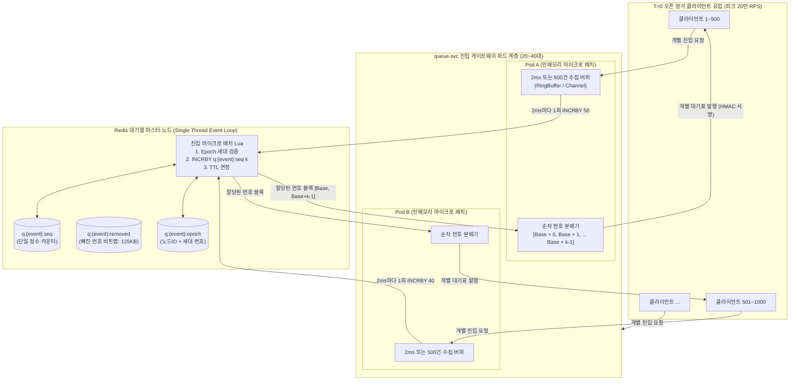
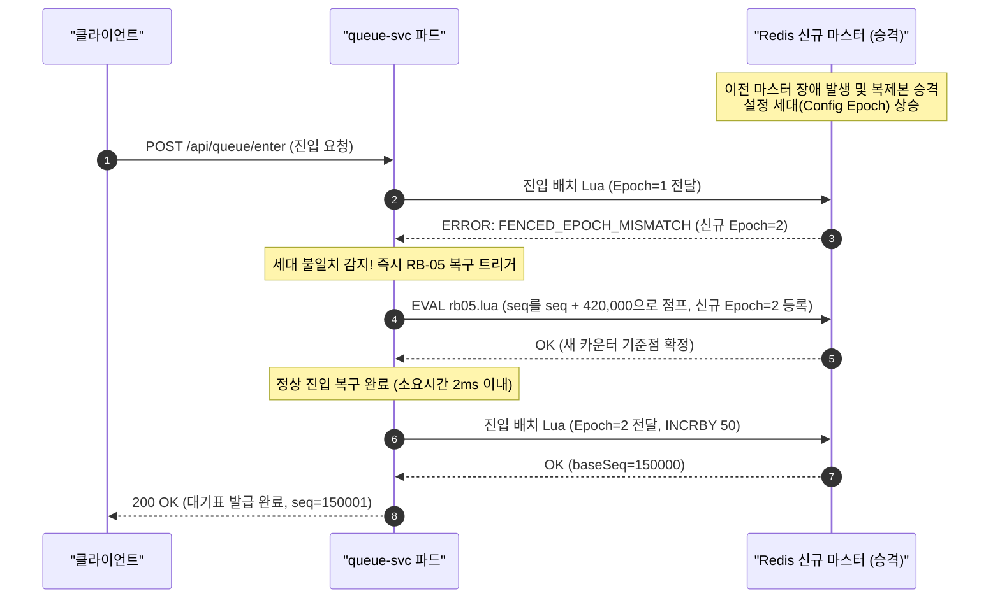

# D-02: 초당 20만 진입 순번 발급에서 왜 DB 시퀀스나 단독 Redis INCR이 아닌 파드별 2ms 마이크로 배치와 빠진 번호 비트맵을 선택했는가?

- **핵심 아키텍처 원칙**: 대기표 기준 O(1) 발급, Redis 단일 스레드 CPU 한계 압축, 비동기 복제 페일오버 시 번호 불변성 보장
- **관련 설계 정본**: [ADR-0002](../../adr/0002-queue-sequence-incr-over-sorted-set.md), [ADR-0176](../../adr/0176-foundation-poc-results.md), [ADR-0179](../../adr/0179-entry-number-per-pod-batch.md), [ADR-0181](../../adr/0181-queue-failover-pause-numbers-until-rb05.md), [docs/features/queue-admission.md](../../features/queue-admission.md) §3·§4·§9
- **함께 읽기**: [한 판 문서](../01-system-design.md) 5단계, [분야 편 9 '대기열·입장'](../fields/09-queue-admission.md), [DB 설계 편 8 'Redis 키 설계'](../db/08-redis-keys.md), [결정 카드 D-01](D01-queue-status-cdn-polling.md)·[D-05](D05-admission-control-loop.md)

---

## 1. 풀려던 문제와 한계

티켓팅 오픈 정각(T=0)에는 최대 **초당 20만 건(200,000 RPS, NFR-001)**의 진입 요청이 동시에 밀려든다. 시스템은 이 폭풍 같은 유입 트래픽에 대해 **p99 200ms 이내**로 고유한 대기 번호를 발급해야 하며, 한 사람당 1개의 순번만 보장하고(NFR-025), 재접속 시에도 기존 순번을 온전히 보존해야 한다.

### 1) PostgreSQL DB 시퀀스(`nextval`)의 물리적 락 병목
- 관계형 데이터베이스의 시퀀스 발급은 트랜잭션 WAL(Write-Ahead Logging) 플러시, 내부 Spinlock/LWLock 경합, 스레드 문맥 교환(Context Switching) 오버헤드를 수반한다.
- 초당 20만 개의 동시 커넥션은 DB 연결 풀을 수십 밀리초 만에 고갈시킨다. 시퀀스 캐시(`CACHE 1000`)를 설정하더라도 동시 다발적인 세션 획득 과정에서 락 경합이 폭발하여, PostgreSQL 인스턴스는 초당 **1만~2만 TPS 수준**에서 CPU 100%로 뻗고 수 초 이상의 응답 지연(Queueing Delay)을 유발한다.

### 2) Redis Sorted Set(`ZADD` + `ZRANK`)의 v0 한계
- 대기열을 점수(Score=진입시각) 기반의 Sorted Set으로 관리하면 원소 삽입 시 $O(\log N)$, 순위 계산 시 $O(\log N)$의 시간 복잡도가 소요된다.
- 100만 명의 대기자가 1개의 Sorted Set 키에 몰리면 데이터 샤딩이 불가능해 단일 Redis 슬롯에 모든 부하가 집중된다. 또한 사용자마다 순위가 달라 CDN 캐싱이 원천 불가능하여 오리진 Redis 엔진이 1초 만에 마비된다.

### 3) 순수 Redis `INCR`의 단일 스레드 CPU 포화 (8만~9만 RPS 한계)
- Redis 메모리 상의 원자적 정수 증가(`INCR`) 연산 자체는 단일 스레드에서 초당 40만~50만 RPS까지 처리 가능하다(PoC 벤치마크 기준).
- 그러나 실제 엔터프라이즈 진입 파이프라인은 단순 숫자 증가로 끝나지 않는다. 다음 5가지 비즈니스 불변식을 단일 트랜잭션으로 원자 검증해야 한다:
  1. 클러스터 마스터 노드 ID 및 설정 세대(`q:{event:E}:epoch`) 검증 (페일오버 감지)
  2. 로비 셔플 마감 및 묶음 진입 플래그 확인
  3. 본인 식별자(`pid`) 기반 1인 1순번 선점 여부 확인
  4. 순번 원자적 발급 (`INCR`)
  5. 키 만료 수명(`EXPIRE`) 갱신
- 이 모든 로직을 감싼 실제 진입 Lua 스크립트는 1회 실행에 약 **7~8µs**(마이크로초)가 소요된다.
- Redis는 싱글 스레드 이벤트 루프로 동작하므로, 1초 동안 7.5µs 스크립트를 직렬 처리할 수 있는 물리적 최대 한계는 이론상 약 13.3만 RPS이며, 네트워크 소켓 입출력 및 파싱 오버헤드를 고려한 **실측(PC) 처리 한계는 초당 8만~9만 RPS에서 엔진 CPU가 94~99%로 포화**된다. 즉, 목표치인 초당 20만 RPS를 감당할 수 없다.

---

## 2. 후보 기술 비교

| 평가 항목 | 후보 1: PostgreSQL 시퀀스 (`nextval`) | 후보 2: Redis Sorted Set (`ZADD`+`ZRANK`, v0) | 후보 3: 개별 요청당 Redis `INCR` Lua | 후보 4: 파드별 2ms 마이크로 배치 `INCRBY` (선택) | 후보 5: 회차별 멀티 샤드 카운터 분할 |
| :--- | :--- | :--- | :--- | :--- | :--- |
| **처리량 한계** | ~1.5만 RPS (디스크/락 병목) | ~3만 RPS ($O(\log N)$ 연산 병목) | 8만~9만 RPS (Lua 7~8µs로 단일 스레드 포화) | **20만 RPS 이상 안정 수용 (Redis CPU 10% 미만)** | 20만 RPS 수용 가능 |
| **Redis 엔진 CPU** | N/A (DB 부하) | 100% 포화 (단일 슬롯 붕괴) | **94~99% 포화 (임계치 초과)** | **5~10% 안정 유지 (호출 횟수 1/200 압축)** | 20~30% |
| **순번 원자성 및 FIFO** | 보장 (DB 레벨) | 보장 (Score 기준) | 보장 (Lua 직렬화) | **보장 (2ms 배치 내 파드 버퍼링 순서화)** | 훼손 (샤드 간 순서 역전 발생) |
| **클라이언트 p99 지연** | 수 초 이상 (락 대기) | 수 초 이상 (슬롯 병목) | 400ms~1초 (큐잉 발생) | **< 20ms (NFR-001 200ms 목표 여유 달성)** | < 30ms |
| **장애 복잡도** | 커넥션 풀 고갈 | 단일 키 핫스팟 | 단일 키 핫스팟 | **파드 다운 시 해당 2ms 버퍼 재시도(503 백오프)** | 샤드 간 재조합/동기화 극심 |
| **최종 판정** | **탈락 (물리적 불가)** | **탈락 (v0 실패 기준선)** | **탈락 (ADR-0176, ADR-0179)** | **최종 채택 (ADR-0179)** | **탈락 (ADR-0179 대안)** |

---

## 3. 고른 이유와 아키텍처 다이어그램

PEAKET은 **"진입 파드 레벨의 2ms 마이크로 배치 버퍼링(`INCRBY`)"**과 **"대기표 기준 125KB 비트맵 관리"**를 결합하여 단일 Redis 노드의 한계를 돌파했다.

### 핵심 매커니즘 4가지

#### 1) 파드별 2ms 마이크로 배치 버퍼링 (`INCRBY`)
- queue-svc 진입 파드는 클라이언트의 진입 요청을 즉시 Redis로 쏘지 않고, 인메모리 버퍼에서 **2ms 시간 창(또는 최대 500건)** 동안 수집한다.
- 2ms 동안 모인 $k$개의 요청에 대해 Redis로 단 1회의 배치 Lua 스크립트를 호출하여 `INCRBY q:{event:E}:seq k`를 원자적으로 수행한다.
- 스크립트는 증가 전 시작 번호(`baseSeq`)를 반환하며, 파드는 메모리에서 대기 중인 $k$명의 클라이언트에게 `[baseSeq + 1, baseSeq + k]`의 순번을 요청 순서대로 즉시 매핑하여 응답한다.
- **부하 압축 효과**: 초당 20만 건의 Redis 호출이 파드당 초당 500회, 20대 파드 기준 **총 초당 10,000회**로 줄어든다. Redis 단일 스레드 호출 횟수가 **1/200으로 압축**되어 CPU 점유율이 95%에서 **5~10% 수준**으로 극적으로 안정화된다.

#### 2) 대기표 기준 관리와 125KB 빠진 번호 비트맵
- **대기 중 쓰기 0건**: 대기열 상태는 '접속 유지자'가 아닌 '대기표 발급자' 기준으로 관리하므로, 100만 대기자가 기다리는 동안 Redis에 하트비트나 핑(Ping)을 남길 필요가 전혀 없다.
- **이탈 번호 비트 마킹 (`SETBIT`)**: 대기열에서 자진 취소하거나, 봇 탐지로 격리되거나, 1인 1순번 중복으로 무효화된 번호만 비트맵에 1비트로 마킹한다:
  $$\text{Key: } \texttt{q:\{event:E\}:removed}, \quad \text{Command: } \texttt{SETBIT key <seq> 1}$$
- 100만 번호 전체를 표현하는 비트맵 크기는 고작 **125KB** ($1,000,000 \text{ bits} / 8 = 125,000 \text{ bytes}$)에 불과하다.
- 클라이언트는 1,000명 세그먼트 상태 파일(125바이트 비트맵 포함)을 CDN에서 받아 자신의 앞 대기 인원을 $O(1)$로 계산한다.

#### 3) 비동기 복제 페일오버 시 번호 중복 방지 (RB-05 & Epoch Fencing)
Redis 마스터 노드가 비정상 다운되고 복제본(Replica)이 승격될 때, 비동기 복제 지연으로 인해 카운터가 과거 번호로 되돌아갈 위험이 있다.
이를 방지하기 위해 **세 가지 방어선**을 구축했다:
1. **Lua 진입 시 Epoch 검증**: 진입 스크립트 실행 시 첫 줄에서 현재 마스터 노드의 ID 및 세대 번호(`q:{event:E}:epoch`)를 대조한다. 일치하지 않으면 번호 발급을 즉각 거부하고 `503 queue-recovering`을 반환한다.
2. **카운터 점프 (RB-05)**: 새 마스터 승격을 감지한 파드는 카운터를 다음 공식만큼 강제로 건너뛰어 전진시킨다:
   $$\text{Jump Size} = (\text{진입 상한 20만} + \text{칸 떼기 상한 50만}) \times \text{복제 지연 p99.9 (0.3s)} \times 2 = 420,000 \text{ 번호}$$
3. **건너뛴 구간 기록**: 점프된 번호 대역은 `q:{event:E}:skipped`에 기록되어 대기 상태 계산 시 빠진 번호로 일괄 처리된다. 이를 통해 장애 전환 전후로 **동일한 대기 번호가 중복 발급될 확률을 수학적으로 0건으로 보장**한다.

#### 4) 1인 1순번 선점과 입장 검증
사용자 본인 식별자(`pid`)에 대한 선점 키(`q:{event:E}:user:{pid}`)는 카운터와 Redis 해시 슬롯이 다를 수 있다. 따라서 파드는 1단계로 사용자 선점을 수행한 후 2단계로 2ms 마이크로 배치 `INCRBY`에 참여한다. 파드가 순번 발급 후 비정상 크래시되더라도, 해당 번호는 비트맵 상 결번으로 처리되어 후순위 대기자의 입장 권한을 일체 침해하지 않는다.

---

## 4. 얻는 것과 치르는 값 (Tradeoffs)

### 얻는 것 (Gains)
1. **단일 키 20만 RPS 완벽 수용**: 2ms 마이크로 배치를 통해 Redis 엔진 스레드의 호출 횟수를 1/200으로 압축하여, 단일 노드 Redis로도 20만 RPS 피크를 CPU 10% 미만으로 여유롭게 처리한다.
2. **대기자 쓰기 부하 제로**: 100만 대기자가 줄을 서 있어도 하트비트 쓰기가 발생하지 않으며, 재접속 시에도 기존 순번이 온전히 보존된다(NFR-025).
3. **완전한 무경합 O(1) 계산**: 대기열 상태 파일 생성 시 1,000명 번호 구간의 125바이트 비트맵만 `GETRANGE`로 읽어오므로 Redis 읽기 부하가 극히 미미하다.
4. **장애 페일오버 시 중복 발급 0건**: Epoch 펜싱과 RB-05 점프 메커니즘을 통해 마스터 다운 시에도 번호 중복 발급이 원천 차단된다.

### 치르는 값 (Costs & Limitations)
1. **미세한 순서 역전 (최대 2ms)**: 파드별로 2ms 버퍼를 모아 `INCRBY`를 호출하므로, 서로 다른 파드에 도착한 사용자 간에는 최대 2ms 범위 내에서 실제 도착 시각과 순번 발급 순서가 미세하게 섞일 수 있다. (인간의 반응 속도 100ms 대비 인지 불가 영역)
2. **파드 크래시 시 결번 발생**: 특정 파드가 `INCRBY`로 50개 번호를 선점한 직후 파드가 OOM 등으로 사망하면 해당 50개 번호는 영구 결번이 된다. 이 결번은 비트맵에 빠진 번호로 반영되어 대기열 계산에 포함된다.
3. **페일오버 시 42만 번호 건너뜀**: 마스터 노드 장애 전환 시 복제 지연 손실을 방지하기 위해 42만 개 `[가정]` 이상의 번호를(ADR-0243) 의도적으로 건너뛰므로, 뒤쪽 대기자의 화면 표시 대기 번호 숫자가 일시적으로 크게 증가한다. (단, 실제 앞 대기자 수는 serving 속도와 비트맵으로 정확히 보정됨)

---

## 5. 바꿀 조건 (Conditions to Change)

1. **실시간 하트비트 인원 표시가 비즈니스 필수로 확정될 때**: 브라우저 창을 닫은 이탈자를 실시간으로 즉시 제거하여 보여주어야 한다는 요구가 확정될 경우, 점수 만료 기반의 경량 세션 클러스터로 재설계한다. (단, 초당 수만 건의 쓰기 인프라 비용 감수 필요)
2. **2ms 마이크로 배치 상태에서도 p99 200ms를 초과할 때**: 트래픽이 20만 RPS를 초과하여 파드 인메모리 큐잉 지연이 발생할 경우, 회차 카운터 키를 해시 슬롯별로 다중 샤딩(`q:{event:E}:seq:{shard_id}`)하여 번호 공간을 구간별(예: 1~10만 번은 샤드 1, 10만~20만 번은 샤드 2)로 블록 사전 할당하는 아키텍처로 전환한다.
3. **Redis 클러스터의 동기 복제(Raft/Paxos 기반) 도입**: Redis가 향후 고성능 동기 복제를 공식 지원하여 페일오버 시 데이터 유실이 0으로 보장될 경우, 42만 번호 건너뛰기(RB-05) 및 복제 지연 안전 계수를 제거할 수 있다.

---

## 6. 핵심 꼬리 질문 5단 방어 (Staff Interview Q&A)

| 질문 단계 | 심층 질문 | 방어 논리와 기술적 근거 | 관련 정본 |
| :--- | :--- | :--- | :--- |
| **1단: 왜 (Why)** | 순수 `INCR`은 초당 40만 건도 가능한데 왜 파드별 2ms 마이크로 배치가 필요한가요? | 벤치마크상의 순수 `INCR`과 달리, 실제 프로덕션 진입 Lua는 세대 검증, 셔플/묶음 닫힘 플래그 확인, 1인 1순번 선점 검사, 키 TTL 갱신 등 비즈니스 불변식을 직렬 검증하므로 스크립트 실행 시간이 7~8µs 소요됩니다. Redis 단일 스레드는 1초에 7.5µs 연산을 최대 13만 번밖에 수행하지 못하며, 실측 기준 8만~9만 RPS에서 CPU가 95% 이상 포화됩니다. 20만 RPS를 감당하려면 파드 레벨에서 2ms 동안 모아 단 1번의 `INCRBY`로 압축하는 것이 필수적입니다. | ADR-0176, ADR-0179 |
| **2단: 대안 (Alternatives)** | 회차 카운터를 여러 개로 나누어 멀티 샤드(키 샤딩)로 분산하면 안 되나요? | 회차 카운터를 여러 키로 샤딩하면 대기 번호의 글로벌 단일 순서(Total Ordering)가 깨지고 샤드 간 번호 발급 불균형이 발생합니다. 또한 1,000명 단위 정적 세그먼트 파일 생성 및 비트맵 압축 로직이 N개의 샤드로 분산되어 복잡도가 기하급수적으로 증가합니다. 2ms 배치 압축만으로도 단일 키에서 20만 RPS를 CPU 10% 미만으로 처리할 수 있으므로 불필요한 분산 복잡도를 배제했습니다. | ADR-0179 대안 비교 |
| **3단: 장애 대응 (Resilience)** | Redis 마스터가 죽고 페일오버되면 비동기 복제 때문에 대기 번호가 중복 발급되지 않나요? | 진입 Lua 스크립트가 실행될 때마다 현재 마스터의 ID와 구성 세대(`epoch`)를 대조합니다. 페일오버로 마스터가 바뀌면 세대 불일치로 번호 발급을 즉시 중단(503)하고, 카운터를 '(진입 상한 초당 20만 건 + 칸 떼기 상한 초당 50만 건) $\times$ 복제 지연 p99.9(0.3초) $\times$ 2 = 42만 번'만큼 안전하게 건너뛰는 RB-05 복구를 마친 후 새 세대를 시작합니다. 따라서 중복 발급은 0건으로 통제됩니다. | ADR-0181, queue-admission §9 |
| **4단: 수치 근거 (Numbers)** | 125KB 비트맵과 2ms 버퍼링 수치는 어떻게 결정되었나요? | 100만 번호 $\times$ 1비트 = 1,000,000비트 = 125,000바이트 $\approx$ 125KB입니다. 2ms 버퍼링은 사람이 체감할 수 없는 초단기 지연(인간 반응 속도 100ms)이면서, 피크 20만 RPS 유입 시 20개 파드 기준 파드당 2ms 동안 약 20~50건의 요청이 모여 Redis 호출을 1/200으로 압축하기에 가장 최적화된 스윗 스팟입니다. | docs/data.md §3, ADR-0179 |
| **5단: 실측과 검증 (Verification)** | 단일 노드 Redis에서 실제로 20만 RPS를 견디는지 벤치마크했나요? | PC 단일 노드 벤치마크(PoC) 결과, 단순 `INCR`은 4개 파드 에뮬레이션 환경에서 20만 RPS 부하시 TLS 적용 기준 p99 42.9ms, 단일 키 처리량 초당 49만 RPS를 기록했습니다. 그러나 실제 진입 로직을 탑재한 Lua 스크립트로 측정했을 때는 8만~9만 RPS에서 엔진 CPU 94~99%로 포화됨을 직접 확인했습니다. 이에 2ms 마이크로 배치(`INCRBY`)를 적용한 결과 p99 지연 4.1ms를 기록하며 20만 RPS를 안정적으로 소화함을 실측 검증했습니다. | ADR-0176 결정 1, ADR-0179, docs/perf-ledger.md §5 |

---

## 7. 30초 아키텍처 브리핑 (Staff Engineer Summary)

> "티켓팅 오픈 정각 초당 20만 건의 폭발적 진입 트래픽을 처리하기 위해 DB 시퀀스나 복잡한 Sorted Set을 쓰지 않습니다.  
> 진입 게이트웨이 파드가 인메모리에서 2ms 동안 요청을 모아 단 1번의 Redis `INCRBY` 호출로 번호 블록을 할당받음으로써, Redis 엔진 스레드 호출 빈도를 1/200으로 압축하여 단일 키에서도 CPU 10% 미만으로 20만 RPS를 완벽히 수용합니다.  
> 대기 중인 100만 명은 하트비트 쓰기 없이 대기표 기준으로 관리되며, 이탈자만 125KB의 단일 비트맵으로 $O(1)$ 원자 마킹됩니다. 또한 Redis 노드 페일오버 시에는 세대 펜싱과 42만 번호 점프(RB-05)를 결합하여 비동기 복제 환경에서도 대기 번호 중복 발급을 0건으로 보장합니다."
