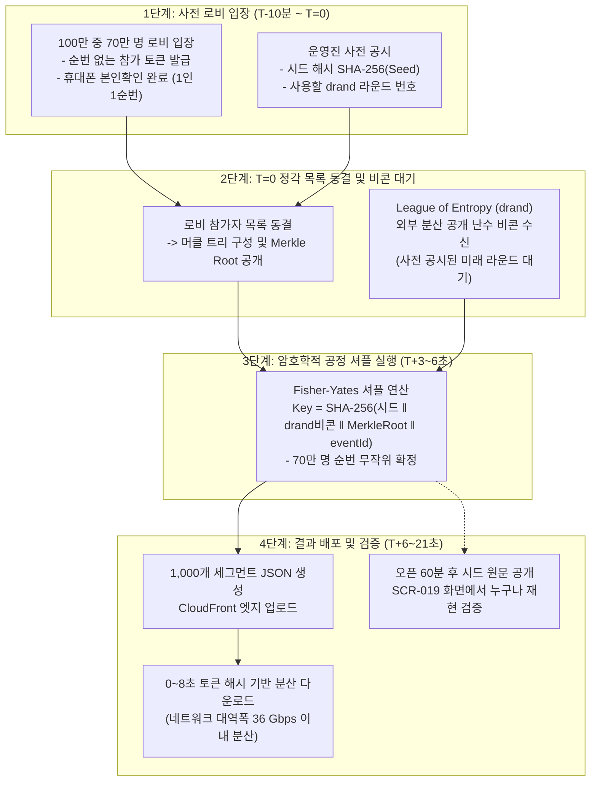

# D-03: 정각에 몰린 사람의 순서를 왜 순수 선착순이 아니라 로비 셔플과 drand 공개 난수로 정하나?

- **핵심 아키텍처 원칙**: 밀리초(ms) 단위 네트워크/기기 속도 경쟁 무력화, T=0 순간 오리진 트래픽 분산, Commit-Reveal 및 drand 분산 비콘 기반의 외부 검증 가능성
- **관련 설계 정본**: [ADR-0012](../../adr/0012-queue-ordering-hybrid-shuffle-default.md), [ADR-0041](../../adr/0041-fifo-speed-bot-countermeasures.md), [ADR-0050](../../adr/0050-crypto-corrections-and-key-management.md) 결정 7, [ADR-0058](../../adr/0058-cdn-distributions-quotas-and-shuffle-fetch-spread.md), [ADR-0064](../../adr/0064-sales-end-24h-before-start.md), [ADR-0118](../../adr/0118-queue-ordering-two-settings-lobby-shuffle-open-batch.md), [docs/features/queue-admission.md](../../features/queue-admission.md) §1·§2·§3
- **함께 읽기**: [한 판 문서](../01-system-design.md) 6단계, [분야 편 9 '대기열·입장'](../fields/09-queue-admission.md), [분야 편 14 '봇 방어'](../fields/14-bot-defense.md), [결정 카드 D-01](D01-queue-status-cdn-polling.md)·[D-04](D04-bot-defense-and-evaluation.md)

---

## 1. 풀려던 문제와 한계

티켓팅 오픈 정각(T=0)에 100만 명의 사용자가 동시에 진입할 때 시스템이 마주하는 물리적·공학적 한계는 다음과 같다.

### 1) 밀리초(ms) 네트워크 인프라 격차와 매크로의 앞자리 100% 독식
- **네트워크 RTT 격차**: AWS 서울 리전 인근 IDC의 초고속 회선을 사용하는 매크로 봇은 게이트웨이까지 RTT가 **1~2ms**에 불과하다. 반면 지하철이나 이동 중 LTE/5G망을 사용하는 일반인은 무선 기지국 지연과 핸드셰이크로 인해 RTT가 **30~80ms**에 달한다.
- **순수 선착순(FIFO)의 구조적 불공정**: 순수 선착순 방식을 취할 경우, 인간이 정각에 아무리 빠르게 반응(인간 신경 반응 속도 최소 150~200ms)하더라도 네트워크 지연 차이와 자동화 스크립트로 인해 앞 번호(1~5,000번)는 **100% 봇과 매크로가 독식**하게 된다.

### 2) T=0 순간 초당 20만 RPS 동시 내리꽂힘 (Thundering Herd)
- 로비 셔플이 없을 경우, 100만 명의 대기자가 T=0 정각에 새로고침을 누르고 진입 버튼을 연타하여 오리진 게이트웨이에 초당 **200,000 RPS**의 쓰기 요청이 일시에 집중된다 (NFR-001 설계 상한).
- 반면 오픈 10분 전 로비를 열고 70%의 사용자를 미리 수용하면, T=0 정각에 로비 참가자(70만 명)는 진입 요청을 전혀 보내지 않는다. 이로써 T=0의 실시간 진입 쓰기 트래픽은 로비 미참가자 30만 명이 생성하는 **초당 약 4.8만 RPS**로 76% 급감한다.

### 3) 플랫폼 내부 조작 의혹과 설명 책임(Explainability)
- 추첨이나 셔플을 플랫폼 내부 난수(`Math.random()` 또는 단순 암호학 난수)로만 수행하면, "운영진이나 개발자가 지인에게 1번을 몰아주었다"는 의혹과 민원이 필연적으로 제기된다.
- 공연법은 정렬 방식을 법으로 강제하지 않으나 '최초 판매자가 정한 공정한 구입 과정'을 기준으로 삼는다. 따라서 운영자 자신도 셔플 결과를 사전에 조작하거나 예측할 수 없음을 암호학적으로 증명(외부 공개 검증 가능성)해야 한다.

---

## 2. 후보 기술 비교

| 평가 항목 | 후보 1: 순수 선착순 (FIFO) | 후보 2: 서버 내부 난수 셔플 | 후보 3: 오픈 순간 캡차(CAPTCHA) 강제 | 후보 4: 오픈 시각 무작위 지터 지연 | 후보 5: 로비 셔플(drand) + 2초 묶음 (선택) |
| :--- | :--- | :--- | :--- | :--- | :--- |
| **속도 매크로 무력화** | 불가 (봇 100% 독식) | 우수 (순서 무작위화) | 보통 (캡차 대행 팜 존재) | 미흡 (기준점만 밀릴 뿐 밀리초 경쟁 유지) | **완벽 (로비 전원 동등 추첨 + 오픈 2초 묶음 셔플)** |
| **T=0 순간 오리진 부하** | 극심 (20만 RPS 쓰기 집중) | 낮음 (결과 정적 배포) | 파멸적 (20만 명이 외부 캡차 서버 동시 호출) | 극심 (20만 RPS가 분산 없이 유입) | **극소 (로비 참가자 요청 0건, 파일 0~8초 분산 수신)** |
| **결과 검증 가능성 (투명성)** | 불가 (서버 타임스탬프 불신) | 0% (내부 조작 의혹 해소 불가) | N/A | 0% | **100% (Commit-Reveal + drand 비콘 + 머클 루트)** |
| **운영자 사전 조작 차단** | 취약 | 취약 (개발자 사전 시드 탈취 가능) | N/A | 취약 | **원천 차단 (T=0 이후 생성되는 외부 분산 난수 결합)** |
| **첫 입장 소요 시간** | 1~2초 (최우수) | 5~8초 | 10~30초 (사용자 피로도 극심) | 3~10초 | **11~21초 (셔플 계산 및 비콘 대기 시간 소요)** |
| **최종 판정** | **탈락 (ADR-0012)** | **탈락 (신뢰성 부족)** | **탈락 (ADR-0041, 오리진 병목)** | **탈락 (ADR-0041)** | **최종 채택 (ADR-0118, ADR-0050)** |

---

## 3. 고른 이유와 아키텍처 다이어그램

PEAKET은 **"도착 순서에 따른 불공정을 암호학적으로 제거하고, 진입 트래픽을 시간축으로 분산한다"**는 설계 철학을 적용했다.

### 핵심 매커니즘 4가지

#### 1) 2개 불리언 스위치(`lobbyShuffle`, `openBatch`)의 정책 조합
기획사와 공연 특성에 맞추어 회차 단위로 2개의 불리언 스위치로 대기열 동작을 결정한다 (ADR-0118):
- **하이브리드 (기본값, `lobbyShuffle: true`, `openBatch: true`)**: 오픈 전 로비 참가자는 drand 셔플로 섞고, 오픈 직후 도착자는 2초 단위 묶음으로 섞는다.
- **사전 셔플 (`lobbyShuffle: true`, `openBatch: false`)**: 로비 참가자만 셔플하고 오픈 후 도착자는 선착순으로 줄을 세운다.
- **선착순 (`lobbyShuffle: false`, `openBatch: true`)**: 로비 없이 오픈하지만, 정각 도착 2초 묶음을 셔플하여 순수 밀리초 경쟁을 완화한다.
- **금지 조합 (`false, false`)**: 밀리초 경쟁을 시스템 전반에 노출하므로 API 유효성 검사 및 DB 제약조건에서 422 에러로 등록을 거부한다.

#### 2) Commit-Reveal 암호화 프로토콜 및 drand 비콘 연동
- 로비 개설 시 서버는 암호학적으로 안전한 256비트 난수 `Seed`를 생성하고, 그 해시값 `SHA-256(Seed)`와 미래 시점에 생성될 **drand(League of Entropy)** 공개 라운드 번호를 웹에 공시한다.
- T=0 정각에 로비 참가자 목록을 확정하고 머클 루트(Merkle Root)를 게시한다.
- 공시된 라운드의 비콘이 수신되면 다음 결합 키로 Fisher-Yates 알고리즘을 수행한다:
  $$\text{Entropy Key} = \text{SHA-256}(\text{Seed} \parallel \text{drand\_signature} \parallel \text{Merkle\_Root} \parallel \text{eventId})$$
- 운영자도 비콘이 발행되기 전에는 결과 순서를 절대 알 수 없으며, 사후에 원본 `Seed`가 공개되므로 조작이 물리적으로 불가능하다.

#### 3) 오픈 직후 2초 동시 유입 구간(`openBatch`) 무작위 묶음
- 로비를 거치지 않고 오픈 정각(T=0)에 도착한 사용자를 위해 오픈 직후 **2초** 윈도우 동안 유입된 요청을 단일 배치로 묶어 무작위 셔플한다 (ADR-0041).
- **2초 선정 근거**: 일반 사용자의 반응 속도 모델상 p90 도착 시간이 약 **0.95초**다. 2초 윈도우를 두어야 정상적인 사용자가 1ms 매크로 봇과 동일한 배치에 묶여 대등한 확률을 보장받는다.

#### 4) 셔플 결과 0~8초 토큰 해시 분산 다운로드
- 70만 명의 셔플 결과 파일(약 36GB 분량)이 동시에 배포될 경우 CloudFront의 기본 대역폭 한도(150 Gbps)를 초과할 수 있다.
- 각 클라이언트는 로비 참가 토큰의 해시값에 따라 `0 ~ 8초` 사이의 지연 오프셋을 배정받아 분산 다운로드한다. 이로써 순간 피크 대역폭을 최대 **36 Gbps** 수준으로 억제한다 (ADR-0058).

---

## 4. 얻는 것과 치르는 값 (Tradeoffs)

### 얻는 것 (Gains)
1. **매크로 속도 경쟁 원천 차단**: 1ms 전용선 매크로나 모바일 LTE 사용자나 로비에 10분 전에만 들어오면 정확히 100% 동일한 확률로 순번을 부여받는다.
2. **T=0 순간 쓰기 트래픽 76% 감축**: 100만 명 중 70만 명이 로비에 머물러 진입 쓰기 RPS가 20만에서 4.8만으로 급감하여 게이트웨이와 Redis를 완벽히 보호한다.
3. **수학적 검증 가능성(Auditability) 확보**: 외부 독립 기관(drand) 비콘과 시드 공개로 사후 조작 의혹을 0건으로 불식시킨다.

### 치르는 값 (Costs & Limitations)
1. **첫 예매창 입장 지연 (11~21초)**: 셔플 연산, 비콘 대기(3~6초), 결과 파일 배포(최대 5초), 분산 다운로드 윈도우(8초)로 인해 정각 오픈 후 실제 첫 번째 사용자가 좌석 선택창에 입장하기까지 **최대 21초**가 소요된다.
2. **외부 비콘 서비스(drand) 가용성 의존**: drand 네트워크가 지연될 경우 대기실 상태는 '순서 계산 중'으로 대기하며, 60초 초과 시 SEV1 장애로 전이된다.
3. **2초 윈도우 이후의 선착순 잔존**: 2초 묶음 구간이 지난 후의 후속 유입자는 여전히 도착 순서대로 줄을 서게 된다.

---

## 5. 바꿀 조건 (Conditions to Change)

1. **drand 장애 빈도 증가**: drand 네트워크 지연으로 인한 60초 대기 초과가 연 2회 이상 발생할 경우, 비트코인 블록 해시나 국립연구기관의 공개 비콘 등 2차 백업 엔트로피 소스를 멀티로 연동한다.
2. **인간 반응 시간 분포의 변화**: 클라이언트 텔레메트리 실측에서 사용자 반응 시간 p90이 2초를 초과하는 것으로 분석되면 `openBatch` 윈도우를 3초로 상향한다.
3. **봇 예매 점유율 한도 초과**: 선착순 모드에서 봇 예매 성공률이 허용 지표(K6)를 초과할 경우, 해당 파트너 공연의 `openBatch`를 강제 활성화하고 선착순 단독 선택 옵션을 영구 폐지한다.

---

## 6. 핵심 꼬리 질문 5단 방어 (Staff Interview Q&A)

| 질문 단계 | 심층 질문 | 방어 논리와 기술적 근거 | 관련 정본 |
| :--- | :--- | :--- | :--- |
| **1단: 왜 (Why)** | 일찍 로비에 들어온 충성 고객이 늦게 온 사람보다 뒷번호를 받으면 불공정하지 않나요? | 로비 진입 시 "일찍 오셔도 순번에 유리함이 없습니다"를 화면에 명확히 사전 고지합니다. 만약 선착순을 적용하면 AWS IDC에 상주하는 1ms 매크로 봇이 100% 앞 번호를 독식하므로 일반 충성 고객에게 기회 자체가 돌아가지 않습니다. 로비 셔플과 1인 1순번 본인인증 결합만이 실제 사람에게 공평한 기회를 부여하는 유일한 해법입니다. | POL-004, ADR-0012 |
| **2단: 대안 (Alternatives)** | 오픈 순간에 캡차(reCAPTCHA 등)를 풀게 하면 매크로를 막을 수 있지 않나요? | T=0 정각에 20만 명이 일제히 외부 캡차 검증 API를 호출하면 외부 서버가 먼저 504 타임아웃을 내며 시스템 전체의 병목이 됩니다. 또한 일반 사용자는 캡차를 푸는 데 5~10초의 피로를 겪는 반면, 봇 조직은 AI 솔버나 캡차 대행 팜(Human Farm)으로 1~2초 만에 우회합니다. 사용자 경험을 해치지 않고 암호학적 셔플로 순서를 섞는 것이 훨씬 견고합니다. | ADR-0041, ADR-0156 |
| **3단: 장애 대응 (Resilience)** | 공시된 drand 라운드 비콘이 통신 장애로 도착하지 않으면 어떻게 하나요? | 직전 라운드 난수를 임의로 사용하지 않고 공시된 라운드를 최대 60초까지 대기합니다. 만약 직전 라운드로 우회하면 내부자가 결과를 미리 계산하고 통신을 고의 차단하는 공격 벡터가 생기기 때문입니다. 60초 초과 시 SEV1 장애를 선포하며, 최후의 비상 셔플은 시스템 지휘관(Commander) 2인의 교차 승인과 '내부자 사전 인지 가능성' 공시 하에서만 제한적으로 수행됩니다. | ADR-0050 결정 7, queue-admission §2 |
| **4단: 수치 근거 (Numbers)** | 오픈 직후 묶음 2초와 첫 입장 지연 11~21초는 어떻게 계산되었나요? | 2초는 일반인의 브라우저 클릭 반응 시간 정규분포 모델에서 p90(약 0.95초)을 여유 있게 감싸는 상한값입니다. 11~21초 지연은 '2초 묶음 수집 + drand 비콘 수신(3~6초) + 70만 명 셔플 연산 및 파일 업로드(최대 5초) + 클라이언트 분산 다운로드 윈도우(8초)'의 단계별 최악 지연 시간을 합산한 결과입니다. | ADR-0041, queue-admission §3 |
| **5단: 실측과 검증 (Verification)** | 셔플 결과가 수학적으로 완전한 무작위(Uniform Distribution)임을 검증했나요? | 합성 벤치마크(Q-T23)를 통해 묶음 내 발급 순번과 실제 도착 타임스탬프 간의 피어슨 상관계수 절댓값이 0.05 이하로 완전 무작위성을 만족함을 검증했습니다. 또한 셔플된 결과는 SCR-019 사후 검증 화면에서 브라우저가 직접 머클 루트와 drand 비콘을 재계산하여 서버 발표 순번과 100% 비트 단위 일치함을 입증할 수 있습니다. | docs/verification.md §3.4, ADR-0057 |

---

## 7. 30초 아키텍처 브리핑 (Staff Engineer Summary)

> "PEAKET은 오픈 정각 선착순에서 발생하는 1ms IDC 매크로의 앞자리 독식과 20만 RPS 트래픽 스파이크를 로비 셔플(Lobby Shuffle)과 drand 공개 난수로 해결했습니다.  
> 오픈 10분 전 모인 사용자들을 T=0 정각에 동결하고, 외부 분산 비콘 네트워크(drand)의 난수와 결합해 Fisher-Yates 셔플을 수행함으로써 운영자조차 결과를 사전 예측하거나 조작할 수 없는 완전한 투명성을 보장합니다.  
> 비록 첫 입장까지 11~21초의 대기 시간이 발생하지만, T=0 진입 쓰기 부하를 76% 낮추고 일반 사용자에게 매크로와 동등한 기회를 제공하는 가장 공학적으로 견고한 선택입니다."
