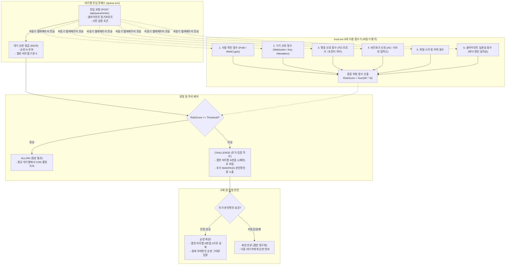

# D-04: 봇 탐지를 왜 인라인 차단하지 않고 ALLOW/CHALLENGE 2단계 격리로 다루며, 탐지 성능은 어떻게 통계적으로 증명하는가?

- **핵심 아키텍처 원칙**: 무고한 사람 오탐 영구 차단 원천 방지(권리 구제 보장), 대기열 핫패스 레이턴시 0ms 유지(비동기 점수 평가), Clopper-Pearson 통계적 신뢰구간 기반의 엄밀한 성능 검증
- **관련 설계 정본**: [ADR-0039](../../adr/0039-bot-detection-evaluation-protocol.md), [ADR-0048](../../adr/0048-bot-evaluation-sample-tiers-cost.md), [ADR-0112](../../adr/0112-human-false-positive-sample-one-session-per-person.md), [ADR-0156](../../adr/0156-bot-defense-detail-allow-or-challenge-two-layer-degraded-appeal-path.md), [ADR-0174](../../adr/0174-human-false-positive-public-data-and-post-launch.md), [docs/features/bot-defense.md](../../features/bot-defense.md) §1·§4.3·§10·§13
- **함께 읽기**: [한 판 문서](../01-system-design.md) 6단계, [분야 편 14 '봇 방어'](../fields/14-bot-defense.md), [결정 카드 D-03](D03-lobby-shuffle-ordering.md)

---

## 1. 풀려던 문제와 한계

대규모 티켓팅 환경에서 매크로와 자동화 봇을 방어하는 과정에서 마주하는 엔지니어링 한계는 다음과 같다.

### 1) 오탐(False Positive)으로 인한 일반 사용자의 영구 탈락 위험
- **회복 불가능한 피해**: 만약 봇 탐지 시스템이 일반 사용자를 봇으로 오판하여 연결을 즉시 끊거나(Drop) 차단하면, 해당 사용자는 수 주일을 기다린 티켓 예매 기회를 억울하게 영구 박탈당한다.
- **법적 규제 준수 의무**: 개인정보 보호법 제37조의2(자동화된 결정에 대한 정보주체의 권리)에 따르면 완전히 자동화된 시스템이 권리·의무에 중대한 영향을 미치는 결정을 내릴 때, 이용자는 이에 대한 설명 요구 및 인적 재검토(이의 제기)를 신청할 권리를 가진다. 따라서 인라인 차단은 기술적으로도, 법적으로도 채택할 수 없다.

### 2) CAPTCHA 단독 방어의 파탄과 역효과
- 최신 연구(USENIX Security 2023 등)에 따르면 비전 AI 및 캡차 해결 팜을 결합한 최신 봇의 CAPTCHA 통과율은 **85~100%**에 달한다. 반면 모바일 환경의 실제 인간 사용자는 글자 뭉개짐이나 타일 선택 피로로 인해 첫 시도 통과율이 **50~85%**로 오히려 봇보다 낮다. CAPTCHA만으로는 봇을 막지 못하고 정상 고객의 이탈률만 높인다.

### 3) 초당 20만 RPS 진입 핫패스의 레이턴시 한계
- NFR-001 기준 초당 20만 RPS가 유입되는 진입 관문에서 무거운 AI 모델 추론이나 외부 사기 탐지(Fraud Detection) SaaS API를 동기 호출하면 네트워크 RTT(30~100ms)와 CPU 병목으로 게이트웨이가 즉각 붕괴한다.

### 4) 사람 오탐률 통계적 검증의 수학적 표본 크기 한계
- NFR-022는 "단측 95% 신뢰수준에서 사람 오탐률(FPR) 상한을 **0.5% 이하**로 통제할 것"을 요구한다.
- 단순히 600명을 뽑아 오탐 0건을 요구하는 순진한 검증(Binomial Test)은, 실제 시스템의 오탐률이 0.1%로 우수하더라도 표본 무작위성에 의해 **45% 확률로 억울하게 탈락(Type II 에러)**하는 치명적 통계 왜곡을 유발한다.

---

## 2. 후보 기술 비교

| 평가 항목 | 후보 1: 인라인 영구 차단 (Hard Drop / IP Ban) | 후보 2: 모든 진입자 대상 강제 CAPTCHA | 후보 3: 동기식 인라인 머신러닝 추론 | 후보 4: ALLOW/CHALLENGE 2단계 격리 (선택) |
| :--- | :--- | :--- | :--- | :--- |
| **무고한 사용자 영구 탈락** | 심각 (오탐 시 예매 즉시 박탈) | 없음 (통과 시 진입 가능) | 심각 | **0건 (순번 보존, 추가 인증 통과 시 원순번 입장)** |
| **진입 핫패스 지연 시간** | < 1ms | 5,000~15,000ms (사용자 피로) | 50~150ms (동기 호출 병목) | **0ms (비동기 병렬 점수 산출 및 대기열 비트맵 격리)** |
| **CAPTCHA 우회 봇 대응** | 불가 | 무력화 (AI 솔버 정답률 90% 이상) | 우수 | **탁월 (6대 다층 점수기 + 경제적 비용 모델 결합)** |
| **법적 설명 책임 준수** | 위반 (개인정보보호법 §37의2) | 보통 | 위반 | **완벽 준수 (이의 제기 경로 및 인적 구제 절차 확보)** |
| **통계적 검증 가능성** | 주관적 판단 | 통과율만 측정 가능 | 불투명 | **수학적 보장 (Clopper-Pearson 947명 단측 95% 검증)** |
| **최종 판정** | **탈락 (POL-006 위반)** | **탈락 (ADR-0039)** | **탈락 (NFR-001 지연 예산 위반)** | **최종 채택 (ADR-0156, ADR-0048)** |

---

## 3. 고른 이유와 아키텍처 다이어그램

PEAKET은 **"대기열 핫패스에서는 절대 차단하지 않고 격리하며, 의심 세션은 순번을 보존한 채 추가 검증(CHALLENGE)을 거치게 한다"**는 무손실 방어 모델을 채택했다.

### 핵심 매커니즘 4가지

#### 1) 무차단 판정(`ALLOW` vs `CHALLENGE`)과 순번 보존 격리
- 판정 결과는 오직 두 가지뿐이며 `DROP`은 존재하지 않는다 (ADR-0156).
- `ALLOW`: 즉시 정상 대기열에서 폴링을 수행한다.
- `CHALLENGE`: 발급된 대기 순번은 유지하되, 대기 세그먼트 파일의 **결번 비트맵(Removed Bitmap)**에 해당 번호를 임시로 `1`로 마킹하여 뒷사람의 대기 인원 계산에서 제외한다.
- 사용자가 휴대폰 본인확인 또는 2차 보안 질문을 통과하면 비트맵을 즉시 `0`으로 원복하여 **원래 발급받은 순번 그대로 예매창에 진입**한다. 즉, 정상인이 오탐되더라도 겪는 피해는 '본인인증 1회 재수행'에 불과하다.

#### 2) 6대 다층 점수기(Multi-Layer Scorers)와 결측치 불변 원칙
- 특정 단일 지표(IP나 CAPTCHA)에 의존하지 않고 6개의 독립 점수기(0.0~1.0 위험 점수)를 전수 평가한다:
  1. **사람 확인 (Proof-of-Human)**: WebCrypto 기반 연산 퍼즐
  2. **기기 신뢰 (Device Attestation)**: WebAuthn 하드웨어 키 서명
  3. **행동 신호 (Behavioral Biometrics)**: 키 입력 간격 분포 및 마우스 이동 엔트로피
  4. **네트워크 신호**: 동일 /24 C-Class IP 대역의 동시 진입 밀도
  5. **계정 신뢰**: 가입 기간, 과거 정상 예매/관람 이력
  6. **환경 일관성**: User-Agent와 TLS Client Hello(JA4) 지문 간의 정합성
- **결측치 규칙**: 네트워크 순단으로 특정 점수기 값이 누락되면 가중치를 재조정하지 않고 해당 점수를 `0`으로 처리한다. 가중치를 재조정하면 정상인의 사소한 환경 누락으로 오탐률이 급증하기 때문이다 (ADR-0156).

#### 3) 통계적 Clopper-Pearson 947명 표본 검증 프로토콜
- NFR-022(단측 95% 신뢰수준에서 사람 오탐률 $\le 0.5\%$)을 엄밀히 증명하기 위해 Clopper-Pearson 이항 분포 정확 구간을 도출했다 (ADR-0048):
  - **표본 크기 $N = 947$명, 허용 오탐 $k \le 1$건**
  - 이 조건 하에서 실제 시스템의 오탐률이 0.1%일 때 검증 합격 확률은 **76%**로 상식적인 합격률을 보장한다. (기존 600명 0건 기준은 55%로 비합리적이었음).
- 출시 전에는 인위적 사용자 947명을 모집할 수 없으므로, 공개 벤치마크 데이터셋(Aalto 136M Keystrokes)의 실제 사람 키스트로크 947건을 주입하여 `BehaviorScore` 단독 기여에 의한 오탐률 상한을 사전 검증한다 (ADR-0174).

#### 4) 봇 정교함 12칸 분류 및 경제적 획득 비용 모델
- 봇을 4대 공격 목적 $\times$ 3단계 기술 수준(단순 스크립트, 헤드리스 브라우저 자동화, 사람 대행 팜)의 총 12개 등급으로 분류한다.
- 인간 입력을 정밀 복제하는 3단계 봇은 탐지율 대신 **1장당 획득 비용 공식**으로 경제성을 무력화한다 (ADR-0048):
  $$\text{티켓 1장당 봇 운영 비용} \ge \text{암표 프리미엄} \times k \quad (k \ge 1.2)$$
- 봇 운영자가 암표로 얻는 기대 수익보다 프록시 IP 비용, SMS 본인인증 대행 비용, AI 인프라 유지 비용을 더 높게 강제하여 비즈니스 모델 자체를 파괴한다.

---

## 4. 얻는 것과 치르는 값 (Tradeoffs)

### 얻는 것 (Gains)
1. **무고한 정상 고객 차단 0건**: 오탐이 발생해도 추가 인증 후 원래 순번으로 진입하므로 영구 박탈 민원 및 법적 분쟁을 100% 방지한다.
2. **진입 경로 초당 20만 RPS 무지연 처리**: 동기 차단 로직이 진입 경로에 존재하지 않으므로 게이트웨이 지연 시간이 0ms로 유지된다.
3. **엄밀한 수학적 신뢰성 증명**: 마케팅성 "봇 99.9% 차단" 문구가 아닌, 947명 표본과 Clopper-Pearson 신뢰구간에 입각한 공학적 보증을 제공한다.

### 치르는 값 (Costs & Limitations)
1. **대여 명의 봇의 일부 침투 가능성**: 대포폰이나 대여 명의를 확보하여 SMS 추가 인증을 사람이 대신 뚫어주는 지능형 봇은 현장 게이트 전까지 대기열에서 걸러내지 못한다 (사후 포렌식으로 이관).
2. **trust-svc 장애 시 판정 완화**: 봇 방어보다 가용성(Availability)이 우선하므로, trust-svc가 장애를 겪을 경우 서킷 브레이커가 열리며 모든 세션을 `ALLOW`로 우회 통과시킨다.
3. **추가 인증 화면 진입 시의 UX 마찰**: 정상인 중 약 0.1~0.5%의 사용자는 본인확인 화면을 한 번 더 거쳐야 하는 경미한 불편을 겪는다.

---

## 5. 바꿀 조건 (Conditions to Change)

1. **실서비스 오탐률 상한(0.5%) 초과**: 첫 온세일 후 R2 단계 표본 검토에서 사람 오탐률이 0.5%를 초과할 경우, `BehaviorScore`의 판정 가중치를 즉시 0으로 내리고 그림자 모드로 환원한다.
2. **봇 조직의 SMS 우회 단가 하락**: 대리 인증 암시장 단가가 급락하여 봇 획득 비용이 암표 프리미엄보다 낮아질 경우, FIDO2 WebAuthn 하드웨어 보안키(지문/FaceID) 인증을 필수 조건으로 격상한다.
3. **신뢰성 높은 공개 벤치마크 표준 등장**: 공인된 학계/업계의 공통 봇 데이터셋 표준이 제정되면 자체 Aalto 데이터셋 변환 모델을 폐기하고 해당 표준 테스트셋으로 마이그레이션한다.

---

## 6. 핵심 꼬리 질문 5단 방어 (Staff Interview Q&A)

| 질문 단계 | 심층 질문 | 방어 논리와 기술적 근거 | 관련 정본 |
| :--- | :--- | :--- | :--- |
| **1단: 왜 (Why)** | 봇 점수가 명백히 높은 세션도 즉시 세션을 끊지 않고 굳이 순번을 유지해 주나요? | 어떤 봇 탐지 알고리즘도 100% 완벽할 수 없습니다. 모바일 기기의 일시적 네트워크 오류나 지체 장애인의 비전형적 입력이 봇으로 오탐될 수 있습니다. 순번을 유지한 채 결번 비트맵으로 일시 격리하고 추가 인증 기회를 부여하면, 무고한 사용자가 단 한 명도 피해를 입지 않으며 개인정보보호법상 설명 및 구제 권리를 완벽히 만족합니다. | POL-006, ADR-0156 |
| **2단: 대안 (Alternatives)** | Cloudflare Bot Management나 AWS WAF Bot Control 같은 상용 서비스를 쓰는 게 낫지 않나요? | 상용 솔루션의 탐지율 수치는 일반 웹사이트 기준이며, 특정 일시에 수십만 명이 몰려 동일한 버튼을 연타하는 고유한 티켓팅 도메인에서는 대규모 오탐을 유발합니다. 또한 1회 티켓팅당 수천만 건의 요청을 상용 SaaS로 검사할 경우 막대한 비용이 발생합니다. 오픈소스 핑거프린팅과 자체 6대 점수기를 결합하는 것이 도메인 특화 정확도와 비용 면에서 압도적입니다. | ADR-0039, ADR-0156 |
| **3단: 장애 대응 (Resilience)** | 봇 점수를 계산하는 trust-svc가 완전히 다운되면 대기열 전체가 마비되나요? | 시스템 5대 품질 목표(ADR-0151)에 따라 가용성은 봇 방어보다 상위 우선순위입니다. queue-svc는 10초 창에서 50% 실패 시 서킷 브레이커를 즉시 개방하고 모든 사용자를 `ALLOW`로 안전 통과시킵니다. 봇이 일부 통과하더라도 대기열 붕괴를 막고 사후 포렌식 시스템(ADR-0171)으로 부정한 예매를 사후 취소합니다. | bot-defense §11, ADR-0151 |
| **4단: 수치 근거 (Numbers)** | 왜 하필 947명 표본에 1건 이하의 오탐 기준을 정했나요? | Clopper-Pearson 이항 분포 공식에서 단측 95% 신뢰수준 상한이 0.5% 이하가 되도록 만족하는 가장 작은 정수 표본 크기가 바로 $N=947$ ($k=1$)입니다. 600명(k=0) 기준은 실제 오탐률 0.1%인 시스템도 45% 확률로 탈락시키는 통계적 결함이 있어, 현실적인 검증 검정력(Power = 76%)을 확보하도록 수학적으로 최적화된 수치입니다. | ADR-0048, ADR-0112 |
| **5단: 실측과 검증 (Verification)** | 실제 사람 947명을 직접 모아서 테스트해 보셨나요? | 서비스 출시 전 단계에서 외부 사용자 947명을 모집하여 티켓팅 환경을 통제하는 것은 비현실적인 일정 리스크를 유발합니다. 따라서 공개된 실제 사람 키 입력 데이터셋(Aalto 136M Keystrokes)의 947명 프로필을 추출하여 행동 점수기의 단독 오탐 기여도를 사전 검증(Q-T44)했습니다. 실제 프로덕션 환경의 복합 오탐률은 출시 첫 온세일에서 섀도우 트래픽으로 200건 표본 2묶음을 교차 검토(R2)하여 최종 확정합니다. | docs/verification.md §3.4, ADR-0174 |

---

## 7. 30초 아키텍처 브리핑 (Staff Engineer Summary)

> "PEAKET은 봇 탐지에서 무고한 실제 고객이 피해를 입는 것을 막기 위해 '인라인 차단(Drop)'을 전면 금지하고 `ALLOW`와 `CHALLENGE` 2단계 격리 모델을 구축했습니다.  
> 핫패스 게이트웨이는 레이턴시 지연 없이 순번을 발급하되, 비동기 6대 다층 점수기 평가에서 의심 판정을 받은 세션은 순번을 보존한 채 결번 비트맵으로 격리하여 2차 본인확인을 거치게 합니다.  
> 이를 통해 사람 오탐률 단측 95% 상한을 0.5% 이하(Clopper-Pearson 947명 표본 검증)로 엄격히 통제하면서도, 초당 20만 RPS의 트래픽을 단 1ms의 추가 지연 없이 수용합니다."
