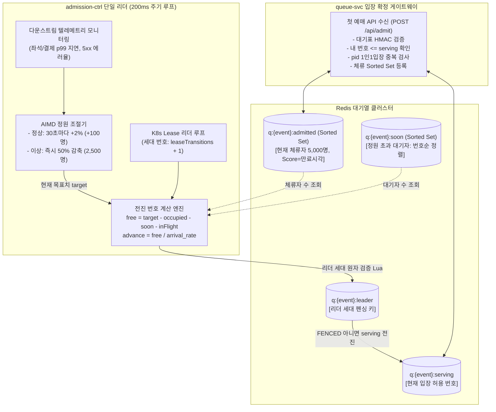
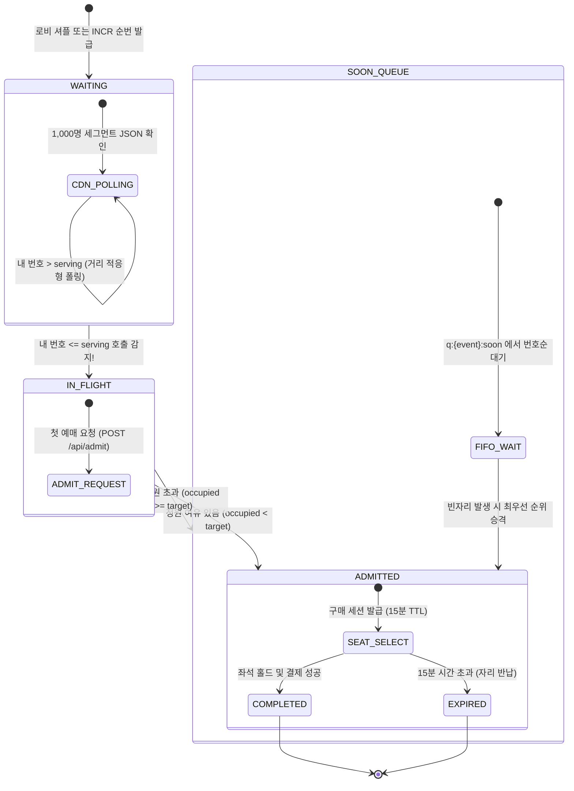

# D-05: 예매창 입장 통제에서 왜 정적 인원이 아닌 Little's Law 기반 5,000명 동시 체류 상한과 200ms 동적 제어 루프(AIMD)를 선택했는가?

- **핵심 아키텍처 원칙**: 리틀의 법칙($L = \lambda W$) 기반 백엔드 용량 보호, 유출입 피드백 제어(`inFlight`·`soon` 반영), 리더 세대 펜싱을 통한 분할 뇌 방어
- **관련 설계 정본**: [ADR-0005](../../adr/0005-admission-confirmed-by-first-booking-request.md), [ADR-0056](../../adr/0056-admission-leader-fencing-and-admission-person-recheck.md), [ADR-0104](../../adr/0104-admission-loop-in-flight-and-ordered-soon-queue.md), [ADR-0182](../../adr/0182-admission-leader-loop-first-implementation.md), [docs/features/queue-admission.md](../../features/queue-admission.md) §5·§6·§9
- **함께 읽기**: [한 판 문서](../01-system-design.md) 7단계, [분야 편 9 '대기열·입장'](../fields/09-queue-admission.md), [DB 설계 편 6 '동시에 고칠 때'](../db/06-concurrency.md), [결정 카드 D-02](D02-queue-number-incr.md)·[D-06](D06-seat-soft-hold-hard-sale.md)

---

## 1. 풀려던 문제와 한계

대기열 뒤편의 좌석 선택, 주문 생성, 결제(PG 승인) 시스템은 동시 수용 가능한 컴퓨팅 자원과 외부 API 처리량이 물리적으로 고정되어 있다. 100만 명의 대기자가 줄을 서 있다고 해서 이들을 무제한으로 예매창에 진입시키면 전체 시스템이 즉각 붕괴한다.

### 1) 리틀의 법칙(Little's Law)과 시스템 수용 한계
리틀의 법칙에 따르면 안정적인 시스템에서 평균 동시 체류 인원($L$)은 평균 유입률($\lambda$)과 평균 체류 시간($W$)의 곱과 같다:
$$L = \lambda \cdot W$$
- **체류 인원 상한 ($L = 5,000$명)**: 좌석 선점 경합(Lock Contention)과 인메모리 세션 용량, PG 결제 승인 API의 최대 한도(토스페이먼츠 기준 초당 300 TPS)를 감안할 때, 예매창 내부 동시 체류자는 최대 5,000명으로 엄격히 통제되어야 한다.
- **평균 체류 시간 ($W = 180$초)**: 사용자가 예매창에 입장하여 좌석을 고르고 본인인증 및 결제를 마치기까지 평균 3분이 소요된다.
- **허용 입장 유입률 ($\lambda = L / W$)**:
  $$\lambda = \frac{5,000 \text{명}}{180 \text{초}} \approx 27.78 \text{ users/sec}$$
- 즉, 시스템이 안전하게 감당할 수 있는 새 입장 속도는 **초당 약 28명**이며, 5만 석 회차 기준 전체 티켓 소진까지 걸리는 이론적 시간은 약 **18분**이다.

### 2) 단순 빈자리 측정 방식(v0)의 호출 증폭 및 붕괴 참사
초기 순진한 설계는 200ms 주기로 `빈자리 = 5,000 - 현재 체류자`를 세어 빈자리만큼 `serving` 번호를 앞으로 전진시켰다.
이 방식은 파멸적인 결함을 유발한다:
- **호출 인지 지연(1~3초)**: 번호가 호출되었더라도 CDN 폴링 지연, 네트워크 전송, 브라우저 렌더링, 모바일 백그라운드 탭 슬로틀링 등으로 인해 사용자가 실제 예매창에 도달하기까지 1~3초의 갭이 발생한다.
- **호출 중복 증폭 폭풍**: 빈자리가 500개 생겼을 때, 첫 주기(0ms)에 500명을 불렀지만 이들이 아직 도착하지 않아 다음 주기(200ms)에도 여전히 빈자리가 500개로 측정된다. 그 결과 1초(5주기) 동안 **동일한 빈자리에 대해 2,500~5,000명을 중복 호출**하게 된다.
- **`SOON` 에러 폭풍**: 뒤늦게 몰려든 수천 명의 사용자는 정원 초과로 쫓겨나며 "자리가 없으니 잠시 후 다시 시도하라"는 429(`SOON`) 응답을 수만~수십만 건 받게 되어 대기열 순서 역전과 사용자 불만이 극대화된다.

### 3) 노쇼(No-Show) 및 이탈자로 인한 좌석 공회전
- 차례가 왔음에도 브라우저를 닫고 이탈한 사람에게 자리를 미리 배정해 두면, 만료 시간(15분) 동안 자리가 낭비되어 전체 입장 속도가 극도로 둔화된다.
- 따라서 **호출 시점이 아닌 실제 첫 예매 요청 시점에만 원자적으로 자리를 확정(Admission Confirmed)**해야 한다.

### 4) K8s Lease 기반 리더 선출의 분할 뇌(Split-Brain) 위험
- admission-ctrl은 단일 리더가 serving 루프를 실행해야 한다. K8s Lease를 사용하지만 일시적 네트워크 단절이나 GC Pause 시 구 리더와 신 리더가 동시에 쓰기를 시도할 수 있다. 분할 뇌 상태에서 serving 번호가 중복 전진하거나 과거 번호로 되돌아가는 치명적 버그를 원천 방어해야 한다.

---

## 2. 후보 기술 비교

| 평가 항목 | 후보 1: 정적 배치 입장 (1분마다 1,000명 일괄 진입) | 후보 2: 단순 빈자리 증분 루프 (AWS 템플릿 기본) | 후보 3: 사전 준비(Ready) 신호 수신 후 입장 | 후보 4: Little's Law 동적 피드백 루프 + 리더 펜싱 (선택) |
| :--- | :--- | :--- | :--- | :--- |
| **백엔드 부하 안정성** | 극심한 톱니바퀴 스파이크 (DB 붕괴) | 부하 초과 (도착 지연으로 인한 과다 중복 호출) | 안정적 (준비된 자만 입장) | **최적 제어 (초당 28명 유입, 체류 5,000명 완벽 유지)** |
| **노쇼(No-Show) 처리** | 이탈자만큼 빈자리가 영구 낭비됨 | 종료 이벤트 누락 시 오차가 영구 누적됨 | 하트비트 트래픽 수만 RPS 폭증 | **도착 전환율(`arrival_rate`) 기반 실시간 자동 보정** |
| **`SOON` (입장 정원 초과) 발생** | 주기 초반 폭발적 발생 | 모의 시 3만~52만 건 대량 발생 | 0건 | **0건 수렴 (inFlight 윈도우 추적으로 중복 호출 차단)** |
| **분할 뇌 (Split-Brain) 방어** | N/A | 무방비 (리더 경합 시 serving 요동) | 무방비 | **Redis Lua 세대 펜싱 (`FENCED`) 완벽 차단** |
| **다운스트림 이상 반응성** | 둔감 (수동 개입 전까지 계속 밀어넣음) | 둔감 | 둔감 | **AIMD 피드백 (오류율/지연 증가 시 목표 50% 급감)** |
| **최종 판정** | **탈락 (시스템 붕괴 유발)** | **탈락 (ADR-0104)** | **탈락 (오리진 쓰기 부하 폭탄)** | **최종 채택 (ADR-0005, ADR-0104, ADR-0182)** |

---

## 3. 고른 이유와 아키텍처 다이어그램

PEAKET은 **"도착 지연을 고려한 유출입 피드백 루프(200ms)"**와 **"AIMD 기반 다운스트림 동적 조절"**을 결합하여 완벽한 백엔드 보호막을 구현했다.

### 핵심 매커니즘 4가지

#### 1) 200ms 단위의 정밀 유출입 제어 공식
리더는 매 200ms마다 다음 4단계 수식을 평가하여 `serving` 번호를 전진시킨다 (ADR-0104):
1. **유효 가용 정원 계산**:
   $$\text{free} = \text{target} - \text{occupied} - \text{soon\_queue} - \text{in\_flight}$$
   - `target`: 현재 동시 입장 목표 인원 (기준 5,000명).
   - `occupied`: 현재 좌석 화면에 머물고 있는 활성 세션 수 (Sorted Set 크기).
   - `soon_queue`: 자리가 없어 대기 중인 `SOON` 큐 인원 수.
   - `in_flight`: 최근 5초($W_{\text{inflight}}$) 윈도우 내에 호출되었으나 아직 첫 예매 요청을 보내지 않은 이동 중인 인원 수.
2. **도착 전환율(`arrival_rate`) 반영 및 전진량 산출**:
   $$\text{advance} = \text{clamp}\left( \frac{\text{free}}{\max(\text{arrival\_rate}, 0.2)}, \, 0, \, \text{max\_advance\_rate} \times 0.2\text{s} \right)$$
   - `arrival_rate`: 최근 10~60초 동안 호출된 번호 중 실제 입장을 확정한 비율 (하한 0.2). 노쇼가 많을수록 더 많은 번호를 과감히 전진시켜 빈자리를 즉시 메운다.
   - `max_advance_rate`: 초당 1,000번호 상한 및 PG사 승인 한도(300 TPS) 중 작은 값으로 클램핑하여 다운스트림의 순간 폭주를 원천 차단한다.

#### 2) 사용자 생애주기와 상태 전이 흐름도
사용자는 대기열 진입부터 좌석 예매창 확정까지 다음의 엄격한 상태 머신을 거친다:

- **`SOON` 큐 번호 순 공정성 (POL-008)**: 순간적으로 정원이 차서 `SOON`을 받은 대기자는 번호 순 정렬 큐(`q:{event:E}:soon`)에 들어가며, 빈자리가 생기면 도착 순이 아닌 **대기 번호가 낮은 순서대로 최우선 입장**한다. 재시도 타이밍에 따른 순서 역전이 발생하지 않는다.

#### 3) AIMD (Additive Increase Multiplicative Decrease) 동적 피드백
- **Additive Increase (선형 증가)**: 다운스트림 좌석 및 결제 시스템의 p99 응답 지연이 정상 범위(좌석 홀드 < 50ms, PG 승인 < 1.5s)이고 에러율이 0.1% 미만이면, 매 30초마다 체류 목표(`target`)를 초기 목표의 **2%(+100명)**씩 점진적으로 상향한다 (최대 8,000명 상한).
- **Multiplicative Decrease (지수 감소)**: 다운스트림 p99 지연이 임계치를 초과하거나 5xx 에러율이 1%를 넘어서면, 즉시 체류 목표를 **50% 감축(2,500명)**으로 급격히 조여 오리진에 유입되는 압력을 즉시 차단한다 (최소 1,000명 하한).

#### 4) 리더 세대 펜싱(Leader Generation Fencing)과 분할 뇌 차단
- 리더 파드는 K8s Lease를 획득할 때 Lease 갱신 카운터(`leaseTransitions`)에 1을 더해 고유한 리더 세대 번호(`leaderEpoch`)를 발급받는다.
- Redis의 `serving` 전진 및 리더 상태 기록은 반드시 원자적 Lua 스크립트를 거치며, 스크립트 내부에서 `q:{event:E}:leader`의 세대 번호와 대조한다:
  - 현재 저장된 세대보다 낮으면 `FENCED` 에러를 반환하고 즉시 쓰기를 거절한다.
  - 구 리더는 `FENCED`를 수신하는 즉시 serving 루프를 즉시 중단하고 대기 파드로 강등된다.
- 이를 통해 네트워크 단절이나 긴 GC로 인해 두 개의 리더가 겹치는 극단적 순간에도 serving 번호의 왜곡이나 데이터 오염이 0건으로 보장된다.

---

## 4. 얻는 것과 치르는 값 (Tradeoffs)

### 얻는 것 (Gains)
1. **다운스트림 완벽 보호**: 100만 명이 몰려도 좌석/결제 시스템에 유입되는 활성 부하는 목표 인원(5,000명, 초당 약 28명 유입)으로 엄격히 평탄화(Throttling)된다.
2. **`SOON` 에러 및 사용자 불만 0건 수렴**: `in_flight` 윈도우 추적을 통해 도착 지연으로 인한 중복 호출을 완벽히 제거하여, 모의 시뮬레이션 기준 수십만 건에 달하던 `SOON` 재시도 응답이 0건으로 사라졌다.
3. **노쇼 자원의 낭비 원천 차단**: 좌석 화면 입장은 실제 첫 예매 요청에서만 확정되므로, 창을 닫고 떠난 사람으로 인해 예매창이 비어 있는 공회전이 발생하지 않는다.
4. **완벽한 분할 뇌 방어**: 리더 세대 펜싱을 통해 분산 환경에서 리더가 일시 겹치더라도 안전한 단일 쓰기 일관성을 보장한다.

### 치르는 값 (Costs & Limitations)
1. **티켓 매진 시간의 제약**: 다운스트림 보호를 위해 입장 속도를 초당 약 28명으로 제한하므로, 5만 석 전체가 매진되기까지 물리적으로 최소 18분의 시간이 소요된다. (티켓 판매 속도와 인프라 안정성 간의 필연적 트레이드오프)
2. **도착 대기 윈도우(W=5s) 동안의 미세한 공회전**: 호출 후 도착하지 않는 노쇼 사용자를 판정하기 위해 5초의 관찰 윈도우를 두므로, 순간 입장 처리량이 이론치 대비 약 0.6~1.5% 미세하게 감소할 수 있다.
3. **리더 전환 공백기 발생**: K8s Lease 만료 및 새 리더 선출 동안(약 10~15초) serving 전진이 일시 정지될 수 있다.

---

## 5. 바꿀 조건 (Conditions to Change)

1. **다운스트림 인프라 스케일업 및 결제사 TPS 한도 상향**: PG사와의 전용선 대역폭 계약을 통해 결제 승인 한도가 300 TPS에서 1,000 TPS 이상으로 확대되고 DB 성능이 검증될 경우, 기본 체류 목표를 5,000명에서 10,000명 이상으로 상향하여 전체 매진 소요 시간을 10분 이내로 단축한다.
2. **`SOON` 응답 비율이 1%를 초과할 때**: 실제 운영 부하에서 네트워크 지연 증가로 `SOON` 응답 비율이 1%를 넘거나 입장 처리량이 3% 이상 저하될 경우, 관찰 윈도우 $W_{\text{inflight}}$를 5초에서 7~10초로 확대하고 도착 전환율 하한을 0.2에서 0.1로 재조정한다.
3. **브라우저의 백그라운드 탭 정책 변경**: Chrome 등 주요 브라우저가 비활성 탭의 타이머 슬로틀링(현재 1분 1회)을 더 엄격하게 제한할 경우, 예상 대기 시간 10초 이내 사용자에 한해 Web Worker 백그라운드 폴링 또는 브라우저 Notification API 연동을 도입한다.

---

## 6. 핵심 꼬리 질문 5단 방어 (Staff Interview Q&A)

| 질문 단계 | 심층 질문 | 방어 논리와 기술적 근거 | 관련 정본 |
| :--- | :--- | :--- | :--- |
| **1단: 왜 (Why)** | 대기자가 100만 명이나 되는데 왜 예매창 동시 입장을 5,000명으로 빡빡하게 묶나요? | Little's Law($L = \lambda W$)에 따라 평균 체류 시간 180초 기준 동시 체류 5,000명은 초당 약 28명의 유입률을 의미합니다. 이 수치는 인기 좌석 선점 시의 DB 행 락 경합과 토스페이먼츠 등 외부 PG사의 초당 처리 한도(300 TPS)를 안정적으로 수용할 수 있는 엔지니어링 임계치입니다. 이를 풀면 대기열 통과는 빨라질지 몰라도 좌석 선택과 결제 단계에서 DB가 100% 뻗어 전면 장애가 발생합니다. | docs/architecture.md §9.1 |
| **2단: 대안 (Alternatives)** | AWS 참조 아키텍처처럼 세션이 종료될 때마다 빠져나간 만큼만 serving을 올리는 증분 방식은 왜 안 되나요? | 세션 종료 이벤트(브라우저 닫기, 네트워크 단절 등)는 유실되기 쉬워 오차가 누적되면 영구적으로 새 입장이 막히는 치명적 결함이 있습니다. 또한 차례가 왔음에도 오지 않는 노쇼(No-Show) 사용자의 자리를 채우지 못해 입장 처리량이 크게 감소합니다. 따라서 매 200ms마다 활성 세션과 이동 중 인원(`inFlight`)을 실측하여 보정하는 유출입 제어 루프가 필수적입니다. | ADR-0104 '검토한 대안' |
| **3단: 장애 대응 (Resilience)** | admission-ctrl 파드가 K8s Lease 경합으로 리더가 2명이 되면 serving 번호가 꼬이지 않나요? | K8s Lease 갱신 시 부여되는 `leaseTransitions` 기반의 리더 세대 번호를 Redis Lua 스크립트 실행 시 원자적으로 검증(Fencing)합니다. 구 리더가 네트워크 단절에서 깨어나 지연 쓰기를 시도하더라도 Redis는 `FENCED` 에러로 즉각 거절하며, 구 리더는 루프를 즉시 중단합니다. 새 리더만이 `ctl` 키의 기존 상태를 이어받아 serving을 안전하게 전진시킵니다. | ADR-0056, ADR-0182 |
| **4단: 수치 근거 (Numbers)** | 5,000명 정원, 200ms 주기, 5초 inFlight 윈도우의 산출 근거는 무엇인가요? | 5,000명은 PG사 300 TPS와 좌석 동시 경합 인원을 고려한 설계 목표치입니다. 200ms 주기는 클라이언트의 최소 폴링 주기(0.5초)보다 충분히 짧아 빈자리를 지연 없이 메우면서도 Redis CPU 부하가 1% 미만인 주기입니다. 5초 inFlight는 CDN 캐시 만료(1초) + 클라이언트 인지 및 네트워크 RTT(1~3초) + 브라우저 페이지 전환(1초)의 p99 합산 지연(약 4.2초)에 안전 마진을 더한 값입니다. | ADR-0104, docs/features/queue-admission.md §5 |
| **5단: 실측과 검증 (Verification)** | 200ms 제어 루프가 극단적 트래픽 환경에서 실제로 안정적인지 검증했나요? | 정형 모델 검사(Formal Verification)를 통해 리더 교체 및 네트워크 분할 상황에서 구 리더의 비정상 쓰기가 0건으로 완벽히 차단됨을 기계적으로 증명했습니다. 또한 10만 가상 사용자 시뮬레이션에서 기존 단순 빈자리 루프 적용 시 3만~52만 건 발생하던 `SOON`(정원 초과 재시도) 응답이 inFlight 및 arrival_rate 피드백 루프 적용 후 **0건으로 수렴**함을 확인했습니다. | ADR-0056, ADR-0104, docs/verification.md §2.6 |

---

## 7. 30초 아키텍처 브리핑 (Staff Engineer Summary)

> "PEAKET은 100만 대기자가 몰려도 다운스트림 좌석 및 결제 시스템을 완벽히 보호하기 위해 **Little's Law($L = \lambda W$) 기반의 5,000명 동시 체류 상한**을 엄격히 유지합니다.  
> 200ms 주기로 동작하는 admission-ctrl 리더 루프는 단순 빈자리가 아니라 호출 후 이동 중인 인원(`inFlight`)과 정원 초과 대기자(`soon`), 실제 도착 전환율을 정밀 계산하여 `serving` 번호를 전진시킵니다. 이를 통해 수십만 건의 입장 거절(`SOON`)을 0건으로 통제합니다.  
> 또한 다운스트림의 지연 및 에러율에 따라 AIMD 방식으로 정원을 동적 조절하며, K8s Lease와 Redis Lua 세대 펜싱을 결합하여 분할 뇌 상황에서도 serving 번호의 왜곡을 100% 차단합니다."
