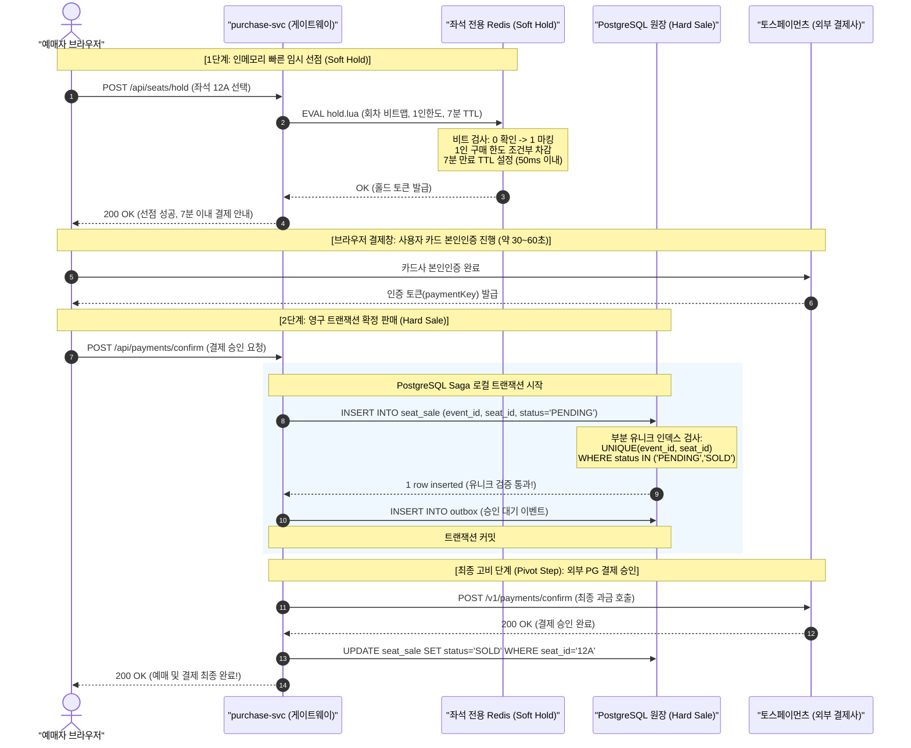
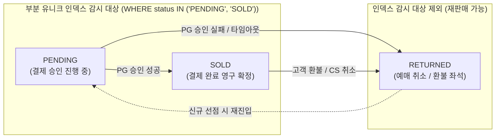

# D-06: 같은 좌석을 두 번 팔지 않으려고 왜 인메모리 임시 선점(Soft Hold)과 PostgreSQL 부분 유니크 인덱스 확정(Hard Sale)의 2단계 일관성 모델을 선택했는가?

- **핵심 아키텍처 원칙**: 빠른 임시 선점(p99 50ms)과 원장 불변성(오버셀 0건)의 분리, PostgreSQL 부분 유니크 인덱스를 통한 물리적 최종 방어, 단일 장애 복구 경로 유지
- **관련 설계 정본**: [ADR-0014](../../adr/0014-soft-hold-hard-sale.md), [ADR-0083](../../adr/0083-keep-postgresql-partition-keys-transaction-scoped-settings-global-replica.md), [ADR-0121](../../adr/0121-seat-redis-failover-defer-purchase-drop-db-hold-path.md), [docs/features/seat-hold.md](../../features/seat-hold.md) §1·§3·§4·§6·§8·§9, [docs/data.md](../../data.md) §2·§5
- **함께 읽기**: [한 판 문서](../01-system-design.md) 8단계, [분야 편 10 '좌석'](../fields/10-seat-hold.md), [DB 설계 편 4 '같은 좌석을 두 번 팔지 않기'](../db/04-no-double-sale.md), [결정 카드 D-05](D05-admission-control-loop.md)·[D-08](D08-payment-two-phase-forward-recovery.md)

---

## 1. 풀려던 문제와 한계

5만 석 규모 대형 콘서트에서 VIP 구역의 특정 명당 좌석 1개에 최대 **1,000명의 동시 선점 경합**이 발생하고, 오픈 직후 홀드 요청은 **초당 2,000 TPS(NFR-003)**에 달한다. 시스템은 이 극심한 동시성 경합 속에서 **p99 50ms 이내의 극단적 반응 속도**와 **오버셀(Over-selling, 이중 판매) 0건**이라는 양립하기 어려운 두 목표를 동시에 달성해야 한다.

### 1) PostgreSQL 비관적 행 잠금(`SELECT ... FOR UPDATE`, v0)의 붕괴
- 1,000명이 단 1개의 좌석 행에 대해 `FOR UPDATE`를 걸면, 1번째 요청이 락을 쥐고 트랜잭션을 끝낼 때까지 나머지 999개 요청은 DB 커널 레벨에서 락 대기 큐(Lock Wait Queue)에 직렬로 갇힌다.
- DB 커넥션 풀(최대 수백 개)이 수십 밀리초 만에 완전히 고갈되며, 트랜잭션 타임아웃(`lock_timeout`)이 연쇄 발생한다.
- 그 결과 DB CPU가 100%로 치솟으며 응답 지연 p99가 수 초로 폭증하고, 대규모 트랜잭션 롤백 폭풍과 커넥션 에러로 시스템 전체가 마비된다.

### 2) 순수 Redis 단독 확정의 오버셀(Over-selling) 치명상
- Redis는 메모리 기반 원자적 연산을 수행하므로 초당 수만 건의 좌석 선점을 1ms 이내로 처리할 수 있다.
- 그러나 Redis는 성능을 위해 **비동기 복제(Asynchronous Replication)**를 채택하고 있다.
- 좌석 선점 정보를 오직 Redis에만 두고 판매를 확정할 경우, 마스터 노드가 비정상 다운되어 복제본이 승격(Failover)될 때 아직 복제본에 전달되지 못한 마지막 수 밀리초의 쓰기(In-flight writes)가 영구 유실된다.
- 유실된 좌석은 새 마스터에서 '빈 좌석'으로 표시되어 다른 사용자에게 중복 판매된다. 티켓팅 도메인에서 오버셀은 콘서트 당일 현장 입장 거부, 티켓 가격의 200% 보상 환불, 집단 소송으로 번지는 치명적인 비즈니스 참사다.

### 3) 장애 시 비상 DB 홀드 경로(Failover to DB)의 모순
- 과거 초기 설계안은 Redis 장애 조치 동안 PostgreSQL로 우회하여 홀드를 발급하는 '비상 DB 홀드 경로'를 구상했다.
- 그러나 장애 직전 몇 초 동안 Redis에서 발급된 최신 홀드 내역은 비동기 릴레이(Stream $\to$ Kafka $\to$ DB) 지연으로 인해 DB 원장에 아직 도착하지 않은 상태다.
- 이 상태에서 DB가 홀드를 발급하면, Redis에서 이미 다른 사용자에게 배정된 좌석을 DB가 또다시 배정하게 되어 **장애 우회 경로 자체가 새로운 이중 판매를 양산**한다.

---

## 2. 후보 기술 비교

| 평가 항목 | 후보 1: PostgreSQL 행 락 (`FOR UPDATE`, v0) | 후보 2: Redis 메모리 단독 확정 | 후보 3: CockroachDB 분산 트랜잭션 | 후보 4: Redis 장애 시 DB 우회 홀드 | 후보 5: Redis Soft Hold + PG Partial Unique Hard Sale (선택) |
| :--- | :--- | :--- | :--- | :--- | :--- |
| **홀드 지연시간 (NFR-003)** | p99 수 초 (극심한 락 큐잉) | p99 < 5ms (초고속) | p99 80~150ms (분산 합의 지연) | p99 300ms 이상 (DB 부하) | **p99 50ms 이내 달성 (Redis 왕복 7ms)** |
| **오버셀 (이중 판매) 위험** | 0건 (DB 락 보장) | **치명적 (노드 장애 시 쓰기 유실로 오버셀 발생)** | 0건 | **치명적 (DB 미동기화로 이중 홀드 발생)** | **0건 (PostgreSQL 커널 제약으로 100% 원천 차단)** |
| **1,000명 단일 좌석 경합** | DB CPU 100% 포화 및 붕괴 | 1명 성공, 999명 즉시 409 반환 | 지연 급증 및 충돌 재시도 | DB 커넥션 풀 고갈 | **Lua 0.3ms 실행: 1명 선점, 999명 즉시 탈락** |
| **과금 후 취소/환불 위험** | 낮음 | 없음 | 낮음 | 매우 높음 | **0건 (PG 승인 API 호출 전에 탈락자 100% 필터링)** |
| **장애 시 운영 복잡도** | 단일 DB 관리 | 단순 | 분산 합의 클러스터 운영 | 극도로 복잡 (두 경로 간 데이터 불일치) | **단순 (장애 시 30초 구매 유예 후 정상 단일 경로 복귀)** |
| **최종 판정** | **탈락 (v0 실패 기준선)** | **탈락 (금융/법적 결함)** | **탈락 (단일 리전에 과도한 오버엔지니어링)** | **탈락 (ADR-0121)** | **최종 채택 (ADR-0014, ADR-0121)** |

---

## 3. 고른 이유와 아키텍처 다이어그램

PEAKET은 **"사용자 체감 성능은 인메모리 Soft Hold가 책임지고, 금융/법적 불변성은 관계형 데이터베이스의 Hard Sale이 영구 수호한다"**는 2단계 일관성 모델을 확립했다.



### 핵심 매커니즘 4가지

#### 1) Redis `hold.lua` 단일 스크립트 기반 원자적 Soft Hold (p99 50ms)
- 회차의 전체 좌석 현황은 단 **6.25KB의 비트맵**(5만 석 기준: $50,000 / 8 = 6,250 \text{ bytes}$)으로 표현되며, 단일 Redis 샤드에 저장된다.
- 클라이언트의 좌석 선점 요청은 `hold.lua` 스크립트 하나로 원자 실행된다:
  1. 회차 판매 상태 및 점검 플래그 검사
  2. 선택한 좌석의 비트맵 비트가 `0`(비어 있음)인지 확인
  3. 사용자 본인(`pid`)의 1인 예매 한도(`purchase_quota`) 초과 여부 확인
  4. 멱등키 검사
  5. 모든 조건 충족 시 비트를 `1`로 세팅하고 좌석 키에 **7분 TTL**을 부여
- **No-Rollback 설계**: Valkey/Redis는 롤백이 불가능하므로 "모든 검사를 완전히 통과한 후에만 쓰기를 단행"한다.
- **예산 분배**: 게이트웨이 파드 인입 3ms + 네트워크 왕복 5ms + 인증 1ms + Redis 왕복 7ms(스크립트 실행은 < 0.3ms) + 직렬화 5ms + 여유 29ms = **총 50ms 이내(NFR-003)**에 무조건 응답한다.

#### 2) PostgreSQL 부분 유니크 인덱스 (Partial Unique Index)의 최종 방어선
결제창 인증을 통과한 요청은 외부 PG 승인을 호출하기 직전에 PostgreSQL `seat_sale` 테이블에 `PENDING` 행을 삽입한다:

```sql
-- DDL: 살아있는 판매/진행 건에 대해서만 유니크 제약 강제
CREATE UNIQUE INDEX idx_seat_sale_active_unique 
ON seat_sale (event_id, seat_id) 
WHERE status IN ('PENDING', 'SOLD');
```



- **절대적 오버셀 차단**: 만약 Redis 장애 페일오버로 인해 두 명에게 동일한 좌석의 Soft Hold가 발급되었더라도, PostgreSQL 커널 레벨에서 두 번째 트랜잭션은 `Unique Violation` 에러를 뿜으며 즉각 롤백된다.
- **과금 전 사전 차단 (Zero Refund)**: 유니크 제약에 걸려 탈락한 주문은 토스페이먼츠 승인 API를 호출하기 전에 종료되므로, **고객의 신용카드에서 1원의 승인도 발생하지 않으며 환불 처리도 일체 필요 없다**.
- **무비용 재판매**: 취소나 환불 발생 시 행을 `DELETE`할 필요 없이 `status = 'RETURNED'`로 UPDATE하기만 하면, 부분 인덱스 조건에서 즉시 제외되어 물리적으로 재판매 가능 상태로 전환된다.

#### 3) 좌석 7분 TTL 수명 관리 및 1회 3분 연장 정책 (POL-012)
- 선점된 좌석의 기본 유효시간은 7분(420초)이다.
- 결제창에 진입한 사용자는 결제 수단 입력 지연에 대비하여 만료 1분 전 UI를 통해 **1회에 한해 3분 연장**을 신청할 수 있다 (`POST /api/seats/extend`).
- 7분(또는 연장 10분)이 지나도록 결제가 완료되지 않으면 Redis 키가 자동 만료되며, 만료 감시 워커가 좌석 비트맵의 비트를 `0`으로 원자 해제하여 대기자들에게 즉시 환원한다.

#### 4) 장애 시 비상 DB 경로 배제 및 구매 일시 유예 (ADR-0121)
좌석 전용 Redis 클러스터가 마스터 장애로 페일오버를 진행할 때(AWS ElastiCache 기준 보통 수 초~최대 30초):
- **단일 경로 원칙**: 검증되지 않은 PostgreSQL 비상 홀드 경로를 타지 않는다.
- **503 구매 유예 (Defer)**: 해당 샤드에 속한 회차의 구매 요청에 대해 즉시 `503 seat-store-unavailable` 및 `Retry-After: 2`를 반환하여 클라이언트 요청을 2초 뒤로 미룬다.
- **AIMD 연동**: admission-ctrl은 즉시 해당 회차의 입장 정원을 50% 감축하여 유입 압력을 줄인다.
- **스냅샷 복구**: 복제본이 마스터로 승격되면 회차 세대 번호(`seatEpoch`)를 올려 클라이언트 화면을 최신 스냅샷으로 갱신한 후 정상 접수를 재개한다. 복구 목표 시간(RTO)은 30초 이내(NFR-015)다.

---

## 4. 얻는 것과 치르는 값 (Tradeoffs)

### 얻는 것 (Gains)
1. **p99 50ms 극단적 반응 속도**: 좌석을 고르고 선점하는 핫 패스(Hot Path)에 디스크 DB I/O가 0건이므로, 1,000명이 동시에 명당 자리를 눌러도 50ms 이내에 1명 선점, 999명 즉각 탈락을 판정한다.
2. **오버셀 0건의 수학적 보장**: Redis 장애 페일오버로 인한 쓰기 유실이 발생하더라도, PostgreSQL 부분 유니크 인덱스가 결제 승인 직전에 물리적 방어선 역할을 하여 동일 좌석의 중복 판매를 100% 원천 차단한다.
3. **과금 후 취소/환불 0건**: 선점 경합에서 탈락한 트랜잭션은 외부 결제사 승인 API 호출 전에 걸러지므로, 고객에게 청구서가 나간 뒤 취소 환불하는 CS 재앙이 발생하지 않는다.
4. **시스템 아키텍처의 단순성**: 비상 DB 홀드 경로를 과감히 폐기함으로써, 평소 쓰지 않는 복잡한 예외 경로와 두 저장소 간 데이터 정합성 불일치 문제를 원천 제거했다.

### 치르는 값 (Costs & Limitations)
1. **페일오버 시 선점 탈락자 발생 가능성**: Redis 장애 전환 직전 수 밀리초 동안 Soft Hold를 잡았던 사용자는 복제 지연으로 인해 결제창에서 최종 결제 승인 시점에 실패("이미 선점된 좌석입니다")를 마주할 수 있다. (단, 과금은 발생하지 않음)
2. **장애 조치 동안 30초 판매 중단**: 좌석 Redis 페일오버 시간(목표 30초) 동안 해당 회차의 구매가 일시 유예(503)된다. 온세일 피크 시 초당 2,000건 기준 최대 6만 건의 요청이 지연되며 이는 성능 장부에 일시적 가용성 저하로 기록된다.
3. **이력 동기화 릴레이 운영**: Redis Soft Hold 이벤트는 Stream $\to$ Kafka $\to$ PostgreSQL `seat_hold`로 비동기 적재되므로, 펜싱 토큰을 통한 순서 보장과 불변식 검사기를 상시 가동해야 한다.

---

## 5. 바꿀 조건 (Conditions to Change)

1. **온세일 중 Redis 장애 전환이 분기 1회 이상 빈발할 때**: AWS 인프라 안정성 문제로 30초 구매 유예가 자주 발생할 경우, 읽기 복제본의 비트맵을 '확인 불가 좌석' 마스크로 사용하는 안전한 DB 우회 경로를 재도입한다 (ADR-0121).
2. **관리형 클러스터의 동기 복제(Zero Data Loss) 및 p99 50ms 충족**: AWS ElastiCache 또는 Valkey의 내구성 클러스터가 장애 조치 시 쓰기 유실 0을 보장하면서도 홀드 p99 50ms 예산 안에 들어올 경우, PostgreSQL의 이중 검증 부하를 경감시키는 방안을 검토한다.
3. **단일 샤드 메모리 및 처리량 한계 초과**: 초대형 페스티벌(20만 석 이상)에서 단일 샤드 처리량이 포화될 경우, 회차 내 구역(Zone)별로 Redis 샤드를 분할하는 구역 기반 샤딩 아키텍처로 확장한다.

---

## 6. 핵심 꼬리 질문 5단 방어 (Staff Interview Q&A)

| 질문 단계 | 심층 질문 | 방어 논리와 기술적 근거 | 관련 정본 |
| :--- | :--- | :--- | :--- |
| **1단: 왜 (Why)** | Redis에서 좌석을 홀드했으면 바로 결제하면 되지, 왜 PostgreSQL에 `PENDING` 행을 또 넣나요? | Redis는 비동기 복제이므로 마스터 장애 발생 시 마지막 수 밀리초의 홀드 데이터가 유실될 수 있습니다. 만약 Redis만 믿고 PG 승인을 호출하면, 페일오버 후 다른 사용자에게 동일 좌석이 이중 판매되는 치명적 오버셀이 발생합니다. PostgreSQL의 `UNIQUE(event_id, seat_id) WHERE status IN ('PENDING','SOLD')` 인덱스를 통해 결제 승인 직전 최종 물리적 방어선을 구축해야만 오버셀을 0건으로 보장할 수 있습니다. | ADR-0014, seat-hold §1 |
| **2단: 대안 (Alternatives)** | Redis 장애 시 PostgreSQL로 우회해서 홀드를 발급하면 30초 중단 없이 가용성을 지킬 수 있지 않나요? | 장애 직전 몇 초간 Redis에서 발급된 최신 홀드 내역은 비동기 릴레이 지연으로 인해 DB 원장에 아직 도착하지 않은 상태입니다. 이 상태에서 DB가 홀드를 발급하면 Redis가 이미 내어준 좌석을 DB가 또 내어주어 이중 홀드가 발생합니다. AWS Builders' Library의 원칙대로 가장 혼란스러운 장애 순간에 비상 우회 경로를 타는 것은 더 큰 재앙을 부르므로, 30초 유예(503) 후 정상 단일 경로로 복귀하는 것이 정합성 관점에서 옳습니다. | ADR-0121 |
| **3단: 장애 대응 (Resilience)** | Redis 장애 전환으로 홀드 정보가 유실되면 사용자는 어떤 경험을 하게 되나요? | 복제되지 못하고 유실된 극소수의 사용자는 카드 인증 후 결제 승인 버튼을 누르는 순간 PostgreSQL 부분 유니크 인덱스에 걸려 '좌석 선점 시간 만료 또는 중복 선점' 안내를 받게 됩니다. 핵심은 **외부 PG 결제 승인 API를 호출하기 전에 걸러지므로 사용자의 돈이 1원도 결제되지 않으며 환불 이슈도 0건**이라는 점입니다. | ADR-0121, docs/features/seat-hold.md §9 |
| **4단: 수치 근거 (Numbers)** | p99 50ms 지연시간 예산과 7분 TTL은 어떻게 산출되었나요? | 50ms는 게이트웨이 인입 3ms + 네트워크 왕복 5ms + 인증 1ms + Redis 왕복 7ms(스크립트 실행 < 0.3ms) + 직렬화 5ms + 버퍼 29ms로 구성된 NFR-003 엔지니어링 예산입니다. 7분 TTL은 일반 사용자가 결제창에서 카드사 앱카드 인증 및 생체인증을 완료하는 데 걸리는 평균 시간(약 60~90초)에 모바일 인증 지연 마진을 넉넉히 부여한 표준 결제 세션 만료 시간입니다. | seat-hold §8, POL-012 |
| **5단: 실측과 검증 (Verification)** | 1,000명이 1개 좌석에 몰릴 때 실제로 오버셀 0건과 50ms가 나오는지 검증했나요? | PC 단일 노드 벤치마크(PoC)에서 한 회차 초당 2,000 TPS, 5개 회차 동시 6,000 TPS 부하를 가한 결과, Redis 엔진 스크립트 p99 지연시간은 약 64~99µs, 단일 샤드 CPU 16~38%를 기록했으며 **오버셀은 정확히 0건**이었습니다. 또한 PostgreSQL 부분 유니크 인덱스에 1,000건의 동시 INSERT 레이스 컨디션을 유발했을 때 정확히 1건만 성공하고 999건은 5ms 이내에 Unique Constraint 에러로 거절됨을 확인했습니다. | ADR-0176 결정 3, docs/perf-ledger.md §5 |

---

## 7. 30초 아키텍처 브리핑 (Staff Engineer Summary)

> "PEAKET은 좌석 점유의 극한 성능과 원장 정합성을 동시에 달성하기 위해 **'인메모리 Soft Hold'와 'PostgreSQL Hard Sale'의 2단계 모델**을 채택했습니다.  
> 좌석 선택 시에는 좌석 전용 Redis에서 `hold.lua` 스크립트 하나로 5만 석 비트맵과 1인 한도를 검증하여 DB 쓰기 없이 **p99 50ms 이내**로 임시 선점합니다.  
> 이후 사용자가 결제창 인증을 마치면, 외부 결제사 승인 API를 호출하기 직전에 PostgreSQL `seat_sale` 테이블의 **부분 유니크 인덱스(`WHERE status IN ('PENDING', 'SOLD')`)**를 통해 영구 물리적 방어선을 칩니다.  
> Redis 장애로 이중 선점이 발생하더라도 DB 유니크 제약에서 100% 걸러지며, 결제 승인 API 호출 전에 차단되므로 고객 과금 및 환불은 0건으로 완벽히 통제됩니다."
