# D-07: 실시간 통신을 왜 단일 기술로 통일하지 않고 화면별 맞춤 전송(좌석 WebSocket, 관제 SSE, 파트너 1분 REST)으로 분리했는가?

- **핵심 아키텍처 원칙**: 화면별 동시 접속 규모(100만 vs 5,000명 vs 수십 명)와 데이터 흐름 방향(단방향 vs 양방향 동적 구독)에 따른 프로토콜 최적화, 런타임 의존성 및 프로덕션 비용 극소화
- **관련 설계 정본**: [ADR-0027](../../adr/0027-realtime-transport-per-client.md), [ADR-0100](../../adr/0100-console-rest-sse-drop-trpc-module-federation-showcase-baseline.md), [ADR-0110](../../adr/0110-latency-budgets-nfr002-nfr004-aligned-expiry-100ms-batches-ms-clock.md) 결정 3, [ADR-0133](../../adr/0133-tech-review-low-doc-fixes-architecture-infra-devops-api.md) 낮음-024, [docs/frontend.md](../../frontend.md) §4.4, [docs/features/seat-hold.md](../../features/seat-hold.md) §7, [docs/features/control-tower.md](../../features/control-tower.md) §11
- **함께 읽기**: [한 판 문서](../01-system-design.md) 9단계, [분야 편 10 '좌석'](../fields/10-seat-hold.md), [분야 편 6 '프론트엔드'](../fields/06-frontend.md), [분야 편 16 '관제탑'](../fields/16-control-tower.md), [결정 카드 D-01](D01-queue-status-cdn-polling.md)·[D-06](D06-seat-soft-hold-hard-sale.md)

---

## 1. 풀려던 문제와 한계

실시간 통신 인프라 설계 시 모든 화면에 단일 프로토콜(예: WebSocket 또는 SSE)을 일괄 적용하려 할 때 다음과 같은 물리적·공학적 병목에 부딪힌다.

### 1) 화면별 접속 규모와 데이터 특성의 극단적 비대칭
- **대기실 (100만 명)**: 모든 사용자가 동일한 정적 대기열 상태를 읽기만 한다. 여기에 지속 연결(WebSocket/SSE)을 열면 커널 메모리 40~64GB와 막대한 로드 밸런서 LCU 요금이 낭비된다 ([D-01](D01-queue-status-cdn-polling.md)).
- **좌석 선택창 (동시 5,000명)**: 사용자가 좌석 배치도를 줌(Zoom)하고 팬(Pan)하며 특정 구역을 동적으로 구독/구독 해제해야 한다. 초당 최대 500건의 좌석 선점 변경이 발생하며, NFR-004에 따라 변경 발생 후 타 사용자의 화면 렌더링까지 **p99 300ms 이내**로 전파되어야 한다.
- **관제 콘솔 (수십 명의 운영진)**: 제어 명령은 엄격한 멱등성이 보장되어야 하고, 경보 및 상태 확인(ack)은 서버에서 브라우저로 단방향으로 빠르게 밀어주어야 한다.
- **기획사 파트너 콘솔 (수백 명)**: 1분 주기로 집계되는 전체 판매 좌석 수와 매출을 조회한다. 1분마다 갱신되는 정적 통계에 실시간 지속 소켓을 유지하는 것은 무의미한 자원 낭비다.

### 2) 좌석 배치도 전체 브로드캐스팅 시의 네트워크 대역폭 폭발
- 50,000석 규모의 스타디움 콘서트에서 좌석 상태(좌석ID, 등급, 상태, 선점자)를 1초마다 JSON으로 5,000명에게 브로드캐스팅하면, 1회 전송당 약 2MB $\times$ 5,000명 = **초당 10 GB/s (80 Gbps)**의 네트워크 트래픽이 발생하여 오리진 네트워크 카드가 즉각 포화된다.
- 따라서 **"구독 중인 구역의 변경분(Delta)만 100ms 단위로 묶어 바이너리 프레임(200바이트 이하)"**으로 전송해야 한다.

### 3) 관제 화면의 다중 프로토콜 난립과 아키텍처 부채
- 초기 프로토타입은 명령은 REST, 위젯 조회의 GraphQL, 실시간 ack/경보 수신용 Socket.IO 등 3개 프로토콜이 혼재했다.
- Socket.IO는 분산 환경에서 파드 간 이벤트 중계를 위해 공유 Redis 클러스터(Redis Adapter)가 강제되었고, 기본 전달 보장이 At-Most-Once에 불과해 연결 단절 시 결국 REST 재조회를 해야 하는 구조적 모순이 발생했다.

---

## 2. 후보 기술 비교

| 평가 항목 | 후보 1: 전 화면 WebSocket 통일 (Socket.IO) | 후보 2: 전 화면 Server-Sent Events (SSE) | 후보 3: 전 화면 단순 REST 폴링 | 후보 4: 화면별 맞춤 분리 전략 (선택) |
| :--- | :--- | :--- | :--- | :--- |
| **100만 대기실 수용** | 파멸적 (소켓 100만 개 메모리 40GB+) | 파멸적 (소켓 100만 개 유지 오버헤드) | 가능 (단, 오리진 초당 20만 RPS 폭주) | **완벽 (CloudFront 엣지 99.9% 흡수, 초당 1,000 RPS)** |
| **좌석 구역 동적 구독** | 최우수 (양방향 프레임 교환) | 불가 (클라이언트가 토픽 변경 시 재연결 필요) | 불가 (p99 300ms 달성 불가능) | **최우수 (WebSocket 양방향 구역 구독 + 델타 바이너리)** |
| **좌석 전송 대역폭** | 낮음 (바이너리 델타) | 높음 (텍스트 스트림 오버헤드) | 극심 (초당 10 GB/s 오리진 붕괴) | **극소 (100ms 마이크로 배치, 대역폭 600배 절감)** |
| **인프라 의존성 (Redis 등)** | 필수 (Socket.IO 파드 간 상태 공유용) | 없음 (DB Outbox/폴링 기반 독립 파드) | 없음 | **최소화 (관제 세션 Redis 제거, 화면별 독립)** |
| **클라이언트 구현 복잡도** | 단일 SDK (단순) | 보통 | 매우 단순 | **관리 가능 (경로별 전송 계층 분리, 번들 최적화)** |
| **최종 판정** | **탈락 (비용 폭탄 및 Redis 단일 장애점)** | **탈락 (좌석 동적 인터랙션 불가)** | **탈락 (NFR-004 미달)** | **최종 채택 (ADR-0027, ADR-0100)** |

---

## 3. 고른 이유와 아키텍처 다이어그램

PEAKET은 **"가장 단순하고 가벼운 전송 계층을 데이터의 라이프사이클에 맞추어 1:1 매핑한다"**는 원칙으로 프로토콜을 분리했다.

```mermaid
flowchart TD
    subgraph S1["1. 대기실 (100만 대기자)"]
        C_QUEUE["대기자 브라우저"]
        EDGE["CloudFront CDN 엣지"]
        C_QUEUE -->|"0.5~20초 적응형 GET 폴링"| EDGE
    end

    subgraph S2["2. 좌석 선택창 (5,000명 동시 접속)"]
        C_SEAT["예매자 웹/앱 클라이언트"]
        RT_GW["realtime-gw (전용 WebSocket 게이트웨이)"]
        SEAT_REDIS[("좌석 Redis Cluster")]
        C_SEAT <-->|"WebSocket (구역 구독 요청 & 델타 바이너리 수신)"| RT_GW
        RT_GW <-->|"100ms 마이크로 배치 폴링 / PubSub"| SEAT_REDIS
    end

    subgraph S3["3. 관제탑 콘솔 (수십 명 운영자)"]
        C_OPS["운영자 브라우저"]
        OPS_API["ops-api 게이트웨이"]
        OPS_DB[("ops PostgreSQL (ops_push_event)")]
        C_OPS -->|"제어 명령 (POST / PUT)"| OPS_API
        OPS_API -->|"SSE (/v1/ops/live & 위젯 스트림)"| C_OPS
        OPS_API <-->|"Last-Event-ID 기반 폴링"| OPS_DB
    end

    subgraph S4["4. 기획사 콘솔 (수백 명 파트너)"]
        C_PARTNER["파트너 웹 대시보드"]
        PARTNER_API["partner-api 게이트웨이"]
        C_PARTNER -->|"1분 주기 정적 REST GET (ETag 캐시)"| PARTNER_API
    end
```

### 핵심 매커니즘 4가지

#### 1) 좌석 선택: WebSocket 바이너리 델타 프레임 및 100ms 마이크로 배치
- 사용자가 보고 있는 구역(Zone)만 WebSocket 상향 프레임으로 구독(`SUB zone_A_01`)한다.
- realtime-gw는 좌석 상태가 변경될 때마다 개별 프레임을 즉시 쏘지 않고, **100ms 윈도우** 동안 발생한 변경 사항을 모아 단일 바이너리 패킷으로 묶어 브로드캐스팅한다 (ADR-0110).
- 패킷 크기는 좌석당 4바이트(좌석 번호 2바이트 + 상태 코드 1바이트 + 버전 1바이트)로 압축되어 50개 좌석이 변경되어도 **약 200바이트**에 불과하다. 전체 브로드캐스팅 대비 대역폭을 **약 600배 절감**하며, 종단 간 지연 시간은 **p99 130~190ms**로 NFR-004(300ms)를 여유 있게 달성한다.

#### 2) 관제 콘솔: REST 명령과 SSE 2개 독립 스트림的分離
- 복잡한 Socket.IO와 GraphQL을 완전히 제거하고 순수 웹 표준(Web Standards)으로 회귀했다 (ADR-0100):
  - **명령 발행**: 멱등한 표준 REST API (`POST /v1/ops/commands`). 결과는 200 OK와 함께 즉시 동기 반환.
  - **상태 수신 (SSE Stream 1)**: `/v1/ops/live` (시스템 전체 경보, 활성 접속자 수, 핵심 킬스위치 상태).
  - **위젯 수신 (SSE Stream 2)**: `/v1/ops/widgets` (현재 화면에 열려 있는 대시보드 위젯 데이터).
- **무손실 재생**: 파드 간 이벤트 공유를 위해 별도 Redis를 두지 않고, ops DB의 `ops_push_event` 시퀀스 번호를 HTTP `Last-Event-ID` 헤더에 바인딩한다. 네트워크 순단 후 재연결 시 브라우저는 누락된 이벤트부터 완벽히 이어받는다.

#### 3) 기획사 콘솔: 1분 캐시 TTL 기반의 단순 REST 폴링
- 티켓 판매 현황과 누적 매출은 실시간 0.1초 단위로 볼 이유가 없는 분석 지표다.
- 파트너 API는 ops-svc가 회차별로 1분마다 사전 집계해 둔 정적 데이터를 `Cache-Control: max-age=60` 헤더와 함께 단순 REST로 응답한다.
- 수백 명의 파트너가 콘솔을 열어두어도 백엔드 쿼리가 전혀 증가하지 않으며, 소켓 연결 유지에 따른 인프라 리소스가 0으로 수렴한다 (ADR-0133).

#### 4) 결제 결과 확인: 롱 폴링(Long Polling)
- 결제 창 인증 후 승인 결과를 대기하는 클라이언트는 지속 소켓을 맺지 않고, 서버가 결제 완료 이벤트 수신 시까지 응답을 최대 15초 지연시키는 단일 **롱 폴링(Long Polling)** 요청으로 처리한다. 상태 전이가 단 1회만 일어나는 트랜잭션에서 가장 결함이 적은 패턴이다.

---

## 4. 얻는 것과 치르는 값 (Tradeoffs)

### 얻는 것 (Gains)
1. **각 화면의 최적 리소스 격리**: 대기실은 CDN 엣지에서 99.9%를 흡수하고, 좌석 화면은 초경량 바이너리로 대역폭을 600배 줄이며, 파트너 콘솔은 소켓 비용을 0으로 묶는다.
2. **관제 인프라의 완전한 독립성 (Shared Fate 배제)**: 관제탑 콘솔에서 Socket.IO 어댑터용 Redis를 제거함으로써, 일반 사용자 트래픽 폭주로 세션 Redis가 지연되더라도 관제 통신은 1비트의 영향도 받지 않는다.
3. **네트워크 대역폭 절감**: 좌석 100ms 마이크로 배치 도입으로 5,000명 동시 인터랙션 시에도 오리진 발신 대역폭을 수십 Mbps 수준으로 제어한다.

### 치르는 값 (Costs & Limitations)
1. **클라이언트 전송 계층 코드 다변화**: 프론트엔드 모노레포에 WebSocket 클라이언트, SSE 구독 훅, REST 폴링 훅 등 서로 다른 전송 모듈이 공존하며 테스트 목(Mock) 서버가 이원화된다.
2. **SSE의 HTTP/1.1 연결 한도 제약**: 관제 PC 환경이 구형 프록시로 인해 HTTP/2 멀티플렉싱을 지원하지 못할 경우, 브라우저의 도메인당 최대 6개 연결 제한(Max Socket Limit)에 걸려 3번째 탭부터 SSE 연결이 블로킹될 수 있다.
3. **파트너 콘솔의 최대 1분 데이터 지연**: 파트너는 티켓이 팔려나가는 순간을 1초 미만 단위로 볼 수 없으며, 최대 60초의 집계 지연을 수용해야 한다.

---

## 5. 바꿀 조건 (Conditions to Change)

1. **관제 콘솔의 양방향 협업 기능 추가**: 복수의 운영자가 대시보드 화면에서 실시간 화이트보드나 동시 편집 세션을 진행해야 하는 기능 요구가 발생할 경우, SSE를 폐기하고 관제 전용 격리 WebSocket으로 회귀한다.
2. **realtime-gw 파드 CPU 임계 초과**: 부하 테스트(S-T12)에서 100ms 마이크로 배치 생성 부하로 인해 realtime-gw 파드의 CPU가 70%를 지속 초과할 경우, 묶음 윈도우를 150ms로 완화한다 (지연 예산 300ms 내 수용 가능).
3. **파트너 콘솔의 실시간성 요구 격상**: 기획사 계약 요건상 판매 현황의 실시간 반영 지연 한도가 5초 이내로 강화될 경우, 1분 REST 조회를 폐기하고 파트너 전용 경량 SSE 스트림을 신설한다.

---

## 6. 핵심 꼬리 질문 5단 방어 (Staff Interview Q&A)

| 질문 단계 | 심층 질문 | 방어 논리와 기술적 근거 | 관련 정본 |
| :--- | :--- | :--- | :--- |
| **1단: 왜 (Why)** | 기술 스택 복잡도를 낮추려면 전 화면을 WebSocket이나 SSE 하나로 통일하는 게 맞지 않나요? | 화면마다 접속자 수와 데이터의 흐름 방향이 극단적으로 다릅니다. 100만 대기자에게 WebSocket을 열면 소켓 메모리만 40GB가 고갈되고, 1분에 한 번 바뀌는 파트너 통계에 지속 연결을 맺는 것은 리소스 낭비입니다. 반면 좌석 선택은 사용자의 실시간 구역 변경 구독이 필수적이므로 양방향 소켓이 불가피합니다. 규모와 성격에 따라 전송 계층을 분리하는 것이 시스템 전체의 가용성을 지키는 가장 경제적인 설계입니다. | ADR-0027, ADR-0100 |
| **2단: 대안 (Alternatives)** | 관제 콘솔에 흔히 쓰이는 Socket.IO나 GraphQL Subscription을 왜 굳이 걷어내고 SSE로 바꿨나요? | Socket.IO는 분산 파드 환경에서 파드 간 브로드캐스팅을 위해 Redis Adapter가 강제되어 세션 Redis에 운명을 공유(Shared Fate)하게 됩니다. 또한 메시지 전달 보장이 At-Most-Once라 연결 단절 시 결국 REST로 재조회해야 했습니다. GraphQL 역시 정적 쿼리만 사용하는데 복잡한 런타임 오버헤드만 남겼습니다. REST(명령) + SSE(이벤트 수신) 조합이 외부 의존성 없이 표준 웹 기술만으로 `Last-Event-ID`를 통한 무손실 복구를 가장 깔끔하게 보장합니다. | ADR-0100 |
| **3단: 장애 대응 (Resilience)** | 네트워크가 끊겼다가 다시 붙으면 관제 콘솔의 경보나 좌석 변경 상태가 유실되지 않나요? | 관제 SSE는 연결 재수립 시 브라우저가 마지막으로 받은 `Last-Event-ID`를 자동으로 전송하며, 서버는 ops DB의 `ops_push_event` 테이블에서 누락된 이벤트부터 재생합니다. 좌석 WebSocket은 구역 시퀀스 번호에 갭(Gap)이 발견되면 해당 구역의 전체 스냅샷을 1회 재요청하여 클라이언트 상태를 즉시 일치시킵니다. | docs/frontend.md §4.4, ADR-0100 |
| **4단: 수치 근거 (Numbers)** | 좌석 전파 지연 p99 300ms와 100ms 마이크로 배치는 어떻게 산출되었나요? | NFR-004는 타인의 좌석 점유가 내 화면에 반영되기까지의 p99 지연 한도를 300ms로 규정합니다. 100ms 묶음 주기를 적용할 경우 'Redis 키 변경 감지(최대 10ms) + 마이크로 배치 대기(평균 50ms, 최대 100ms) + 게이트웨이 바이너리 직렬화(2ms) + 네트워크 전송 RTT(50ms) + 브라우저 캔버스 렌더링(16ms)'을 거쳐 종단 간 지연이 p99 130~190ms로 안정적으로 유지됩니다. | ADR-0110 결정 3, docs/features/seat-hold.md §7 |
| **5단: 실측과 검증 (Verification)** | 5,000명이 동시에 좌석 변경을 구독할 때의 게이트웨이 부하를 검증했나요? | 단일 노드 벤치마크(S-T12)를 통해 5,000개의 가상 WebSocket 클라이언트를 연결하고 초당 500건의 좌석 상태 변경 이벤트를 주입하여 성능을 측정했습니다. 100ms 마이크로 배치를 적용했을 때 비배치 대비 게이트웨이 파드의 CPU 사용량이 65% 감소하고 네트워크 아웃바운드 패킷 수가 90% 이상 급감함을 실측으로 확인했습니다. | docs/verification.md §3.4, ADR-0057 |

---

## 7. 30초 아키텍처 브리핑 (Staff Engineer Summary)

> "PEAKET은 실시간 전송 프로토콜을 단일 기술로 획일화하지 않고 화면의 스케일과 데이터 인터랙션 특성에 따라 철저히 분리했습니다.  
> 100만 대기실은 연결을 열지 않고 CDN 정적 파일 폴링으로 엣지에서 흡수하며, 5,000명의 좌석 선택창은 WebSocket 양방향 구역 구독과 100ms 바이너리 마이크로 배치(200바이트 이하)로 대역폭을 600배 절감하며 p99 300ms 전파를 보장합니다.  
> 관제 콘솔은 Socket.IO의 공유 Redis 의존성을 제거하고 멱등한 REST 명령과 `Last-Event-ID` 복구가 내장된 SSE로 단순화했으며, 파트너 콘솔은 1분 캐시 기반 REST 조회로 소켓 인프라 비용을 제로화했습니다."
