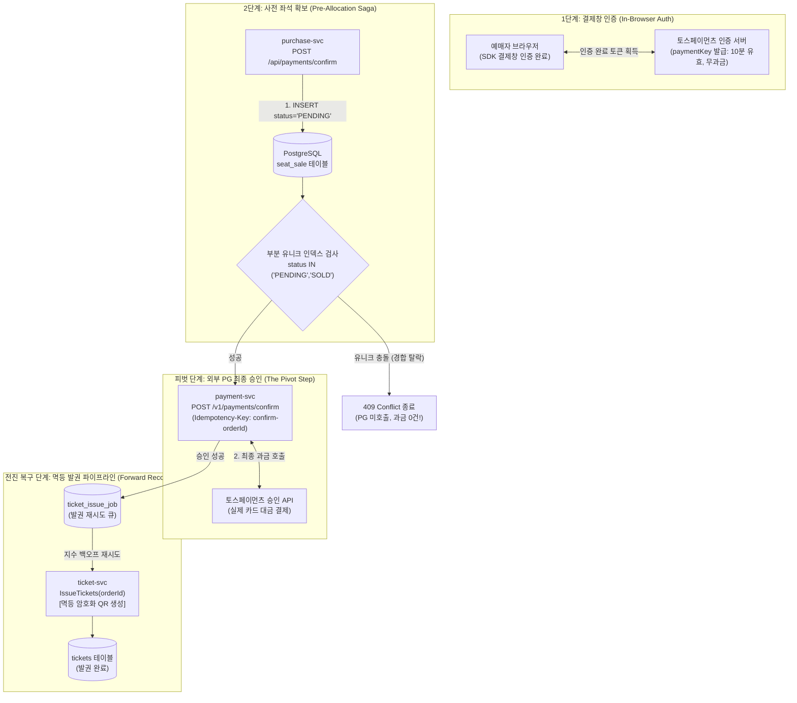
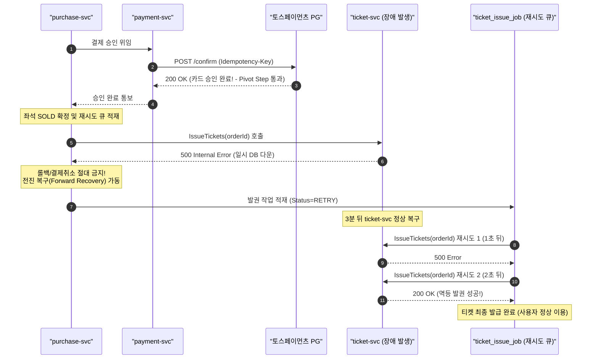

# D-08: 분산 결제 파이프라인에서 왜 결제사 2단계 승인을 쓰고, 승인 후 실패 시 롤백 취소가 아닌 전진 복구(Forward Recovery)를 선택했는가?

- **핵심 아키텍처 원칙**: PG 승인 전 원장 선점(Zero Refund), 피벗 단계(Pivot Step) 이후 전진 복구(Forward Recovery), 메시징 장애를 극복하는 밀기+당기기(Push-Pull) 이중 수신
- **관련 설계 정본**: [ADR-0015](../../adr/0015-tosspayments-two-phase-approval.md), [ADR-0106](../../adr/0106-forward-recovery-after-payment-approval-ticket-issue-retry.md), [ADR-0140](../../adr/0140-payment-result-pull-fallback-when-kafka-is-late.md), [docs/features/payment.md](../../features/payment.md) §1·§2·§4·§9
- **함께 읽기**: [한 판 문서](../01-system-design.md) 10단계, [분야 편 11 '결제'](../fields/11-payment.md), [DB 설계 편 5 '일관성과 트랜잭션 경계'](../db/05-consistency-transactions.md), [결정 카드 D-06](D06-seat-soft-hold-hard-sale.md)·[D-10](D10-order-history-polling-outbox.md)

---

## 1. 풀려던 문제와 한계

결제 및 발권 처리는 `purchase-svc`(좌석 및 주문 관리), `payment-svc`(외부 PG사 연동), `ticket-svc`(암호화 QR 발권)의 3개 마이크로서비스와 외부 PG사(토스페이먼츠 등)가 얽힌 복잡한 분산 사가(Saga) 트랜잭션이다.
시스템은 **피크 300 TPS(NFR-005)** 환경에서 **접수 응답 p99 150ms 이내**, **결제 확정 p99 3초 이내 및 완료율 99.95%(NFR-006)**를 만족해야 한다.

### 1) 승인 후 좌석 확정 시의 과금/환불 재앙
- 전통적인 단순 쇼핑몰처럼 PG사 결제 승인을 먼저 완료한 후 좌석을 DB에 확정하려 들면, 좌석 경합 탈락자에게 **"돈은 카드사에서 이미 결제되었는데 좌석은 배정되지 않는"** 치명적 사고가 발생한다.
- 즉각 취소 환불 API를 호출해야 하지만 결제사 네트워크 지연이나 장애가 겹치면 고객은 잔고만 깎인 채 표를 받지 못해 극심한 법적 분쟁과 CS 폭탄이 터진다.

### 2) 외부 PG 타임아웃 시 단순 롤백(Rollback) 취소의 파멸적 오류
- 외부 PG사 승인 API를 호출했으나 네트워크 단절이나 60초 Read Timeout이 발생하면, 분산 시스템 관점에서 이 상태는 **"성공인지 실패인지 모르는 미결(`UNKNOWN`)"** 상태다.
- PG사 전산망 내부에서는 카드 결제가 이미 승인 완료되었을 수 있다.
- 이때 가맹점 서버가 "응답을 받지 못했다"며 로컬 트랜잭션을 롤백하고 주문을 취소해 버리면:
  1. 고객 카드에서는 돈이 빠져나갔는데 예매는 취소되는 유령 결제(Ghost Charge)가 발생한다.
  2. 시스템은 해당 좌석을 빈자리로 착각하여 다른 사람에게 재판매함으로써 오버셀(Over-selling) 참사로 이어진다.

### 3) 승인 후 발권 장애 시 자동 결제 취소(v0)의 비즈니스 붕괴
- 초기 순진한 설계는 PG 결제 승인 후 `ticket-svc`가 일시적 장애(DB 락, 배포 지연 등)로 에러를 내면, 사가 보상 트랜잭션(Compensating Transaction)을 발동하여 결제를 자동 취소 환불했다.
- 그 결과, 온세일 피크 시 `ticket-svc`가 **단 1분만 멈춰도** 치열한 대기열을 뚫고 결제까지 완료한 수천 명의 정상 팬들의 티켓이 강제 환불되고 좌석이 시장에 무작위로 방출되는 파멸적 비즈니스 참사가 발생했다 (ADR-0106 맥락).

### 4) Kafka 단일 의존의 SLA 결함
- 결제 승인 결과는 `payment-svc`가 Kafka(`trade.payments`)로 발행한다. 그러나 AWS MSK(Kafka)의 공식 SLA는 **99.9%**다.
- 시스템의 결제 완료율 목표인 **99.95%(NFR-006)**를 달성하기에는 Kafka 단일 파이프라인의 가용성이 수학적으로 부족하다.

---

## 2. 후보 기술 비교

| 평가 항목 | 후보 1: PG 승인 후 좌석 확정 | 후보 2: 승인 후 발권 실패 시 즉시 자동 결제 취소 (v0) | 후보 3: 발권 실패 시 N회 재시도 후 자동 환불 | 후보 4: 승인 전 PENDING 선점 + 전진 복구 + 푸시-풀 수신 (선택) |
| :--- | :--- | :--- | :--- | :--- |
| **좌석 탈락자 과금 위험** | 극심 (경합 탈락자에게 과금 발생 후 환불) | 없음 (선점 실패 시 미과금) | 없음 | **0건 (PG 승인 API 호출 전에 탈락자 100% 필터링)** |
| **일시 발권 장애 시 영향** | 전면 환불 폭풍 | 수천 건 강제 환불 및 좌석 유실 대재앙 | 지연 시간 초과 시 강제 환불 | **환불 0건 (결제는 안전 보존, 백그라운드 멱등 전진 복구)** |
| **네트워크 타임아웃 정합성** | 불일치 발생 (유령 결제) | 불일치 발생 | 불일치 발생 | **단건 조회 API 대사 및 Outbox 기반 미결 상태 해소** |
| **메시징 장애 내성** | 취약 (Kafka 장애 시 결제 유실) | 취약 | 취약 | **완벽 (5초 지연 시 gRPC 당기기 Fallback 즉시 가동)** |
| **사용자 신뢰도** | 최악 | 극히 낮음 (성공 직후 취소 통보) | 낮음 | **최상 (결제 성공 통보 후 티켓 안전 발급 보장)** |
| **최종 판정** | **탈락 (금융 결함)** | **탈락 (ADR-0106)** | **탈락 (ADR-0106)** | **최종 채택 (ADR-0015, ADR-0106, ADR-0140)** |

---

## 3. 고른 이유와 아키텍처 다이어그램

PEAKET은 **"돈이 움직이기 전에 원장을 선점하고, 일단 승인된 금융 결제는 절대 취소하지 않고 무조건 전진 복구(Forward Recovery)한다"**는 분산 사가 철학을 구축했다.

### 핵심 매커니즘 4가지

#### 1) 2단계 승인 분리와 사전 예약(PENDING) 필수 보장
- 토스페이먼츠 결제창에서 카드 비밀번호나 생체인증을 마쳐도 가맹점 서버가 승인 API를 부르기 전까지는 **대금이 1원도 결제되지 않는다 (10분 유효기간)**.
- purchase-svc는 클라이언트의 승인 요청(`POST /api/payments/confirm`)을 받으면, PG 승인을 부르기 전에 PostgreSQL `seat_sale` 테이블에 `PENDING` 행을 먼저 삽입한다:
  - **좌석 경합 탈락 시**: 부분 유니크 인덱스 위반으로 트랜잭션이 즉시 롤백되며, 외부 PG 승인 API 자체를 호출하지 않고 클라이언트에 409를 반환한다. **과금도 없고 환불도 없다**.
  - **좌석 선점 성공 시**: 안전하게 `payment-svc`로 넘어가 승인 API를 호출한다.

#### 2) 피벗 단계(Pivot Step) 이론과 발권 실패 시 전진 복구(Forward Recovery)
Azure 분산 사가 설계 패턴(Saga Design Pattern)에 따르면, 분산 트랜잭션은 되돌릴 수 없는 **고비 단계(Pivot Step)**를 기준으로 전후 전략이 완전히 나뉜다:
- **피벗 이전 단계**: 로컬 롤백 및 보상 트랜잭션(Compensating Transaction)을 통한 취소가 자유롭다.
- **피벗 단계**: 바로 **외부 PG 결제 승인 API 호출**이다. 카드사 승인이 떨어지는 순간 대금이 빠져나가므로 되돌리기가 극도로 어렵다.
- **피벗 이후 단계 (전진 복구)**:
  - PG 승인 후 `ticket-svc`가 일시 장애로 응답하지 못하더라도, **결제를 절대로 취소하지 않는다**.
  - 승인이 성공하면 동일 DB 트랜잭션에서 `seat_sale`을 `SOLD`로 올리고, 발권 재시도 큐(`ticket_issue_job`)에 작업을 적재한다.
  - 워커가 백그라운드에서 지수 백오프(1초, 2초, 4초... 최대 60초)로 `ticket-svc.IssueTickets`를 무한 재시도한다.
  - `IssueTickets`는 주문 ID(`orderId`) 기반으로 완전 멱등하게 설계되어 100번 재호출되어도 동일한 티켓 1건만 안전하게 발행된다.

#### 3) PG 타임아웃 미결(`UNKNOWN`) 상태의 단건 조회 해소
- `payment-svc`가 토스페이먼츠 승인 호출 시 60초 Read Timeout이 발생하면 주문 상태를 실패로 처리하지 않고 `UNKNOWN`으로 보존한다.
- 백그라운드 복구 워커가 즉시 동일한 멱등키(`confirm-{orderId}`)를 사용하여 토스페이먼츠 단건 조회 API(`GET /v1/payments/orders/{orderId}`)를 폴링한다:
  - **이미 승인된 경우**: 결제 완료 상태로 동기화하고 티켓 발권 파이프라인을 전진시킨다.
  - **승인되지 않은 경우**: 비로소 주문을 안전하게 취소하고 좌석을 반환한다.

#### 4) 결과 수신의 이중 통로: Kafka 밀기(Push) + 5초 폴링 당기기(Pull)
- `payment-svc`는 결제 결과를 트랜잭셔널 아웃박스(Transactional Outbox)에 기록하고 릴레이가 Kafka `trade.payments` 토픽으로 스트리밍한다 (밀기).
- **5초 당기기 폴링 Fallback (ADR-0140)**:
  - MSK의 SLA(99.9%) 한계로 인해 Kafka 컨슈머 지연이 5초를 초과하면, `purchase-svc`는 결제 상태를 마냥 기다리지 않고 `payment-svc`의 gRPC 조회 API(`BatchGetPayments`)를 직접 호출하여 결과를 즉시 당겨온다.
  - 이를 통해 Kafka 클러스터가 완전히 멈추더라도 티켓 결제 확정 파이프라인은 단 1건의 지연 없이 99.95% 완료율을 완벽히 수호한다.

---

## 4. 얻는 것과 치르는 값 (Tradeoffs)

### 얻는 것 (Gains)
1. **과금 후 환불 사고 0건**: 승인 전 `PENDING` 좌석 선점을 강제하므로, 좌석 경합 탈락자에게 돈이 빠져나간 뒤 환불하는 금융 사고가 원천 차단된다.
2. **다운스트림 장애 시 티켓 강제 환불 방지**: 발권 서비스가 일시 다운되더라도 이미 승인된 결제는 안전하게 보호되며, 시스템 복구 후 지연 발권을 통해 팬들의 소중한 티켓을 100% 지켜낸다.
3. **네트워크 타임아웃 시 데이터 정합성 보장**: PG사 타임아웃 시 섣부른 취소 대신 단건 조회를 통한 상태 동기화를 수행하여 유령 결제 및 이중 판매를 원천 방지한다.
4. **메시징 브로커 장애 무력화**: Kafka 장애 시 5초 폴링 Fallback을 가동하여 브로커 다운 상황에서도 결제 완료율 99.95%(NFR-006)를 지켜낸다.

### 치르는 값 (Costs & Limitations)
1. **발권 지연 시간 발생 가능성**: 발권 서비스 장애 시 결제는 완료되었으나 화면에 티켓 QR이 노출되기까지 최대 발권 유예 기한(기본 30분)이 소요될 수 있다. (이 동안 양도 및 취소 제한)
2. **상태 머신 및 운영 복잡도 증가**: `ticket_issue_job` 재시도 큐 테이블, `ISSUE_DELAYED` 이벤트, 30분 이상 지연 시의 CS 수동 확인 티켓(`TICKET_NOT_ISSUED`) 등 운영 파이프라인이 추가된다.
3. **이중 수신 오버헤드**: Kafka 밀기와 gRPC 당기기가 동시에 동작할 수 있으므로, purchase-svc에서 멱등한 결과 병합(Deduplication) 로직이 요구된다.

---

## 5. 바꿀 조건 (Conditions to Change)

1. **발권 서비스 재시도가 백엔드 회복을 저해할 때**: 장애 복구 직후 수천 건의 발권 재시도가 쏟아져 ticket-svc의 CPU를 재포화시킬 경우, 동시 재시도 워커 수를 제한(Rate Limiting)하고 지수 백오프 최대 상한을 60초에서 300초로 연장한다.
2. **발권 비즈니스 검증 실패가 발생할 때**: 발권 단계에서 비즈니스적 사유(예: 사용자 자격 박탈 등)로 거절되는 경우가 발생한다면, 해당 비즈니스 검증 로직 전체를 반드시 'PG 결제 승인 이전' 단계로 전진 배치해야 한다. (승인 이후에는 오직 기술적 일시 장애만 존재해야 한다는 것이 이 아키텍처의 절대 전제다).
3. **법령 및 여신전문금융업법 약관의 강제 즉시 발권 규제**: 결제 완료 후 티켓 발급 기한이 법적으로 수 분 이내로 강제될 경우, 발권 실패 시 CS 수동 확인 대신 일정 시간 후 자동 취소 환불하도록 정책을 전환한다.

---

## 6. 핵심 꼬리 질문 5단 방어 (Staff Interview Q&A)

| 질문 단계 | 심층 질문 | 방어 논리와 기술적 근거 | 관련 정본 |
| :--- | :--- | :--- | :--- |
| **1단: 왜 (Why)** | PG 결제 승인을 먼저 하고 좌석을 확정하면 코드가 훨씬 단순한데 왜 승인 전에 `PENDING` 행을 넣나요? | PG 승인을 먼저 하면 인기 좌석 경합에서 탈락한 사람의 카드 대금이 이미 빠져나간 상태가 됩니다. 이후 환불 API를 불러야 하지만 네트워크 장애가 겹치면 유령 결제와 심각한 분쟁이 발생합니다. 승인 전 PostgreSQL 부분 유니크 인덱스로 `PENDING` 행을 먼저 선점하면, 경합 탈락자는 승인 API 호출 전에 100% 필터링되므로 과금도 환불도 0건이 됩니다. | ADR-0015 |
| **2단: 대안 (Alternatives)** | 발권(`ticket-svc`)이 실패했을 때 깔끔하게 결제를 즉시 취소 환불(보상 트랜잭션)하는 게 맞지 않나요? | 피크 시간대에 ticket-svc가 단 1분만 배포 지연이나 DB 락으로 멈춰도, 치열한 대기열을 뚫고 결제를 마친 수천 명 팬들의 티켓이 강제 환불되고 좌석이 시장에 방출되는 비즈니스 대참사가 일어납니다. 사가 패턴에서 PG 승인은 '되돌리기 어려운 피벗 단계'이므로, 승인 이후 단계의 기술적 실패는 롤백하지 않고 멱등한 재시도 큐를 통해 성공할 때까지 밀고 나가는 전진 복구(Forward Recovery)가 정석입니다. | ADR-0106 |
| **3단: 장애 대응 (Resilience)** | 외부 PG사 승인 API를 호출했는데 60초 Read Timeout이 발생하면 어떻게 처리하나요? | 타임아웃은 실패가 아니라 '알 수 없음(`UNKNOWN`)' 상태입니다. 로컬 롤백을 단행하면 PG사에서 승인된 건과 원장이 어긋나 이중 판매가 발생합니다. 따라서 주문 상태를 `UNKNOWN`으로 유지하고, 백그라운드 워커가 동일한 멱등키(`confirm-{orderId}`)로 PG사 단건 조회 API를 호출하여 실제 승인 여부를 확인한 뒤 동기화합니다. | ADR-0015, docs/features/payment.md §9 |
| **4단: 수치 근거 (Numbers)** | 5초 폴링 Fallback과 30분 발권 유예 기한은 어떻게 도출되었나요? | Kafka SLA 99.9% 환경에서 NFR-006(결제 완료율 99.95%)을 달성하려면 메시징 지연에 대응할 Fallback이 필수적입니다. 5초는 일반적인 Kafka P99.9 전송 지연(1~2초)을 감안할 때 불필요한 gRPC 조회를 최소화하면서도 결제 확정 p99 3초 목표를 방어할 수 있는 임계치입니다. 30분은 티켓 서버 배포 실패 시 롤백 및 파드 재기동에 소요되는 인프라 MTTR 안전 여유치입니다. | ADR-0106, ADR-0140 |
| **5단: 실측과 검증 (Verification)** | 메시징 장애 시 5초 Fallback 및 발권 재시도 멱등성을 실제로 테스트했나요? | 단위 및 통합 테스트에서 Kafka 클러스터 다운 시뮬레이션을 수행하여, 5초 타임아웃 경과 후 `BatchGetPayments` gRPC 조회를 통해 주문 확정이 100% 이어짐을 확인했습니다. 또한 동일 `orderId`로 `ticket-svc.IssueTickets`를 1,000회 연속 호출하는 카오스 테스트를 통해 중복 티켓이 발행되지 않고 항상 기존 티켓 1건이 멱등하게 반환됨을 검증했습니다. | ADR-0106, ADR-0140, docs/perf-ledger.md §2 |

---

## 7. 30초 아키텍처 브리핑 (Staff Engineer Summary)

> "PEAKET은 금융 결제의 무결성을 지키기 위해 **'승인 전 PENDING 선점'**과 **'승인 후 전진 복구(Forward Recovery)'**를 결합했습니다.  
> 결제창 인증 후 PG 승인 API를 호출하기 직전에 PostgreSQL `seat_sale`에 `PENDING` 행을 넣어, 좌석 경합 탈락자에게 카드 과금이 발생하는 참사를 사전에 100% 차단합니다.  
> 외부 PG 결제 승인은 되돌리기 어려운 '피벗 단계(Pivot Step)'이므로, 승인 이후 발권 서비스가 일시 다운되더라도 결제를 취소하지 않고 멱등한 재시도 큐를 통해 티켓이 발급될 때까지 전진 복구합니다.  
> 또한 Kafka 이벤트 수신이 5초 이상 지연되면 gRPC 직접 당겨오기 Fallback을 가동하여 브로커 장애 시에도 99.95%의 결제 완료율을 철저히 사수합니다."
