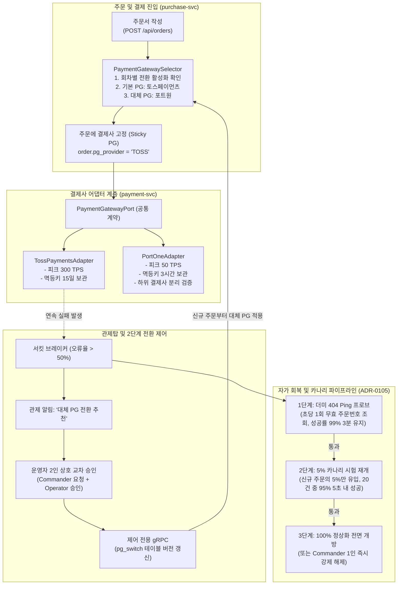

# D-09: 결제 대행사를 왜 이중화(토스페이먼츠/포트원)하고, 주문 시점에 고정하며 카나리로 복구하는가?

- **핵심 아키텍처 원칙**: 단일 결제사 장애 시 서비스 마비 방어, 트랜잭션 접수 후 결제사 고정(Sticky PG)을 통한 이중 과금 원천 차단, 처리량 격차(300 TPS vs 50 TPS)를 감안한 2인 승인 전환 및 카나리(Canary) 자가 회복
- **관련 설계 정본**: [ADR-0029](../../adr/0029-pg-adapter-toss-default-portone-compatible.md), [ADR-0044](../../adr/0044-dual-pg-selection-and-switchover.md), [ADR-0105](../../adr/0105-payment-entry-pause-probe-trial-reopen-manual-release.md), [ADR-0143](../../adr/0143-settings-commands-pg-switch-over-grpc-applied-version-outbox.md) 결정 1, [docs/features/payment.md](../../features/payment.md) §2.1·§2.2·§9
- **함께 읽기**: [한 판 문서](../01-system-design.md) 10단계, [분야 편 11 '결제'](../fields/11-payment.md), [분야 편 9 '대기열·입장'](../fields/09-queue-admission.md), [결정 카드 D-08](D08-payment-two-phase-forward-recovery.md)·[D-18](D18-control-as-state-grpc.md)

---

## 1. 풀려던 문제와 한계

티켓팅 피크 시 결제 시스템(PG 연동)을 단일 대행사로 운영하거나, 순진한 자동 전환을 도입할 경우 마주하는 물리적·금융적 병목은 다음과 같다.

### 1) 단일 결제사 장애 시의 전면 매출 중단 리스크
- 카드사 전산 작업, PG사 네트워크 단절, 승인 API 레이트 리미트 초과로 결제 장애가 발생하면 티켓 판매가 완전히 중단된다.
- 5만 석 규모 대형 콘서트에서 10분간 결제 장애가 지속되면, 수천 명의 좌석 점유(Soft Hold)가 연쇄 만료되어 극심한 사용자 혼란과 수십억 원의 매출 손실이 발생한다.

### 2) 이중 결제(Double Billing) 발생 위험
- 승인 요청이 진행 중인 결제 세션에 대해 타 결제사로 무작정 장애 전환(Failover) 재시도를 시도하면, 두 PG사에서 각각 카드 결제가 정상 승인되어 **동일 티켓에 대해 2건의 카드 청구가 발생하는 대형 금융 사고**로 이어진다.
- 토스페이먼츠(멱등키 보관 15일, REST)와 포트원(멱등키 보관 3시간, 브로커 방식)은 멱등키 보존 주기와 승인 API 스펙이 완전히 달라 단순 재전송이 불가능하다.

### 3) 두 결제사 간 처리량(TPS)의 6배 격차와 자동 전환의 파멸
- **토스페이먼츠 운영 한도**: 설계 피크 **300 TPS** 수용 가능.
- **포트원 채널 한도**: 단일 결제 채널 기준 초당 **50건** 수준 (토스의 1/6).
- 서킷 브레이커가 열렸다고 해서 300 TPS로 유입되던 결제 트래픽을 50 TPS 한도의 포트원으로 100% 즉시 자동 전환하면, 전환 즉시 포트원 채널이 병목으로 포화되어 2차 연쇄 장애가 발생한다.

### 4) 결제 차단 후 자가 회복 신호 부재 (Cold Start 관측 한계)
- 서킷 브레이커가 트립되어 새 결제 진입이 차단된 상태에서는 PG사로 유입되는 실제 결제 요청이 0건이므로, "PG사가 실제로 복구되었는지"를 판정할 수 있는 성공률 메트릭이 생성되지 않는 닭과 달걀의 문제가 발생한다.

---

## 2. 후보 기술 비교

| 평가 항목 | 후보 1: 단일 PG사 독점 (토스페이먼츠 단독) | 후보 2: 서킷 브레이커 기반 100% 자동 전환 | 후보 3: 결제 트랜잭션 중 실시간 PG 스왑 | 후보 4: 주문 시점 고정 + 2인 승인 전환 + 카나리 재개 (선택) |
| :--- | :--- | :--- | :--- | :--- |
| **단일 결제사 장애 내성** | 0% (PG 다운 시 판매 전면 마비) | 우수 (즉시 타 PG 전환) | 우수 | **탁월 (대체 결제사로 안전 우회)** |
| **이중 결제 발생 위험** | 없음 | 보통 | 극심 (2개 PG 동시 승인 위험) | **0건 (Sticky PG 및 2단계 승인 전 폐기)** |
| **대체 결제사 과부하 방어** | N/A | 취약 (50 TPS 한도 즉시 초과 붕괴) | 취약 | **완벽 (입장 정원 제어 + 점진적 카나리 유입)** |
| **복구 시 관측 가능성** | N/A | 무조건 시간 경과 후 재개 (재폭발 위험) | 불투명 | **정밀 관측 (404 Ping 프로브 + 5% 카나리 시험)** |
| **통합 인터페이스 일관성** | 단일 코드베이스 | 복잡 | 극히 복잡 | **추상화 완벽 (PaymentGatewayPort 어댑터 패턴)** |
| **최종 판정** | **탈락 (SPOF 리스크)** | **탈락 (ADR-0044, 2차 붕괴 위험)** | **탈락 (금융 사고 유발)** | **최종 채택 (ADR-0044, ADR-0105, ADR-0143)** |

---

## 3. 고른 이유와 아키텍처 다이어그램

PEAKET은 **"주문 세션마다 단 하나의 PG를 바인딩(Sticky PG)하여 이중 승인을 물리적으로 방지하고, 장애 전환과 재개는 처리량 한계를 고려해 통제한다"**는 원칙을 적용했다.

### 핵심 매커니즘 4가지

#### 1) PaymentGatewayPort 어댑터 패턴과 주문 접수 시점 결제사 고정 (Sticky PG)
- `payment-svc`는 결제사별 차이점을 `PaymentGatewayPort` 인터페이스 뒤로 은닉하여, 주문 도메인 로직이 특정 결제사 API에 결합되지 않도록 한다.
- **Sticky PG 원칙**: 사용자가 결제창을 띄우는 시점에 주문 엔티티에 `pg_provider`가 영구 낙인된다. 결제 접수 이후의 승인, 취소, 환불, 웹훅, 대사는 **오직 해당 결제사 어댑터로만 라우팅**된다.
- 결제 진행 중 장애 전환이 일어나더라도 진행 중인 결제는 절대 다른 결제사로 넘어가지 않으므로 **이중 결제가 원천 불가능**하다.

#### 2) 하위 결제사(Sub-PG) 물리적 격리 검증 (POL-036)
- 포트원은 여러 결제사를 중계하는 브로커이므로, 포트원 내부 설정에서 토스페이먼츠를 하위 결제사로 지정할 수 있다.
- 만약 기본 결제사(토스)와 대체 결제사(포트원-토스)의 배후 카드망이 동일하면, 토스 장애 시 포트원으로 전환해도 동일한 장애에 빠진다.
- 따라서 시스템은 회차 등록 시 기본 PG와 대체 PG의 **하위 결제사 식별자가 완전히 다름을 엄격히 검증**한다 (예: 기본=토스페이먼츠, 대체=포트원(KCP/NICE)).

#### 3) 처리량 차이를 고려한 운영자 2인 승인 전환
- 토스(300 TPS)와 포트원(50 TPS)의 처리량 격차로 인해 서킷 브레이커 트립 시 자동 전환을 금지한다.
- 관제 시스템은 '전환 권고' 경보만 발생시키며, **지휘관(Commander) 1인의 요청과 부지휘관(Operator) 1인의 교차 승인**이 있어야만 제어 전용 gRPC를 통해 `pg_switch` 상태를 전파한다 (ADR-0143).
- 전환 시 대기열의 예매창 동시 입장 목표 인원(`target`)을 포트원 수용량에 맞추어 즉시 5,000명에서 4,500명 이하로 자동 축소한다.

#### 4) 3단계 자가 회복 및 카나리 재개 (ADR-0105)
결제사가 회복되었는지 확인하기 위해 다음의 3단계 파이프라인을 가동한다:
1. **가상 404 Ping 프로브**: 결제창이 닫힌 상태에서 결제사 조회 API로 무작위 가상 결제 ID를 초당 1회 조회하여 정상적인 404 Not Found 응답이 반환되는지 확인한다 (성공률 99% 이상 3분 지속).
2. **5% 카나리 시험 재개**: 프로브 통과 시 신규 결제 진입의 5%만 선별 통과시킨다. 첫 20건 중 95%가 5초 이내에 정상 승인되는지 관측한다.
3. **전면 개방**: 카나리 검증 완료 시 100% 정상 트래픽을 허용한다. (비상 시 Commander 1인의 단독 판단으로 즉시 강제 전면 개방 가능).

---

## 4. 얻는 것과 치르는 값 (Tradeoffs)

### 얻는 것 (Gains)
1. **단일 결제사 장애 시 서비스 지속성**: 주 결제사가 완전히 셧다운되더라도 2인 승인을 통해 대체 결제사로 수 분 내 우회하여 티켓 판매를 완수한다.
2. **이중 결제 0건 보장**: Sticky PG 정책을 통해 결제 승인 요청이 복수의 PG사로 분기되는 문제를 원천 차단한다.
3. **2차 연쇄 과부하 방어**: 50 TPS 한도의 대체 PG로 트래픽이 쏟아져 대체 결제사까지 동반 사망하는 사태를 수동 승인 및 입장 통제 축소로 완벽히 방어한다.

### 치르는 값 (Costs & Limitations)
1. **포트원 회차의 입장 속도 저하**: 포트원 단독 회차는 결제 처리량 한계(50건/초)로 인해 첫 물결 입장 시 5,000석을 채우는 데 약 90초(토스는 17초)가 소요된다.
2. **수동 승인 대기 시간 동안의 결제 정지**: 2인 교차 승인이 완료될 때까지 신규 결제 진입이 일시 중단되며, 해당 시간 동안 주문서에 머물던 사용자의 좌석 선점(Soft Hold, 5분)이 만료될 위험이 있다.
3. **전산 대사(Reconciliation) 파이프라인 이원화**: 결제 대사 워커가 토스페이먼츠 정산 파일과 포트원 정산 파일을 각각 파싱하고 대사 규칙을 유지보수해야 한다.

---

## 5. 바꿀 조건 (Conditions to Change)

1. **포트원의 엔터프라이즈 TPS 상향 계약**: 포트원과의 전용선 구축 및 하위 결제사 쿼터 상향을 통해 200 TPS 이상의 처리량이 공식 보증될 경우, 2인 수동 전환을 폐기하고 서킷 브레이커 기반 완전 자동 전환으로 전환한다.
2. **단일 티켓팅 내 카드사 전산 장애 국소화**: 특정 카드사(예: 현대카드)만 결제 장애가 발생하는 경우, PG사 전체를 전환하는 대신 해당 카드사 결제 수단만 비활성화하는 수단별 킬스위치를 도입한다.
3. **카나리 5% 윈도우 지연**: 5% 카나리 재개 시 20건 모수 수집이 10분 이상 지연되는 저트래픽 회차의 경우, 카나리 비율을 20%로 상향하고 모수를 10건으로 축소한다.

---

## 6. 핵심 꼬리 질문 5단 방어 (Staff Interview Q&A)

| 질문 단계 | 심층 질문 | 방어 논리와 기술적 근거 | 관련 정본 |
| :--- | :--- | :--- | :--- |
| **1단: 왜 (Why)** | PG사 1개만 쓰는 것이 연동과 정산이 훨씬 간단한데 왜 굳이 2개를 복잡하게 연동하나요? | 티켓팅은 특정 1시간 동안 수십억 원의 결제가 집중되는 특수 비즈니스입니다. 단일 결제사의 예기치 않은 시스템 점검이나 네트워크 장애 발생 시 대안이 없으면 플랫폼 전체가 마비됩니다. PG 이중화는 고가용성 결제 시스템의 필수적인 재해 복구(DR) 요건입니다. | ADR-0029, ADR-0044 |
| **2단: 대안 (Alternatives)** | 결제 실패율이 치솟으면 서킷 브레이커로 즉시 대체 PG로 자동 전환하는 것이 가장 빠르지 않나요? | 주 결제사인 토스는 300 TPS를 감당하지만 포트원 단일 채널은 50 TPS로 처리량 격차가 6배에 달합니다. 300 TPS 트래픽을 50 TPS 결제사로 무조건 자동 넘기면 대체 결제사까지 1초 만에 과부하로 뻗는 연쇄 참사가 발생합니다. 또한 일시적 카드사 순단에 의한 오탐 전환을 막기 위해 운영자 2인이 대기열 입장 정원 축소와 연계하여 승인하는 것이 안전합니다. | ADR-0044, ADR-0036 |
| **3단: 장애 대응 (Resilience)** | 결제창에서 인증을 마치고 서버로 승인을 요청하는 찰나에 장애 전환이 일어나면 어떻게 되나요? | 주문 접수 시점에 주문 데이터에 특정 PG가 영구 고정(Sticky PG)됩니다. 장애 전환이 발효되더라도 이미 접수된 주문은 원래 PG로만 승인이 진행되며 대체 PG로 절대 넘어가지 않습니다. 승인이 실패하면 전진 복구 큐에서 재시도되거나 안전하게 취소 만료되므로 이중 결제가 절대 일어나지 않습니다. | ADR-0044, docs/features/payment.md §2.2 |
| **4단: 수치 근거 (Numbers)** | 포트원 50 TPS와 카나리 5% 수치는 어떻게 도출되었나요? | 50 TPS는 포트원 연동 공식 문서의 하위 밴더 권장 처리량 한계를 준용한 보수적 수치입니다. 카나리 5%와 20건 기준은, 재개 직후 결제사가 여전히 비정상일 때 발생할 수 있는 잠재적 실패 피해를 1~2건 이내로 최소화하면서 통계적 유의미성(95% 신뢰수준)을 확보할 수 있는 최소 검증 모수입니다. | ADR-0036, ADR-0105 |
| **5단: 실측과 검증 (Verification)** | 실제 결제사 장애 상황에서의 전환과 재개 과정을 테스트해 보셨나요? | 결제사 실서버에 장애를 유발할 수는 없으므로, 토스형 및 포트원형 결제사 모의 서버(Mock Simulator)를 구축하고 카오스 엔지니어링 도구로 결제 지연 및 5xx 에러를 주입하는 장애 훈련(P-T31)을 수행했습니다. 서킷 트립 후 2인 승인 gRPC 전파, 404 Ping 프로브 3분 유지 후 5% 카나리 재개에 이르는 전 파이프라인의 상태 전이가 정상 동작함을 검증했습니다. | docs/features/payment.md §11, ADR-0057 |

---

## 7. 30초 아키텍처 브리핑 (Staff Engineer Summary)

> "PEAKET은 대규모 티켓 결제 마비를 방지하기 위해 토스페이먼츠를 기본으로 두고 포트원을 대체 결제사로 액티브-스탠바이 이중화했습니다.  
> 결제창을 여는 순간 해당 주문에 특정 PG가 고정(Sticky PG)되어 승인 재시도가 타 결제사로 넘어가지 않도록 강제함으로써 이중 결제를 원천 차단합니다.  
> 또한 두 결제사 간 처리량 격차(300 TPS vs 50 TPS)로 인한 연쇄 과부하를 막기 위해 장애 전환은 운영자 2인 상호 승인으로 통제하며, 복구 시에는 404 Ping 프로브와 5% 카나리 시험 재개를 거쳐 시스템을 안전하게 정상화합니다."
