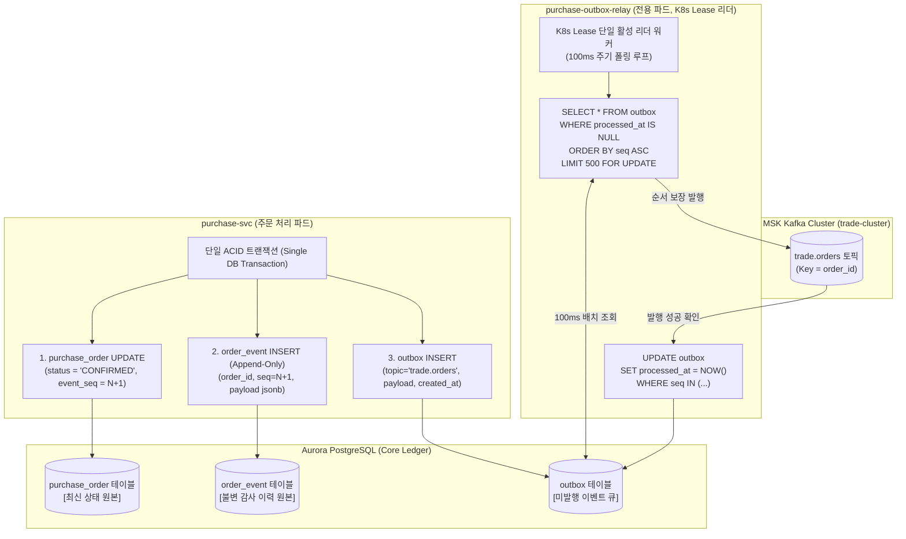

# D-10: 주문 데이터를 왜 전체 이벤트 소싱하지 않고 '상태 + 덧붙이기 이력 + Outbox'로 두며, 릴레이는 왜 Debezium 대신 폴링을 쓰는가?

- **핵심 아키텍처 원칙**: 도메인 요구사항에 최적화된 상태 머신 모델링(과도한 이벤트 소싱 배제), RDBMS ACID 트랜잭션 기반의 원자적 Outbox 발행, 운영/로컬 환경 단일화 및 DB 복제 슬롯(WAL) 고갈 리스크 원천 차단
- **관련 설계 정본**: [ADR-0113](../../adr/0113-order-state-with-append-only-history-event-sourcing-only-for-ops-commands.md), [ADR-0116](../../adr/0116-single-polling-outbox-relay-drop-debezium-place-pgbouncer-schema-registry.md), [ADR-0140](../../adr/0140-payment-result-pull-fallback-when-kafka-is-late.md), [ADR-0143](../../adr/0143-settings-commands-pg-switch-over-grpc-applied-version-outbox.md), [docs/data.md](../../data.md) §4
- **함께 읽기**: [한 판 문서](../01-system-design.md) 10단계, [분야 편 11 '결제'](../fields/11-payment.md), [DB 설계 편 5 '일관성과 트랜잭션 경계'](../db/05-consistency-transactions.md), [분야 편 18 '이벤트 흐름'](../fields/18-streaming.md), [결정 카드 D-08](D08-payment-two-phase-forward-recovery.md)

---

## 1. 풀려던 문제와 한계

주문/결제 이력 관리 및 메시지 브로커(Kafka) 연동 아키텍처 설계 시 마주하는 구조적 트레이드오프는 다음과 같다.

### 1) 이벤트 소싱(Event Sourcing)의 과도한 복잡도와 불필요성
- 주문 1건이 겪는 상태 변화는 기껏해야 `CREATED` $\rightarrow$ `HELD` $\rightarrow$ `PAYMENT_PENDING` $\rightarrow$ `CONFIRMED` $\rightarrow$ `TICKET_ISSUED` (또는 `CANCELLED`) 등 **평균 5~10개 이벤트**에 불과하다.
- 이벤트 소싱을 전면 도입하면 주문의 현재 상태 하나를 조회하기 위해 수십 개의 이벤트를 메모리에 로드해 리플레이(Replay)해야 하며, 이벤트 스키마 변경 시 과거 5년간 쌓인 1,700만 건의 이벤트를 변환하는 업캐스팅(Upcasting)과 스냅샷 유지보수라는 막대한 아키텍처 부채를 떠안게 된다.
- 비즈니스 요구사항(FR-031)은 "과거 시점의 주문/좌석 상태 역추적 및 분쟁 소명"일 뿐이며, 이는 단일 트랜잭션 내 `purchase_order` 최신 상태 갱신과 `order_event` **덧붙이기(Append-Only) 이력** 테이블 적재로 100% 충족된다.

### 2) 듀얼 라이트(Dual-Write) 문제와 메시지 발행 정합성
- 애플리케이션이 DB에 주문을 저장한 직후 Kafka에 이벤트를 직접 쏘는 방식은, 네트워크 장애나 파드 크래시 시 "DB는 커밋되었으나 Kafka에는 메시지가 누락"되거나 그 반대의 불일치가 필연적으로 발생한다.
- 따라서 DB 커밋과 이벤트 적재가 단일 ACID 트랜잭션으로 묶이는 **Transactional Outbox 패턴**이 필수적이다.

### 3) Debezium(CDC) 운영의 물리적 위험 (PostgreSQL WAL 디스크 폭주)
- 초기 설계는 운영 환경에 Debezium(Kafka Connect + PostgreSQL Logical Replication Slot)을 두고, 로컬 환경에는 DB 폴링을 두는 이원화 구조였다.
- **복제 슬롯의 파멸적 위험**: MSK(Kafka) 브로커 장애나 Kafka Connect 파드 다운 시, PostgreSQL은 복제 슬롯이 소비하지 않은 WAL(Write-Ahead Log)을 디스크에 계속 누적한다. 피크 티켓팅 도중 WAL이 수십 GB 이상 급증하여 Aurora DB 디스크가 100% 차오르면 **데이터베이스 전체가 쓰기 불가(Read-Only)로 뻗어 서비스가 영구 마비**된다.
- 또한 Java 런타임 기반의 Kafka Connect 클러스터와 MSK IAM 인증 관리는 소규모 팀에 극심한 인프라 오버헤드를 유발한다.

---

## 2. 후보 기술 비교

| 평가 항목 | 후보 1: 완전한 이벤트 소싱 + CQRS | 후보 2: Debezium CDC 릴레이 (전 환경) | 후보 3: PostgreSQL LISTEN / NOTIFY | 후보 4: 상태+이력+Outbox + K8s Lease 폴링 릴레이 (선택) |
| :--- | :--- | :--- | :--- | :--- |
| **현재 상태 조회 성능** | 낮음 (이벤트 리플레이 또는 스냅샷 필요) | 높음 (RDBMS 단일 행 조회) | 높음 | **최상 (단일 행 PK 인덱스 스캔, < 1ms)** |
| **스키마 변경 유지보수** | 극히 복잡 (업캐스팅 및 이벤트 마이그레이션) | 보통 | 보통 | **매우 단순 (표준 RDBMS DDL 마이그레이션)** |
| **DB 디스크 고갈 위험** | 보통 | 심각 (Debezium 지연 시 WAL 디스크 100% 위험) | 보통 | **완전 제거 (복제 슬롯 미사용, 일반 테이블 관리)** |
| **환경 간 정합성** | N/A | 보통 (로컬에 무거운 Kafka Connect 필요) | 보통 | **완벽 (로컬 kind, 측정 환경, 프로덕션 100% 동일 코드)** |
| **이벤트 발행 지연** | 실시간 | 10~50ms | 10~50ms (단, 커넥션 풀 제약) | **100ms 이내 (지연 예산 1초 대비 충분)** |
| **최종 판정** | **탈락 (ADR-0113, 오버엔지니어링)** | **탈락 (ADR-0116, WAL 안정성 위험)** | **탈락 (PgBouncer 풀링 호환 불가)** | **최종 채택 (ADR-0113, ADR-0116)** |

---

## 3. 고른 이유와 아키텍처 다이어그램

PEAKET은 **"도메인 원장은 상태와 이력을 분리해 ACID로 묶고, Outbox 릴레이는 외부 의존성 없는 단순한 100ms 폴링으로 운영한다"**는 설계를 확립했다.

### 핵심 매커니즘 4가지

#### 1) 단일 상태 머신 전이 함수와 엄격한 Append-Only 이력 테이블
- 주문의 상태를 변경하는 경로는 단 하나의 전이 함수(`transitionOrder()`)로 일원화되어 있다.
- 상태 갱신 시 `purchase_order`의 `event_seq`를 조건부 원자적 증가(`event_seq = event_seq + 1`)시키며, 동일한 트랜잭션에서 `order_event` 테이블에 변경 사유와 페이로드를 INSERT한다.
- `order_event` 테이블에 접근하는 DB 계정은 `INSERT` 권한만 부여받고 `UPDATE`와 `DELETE` 권한이 박탈되어 영구적인 감사 증적(Audit Trail)을 보장한다 (ADR-0113).

#### 2) 이벤트 소싱의 선별적 적용 (운영 명령에만 국한)
- 비즈니스 주문은 5~10회 상태 전이 후 완료되므로 상태 머신으로 충분하다.
- 반면 운영 통제 명령(`ops-svc`)은 1인 일시정지, 2인 승인, 파드별 ack 수렴, 사후 감사 보고서 생성 등 모든 생명주기 자체가 이벤트의 결합이므로 **운영 명령 도메인에만 선별적으로 이벤트 소싱을 적용**한다 (ADR-0113 결정 3).

#### 3) K8s Lease 기반 단일 액티브 릴레이와 100ms 폴링
- 서비스마다 전용 릴레이 디플로이먼트(`<service>-outbox-relay`, 복제본 2개)를 배치하고, Kubernetes Lease 객체를 통해 1개의 활성 리더만 100ms 주기로 폴링을 실행한다.
- 전체 티켓팅 피크 시에도 Outbox 이벤트는 초당 수천 건 이하(평균 결제 28 TPS)이므로, 100ms 폴링으로도 종단 지연 1초 이내 요구사항을 여유 있게 달성한다.
- Kafka Connect나 Debezium 런타임을 완전히 배제함으로써 자바 메모리 오버헤드와 복제 슬롯 WAL 디스크 폭주 리스크를 100% 제거했다 (ADR-0116).

#### 4) Strict FIFO 순서 보장과 `SKIP LOCKED` 금지 원칙
- 동일 주문 및 좌석에 대한 이벤트 순서가 뒤집히면 관제탑 실시간 집계나 결제 상태 머신이 파탄 난다.
- 따라서 릴레이는 `ORDER BY seq ASC LIMIT 500 FOR UPDATE`를 엄격히 사용하며, **`SKIP LOCKED`는 의도적으로 사용하지 않는다**.
- 만약 `SKIP LOCKED`를 사용하면 리더 페일오버 순간에 구 리더가 잠근 앞쪽 이벤트를 신 리더가 건너뛰고 뒤쪽 이벤트를 먼저 발행하여 순서 역전이 발생하기 때문이다 (ADR-0116 결정 3).

---

## 4. 얻는 것과 치르는 값 (Tradeoffs)

### 얻는 것 (Gains)
1. **아키텍처 및 쿼리 단순성**: 현재 상태를 읽기 위해 복잡한 이벤트 리플레이를 하지 않고, 단일 행 `SELECT`로 밀리초 미만에 조회한다.
2. **PostgreSQL DB 안정성 100% 확보**: Debezium 장애 시 발생하는 복제 슬롯 WAL 디스크 고갈 사고 위험이 원천 제거된다.
3. **환경 정합성 일치**: 개발자의 로컬 쿠버네티스(kind), 부하 테스트 환경, 프로덕션 환경이 100% 동일한 TypeScript 릴레이 코드로 구동되어 환경 불일치 버그가 사라진다.

### 치르는 값 (Costs & Limitations)
1. **100ms의 발행 지연 추가**: CDC 대비 폴링 주기(최대 100ms)만큼 Kafka 발행 지연이 추가된다. (단, 비즈니스 지연 예산 1초 내에 완벽히 수용).
2. **Outbox 테이블 쓰기 IOPS 증가**: 이벤트를 DB 테이블에 INSERT하고, 릴레이가 발행 후 `processed_at`을 UPDATE하므로 DB 쓰기 IOPS가 추가 소모된다.
3. **리더 전환 시의 일시 정체**: 릴레이 파드 장애 시 K8s Lease 만료 및 신규 리더 인계까지 약 10~14초간 해당 서비스의 이벤트 발행이 일시 지연된다.

---

## 5. 바꿀 조건 (Conditions to Change)

1. **초고빈도 Outbox 트래픽 폭증**: 티켓팅 규모가 수백만 석으로 확장되어 Outbox 이벤트가 초당 20,000건을 초과하고 DB 폴링 IOPS가 Aurora CPU의 10%를 잠식할 경우, Rust/Go 기반 경량 논리 복제 슬롯 리더로 마이그레이션한다.
2. **릴레이 종단 지연 임계 초과**: 부하 벤치마크(V-T27)에서 릴레이 p99 지연이 200ms를 초과할 경우, 폴링 주기를 50ms로 단축하거나 배치 크기를 1,000건으로 상향 조정한다.
3. **과거 시점 뷰 완전 복원 규제**: 전자금융거래법 등 법적 규정 개정으로 과거 100% 이벤트 리플레이를 통한 완전한 시간여행 뷰 복원이 의무화될 경우, 주문 서비스에 한해 이벤트 소싱 아키텍처로 피벗한다.

---

## 6. 핵심 꼬리 질문 5단 방어 (Staff Interview Q&A)

| 질문 단계 | 심층 질문 | 방어 논리와 기술적 근거 | 관련 정본 |
| :--- | :--- | :--- | :--- |
| **1단: 왜 (Why)** | 주문 도메인에 흔히 추천되는 이벤트 소싱을 왜 채택하지 않았나요? | 주문의 라이프사이클은 상태 전이가 5~10단계에 불과합니다. 현재 상태를 알기 위해 매번 이벤트를 리플레이하고 스냅샷을 관리하며 5년간 스키마 업캐스팅을 감당하는 것은 실익 없는 거대한 아키텍처 부채입니다. 비즈니스 요구는 단일 트랜잭션 내 `purchase_order` 최신 상태와 `order_event` 불변 이력 덧붙이기로 100% 충족됩니다. | ADR-0113 |
| **2단: 대안 (Alternatives)** | Debezium 같은 검증된 오픈소스 CDC 도구를 쓰면 커밋 즉시 Kafka로 나가는데 왜 굳이 폴링을 쓰나요? | Debezium은 Kafka Connect 클러스터와 PostgreSQL 복제 슬롯을 요구합니다. 컨슈머나 브로커 장애 시 PostgreSQL이 WAL을 디스크에 계속 누적하여 DB 디스크 100% 차단으로 전체 서비스가 다운되는 치명적 리스크가 있습니다. 초당 수천 건 수준의 트래픽에서는 100ms DB 인덱스 폴링만으로도 지연 예산(1초)을 충분히 만족하며 DB 안정성을 완벽히 보장합니다. | ADR-0116 |
| **3단: 장애 대응 (Resilience)** | 릴레이가 Kafka로 이벤트를 발행한 직후, DB에 완료 표시를 남기기 전에 크래시되면 어떻게 되나요? | 동일한 이벤트가 중복 발행될 수 있는 At-Least-Once 상황이 발생합니다. 하지만 모든 Kafka 이벤트는 고유한 `eventKey`를 가지며, 다운스트림 컨슈머들은 RDBMS 멱등성 테이블 또는 레디스 중복 방지 키를 통해 중복 메시지를 원자적으로 무시하므로 비즈니스 정합성은 완벽히 유지됩니다. | ADR-0116, ADR-0142 |
| **4단: 수치 근거 (Numbers)** | 왜 100ms 폴링 주기와 배치 500건으로 설정했나요? | 피크 티켓팅 시 평균 결제 승인 속도는 약 28 TPS이며 전체 Outbox 이벤트는 초당 1,000~2,000건 수준입니다. 100ms 주기로 500건씩 처리하면 초당 최대 5,000건을 소화하므로 큐가 전혀 적체되지 않으며, DB CPU 사용률 증가는 1% 미만으로 측정됩니다. | ADR-0116 결정 6, docs/verification.md §9 |
| **5단: 실측과 검증 (Verification)** | 폴링 릴레이의 K8s Lease 장애 복구와 순서 보장을 실제로 검증했나요? | 로컬 kind 쿠버네티스 환경에서 활성 릴레이 리더 파드를 강제 종료(SIGKILL)시키는 카오스 테스트를 수행했습니다. 대기 파드가 Lease 만료 후 11.1초 및 13.5초 만에 리더십을 정상 승계(이어받기)함을 확인했습니다. 또한 V-T28 검증을 통해 동시 다발 트랜잭션에서 동일 주문의 순번(seq)이 단 1건도 역전되지 않고 Kafka 토픽에 순차 적재됨을 입증했습니다. | docs/verification.md §9 (V-T27, V-T28) |

---

## 7. 30초 아키텍처 브리핑 (Staff Engineer Summary)

> "PEAKET은 주문 시스템에 과도한 이벤트 소싱을 배제하고 '최신 상태 테이블 + 불변 덧붙이기 이력 + Transactional Outbox'를 단일 DB 트랜잭션으로 묶었습니다.  
> Outbox 이벤트를 Kafka로 전달하는 릴레이는 복제 슬롯 WAL 폭주 위험이 있는 Debezium CDC 대신, K8s Lease 기반의 경량 100ms 폴링 워커를 단일화했습니다.  
> 이를 통해 5년간 1,700만 건 주문에 대한 이벤트 리플레이 및 스키마 업캐스팅 부담을 완전히 없애면서도, 초당 수천 건의 이벤트를 100ms 이내에 순서 역전 없이 Kafka로 완벽히 중계합니다."
