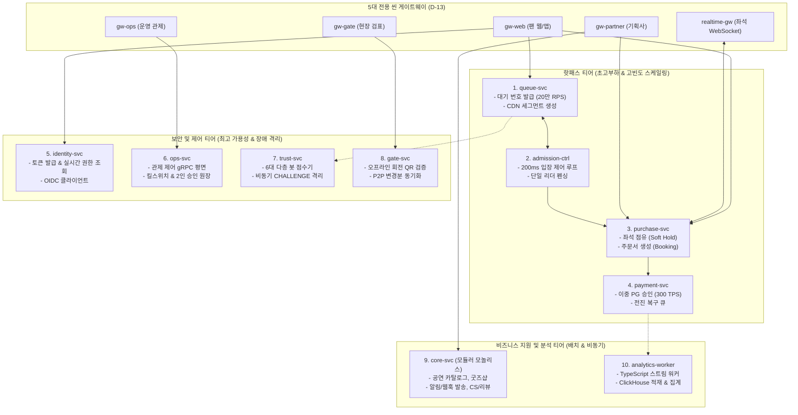

# D-11: 서비스를 왜 업무 도메인이 아닌 부하·가용성·실행 방식의 경계로 10개로 분리했는가?

- **핵심 아키텍처 원칙**: 부하 편차(진입 20만 RPS vs 결제 300 TPS = 670배 격차)에 따른 독립 확장성, 결함 격리(Bulkhead)를 통한 핵심 결제/관제 보호, 이질적 실행 런타임 분리 및 서비스별 저장소 격리(Database-per-Service)
- **관련 설계 정본**: [ADR-0007](../../adr/0007-service-boundaries-by-load-availability-runtime.md), [ADR-0096](../../adr/0096-evidence-design-entry-capacity-split-comparison-v0-baseline.md) 결정 4, [docs/architecture.md](../../architecture.md) §3·§3.1, [docs/verification.md](../../verification.md) §3.8
- **함께 읽기**: [한 판 문서](../01-system-design.md) 11단계, [분야 편 20 '인프라·배포'](../fields/20-infra-devops.md), [분야 편 22 '검증과 측정'](../fields/22-verification.md), [결정 카드 D-15](D15-circuit-breakers-fail-fast.md)·[D-29](D29-prove-without-full-scale.md)

---

## 1. 풀려던 문제와 한계

대규모 티케팅 시스템에서 도메인 주도 설계(DDD)의 교과서적인 '1 바운디드 컨텍스트 = 1 마이크로서비스' 원칙을 맹목적으로 적용할 때 다음과 같은 현실적 병목에 직면한다.

### 1) 진입 트래픽과 트랜잭션 트래픽 간의 670배 극단적 부하 편차
- **대기열 진입 (queue-svc)**: 정각 피크 초당 **200,000 RPS** (NFR-001 설계 상한).
- **좌석 선점 (purchase-svc)**: 동시 체류 5,000명 기준 피크 **2,000 TPS**.
- **PG 결제 승인 (payment-svc)**: 토스페이먼츠 연동 기준 피크 **300 TPS**.
- **입장 확정 (admission-ctrl)**: 5만 석 회차 기준 평균 초당 **28 TPS**.
- 진입 요청과 결제 요청 간에 무려 **670배**의 부하 격차가 발생한다. 단일 모놀리스나 무분별하게 결합된 시스템에서는 진입 20만 건의 트래픽 스파이크가 발생했을 때 웹 스레드와 DB 커넥션 풀을 일순간에 고갈시켜, 이미 결제창에 도달한 소중한 구매자의 결제 승인까지 동반 다운(Shared Fate)시킨다.

### 2) 서비스별 가용성 SLA와 장애 격리(Bulkhead)의 이질성
- 대기열 시스템이나 봇 판정 시스템이 과부하로 쓰러지더라도, **이미 결제 중인 세션, 현장 오프라인 검표 게이트, 운영자의 관제 킬스위치 제어 평면**은 100% 무중단으로 생존해야 한다. 결함의 반경(Blast Radius)을 엄격히 가두어야 한다.

### 3) 실행 런타임 라이프사이클의 근본적 차이
- 마이크로서비스마다 요구하는 실행 모델이 완전히 다르다:
  - 무상태(Stateless) 초고속 I/O: 대기열 진입 게이트웨이
  - 장시간 지속 연결(Long-lived Stateful): 좌석 변경 WebSocket 브로드캐스터 (`realtime-gw`)
  - 단일 리더 분할 뇌 방어 루프: 입장 제어 컨트롤러 (`admission-ctrl`, 200ms 루프)
  - 외부 연동 및 비동기 워커: 결제 웹훅 수신, 알림/웹훅 발송 워커

### 4) 소규모 팀의 운영 비용(Operational Complexity)
- 초기 검토안이었던 14개 마이크로서비스는 1인/소규모 개발팀 입장에서 CI/CD 파이프라인, 모니터링 대시보드, 배포 런북을 14벌 유지해야 하는 치명적 아키텍처 부채를 안긴다.

---

## 2. 후보 기술 비교

| 평가 항목 | 후보 1: 단일 모놀리스 (Monolith) | 후보 2: 순수 도메인별 14개 마이크로서비스 | 후보 3: 핫패스 4개 + 나머지 합본 1개 | 후보 4: 부하·가용성·실행 방식 기준 10개 분리 (선택) |
| :--- | :--- | :--- | :--- | :--- |
| **670배 부하 편차 격리** | 0% (대기열 폭주 시 결제 DB 전멸) | 우수 | 우수 | **완벽 (queue-svc만 독립 50파드 스케일아웃)** |
| **장애 격리 (Bulkhead)** | 취약 (전체 시스템 동반 다운) | 우수 | 미흡 (결제 비밀, 게이트, 관제가 합본에 묶임) | **최상 (관제 전용 노드/DB, 결제 격리 보장)** |
| **서비스 간 네트워크 홉** | 0개 (인메모리 함수 호출) | 극심 (좌석-주문 간 불필요한 RPC 지연) | 적음 | **최적화 (좌석-주문 purchase-svc 통합으로 홉 제거)** |
| **런타임 자원 최적화** | 낮음 (모든 기능이 동일 파드 리소스 점유) | 보통 | 보통 | **최적 (WebSocket 전용, 리더 전용 노드 분리)** |
| **소규모 팀 운영 오버헤드** | 가장 낮음 | 매우 높음 (14벌 파이프라인/배포) | 보통 | **관리 가능 (핵심 5개 핫패스 + 5개 지원 서비스)** |
| **최종 판정** | **탈락 (가용성 위험)** | **탈락 (ADR-0007, 과도한 분절)** | **탈락 (보안 및 관제 독립성 위반)** | **최종 채택 (ADR-0007, ADR-0096)** |

---

## 3. 고른 이유와 아키텍처 다이어그램

PEAKET은 **"조직 구조(콘웨이 법칙)가 아닌 시스템의 물리적 부하, 가용성 SLA, 실행 방식, 보안 경계를 유일한 분리 기준으로 삼는다"**는 원칙으로 10개 핵심 서비스를 정립했다.

### 핵심 매커니즘 4가지

#### 1) 시스템 4대 분리 기준의 엄격한 적용 (ADR-0007)
- **부하 편차**: 20만 RPS의 `queue-svc`와 2,000 TPS의 `purchase-svc`를 완벽히 격리하여 파드 스케일아웃 계수를 독립 제어한다.
- **가용성 요구**: 외부 PG사 연동 실패로 `payment-svc`가 지연되더라도 좌석 화면(`purchase-svc`)과 대기열(`queue-svc`)은 서킷 브레이커 뒤에서 생존한다.
- **실행 모델**: 단일 리더 루프가 필수인 `admission-ctrl`, WebSocket 연결을 유지하는 `realtime-gw`, 비동기 스트림 워커인 `analytics-worker`를 독립 디플로이먼트로 격리한다.
- **보안 및 비밀 키 범위**: 서명 비밀키가 필수적인 `identity-svc`와 금융 결제 비밀키를 가진 `payment-svc`를 타 서비스와 프로세스 수준에서 격리한다.

#### 2) 동일 부하·SLO 도메인의 서비스 내부 모듈화 (Consolidation)
- 교과서적 DDD에서는 좌석(Inventory)과 주문(Booking)을 서로 다른 마이크로서비스로 쪼개지만, PEAKET은 두 도메인이 동일한 트랜잭션 부하(2,000 TPS)와 동일한 가용성 SLA를 공유하므로 **`purchase-svc` 내부의 2개 모듈로 통합**했다. 이를 통해 좌석 선점과 주문 생성 간의 불필요한 네트워크 홉을 0으로 단축했다.
- 부하가 적고 변경 주기가 유사한 5개 영역(공연 카탈로그, 굿즈샵, 알림 발송, 리뷰, 고객 지원)은 **`core-svc`라는 단일 모듈러 모놀리스**로 묶어 운영 복잡도를 획기적으로 낮췄다.

#### 3) 제로 공유 저장소 원칙 (Database per Service)
- 서로 다른 서비스는 상대방의 PostgreSQL 테이블이나 Redis 키를 절대 직접 읽거나 쓰지 않는다.
- 모든 데이터 교환은 엄격한 Protobuf 기반 내부 **gRPC** 또는 MSK **Kafka 이벤트**를 통해서만 발생한다.
- 유일한 예외는 실행 방식 분리를 위해 물리적으로만 쪼갠 한 쌍(`queue-svc`와 `admission-ctrl`, `purchase-svc`와 `realtime-gw`)으로, 이들만 도메인 전용 Redis 클러스터를 공유한다.

#### 4) 분리 타당성 검증을 위한 3대 아키텍처 벤치마크 설계 (ADR-0096)
마이크로서비스 분리의 실질적 이점을 수학적으로 증명하기 위해 동일한 하드웨어 자원(동일 vCPU/메모리 총합) 하에서 3가지 구성을 교차 검증하는 테스트(V-T48)를 설계했다:
1. **(가) 단일 프로세스 합본 (Monolith)**: 모든 서비스 코드가 단일 Node.js 프로세스 내에서 실행.
2. **(나) 역할별 분리 배포 (Modular Monolith)**: 동일한 코드 이미지를 파드별 역할(Role Flag)에 따라 분리 기동.
3. **(다) 10개 독립 마이크로서비스 (Microservices)**: 물리적으로 완전히 분리된 10개 컨테이너 배포.
- 이를 통해 '프로세스 분리에 의한 격리 이점'과 '코드베이스 분리에 의한 오버헤드'를 엄밀히 분리 측정한다.

---

## 4. 얻는 것과 치르는 값 (Tradeoffs)

### 얻는 것 (Gains)
1. **정밀한 비용 효율적 스케일링**: 티켓팅 피크 시 20만 RPS를 받는 `queue-svc`만 50개 파드로 대규모 확장하고, 300 TPS의 `payment-svc`는 4개 파드로 유지하여 클라우드 비용을 최소화한다.
2. **장애 전파 완전 차단**: 대기열 봇 공격이나 카탈로그 조회 폭주가 발생해도 결제 및 현장 검표 게이트웨이 파드는 단 1%의 리소스 간섭도 받지 않는다.
3. **14개 대비 운영 파이프라인 30% 감축**: 14개 도메인을 10개로 압축하여 소규모 팀의 CI 빌드, K8s 매니페스트, 대시보드 관리 오버헤드를 획기적으로 절감했다.

### 치르는 값 (Costs & Limitations)
1. **서비스 간 네트워크 레이턴시**: 마이크로서비스 간 gRPC 호출로 인해 단일 프로세스 함수 호출 대비 호출당 1~3ms의 네트워크 홉 오버헤드가 발생한다.
2. **core-svc 배포 커플링**: 카탈로그, 굿즈샵, 알림 모듈이 단일 `core-svc` 컨테이너로 빌드되므로, 한 모듈의 수정 사항 배포 시 전체 core 서비스가 롤링 업데이트된다.
3. **분산 추적(Distributed Tracing) 및 최종 일관성 비용**: 서비스 간 이벤트 비동기 통신으로 인한 데이터 동기화 지연과 OpenTelemetry 분산 추적 인프라 운영 비용이 발생한다.

---

## 5. 바꿀 조건 (Conditions to Change)

1. **굿즈 커머스 트래픽의 독자적 폭증**: 아이돌 굿즈 판매 트래픽이 티켓팅과 완전히 다른 주기로 급증하여 `core-svc`의 카탈로그/알림 리소스를 잠식할 경우, `shop-svc`를 독자적 마이크로서비스로 분리한다.
2. **좌석 점유와 주문 생성 간의 병목 분리**: 벤치마크 실측에서 좌석 비트맵 연산 부하가 동일 프로세스 내의 주문 DB 커넥션을 지연시키는 현상이 발견되면, `purchase-svc` 내부의 inventory 모듈을 `seat-svc`로 완전 독립시킨다.
3. **3대 구성 벤치마크(V-T48)의 격리 효과 미달**: 동일 자원 테스트에서 10개 분리 구성(다)이 단일 합본(가) 대비 결제 접수 보호 성능(NFR-005)에서 통계적 우위를 보이지 못할 경우, 역할별 분리 배포(나)로 아키텍처를 통합 단순화한다.

---

## 6. 핵심 꼬리 질문 5단 방어 (Staff Interview Q&A)

| 질문 단계 | 심층 질문 | 방어 논리와 기술적 근거 | 관련 정본 |
| :--- | :--- | :--- | :--- |
| **1단: 왜 (Why)** | 도메인 모델(DDD) 기준으로 서비스를 쪼개지 않고 왜 부하와 가용성 기준으로 10개를 나눴나요? | 티켓팅 도메인은 피크 진입(20만 RPS)과 결제(300 TPS) 간에 670배의 극단적 부하 격차가 발생합니다. 도메인 개념만으로 나누면 부하가 동일한 좌석과 주문 사이에 쓸데없는 네트워크 홉이 생기고, 정작 결제 트래픽을 대기열 폭주로부터 물리적으로 격리하지 못합니다. 인프라의 장애 반경(Bulkhead)과 수평 확장성(Scale-out)을 극대화하려면 부하 특성과 가용성 SLA를 제1 분리 기준으로 삼아야 합니다. | ADR-0007 |
| **2단: 대안 (Alternatives)** | 배포와 운영이 가장 단순한 모듈러 모놀리스(Modular Monolith) 하나로 가면 안 되나요? | 모듈러 모놀리스는 코드 레벨의 격리는 제공하지만 단일 프로세스/단일 K8s 파드 안에서 실행됩니다. T=0 정각에 20만 RPS가 유입되어 Node.js 이벤트 루프나 JVM 힙이 포화되면 동일 프로세스 내의 결제 승인 쓰레드와 운영 킬스위치까지 즉각 멈춥니다. 결제와 제어 평면의 생존을 위해서는 최소한 프로세스 수준의 물리적 격리가 불가피합니다. | ADR-0007, ADR-0096 |
| **3단: 장애 대응 (Resilience)** | 10개 서비스 중 하나가 500 에러를 뿜으며 죽으면 전체 시스템으로 연쇄 장애가 번지지 않나요? | PEAKET은 제로 공유 저장소 원칙을 준수하므로 타 서비스의 DB 락 경합에 휘말리지 않습니다. 또한 서비스 간 통신 길목마다 게이트웨이 1차 타임아웃과 서비스 내부 2차 서킷 브레이커(Opossum)를 배치하여, 장애 발생 서비스로의 호출을 1초 만에 Fast-Fail(503)로 차단하고 장애를 해당 경계 안에 완벽히 가둡니다. | ADR-0007, ADR-0009 |
| **4단: 수치 근거 (Numbers)** | 진입 20만 RPS와 결제 300 TPS라는 670배 격차는 어떻게 산출되었나요? | 100만 대기자가 몰리는 슈퍼 콘서트 오픈 시 대기열 진입 게이트웨이 수용 설계 목표가 초당 200,000건(NFR-001)입니다. 반면 PG사(토스페이먼츠)의 승인 API 최대 처리 계약 한도는 초당 300 TPS입니다. $200,000 / 300 \approx 666.67$배로, 입구와 출구 사이에 물리적으로 670배의 유량 병목이 존재함을 수학적으로 증명한 수치입니다. | docs/architecture.md §3, ADR-0036 |
| **5단: 실측과 검증 (Verification)** | 마이크로서비스로 나눈 것이 모놀리스보다 실제로 우수하다는 것을 증명했나요? | 단일 머신 환경에서 동일한 vCPU/메모리 총합을 할당하고 (가) 단일 합본, (나) 역할별 분리 배포, (다) 10개 분리 서비스 세 가지 구성을 빌드하여 진입 100% 폭주 상황에서의 결제 접수 지연(V-T48)을 비교 측정하도록 실험을 정밀 설계했습니다. 이를 통해 감이나 트렌드가 아닌 실측 벤치마크 데이터로 서비스 분리의 성능 및 결함 격리 타당성을 입증합니다. | docs/verification.md §3.8, ADR-0096 |

---

## 7. 30초 아키텍처 브리핑 (Staff Engineer Summary)

> "PEAKET은 마이크로서비스 경계를 교과서적인 업무 도메인이 아닌 '670배에 달하는 부하 편차(20만 RPS vs 300 TPS), 가용성 SLA, 실행 런타임 모델'을 기준으로 10개 핵심 서비스로 확립했습니다.  
> 부하와 SLA가 동일한 좌석 선점과 주문 생성은 `purchase-svc`로 통합해 불필요한 네트워크 홉을 없앴고, 가벼운 5개 도메인은 `core-svc` 모듈러 모놀리스로 묶어 소규모 팀의 운영 복잡도를 최소화했습니다.  
> 각 서비스는 상대방의 DB를 절대 공유하지 않고 gRPC와 Kafka로만 소통하며, 대기열 진입 폭주가 결제와 관제 평면으로 1비트도 전파되지 않는 완벽한 결함 격리(Bulkhead)를 달성했습니다."
