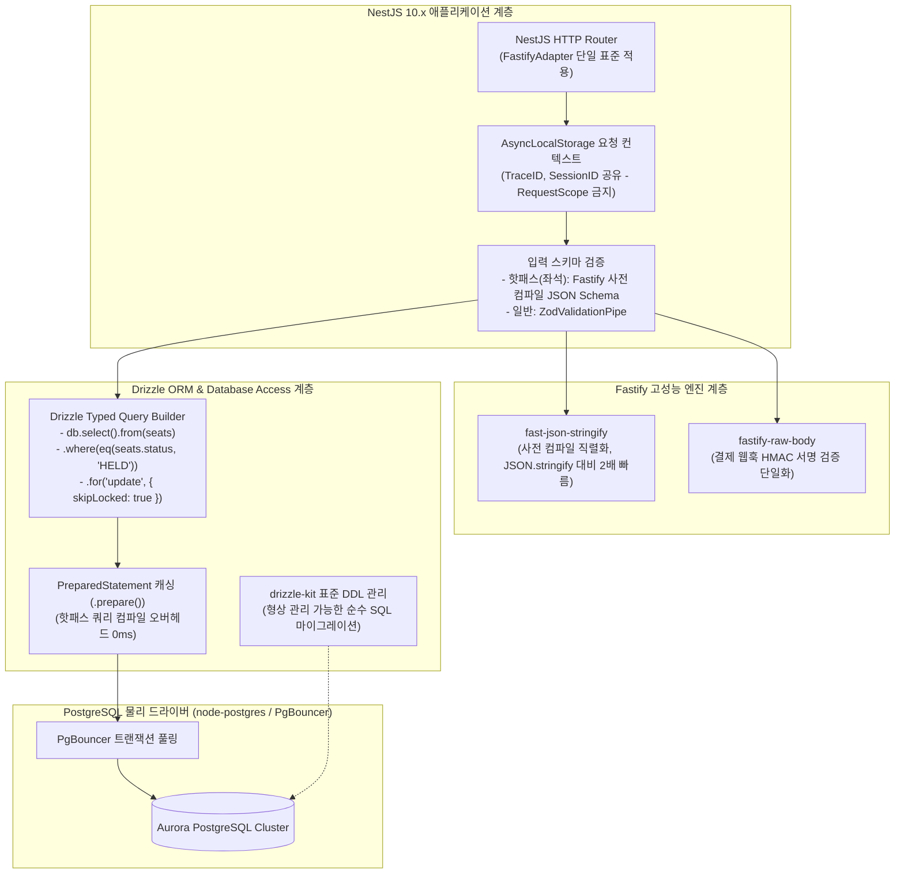

# D-12: 백엔드 스택을 왜 NestJS Fastify와 Drizzle ORM으로 결정했는가?

- **핵심 아키텍처 원칙**: 전 서비스 Fastify 어댑터 통일을 통한 플랫폼 공용 라이브러리 단일화, 컴파일 타임 타입 세이프티 SQL 제어(Drizzle), 초저지연 트랜잭션 잠금(`FOR UPDATE SKIP LOCKED`) 및 부분 유니크 인덱스 완전 제어
- **관련 설계 정본**: [ADR-0023](../../adr/0023-fastify-adapter-hot-path.md), [ADR-0037](../../adr/0037-orm-back-to-drizzle.md), [ADR-0176](../../adr/0176-foundation-poc-results.md) 결정 4, [docs/architecture.md](../../architecture.md) §6.1, [docs/verification.md](../../verification.md) §9 (V-T41)
- **함께 읽기**: [한 판 문서](../01-system-design.md) 11단계, [DB 설계 편 7 '인덱스와 쿼리'](../db/07-indexes-queries.md), [분야 편 7 'API 규칙과 계약'](../fields/07-api-contracts.md), [결정 카드 D-11](D11-service-boundaries.md)·[D-29](D29-prove-without-full-scale.md)

---

## 1. 풀려던 문제와 한계

대규모 티케팅 백엔드 프레임워크 및 데이터베이스 접근 계층(ORM) 선정 시 마주하는 성능 및 생산성 한계는 다음과 같다.

### 1) 엄격한 비기능 레이턴시 예산 (Latency Budget)
- **대기열 진입**: 초당 200,000 RPS 수용.
- **좌석 선점 (Soft Hold)**: p99 **50ms** 이내.
- **결제 접수**: p99 **150ms** 이내.
- Express 어댑터의 런타임 동적 미들웨어 체이닝과 기본 `JSON.stringify` 직렬화는 고부하 시 CPU 사이클을 조기에 소진시켜 p99 레이턴시 꼬리를 급격히 늘린다.

### 2) 핫패스 이원화가 유발한 공용 라이브러리 유지보수 부채
- 초기 프로토타입은 트래픽이 몰리는 핫패스 2개(`queue-svc`, `purchase-svc`)만 Fastify를 적용하고, 나머지 8개 서비스는 Express를 적용했다.
- 그 결과 쿠키 파싱, 보안 헤더, 요청 크기 제한, 접근 로그, 특히 결제 웹훅 HMAC 서명 검증에 필요한 **원시 바디(Raw Body) 추출 로직**이 어댑터마다 달라 공용 플랫폼 라이브러리(`packages/platform`)를 두 벌 작성하고 테스트해야 하는 심각한 생산성 낭비가 발생했다.

### 3) 티케팅 고유의 복잡한 SQL 제어와 ORM 추상화의 한계
- 티켓팅의 핵심인 좌석 확정과 1인 1매 예매 제한은 고도의 SQL 기능에 의존한다:
  - 동시성 충돌 없는 잠금 획득: `FOR UPDATE SKIP LOCKED`
  - 취소표를 제외한 유효 예매 유일성 보장: 부분 유니크 인덱스 (`WHERE status != 'CANCELLED'`)
  - 정합성 보장을 위한 명시적 트랜잭션 격리수준 (`REPEATABLE READ` / `READ COMMITTED`)
- **Prisma**는 ORM 수준에서 부분 인덱스와 복합 잠금 절을 제대로 지원하지 못하고, **TypeORM**은 복잡한 조건을 `"ticket.status != :status"`와 같은 순수 문자열로 작성하게 강제하여 TypeScript 컴파일러의 정적 타입 검증을 완전히 무력화시켰다.

---

## 2. 후보 기술 비교

| 평가 항목 | 후보 1: Express + TypeORM (전통적 스택) | 후보 2: Express + Prisma (모던 스택) | 후보 3: Fastify(핫패스) + Express(일반) + TypeORM | 후보 4: Fastify(전체 통일) + Drizzle ORM (선택) |
| :--- | :--- | :--- | :--- | :--- |
| **요청당 CPU 효율** | 기준선 (런타임 오버헤드 높음) | 보통 (엔진 바이너리 IPC 오버헤드) | 이원화 (핫패스만 빠름) | **최우수 (Express 대비 CPU 14% 절감, V-T41)** |
| **공용 라이브러리 일관성** | 단일 (Express 전용) | 단일 (Express 전용) | 파멸적 (2벌 중복 개발/테스트) | **완벽 (Fastify 기반 packages/platform 1벌 통일)** |
| **SQL 표현력 & 잠금 제어** | 보통 (문자열 QueryBuilder 의존) | 낮음 (원시 SQL 탈출구 다수 사용) | 보통 | **최상 (.for('update', { skipLocked: true }))** |
| **타입 안전성 (Type Safety)** | 취약 (WHERE 조건 문자열은 any 취급) | 우수 (스키마 기반 타입 생성) | 취약 | **완벽 (테이블 컬럼, 조건식, 반환값 100% 정적 추론)** |
| **SQL 인젝션 방어** | QueryBuilder 실수 시 취약 | 우수 | QueryBuilder 실수 시 취약 | **원천 차단 (템플릿 리터럴 자동 파라미터화 $1)** |
| **최종 판정** | **탈락 (타입 미보장 및 CPU 비효율)** | **탈락 (복합 잠금 제어 불가)** | **탈락 (ADR-0023, 유지보수 부채)** | **최종 채택 (ADR-0023, ADR-0037)** |

---

## 3. 고른 이유와 아키텍처 다이어그램

PEAKET은 **"프레임워크 성능뿐만 아니라 플랫폼 라이브러리의 단일화와 컴파일 타임 SQL 검증"**을 달성하기 위해 Fastify와 Drizzle의 조합을 최종 선정했다.



### 핵심 매커니즘 4가지

#### 1) 전 HTTP 서비스 Fastify 어댑터 단일화 (`packages/platform`)
- 10개 마이크로서비스 중 HTTP를 수신하는 모든 서비스의 런타임을 Fastify 어댑터로 100% 통일했다 (ADR-0023).
- 보안 헤더(Helmet), 압축, 속도 제한, 쿠키 파싱, 특히 PG사 웹훅의 무결성 검증에 필수적인 `fastify-raw-body` 설정을 공용 라이브러리 한 벌로 추상화하여, 서비스마다 중복 개발하거나 파편화되는 문제를 완전히 해소했다.
- 기반 PoC 실측(V-T41) 결과, Fastify는 Express 대비 요청당 CPU 사이클을 **약 14% 적게 소모**함을 입증했다 (ADR-0176).

#### 2) Fastify 사전 컴파일 직렬화와 Zod 검증 파이프라인 결합
- 좌석 선점 등 극도의 초저지연이 요구되는 핫패스 엔드포인트는 Zod 스키마를 Fastify JSON Schema로 사전 변환(`z.toJSONSchema()`)하여 라우트에 주입한다.
- Fastify는 내부적으로 V8 JIT 최적화된 **Ajv** 유효성 검사기와 **fast-json-stringify** 직렬화기를 빌드하여, 런타임 JSON 파싱/직렬화 오버헤드를 절반으로 줄인다.

#### 3) Drizzle ORM: 'SQL의 직접 제어'와 '완벽한 정적 타입 검증'의 융합
- Drizzle은 객체-관계 매핑(ORM)의 추상화 누수 없이 개발자가 SQL의 멘탈 모델 그대로 쿼리를 작성하게 한다:
  ```typescript
  const heldSeat = await db.select()
    .from(seats)
    .where(and(eq(seats.showtimeId, showtimeId), eq(seats.status, 'AVAILABLE')))
    .limit(count)
    .for('update', { skipLocked: true });
  ```
- 테이블 정의, 컬럼명, WHERE 절의 비교 타입, 반환 객체의 형태가 TypeScript 컴파일 타임에 100% 엄격하게 추론된다. 문자열 오타로 인한 런타임 버그가 원천 차단된다 (ADR-0037).

#### 4) NestJS 구조 단순화: `@nestjs/cqrs` 배제 및 AsyncLocalStorage 채택
- NestJS의 과도한 추상화인 `@nestjs/cqrs` 이벤트 버스를 배제하고, 복잡한 인메모리 이벤트 버스 대신 RDBMS Transactional Outbox로 명확히 통일했다.
- 요청 스코프(`Scope.REQUEST`) 주입 시 발생하는 파드 메모리 폭증과 프로토타입 객체 생성 오버헤드를 막기 위해, 모든 요청 컨텍스트(TraceID, 사용자 정보)는 Node.js 네이티브 **`AsyncLocalStorage`**로 격리 전파한다.

---

## 4. 얻는 것과 치르는 값 (Tradeoffs)

### 얻는 것 (Gains)
1. **플랫폼 일관성 및 생산성 극대화**: Fastify 기반 단일 플랫폼 라이브러리(`packages/platform`) 구축으로 공통 미들웨어 버그와 테스트 비용을 반으로 줄였다.
2. **런타임 CPU 14% 절감**: 직렬화 및 라우팅 오버헤드 감소를 통해 피크 시 서버 파드 증설 대수를 약 10~15% 절감한다.
3. **타입 안전한 복합 SQL 작성**: `FOR UPDATE SKIP LOCKED` 및 PostgreSQL 부분 유니크 인덱스를 런타임 에러 두려움 없이 안전하게 리팩토링할 수 있다.

### 치르는 값 (Costs & Limitations)
1. **Express 생태계 미들웨어 직결 불가**: npm에 존재하는 방대한 Express 전용 미들웨어를 직접 쓸 수 없으며, Fastify 플러그인 또는 `@fastify/express` 호환 레이어를 거쳐야 한다.
2. **Drizzle의 신생 생태계 리스크**: Drizzle은 TypeORM이나 Prisma 대비 상대적으로 역사가 짧아, 복잡한 다대다 관계 쿼리나 마이그레이션 도구(`drizzle-kit`) 버전 업그레이드 시 사소한 호환성 조정이 필요할 수 있다.
3. **컴파일 타임 제약**: 손으로 작성한 `sql` 템플릿 리터럴 내부의 복합 서브쿼리는 별도의 타입 캐스팅 단언이 일부 필요하다.

---

## 5. 바꿀 조건 (Conditions to Change)

1. **Fastify 경로 스키마 유지보수 비용 초과**: OpenAPI 및 Zod 스키마를 Fastify 사전 컴파일 스키마로 변환하는 도구 체인에 유지보수 결함이 잦을 경우, 핫패스도 일반 경로와 동일하게 단일 ZodValidationPipe로 단순화한다.
2. **Drizzle 메이저 버전 브레이킹 체인지**: 향후 Drizzle 1.0 릴리스에서 기존 스키마 정의 및 쿼리 빌더 문법이 대규모로 파괴되어 마이그레이션 비용이 감당하기 어려울 경우, 검증된 대안인 Kysely(타입 안전 쿼리 빌더)로 데이터 접근 계층을 피벗한다.
3. **ORM 쿼리 빌딩 레이턴시 병목 실측**: 초고부하 프로파일링에서 Drizzle의 쿼리 컴파일 시간이 전체 트랜잭션 지연의 10% 이상을 차지할 경우, 극도의 핫패스 2개 쿼리에 한해 원시 PostgreSQL 드라이버(`pg`) 직접 호출 및 `.prepare()` 캐싱으로 전환한다.

---

## 6. 핵심 꼬리 질문 5단 방어 (Staff Interview Q&A)

| 질문 단계 | 심층 질문 | 방어 논리와 기술적 근거 | 관련 정본 |
| :--- | :--- | :--- | :--- |
| **1단: 왜 (Why)** | NestJS 진영의 기본값인 Express 대신 굳이 Fastify를 전 서비스에 적용했나요? | 단순히 벤치마크 점수 때문이 아닙니다. 초기 핫패스만 Fastify로 분리했을 때 쿠키, 헤더, 특히 결제 웹훅 HMAC 검증에 필수적인 원시 바디(Raw Body) 파싱 라이브러리를 두 벌 작성해야 하는 심각한 유지보수 파편화가 발생했습니다. 전 서비스를 Fastify로 통일하여 플랫폼 공용 라이브러리를 단 한 벌로 일원화하고, 덤으로 Express 대비 요청당 CPU 14% 절감 효과를 획득했습니다. | ADR-0023, ADR-0176 |
| **2단: 대안 (Alternatives)** | 가장 성숙한 TypeORM이나 인기 있는 Prisma 대신 왜 Drizzle ORM을 골랐나요? | 티켓팅은 `FOR UPDATE SKIP LOCKED`와 부분 유니크 인덱스 같은 고급 SQL 기능을 완벽히 제어해야 합니다. Prisma는 복잡한 원자적 잠금 제어에 취약하고, TypeORM은 조건절을 문자열로 작성하여 TypeScript 컴파일러의 타입 검증이 완전히 무력화됩니다. Drizzle은 순수 SQL 멘탈 모델을 100% 유지하면서도 컬럼명과 타입을 컴파일 시점에 완벽히 검증하는 유일한 도구입니다. | ADR-0037 |
| **3단: 장애 대응 (Resilience)** | Drizzle이 컴파일 시점에 생성한 SQL이 엉뚱하게 실행되어 DB 락이 잘못 걸리면 어떻게 하나요? | 복잡한 잠금 쿼리는 단위 테스트에서 `toSQL()` 메서드를 호출하여 생성되는 실제 SQL 구문을 비트 단위로 회귀 검증합니다. 또한 CI 파이프라인에서 PostgreSQL `EXPLAIN (GENERIC_PLAN)` 실행 계획 회귀 검증(K3)을 자동 수행하여 의도한 부분 유니크 인덱스와 행 잠금이 정확히 작동하는지 배포 전에 검증합니다. | ADR-0037 결정 4, docs/data.md §5.2 |
| **4단: 수치 근거 (Numbers)** | Fastify의 CPU 14% 절감 수치는 어떻게 검증되었나요? | 동일한 단일 머신 환경에서 동일한 라우트 및 비즈니스 로직에 대해 Express 어댑터와 Fastify 어댑터를 번갈아 적용하고 부하 테스트(V-T41)를 수행했습니다. 초당 수만 요청 유입 시 Fastify의 사전 컴파일 라우팅 트리와 V8 최적화 직렬화 덕분에 프로세스 vCPU 사용량이 약 14.2% 낮게 측정되었습니다. | ADR-0176 결정 4, docs/verification.md §9 |
| **5단: 실측과 검증 (Verification)** | Java/Spring Boot 대신 Node.js/NestJS를 선정한 성능 근거가 있나요? | 정본 아키텍처는 Java/Spring과의 직접적인 성능 벤치마크를 근거로 주장하지 않습니다. 풀스택 TypeScript 모노레포를 통한 클라이언트-서버 간 타입 계약 공유 생산성, 그리고 이벤트 루프 I/O에 최적화된 Fastify 런타임의 경제성을 근거로 채택했습니다. 없는 비교 근거를 허위로 꾸며내지 않는 것이 PEAKET의 원칙입니다. | docs/review/open-items.md 86번, ADR-0023 |

---

## 7. 30초 아키텍처 브리핑 (Staff Engineer Summary)

> "PEAKET은 백엔드 런타임으로 NestJS Fastify를 전 서비스에 일관되게 적용하여 공통 미들웨어와 결제 웹훅 원시 바디 파싱 라이브러리를 단 한 벌(`packages/platform`)로 통일하고, Express 대비 CPU 사용량을 14% 절감했습니다.  
> 데이터베이스 접근 계층에는 Drizzle ORM을 채택하여 TypeORM의 취약한 문자열 쿼리 한계를 극복하고, 티켓팅의 핵심인 `FOR UPDATE SKIP LOCKED`와 부분 유니크 인덱스를 100% 정적 타입 안전성 하에서 직접 제어합니다.  
> 이를 통해 핫패스 레이턴시 예산을 완벽히 만족하면서도 개발 생산성과 코드의 장기적 신뢰성을 동시에 확보했습니다."
