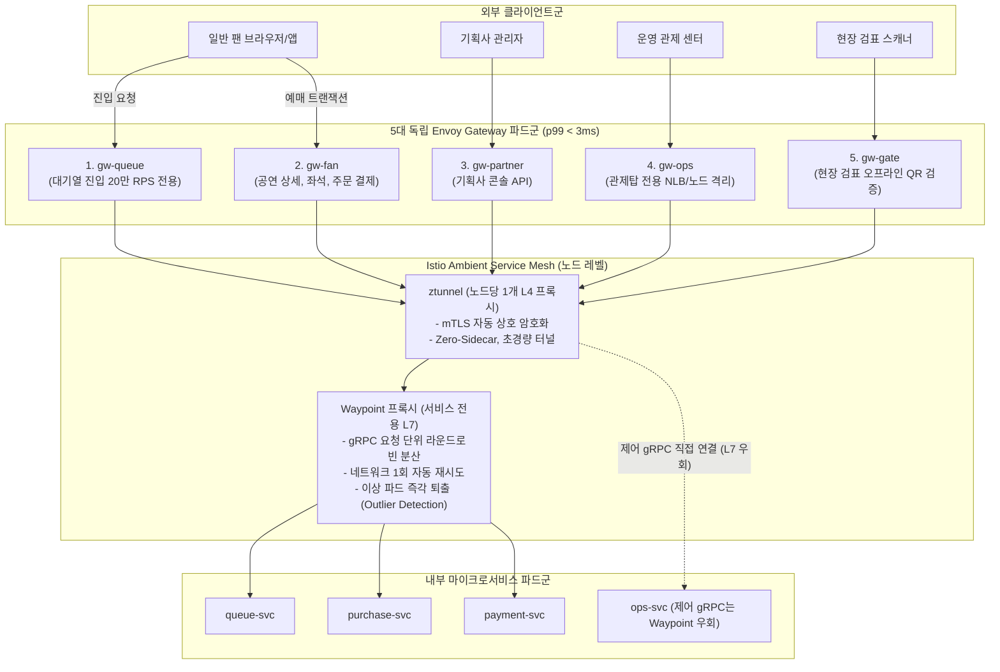

# D-13: 입구 서버를 왜 클라이언트 유형별 5개 씬 게이트웨이로 나누고, 내부 통신은 왜 Istio Ambient Mesh에 위임했는가?

- **핵심 아키텍처 원칙**: 클라이언트별 물리적 결함 격벽(Bulkhead), 게이트웨이 비즈니스 로직 배제(Thin Gateway, p99 3ms), Istio Ambient 제로 사이드카(Zero-Sidecar)를 통한 인프라 비용 절감 및 gRPC L7 요청 단위 로드 밸런싱
- **관련 설계 정본**: [ADR-0008](../../adr/0008-client-specific-thin-gateways.md), [ADR-0010](../../adr/0010-service-discovery-and-internal-calls.md), [ADR-0082](../../adr/0082-istio-ambient-mesh-app-boundary-meshless-portfolio-runs.md), [ADR-0100](../../adr/0100-console-rest-sse-drop-trpc-module-federation-showcase-baseline.md), [ADR-0102](../../adr/0102-control-plane-direct-grpc-dedicated-pool-ops-db-audit-chain-worker-break-glass.md), [ADR-0144](../../adr/0144-edge-load-balancer-shared-fate-separation-and-failure-response.md), [ADR-0172](../../adr/0172-judge-roles-per-request-not-in-tokens.md), [docs/architecture.md](../../architecture.md) §4·§5·§6.1
- **함께 읽기**: [한 판 문서](../01-system-design.md) 11단계, [분야 편 8 '인증'](../fields/08-identity.md), [분야 편 20 '인프라·배포'](../fields/20-infra-devops.md), [결정 카드 D-14](D14-tokens-and-per-request-authz.md)·[D-15](D15-circuit-breakers-fail-fast.md)·[D-18](D18-control-as-state-grpc.md)

---

## 1. 풀려던 문제와 한계

외부 클라이언트 진입 관문(API Gateway) 및 내부 서비스 간 통신(East-West Mesh) 설계 시 직면하는 아키텍처 병목은 다음과 같다.

### 1) 통합 게이트웨이(Single Edge Gateway)의 운명 공유(Shared Fate) 참사
- 과거 방식처럼 단일 API 게이트웨이에 모든 클라이언트(웹, 모바일, 기획사 어드민, 관제 콘솔, 현장 검표기)의 트래픽을 몰아넣으면, 티켓팅 정각에 `queue`로 유입되는 **초당 200,000 RPS**의 스파이크가 게이트웨이 파드의 CPU와 소켓을 일순간에 고갈시킨다.
- 그 결과 장애 상황을 수습해야 할 **운영 관제 콘솔(`gw-ops`)**과 당일 티켓을 검표해야 하는 **현장 스캐너(`gw-gate`)**의 요청까지 504 Gateway Timeout으로 동반 마비되는 치명적 파멸이 일어난다.

### 2) 비대한 게이트웨이(Fat Gateway / BFF)의 레이턴시 잠식
- 게이트웨이에서 비즈니스 트랜잭션을 실행하고, Redis나 DB를 직접 조회하거나, 복수의 마이크로서비스 응답을 모아 조합(Aggregation)하는 BFF 패턴은 게이트웨이 자체를 거대한 단일 병목으로 만든다.
- 대규모 트래픽에서 게이트웨이 순수 레이턴시는 **p99 3ms 이내**로 극도로 가벼워야 한다.

### 3) gRPC의 L4 부하 분산 편향 한계
- 내부 서비스 통신에 사용되는 gRPC는 HTTP/2 단일 TCP 커넥션 상에서 수많은 요청을 멀티플렉싱(Multiplexing)한다.
- 쿠버네티스의 기본 `kube-proxy`는 TCP L4 레벨에서만 로드 밸런싱을 수행하므로, 클라이언트 파드가 한 번 특정 서버 파드와 TCP 연결을 맺으면 **모든 gRPC 호출이 해당 파드 하나로만 쏠리는 극심한 부하 불균형**이 발생한다. 따라서 L7 요청 단위(Request-level) 로드 밸런싱이 필수적이다.

### 4) 전통적 사이드카(Sidecar) 메시의 막대한 컴퓨팅/메모리 오버헤드
- 모든 애플리케이션 파드마다 Envoy 사이드카 컨테이너를 주입하는 전통적 방식은 20만 RPS 환경에서 프록시 유지에만 **약 80 vCPU**를 소모한다 (Istio 공식 벤치마크 기준 초당 1,000요청당 0.20 vCPU).
- 또한 프록시 버전 업그레이드 시마다 모든 비즈니스 애플리케이션 파드를 강제 재시작해야 하는 심각한 운영 부담을 유발한다.

---

## 2. 후보 기술 비교

| 평가 항목 | 후보 1: 통합 단일 API 게이트웨이 | 후보 2: AWS API Gateway (완전관리형) | 후보 3: 전통적 Istio 사이드카 메시 | 후보 4: 5대 씬 게이트웨이 + Istio Ambient Mesh (선택) |
| :--- | :--- | :--- | :--- | :--- |
| **장애 격리 (Bulkhead)** | 0% (대기열 폭주 시 관제/게이트 동반 다운) | 낮음 (통합 계정 쿼터 공유) | N/A (내부 통신용) | **완벽 (5개 게이트웨이 파드군 물리적 완전 분리)** |
| **게이트웨이 순수 지연** | 20~50ms (무거운 비즈니스 로직 수행) | 10~30ms | N/A | **p99 < 3ms (비즈니스 로직 0, 서명 검증만 수행)** |
| **gRPC L7 부하 분산** | N/A | 미지원 | 지원 (파드 사이드카) | **지원 (Waypoint L7 프록시를 통한 완전 분산)** |
| **메시 컴퓨팅 오버헤드** | N/A | N/A | 극심 (20만 RPS 시 약 80 vCPU 소모) | **최소화 (노드당 ztunnel L4 mTLS, 약 24 vCPU)** |
| **프록시 패치 운영 부담** | 게이트웨이 재배포 | AWS 관리 | 극심 (모든 앱 파드 재시작 필요) | **무중단 (앱 파드 재시작 없이 ztunnel만 롤링)** |
| **최종 판정** | **탈락 (Shared Fate 위험)** | **탈락 (20만 RPS 비용 폭탄)** | **탈락 (ADR-0082, 리소스 낭비)** | **최종 채택 (ADR-0008, ADR-0010, ADR-0082)** |

---

## 3. 고른 이유와 아키텍처 다이어그램

PEAKET은 **"입구는 결함 격벽을 위해 얇게 5개로 쪼개고, 내부는 사이드카 없는 Istio Ambient로 연결한다"**는 설계를 적용했다.

### 핵심 매커니즘 4가지

#### 1) 5대 독립 씬 게이트웨이(Thin Gateway) 격벽 분리
- 클라이언트 목적별로 Envoy Gateway 인스턴스를 5개로 완전히 분리했다 (ADR-0008):
  1. `gw-queue`: 오픈 피크 20만 RPS 대기열 진입 전용
  2. `gw-fan`: 예매, 좌석 선점, 결제 승인 API
  3. `gw-partner`: 기획사 어드민 API
  4. `gw-ops`: 시스템 운영 관제 전용 (전용 NLB 및 전용 노드 풀 격리, ADR-0144)
  5. `gw-gate`: 현장 스캐너 기기 인증 및 검표 전용
- `gw-queue`가 트래픽 폭주로 포화되어 503 에러를 뿜더라도, `gw-ops`나 `gw-gate`의 네트워크 대역폭과 CPU는 1%의 간섭도 받지 않는다.

#### 2) 씬 게이트웨이 원칙 (비즈니스 로직 제로)
- 게이트웨이는 다음의 6가지 L7 횡단 관심사만 수행하며, 비즈니스 로직과 DB 조회를 완전히 배제한다:
  1. JWT 토큰의 타원곡선(ES256) 비대칭키 서명 검증 (로컬 메모리 공개키 캐시 사용, DB 조회 0건)
  2. 토큰의 Audience(대상) 및 Scope(범위) 검사
  3. 전역 및 IP 기반 레이트 리미팅 (Rate Limiting)
  4. CORS 및 CSRF 공격 차단
  5. 게이트웨이 타임아웃 및 동시 연결 상한 제어
  6. 클라이언트 요청 헤더 정제
- **역할 및 테넌트 인가(RBAC)는 게이트웨이가 하지 않고 수신 서비스가 요청마다 직접 수행**한다 (ADR-0172). 이를 통해 게이트웨이 처리 지연을 **p99 3ms 이내**로 고정한다.

#### 3) Istio Ambient Mesh: ztunnel과 Waypoint 프록시의 2단계 분리
- **ztunnel (L4 mTLS)**: 노드당 단 1개만 실행되는 초경량 Rust 프록시다. 애플리케이션 파드에 사이드카를 주입하지 않고도 클러스터 내부의 모든 TCP 트래픽을 mTLS(HBONE 프로토콜)로 완벽히 암호화한다. 사이드카 대비 프록시 CPU 소모를 **약 70% 절감**한다 (80 vCPU $\rightarrow$ 24 vCPU, ADR-0082).
- **Waypoint 프록시 (L7 gRPC 분산)**: gRPC를 수신하는 서비스(예: `purchase-svc`) 앞에만 전용 L7 프록시를 띄운다. HTTP/2 스트림을 파싱하여 **파드 간 완벽한 요청 단위 로드 밸런싱**, 1회 네트워크 재시도, 지연 파드 즉시 퇴출(Outlier Ejection)을 수행한다.

#### 4) 서비스 메시와 애플리케이션의 엄격한 책임 분계선
- **메시의 책임**: L4 mTLS 암호화, 서비스 디스커버리, gRPC L7 부하 분산, 단순 네트워크 일시 오류 1회 재시도(`connect-failure,refused-stream`).
- **앱의 책임**: 비즈니스 데드라인 전파, 도메인 멱등 재시도, 2단계 서킷 브레이커, 사용자 인증/인가.
- 앱 계층에서 불필요한 네트워크 재시도를 중복 구현하지 않음으로써, 네트워크 단절 시 재시도가 기하급수적으로 폭증(Retry Storm)하는 사태를 방지한다.

---

## 4. 얻는 것과 치르는 값 (Tradeoffs)

### 얻는 것 (Gains)
1. **완벽한 결함 격리 (Bulkhead)**: 대기열 20만 RPS 폭주 시에도 관제탑 킬스위치와 당일 현장 게이트가 100% 정상 가동된다.
2. **사이드카 대비 컴퓨팅 비용 70% 절감**: 100만 트래픽 수용 시 사이드카 메모리/CPU 낭비를 제거하고, 노드당 단일 ztunnel로 mTLS를 경량화했다.
3. **무중단 인프라 라이프사이클**: 서비스 메시 프록시 보안 패치 시 애플리케이션 비즈니스 파드를 재기동할 필요가 전혀 없다.

### 치르는 값 (Costs & Limitations)
1. **관리 대상 인프라 매니페스트 증가**: Gateway, HTTPRoute, SecurityPolicy 매니페스트를 5벌 분리 관리해야 하는 설정 오버헤드가 발생한다.
2. **Waypoint L7 프록시의 네트워크 1홉 추가**: L7 상세 제어가 필요한 gRPC 경로에 한해 Waypoint 프록시를 경유하므로 약 0.5~1ms의 추가 지연이 발생한다.
3. **Ambient Mesh 기술 성숙도 학습 곡선**: 전통적 사이드카 대비 최신 기술이므로 운영팀의 디버깅 및 트러블슈팅 역량이 요구된다.

---

## 5. 바꿀 조건 (Conditions to Change)

1. **Waypoint 프록시 지연 초과**: gRPC 경로에서 Waypoint 프록시 경유에 따른 지연이 p99 2ms를 지속 초과할 경우, Waypoint를 제거하고 K8s Headless Service와 gRPC 클라이언트 측 로드 밸런싱(`grpc-js round_robin`)으로 전환한다.
2. **게이트웨이 관리 오버헤드의 이점 역전**: 트래픽 규모가 축소되거나 팀 리소스 제약으로 5개 게이트웨이 운영 비용이 격리 실익을 초과할 경우, `gw-partner`와 `gw-gate`를 단일 관리자 게이트웨이로 통폐합한다.
3. **노드 단위 ztunnel 장애 파급**: 카오스 엔지니어링 훈련에서 단일 ztunnel 다운이 해당 노드의 전체 파드 통신을 광범위하게 마비시킬 경우, 핫패스 결제/좌석 노드 풀에 한해 전통적 파드별 사이드카 주입 방식으로 롤백한다.

---

## 6. 핵심 꼬리 질문 5단 방어 (Staff Interview Q&A)

| 질문 단계 | 심층 질문 | 방어 논리와 기술적 근거 | 관련 정본 |
| :--- | :--- | :--- | :--- |
| **1단: 왜 (Why)** | API 게이트웨이 1개로 통합해서 운영하는 게 비용과 관리 면에서 훨씬 편하지 않나요? | 대규모 티켓팅에서는 진입 트래픽(20만 RPS)과 관제/결제 트래픽의 중요도가 다릅니다. 단일 게이트웨이를 쓰면 대기열 진입 폭주나 설정 실수 한 번으로 운영자의 비상 킬스위치와 현장 검표기까지 504 타임아웃으로 동반 사망합니다. 5개 게이트웨이로 물리 분리하는 것은 '내부 결함 격벽(Bulkhead)'을 확보하기 위한 필수 불가결한 투자입니다. | ADR-0008, ADR-0144 |
| **2단: 대안 (Alternatives)** | 서비스 메시 대신 gRPC 클라이언트 네이티브 라운드로빈(`grpc-js`)을 쓰면 메시 없이도 되지 않나요? | 순수 gRPC 클라이언트 로드 밸런싱은 쿠버네티스 파드의 스케일아웃/다운 시 코어DNS 갱신 지연(최소 30초)으로 인해 죽은 파드로 요청을 보내는 오류율이 증가합니다. 또한 mTLS 상호 인증과 이상 파드 즉각 퇴출(Outlier Ejection)을 앱 코드로 일일이 구현해야 합니다. 메시 계층에 위임하는 것이 애플리케이션 코드를 순수하게 유지하는 길입니다. | ADR-0010, ADR-0082 |
| **3단: 장애 대응 (Resilience)** | `gw-queue` 파드가 20만 RPS 부하를 견디지 못하고 전멸하면 어떻게 되나요? | `gw-queue` 디플로이먼트만 503 에러를 반환하며 무너질 뿐, 독립된 파드 풀과 전용 NLB를 사용하는 `gw-fan`(좌석/결제)과 `gw-ops`(관제)는 1비트의 트래픽 간섭도 받지 않습니다. 결제 중인 사용자는 정상적으로 결제를 마치고, 운영자는 관제탑에서 대기열 입장 정원을 즉각 축소할 수 있습니다. | ADR-0008, ADR-0009 |
| **4단: 수치 근거 (Numbers)** | 사이드카 방식 대비 Ambient Mesh의 CPU 소모가 70% 적다는 근거는 무엇인가요? | Istio 공식 1.24 성능 벤치마크에 따르면 초당 1,000 요청당 파드별 사이드카 Envoy는 약 0.20 vCPU를 소모하는 반면, Ambient의 공유 ztunnel은 약 0.06 vCPU를 소모합니다. 20만 RPS 피크 환경에 대입하면 사이드카 방식은 프록시 유지에만 80 vCPU가 들지만, Ambient 방식은 약 24 vCPU로 충분하여 프록시 컴퓨팅 비용을 약 70% 절감할 수 있습니다. | ADR-0082 맥락, docs/architecture.md §9.4 |
| **5단: 실측과 검증 (Verification)** | Istio Ambient Mesh를 실제 프로덕션 부하 환경에서 검증해 보셨나요? | Istio Ambient의 mTLS 및 Waypoint L7 라우팅 스펙은 K8s 매니페스트로 완벽히 선언되어 있습니다. 다만 로컬 개발 환경(kind)에서는 개발자 머신의 자원 한계로 인해 메시 없는(Meshless) 모드로 구동하며, gRPC 라이브러리 레벨의 로드 밸런싱과 K8s NetworkPolicy로 대체 동작하도록 이원화했습니다. 프로덕션 파이프라인(D-T28)에서는 메시 매니페스트가 검증되지 않으면 배포가 차단됩니다. | docs/architecture.md §5, ADR-0082 결정 8 |

---

## 7. 30초 아키텍처 브리핑 (Staff Engineer Summary)

> "PEAKET은 대기열 20만 RPS 폭주 트래픽이 결제와 관제 시스템을 파괴하는 것을 막기 위해 진입 게이트웨이를 5개 독립 Envoy 인스턴스로 물리 격리했습니다.  
> 각 게이트웨이는 비즈니스 로직과 DB 조회를 완전히 배제하고 토큰 비대칭 서명 검증과 속도 제한만 수행하는 씬 게이트웨이(Thin Gateway)로 작동하여 p99 3ms 이내의 극초저지연을 보장합니다.  
> 내부 서비스 간 통신은 Istio Ambient Mesh에 위임하여, 파드별 사이드카 메모리 낭비 없이 노드당 1개의 경량 ztunnel로 mTLS를 달성하고 gRPC 요청 단위 L7 분산을 완벽히 실현했습니다."
