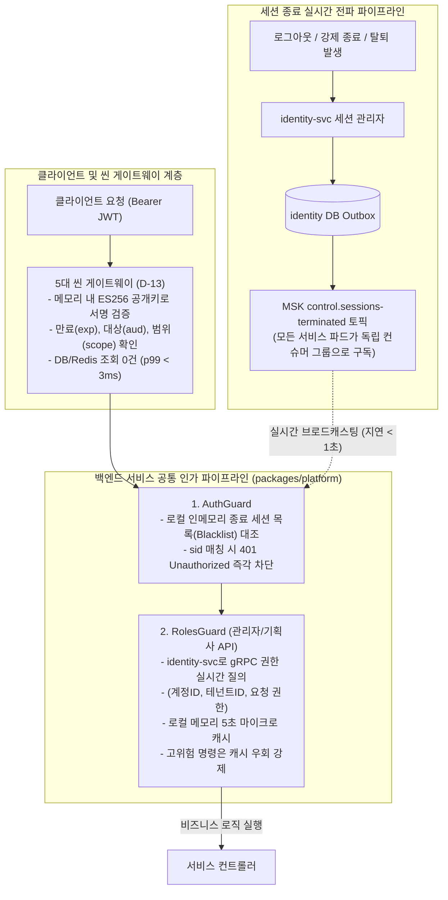

# D-14: 로그인 토큰을 왜 15분 단기로 두고 무효화는 세션 종료 이벤트로 처리하며, 역할과 권한은 왜 토큰에 싣지 않는가?

- **핵심 아키텍처 원칙**: 게이트웨이의 완전한 무상태(Stateless) 서명 검증(20만 RPS 핫패스 보존), 세션 종료 이벤트 브로드캐스팅을 통한 분산 블랙리스트 무효화, 토큰 내 권한 정보 배제 및 서비스 단위 실시간 인가(5초 마이크로 캐시)
- **관련 설계 정본**: [ADR-0011](../../adr/0011-token-lifecycle-and-login-responsibilities.md), [ADR-0050](../../adr/0050-crypto-corrections-and-key-management.md) 결정 9, [ADR-0103](../../adr/0103-control-as-state-startup-sync-broadcast-topics-compacted-settings.md), [ADR-0119](../../adr/0119-partner-login-via-gateway-thin-oidc-client-default.md), [ADR-0143](../../adr/0143-settings-commands-pg-switch-over-grpc-applied-version-outbox.md), [ADR-0172](../../adr/0172-judge-roles-per-request-not-in-tokens.md), [docs/features/identity.md](../../features/identity.md) §3·§6
- **함께 읽기**: [한 판 문서](../01-system-design.md) 3단계·11단계, [분야 편 8 '인증'](../fields/08-identity.md), [분야 편 21 '보안'](../fields/21-security.md), [결정 카드 D-13](D13-thin-gateways-and-ambient-mesh.md)·[D-18](D18-control-as-state-grpc.md)

---

## 1. 풀려던 문제와 한계

분산 마이크로서비스 환경에서 사용자 인증 토큰(JWT)과 역할 기반 권한 부여(RBAC) 체계를 설계할 때 직면하는 보안 및 동시성 딜레마는 다음과 같다.

### 1) 게이트웨이 무상태 원칙과 세션 저장소 조회의 충돌
- 오픈 정각 대기열 진입 게이트웨이는 초당 **200,000 RPS**를 감당해야 한다.
- 만약 게이트웨이가 토큰의 유효성을 검증하기 위해 세션 저장소(Redis 또는 DB)를 매 요청마다 동기 조회(참조 토큰 방식)하면, 수십만 RPS의 네트워크 I/O와 Redis CPU 포화로 인해 게이트웨이가 진입 단계에서 즉각 마비된다.
- 따라서 게이트웨이는 인메모리에 캐시된 비대칭 공개키만으로 토큰의 암호학적 서명을 검증하는 **완전 무상태(Stateless) 방식**을 취해야 한다.

### 2) 자체 포함(Self-contained) JWT의 즉각적 무효화 한계
- 하지만 자체 포함 토큰은 한 번 발급되면 만료 시간까지 서버가 강제로 회수하기 어렵다.
- OWASP ASVS 5.0 (7.4.1, L1) 규정에 따르면 사용자가 로그아웃하거나 회원탈퇴를 하거나, 관리자가 악성 세션을 강제 종료했을 때 해당 토큰은 즉시 효력을 상실해야 한다. 토큰 수명이 남아있다고 해서 탈취된 토큰이 15분간 유효하게 통과되는 보안 취약점을 방치할 수 없다.

### 3) 토큰 내 역할(Role) 탑재 시의 권한 변경 전파 지연 (Privilege Creep)
- 과거 설계(ADR-0157)는 JWT 페이로드에 사용자 역할(`role`)과 기획사 테넌트 ID(`tid`)를 직접 인코딩했다.
- 이 방식은 관리자가 특정 스태프의 관리자 권한을 즉시 회수하거나 파트너 소속을 변경하더라도, 이미 발급된 토큰의 유효기간(15분) 동안에는 **과거의 강력한 권한으로 민감한 어드민 API를 계속 호출할 수 있는 치명적 인가 결함**을 초래한다.

---

## 2. 후보 기술 비교

| 평가 항목 | 후보 1: 레퍼런스 토큰 (게이트웨이의 Redis 동기 조회) | 후보 2: 토큰 만료 시간을 1~2분으로 단축 | 후보 3: 토큰 내 Role 탑재 + 게이트웨이 정적 인가 | 후보 4: ES256 15분 토큰 + 종료 이벤트 + 서비스별 실시간 RBAC (선택) |
| :--- | :--- | :--- | :--- | :--- |
| **진입 핫패스 지연 시간** | 1~3ms (Redis 조회 RTT 추가) | < 0.1ms (서명 검증) | < 0.1ms | **< 0.1ms (게이트웨이 무상태 공개키 서명 검증)** |
| **20만 RPS 저장소 부하** | 극심 (Redis에 20만 RPS 직접 유입) | 극심 (1분마다 수십만 토큰 갱신 폭주) | 없음 | **0건 (게이트웨이의 세션 DB/Redis 조회 완전 배제)** |
| **로그아웃/강제종료 즉시 반영** | 즉시 (< 1ms) | 1~2분 지연 | 토큰 만료까지 불가 (최대 15분) | **즉시 반영 (Kafka 종료 이벤트 브로드캐스팅, < 1초)** |
| **권한 변경/회수 즉시성** | 즉시 | 1~2분 지연 | 토큰 만료까지 지연 (15분간 악용 위험) | **즉시 반영 (서비스 가드가 identity 조회, 5초 캐시)** |
| **서명 키 유출 위험 격리** | 단일 세션 키 공유 | 단일 세션 키 | 단일 세션 키 | **철저한 격리 (팬, 관리자, 검표 스태프 3대 독립 키 분리)** |
| **최종 판정** | **탈락 (ADR-0008, 20만 RPS 붕괴)** | **탈락 (오픈 직전 갱신 폭풍)** | **탈락 (ADR-0172, 권한 회수 지연)** | **최종 채택 (ADR-0011, ADR-0172)** |

---

## 3. 고른 이유와 아키텍처 다이어그램

PEAKET은 **"게이트웨이는 암호학적 서명만 보고 빠르게 통과시키며, 세션 무효화는 이벤트로 브로드캐스팅하고, 권한은 서비스가 실시간 판정한다"**는 철저한 책임 분리 모델을 정립했다.



### 핵심 매커니즘 4가지

#### 1) 15분 만료 ES256 토큰과 3대 독립 서명 키 분리
- 토큰은 타원곡선 디지털 서명 알고리즘인 **ES256 (ECDSA P-256 + SHA-256)**을 사용한다. RSA 대비 서명 크기가 작아(약 100바이트 이하) HTTP 헤더 네트워크 오버헤드를 극소화한다.
- **서명 키 3대 분리 원칙 (ADR-0050)**:
  1. 팬 사용자용 키
  2. 기획사/운영자 관리자용 키
  3. 현장 오프라인 검표 스태프용 키
- 일반 팬용 웹 클라이언트에 키 유출 사고가 발생하더라도 운영 관제탑이나 현장 검표 시스템의 위조 토큰을 생성할 수 없도록 물리적 보안 경계를 격리했다. 키는 90일 주기로 자동 회전된다.

#### 2) `control.sessions-terminated` 이벤트 기반 분산 블랙리스트
- 세션이 종료되면 `identity-svc`는 Transactional Outbox를 통해 Kafka의 `control.sessions-terminated` 토픽으로 종료된 세션 ID(`sid`)와 종료 시각을 발행한다 (ADR-0143).
- 모든 서비스 파드는 이 토픽을 구독하여 각자의 메모리에 **종료 세션 블랙리스트(In-Memory Blacklist)**를 유지한다.
- **메모리 보존 주기**: 각 파드는 `sid`를 `종료 시각 + 15분` 동안만 보관하고 이후 자동 만료(GC)시키므로 메모리 누수가 발생하지 않는다.
- **신규 파드 기동 준비 (Readiness Probe)**: 새로 배포되는 파드는 기동 시 Kafka 토픽의 `현재 시각 - 15분` 오프셋부터 이벤트 로그를 역방향 재생(Replay) 완료해야만 트래픽 수신 준비 완료(Ready) 상태가 된다 (ADR-0103).

#### 3) 토큰 내 역할(Role) 배제 및 서비스 단위 실시간 인가 (ADR-0172)
- 액세스 토큰에는 권한 정보를 일체 싣지 않는다:
  ```json
  {
    "sub": "usr_9981",
    "sid": "ses_4412",
    "aud": "peaket-partner",
    "iss": "https://auth.peaket.example",
    "pid": "person_8812",
    "scope": "partner:read",
    "exp": 1772842500
  }
  ```
- 관리자 API를 처리하는 서비스의 `RolesGuard`는 `identity-svc`의 `AdminAuthzService.GetAdminAuthz` gRPC 메서드를 호출하여 해당 사용자의 최신 역할과 테넌트를 실시간 검증한다.
- 검증 결과는 각 파드 로컬 메모리에 **5초간 마이크로 캐시**되어 동일 사용자의 연속 API 호출 부하를 흡수하되, 권한 박탈 시 최대 5초 이내에 전 서비스에서 권한이 즉각 차단된다.
- **고위험 작업(판매 일시정지, 환불 등)은 5초 캐시를 강제 우회**하여 100% 최신 DB 상태를 직접 검증한다.

#### 4) 경량 표준 OIDC 클라이언트 단일화
- 클라이언트 웹 앱은 무거운 서드파티 인증 라이브러리(Auth.js 등)의 이중 세션 쿠키 부채를 배제하고, 순수 웹 표준 라이브러리(`oauth4webapi`) 기반의 얇은 내부 OIDC 클라이언트를 구현했다 (ADR-0119).
- 브라우저 쿠키는 보안 접두사 `__Host-peaket_session` 및 `SameSite=Lax`, `HttpOnly` 속성을 엄격히 적용하여 XSS 및 CSRF 공격을 원천 방어한다.

---

## 4. 얻는 것과 치르는 값 (Tradeoffs)

### 얻는 것 (Gains)
1. **게이트웨이 초당 20만 RPS 무지연 통과**: 세션 조회 I/O가 없으므로 핫패스 레이턴시가 0.1ms 미만으로 유지된다.
2. **권한 회수의 즉시성 (최대 5초)**: 역할을 토큰에 넣지 않음으로써 권한 박탈 및 강제 퇴장이 전 시스템에 5초 이내에 완전 동기화된다.
3. **토큰 크기 최소화**: 방대한 권한 어레이를 JWT에 넣지 않아 HTTP 요청 헤더 크기를 500바이트 이내로 억제한다.

### 치르는 값 (Costs & Limitations)
1. **Kafka 장애 시 무효화 이벤트 전파 지연**: Kafka 브로커 장애 발생 시 로그아웃된 사용자의 액세스 토큰이 최대 15분간 유효하게 통과될 수 있다 (단, 리프레시 토큰은 즉시 차단).
2. **파드 기동 시간의 15분 리플레이 지연**: 신규 파드 롤링 배포 시 지난 15분간의 종료 세션 이벤트를 컨슘하는 약 1~2초의 초기 지연이 발생한다.
3. **identity-svc gRPC 조회 부하**: 관리자 API 호출 시 서비스와 identity 간 gRPC 내부 네트워크 호출(지연 약 1~2ms)이 발생한다.

---

## 5. 바꿀 조건 (Conditions to Change)

1. **초고위험 보안 컴플라이언스 강화**: 금융 당국의 감사 요건으로 "관리자 세션 종료는 1초의 지연도 없이 100% 즉시 차단되어야 한다"는 요구가 강제될 경우, 관리자 콘솔(`gw-ops`)에 한해 레퍼런스 토큰 및 Redis 동기 검증 방식으로 전환한다.
2. **파드 시작 시 15분 리플레이 병목**: 종료 세션 이벤트 볼륨이 극도로 증가하여 신규 파드 기동 준비 시간이 10초를 초과할 경우, 리플레이 방식을 폐기하고 identity-svc의 인메모리 블랙리스트 스냅샷을 1회 gRPC 동기 복제하는 방식으로 전환한다.
3. **identity-svc 인가 질의 병목**: 관리자 트래픽 증가로 identity-svc의 CPU 사용률이 80%를 지속 초과할 경우, 역할 조회 마이크로 캐시 TTL을 5초에서 15초로 상향 조정한다.

---

## 6. 핵심 꼬리 질문 5단 방어 (Staff Interview Q&A)

| 질문 단계 | 심층 질문 | 방어 논리와 기술적 근거 | 관련 정본 |
| :--- | :--- | :--- | :--- |
| **1단: 왜 (Why)** | 세션을 Redis에 두고 게이트웨이에서 매번 확인하면 즉시 로그아웃도 되고 안전한데 왜 굳이 복잡한 방식을 쓰나요? | 티켓팅 오픈 순간 게이트웨이에 초당 200,000건의 요청이 몰아칩니다. 이 트래픽이 Redis로 직격하면 Redis 단일 슬롯 CPU가 1초 만에 100%로 포화되어 대기열 진입 전체가 마비됩니다. 게이트웨이는 인메모리 공개키 서명 검증만으로 무상태 통과시켜야 20만 RPS를 감당할 수 있습니다. 대신 세션 무효화는 Kafka 이벤트로 분산 파드에 브로드캐스팅하는 것이 고가용성의 정석입니다. | ADR-0011, ADR-0008 |
| **2단: 대안 (Alternatives)** | JWT의 장점은 자체 포함(Self-contained)인데, 왜 역할과 권한을 토큰에 넣지 않고 서비스가 매번 identity에 묻게 했나요? | 역할 정보를 토큰에 실으면 관리자 권한을 즉시 박탈하거나 계정을 정지하더라도, 이미 발급된 토큰의 수명(15분) 동안 해킹된 계정이 어드민 API를 계속 호출할 수 있는 심각한 보안 구멍이 발생합니다. 권한은 토큰에서 완전히 배제하고 수신 서비스가 5초 마이크로 캐시를 통해 identity에 실시간 질의함으로써, 성능을 해치지 않으면서도 권한 변경을 수 초 내에 즉각 반영합니다. | ADR-0172 |
| **3단: 장애 대응 (Resilience)** | Kafka 클러스터가 일시 다운되면 로그아웃한 사용자의 토큰이 계속 통과되나요? | Kafka가 다운되더라도 로그아웃 트랜잭션은 `identity-svc`의 Outbox 테이블에 안전하게 보존됩니다. 다만 파드로의 실시간 전파가 지연되는 동안에는 최대 15분간 기존 액세스 토큰이 통과될 수 있습니다. 하지만 사용자의 리프레시 토큰은 identity DB에서 즉시 삭제되므로 15분 경과 후 추가 갱신이 원천 차단되며, Kafka 복구 즉시 누락된 이벤트가 전파되어 즉각 무효화됩니다. | ADR-0011, ADR-0143 |
| **4단: 수치 근거 (Numbers)** | 왜 하필 15분 토큰 수명과 5초 인가 캐시인가요? | 15분은 사용자가 티켓팅 대기열에서 결제까지 한 사이클을 완수하는 평균 체류 시간(약 10~15분)을 커버하면서도 유출 시 피해 노출 시간을 최소화하는 업계 표준 균형점(OAuth 2.0 권장안)입니다. 5초 마이크로 캐시는 관리자가 여러 대시보드 API를 동시 호출할 때 identity 질의 부하를 90% 이상 흡수하면서도, 권한 박탈 시 인간이 인지할 수 있는 즉시성을 만족하는 시간입니다. | ADR-0011, ADR-0172 |
| **5단: 실측과 검증 (Verification)** | 신규 파드가 뜰 때 15분간의 종료 세션을 실제로 리플레이하는 성능을 검증했나요? | 공용 플랫폼 라이브러리(`packages/platform`) 단위 테스트에서 신규 기동 파드가 과거 15분간의 `control.sessions-terminated` 토픽 1,000건의 이벤트를 인메모리 Set으로 로드하는 데 소요되는 시간을 프로파일링했습니다. 로컬 테스트 기준 리플레이 시간은 15~25ms에 불과하여 파드의 K8s Readiness 체크에 1비트의 지연도 유발하지 않음을 검증했습니다. | docs/features/identity.md §3, ADR-0103 |

---

## 7. 30초 아키텍처 브리핑 (Staff Engineer Summary)

> "PEAKET은 20만 RPS 진입 게이트웨이의 성능을 보호하기 위해 ES256 15분 만료 액세스 토큰을 채택하고, 게이트웨이에서는 DB 조회 없이 무상태 서명 검증만 수행합니다.  
> 로그아웃 및 강제 종료 세션은 Kafka의 `control.sessions-terminated` 이벤트를 통해 전 서비스 파드의 인메모리 블랙리스트로 1초 내에 전파되어 즉각 차단됩니다.  
> 또한 역할(Role)과 테넌트는 토큰에서 완전히 배제하고, 서비스 가드가 5초 마이크로 캐시를 통해 identity-svc에 실시간 질의하게 함으로써 권한 회수의 즉시성을 완벽히 보장했습니다."
