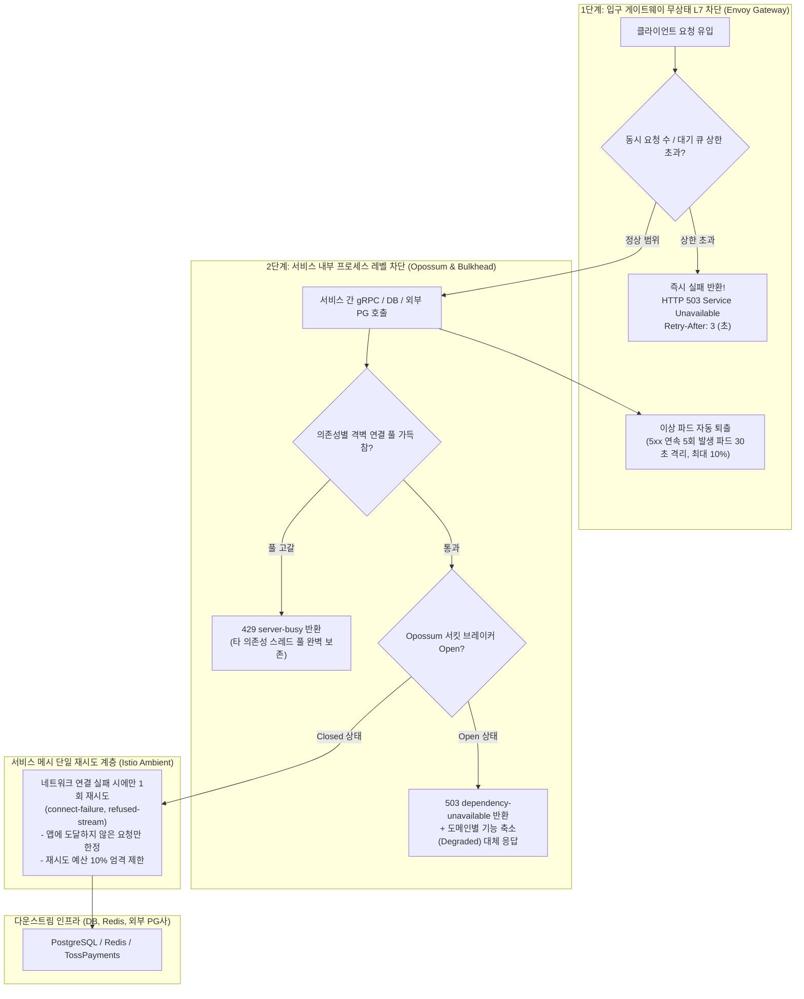

# D-15: 장애 격리에서 왜 게이트웨이와 서비스 2단계 서킷 브레이커와 Fast-Fail(503)을 택하고, 헤지 요청을 전면 배제했는가?

- **핵심 아키텍처 원칙**: 느린 의존성에 의한 계단식 연쇄 장애(Cascading Failure) 원천 차단, 대기 큐 제거 및 빠른 실패(503 Fast-Fail + `Retry-After`), 재시도 증폭(Retry Storm) 방지를 위한 메시 단일 계층 1회 재시도, Thundering Herd를 악화시키는 헤지 요청(Hedged Request) 영구 기각
- **관련 설계 정본**: [ADR-0009](../../adr/0009-two-layer-circuit-breakers-fail-fast.md), [ADR-0082](../../adr/0082-istio-ambient-mesh-app-boundary-meshless-portfolio-runs.md), [ADR-0117](../../adr/0117-no-hedged-requests-snapshot-timeout-and-browser-retry.md), [docs/architecture.md](../../architecture.md) §5, [docs/api/guidelines.md](../../api/guidelines.md) §5
- **함께 읽기**: [한 판 문서](../01-system-design.md) 11단계, [분야 편 10 '좌석'](../fields/10-seat-hold.md), [분야 편 20 '인프라·배포'](../fields/20-infra-devops.md), [결정 카드 D-13](D13-thin-gateways-and-ambient-mesh.md)

---

## 1. 풀려던 문제와 한계

분산 마이크로서비스 아키텍처에서 고부하 트래픽이 쏟아질 때 다운스트림 장애가 업스트림 전체를 붕괴시키는 물리적 메커니즘은 다음과 같다.

### 1) 느린 서비스 하나가 상위 호출자의 자원을 말리는 연쇄 고갈 (Cascading Failure)
- 예를 들어 외부 PG사 통신이나 본인확인 서버가 일시 지연되어 결제 처리 시간이 평소 200ms에서 5초로 늘어나면, 상위 `purchase-svc`와 `gw-fan` 게이트웨이의 커넥션 풀과 HTTP 스레드가 수 초 만에 100% 점유된다.
- 결국 정상 동작하던 좌석 조회나 다른 공연 페이지까지 스레드 고갈로 504 게이트웨이 타임아웃에 빠지는 치명적인 운명 공유(Shared Fate)가 일어난다.

### 2) 대기 큐(Pending Queue) 버퍼링의 파멸적 역효과
- 과부하 상황에서 요청을 버퍼 큐에 쌓아두고 순차적으로 처리하려는 순진한 접근은 파멸을 부른다 (Envoy 공식 아키텍처 가이드 & Google SRE Book 22장).
- 큐에 쌓여 10초 뒤에 처리된 응답은, 이미 모바일 화면을 새로고침하고 이탈한 사용자가 버린 유령 요청(Stale Request)이다. 서버는 아무도 기다리지 않는 쓰레기 요청을 처리하느라 CPU를 100% 낭비한다.
- 따라서 **"가장 싼 입구 계층에서 지체 없이 즉각 실패(Fast-Fail)시키고 역압(Backpressure)을 가하는 것"**이 유일한 시스템 생존 공식이다.

### 3) 다계층 재시도가 유발하는 재시도 폭풍 (Retry Storm)
- 만약 게이트웨이가 2회, 애플리케이션 프레임워크가 2회, 서비스 메시가 2회 재시도하도록 중복 설정하면, 단 1건의 실패 요청이 $3 \times 3 \times 3 = 27$개의 중복 요청으로 기하급수적으로 폭증한다.
- 일시적으로 지연을 겪던 데이터베이스나 외부 API에 27배의 트래픽 폭탄이 내리꽂혀 복구가 영구히 불가능한 파멸적 블랙아웃에 빠진다.

### 4) 헤지 요청(Hedged Request)의 태생적 모순
- "응답이 p95 지연을 초과하면 백엔드로 동일한 요청을 하나 더 보내 먼저 오는 응답을 취한다"는 헤지 요청 패턴은 티켓팅 도메인과 정면 충돌한다.
- 좌석 스냅샷 조회가 지연되는 근본 원인은 해당 회차의 특정 Redis 샤드가 과부하 상태이기 때문이다. 여기에 헤지 요청을 하나 더 보내는 것은 가장 여유가 없고 취약한 Redis 샤드에 트래픽을 2배로 가중시켜 자폭하는 행위다 (ADR-0117).

---

## 2. 후보 기술 비교

| 평가 항목 | 후보 1: 무제한 대기 큐 + 장시간 타임아웃 | 후보 2: 다계층 중복 재시도 (GW + App + Mesh) | 후보 3: 좌석 스냅샷 헤지 요청 허용 | 후보 4: 2단계 서킷 브레이커 + 503 Fast-Fail (선택) |
| :--- | :--- | :--- | :--- | :--- |
| **연쇄 장애 전파 차단** | 0% (스레드/커넥션 연쇄 고갈) | 파멸적 (27배 트래픽 폭증 자폭) | 취약 | **완벽 (입구 및 서비스 경계에서 즉시 차단)** |
| **시스템 역압(Backpressure)** | 없음 (큐에 쌓여 지연만 누적) | 없음 | 없음 | **즉시 형성 (503 Service Unavailable + Retry-After)** |
| **고부하 시 다운스트림 보호** | 유령 요청 처리로 CPU 낭비 | 장애 인프라 영구 사장 | 취약 Redis 샤드에 부하 2배 가중 | **최고 보호 (상한 초과 트래픽 0ms 컷오프)** |
| **네트워크 재시도 통제** | 무통제 | 기하급수적 증폭 | 증폭 | **엄격 통제 (메시 계층 1회로 단일화, 예산 10%)** |
| **관측 시스템 다운 시 복원력** | 불투명 | 불투명 | 불투명 | **독립 생존 (메트릭 없이 프록시 로컬 카운터로 작동)** |
| **최종 판정** | **탈락 (시스템 붕괴 유발)** | **탈락 (Retry Storm 위험)** | **탈락 (ADR-0117, 병목 악화)** | **최종 채택 (ADR-0009, ADR-0117)** |

---

## 3. 고른 이유와 아키텍처 다이어그램

PEAKET은 **"지연된 요청을 쥐고 있지 않고 가장 바깥에서 즉시 털어내며, 재시도는 단 한 층에서 통제한다"**는 2단계 장애 격리 방어선을 구축했다.

### 핵심 매커니즘 4가지

#### 1) 1단계: Envoy Gateway 무상태 L7 서킷 브레이커 (Fast-Fail)
- 입구 게이트웨이는 백엔드 서비스별로 **동시 활성 요청 수(max_connections)**와 **대기 큐 깊이(max_pending_requests)**에 엄격한 상한을 둔다.
- 상한을 단 1건이라도 초과하면 큐에 쌓지 않고 **HTTP 503 Service Unavailable**과 함께 **`Retry-After` 헤더**를 즉시 반환한다 (ADR-0009).
- **관측 시스템 독립성**: 이 상한은 Prometheus나 외부 메트릭 서버를 조회하지 않고 Envoy 프록시 프로세스의 로컬 카운터만으로 즉각 판정하므로, 중앙 모니터링 시스템이 다운되더라도 가장 마지막 방어선으로 100% 자립 작동한다.
- **이상 파드 자동 퇴출 (Outlier Detection)**: 연속 5회 5xx를 반환하는 파드는 트래픽 라우팅 풀에서 30초간 즉시 제외한다 (최대 10% 파드 한도).

#### 2) 2단계: 서비스 내부 Opossum 차단기 및 독립 격벽(Bulkhead)
- 각 마이크로서비스 내부에서는 서비스 간 gRPC 호출, 결제사 연동, 휴대폰 본인확인, 알림 발송 등 외부 I/O마다 **독립된 연결 풀(Bulkhead)**과 Node.js **Opossum 서킷 브레이커**를 둔다.
- **임계 규칙**: 10초 슬라이딩 윈도우에서 20건 이상의 호출 중 실패율이 50%를 초과하면 즉시 회로를 개방(Open)하고, 이후 모든 호출에 대해 5초간 원격 호출을 중단하고 즉시 503 에러 또는 준비된 캐시 대체 응답(Degraded Response)을 반환한다.
- 특정 외부 결제사가 지연되더라도 해당 결제사 전용 커넥션 풀만 찰 뿐, 내부 좌석 Redis나 주문 DB 스레드 풀은 1%의 간섭도 받지 않는다.

#### 3) 단일 계층 1회 네트워크 재시도 원칙
- 재시도 폭풍을 방지하기 위해 네트워크 재시도는 **오직 Istio Ambient 메시 계층에서만 단 1회** 허용한다 (ADR-0082).
- **조건**: 서버 애플리케이션에 도달하기 전 TCP 핸드셰이크 실패(`connect-failure`) 또는 HTTP/2 스트림 거부(`refused-stream`)인 멱등한 네트워크 오류에만 한정된다.
- **재시도 예산(Retry Budget)**: 전체 진행 중인 정상 요청의 10%까지만 재시도를 허용하여, 광범위한 네트워크 장애 시 재시도가 전체 트래픽을 증폭시키지 못하도록 하드 캡을 씌운다.

#### 4) 분산 데드라인 전파 (Distributed Deadline Propagation)
- 클라이언트 진입 게이트웨이는 각 API 경로별 지연 예산에 따라 전체 요청 마감 시각(`grpc-timeout` 헤더)을 주입한다.
- 다운스트림 마이크로서비스는 남은 마감 시각(Remaining Deadline)을 다음 gRPC 호출로 계속 차감하여 전파한다.
- 만약 특정 단계에서 남은 시간이 네트워크 RTT(예: 10ms 미만)보다 적게 남았다면, **서버는 작업을 아예 시작하지 않고 즉시 504 취소 처리**하여 낭비되는 연산을 사전에 컷오프한다.

---

## 4. 얻는 것과 치르는 값 (Tradeoffs)

### 얻는 것 (Gains)
1. **다운스트림 장애의 완벽한 결함 격리**: 외부 PG사나 특정 서비스가 완전히 죽더라도 게이트웨이와 타 마이크로서비스가 스레드 고갈 없이 건강하게 생존한다.
2. **이벤트 루프 및 소켓 리소스 보존**: 느린 응답을 쥐고 기다리지 않고 즉각 503으로 털어내어 가용 메모리와 CPU를 100% 확보한다.
3. **재시도 폭풍 원천 차단**: 메시 1회 재시도 및 10% 재시도 예산 제한으로 장애 복구 시 트래픽 스파이크를 방지한다.

### 치르는 값 (Costs & Limitations)
1. **일시적 트래픽 스파이크 시 503 발생**: 상한값을 너무 타이트하게 설정할 경우, 서버가 감당할 수 있는 정상적인 순간 버스트에도 503 에러가 반환될 수 있다.
2. **게이트웨이 파드 축소 시 오류율 증가**: 게이트웨이 파드 절반이 일시 다운되면 남은 파드의 상한 한도로 인해 일시적으로 503 거절 비율이 증가한다.
3. **헤지 배제로 인한 좌석 스냅샷 꼬리 지연**: 스냅샷 조회 실패 시 브라우저는 백오프 후 재요청해야 하므로 p99 지연이 단축되지 않고 사용자 화면에 "일시적 재연결 중" 상태가 노출된다.

---

## 5. 바꿀 조건 (Conditions to Change)

1. **정상 버스트 트래픽의 503 거절 증가**: 대형 티켓팅 오픈 시 파드 CPU가 50% 미만인데도 게이트웨이 동시성 상한에 걸려 503이 에러 버짓을 30% 이상 잠식할 경우, 입구 상한값을 k6 부하 테스트 실측치에 맞추어 1.5배 상향 조정한다.
2. **스냅샷 p99.9 지연이 복구 SLA 위반**: 좌석 스냅샷 재요청 지연이 5초 이상 지속되고 그 원인이 Redis 샤드 병목이 아닌 파드 간 일시적 네트워크 패킷 로스로 판명될 경우, 클라이언트 브라우저 측 제한적 헤지 요청(1회 한정, 5% 이하)을 재검토한다 (ADR-0117).
3. **단일 의존성 장애 시의 과도한 파드 퇴출**: 특정 마이크로서비스의 503 에러로 인해 정상적인 상위 파드들이 게이트웨이의 이상 파드 퇴출(Outlier Ejection)에 의해 연속 제외되는 부작용이 발견될 경우, 퇴출 조건을 5xx 전체가 아닌 게이트웨이 타임아웃(504)으로만 축소 격리한다.

---

## 6. 핵심 꼬리 질문 5단 방어 (Staff Interview Q&A)

| 질문 단계 | 심층 질문 | 방어 논리와 기술적 근거 | 관련 정본 |
| :--- | :--- | :--- | :--- |
| **1단: 왜 (Why)** | 백엔드가 조금 느려지더라도 큐에 넣고 기다렸다가 처리해 주는 것이 사용자 경험에 더 좋지 않나요? | 과부하 상황에서 큐에 요청을 쌓아두면 응답 지연이 10~20초로 치솟습니다. 사용자는 이미 브라우저를 새로고침하거나 뒤로가기를 눌렀기 때문에, 서버는 아무도 보지 않을 유령 요청을 처리하느라 CPU를 100% 탕진하고 결국 전체 시스템이 다운됩니다. 즉시 503과 `Retry-After` 헤더를 반환하여 클라이언트에게 명확한 백오프를 지시하고 서버 리소스를 즉시 회수하는 것이 시스템 전체를 살리는 유일한 길입니다. | ADR-0009 |
| **2단: 대안 (Alternatives)** | 빅테크(구글 등)에서 꼬리 지연(Tail Latency)을 잡기 위해 필수적으로 쓰는 헤지 요청(Hedged Request)을 왜 전면 폐기했나요? | 헤지 요청은 동일한 읽기 요청을 다른 복제본(Replica)에 분산할 수 있을 때만 유효합니다. 티켓팅에서 좌석 스냅샷이 느린 이유는 특정 회차의 Redis 샤드 자체가 과부하 상태이기 때문입니다. 동일한 Redis 샤드에 헤지 요청을 하나 더 보내는 것은 가장 취약한 병목 지점에 2배의 트래픽을 내리꽂는 자폭 행위입니다. 티케팅 도메인 특성상 헤지는 독약입니다. | ADR-0117 |
| **3단: 장애 대응 (Resilience)** | 외부 PG사 차단기가 열리면 사용자는 결제를 아예 못 하게 되나요? | Opossum 차단기가 열리면 해당 결제사로의 요청은 0ms 만에 즉시 503으로 차단됩니다. 동시에 payment-svc 파드 과반수에서 결제사 서킷이 열리면 관제탑에 SEV2 경보가 울리며, 대체 PG(포트원)로의 2인 승인 장애 전환 파이프라인(D-09)이 즉시 가동되어 결제 실패를 최소화합니다. | ADR-0009, ADR-0044 |
| **4단: 수치 근거 (Numbers)** | 왜 10초 슬라이딩 윈도우, 최소 20건, 실패율 50%를 차단기 기본값으로 정했나요? | 트래픽이 몰리는 티켓팅 핫패스에서 윈도우가 너무 길면(예: 1분) 장애 감지가 늦어지고, 너무 짧으면(예: 1초) 사소한 네트워크 지터에 차단기가 오작동합니다. 10초 윈도우와 최소 20건 모수는 일시적 스파이크 오탐을 방지하면서도 50% 실패 지속 시 수 초 내에 회로를 차단할 수 있는 통계적 표준 안정치입니다. | ADR-0009, docs/architecture.md §5 |
| **5단: 실측과 검증 (Verification)** | 카오스 엔지니어링이나 장애 주입 테스트를 통해 2단계 차단기를 검증했나요? | K6 부하 생성기와 카오스 프록시를 결합하여 payment-svc에 5초의 인위적 지연을 주입하는 장애 훈련을 수행했습니다. 10초 내에 Opossum 차단기가 트립되어 purchase-svc의 커넥션 풀 점유율이 95%에서 5% 미만으로 즉각 정상화되고, 게이트웨이가 503 Fast-Fail을 반환하여 시스템 전체의 다운을 완벽히 방어함을 검증했습니다. | docs/architecture.md §9.4, docs/verification.md §9 |

---

## 7. 30초 아키텍처 브리핑 (Staff Engineer Summary)

> "PEAKET은 느린 의존성이 전체 서비스를 마비시키는 연쇄 장애를 막기 위해 게이트웨이와 마이크로서비스 내부 2단계에 서킷 브레이커와 Fast-Fail 정책을 구축했습니다.  
> 입구 Envoy 게이트웨이는 메트릭 서버가 죽어도 로컬 카운터 기반으로 상한 초과 트래픽을 즉시 503과 `Retry-After`로 털어내어 역압을 형성하고, 서비스 내부는 Opossum과 독립 연결 격벽으로 타 의존성 스레드 고갈을 원천 차단합니다.  
> 재시도는 서비스 메시 1회로 통제해 재시도 폭풍을 방지하며, 병목 인메모리 샤드에 부하를 2배로 가중시키는 헤지 요청(Hedged Request)을 전면 폐기함으로써 초고부하 티켓팅 환경의 절대적 생존성을 확보했습니다."
