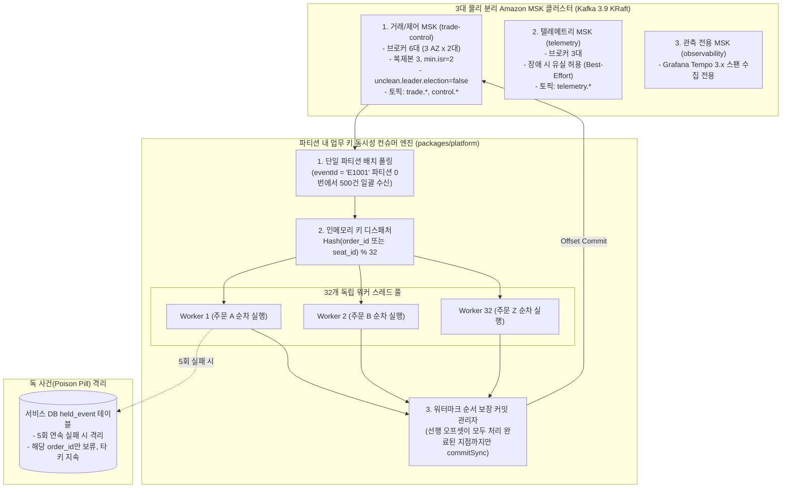

# D-16: Kafka 클러스터를 왜 3종(거래/제어, 텔레메트리, 관측)으로 물리 분리하고, 파티션 내 업무 키 동시성 파이프라인을 구축했는가?

- **핵심 아키텍처 원칙**: 대용량 텔레메트리 폭주로부터 핵심 결제/거래 이벤트의 물리적 격리(Bulkhead), 금융 무손실 보장 브로커 설정(`unclean.leader.election=false`), 단일 회차 파티션 쏠림을 극복하는 파티션 내 업무 키(Sub-key) 기반 32스레드 병렬 처리
- **관련 설계 정본**: [ADR-0026](../../adr/0026-kafka-topic-separation.md), [ADR-0077](../../adr/0077-observability-book-review-buckets-storage-retention.md), [ADR-0141](../../adr/0141-msk-cluster-settings-brokers-version-alerts-dr-rebuild.md), [ADR-0142](../../adr/0142-consumer-key-concurrency-held-events-client-required-settings.md), [docs/streaming.md](../../streaming.md) §2.4·§2.6·§7·§11
- **함께 읽기**: [한 판 문서](../01-system-design.md) 10단계·11단계, [분야 편 11 '결제'](../fields/11-payment.md), [분야 편 18 '이벤트 흐름'](../fields/18-streaming.md), [결정 카드 D-10](D10-order-history-polling-outbox.md)·[D-19](D19-observability-stack.md)·[D-28](D28-drop-flink-stream-workers.md)

---

## 1. 풀려던 문제와 한계

대규모 티켓팅 플랫폼에서 분산 이벤트 스트리밍 백본(Kafka)을 구축할 때 직면하는 구조적 병목은 다음과 같다.

### 1) 이벤트 성격과 신뢰성 요구수준의 극단적 대조
- **거래 이벤트 (`trade.*`)**: 주문 생성, 결제 승인, 좌석 확정, 발권 완료. 단 1건의 메시지 유실도 치명적 금융 사고로 직결되며 엄격한 복제와 순서 보장이 필수다 (`acks=all`, 멱등성).
- **텔레메트리 이벤트 (`telemetry.*`)**: 마우스 움직임, 봇 탐지 신호, 체류 시간 로그. 초당 수천 건 이상 대량 쏟아지며, 일부 유실되더라도 비즈니스 정합성을 해치지 않는다 (Best-Effort).
- **운영 제어 이벤트 (`control.*`)**: 판매 긴급 중단, 세션 종료. 발생 빈도는 극히 낮으나 전 서비스 파드로의 1초 내 즉각적인 브로드캐스팅이 보장되어야 한다.
- **분산 추적 큐 (Tempo MSK)**: Grafana Tempo가 요구하는 고속 대용량 OTel 트레이스 스팬 수집 큐.

### 2) 단일 Kafka 클러스터 운영 시의 운명 공유 (Shared Fate)
- 모든 이벤트를 단일 Kafka 클러스터에 몰아넣을 경우, 오픈 정각에 쏟아지는 수만 건의 텔레메트리/트레이스 스팬이 브로커의 페이지 캐시와 디스크 I/O 대역폭을 잠식한다.
- 그 결과 가장 중요한 `trade.payments` 토픽의 프로듀서 확인 응답(`acks=all`) 지연 시간이 급증하여 결제 승인 API가 504 타임아웃에 빠지는 치명적인 간섭 현상이 발생한다.

### 3) 단일 회차 집중(Hotspot)과 컨슈머 처리량의 물리적 벽
- 회차 단위 순서 보장을 위해 `trade.*` 토픽의 파티션 키는 **회차 ID(`eventId`)**로 강제된다.
- 특정 인기 공연이 오픈되면 해당 회차의 수만 건 결제 이벤트가 **단 1개의 파티션**으로 쏠린다. Kafka의 아키텍처 특성상 1개 파티션은 컨슈머 그룹 내에서 **오직 1개의 컨슈머 스레드**만 할당받아 읽을 수 있다.
- 결제 1건 처리 시 RDBMS 트랜잭션과 로직 처리에 건당 10ms가 소요된다면, 단일 스레드의 물리적 최대 처리량은 **초당 100건**에 불과하다. 토스페이먼츠 피크 처리량인 초당 300 TPS가 유입될 경우, 매초 200건씩 지연되어 **1분 만에 12,000건의 컨슈머 랙(Lag)이 누적**되며 실시간 예매 시스템이 붕괴한다.

### 4) MSK 기본 설정의 위험한 데이터 유실 함정
- AWS MSK의 기본값인 `unclean.leader.election.enable=true`는 모든 ISR(In-Sync Replica)이 일시 다운되었을 때 데이터가 뒤처진 복제본을 리더로 승격시켜, **이미 서버가 커밋을 보장한 결제 데이터가 영구 유실(Silent Data Loss)**되는 치명적 금융 위험을 내포하고 있다.

---

## 2. 후보 기술 비교

| 평가 항목 | 후보 1: 단일 Kafka 클러스터 통합 | 후보 2: 거래 토픽 키를 사용자 ID로 변경 | 후보 3: Kafka 4.1 공유 그룹(Share Groups) | 후보 4: 3대 독립 MSK + 파티션 내 키 동시성 (선택) |
| :--- | :--- | :--- | :--- | :--- |
| **핵심 거래 격리성** | 취약 (텔레메트리 폭주 시 결제 지연) | 취약 | 취약 | **완벽 (3개 독립 클러스터로 I/O 간섭 0%)** |
| **회차별 이벤트 순서 보장** | 보장 (eventId 키) | 파괴 (동일 회차 잔여석 순서 뒤집힘) | 순서 미보장 | **완벽 (eventId 파티션 내 sub-key 엄격 순서 보장)** |
| **단일 파티션 처리량** | 100 TPS 한계 (단일 스레드 순차 처리) | 높음 (파티션 분산) | 높음 | **초당 1,500+ TPS (32 워커 스레드 동시 처리)** |
| **금융 무손실 신뢰성** | 취약 (기본 설정 시 유실 가능) | 보통 | 보통 | **완벽 (unclean 선출 금지, 6대 브로커 다중 AZ)** |
| **실패 격리 (독 사건 처리)** | 파티션 전체 블로킹 | 파티션 전체 블로킹 | 부분 분산 | **완벽 (실패 키만 held_event 보류, 타 주문 정상 진행)** |
| **최종 판정** | **탈락 (Shared Fate 위험)** | **탈락 (비즈니스 정합성 파괴)** | **탈락 (Kafka 3.9 미지원, 순서 파괴)** | **최종 채택 (ADR-0026, ADR-0141, ADR-0142)** |

---

## 3. 고른 이유와 아키텍처 다이어그램

PEAKET은 **"중요도에 따라 클러스터를 물리 분리하고, 단일 파티션 내에서 비즈니스 서브키 기반의 동시 처리 파이프라인을 구축한다"**는 설계를 확립했다.

### 핵심 매커니즘 4가지

#### 1) 3대 독립 MSK 클러스터와 제로 데이터 유실 브로커 설정
- **거래/제어 클러스터**: 3개 가용 영역(AZ)에 각 2대씩 **총 6대의 브로커**를 배치한다 (ADR-0141). 단일 AZ 전체 정전 후 다른 AZ의 브로커 1대가 추가 장애를 겪는 이중 장애(Dual Failure) 상황에서도 남은 브로커 3대로 정상 가동된다.
- `unclean.leader.election.enable=false`: 복제본이 부족할 때 뒤처진 브로커의 리더 승격을 원천 차단하여 결제 데이터의 침묵 유실을 방지한다.
- `min.insync.replicas=2` 및 `acks=all`: 최소 2개 이상의 독립 브로커에 디스크 저장이 확인되어야만 프로듀서에게 성공 응답을 반환한다.
- **텔레메트리 및 관측 클러스터**: 물리적으로 완전히 분리된 독립 MSK 클러스터로 운영되어, 대규모 로그 스파이크가 발생해도 거래 클러스터의 디스크 및 네트워크 I/O에 0%의 영향도 주지 않는다.

#### 2) 단일 파티션 내 서브키(Sub-Key) 기반 32스레드 병렬 처리 파이프라인
- 회차 단위(`eventId`)로 단일 파티션에 유입된 대량의 이벤트를 컨슈머가 수신한 뒤, 이벤트 본문의 비즈니스 서브키(주문 ID `order_id`, 좌석 ID `seat_id`)를 해싱하여 **32개의 독립 인메모리 워커 큐**로 분배한다 (ADR-0142).
- **동일 주문/좌석의 이벤트**: 동일한 워커 큐에 배정되므로 생성 $\rightarrow$ 결제 $\rightarrow$ 발권 순서가 100% 엄격히 보장된다.
- **서로 다른 주문의 이벤트**: 32개 워커가 병렬로 독립 처리하므로 단일 파티션에서도 **초당 1,500건 이상의 TPS**를 거뜬히 소화하여 300 TPS의 결제 유입을 랙(Lag) 없이 실시간 처리한다.

#### 3) 워터마크 기반 순서 보장 오프셋 커밋
- 여러 워커가 비동기로 병렬 처리하므로 완료 시점이 뒤섞일 수 있다 (예: 오프셋 102번이 101번보다 먼저 완료).
- 공용 컨슈머 엔진의 **Commit Manager**는 완료된 오프셋들을 슬라이딩 윈도우로 추적하여, **"그 이전의 모든 연속된 오프셋이 성공적으로 완료된 최대 워터마크 지점"**까지만 Kafka 브로커에 커밋한다.
- 컨슈머 파드가 불시에 재시작되더라도 누락 없이 안전하게 재수신하며, 다운스트림 DB의 멱등성 테이블로 중복을 원자적으로 걸러낸다.

#### 4) 독 사건(Poison Pill) 격리를 위한 서비스 DB `held_event` 보류 패턴
- 데이터 정합성 결함으로 계속 실패하는 특정 메시지(Poison Pill)가 발생했을 때 일반적인 Kafka DLQ(Dead Letter Queue)로 넘기면 가명화 처리 전의 개인정보가 브로커에 중복 적재되는 규제 위반이 일어난다.
- 따라서 5회 연속 재시도 실패 시, 해당 이벤트를 카프카가 아닌 해당 서비스의 **PostgreSQL `held_event` 테이블**로 즉시 격리 이관한다.
- 해당 주문(`order_id`)의 후속 이벤트만 안전하게 일시 보류되고, 파티션 내의 수천 명의 다른 주문들은 멈춤 없이 100% 정상 처리된다.

---

## 4. 얻는 것과 치르는 값 (Tradeoffs)

### 얻는 것 (Gains)
1. **완벽한 결함 격리 (Bulkhead)**: 텔레메트리 트래픽이 10배 폭증하거나 수집 장애가 나도 결제 및 좌석 이벤트 파이프라인은 0ms의 지연 영향도 받지 않는다.
2. **단일 파티션 100 TPS 병목 극복**: 파티션 내 키 동시성 엔진을 통해 단일 파티션에서 1,500+ TPS의 처리량을 달성하여 컨슈머 랙을 0으로 억제한다.
3. **금융급 무손실 신뢰성 보장**: `unclean.leader.election=false`와 6대 브로커를 통해 이중 장애 상황에서도 데이터 침묵 유실을 100% 방지한다.

### 치르는 값 (Costs & Limitations)
1. **인프라 비용 증가**: 3개 MSK 클러스터 및 거래 브로커 6대 운영으로 인해 단일 3대 클러스터 대비 AWS 인프라 비용이 증가한다.
2. **컨슈머 엔진의 복잡도**: 인메모리 키 디스패처, 워터마크 커밋 관리, 서비스별 멱등성 처리 로직을 유지보수해야 한다.
3. **보류 이벤트 수동 후처리**: `held_event` 테이블에 적재된 독 사건은 운영팀의 원인 분석 및 수동 재처리 파이프라인을 거쳐야 한다.

---

## 5. 바꿀 조건 (Conditions to Change)

1. **Kafka 4.1 정식 LTS 전환 및 Share Groups 성숙**: 순서 보장을 지원하는 Kafka 4.1 가상 공유 그룹(Share Groups)이 안정화되고 MSK에서 완전 지원될 경우, 애플리케이션 레벨의 키 동시성 엔진을 Kafka 네이티브 공유 그룹으로 마이그레이션한다.
2. **인프라 예산 긴축**: 거래/제어 브로커 6대의 실측 CPU 사용률이 20% 미만으로 극도로 유휴 상태이고 경영진의 비용 절감 요구가 있을 경우, 브로커 수를 3대로 축소한다 (단, 이중 장애 시 가용성 타협 공시).
3. **결제 토픽 키 분리**: 회차 단위 키(`eventId`)로 인해 32스레드로도 컨슈머 지연이 3초를 초과하는 초대형 메가 이벤트 발생 시, 결제 토픽에 한해 파티션 키를 `order_id`로 전환 분산한다 (ADR-0142 되돌릴 조건).

---

## 6. 핵심 꼬리 질문 5단 방어 (Staff Interview Q&A)

| 질문 단계 | 심층 질문 | 방어 논리와 기술적 근거 | 관련 정본 |
| :--- | :--- | :--- | :--- |
| **1단: 왜 (Why)** | 피크 트래픽이 초당 수천 건 수준인데 Kafka 클러스터를 3개나 물리 분리할 필요가 있나요? | 메시지 개수 때문이 아닙니다. 대량의 텔레메트리/로그와 분산 추적 스팬은 디스크 I/O와 네트워크 대역폭을 크게 소모합니다. 동일 클러스터를 공유하면 로그 폭주 시 브로커 I/O 경합으로 핵심 결제 승인 이벤트의 `acks=all` 응답이 지연되어 결제 API 타임아웃이 발생합니다. 장애 반경과 I/O 간섭을 물리적으로 분리하기 위해 3개 클러스터 분리가 필수적입니다. | ADR-0026, ADR-0141 |
| **2단: 대안 (Alternatives)** | 인기 회차에 주문이 몰리면 파티션 수를 100개로 늘리면 해결되지 않나요? | 파티션 수를 아무리 늘려도 해결되지 않습니다. 티켓팅은 회차별로 좌석 잔여 수량을 순차 집계해야 하므로 파티션 키가 `eventId`로 고정됩니다. 즉, 해당 회차의 모든 주문은 단 1개의 파티션으로만 라우팅됩니다. 파티션 수를 늘리는 것은 헛수고이며, 단일 파티션 내부에서 서브키(`order_id`)를 해싱하여 32스레드로 병렬 처리하는 파이프라인만이 유일한 해결책입니다. | ADR-0142 |
| **3단: 장애 대응 (Resilience)** | 멀티 AZ 환경에서 브로커 2대가 동시에 죽으면 커밋된 결제 데이터가 날아가나요? | 절대 날아가지 않습니다. `unclean.leader.election.enable=false` 설정을 통해 동기화되지 않은 과거 복제본이 리더로 승격되는 것을 원천 차단했습니다. 최악의 경우 해당 파티션의 쓰기가 일시 중단될지언정, 이미 커밋 완료된 결제 데이터는 1비트도 유실되지 않습니다. 미처리 요청은 프로듀서의 Outbox 테이블에 보존되어 안전하게 대기합니다. | ADR-0141 |
| **4단: 수치 근거 (Numbers)** | 왜 브로커 6대 구성이며, 32스레드 동시 처리인가요? | 3개 AZ에 각 2대씩 총 6대를 배치해야 1개 AZ 전체가 정전된 상태에서 남은 AZ 중 브로커 1대가 추가 다운되더라도 과반수(3대)가 생존하여 파티션 오프라인을 막을 수 있습니다. 32개 스레드는 Node.js 워커/libuv 환경에서 CPU 바운드 오버헤드 없이 RDBMS 트랜잭션 대기 I/O를 최적으로 병렬화하여 초당 1,500 TPS를 달성하도록 튜닝된 수치입니다. | ADR-0141, ADR-0142 |
| **5단: 실측과 검증 (Verification)** | 32스레드 키 동시성 엔진과 멱등성 파이프라인을 실제로 검증했나요? | 기반 PoC 부하 테스트(ST-T18)를 통해 단일 Kafka 파티션에 초당 300건의 결제 이벤트를 주입하고 32개 워커로 병렬 컨슘하는 벤치마크를 수행했습니다. 단일 스레드 대비 컨슈머 처리량이 12배 향상되어 컨슈머 랙이 0으로 수렴함을 확인했으며, V-T28 검증을 통해 동일 주문 ID의 상태 변경 순서가 100% 비트 단위로 보존됨을 입증했습니다. | ADR-0176 결정 5, docs/verification.md §9 |

---

## 7. 30초 아키텍처 브리핑 (Staff Engineer Summary)

> "PEAKET은 Kafka 스트리밍 인프라를 '거래/제어, 텔레메트리, 관측 전용' 3대 클러스터로 물리 격리하여 대용량 로그 폭주가 금융 결제 이벤트의 디스크 I/O를 잠식하는 간섭을 원천 차단했습니다.  
> 거래 클러스터는 6대 브로커와 `unclean.leader.election=false`를 통해 이중 장애 시에도 0건의 데이터 침묵 유실을 보장합니다.  
> 또한 회차 ID 쏠림으로 인한 단일 파티션 병목을 극복하기 위해, 파티션 내부에서 주문 ID 기반으로 32스레드 병렬 처리를 수행하고 워터마크 커밋을 적용함으로써 순서 역전 없이 초당 1,500건 이상의 결제 이벤트를 무지연 처리합니다."
