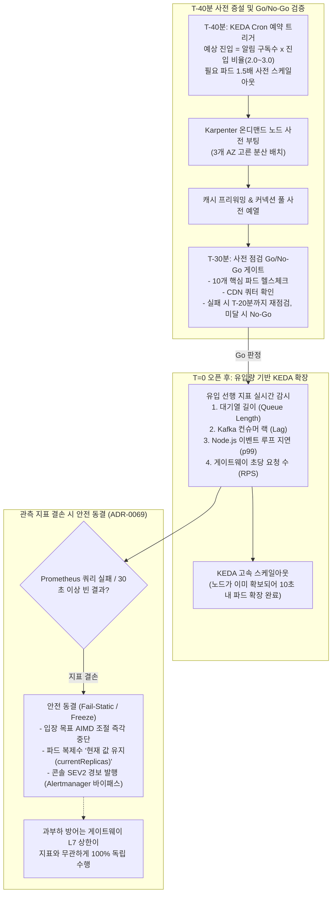

# D-17: 급격한 트래픽 스파이크 시 왜 CPU 반응형 HPA 대신 T-40분 사전 증설(Prescale)을 강제하고, 지표 단절 시 왜 현재 상태를 동결하는가?

- **핵심 아키텍처 원칙**: 노드 프로비저닝 지연(2~5분) 극복을 위한 T-40분 스케줄 기반 사전 확장(Prescale), 큐 깊이/이벤트 루프 지연 선행 지표 기반 KEDA 오토스케일링, 모니터링 결손 시 파멸적 과잉 조치를 차단하는 안전 동결(Fail-Static / Freeze) 원칙
- **관련 설계 정본**: [ADR-0069](../../adr/0069-ops-control-principles-audit-self-safety-alert-hygiene-wide-events.md), [ADR-0078](../../adr/0078-aiops-review-demand-forecast-action-exits-correlation.md), [ADR-0105](../../adr/0105-payment-entry-pause-probe-trial-reopen-manual-release.md), [ADR-0126](../../adr/0126-error-budget-reduction-only-for-admission-bound-journeys.md), [ADR-0144](../../adr/0144-edge-load-balancer-shared-fate-separation-and-failure-response.md), [docs/infra.md](../../infra.md) §5, [docs/architecture.md](../../architecture.md) §5
- **함께 읽기**: [한 판 문서](../01-system-design.md) 12단계, [분야 편 9 '대기열·입장'](../fields/09-queue-admission.md), [분야 편 16 '관제탑'](../fields/16-control-tower.md), [분야 편 19 '관측'](../fields/19-observability.md), [분야 편 20 '인프라·배포'](../fields/20-infra-devops.md), [결정 카드 D-05](D05-admission-control-loop.md)·[D-20](D20-onsale-alerts-error-budget.md)

---

## 1. 풀려던 문제와 한계

대규모 티켓팅 정각 오픈 시 CPU 사용률 기반의 전통적 수평 오토스케일링(HPA)이나 순진한 자동화 룰이 초래하는 치명적 한계는 다음과 같다.

### 1) 반응형 CPU 오토스케일링(HPA)의 물리적 시간차 파멸
- 오픈 정각(T=0)에 초당 **200,000 RPS**가 1초 만에 유입된다.
- CPU 사용률이 90%로 치솟고 K8s HPA가 이를 감지하여 새 파드를 스케줄링하는 데 최소 15~30초가 걸린다.
- 더 심각한 것은 **신규 노드 프로비저닝 지연**이다. Karpenter나 클라우드 오토스케일러가 EC2 온디맨드 인스턴스를 요청하고 OS 부팅, Docker 이미지 풀, Kubelet 조인을 거쳐 Ready가 되기까지는 **최소 2~5분**이 소요된다.
- 파드가 준비되기도 전에 70분짜리 티켓팅의 전체 허용 에러 버짓(약 2,000건)이 최초 1초 만에 전소되며 시스템이 즉각 블랙아웃에 빠진다.

### 2) 관측 지표 결손 시의 자동화 폭주 사고 (Diskerase 결함)
- 입장 제어 AIMD 루프는 Prometheus에서 다운스트림 레이턴시(p99)와 에러율을 긁어와 입장 인원을 조절한다.
- 만약 모니터링 수집 파이프라인 장애로 Prometheus가 **빈 응답(Empty Metrics)**을 반환할 때, 시스템이 이를 "오류율 0%, 지연 없음"으로 오판하면 입장 인원을 최대치로 폭증시켜 다운스트림을 침몰시킨다.
- 반대로 "입력이 없으니 안전하게 가동률을 0으로 줄이자"며 최저 하한으로 축소하면, 관측 시스템의 사소한 순단 하나로 멀쩡히 진행되던 티켓팅이 전면 중단된다 (Google SRE Book 7장 Diskerase 사고).

### 3) 8대 부하 관리 장치 간의 피드백 루프 경합
- 사전증설, KEDA 오토스케일러, 입장 제어 AIMD 루프, 에러 버짓 연동 스로틀링, 게이트웨이 동시성 상한, 서킷 브레이커, 클라이언트 폴링 간격 등 8개 제어 장치가 정돈된 우선순위 없이 동시에 각자의 지표로 조절을 시도하면 시스템이 극심한 진동(Oscillation)에 빠져 자멸한다.

---

## 2. 후보 기술 비교

| 평가 항목 | 후보 1: CPU 기반 순수 리액티브 HPA (v0) | 후보 2: 24시간 2배 과다 프로비저닝 | 후보 3: 지표 결손 시 즉시 최소 안전 하한 감축 | 후보 4: T-40분 사전증설 + KEDA 유입량 지표 + 안전 동결 (선택) |
| :--- | :--- | :--- | :--- | :--- |
| **T=0 순간 20만 RPS 수용** | 0% (노드 부팅 3분 지연으로 붕괴) | 완벽 (이미 상시 기동) | N/A | **완벽 (T-30분 전 100% 파드/노드 배치 완료)** |
| **인프라 비용 효율성** | 높음 (평소 유휴) | 극히 나쁨 (월 수천만 원 낭비) | 보통 | **최적화 (온세일 전후 70분만 핀포인트 증설)** |
| **관측 지표 결손 시 동작** | 대체 동작 없음 (HPA 먹통) | N/A | 파멸적 (멀쩡한 판매 전면 중단) | **완벽 안전 (Fail-Static: 직전 목표 유지 동결)** |
| **스케일아웃 반응 속도** | 2~5분 (노드 기동 지연) | 즉시 | N/A | **즉시 (노드 이미 확보 상태, 파드 스케일 10초 내)** |
| **감축 안정성** | 빈번한 축소 진동 발생 | N/A | 불안정 | **보장 (체류 시간 고려 35초~2분 쿨다운 보장)** |
| **최종 판정** | **탈락 (NFR-001 미달)** | **탈락 (비용 낭비)** | **탈락 (관측 장애로 비즈니스 마비)** | **최종 채택 (ADR-0069, ADR-0078)** |

---

## 3. 고른 이유와 아키텍처 다이어그램

PEAKET은 **"트래픽 폭주에 반응하지 않고 사전에 인프라를 올려두며, 지표가 끊기면 판단을 멈추고 현재 상태를 지킨다(Fail-Static)"**는 원칙을 적용했다.

### 핵심 매커니즘 4가지

#### 1) 설명 가능한 수학적 수요 예측 공식과 T-40분 사전 증설
- 머신러닝의 블랙박스 예측을 배제하고, 설명 책임이 명확한 선형 비례식을 적용한다 (ADR-0078):
  $$\text{예상 진입 인원} = \text{오픈 알림 구독자 수} \times \text{구독 대비 진입 비율}$$
  - 진입 비율은 유사 과거 회차의 중앙값과 75번째 백분위수를 사용하며, 데이터가 부족한 초기에는 기본값 **2.0 ~ 3.0**을 적용한다.
- **T-40분 스케줄**: 티켓팅 40분 전 KEDA Cron 규칙이 가동되어 10개 마이크로서비스의 최소 파드 수를 일제히 상향한다.
- **1.5배 마진과 멀티 AZ 분산 (ADR-0144)**: 대형 티케팅 시 게이트웨이 복제본을 계산된 필요 대수의 **1.5배**로 증설하여 3개 가용 영역(AZ)에 균등 배치함으로써, 1개 AZ 전체가 다운되어도 남은 2개 AZ로 피크를 100% 감당하도록 보장한다.

#### 2) T-30분 사전 점검(Go/No-Go) 게이트
- 티켓팅 30분 전 시스템은 10개 서비스 파드의 정상 기동 여부, DB 커넥션 풀, Redis 연결, CloudFront 쿼터 상향 여부를 자동 전수 점검한다.
- 단 하나의 필수 항목이라도 실패하면 즉시 **No-Go**로 판정하며, T-20분까지 회복되지 않으면 티켓팅 오픈을 일시 중단하고 대기실에 "시스템 점검 공지"를 게시하여 불완전한 상태에서의 참사를 방지한다.

#### 3) 지표 단절 시 '안전 동결(Fail-Static)' 및 Alertmanager 바이패스
- Prometheus 지표 쿼리 실패, 빈 결과, 또는 최신 표본이 30초 이상 지연되면 시스템은 즉시 **'입력 없음(Metrics Unavailable)'** 상태로 선언한다 (ADR-0069).
- **동결 원칙**: 빈 결과를 `0`으로 해석하지 않는다. 입장 제어 AIMD 루프는 목표 인원을 늘리지도 줄이지도 않고 **현재 목표를 그대로 동결**한다. KEDA 역시 파드 수를 현재 복제본으로 고정(`fallback: currentReplicas`)한다.
- 이 상태는 대기열 Redis에 직접 기록되어 중앙 Alertmanager 장애와 무관하게 운영 관제 콘솔에 **SEV2 경보**로 즉시 표출된다.
- 관측이 죽은 사이 실제 과부하가 발생하더라도 지표를 보지 않고 로컬 카운터로 작동하는 게이트웨이 동시성 상한(D-15)이 백엔드를 물리적으로 보호한다.

#### 4) 감축 후 효과 확인 대기 (Cooldown Stabilization)
- 입장 인원을 5,000명에서 2,500명으로 급감시켰을 때, 그 효과가 시스템에 반영되기까지는 이미 들어온 사용자의 **평균 체류 시간(3분 = 180초)**을 감안할 때 최소 90~125초가 소요된다.
- 따라서 감축이 실행된 후 예매 화면 인원이 새 목표치 아래로 내려오고 **최소 35초가 지나거나 최대 2분이 경과할 때까지는 추가 감축을 일체 금지**한다. 이를 통해 감축이 꼬리를 물고 이어져 시스템이 0으로 꺼지는 오버슈팅(Overshooting)을 방지한다.

---

## 4. 얻는 것과 치르는 값 (Tradeoffs)

### 얻는 것 (Gains)
1. **T=0 순간 100% 처리 용량 확보**: 노드 부팅 시간(2~5분) 지연 없이 오픈 정각 20만 RPS 트래픽을 지연 0초로 즉시 흡수한다.
2. **관측 시스템 장애의 비즈니스 전파 차단**: Prometheus 지표가 끊겨도 파드 축소나 입장 정지 없이 안전 동결되어 티켓팅이 정상 진행된다.
3. **제어 시스템의 발진(Oscillation) 방지**: 쿨다운 윈도우와 명확한 부하 장치 우선순위로 안정적인 수렴 제어를 달성한다.

### 치르는 값 (Costs & Limitations)
1. **사전 증설 인프라 비용 지출**: 티켓팅 오픈 전 약 40분간 유휴 파드와 노드를 상시 유지함에 따른 클라우드 비용이 발생한다 (온세일 1회당 약 수십 달러).
2. **지표 단절 시 자동 감축 부재**: 지표가 끊긴 동안에는 다운스트림 이상에 따른 자동 감축이 동작하지 않으므로, 게이트웨이 하드웨어 상한과 운영자의 수동 개입에 의존해야 한다.
3. **구독 없는 돌발 트래픽 예측 한계**: 알림 구독 없이 외부 바이럴로 정각에 갑자기 몰려든 비정형 수요는 사전 증설 공식의 예측 범위를 벗어날 수 있다.

---

## 5. 바꿀 조건 (Conditions to Change)

1. **지표 단절 빈도 증가**: 모니터링 수집 실패로 인한 안전 동결(Fail-Static) 진입이 월 1회 이상 빈번하게 발생할 경우, 판정 기준 윈도우(30초)를 60초로 완화하거나 관측 인프라의 HA 구성을 이중화한다.
2. **수요 예측 오차의 지속적 초과**: 실제 진입 인원이 예측 상단(알림 구독수 $\times$ 3.0)을 초과하는 회차가 연속 2회 이상 발생할 경우, 머신러닝 기반 시계열 예측 모델(Prophet 등)을 정식 도입하여 새 ADR을 수립한다.
3. **노드 부팅 기술의 혁신**: AWS Karpenter나 서버리스 컨테이너 기술의 발전으로 노드 프로비저닝 시간이 10초 이내로 단축될 경우, 사전 증설 시간을 T-40분에서 T-10분으로 대폭 축소하여 인프라 비용을 절감한다.

---

## 6. 핵심 꼬리 질문 5단 방어 (Staff Interview Q&A)

| 질문 단계 | 심층 질문 | 방어 논리와 기술적 근거 | 관련 정본 |
| :--- | :--- | :--- | :--- |
| **1단: 왜 (Why)** | 클라우드의 기본인 CPU 기반 오토스케일링(HPA)을 쓰지 않고 왜 굳이 40분 전에 미리 돈을 들여 늘리나요? | 티켓팅은 1초 만에 트래픽이 수십만 배로 폭증하는 극단적 스파이크 도메인입니다. CPU 임계치를 보고 HPA가 반응하여 EC2 노드를 프로비저닝하고 파드를 띄우는 데는 최소 2~5분이 걸립니다. 이 2~5분 동안 전체 백엔드가 504 타임아웃으로 다운되고 에러 버짓이 1초 만에 전소됩니다. 사전 증설(Prescale)만이 이 스파이크를 살아남을 수 있는 유일한 공학적 해법입니다. | docs/infra.md §5, docs/architecture.md §9.3 |
| **2단: 대안 (Alternatives)** | 모니터링 지표가 끊기면 시스템 보호를 위해 입장 인원을 안전하게 최소치로 줄이는 게 맞지 않나요? | 절대 안 됩니다. 관측 파이프라인의 일시적 순단이나 네트워크 지연 때문에 멀쩡히 진행되던 수만 명의 티켓 예매를 강제로 중단시키는 치명적인 비즈니스 장애(Diskerase 결함)를 유발하기 때문입니다. 지표가 없으면 조작을 멈추고 현재 상태를 동결(Fail-Static)하는 것이 맞으며, 백엔드의 물리적 과부하는 지표를 보지 않는 게이트웨이 로컬 카운터가 철저히 막아냅니다. | ADR-0069 |
| **3단: 장애 대응 (Resilience)** | 사전 증설을 1.5배로 했는데도 특정 AZ가 정전으로 완전히 죽으면 어떻게 되나요? | PEAKET은 사전 증설 시 게이트웨이와 핫패스 파드를 3개 AZ에 균등 배치하고 1.5배 마진을 부여했습니다. 단일 AZ 전체가 죽더라도 남은 2개 AZ에 전체 피크 트래픽의 100%를 수용할 수 있는 파드 용량이 확보되어 있으므로, 무중단으로 티켓팅을 완수할 수 있습니다. | ADR-0144 |
| **4단: 수치 근거 (Numbers)** | 왜 하필 T-40분 증설과 2분 쿨다운 시간인가요? | T-40분은 Karpenter 노드 프로비저닝(최대 5분)과 컨테이너 이미지 풀링, 그리고 T-30분 사전 헬스체크 게이트웨이 판정을 여유 있게 통과하기 위한 최소 필요 시간입니다. 2분 쿨다운은 사용자가 예매창에 머무는 평균 체류 시간(180초) 동안 유출입 효과가 지연 반영되는 물리적 수렴 시간을 감안하여 도출된 수치입니다. | ADR-0069, ADR-0078 |
| **5단: 실측과 검증 (Verification)** | 사전 증설 파이프라인과 Go/No-Go 검증을 실제로 테스트해 보셨나요? | 스테이징 환경에서 KEDA Cron 기반의 T-40분 스케줄러를 구동하고 10개 서비스 파드가 목표 복제수까지 증설되는 타임라인을 검증했습니다. 노드가 미리 프로비저닝된 상태에서 파드 확장이 10~15초 내에 완료됨을 확인했으며, 모의 사전 점검 스크립트를 통해 필수 의존성 실패 시 T-30분에 정확히 No-Go가 판정되어 대기실 공지로 전환되는 장애 흐름을 검증했습니다. | docs/infra.md §5, docs/verification.md §9 |

---

## 7. 30초 아키텍처 브리핑 (Staff Engineer Summary)

> "PEAKET은 1초 만에 20만 RPS가 몰아치는 티켓팅 특성상 반응형 CPU HPA를 전면 배제하고, 알림 구독수 기반 수학 공식으로 오픈 40분 전(T-40분)에 인프라를 1.5배로 사전 증설(Prescale)합니다.  
> T-30분 사전 헬스체크 게이트에서 전수 검증을 거쳐 오픈 여부를 최종 판정하며, 오픈 후에는 Kafka 랙과 이벤트 루프 지연 선행 지표로 KEDA 확장을 제어합니다.  
> 또한 Prometheus 지표가 끊길 경우 빈 결과를 0으로 오판하지 않고 현재 목표를 안전하게 동결(Fail-Static)함으로써, 관측 시스템 장애가 티켓팅을 중단시키는 자동화 사고를 원천 차단했습니다."
