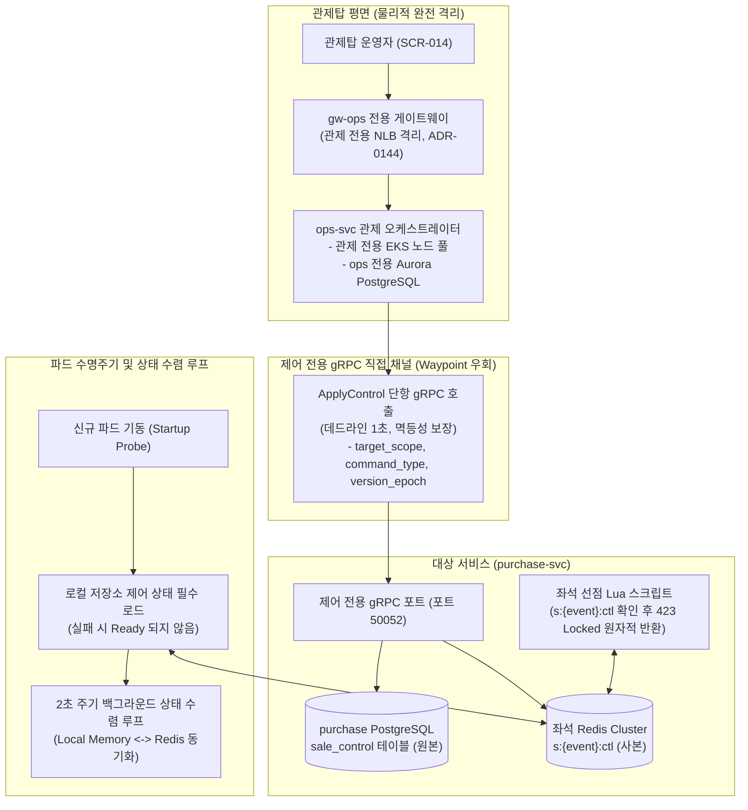

# D-18: 운영 명령을 왜 비동기 메시지가 아닌 '로컬 저장소 상태 수렴'으로 모델링하고, 제어 전용 gRPC로 전달하는가?

- **핵심 아키텍처 원칙**: 운영 제어의 휘발성 메시지 배제 및 저장소 상태(Control-as-State) 수렴 모델, 신규 파드 기동 시 상태 동기화 강제(Readiness Gate), 데이터 플레인 및 서비스 메시를 우회하는 제어 전용 gRPC 단항 호출, 관제 평면의 물리적 완전 격리
- **관련 설계 정본**: [ADR-0022](../../adr/0022-control-plane-tcp-out-of-band.md), [ADR-0102](../../adr/0102-control-plane-direct-grpc-dedicated-pool-ops-db-audit-chain-worker-break-glass.md), [ADR-0103](../../adr/0103-control-as-state-startup-sync-broadcast-topics-compacted-settings.md), [ADR-0143](../../adr/0143-settings-commands-pg-switch-over-grpc-applied-version-outbox.md), [docs/features/control-tower.md](../../features/control-tower.md) §5, [docs/architecture.md](../../architecture.md) §5
- **함께 읽기**: [한 판 문서](../01-system-design.md) 11단계·13단계, [분야 편 10 '좌석'](../fields/10-seat-hold.md), [분야 편 16 '관제탑'](../fields/16-control-tower.md), [결정 카드 D-05](D05-admission-control-loop.md)·[D-09](D09-dual-pg-and-failover.md)·[D-14](D14-tokens-and-per-request-authz.md)·[D-21](D21-command-approval-and-audit-anchor.md)

---

## 1. 풀려던 문제와 한계

대규모 티켓팅 장애 상황에서 비상 킬스위치(판매 일시정지, 입장 목표 하향, 결제사 장애 전환)를 전파할 때 마주하는 아키텍처 한계는 다음과 같다.

### 1) 엄격한 운영 제어 지연 예산 (NFR-008)
- **명령 접수 지연**: p95 **500ms** 이내.
- **2인 승인 완료 후 전 시스템 전파 및 집행 완료(ACK)**: p99 **3초** 이내.
- 대규모 금융 사고나 중복 결제가 의심되는 순간, 운영자의 판매 중단 명령은 3초 이내에 전 시스템에서 100% 집행되어야 한다.

### 2) 비동기 메시지(Ephemeral Push) 전파의 치명적 결함
- 과거의 순진한 설계는 현재 떠 있는 파드들에게 웹소켓이나 메시지 큐로 일괄 '정지 메시지'를 푸시하고 완료(ACK)로 간주했다.
- **신규 파드의 상태 유실 참사**: 킬스위치를 켜야 하는 순간은 시스템 장애가 극에 달해 K8s HPA에 의해 새 파드가 긴급 증설되거나, 기존 파드가 OOM으로 크래시되어 재기동되는 순간이다. 새로 뜬 파드는 과거의 정지 메시지를 받은 적이 없으므로, **"시스템은 판매 일시정지 상태인데 새로 뜬 파드 혼자서 좌석을 정상 판매하고 결제를 승인하는 대형 참사"**가 발생한다.

### 3) 데이터 플레인(Data Plane) 정체 시의 제어 신호 고립
- 일반 API 게이트웨이나 Kafka 메시지 큐를 통해 운영 명령을 전송하면, 오픈 정각 초당 200,000건의 사용자 트래픽이나 로그 큐 적체 뒤에 운영 명령이 갇혀 수십 초간 도달하지 못하는 병목이 발생한다 (ADR-0022).
- 제어 신호는 일반 사용자 트래픽의 병목과 완전히 무관한 독립된 고속 통로를 타야 한다.

---

## 2. 후보 기술 비교

| 평가 항목 | 후보 1: Kafka 제어 토픽 브로드캐스팅 | 후보 2: 커스텀 TCP 대역 외 채널 (v0) | 후보 3: 게이트웨이 / CDN 엣지 레벨 차단 | 후보 4: 제어 전용 gRPC + 저장소 상태 수렴 (선택) |
| :--- | :--- | :--- | :--- | :--- |
| **전파 지연 (NFR-008)** | 5~30초 (트래픽 폭주 시 큐 뒤에 갇힘) | 1~3초 | 10~60초 (CDN 전파 지연) | **p99 < 3초 (직접 단항 gRPC 즉시 전파)** |
| **재시작/증설 신규 파드** | 상태 미인지 (과거 메시지 누락) | 상태 미인지 (재기동 시 정지 풀림) | 게이트웨이만 인지 | **완벽 인지 (Startup Probe에서 로컬 저장소 상태 읽기)** |
| **원자적 좌석 차단** | 불가 (파드 메모리 플래그 의존) | 불가 | 불가 (원자적 홀드 불가) | **완벽 (좌석 Redis s:{event}:ctl Lua 원자적 423 거부)** |
| **데이터 경로 간섭** | 극심 (Kafka 브로커 I/O 경합) | 보통 | 보통 | **0% (게이트웨이/메시 우회 전용 gRPC 포트)** |
| **운영 인프라 안전성** | 사용자 트래픽과 공유 | 불안정 (자체 TCP 스키마 부채) | CDN 종속 | **최고 (관제 전용 노드 풀 및 전용 DB 분리)** |
| **최종 판정** | **탈락 (지연 예산 초과)** | **탈락 (ADR-0102, 아키텍처 부채)** | **탈락 (원자적 정합성 미달)** | **최종 채택 (ADR-0102, ADR-0103, ADR-0143)** |

---

## 3. 고른 이유와 아키텍처 다이어그램

PEAKET은 **"운영 제어는 휘발성 메시지가 아니라 받는 쪽 저장소의 버전 상태(Control-as-State)이며, 전송은 데이터 플레인을 우회하는 제어 전용 gRPC로 수행한다"**는 설계를 적용했다.

### 핵심 매커니즘 4가지

#### 1) 제어는 메시지가 아니라 버전 상태다 (Control-as-State)
- 운영 명령은 휘발성 푸시 메시지가 아니라, **수신 서비스의 영구 저장소에 기록되는 버전 상태(State)**로 정의된다 (ADR-0103).
- **단조 증가 버전 에포크(Version Epoch)**: 명령이 발행될 때마다 범위(전체, 회차 ID)별로 단조 증가하는 버전 번호 $N$이 부여된다.
- **적용 저장소 매핑**:
  - 판매 일시정지: `purchase-svc` DB의 `sale_control` 테이블(원본) 및 좌석 Redis `s:{event}:ctl`(사본).
  - 입장 목표 변경: `admission-ctrl`의 `q:{event}:ctl`.
  - 대기열 공지: `queue-svc`의 `q:{event}:notice`.
  - 결제사 장애 전환: `payment-svc`의 `pg_switch`.
- 수신 서비스는 수신한 명령의 버전 $N$이 현재 로컬 버전보다 클 때만 상태를 원자적으로 갱신한다.

#### 2) 좌석 선점 Lua 스크립트의 원자적 정지 판정
- 판매 일시정지가 발령되면 좌석 Redis의 `s:{event}:ctl` 키에 `PAUSED, version=N`이 기록된다.
- 좌석을 선점하는 Redis Lua 스크립트는 좌석 비트맵을 확인하기 전, **첫 번째 라인에서 `s:{event}:ctl` 키를 원자적으로 평가**한다.
- 키가 `PAUSED` 상태이면 비트맵을 건드리지 않고 즉시 **423 Locked** 상태 코드를 반환한다. 애플리케이션 파드의 스레드가 과부하 상태이더라도 Redis 레벨에서 즉각 0ms 만에 완벽한 판매 중단이 보장된다.

#### 3) 신규 파드 기동 동기화 의무(Readiness Gate) 및 2초 수렴 루프
- 파드가 새로 기동되면 쿠버네티스 Readiness Probe 단계에서 **자신이 소유한 저장소의 최신 제어 상태를 로드하기 전까지 트래픽 수신 준비 완료(Ready) 상태가 될 수 없다**.
- 기동 후에도 백그라운드에서 **2초 주기 수렴 루프**가 실행되어, 네트워크 순단으로 gRPC 명령을 놓쳤더라도 2초 이내에 저장소의 최신 상태로 메모리를 강제 일치시킨다.

#### 4) 서비스 메시를 우회하는 제어 전용 단항 gRPC 채널 (ADR-0102)
- 일반 비즈니스 트래픽을 처리하는 포트(8080)와 분리된 **제어 전용 포트(50052)**를 개설한다.
- 이 포트는 Istio Ambient의 Waypoint L7 프록시를 경유하지 않고 ztunnel L4 mTLS만 거쳐 직접 통신하므로 프록시 버퍼 큐에 갇히지 않는다.
- 단항 RPC(`peaket.control.v1.ControlReceiver/ApplyControl`)로 호출되며, 타임아웃 데드라인은 1초로 짧게 강제된다.
- **ACK(확인)의 재정의**: 판 $N$의 ACK는 "수신 서비스의 저장소 원본, Redis 사본, 그리고 현재 실행 중인 모든 파드가 버전 $N$ 이상을 적용 완료했음"을 의미한다.

---

## 4. 얻는 것과 치르는 값 (Tradeoffs)

### 얻는 것 (Gains)
1. **신규 증설 파드의 상태 일관성 100% 보장**: 킬스위치 발동 후 파드가 재시작되거나 100대로 스케일아웃되더라도 판매 정지 상태를 누락 없이 강제한다.
2. **초고부하 시 3초 내 비상 통제 (NFR-008 준수)**: Kafka나 일반 게이트웨이가 포화되어도 독립된 제어 gRPC 채널로 즉시 도달한다.
3. **Lua 원자적 판매 차단**: 애플리케이션 파드가 CPU 100%로 뻗어있어도 Redis 메모리 레벨에서 좌석 판매를 0ms 만에 셧다운한다.

### 치르는 값 (Costs & Limitations)
1. **신규 파드 기동 시간의 미세한 지연**: 기동 시 제어 상태 및 종료 세션 목록을 동기 로드해야 하므로 컨테이너 준비 시간이 약 1~2초 지연된다.
2. **관제 인프라 상시 비용**: 관제 전용 EKS 노드 풀과 ops 전용 Aurora PostgreSQL을 분리 운영함에 따른 고정 인프라 비용이 추가된다.
3. **서비스별 제어 포트 유지보수**: 10개 마이크로서비스마다 업무 gRPC 포트 외에 제어 전용 gRPC 포트와 K8s Service를 이원화 관리해야 한다.

---

## 5. 바꿀 조건 (Conditions to Change)

1. **파드 과부하로 인한 ACK 지연 초과**: 수신 파드의 이벤트 루프 마비로 gRPC ACK 응답이 p99 3초를 지속 초과할 경우, `ops-svc`가 대상 파드를 거치지 않고 좌석 Redis에 직접 상태 키를 쓰는 다이렉트 바이패스 권한을 부여한다 (ADR-0103 대안 B).
2. **클러스터 공유 DB 여유 용량 확보**: 공유 Aurora DB의 쓰기 CPU가 피크 시에도 40% 미만으로 유지되고 인프라 비용 절감이 요구될 경우, ops 전용 DB를 공유 클러스터 내부의 논리 DB로 통합 환원한다.
3. **설정형 명령 전파 지연**: Kafka 압축 토픽 기반 설정 전파가 30초 이내에 완료되지 못하는 사고가 월 3회 이상 발생할 경우, 봇 판정 및 공지 변경 명령도 제어 전용 gRPC 파이프라인으로 일원화한다.

---

## 6. 핵심 꼬리 질문 5단 방어 (Staff Interview Q&A)

| 질문 단계 | 심층 질문 | 방어 논리와 기술적 근거 | 관련 정본 |
| :--- | :--- | :--- | :--- |
| **1단: 왜 (Why)** | 킬스위치 명령을 파드들에 웹소켓이나 큐로 쏘면 되지, 왜 굳이 저장소 상태로 저장하나요? | 킬스위치를 켜야 하는 상황은 파드가 다운되고 재기동되거나 오토스케일링되는 장애 상황입니다. 단순히 현재 파드에 메시지를 푸시하고 끝내면, 1초 뒤에 새로 뜬 파드는 정지 명령을 받지 못해 혼자 티켓을 계속 판매하는 치명적인 정합성 파탄이 일어납니다. 수신 서비스의 DB와 Redis에 '버전 상태'로 기록하고, 새 파드는 이 상태를 읽어야만 뜨도록 강제해야 영구히 안전합니다. | ADR-0103 |
| **2단: 대안 (Alternatives)** | 제어 신호를 Kafka의 가장 빠른 토픽으로 보내면 안 되나요? | 티켓팅 오픈 정각에는 수십만 건의 트래픽으로 브로커 I/O가 포화될 수 있습니다. 비상 판매 일시정지는 3초 내에 완료되어야 하는데, Kafka 브로커 랙이나 파티션 리밸런싱이 겹치면 제어 메시지가 10~30초간 큐 뒤에 갇힙니다. 긴급 제어 명령은 메시지 큐와 일반 게이트웨이를 물리적으로 우회하는 독립된 단항 gRPC 직결 채널을 타야 합니다. | ADR-0022, ADR-0102 |
| **3단: 장애 대응 (Resilience)** | 관제 서비스를 제공하는 ops-svc 파드가 죽으면 긴급 판매 정지를 아예 못 내리나요? | ops-svc가 완전히 죽었을 때를 대비하여 쿠버네티스 비상 잡(Emergency Runbook Job)이 사전에 패키징되어 있습니다. 운영자는 관제 웹 UI가 죽어도 K8s CLI 환경에서 사전 서명된 명령을 실행하여 동일한 제어 gRPC 채널로 각 서비스의 저장소 상태를 10초 이내에 강제 갱신할 수 있습니다. | docs/features/control-tower.md §5, ADR-0102 |
| **4단: 수치 근거 (Numbers)** | 접수 500ms, 전파 3초, 데드라인 1초는 어떻게 도출되었나요? | NFR-008은 이중 결제나 금융 사고 감지 시 최대 5만 석 회차에서 누적될 수 있는 추가 피해를 100건 이내로 통제하기 위해 '3초 전파 완료'를 요구합니다. 3초는 'gRPC 단항 호출(최대 1초 데드라인) + DB 트랜잭션 및 Redis 키 갱신(100ms) + K8s 전 파드 2회차 재확인 루프'를 포함하는 엄밀한 지연 예산입니다. | NFR-008, ADR-0102 |
| **5단: 실측과 검증 (Verification)** | 킬스위치 발동 중 파드를 2대에서 6대로 강제 증설하는 카오스 테스트를 해 보셨나요? | 서비스 템플릿 검증(C-T50)을 통해 판매 일시정지가 걸린 상태에서 purchase-svc 파드를 6대로 스케일아웃시키고 파드를 강제 재시작했습니다. 신규 파드들이 Startup Probe에서 Redis의 `s:{event}:ctl` 상태를 로드하기 전까지 준비 완료되지 않으며, 기동 즉시 모든 좌석 선점 요청에 대해 단 1건의 누락도 없이 423 Locked를 원자적으로 반환함을 검증했습니다. | docs/verification.md §2.6, ADR-0103 |

---

## 7. 30초 아키텍처 브리핑 (Staff Engineer Summary)

> "PEAKET은 운영 통제 신호를 휘발성 메시지가 아닌 '수신 서비스 저장소의 단조 증가 버전 상태(Control-as-State)'로 정립했습니다.  
> 킬스위치 발동 시 `purchase-svc` DB와 좌석 Redis에 상태를 기록하고 좌석 선점 Lua 스크립트가 첫 줄에서 이를 원자적으로 검사함으로써 0ms 만에 판매를 셧다운합니다.  
> 신규 파드는 기동 시 이 상태를 필수 로드해야만 Ready 상태가 되므로 재시작으로 인한 정지 해제 사고가 0건이며, 제어 신호는 메시 큐와 게이트웨이를 우회하는 제어 전용 gRPC로 1초 내에 직결 전파됩니다."
