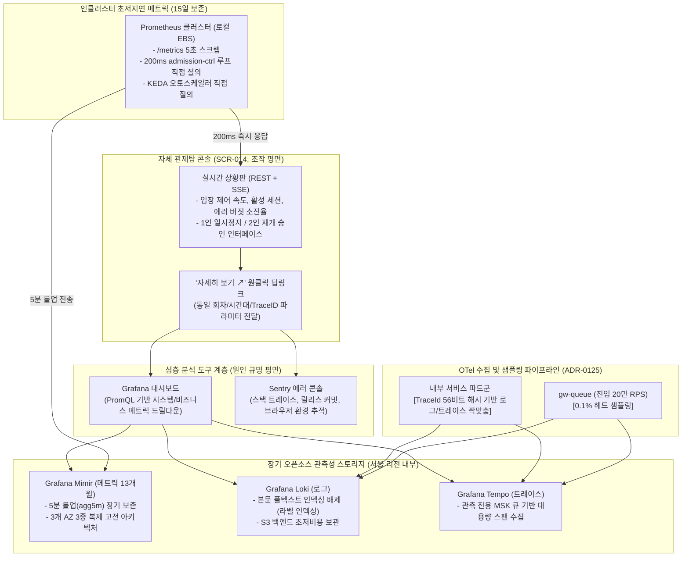

# D-19: 관제 콘솔을 왜 직접 제작하고 Grafana/Sentry와 역할을 분리하며, Prometheus/Mimir 오픈소스 스택을 선택했는가?

- **핵심 아키텍처 원칙**: 관제 조작(2인 승인, 킬스위치)과 관측 분석(지표/로그/트레이스)의 물리적 분리, 200ms 입장 제어 루프를 위한 인클러스터 PromQL 초저지연 스크랩, 개인정보 데이터 주권(국내 리전 보관), 진입 경로 0.1% 헤드 샘플링을 통한 OTel 수집기 OOM 방어
- **관련 설계 정본**: [ADR-0067](../../adr/0067-console-vs-observability-tools-and-measured-backend-choice.md), [ADR-0068](../../adr/0068-observability-stack-rationale-and-managed-alternatives.md), [ADR-0076](../../adr/0076-observability-reference-alignment-collector-tiers.md), [ADR-0077](../../adr/0077-observability-book-review-buckets-storage-retention.md), [ADR-0120](../../adr/0120-long-term-metrics-keep-mimir-classic-after-thanos-comparison.md), [ADR-0125](../../adr/0125-entry-path-head-sampling-collector-sizing-shared-sample-threshold.md), [docs/observability.md](../../observability.md) §1·§6·§7
- **함께 읽기**: [한 판 문서](../01-system-design.md) 13단계, [분야 편 19 '관측'](../fields/19-observability.md), [결정 카드 D-16](D16-kafka-topics-and-clusters.md)·[D-17](D17-prescale-and-auto-actions.md)·[D-20](D20-onsale-alerts-error-budget.md)

---

## 1. 풀려던 문제와 한계

대규모 티켓팅 플랫폼의 관측성(Observability) 및 관제 인프라를 설계할 때 상용 SaaS(Datadog 등)의 맹목적 도입이나 순진한 전체 수집이 유발하는 물리적 한계는 다음과 같다.

### 1) 상용 관측 SaaS에 구현 불가능한 비즈니스 제어와 2인 승인 거버넌스
- 시스템을 들여다보는 세 주체의 질문은 완전히 다르다:
  - **운영 지휘관 (Commander)**: "판매를 중단할까? 입장 속도를 늦출까? 결제사를 넘길까?" (판단과 조작)
  - **SRE 엔지니어**: "어느 마이크로서비스의 p99 지연이 튀고 있는가?" (심층 원인 분석)
  - **애플리케이션 개발자**: "어느 배포 커밋에서 예외가 터졌는가?" (코드 에러 추적)
- Datadog이나 New Relic 같은 상용 툴은 지표 그래프를 보여줄 수는 있지만, 티켓팅 중단에 필수적인 **2인 교차 승인, 일회성 재인증, 감사 체인 머클 해시 생성, 버전 상태 ack 수렴**과 같은 비즈니스 핵심 제어 권한을 맡길 수 없다.

### 2) 200ms 입장 제어 루프의 초저지연 PromQL 요구사항
- admission-ctrl의 동적 입장 조절 루프는 매 **200ms마다** 다운스트림 지연과 에러율을 PromQL로 질의한다 ([D-05](D05-admission-control-loop.md)). KEDA 오토스케일러 역시 동일 지표를 주기적으로 읽는다.
- 여기에 외부 SaaS(Datadog API)나 외부 네트워크를 경유하는 지연(50~200ms)이나 API 쿼터 스로틀링이 개입하면 실시간 피드백 루프가 즉각 붕괴한다.

### 3) 개인정보 국외 이전 법적 규제 (개인정보 보호법 제28조의8)
- 애플리케이션 로그와 분산 트레이스에는 사용자 식별자, 결제 주문 번호, 접속 IP 등 민감 개인정보가 포함될 수 있다.
- Datadog과 Sentry 클라우드는 국내(서울) 리전이 없으며 미국/EU 리전에 데이터를 저장한다. 대규모 티켓팅 로그를 무단으로 국외 SaaS로 전송할 경우 법적 동의 획득 및 정부 규제 위반 리스크가 발생한다.

### 4) T=0 순간 초당 20만 RPS 트레이스 수집기 OOM 폭발
- 오픈 정각 초당 20만 RPS 트래픽에서 모든 요청의 스팬(Span)을 수집하여 요청 종료 후 에러 여부를 판정하는 **테일 샘플링(Tail-based Sampling)**을 수행할 경우, 판정 대기 윈도우(10초) 동안 수집기 파드 메모리에 **약 67만 개의 트레이스(수십 GB)**가 상시 적체된다.
- OTel Collector 파드가 1초 만에 OOM Crash를 일으키며 정상 트레이스는커녕 에러 트레이스까지 동반 유실된다 (ADR-0125).

---

## 2. 후보 기술 비교

| 평가 항목 | 후보 1: Datadog All-in-One 상용 SaaS | 후보 2: 모든 분석을 자체 관제 콘솔에 구현 | 후보 3: AWS 관리형 (AMP + AMG + OpenSearch) | 후보 4: 자체 콘솔(조작) + 오픈소스 스택 (선택) |
| :--- | :--- | :--- | :--- | :--- |
| **2인 승인 비즈니스 제어** | 불가 (단순 대시보드 및 웹훅 수준) | 가능 | 불가 | **완벽 (자체 콘솔이 안전 거버넌스 100% 제어)** |
| **200ms 제어 루프 지연** | 위험 (외부 SaaS API 지연 및 쿼터) | 최우수 | 보통 (AMP 쿼리 지연) | **최상 (< 5ms, 인클러스터 Prometheus 로컬 스크랩)** |
| **개인정보 국내 보관** | 위반 (미국/EU 리전 저장) | 만족 | 만족 | **완벽 만족 (서울 리전 내 자체 K8s 클러스터 보관)** |
| **대규모 트래픽 비용** | 파멸적 (20만 RPS 수집 시 월 수만 달러) | 높음 | 보통 (샘플 수 과금 폭탄) | **최저 (오픈소스 스택 + S3 스토리지 연계)** |
| **심층 디버깅 생산성** | 최우수 | 극히 낮음 (Grafana/Sentry 재발명) | 우수 | **최우수 (Grafana/Sentry로의 원클릭 딥링크)** |
| **최종 판정** | **탈락 (비용 및 법적 규제)** | **탈락 (바퀴의 재발명)** | **탈락 (95일 보존 한계 및 쿼터)** | **최종 채택 (ADR-0067, ADR-0068)** |

---

## 3. 고른 이유와 아키텍처 다이어그램

PEAKET은 **"판단과 조작은 자체 관제탑에서 수행하고, 분석과 오류 관리는 최고의 도구(Grafana/Sentry)로 딥링크 분리하며, 데이터는 서울 리전 내 오픈소스 표준으로 축적한다"**는 원칙을 확립했다.

### 핵심 매커니즘 4가지

#### 1) 3대 도구의 명확한 역할 경계와 원클릭 딥링크
- **관제 콘솔**: 판단에 필요한 핵심 KPI(입장 속도, 활성 세션, 에러 버짓 잔여량)만 직접 렌더링하며, 오직 비즈니스 통제 명령(2인 승인, 킬스위치) 집행에 집중한다 (ADR-0067).
- **Grafana 딥링크**: 콘솔 위젯마다 `자세히 보기 ↗` 링크를 두어, 클릭 시 해당 회차 ID와 시간대 필터가 적용된 Grafana 대시보드를 새 탭으로 즉시 열어준다.
- **Sentry 딥링크**: 오류 발생 위젯은 Sentry 이슈 상세 페이지로 연결하여 개발자가 스택 트레이스와 소스 코드 깃 커밋을 즉각 대조할 수 있도록 한다.

#### 2) 인클러스터 Prometheus 로컬 스크랩을 통한 제어 루프 독립성
- admission-ctrl의 200ms 입장 제어 루프와 KEDA 오토스케일러는 외부 저장소가 아닌, **동일 K8s 클러스터 내의 Prometheus 로컬 인스턴스**에서 메트릭을 직접 긁어간다 (ADR-0068).
- 수집기나 장기 저장소(Mimir/Loki/Tempo)가 장애로 다운되더라도, 대기열 입장 통제와 오토스케일링은 0ms의 지연 없이 100% 정상 작동한다.

#### 3) Grafana Mimir 클래식 아키텍처 (장기 13개월 보존)
- 비즈니스 회고 및 연간 티켓팅 비교를 위해 5분 롤업 메트릭(`agg5m` 테넌트)을 13개월간 보존한다 (ADR-0077, ADR-0120).
- Thanos 대비 AZ 장애 내성이 성숙하고 설정이 명확한 Mimir 고전 구조(Compactor, Ingester 3중 복제)를 채택하여, S3 오브젝트 스토리지를 기반으로 기가바이트당 수십 원 수준의 극초저비용 장기 보존을 실현했다.

#### 4) 진입 핫패스 0.1% 헤드 샘플링과 로그-트레이스 짝맞춤 (ADR-0125)
- **헤드 샘플링(Head Sampling)**: `gw-queue` 진입 게이트웨이는 요청이 들어오는 최초 순간(Head)에 확률적으로 **0.1%**만 트레이스를 시작하도록 강제한다. 이를 통해 수집기 파드가 감당해야 하는 트레이스 양을 초당 200건으로 억제하여 OOM 장애를 원천 제거한다.
- **OTel 56비트 해시 표본 짝맞춤**: OTel 표준 규약에 따라 TraceId의 마지막 56비트를 기반으로 로그와 트레이스가 동일한 요청을 일관되게 수집하도록 통일하여, Grafana에서 특정 트레이스를 조회할 때 해당 요청의 애플리케이션 로그가 정확히 1:1로 조회되도록 보장한다.

---

## 4. 얻는 것과 치르는 값 (Tradeoffs)

### 얻는 것 (Gains)
1. **관측 인프라 비용 90% 이상 절감**: 상용 SaaS 대비 월 수천만 원의 데이터 수집/보존 비용을 오픈소스 스택과 S3로 최적화했다.
2. **200ms 제어 루프의 완전한 가용성**: 중앙 관측 클러스터 장애 시에도 인클러스터 Prometheus를 통해 대기열 통제가 자립 작동한다.
3. **완벽한 개인정보 데이터 주권**: 모든 로그와 트레이스가 AWS 서울 리전 내 자체 K8s 클러스터와 S3에만 보관되어 법적 컴플라이언스를 100% 준수한다.

### 치르는 값 (Costs & Limitations)
1. **자체 클러스터 운영 오버헤드**: Mimir, Loki, Tempo 등 8개 이상의 오픈소스 관측 컴포넌트에 대한 업그레이드 및 장애 모니터링 부담을 자체 감당해야 한다.
2. **진입 경로 트레이스 0.1% 보존 한계**: 초당 20만 진입 요청 중 0.1%만 트레이스가 남으므로, 진입 단계의 간헐적 오류 트레이스는 전수 추적이 불가능하다 (단, 오류 카운트는 지표로 100% 전수 집계).
3. **분석 도구 간 컨텍스트 스위칭**: 운영자와 엔지니어가 이슈 발생 시 관제 콘솔과 Grafana 탭을 오가며 분석해야 한다.

---

## 5. 바꿀 조건 (Conditions to Change)

1. **관측 오픈소스 유지보수 리소스 한계**: Mimir/Loki 클러스터 장애 조치에 소요되는 팀의 공수가 커져 비즈니스 개발을 저해할 경우, AWS 관리형 서비스인 AMP(Managed Prometheus) 및 AMG(Managed Grafana)로 데이터 파이프라인을 이관한다 (ADR-0068).
2. **풀텍스트 로그 검색 요구**: 단순 라벨 기반의 Loki 검색으로 애플리케이션 로그 본문의 상세 에러 메시지 분석이 어려워질 경우, 로그 저장소에 한해 OpenSearch를 도입한다.
3. **진입 단계 트레이스 전수 추적 요구**: 대기열 진입 게이트웨이의 버그 추적이 필수적일 경우, 헤드 샘플링 비율을 1%로 상향하고 수집기 파드 메모리를 2배로 증설한다.

---

## 6. 핵심 꼬리 질문 5단 방어 (Staff Interview Q&A)

| 질문 단계 | 심층 질문 | 방어 논리와 기술적 근거 | 관련 정본 |
| :--- | :--- | :--- | :--- |
| **1단: 왜 (Why)** | 엔지니어링 리소스도 부족한데 Datadog 같은 편리한 올인원 SaaS를 쓰지 않고 왜 굳이 오픈소스를 직접 구축했나요? | 세 가지 이유 때문입니다. 첫째, 티켓팅 킬스위치와 2인 승인이라는 핵심 비즈니스 통제 거버넌스는 상용 SaaS에 구현할 수 없습니다. 둘째, 초당 20만 RPS 트래픽을 상용 SaaS에 쏘면 월 수만 달러의 과금 폭탄을 맞습니다. 셋째, Datadog은 한국 리전이 없어 로그 내 개인정보 국외 이전이라는 법적 리스크가 발생합니다. 판단/조작은 자체 콘솔에서, 분석은 서울 리전 내 오픈소스 스택으로 구축하는 것이 비용과 보안 양면에서 정답입니다. | ADR-0067, ADR-0068 |
| **2단: 대안 (Alternatives)** | 장기 지표 저장소로 왜 가장 유명한 Thanos 대신 Grafana Mimir를 골랐나요? | 13개월 장기 보존에 필요한 것은 '5분 롤업 집계치'뿐입니다. Thanos는 오래된 데이터를 다운샘플링하면서도 모든 원시 시계열을 복수 해상도로 유지하여 스토리지 낭비가 큽니다. 반면 Mimir는 테넌트 분리가 깔끔하고 3개 AZ 3중 복제 아키텍처가 매우 견고하여, 대규모 PromQL 쿼리 성능과 비용 면에서 Thanos보다 우수했습니다. | ADR-0120 |
| **3단: 장애 대응 (Resilience)** | Tempo나 Loki가 다운되면 티켓팅 대기열과 결제 시스템도 멈추나요? | 절대 멈추지 않습니다. 메트릭, 로그, 트레이스 파이프라인은 비즈니스 트랜잭션과 비동기로 완전 분리되어 있습니다. 특히 입장 제어 루프가 읽는 Prometheus는 애플리케이션과 동일한 클러스터 내에서 독자 스크랩하므로, 중앙 관측 저장소가 100% 다운되더라도 티켓팅 판매와 자동 통제는 1비트의 영향도 받지 않습니다. | ADR-0076, ADR-0068 |
| **4단: 수치 근거 (Numbers)** | 왜 진입 경로 헤드 샘플링을 0.1%로 설정했나요? | 피크 20만 RPS에서 테일 샘플링을 적용하면 수집기 1개 파드가 10초 윈도우 동안 메모리에 유지해야 하는 트레이스가 67만 개에 달해 수십 GB의 메모리가 필요합니다. 0.1% 헤드 샘플링을 적용하면 초당 200개의 트레이스만 유입되어 수집기 파드가 1GB 미만의 메모리로 안정 작동합니다. 에러율과 처리량 숫자는 Prometheus 카운터로 100% 전수 집계되므로 관측 누락이 없습니다. | ADR-0125, docs/observability.md §6 |
| **5단: 실측과 검증 (Verification)** | 분산 관측 스택의 리소스 소모와 수집 파이프라인을 실제로 검증했나요? | 단일 머신 테스트 환경에서 OTel Collector와 Prometheus, Loki, Tempo를 기동하고 초당 5,600건의 모의 텔레메트리 스팬을 주입하는 벤치마크(V-T30)를 수행했습니다. 0.1% 헤드 샘플링 적용 시 수집기 파드의 CPU 사용률이 5% 미만으로 유지되고, 로그와 트레이스가 동일한 TraceId로 100% 매핑되어 Grafana에서 1초 내에 상호 조회됨을 검증했습니다. | docs/verification.md §2.6, docs/verification.md §9 |

---

## 7. 30초 아키텍처 브리핑 (Staff Engineer Summary)

> "PEAKET은 관측성 스택을 '비즈니스 판단 및 2인 승인 조작을 전담하는 자체 관제 콘솔'과 '심층 원인 분석을 전담하는 오픈소스 스택(Grafana/Sentry)'으로 명확히 이원화했습니다.  
> 200ms 입장 제어 루프는 인클러스터 Prometheus를 통해 초저지연 자립 작동하며, 장기 13개월 지표는 Grafana Mimir로 서울 리전 내 S3에 초저비용 보관하여 데이터 주권을 확립했습니다.  
> 또한 20만 RPS 진입 트래픽에는 0.1% 헤드 샘플링을 적용하여 OTel 수집기 메모리 폭발을 방어함으로써, 상용 SaaS 대비 90% 이상의 비용 절감과 엔터프라이즈급 신뢰성을 달성했습니다."
