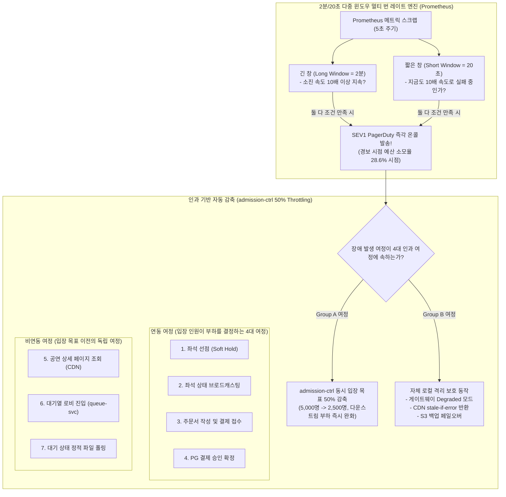

# D-20: 70분 온세일 티켓팅에서 왜 2분/20초 단기 윈도우 멀티 번 레이트 경보를 걸고, 자동 감축을 4대 핵심 여정으로 엄격히 제한했는가?

- **핵심 아키텍처 원칙**: 70분 초단기 온세일의 극소 에러 버짓(결제 12건, 좌석 75건 허용) 보존을 위한 30% 이하 소진 시점(Burn Rate 10x, 2분 창) 조기 경보, 짧은 창(20초)을 통한 회복 후 즉각 경보 해제, 인과적 통제 범위(Causal Domain)에 국한된 4대 여정 자동 스로틀링(Throttling)
- **관련 설계 정본**: [ADR-0049](../../adr/0049-onsale-alert-windows-and-ops-metrics.md), [ADR-0126](../../adr/0126-error-budget-reduction-only-for-admission-bound-journeys.md), [ADR-0127](../../adr/0127-tech-review-high-doc-fixes-intervals-budget-keys-logs-search.md), [docs/observability.md](../../observability.md) §4, [docs/features/control-tower.md](../../features/control-tower.md) §6
- **함께 읽기**: [한 판 문서](../01-system-design.md) 13단계, [분야 편 9 '대기열·입장'](../fields/09-queue-admission.md), [분야 편 19 '관측'](../fields/19-observability.md), [결정 카드 D-05](D05-admission-control-loop.md)·[D-17](D17-prescale-and-auto-actions.md)

---

## 1. 풀려던 문제와 한계

70분이라는 초단기 시간 동안 수만 장의 티켓이 완판되는 온세일(On-sale) 환경에서 일반 웹 서비스의 30일 단위 SRE 경보 및 자동화 룰을 적용할 때 마주하는 치명적 한계는 다음과 같다.

### 1) 70분 온세일의 극소 에러 버짓(Error Budget)과 경보 시점의 지연
- 70분 온세일 동안 시스템이 허용할 수 있는 최대 실패 건수(에러 버짓)는 극도로 적다:
  - 공연 상세 조회 (99.9%): 약 **1,000건** 허용
  - 대기열 진입 (99.9%): 약 **2,000건** 허용
  - 좌석 선점 (99.5%): 약 **75건** 허용
  - 결제 승인 확정 (99.9%): **단 12건** 허용
- Google SRE Workbook 공식에 따르면 경보 시점까지 이미 소진된 예산 비율은 $\text{Burn Rate} \times \text{긴 창} / \text{예산 기간}$이다.
- 과거의 표준적인 5분 창 10배 번 레이트 규칙을 적용하면, 경보가 울렸을 때 이미 전체 에러 버짓의 **71.4%**가 소모된 상태다 ($10 \times 5\text{분} / 70\text{분} = 71.4\%$). 결제 확정의 경우 허용치 12건 중 **9건이 이미 실패한 뒤에야** 운영자가 호출되는 사후약방문 참사가 일어난다.

### 2) 결제 확정 여정의 통계적 모수 부족과 헛경보(False Alarm)
- 결제 승인 실패율을 더 빨리 잡겠다고 1분 창으로 단축하면, 결제 1건만 실패해도 번 레이트가 튀어 **SLO 정상 범위 내에서도 70분간 헛경보 확률이 80% 이상 폭증**하여 운영진의 경보 피로(Alert Fatigue)를 유발한다.

### 3) 인과 관계 없는 무차별적 입장 인원 자동 감축의 폐해
- 에러 버짓이 50% 소진되었다고 해서 시스템이 admission-ctrl의 예매창 입장 목표(`target`, 5,000명 $\rightarrow$ 2,500명)를 무조건 반토막 내는 자동 감축을 실행하면 파멸적인 부작용이 발생한다.
- 예를 들어 CDN 엣지에서 "공연 상세 페이지 HTML" 캐시 오류가 발생한 경우, 이는 예매창 내부 부하와 아무런 인과 관계가 없다. 여기에 입장 인원 감축을 걸면 원인은 해결되지 않은 채 **티켓 판매 완료 시간만 2배로 지연**되는 엉뚱한 자해를 하게 된다 (ADR-0126).

---

## 2. 후보 기술 비교

| 평가 항목 | 후보 1: 5분 창 10배 단일 경보 (v0) | 후보 2: 1분 창 10배 단일 경보 | 후보 3: 전 여정 에러 버짓 소진 시 일괄 입장 감축 | 후보 4: 2분/20초 멀티 번 레이트 + 4대 인과 여정 한정 감축 (선택) |
| :--- | :--- | :--- | :--- | :--- |
| **경보 시점 예산 소모율** | 71.4% (너무 늦음, 결제 9건 실패) | 14.3% (매우 빠름) | N/A | **28.6% (소진율 30% 이하 완벽 충족)** |
| **SLO 한도 내 헛경보 확률** | 0.1% 미만 | 약 80% (모수 부족으로 상시 울림) | N/A | **약 5% (통계적 안정치 수렴)** |
| **장애 회복 후 경보 해제** | 5분 소요 (느림) | 1분 소요 | N/A | **20초 이내 즉각 해제 (짧은 창 평가)** |
| **자동 감축의 인과 정합성** | N/A | N/A | 0% (CDN 장애 시에도 판매 속도 반토막) | **100% (입장 인원이 부하의 원인인 4대 여정만 감축)** |
| **결제 장애 시 동작** | 무반응 | 무반응 | 전체 입장 축소 | **'피해 노출 축소(Exposure Reduction)' 명시 감축** |
| **최종 판정** | **탈락 (ADR-0049, 골든타임 상실)** | **탈락 (경보 피로 폭발)** | **탈락 (ADR-0126, 인과율 파괴)** | **최종 채택 (ADR-0049, ADR-0126)** |

---

## 3. 고른 이유와 아키텍처 다이어그램

PEAKET은 **"알았을 때 아직 70% 이상의 예산이 남아있어야 하고, 조작하는 손잡이가 원인에 닿는 곳만 감축한다"**는 원칙을 적용했다.

### 핵심 매커니즘 4가지

#### 1) 소진율 29% 시점 SEV1 조기 경보 공식 (ADR-0049)
- 운영 지휘관이 호출을 받고 상황실에 진입했을 때 아직 조치할 수 있는 잔여 예산이 최소 70% 이상 남아있어야 한다.
- **긴 창 2분, 소진 배수 10배** 규칙을 적용하여 경보 발생 시점의 예산 소모율을 **28.6%**로 고정했다:
  $$\text{소진율} = \frac{10 \times 2 \text{분}}{70 \text{분}} \approx 28.57\%$$
- 실패율이 20배(1%)로 급증하면 약 75초 만에, 27배(1.35%) 이상이면 **60초 이내**에 온콜 페이저가 즉각 울린다.

#### 2) 멀티 번 레이트 짧은 창(20초) 튜닝과 스크랩 하한
- Google SRE 지침은 짧은 창을 긴 창의 $1/12$($2\text{분} / 12 = 10\text{초}$)로 권장하지만, PEAKET은 이를 **20초**로 상향 조정했다 (ADR-0127).
- 지표 스크랩 간격(5초)의 최소 4배 이상을 확보해야 네트워크 일시 지터에 의한 거짓 경보를 배제할 수 있기 때문이다.
- 짧은 창은 "장애가 해결되었을 때 경보가 20초 만에 자동으로 꺼지도록" 보장하여 운영진의 인지 부하를 줄인다.

#### 3) 인과 관계에 국한된 4대 핵심 여정 한정 자동 감축 (ADR-0126)
- admission-ctrl의 동시 입장 목표(기준 5,000명)를 50% 축소하는 자동 감축은 **입장 인원이 직접적인 부하의 원인이 되는 다음 4대 여정**에만 엄격히 연동된다:
  1. 좌석 선점 (`journey="seat_hold"`)
  2. 좌석 변경 전파 (`journey="seat_stream"`)
  3. 결제 주문 접수 (`journey="order_booking"`)
  4. 결제 승인 확정 (`journey="payment_confirm"`)
- 공연 상세 조회나 대기열 진입 같은 이전 단계 여정은 입장 인원을 줄여도 부하가 줄지 않으므로, 게이트웨이 Degraded 전환이나 CDN 캐시 연장 등 각자의 자체 보호 메커니즘으로 방어하며 판매 속도를 깎지 않는다.

#### 4) 결제사 장애 시의 '피해 노출 축소(Exposure Reduction)' 명문화
- 외부 PG사 장애로 결제 확정 에러 버짓이 소진되어 입장 인원을 50% 감축할 때, 관제 콘솔은 이 감축의 성격을 '다운스트림 속도 개선'이 아닌 **'피해 노출 축소(Exposure Reduction)'**로 명확히 라벨링한다.
- PG사 장애는 우리가 입장 인원을 줄인다고 빨라지지 않지만, 실패하는 결제창에 진입하여 결제 오류를 겪는 무고한 고객의 수를 절반으로 억제하기 위함임을 감사 로그에 명시한다.

---

## 4. 얻는 것과 치르는 값 (Tradeoffs)

### 얻는 것 (Gains)
1. **에러 버짓 70% 잔여 골든타임 확보**: 과거 71% 소진 시점 대비, 29% 소진 시점에 사람을 호출하여 장애를 복구할 충분한 시간적 여유를 확보한다.
2. **비관련 장애로 인한 판매 지연 방지**: CDN이나 대기실 장애가 발생해도 티켓 예매창 입장 속도가 절반으로 깎이는 엉뚱한 자해 행위가 원천 차단된다.
3. **거짓 알림 억제**: 멀티 윈도우(긴 창 AND 짧은 창) 검증을 통해 일시적 스파이크에 의한 헛경보를 5% 미만으로 억제한다.

### 치르는 값 (Costs & Limitations)
1. **극소 모수 결제 확정의 헛경보 수용**: 결제 확정은 허용치가 12건에 불과하므로, 2분 창 10배 규칙 하에서 통계적 한계로 인해 약 5%의 헛경보 가능성을 감수해야 한다.
2. **피해 노출 축소 시의 판매 속도 저하**: 결제사 장애 시 노출 축소를 위해 입장 목표를 줄임으로써 전체 티켓 판매 완료가 다소 지연된다.
3. **Prometheus 경보 규칙 관리 복잡도**: 여정 라벨(`journey`) 필터링과 다중 윈도우 계산식으로 인해 Alertmanager 룰 매니페스트가 복잡해진다.

---

## 5. 바꿀 조건 (Conditions to Change)

1. **온세일 헛경보 빈도 초과**: 실측 모니터링에서 SEV1 헛경보가 온세일 1회당 1회를 초과할 경우, 긴 창을 2분에서 3분으로 완화한다 (단, 소진율 30% 이하 기준은 절대 준수).
2. **비연동 여정과 백엔드 부하 간의 상관관계 발견**: 인프라 프로파일링에서 CDN 장애나 대기실 폴링 폭주가 백엔드 DB 커넥션 풀을 실질적으로 잠식한다는 계측 증거가 발견될 경우, 해당 여정을 자동 감축 대상 그룹으로 편입한다.
3. **티켓팅 시간 단축 (초고속 완판)**: 5만 석이 70분이 아닌 10분 만에 완판되는 특수 공연의 경우, 에러 버짓 산출 기준 시간을 70분에서 10분으로 축소하고 긴 창을 30초로 재튜닝한다.

---

## 6. 핵심 꼬리 질문 5단 방어 (Staff Interview Q&A)

| 질문 단계 | 심층 질문 | 방어 논리와 기술적 근거 | 관련 정본 |
| :--- | :--- | :--- | :--- |
| **1단: 왜 (Why)** | 30일/28일 표준 에러 버짓 경보를 쓰지 않고 왜 70분짜리 단기 윈도우를 따로 계산하나요? | 티켓팅은 70분 동안 전체 비즈니스가 종결되는 특수 상황입니다. 30일 기준 규칙을 적용하면 결제 허용치(단 12건)가 1~2분 만에 전소된 뒤에야 경보가 울립니다. 70분 전용 예산 창에서 긴 창 2분, 소진 배수 10배를 적용해야 예산이 28.6% 소모된 시점(결제 실패 3~4건 발생 순간)에 온콜을 호출하여 골든타임을 지킬 수 있습니다. | ADR-0049 |
| **2단: 대안 (Alternatives)** | 에러 버짓이 50% 소진되면 안전을 위해 사이트 전체 유입 인원을 무조건 줄이는 게 맞지 않나요? | 전혀 아닙니다. 피드백 제어의 대원칙은 '조작하는 값이 문제의 원인에 닿을 때만 손을 대는 것'입니다. 공연 상세 페이지 조회나 대기실 파일 폴링 오류는 CDN이나 S3 캐시의 문제이지 예매창 내부 부하와 무관합니다. 여기에 입장 인원 감축을 걸면 원인은 해결되지 않고 티켓 판매만 지연됩니다. 인과가 명확한 4대 핵심 여정에만 감축을 거는 것이 정답입니다. | ADR-0126 |
| **3단: 장애 대응 (Resilience)** | 결제 확정 여정은 허용 실패가 12건뿐인데, 소진 배수 경보만으로 충분한가요? | 모수가 너무 적은 결제 확정은 소진 배수 경보만으로는 한계가 있습니다. 따라서 승인 호출 지연(p99 > 2s), 서킷 브레이커 트립, 결제사 오류 응답 급증 등 '명확하고 임박한 물리적 원인 지표'를 감지하는 원인 기반 SEV2 경보를 병행 배치하여 다층 방어합니다. | ADR-0049 결정 2, docs/observability.md §4 |
| **4단: 수치 근거 (Numbers)** | 왜 2분 창과 20초 창으로 조합했나요? | 긴 창 2분은 70분 예산의 $10 \times 2 / 70 = 28.6\%$ 소모 시점에 정확히 경보를 발생시키기 위한 수학적 해입니다. 짧은 창 20초는 메트릭 스크랩 주기(5초)의 최소 4배 이상을 확보하여 거짓 양성(False Positive)을 억제하면서도, 장애 해소 시 20초 만에 경보를 자동 해제하기 위한 최적 하한값입니다. | ADR-0049, ADR-0127 |
| **5단: 실측과 검증 (Verification)** | 경보 룰과 4대 여정 자동 감축을 실제로 시뮬레이션해 보셨나요? | 합성 에러 주입 테스트(Q-T49)를 통해 결제 확정 및 좌석 선점 여정에 1.5%의 에러를 주입했습니다. 정확히 60~75초 내에 긴 창과 짧은 창이 동시 트리거되어 SEV1 경보가 발령되고, admission-ctrl의 목표 인원이 5,000명에서 2,500명으로 즉시 감축됨을 검증했습니다. 반면 CDN 오류 주입 시에는 경보만 울리고 입장 목표는 5,000명을 완벽히 유지함을 교차 확인했습니다. | ADR-0126 결정 5, docs/verification.md §9 |

---

## 7. 30초 아키텍처 브리핑 (Staff Engineer Summary)

> "PEAKET은 70분 온세일 티켓팅의 극소 에러 버짓(결제 12건 실패 허용)을 지키기 위해 긴 창 2분, 소진 배수 10배의 멀티 번 레이트 경보를 구축하여 예산 소모율 28.6% 시점에 온콜을 조기 호출합니다.  
> 지표 스크랩 5초의 4배인 20초 짧은 창을 결합해 헛경보를 5% 미만으로 억제하며 장애 복구 시 즉각 경보를 해제합니다.  
> 또한 자동 감축은 입장 인원이 직접적인 부하 원인이 되는 4대 핵심 여정(좌석 선점/전파, 결제 접수/확정)으로 엄격히 제한함으로써, CDN이나 대기실 오류로 인해 티켓 판매 속도가 부당하게 반토막 나는 인과 왜곡을 원천 차단했습니다."
