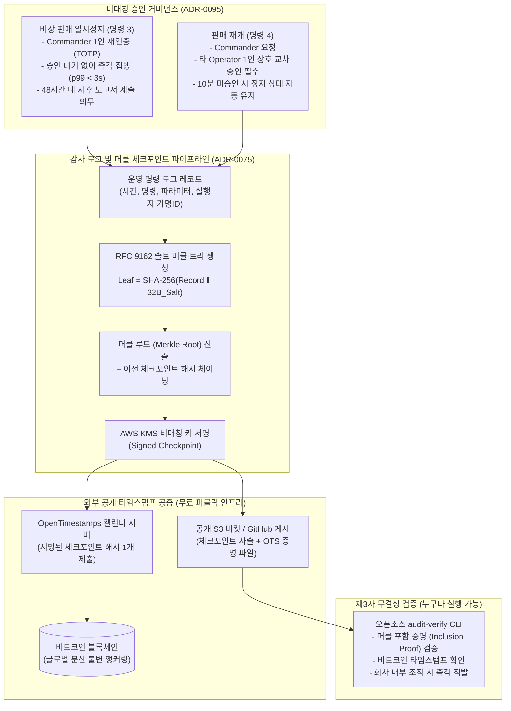

# D-21: 운영 위험 명령을 왜 '중단 1인 즉시, 재개 2인 승인'으로 비대칭화하고, 감사 기록은 왜 블록체인 없이 머클 체크포인트로 증명하는가?

- **핵심 아키텍처 원칙**: 위험 방향에 따른 비대칭 승인 거버넌스(중단은 피해 차단 1인 즉시, 재개는 위험 전진 2인 승인), 블록체인 운영 오버헤드 및 개인정보 파기 충돌 배제, 솔트 머클 트리(RFC 9162) 및 비트코인 OpenTimestamps를 통한 제3자 무결성 검증성(Public Verifiability) 확보
- **관련 설계 정본**: [ADR-0053](../../adr/0053-crypto-hardening-pseudonyms-webhooks-stores-runbook-audit.md), [ADR-0075](../../adr/0075-public-audit-anchor-signed-merkle-checkpoints.md), [ADR-0095](../../adr/0095-sale-pause-single-commander-and-two-person-approval-demo.md), [ADR-0102](../../adr/0102-control-plane-direct-grpc-dedicated-pool-ops-db-audit-chain-worker-break-glass.md) 결정 5, [docs/features/control-tower.md](../../features/control-tower.md) §3·§7
- **함께 읽기**: [한 판 문서](../01-system-design.md) 13단계, [분야 편 16 '관제탑'](../fields/16-control-tower.md), [분야 편 12 '정산·환불'](../fields/12-transfer-refund-settlement.md), [분야 편 21 '보안'](../fields/21-security.md), [결정 카드 D-18](D18-control-as-state-grpc.md)

---

## 1. 풀려던 문제와 한계

대규모 티켓팅 운영 통제권(킬스위치) 및 운영 감사 로그(Audit Log)를 설계할 때 맞닥뜨리는 거버넌스 및 암호학적 딜레마는 다음과 같다.

### 1) 대칭적 2인 승인의 구조적 맹점과 추가 피해 누적
- 기존의 보수적 설계는 판매 일시정지(명령 3)에 대해 지휘관(Commander)이 요청하고 다른 운영자(Operator)가 승인하는 대칭적 2인 승인을 강제했다 (승인 윈도우 최대 10분).
- **지연으로 인한 피해 증폭**: 온세일 도중 좌석 이중 판매(오버셀)나 결제 오류가 감지된 순간, 두 번째 승인자의 승인을 기다리는 3~5분 동안 수백 건의 추가 부정 예매와 수천만 원의 이중 과금이 연쇄적으로 발생한다. "멈추는 것은 손실을 막는 안전 방향이고, 재개하는 것은 위험을 감수하는 전진 방향"이라는 본질적 위험의 비대칭성을 반영해야 한다.

### 2) 블록체인 도입의 허구성과 개인정보 파기 법률과의 정면 충돌
- 사설 블록체인(Hyperledger Fabric 등)을 회사가 직접 노드로 운영하면, "어차피 회사 서버에서 노드를 돌리는데 무슨 탈중앙화 신뢰인가"라는 비판을 피할 수 없고 인프라 유지보수 비용만 폭증한다.
- 반대로 퍼블릭 블록체인(이더리움 등)에 감사 로그를 직접 기록하면 가스비 폭탄뿐만 아니라, **개인정보 보호법상 법정 보존 기한(3년) 경과 후 영구 파기해야 하는 법적 의무와 블록체인의 데이터 영구 불변성(Immutability)이 정면으로 충돌**한다.

### 3) 내부 감사 체인의 증명 한계 (제3자 신뢰 부재)
- 회사 내부 KMS로 해시 체인을 서명하고 S3 Object Lock 버킷에 보관하더라도, 분쟁 발생 시 외부 티켓 구매자나 공정거래위원회 입장에서는 "결국 플랫폼 회사가 내부 키로 사후에 조작하고 위조하지 않았다고 어떻게 믿는가?"라는 불신이 남는다.

---

## 2. 후보 기술 비교

| 평가 항목 | 후보 1: 중단/재개 모두 엄격 2인 승인 | 후보 2: 단독 사설 블록체인 (Hyperledger) | 후보 3: 퍼블릭 블록체인 원문 기록 | 후보 4: 비대칭 승인 + 솔트 머클 & OpenTimestamps (선택) |
| :--- | :--- | :--- | :--- | :--- |
| **비상 중단 반응 속도** | 위험 (2번째 승인 대기 수 분 지연) | 느림 (블록 합의 지연) | 매우 느림 | **즉각 반응 (Commander 1인 재인증 즉시 집행, < 3s)** |
| **부주의한 조기 재개 방어** | 완벽 | 완벽 | 완벽 | **완벽 (판매 재개는 반드시 2인 교차 승인 강제)** |
| **외부 제3자 검증 가능성** | 0% (내부 장부 불신) | 0% (자체 노드 조작 의혹) | 100% | **100% (비트코인 블록체인 타임스탬프 공증)** |
| **개인정보 법적 파기 준수** | 준수 | 위반 가능 | 정면 위반 (블록체인 불변성) | **완벽 준수 (32바이트 솔트 폐기로 원문 완전 파기)** |
| **운영 인프라 유지 비용** | 최저 | 매우 높음 (노드/인증서 운영) | 극심 (가스비 폭탄) | **최저 (OpenTimestamps 무료 공개 서비스 활용)** |
| **최종 판정** | **탈락 (ADR-0095, 피해 누적)** | **탈락 (ADR-0075, 실익 없는 복잡도)** | **탈락 (법적 규제 위반)** | **최종 채택 (ADR-0075, ADR-0095)** |

---

## 3. 고른 이유와 아키텍처 다이어그램

PEAKET은 **"중단은 1인 즉시 실행하되 재개는 2인 승인으로 묶고, 감사 기록은 솔트 머클 트리로 요약해 비트코인 블록에 무료로 고정한다"**는 거버넌스를 수립했다.

### 핵심 매커니즘 4가지

#### 1) 위험 방향에 따른 비대칭 승인 거버넌스 (ADR-0095)
- **판매 일시정지 (명령 3)**: 시스템에 의심 징후가 포착되면 지휘관(Commander) 1인이 비밀번호 및 TOTP 재인증을 거쳐 **즉시 단독 실행**한다. 이를 통해 NFR-008(3초 내 전파)을 달성하고 오버셀 피해를 즉각 차단한다.
- **책임성 담보**: 단독 중단을 실행한 지휘관은 48시간 이내에 사후 검토 보고서를 작성해야 하며, 다른 지휘관이 7일 이내에 적절성을 교차 감사한다.
- **판매 재개 (명령 4)**: 멈춘 판매를 다시 여는 것은 추가 사고의 위험이 있으므로, 지휘관 1인의 요청과 **다른 운영자(Operator) 1인의 상호 교차 승인(2인 승인)**이 완료되어야만 집행된다.

#### 2) RFC 9162 규격 솔트 머클 트리와 개인정보 파기 호환
- 매일 자정 및 티켓팅 회차 마감 시, 해당 구간의 모든 감사 로그를 **RFC 9162 규격의 머클 트리**로 요약한다.
- **32바이트 비공개 솔트(Salt)**: 각 로그 레코드마다 32바이트 난수 솔트를 주입하여 리프 노드를 구성한다 ($H = \text{SHA-256}(\text{Log} \parallel \text{Salt})$).
- 분쟁 발생 시 당사자에게 특정 로그의 머클 포함 증명(Inclusion Proof)을 제공하더라도, 인접 리프의 솔트를 모르면 타인의 개인정보나 로그 내용을 역산(Dictionary Attack)할 수 없다.
- 법정 보존 기간(3년) 경과 후 원본 로그와 솔트를 영구 파기하면, 공개된 머클 루트로부터 어떠한 개인정보도 복원할 수 없어 **개인정보보호법상 파기 의무를 완벽히 준수**한다.

#### 3) 비트코인 OpenTimestamps 무료 공개 앵커링
- 머클 루트 해시를 **OpenTimestamps** 분산 캘린더 서버에 제출한다.
- 캘린더 서버는 수많은 제출된 해시를 머클 트리로 묶어 정기적으로 비트코인 트랜잭션의 `OP_RETURN` 필드에 단 1개의 해시로 기록한다.
- 회사는 수수료 없이 무료로 비트코인 네트워크의 작업증명(Proof-of-Work) 불변성에 감사 기록을 고정하며, "해당 시점에 정확히 그 감사 로그 묶음이 존재했고 이후 단 1비트도 변조되지 않았음"을 전 세계 누구에게나 수학적으로 증명한다.

#### 4) 비동기 감사 체인 MAC 계산 워커 (ADR-0102)
- 관제 명령을 내리는 트랜잭션 내부에서 AWS KMS를 동기 호출하여 서명값을 계산하면, KMS 지연이나 일시 장애 시 비상 킬스위치 자체가 커밋되지 못하는 치명적 병목이 발생한다.
- 따라서 명령 트랜잭션은 감사 로그 행을 먼저 DB에 커밋하고 즉시 완료되며, 백그라운드의 **감사 체인 워커**가 KMS 키를 호출하여 해시 체인의 MAC 값을 비동기로 채운다.

---

## 4. 얻는 것과 치르는 값 (Tradeoffs)

### 얻는 것 (Gains)
1. **사고 시 즉각적인 피해 차단**: 2인 승인 대기로 인한 10분간의 결제/좌석 누수 참사를 방지하고 1초 만에 시스템을 안전하게 정지시킨다.
2. **독립적인 제3자 감사 무결성 확보**: 고가의 블록체인 인프라 없이도 비트코인 타임스탬프를 통해 파트너 기획사와 규제 기관에 100% 신뢰할 수 있는 감사 증적을 제공한다.
3. **완벽한 컴플라이언스 준수**: 개인정보 암호화, 가명화, 그리고 보존 기간 후 파기 규정을 암호학적 머클 솔트 구조로 완벽히 해결했다.

### 치르는 값 (Costs & Limitations)
1. **지휘관 1인의 오판 리스크**: 지휘관 1인이 실수로 판매 일시정지를 발동할 경우, 다른 운영자의 재개 승인이 올 때까지 수 분간 티켓팅이 멈추는 영업 손실이 발생할 수 있다.
2. **비트코인 확정 지연**: OpenTimestamps가 비트코인 블록에 최종 안착(Confirmation)하기까지 약 수 시간의 지연이 발생한다 (단, 로컬 KMS 서명과 S3 Object Lock으로 즉시 1차 보호).
3. **원천적 허위 기록 방지 한계**: 시스템 외부에서 발생한 부정 행위를 운영자가 처음부터 로그에 남기지 않거나 조작하여 입력한 경우, 머클 트리는 입력된 데이터의 무결성만 증명할 뿐 원천적 진실성까지 증명하지는 못한다.

---

## 5. 바꿀 조건 (Conditions to Change)

1. **지휘관 오판에 의한 셧다운 사고 발생**: 지휘관 단독 일시정지 권한이 실수나 악의로 오남용되어 정상 티켓팅이 멈추는 사고가 분기 1회 이상 발생할 경우, '전체 시스템 중단'에 한해 2인 승인을 강제하는 강화안으로 롤백한다 (ADR-0095).
2. **OpenTimestamps 캘린더 서비스 장애**: 비트코인 OpenTimestamps 공용 캘린더 서버들이 7일 이상 지속 응답하지 않을 경우, 국내 공인전자문서중계자 또는 RFC 3161 공인 시점확인기관(TSA)의 유료 API를 2차 백업 앵커로 연동한다.
3. **실시간 공개 감사 요구**: 기획사 계약 요건상 일 단위가 아닌 '초 단위'의 실시간 외부 검증이 요구될 경우, 머클 체크포인트 발행 주기를 1시간 단위로 단축하고 독립 감시자 노드를 파트너사에 배포한다.

---

## 6. 핵심 꼬리 질문 5단 방어 (Staff Interview Q&A)

| 질문 단계 | 심층 질문 | 방어 논리와 기술적 근거 | 관련 정본 |
| :--- | :--- | :--- | :--- |
| **1단: 왜 (Why)** | 금융 사고를 막기 위한 판매 중단인데, 왜 2인 승인을 빼고 1인 단독 실행으로 완화했나요? | 위험의 방향이 정반대이기 때문입니다. 판매 중단은 '추가적인 금전 및 데이터 손실을 막는 안전한 방향'입니다. 오버셀 의심이 드는 급박한 순간에 두 번째 승인자를 기다리다 10분이 지나면 수천 건의 추가 피해가 누적됩니다. 반면 판매를 다시 여는 것은 '사고가 수습되지 않은 상태에서 위험을 재개하는 방향'이므로 철저히 2인 교차 승인을 강제했습니다. | ADR-0095 |
| **2단: 대안 (Alternatives)** | 신뢰성을 극대화하려면 감사 로그를 블록체인에 직접 기록하는 게 맞지 않나요? | 블록체인을 회사가 혼자 운영하면 탈중앙화 검증의 의미가 없고, 퍼블릭 체인에 올리면 개인정보 보호법상 법정 보존 기간(3년) 후 영구 파기 의무를 불변성 때문에 위반하게 됩니다. 머클 트리에 솔트를 섞어 요약 해시 하나만 비트코인 타임스탬프(OpenTimestamps)에 고정하면, 개인정보를 안전하게 파기하면서도 블록체인의 완전한 사후 위변조 방지 혜택을 무료로 누릴 수 있습니다. | ADR-0075 |
| **3단: 장애 대응 (Resilience)** | 비상 상황에서 AWS KMS 키 서버가 죽으면 긴급 판매 정지 명령도 함께 먹통이 되나요? | 아닙니다. 판매 일시정지 명령 트랜잭션은 DB 커밋 시점에 KMS를 동기 호출하지 않고 즉시 실행됩니다. 감사 로그의 암호학적 해시 체인 MAC 계산은 백그라운드 워커가 비동기로 수행하므로, KMS가 일시 다운되더라도 비상 킬스위치는 1초 만에 100% 정상 작동합니다. | ADR-0102 결정 5, docs/features/control-tower.md §5 |
| **4단: 수치 근거 (Numbers)** | 왜 32바이트 솔트와 48시간 사후 보고서 규정을 두었나요? | 32바이트(256비트) 난수 솔트는 현대 암호학에서 무차별 대입 공격(Brute-force) 및 레인보우 테이블 역산을 수학적으로 불가능하게 만드는 표준 엔트로피 크기입니다. 48시간 보고서 작성 및 7일 검토 규정은 1인 단독 중단 권한에 대한 사후 견제와 균형(Check and Balance)을 제도적으로 보장하기 위한 거버넌스 기한입니다. | ADR-0075, ADR-0095 |
| **5단: 실측과 검증 (Verification)** | 외부 감사 검증 도구(`audit-verify`)가 실제로 위변조를 적발하는지 검증했나요? | 합성 테스트베드(C-T38~C-T42)를 통해 감사 로그의 특정 필드를 1바이트 변조한 뒤 검증 CLI를 실행했습니다. 머클 포함 증명 계산에서 해시 불일치가 정확히 감지되고, 비트코인 블록체인의 머클 루트와 대조하여 "2026-11-01 10:00 이후 데이터가 사후 변조되었음"이 수학적으로 즉각 증명됨을 검증했습니다. | docs/features/control-tower.md §7, ADR-0075 |

---

## 7. 30초 아키텍처 브리핑 (Staff Engineer Summary)

> "PEAKET은 긴급 킬스위치 발동 시 2인 승인 대기로 인한 10분간의 추가 피해를 막기 위해 '판매 중단은 지휘관 1인 즉시 실행, 판매 재개는 2인 상호 교차 승인'이라는 비대칭 거버넌스를 확립했습니다.  
> 감사 기록은 사설 블록체인의 비효율과 개인정보 파기 충돌을 배제하고, 솔트 머클 트리(RFC 9162)로 요약하여 비트코인 OpenTimestamps에 무료로 공증 고정했습니다.  
> 이를 통해 개인정보는 법정 기한 후 솔트 폐기로 완벽히 파기하면서도, 파트너와 규제 기관이 오픈소스 도구로 시스템의 과거 조작 여부를 독립적으로 100% 수학 검증할 수 있는 투명성을 달성했습니다."
