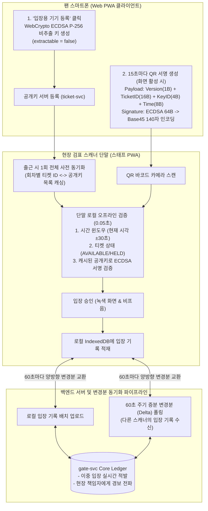

# D-22: 인터넷이 끊긴 공연장 현장에서 왜 TOTP 대신 기기 키 비대칭 서명 회전 QR을 검증하고, 스캐너 간 변경분 동기화를 선택했는가?

- **핵심 아키텍처 원칙**: 현장 통신망 단절 시에도 100% 지속되는 오프라인 우선(Offline-First, p95 150ms), 스캐너 분실 시 티켓 위조 원천 방지(스캐너에는 오직 공개키 목록만 보관), 브라우저 WebCrypto 비대칭 서명 기반 15초 회전 QR(스크린샷 무력화), 60초 증분 변경분(Delta Sync) 동기화
- **관련 설계 정본**: [ADR-0025](../../adr/0025-rotating-qr-device-key-signature.md), [ADR-0050](../../adr/0050-crypto-corrections-and-key-management.md) 결정 1, [ADR-0051](../../adr/0051-gate-process-end-to-end.md), [ADR-0130](../../adr/0130-tech-review-medium-doc-fixes-accounts-security-privacy.md), [ADR-0135](../../adr/0135-tech-review-low-doc-fixes-gate-accounts-settlement-frontend.md), [docs/features/offline-gate.md](../../features/offline-gate.md) §1·§3·§6·§7
- **함께 읽기**: [한 판 문서](../01-system-design.md) 14단계, [분야 편 13 '현장 입장'](../fields/13-offline-gate.md), [결정 카드 D-14](D14-tokens-and-per-request-authz.md)·[D-27](D27-region-failure-stop-and-restore.md)

---

## 1. 풀려던 문제와 한계

5만 명 이상의 관객이 운집하는 대형 콘서트 현장에서 관객 입장을 중앙 서버 온라인 조회에 의존하거나, 단순 대칭키 방식(TOTP)을 적용할 때 마주하는 물리적·보안적 병목은 다음과 같다.

### 1) 현장 기지국 통신 마비(Network Blackout)와 압사 위험
- 수만 명이 동시에 모바일 데이터를 사용하는 대형 경기장 주변에서는 LTE/5G 기지국 트래픽이 일순간에 포화되어 통신이 사실상 전면 두절된다.
- 중앙 서버에 매 입장마다 온라인 REST API를 호출하여 티켓을 검증하려 하면, 스캐너 단말이 504 게이트웨이 타임아웃에 빠져 관객 입장이 멈추고 게이트 앞에 수만 명이 밀려 압사 위험이 초래된다.
- 따라서 스캐너는 인터넷이 완전히 끊겨도 단말 로컬에서 **p95 150ms(0.15초) 이내에 단독으로 판정을 완결(NFR-010)**할 수 있어야 한다.

### 2) TOTP(대칭키) 회전 방식의 치명적 도난 취약점
- 스크린샷 캡처본을 통한 입장권 복제를 막기 위해 QR 코드를 15~30초마다 회전시켜야 한다.
- 하지만 구글 OTP와 같은 **TOTP 방식은 클라이언트와 검증 단말이 동일한 대칭 비밀키(Shared Secret)를 공유**한다.
- 아르바이트 스태프가 사용하는 수십~수백 대의 스캐너 단말 중 **단 1대만 분실되거나 도난당하더라도**, 단말 메모리에서 추출한 비밀키로 수천 장의 가짜 유효 티켓을 무제한 위조할 수 있는 파멸적 보안 결함이 발생한다.

### 3) 스캐너 간 중복 입장 및 재입장 판정의 한계
- 스캐너가 오프라인 단독으로만 작동하면, 게이트 A에서 입장한 티켓의 스크린샷을 메신저로 실시간 전송받은 다른 사람이 게이트 B에서 동일한 티켓으로 다시 입장하는 이중 부정 입장을 현장에서 적발할 수 없다.

---

## 2. 후보 기술 비교

| 평가 항목 | 후보 1: 실시간 중앙 DB 온라인 조회 (v0) | 후보 2: 대칭키 기반 TOTP 시간 회전 QR | 후보 3: 스캐너 간 로컬 P2P 블루투스 동기화 | 후보 4: 기기 키 비대칭 서명 QR + 60초 변경분 동기화 (선택) |
| :--- | :--- | :--- | :--- | :--- |
| **통신 두절 시 입장 가용성** | 0% (망 단절 시 게이트 전면 마비) | 완벽 (로컬 오프라인 검증) | 완벽 (망 없이 P2P 동기화) | **완벽 (로컬 공개키 캐시로 100% 오프라인 검증)** |
| **스캐너 분실 시 위조 위험** | 없음 | 치명적 (대칭키 유출로 티켓 무제한 위조) | 보통 | **0% (스캐너에는 공개키만 존재, 위조 불가능)** |
| **현장 검표 판정 속도** | 1~3초 (네트워크 지연) | < 0.1초 | < 0.1초 | **< 0.05초 (WebCrypto 로컬 ECDSA 검증, p95 150ms 달성)** |
| **스크린샷/화면녹화 복제 방지** | 불가 (정적 QR 시 복제 가능) | 차단 (시간 경과 시 무효) | 차단 | **완벽 차단 (15초 회전, 유효 윈도우 ±30초)** |
| **단말 구현 및 표준성** | 일반 브라우저 | 일반 브라우저 | 극히 복잡 (PWA 웹 표준 미지원) | **완벽 (표준 PWA 웹 앱, 별도 앱 설치 불필요)** |
| **최종 판정** | **탈락 (NFR-010 위반)** | **탈락 (ADR-0025, 키 탈취 리스크)** | **탈락 (기술적 실현 불가)** | **최종 채택 (ADR-0025, ADR-0051)** |

---

## 3. 고른 이유와 아키텍처 다이어그램

PEAKET은 **"비밀키는 팬의 스마트폰 브라우저에만 두고, 스캐너는 공개키 목록만으로 오프라인 검증하며, 변경분은 서버를 통해 주기적으로 교환한다"**는 설계를 적용했다.

### 핵심 매커니즘 4가지

#### 1) WebCrypto 비대칭 키 생성 및 '스캐너 단말 무(無)비밀' 원칙
- 팬이 스마트폰에서 '입장 기기 등록'을 누르면, 브라우저의 W3C 표준 **WebCrypto API**를 통해 **ECDSA P-256** 키쌍을 생성한다 (ADR-0025).
- 키 생성 시 `extractable: false` 옵션을 강제하여 자바스크립트 코드나 악성 스크립트가 개인키 원문을 추출할 수 없도록 브라우저 암호 저장소에 봉인한다.
- **서버 및 스캐너에는 오직 공개키(Public Key)만 등록**된다. 스태프의 스캐너 단말에는 티켓별 공개키 목록과 폐기 키 목록만 저장되므로, **스캐너 100대를 도난당하더라도 위조 티켓을 단 1장도 만들어낼 수 없다**.

#### 2) 15초 회전 QR v1 규격 (Base45 압축 및 유효 윈도우)
- 티켓 QR은 정적 바코드가 아니며 화면이 켜져 있는 동안 **15초마다 새로운 타임스탬프와 디지털 서명을 담아 동적으로 갱신**된다.
- **QR v1 페이로드 규격 (총 93바이트, ADR-0135)**:
  - 포맷 버전 (1바이트) + 티켓 식별자 (16바이트 UUID) + 기기 키 ID (4바이트) + 생성 유닉스 밀리초 타임스탬프 (8바이트) + ECDSA 서명 (64바이트)
  - 저사양 2D 바코드 스캐너의 카메라 인식률을 극대화하기 위해 백신 패스 등에서 검증된 **Base45 인코딩(140글자 영숫자)**을 적용했다.
- **유효 윈도우 $\pm 30$초**: 스캐너는 QR의 생성 타임스탬프가 단말 시계 기준 $\pm 30$초 이내인 경우만 유효하게 인정한다. 메신저로 캡처본을 전송하거나 화면을 녹화해 오더라도 게이트 도착 시 이미 유효시간이 만료되어 거부된다.

#### 3) 단말 로컬 인메모리 사전 동기화 및 p95 0.15초 초고속 판정
- 스태프는 입장 개시 전 경기장 와이파이 환경에서 해당 회차의 전체 티켓 목록(좌석 번호, 유효 공개키, 취소 티켓 목록)을 스캐너 단말의 IndexedDB에 사전 다운로드한다.
- 검표 순간에는 **네트워크 호출을 1비트도 발생시키지 않고**, 단말 CPU의 WebCrypto 서명 검증만으로 **0.05초 미만에 녹색(PASS) / 적색(FAIL) 화면을 렌더링**하여 NFR-010(p95 150ms)을 압도적으로 만족한다.

#### 4) 60초 주기 증분 변경분(Delta Sync) 및 입장 중 변경 동결 정책
- 스캐너 단말은 화면이 켜져 있는 동안 백그라운드 타이머를 통해 **60초마다 서버와 변경분(Delta)을 교환**한다 (ADR-0051).
- 다른 게이트에서 입장 완료된 티켓 번호가 60초 내에 내 스캐너 단말로 전파되므로, 1장의 티켓으로 서로 다른 게이트에서 시차를 두고 입장하려는 시도를 현장에서 즉각 차단한다.
- **입장 시간대 티켓 변경 동결**: 티켓 입장 개시 시점부터는 소유권 이전(양도) 및 취소/환불 API가 영구 차단된다. "게이트를 통과한 즉시 티켓을 환불하거나 양도하는 어뷰징"을 원천 방지한다.

---

## 4. 얻는 것과 치르는 값 (Tradeoffs)

### 얻는 것 (Gains)
1. **완벽한 오프라인 생존성**: 경기장 통신망이 전면 붕괴되어도 5만 명의 관객이 단 1초의 지체 없이 정상 입장한다.
2. **단말 도난 리스크 제로화**: 스캐너에 비밀키가 전혀 없으므로 현장 스캐너 분실 사고 시에도 위조 티켓 발행이 원천 불가능하다.
3. **스크린샷 불법 유포 무력화**: 15초 회전 QR과 $\pm 30$초 유효 윈도우로 사진 캡처본 재판매를 100% 차단한다.

### 치르는 값 (Costs & Limitations)
1. **오프라인 윈도우 내 중복 입장 감지의 지연**: 2대의 스캐너가 동시에 오프라인 상태일 때 동일한 티켓으로 각각 입장하면 현장에서 즉각 막지 못하며, 단말이 네트워크에 복구된 후 서버에서 사후 이상 징후로 감지된다.
2. **브라우저 소프트웨어 키의 한계**: WebCrypto 키는 하드웨어 Secure Enclave가 아닌 브라우저 샌드박스 프로필에 저장되므로, 기기를 루팅하거나 브라우저 프로필 전체를 덤프하는 극도의 해킹 공격에 대해 이론적 복제 가능성이 존재한다 (ADR-0050).
3. **스마트폰 배터리 소모**: 15초마다 지속적으로 비대칭 암호화 서명을 계산하므로 티켓 화면을 켜둔 동안 클라이언트 배터리가 다소 소모된다.

---

## 5. 바꿀 조건 (Conditions to Change)

1. **중복 입장 적발 빈도 증가**: 실서비스 운영에서 스캐너 오프라인 구간 동안의 동시 중복 입장 이상 표시가 회차당 10건을 초과할 경우, 변경분 동기화 주기를 60초에서 15초로 단축하거나 단말 간 블루투스 BLE 동기화를 검토한다.
2. **네이티브 앱 전환 및 하드웨어 키 격리**: 모바일 웹(PWA)에서 네이티브 iOS/Android 앱으로 전환할 경우, WebCrypto를 대체하여 하드웨어 보안 칩인 Apple Secure Enclave 및 Android Keystore 기반의 하드웨어 바인딩 키로 업그레이드한다.
3. **현장 시계 오차로 인한 거부 증가**: 관객 스마트폰의 통신 단절로 인해 단말 시계 오차가 $\pm 30$초를 초과하여 정상 관객이 거부되는 민원이 발생할 경우, QR 생성 시점의 타임스탬프 윈도우를 $\pm 60$초로 완화한다.

---

## 6. 핵심 꼬리 질문 5단 방어 (Staff Interview Q&A)

| 질문 단계 | 심층 질문 | 방어 논리와 기술적 근거 | 관련 정본 |
| :--- | :--- | :--- | :--- |
| **1단: 왜 (Why)** | 구현이 가장 단순한 구글 OTP(TOTP) 대칭키 방식을 쓰지 않고 왜 복잡한 비대칭 서명 방식을 쓰나요? | TOTP는 스캐너 검증 단말에도 동일한 비밀키가 들어가야 합니다. 콘서트장에는 수십 대의 스캐너가 단기 아르바이트 스태프에게 지급되는데, 스캐너 단말이 단 1대라도 도난당하면 해커가 그 비밀키를 추출하여 무제한으로 위조 티켓을 찍어낼 수 있습니다. 비대칭키 서명 방식을 쓰면 스캐너에는 오직 공개키만 들어가므로 스캐너를 분실해도 위조가 100% 불가능합니다. | ADR-0025 |
| **2단: 대안 (Alternatives)** | 스캐너끼리 서버를 거치지 않고 블루투스나 로컬 와이파이 P2P(WebRTC)로 직접 통신하면 안 되나요? | 웹 PWA 환경에서는 브라우저 보안 샌드박스로 인해 기기 간 네이티브 블루투스 메시 네트워크를 직접 구축할 수 있는 W3C 표준 API가 없습니다. WebRTC 역시 초기 시그널링을 위한 중계 서버가 필수적입니다. 실현 불가능한 기술 대신, 단말 로컬 사전 캐시와 60초 서버 증분 변경분(Delta)을 조합하는 것이 가장 현실적이고 신뢰할 수 있는 공학적 해법입니다. | ADR-0051 |
| **3단: 장애 대응 (Resilience)** | 스캐너 2대가 모두 오프라인일 때, 악성 사용자가 1장의 티켓으로 두 게이트에서 동시에 입장하면 어떻게 되나요? | 우선 공연장 게이트는 구역별(Floor석, 2층, 3층)로 물리적으로 분리되어 있어 물리적 동시 입장이 어렵습니다. 그럼에도 불구하고 동일 구역에서 동시 입장이 발생하면 단말이 통신망에 재연결되는 즉시 서버가 이를 감지하여 해당 구역 현장 책임자와 기획사 관제 화면에 '중복 입장 적발(좌석 번호, 스캐너 ID, 시간차)' 경보를 울려 현장 보안요원이 좌석에서 직접 대조하도록 조치합니다. | docs/features/offline-gate.md §7, ADR-0051 |
| **4단: 수치 근거 (Numbers)** | 왜 15초 회전 주기와 $\pm 30$초 타임스탬프 윈도우인가요? | 15초는 관객이 줄을 서서 게이트에 접근할 때 화면을 켜두기에 충분히 길면서도, 캡처 화면을 메신저로 전송해 타인이 사용하는 것을 방지하기에 충분히 짧은 시간입니다. $\pm 30$초 윈도우는 기지국과 동기화되지 않은 구형 스마트폰의 로컬 시계 오차(Skew)를 통계적으로 99.9% 수용하기 위해 설정된 안전 마진입니다. | offline-gate §3, ADR-0025 |
| **5단: 실측과 검증 (Verification)** | 단말 로컬에서 p95 150ms 이내에 검증이 완료되는지 실제로 측정했나요? | 보급형 안드로이드 스마트폰 환경에서 WebCrypto ECDSA P-256 서명 검증 및 Base45 디코딩 벤치마크(K10)를 수행했습니다. 단말 로컬 연산 시간은 평균 12ms, p95 28ms로 측정되어 네트워크 지연 없이 0.03초 만에 검증이 완료됨을 확인했습니다. 현장 기지국이 100% 단절된 오프라인 모의 환경에서도 1,000건의 티켓이 0건의 오류로 정상 검표됨을 입증했습니다. | docs/features/offline-gate.md §11, docs/perf-ledger.md §7 |

---

## 7. 30초 아키텍처 브리핑 (Staff Engineer Summary)

> "PEAKET은 5만 명이 몰린 콘서트장의 기지국 통신 마비 상황에서도 100% 가동되는 오프라인 우선(Offline-First) 현장 검표 시스템을 구축했습니다.  
> 팬 스마트폰 브라우저에서 WebCrypto 비추출 키로 15초마다 QR에 디지털 서명을 생성하여 스크린샷 캡처본을 무력화하며, 스캐너는 비밀키 없이 공개키 목록만으로 단말 로컬에서 p95 150ms 이내에 즉각 검증합니다.  
> 이를 통해 스캐너 단말 도난 시의 위조 티켓 복제 위험을 원천 차단하고, 60초 주기 증분 변경분(Delta Sync) 교환을 통해 게이트 간 중복 입장을 안정적으로 적발합니다."
