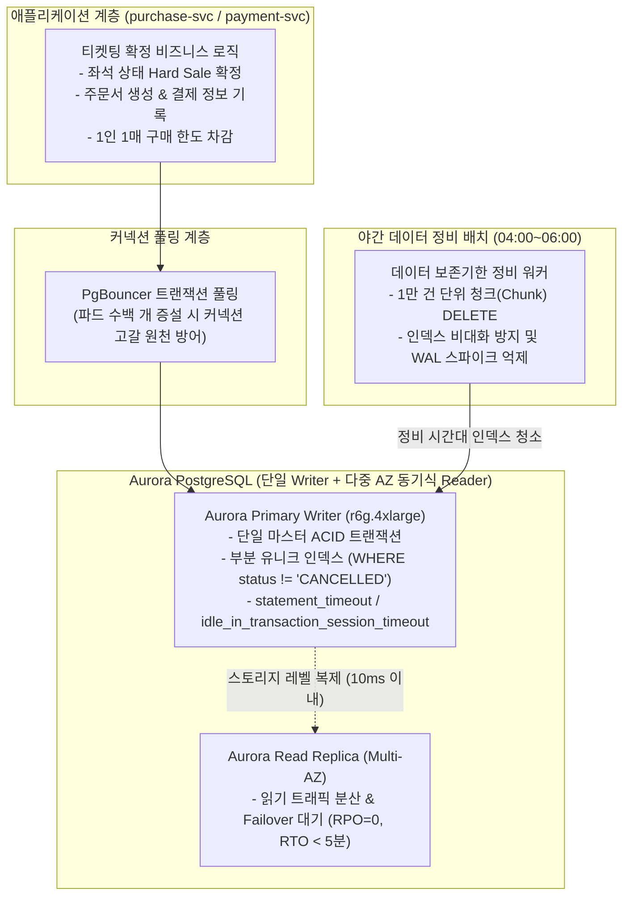

# D-23: 원장 DB를 왜 수평 샤딩하지 않고 Aurora PostgreSQL 단일 인스턴스/셀 기반으로 유지하며, 테이블 파티셔닝을 배제했는가?

- **핵심 아키텍처 원칙**: 100만 대기자와 코어 원장 쓰기(평균 28 TPS, 피크 300 TPS)의 완전한 디커플링, 분산 트랜잭션(2PC) 배제 및 완벽한 ACID 정합성, PostgreSQL 특화 기능(부분 유니크 인덱스, 트랜잭션 DDL), 5년 1,700만 건 규모의 테이블 파티셔닝 부채 배제 및 야간 청크 배치 정비
- **관련 설계 정본**: [ADR-0028](../../adr/0028-postgres-no-sharding-cell-scaling.md), [ADR-0083](../../adr/0083-keep-postgresql-partition-keys-transaction-scoped-settings-global-replica.md), [ADR-0086](../../adr/0086-query-index-rules-plan-diagnostics-data-pattern-gaps.md), [ADR-0114](../../adr/0114-no-monthly-partitions-for-order-payment-ticket-batched-retention-delete.md), [ADR-0021](../../adr/0021-reject-cockroachdb.md), [docs/architecture.md](../../architecture.md) §6.1·§9.1, [docs/data.md](../../data.md) §1·§5.1
- **함께 읽기**: [한 판 문서](../01-system-design.md) 15단계, [DB 설계 편 2 '저장소 선택'](../db/02-choose-stores.md)·[5 '일관성과 트랜잭션 경계'](../db/05-consistency-transactions.md)·[9 '규모 확장'](../db/09-scaling.md), [결정 카드 D-06](D06-seat-soft-hold-hard-sale.md)·[D-25](D25-drop-mongodb.md)·[D-27](D27-region-failure-stop-and-restore.md)

---

## 1. 풀려던 문제와 한계

"100만 명이 몰리는 대규모 시스템"이라는 문구에 현혹되어 데이터베이스 샤딩(Sharding)이나 분산 NoSQL/NewSQL을 섣불리 도입할 때 마주하는 치명적인 엔지니어링 한계는 다음과 같다.

### 1) 100만 트래픽의 착시와 실제 원장 쓰기 부하의 괴리
- 100만 명은 대기열 로비와 CDN 정적 파일 폴링에 몰리는 **읽기(Read) 트래픽**의 숫자다.
- 시스템 입구의 admission-ctrl 루프가 예매창 동시 체류 인원을 **5,000명**으로 엄격히 제한하고([D-05](D05-admission-control-loop.md)), PG사의 결제 승인 한도가 **300 TPS**로 고정되어 있다 ([D-09](D09-dual-pg-and-failover.md)).
- 따라서 실제 코어 데이터베이스 원장(`purchase_order`, `payment`, `ticket`)에 가해지는 쓰기 트래픽은 **평균 초당 28 TPS**, 피크 시에도 **초당 300 TPS**에 불과하다. 300 TPS는 최신 단일 Aurora PostgreSQL 인스턴스(`db.r6g.4xlarge`)로 CPU 사용률 20% 미만에서 여유 있게 처리 가능한 경미한 부하 수준이다.

### 2) 수평 샤딩(Sharding)의 파멸적 대가 (분산 트랜잭션 오버헤드)
- 데이터베이스를 여러 서버로 수평 샤딩하면, 티켓팅의 핵심인 **"주문 생성 + 좌석 SOLD 확정 + 1인 1매 한도 차감"**을 원자적으로 묶기 위해 2단계 커밋(2PC)이나 복잡한 분산 Saga가 강제된다.
- 네트워크 RTT와 코디네이터 지연으로 인해 p99 트랜잭션 지연이 수백 밀리초로 치솟고, 대형 인기 콘서트가 열릴 때 특정 샤드로 트래픽이 100% 쏠려 단일 샤드가 포화되는 **핫스팟(Hotspot) 문제**를 피할 수 없다.

### 3) 5년 누적 1,700만 건 규모의 테이블 파티셔닝 오버엔지니어링
- 5년간 누적 예상 주문은 약 **1,700만 건**, 티켓은 약 **3,500만 장**이다.
- B-Tree 인덱스 관점에서 1,700만 행은 트리 깊이가 **단 3~4레벨**에 불과하여 인덱스 스캔 성능이 메모리 캐시 내에서 1ms 미만으로 유지된다.
- 월별 테이블 파티셔닝(Table Partitioning)을 적용하면, 파티션을 건너뛰는 외래키 제약과 전역 유니크 제약이 깨지고, `pg_partman` 유지보수 및 자식 테이블 마이그레이션이라는 막대한 운영 부채만 떠안게 된다.

---

## 2. 후보 기술 비교

| 평가 항목 | 후보 1: 공연 ID 기반 수평 샤딩 | 후보 2: CockroachDB (분산 NewSQL) | 후보 3: Aurora MySQL | 후보 4: 주문/티켓 월별 파티셔닝 | 후보 5: Aurora PostgreSQL 단일 인스턴스 + 셀 확장 (선택) |
| :--- | :--- | :--- | :--- | :--- | :--- |
| **ACID 트랜잭션 단순성** | 파괴 (2PC/Saga 오버헤드 극심) | 우수 (Raft 기반 분산 합의) | 우수 | 우수 | **완벽 (단일 인스턴스 네이티브 ACID, 지연 < 2ms)** |
| **쓰기 지연 시간 (p99)** | 50~200ms (분산 코디네이터) | 20~80ms (Raft 네트워크 RTT) | < 5ms | < 5ms | **< 3ms (최고 성능)** |
| **인덱스 및 무결성 제약** | 샤드 간 유니크 제약 불가 | 지원 | 부분 인덱스 미지원 | 파티션 간 외래키 제약 복잡 | **완벽 (부분 유니크 인덱스로 오버셀 원천 차단)** |
| **운영 및 라이선스 위험** | 극히 높음 (샤드 리밸런싱 지옥) | 높음 (2024년 무료 Core 폐지) | 낮음 | 높음 (pg_partman 관리) | **최저 (검증된 AWS 완전관리형 Aurora)** |
| **보존 기한 만료 데이터 정리** | 수동 스크립트 | 수동 | 수동 | DROP TABLE (가장 빠름) | **야간 1만 건 청크 배치 DELETE로 해결** |
| **최종 판정** | **탈락 (ADR-0028, 핫스팟 불가피)** | **탈락 (ADR-0021, 과도한 RTT/비용)** | **탈락 (ADR-0083, 제약조건 미비)** | **탈락 (ADR-0114, 실익 없는 복잡도)** | **최종 채택 (ADR-0028, ADR-0083, ADR-0114)** |

---

## 3. 고른 이유와 아키텍처 다이어그램

PEAKET은 **"수평 샤딩과 파티셔닝의 환상을 걷어내고, 단일 Aurora PostgreSQL의 강력한 ACID 제약조건과 셀(Cell) 아키텍처로 확장한다"**는 설계를 채택했다.

### 핵심 매커니즘 4가지

#### 1) 쓰기 트래픽의 물리적 수용성과 셀(Cell) 단위 스케일아웃
- 티켓팅 피크 시 원장 쓰기는 초당 **300 TPS** 수준으로, 최신 Aurora PostgreSQL 인스턴스의 IOPS 한계(수만 IOPS) 대비 5% 미만이다.
- 향후 초대형 메가 이벤트가 여러 개 동시에 열려 단일 쓰기 인스턴스의 한계를 초과할 경우, 데이터베이스 내부를 샤딩하는 대신 **공연 단위로 Redis, DB, 서비스를 통째로 한 세트 더 증설하는 셀(Cell) 아키텍처**로 확장한다 (ADR-0028). 이를 통해 분산 트랜잭션 없이 단일 DB의 무결성을 영구 보존한다.

#### 2) PostgreSQL 필수 선정 4대 핵심 기능 (ADR-0083)
MySQL 대신 PostgreSQL을 선정한 기술적 이유는 마케팅이 아닌 설계가 직접 사용하는 기능 때문이다:
1. **부분 유니크 인덱스 (Partial Unique Index)**: 취소표를 제외한 유효 티켓에만 유일성을 거는 `CREATE UNIQUE INDEX ... WHERE status != 'CANCELLED'`를 네이티브 지원하여 오버셀을 DB 레벨에서 100% 원천 차단한다. (MySQL은 가상 컬럼 트릭 필요).
2. **트랜잭션 DDL (Transactional DDL)**: 마이그레이션 실행 도중 오류가 발생하면 테이블 스키마 변경 사항 전체가 원자적으로 롤백되어 DB가 불완전한 상태에 빠지지 않는다.
3. **서버사이드 엄격한 타임아웃 통제**: `statement_timeout`과 `idle_in_transaction_session_timeout`을 DB 역할 기본값으로 강제하여 슬로우 쿼리가 커넥션을 물고 늘어지는 것을 차단한다.
4. **외래키 제약과 참조 무결성 보장**.

#### 3) 테이블 파티셔닝 배제 및 1만 건 청크 야간 배치 정비 (ADR-0114)
- 5년간 누적되는 1,700만 건 주문과 3,500만 장 티켓은 단일 일반 테이블로 유지한다.
- 5년 보존 기간이 지난 데이터는 매일 새벽 정비 시간(04:00~06:00)에 백그라운드 워커가 `ORDER BY id LIMIT 10000`으로 자식 테이블부터 **1만 건 청크 단위로 나누어 DELETE**한다.
- 이를 통해 파티셔닝의 복잡한 메타데이터 관리와 제약조건 파괴를 완전히 배제하면서도, 대량 DELETE 시 발생하는 WAL 급증 및 복제 지연을 완벽히 방지한다.

#### 4) 쿼리-인덱스 정본 규칙과 5년 합성 데이터 실행 계획 회귀 검증 (ADR-0086)
- 모든 쿼리는 `docs/data.md`의 정본 쿼리-인덱스 매핑 규칙을 철저히 준수한다.
- 신규 API나 쿼리 추가 시 PR에 5년치 합성 대용량 데이터(1,700만 행)가 적재된 테스트 DB에서의 **`EXPLAIN (ANALYZE, BUFFERS)` 실행 계획**을 필수 첨부해야 하며, 대형 테이블의 순차 스캔(Sequential Scan)이 발견되면 CI(K3)가 빌드를 즉시 차단한다.

---

## 4. 얻는 것과 치르는 값 (Tradeoffs)

### 얻는 것 (Gains)
1. **완벽한 ACID 정합성 보장**: 2PC나 분산 사가 없이 단일 RDBMS 트랜잭션으로 좌석 선점, 주문, 결제를 묶어 금융 무결성을 100% 수호한다.
2. **아키텍처 및 쿼리 단순성**: 복잡한 샤딩 키 라우팅이나 파티션 관리 확장 프로그램 없이 표준 SQL과 ORM으로 개발 생산성을 극대화한다.
3. **오버셀 0건의 물리적 보장**: PostgreSQL 부분 유니크 인덱스를 통해 애플리케이션 버그가 발생하더라도 동일 좌석의 중복 판매를 DB 스토리지 엔진 레벨에서 차단한다.

### 치르는 값 (Costs & Limitations)
1. **단일 쓰기 노드 스케일업 비용**: 트래픽 증가 시 수평 확장이 아닌 r6g.4xlarge, r6g.8xlarge 등 대형 인스턴스로의 수직 스케일업(Scale-up) 비용이 발생한다.
2. **PostgreSQL VACUUM 관리 필요**: UPDATE/DELETE가 빈번한 원장 테이블의 죽은 튜플(Dead Tuple) 정리를 위해 자동 VACUUM 튜닝과 PgBouncer 커넥션 풀 관리가 필수적이다.
3. **장기 운영 시 인덱스 비대화**: 5년 누적 인덱스 크기가 수십 GB로 증가하므로 인덱스 캐시를 위한 충분한 인스턴스 RAM 용량 확보가 요구된다.

---

## 5. 바꿀 조건 (Conditions to Change)

1. **단일 인스턴스 쓰기 IOPS 한계 도달**: 온세일 피크 시 쓰기 인스턴스의 CPU 사용률이 60%를 지속 초과하거나 쓰기 IOPS가 프로비저닝 상한의 70%에 도달할 경우, 셀(Cell) 아키텍처를 가동하여 신규 대형 공연을 독립된 2차 Aurora 클러스터로 분리 라우팅한다.
2. **야간 청크 DELETE 시간 초과**: 보존 기한 만료 데이터 정리 배치가 2시간의 정비 윈도우를 초과하여 오전 서비스 운영에 I/O 간섭을 일으킬 경우, 주문/결제 테이블에 한해 연 단위 테이블 파티셔닝 도입을 재검토한다 (ADR-0114 결정 6).
3. **인덱스 메모리 잠식**: 테이블 하나의 인덱스 합계가 Aurora 가용 메모리의 25%를 초과하여 버퍼 캐시 히트율이 99% 아래로 떨어질 경우 인덱스 구조를 재설계한다.

---

## 6. 핵심 꼬리 질문 5단 방어 (Staff Interview Q&A)

| 질문 단계 | 심층 질문 | 방어 논리와 기술적 근거 | 관련 정본 |
| :--- | :--- | :--- | :--- |
| **1단: 왜 (Why)** | 100만 명이 몰리는 대규모 시스템인데 원장 DB를 왜 수평 샤딩하지 않고 단일 인스턴스로 받나요? | 100만 명은 대기열과 CDN 폴링에 머무는 읽기 트래픽의 수치일 뿐입니다. 입구의 5,000명 입장 정원 통제와 PG사 300 TPS 승인 한도로 인해, 원장 DB에 유입되는 쓰기는 평균 28 TPS, 피크 300 TPS에 불과합니다. 이 정도 부하는 최신 Aurora 단일 인스턴스로 CPU 20% 미만에서 거뜬히 소화합니다. 샤딩을 하면 2단계 커밋(2PC)으로 인해 p99 지연이 치솟고 핫스팟이 발생하므로 단일 DB로 완벽한 ACID를 지키는 것이 압도적으로 우수합니다. | ADR-0028, docs/architecture.md §9.1 |
| **2단: 대안 (Alternatives)** | 가장 널리 쓰이는 MySQL(Aurora MySQL) 대신 왜 PostgreSQL을 선택했나요? | 오버셀을 막는 핵심 방어선인 '부분 유니크 인덱스(`WHERE status != 'CANCELLED'`)'를 PostgreSQL이 네이티브로 지원하기 때문입니다. 또한 트랜잭션 내부 DDL 롤백과 서버사이드 쿼리 타임아웃 강제 기능이 엔터프라이즈 티켓팅의 무결성 보장에 필수적입니다. 성능과 서울 리전 비용은 두 엔진이 거의 대등하므로, 설계가 요구하는 무결성 기능을 기준으로 PostgreSQL을 확정했습니다. | ADR-0083 |
| **3단: 장애 대응 (Resilience)** | 단일 Writer 인스턴스가 하드웨어 장애로 죽으면 결제가 완전히 중단되나요? | Aurora PostgreSQL은 3개 AZ에 걸쳐 6중 스토리지 복제본을 유지합니다. Writer 인스턴스 장애 시 Multi-AZ에 상시 대기 중인 Read Replica가 30초~1분 이내에 새로운 Writer로 자동 승격(Failover)되어 서비스가 복구됩니다 (RPO=0, RTO < 5분 보장, NFR-015). | ADR-0028, NFR-015 |
| **4단: 수치 근거 (Numbers)** | 5년 1,700만 건 규모에서 파티셔닝이 필요 없다는 근거는 무엇인가요? | B-Tree 인덱스 블록(8KB)의 팬아웃(Fan-out)을 고려할 때, 1,700만 건의 기본키 인덱스는 트리 높이가 3~4단계에 불과합니다. 루트와 중간 노드가 RAM 버퍼 캐시에 상주하므로 PK 조회 시 물리 디스크 I/O가 단 1회 발생하거나 0회에 수렴합니다. 파티셔닝으로 줄일 수 있는 B-Tree 탐색 깊이는 기껏해야 1단계(수 마이크로초)에 불과한 반면, 파티셔닝이 초래하는 외래키 제약 파괴와 운영 부채가 훨씬 크기 때문입니다. | ADR-0114 |
| **5단: 실측과 검증 (Verification)** | 5년치 대용량 데이터 환경에서의 쿼리 성능을 실제로 검증했나요? | 합성 데이터 생성기를 통해 PostgreSQL 인스턴스에 5년치에 해당하는 1,700만 건의 주문 및 3,500만 건의 티켓 데이터를 실제로 적재했습니다. 핵심 17개 운영 쿼리에 대해 `EXPLAIN (ANALYZE, BUFFERS)`를 실행한 결과, 모든 핫패스 쿼리가 적절한 인덱스를 타며 실행 시간 2ms 이내에 완료되고 순차 스캔이 0건임을 회귀 검증(K3)했습니다. | docs/data.md §5.1, docs/verification.md §9 |

---

## 7. 30초 아키텍처 브리핑 (Staff Engineer Summary)

> "PEAKET은 100만 대기열과 코어 원장 쓰기(피크 300 TPS)의 디커플링을 기반으로, 데이터베이스 수평 샤딩을 전면 배제하고 단일 Aurora PostgreSQL과 셀(Cell) 아키텍처를 확립했습니다.  
> 크로스 샤드 분산 트랜잭션 없이 단일 인스턴스에서 네이티브 ACID 트랜잭션을 보장하며, 부분 유니크 인덱스를 통해 오버셀을 DB 레벨에서 100% 원천 차단합니다.  
> 또한 5년 1,700만 건 규모의 테이블 파티셔닝 오버엔지니어링을 걷어내고 1만 건 청크 야간 배치 정비를 적용함으로써, 복잡한 인프라 부채 없이 최고 수준의 데이터 무결성과 개발 단순성을 달성했습니다."
