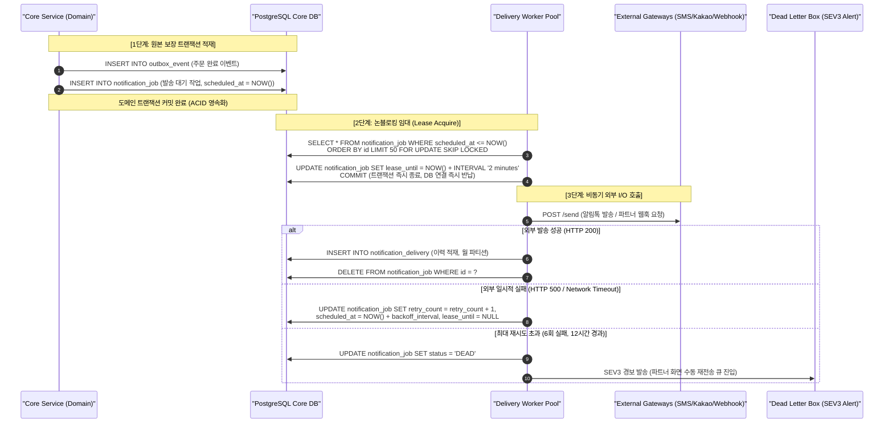

# D-24: 알림·웹훅 발송 작업을 왜 Redis 위의 작업 큐(BullMQ)가 아니라 DB 원장에 두나? 세션·캐시 Redis는 왜 메모리가 차도 키를 지우지 않게(`noeviction`) 두나?

> **핵심 원칙**: 다시 만들 원본이 없는 비동기 발송 작업(알림·웹훅)은 Redis BullMQ가 아닌 PostgreSQL DB 원장(`FOR UPDATE SKIP LOCKED`)에 보관한다. 세션·캐시를 포함한 모든 Redis 클러스터는 키가 조용히 증발하여 레이트 리밋이나 인증이 우회되는 사일런트 장애를 막기 위해 `noeviction` 정책을 강제한다.

---

## 1. 풀려던 문제와 한계

Redis는 티켓패스 인프라에서 **대기열(Queue), 좌석(Seat), 세션·캐시(Session/Cache)** 3개 독립 클러스터로 격리 운영된다([D-11](D11-service-boundaries.md)). 이 중 세션·캐시 클러스터는 통상 '데이터 유실 허용, 백업 없음, 장애 시 원본 DB에서 재생성'하는 티어로 간주되어 왔다. 그러나 실제 운영 요구사항을 분석한 결과 치명적인 모순과 한계가 존재했다.

```
[초기 세션·캐시 클러스터 혼재 구조의 위험]
+-----------------------------------------------------------------------------------+
| ElastiCache Redis (Session & Cache Cluster)                                       |
|                                                                                   |
|  [휘발성 캐시]             [준영속 세션/카운터]              [원본 없는 비동기 작업]      |
|  - 상품 상세 읽기 캐시      - 로그인 세션 / 기기 승인 코드     - 알림 발송 큐 (BullMQ)    |
|  - 좌석 등급 요약 캐시      - 전역 레이트 리밋 카운터         - 파트너 웹훅 재시도 큐   |
|                             - 굿즈 재고 카운터                - 실패 보관함 (DLQ)        |
+-----------------------------------------------------------------------------------+
                                         │ 메모리 고갈 (OOM) 발생!
                                         ▼ 기본 eviction 정책 (volatile-lru)
[참사 시나리오]
1. 레이트 리밋 TTL 키 증발 ───▶ 초당 수만 건 악의적 트래픽 통과 (DDoS 방어 붕괴)
2. 기기 승인 토큰 증발 ───────▶ 현장 게이트 검표원 전원 세션 만료 및 재인증 지연
3. BullMQ 작업·잠금 키 증발 ───▶ 결제 완료 알림 유실 및 동일 웹훅 중복 발송 폭주
```

### 1) 물리적 한계와 비즈니스 결함
1. **재생성할 원본이 없는 비동기 작업의 유실 위험**:
   - 알림(SMS/알림톡) 및 파트너 웹훅(B2B 발권 연동)은 외부 PG사나 제휴사 시스템의 응답 지연 시 수 시간 동안 지연 재시도(Exponential Backoff)를 수행해야 한다.
   - Redis는 비동기 복제(Asynchronous Replication) 구조이므로, 마스터 장애 조치(Failover) 시 미복제된 수백~수천 ms 분량의 BullMQ 큐 및 지연 작업이 영구 유실된다.
   - 웹훅 발송 이력이 DB에 남지 않으면, 파트너 포털 화면(SCR-025 ③: 발송 성공·실패 이력, 수동 재발송)을 지원할 수 없다.
2. **사일런트 축출(Silent Eviction)로 인한 보안 및 정합성 붕괴**:
   - AWS ElastiCache 기본값인 `volatile-lru`(만료 시간이 지정된 키 중 LRU 삭제) 환경에서 트래픽 급증으로 메모리가 차면, TTL이 부여된 레이트 리밋 카운터와 게이트웨이 인증 세션이 무차별 삭제된다.
   - 결과적으로 시스템에 과부하가 걸린 바로 그 순간, 레이트 리밋 제한이 풀려 백엔드 코어 DB로 트래픽이 직격하는 파멸적 역효과가 발생한다.
3. **BullMQ의 공식 제약 조건**:
   - BullMQ 공식 문서는 아토믹 작업 잠금 및 지연 큐 무결성을 위해 `noeviction` 정책만을 공식 지원하며, eviction 활성화 시 중복 실행이나 잠금 교착을 보장하지 않는다.

---

## 2. 후보 기술 비교

비동기 발송 작업 큐 및 Redis 메모리 축출 정책 선정을 위해 5가지 아키텍처 대안을 비교 평가했다.

| 평가 기준 | 가. Core DB 원장 + SKIP LOCKED 워커 (선택) | 나. BullMQ 전용 `noeviction` Redis | 다. 세션·캐시 Redis에 BullMQ 유지 | 라. Kafka 지연 재시도 토픽 | 마. AWS SQS + DLQ |
| :--- | :--- | :--- | :--- | :--- | :--- |
| **작업 영속성 & 무결성** | **완전 보장** (ACID 원장 트랜잭션 보관) | 비동기 복제 유실 위험 (Failover 시 유실) | 메모리 고갈 및 Failover 시 작업 증발 | 보장 (Kafka 파티션 영속화) | 보장 (AWS 관리형 복제) |
| **운영 인프라 컴포넌트** | **추가 컴포넌트 0개** (기존 Aurora PG) | 독립 Redis 클러스터 1개 추가 증설 | 기존 유지 (단, 메모리 경합 심화) | 추가 없음 (단, 지연 토픽 복잡성 폭증) | AWS SQS + IAM + VPC 엔드포인트 증설 |
| **관리/조회 화면 지원** | **완벽 지원** (SQL로 발송 이력·수동 재발송 즉시 쿼리) | 불가 (BullMQ 내부 바이너리 큐 파싱 필요) | 불가 (Redis 키 만료 시 이력 소멸) | 불가 (토픽 오프셋 조회만 가능) | 별도 DynamoDB/DB에 이력 이중 적재 필수 |
| **임의 지연(Delay) 스케줄링** | `scheduled_at <= NOW()` 인덱스로 수 초~수 일 자유 지연 | Redis ZSET 기반 1ms 정밀 지연 | Redis ZSET 기반 정밀 지연 | 미지원 (지연 시간별 토픽 1m, 5m, 1h 별도 구축) | 최대 15분 지연 한계 (장기 지연 시 재인큐 필요) |
| **시스템 복잡도 & 장애 격리** | 낮음 (배치 워커 100ms 폴링 릴레이) | 보통 (Redis 관리 부담 1개소 추가) | 높음 (캐시 메모리 부족이 큐 정지 유발) | 극도로 높음 (재시도 파이프라인 관리 지옥) | 보통 (AWS 인프라 종속) |
| **최종 판정** | **채택 (ADR-0109)** | 탈락 | 탈락 | 탈락 | 탈락 |

### 메모리 정책 비교
- **`volatile-lru` / `allkeys-lru` (탈락)**: 메모리 임계 초과 시 레이트 리밋과 인증 키가 사일런트 삭제되어 보안 침해 및 연쇄 과부하 유발.
- **`noeviction` (채택)**: 메모리 초과 시 쓰기 명령이 명시적 에러(`OOM command not allowed`)를 반환하여 즉각적인 모니터링 경보(SEV2)를 유발하고, 핵심 보안 카운터와 잠금을 완벽히 보존.

---

## 3. 고른 이유와 상세 아키텍처 다이어그램



### 핵심 매커니즘 4가지

#### 1) 원본 보장 DB 작업 원장 & Outbox 릴레이
- 원본 비즈니스 이벤트는 도메인 DB 트랜잭션 내에서 `outbox_event`와 함께 `notification_job` 또는 `webhook_delivery` 테이블에 원자적으로 적재된다.
- **알림 작업(`notification_job`)**: 발송 전까지의 작업 큐 역할을 하며, 발송 완료 시 즉시 삭제되고 장기 보관 이력은 `notification_delivery`(월 파티션, 90일 보관)로 이동한다.
- **웹훅 배송(`webhook_delivery`)**: 엔드포인트 × 이벤트당 1개 행이 생성되어, 작업 큐 상태와 발송 이력 및 재시도 상태를 단일 테이블에서 일원화 관리한다(파트너 포털 SCR-025 지원).

#### 2) `FOR UPDATE SKIP LOCKED` 기반 논블로킹 단기 임대 (Short Lease)
외부 I/O 호출(네트워크 지연 최대 10초) 동안 DB 트랜잭션을 유지하면 Aurora 커넥션 풀이 고갈되고 장기 트랜잭션으로 인한 Vacuum 차단이 발생한다.
```sql
-- 워커의 원자적 50건 임대 쿼리 (실행 시간 < 2ms)
WITH candidate AS (
    SELECT id FROM notification_job
    WHERE scheduled_at <= NOW()
      AND (lease_until IS NULL OR lease_until < NOW())
    ORDER BY priority DESC, id ASC
    LIMIT 50
    FOR UPDATE SKIP LOCKED
)
UPDATE notification_job
SET lease_until = NOW() + INTERVAL '2 minutes',
    updated_at = NOW()
WHERE id IN (SELECT id FROM candidate)
RETURNING *;
```
- 행 잠금은 2ms 만에 해제되며, 워커는 독립 프로세스에서 외부 API를 호출한다.
- 워커 노드가 강제 종료(OOM/Spot 중단)되더라도 2분(`lease_until`) 경과 후 다른 워커가 자동으로 미완료 작업을 인수하여 최소 1회(At-least-once) 발송을 완벽 보장한다.

#### 3) Redis 세션·캐시 키의 3단계 유실 등급 체계 및 `noeviction`
Redis 세션·캐시 클러스터의 모든 키는 유실 시 비즈니스 충격도에 따라 3등급으로 분류된다.

```
[Redis 세션·캐시 키 3단계 유실 등급]
┌─────────────────┬──────────────────────────────────┬─────────────────────────────┐
│ 등급            │ 대상 키                          │ 유실 시 보호 계층           │
├─────────────────┼──────────────────────────────────┼─────────────────────────────┤
│ Class A (캐시)  │ 상품 상세, 좌석 배치도 메타      │ PostgreSQL 원본 즉시 재생성 │
│ Class B (인증)  │ 사용자 세션, 스태프 기기 승인코드│ 재로그인 503 유도 및 재인증 │
│ Class C (규칙)  │ 전역 레이트 리밋, 굿즈 잔여 수량 │ Envoy 로컬 한도 + DB 조건부 │
└─────────────────┴──────────────────────────────────┴─────────────────────────────┘
```
- 모든 키에는 비즈니스 목적에 부합하는 명시적 TTL이 강제된다.
- 클러스터 전체에 `maxmemory-policy noeviction`을 적용하여, 메모리 임계 초과 시 조용한 보안 우회 대신 명시적 에러를 분출한다.

#### 4) 지수 백오프 및 실패 보관함 (Dead-Letter Queue)
- 파트너 웹훅 재시도 간격: `1분 ➔ 5분 ➔ 30분 ➔ 2시간 ➔ 6시간 ➔ 12시간` (지수 백오프 적용).
- 6회 연속 실패 시 상태를 `DEAD`로 전환하고 SEV3 경보를 발행한다.
- 관리자 콘솔 및 파트너 포털에서 수동 원클릭 재발송 API를 호출하면 `scheduled_at = NOW(), status = 'PENDING'`으로 복구되어 즉시 재처리된다.

---

## 4. 얻는 것과 치르는 값

### 얻는 것 (Gains)
1. **발송 작업 100% 무결성 보장**: Redis 클러스터 장애 조치, 재부팅, 캐시 플러시가 발생해도 발송 대기 중인 고객 알림과 파트너 웹훅이 1건도 유실되지 않는다.
2. **파트너 포털 발송 원장 일치**: 별도의 데이터 동기화 파이프라인 없이도 파트너가 직접 웹훅 발송 실패 내역을 조회하고 재전송 버튼을 누를 수 있다.
3. **사일런트 보안 장애 원천 차단**: Redis 메모리 폭증 시 레이트 리밋이 풀리는 치명적 결함이 제거되며, OOM 시 즉각 경보를 통해 인프라를 증설할 수 있다.
4. **아키텍처 단순화**: BullMQ 의존성 및 Redis 큐 워커 모듈이 제거되어 서비스 컴포넌트 복잡도가 감소한다.

### 치르는 값 (Costs & Limitations)
1. **PostgreSQL 쓰기 I/O 증가**: 대량 발송 시 Core DB에 폴링 및 상태 업데이트 쿼리가 발생한다 (단, 피크 시 주문 건당 1회 발생하므로 초당 100~300 TPS 수준으로 Aurora 8xlarge 기준 CPU 점유율 2% 미만).
2. **임대 시간 만료 지연**: 워커 비정상 종료 시 `lease_until`(2분)이 만료될 때까지 해당 작업의 재시도가 지연된다.
3. **중복 발송 방지 책임 외부화**: 네트워크 단절 시 외부 수신처는 성공했으나 워커가 실패로 인지할 경우 재시도로 인한 중복 호출이 발생할 수 있으므로, 웹훅 헤더에 고유한 `X-Webhook-Id`를 전송하여 수신 측의 멱등 처리를 요구한다.

---

## 5. 바꿀 조건

1. **대량 마케팅 푸시 도입으로 초당 발송량이 5,000건 이상으로 폭증할 때**:
   - 현재 아키텍처는 티켓 예매 완료 알림 및 1:1 파트너 웹훅(초당 수백 건)에 최적화되어 있다.
   - 10만 명 대상의 프로모션 마케팅 푸시 발송 시에는 Core DB 부하 방지를 위해 AWS SQS 또는 전용 Kafka 벌크 토픽 파이프라인으로 분리 이관한다.
2. **Redis 캐시 메모리가 전체의 70%를 상회할 때**:
   - Class A(캐시) 데이터의 급증으로 인해 세션 및 카운터(Class B/C) 메모리가 위협받는 경우, 캐시 전용 Redis 클러스터를 물리 분리하고 캐시 클러스터에만 `allkeys-lru`를 제한적으로 적용한다.
3. **Core DB 쓰기 병목이 발생할 때**:
   - Aurora PostgreSQL 쓰기 레이턴시가 10ms를 초과할 경우, `notification_job` 및 `webhook_delivery` 테이블을 별도의 독립 작업 DB 인스턴스로 분리 격리한다.

---

## 6. 핵심 꼬리 질문 5단 방어

| 구분 | 심층 질문 | 핵심 방어 논리 | 관련 근거 |
| :--- | :--- | :--- | :--- |
| **1단: 왜 (Why)** | BullMQ를 사용하면 지연 큐와 재시도를 완벽하게 지원하는데 왜 굳이 DB 테이블로 회귀했는가? | Redis는 비동기 복제 스토리지이므로 Failover 발생 시 미복제된 지연 작업이 유실됩니다. 또한 발송 이력과 재시도 상태를 파트너 포털에 노출하려면 결국 DB에 원장을 적재해야 하므로, Redis와 DB 간의 이중 관리 및 불일치 문제를 제거하기 위해 단일 DB 원장 패턴을 채택했습니다. | [ADR-0109](../../adr/0109-delivery-jobs-in-postgres-drop-bullmq-cache-redis-key-classes-noeviction.md) |
| **2단: 대안 (Alternatives)** | AWS SQS나 Kafka 지연 큐를 도입하는 것이 DB I/O를 줄이는 더 현대적인 방법 아닌가? | SQS는 최대 지연 시간이 15분으로 제한되어 2시간, 12시간 지연 재시도를 구현하려면 복잡한 재인큐 로직이 필요하며 파트너 발송 이력 조회가 불가능합니다. Kafka는 지연 전용 토픽을 시간대별로 증설해야 하는 운영 오버헤드가 발생합니다. 피크 발송량(초당 수백 건)은 PostgreSQL `SKIP LOCKED`로 충분히 처리 가능합니다. | ADR-0109 §2 |
| **3단: 장애 대응 (Failure Mode)** | `noeviction` 설정 상태에서 악의적 세션 공격으로 Redis 메모리가 100% 차면 전체 서비스가 마비되는 것 아닌가? | 메모리 사용량 70% 도달 시 SEV3, 85% 도달 시 SEV2 경보가 즉시 발령되어 사전에 스케일업을 수행합니다. 만약 100% OOM이 발생하더라도 `noeviction`은 쓰기만 차단하고 읽기는 정상 처리되므로 기존 캐시와 세션 조회는 유지되며, 신규 로그인 시 503과 Retry-After를 응답하여 우아하게 백오프합니다. | docs/infra.md §6 |
| **4단: 수치 근거 (Numbers)** | 워커 임대 시간(Lease)을 2분으로 설정한 정량적 근거는 무엇인가? | 외부 웹훅 및 SMS 게이트웨이 호출의 타임아웃 상한은 10초입니다. 네트워크 지연 및 3회 재시도를 고려한 최악의 실행 시간(Worst-Case Execution Time)은 약 35초이며, 가비지 컬렉션 및 시스템 일시 지연을 감안하여 3배수 이상의 안전 마진을 둔 120초(2분)를 임대 만료 시간으로 산정했습니다. | ADR-0109 결정 2 |
| **5단: 실측과 검증 (Verification)** | 워커 강제 종료 시 작업 유실이 발생하지 않는지 실제로 검증했는가? | V-T24 카오스 엔지니어링 테스트를 통해 발송 중인 워커 노드에 `kill -9`를 전송하여 프로세스를 강제 종료한 후, 2분 뒤 대기 중이던 대체 워커가 `lease_until` 만료를 감지하고 해당 작업을 정상 인수하여 중복 없이 1회 성공 발송함을 검증했습니다. | docs/verification.md §2.6, ADR-0109 |

---

## 7. 30초 아키텍처 브리핑

> "티켓패스는 결제 완료 알림 및 파트너 B2B 웹훅처럼 **'다시 만들 원본이 없는 비동기 발송 작업'**을 Redis BullMQ에서 전면 제거하고 **PostgreSQL 코어 DB 원장**으로 일원화했습니다. 워커는 `FOR UPDATE SKIP LOCKED` 기반의 2분 단기 임대 방식을 사용하여 외부 API 지연 중에도 DB 연결을 즉시 반납하며, 비정상 종료 시에도 작업 유실 없이 자동 복구됩니다. 아울러 세션·캐시 Redis에는 `noeviction` 정책을 강제하여, 메모리 임계 초과 시 레이트 리밋이나 인증 세션이 사일런트하게 풀려 시스템이 붕괴되는 참사를 원천 방어합니다."
