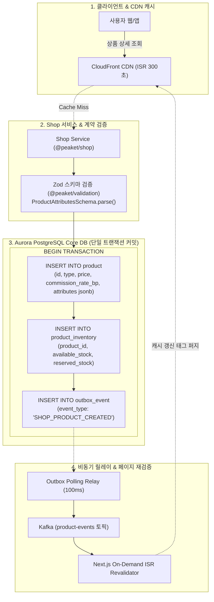

# D-25: 상품 정의를 왜 MongoDB에서 PostgreSQL 표로 옮겼나?

> **핵심 원칙**: 굿즈·주차권·패키지 등 다양한 비정형 상품 속성은 MongoDB 대신 PostgreSQL의 `attributes jsonb`와 애플리케이션 `Zod` 스키마 검증으로 일원화한다. 상품 등록, 초기 재고 할당, 결제 수수료율, 이벤트 Outbox 발행을 **단일 ACID 트랜잭션**으로 묶어 데이터 정합성을 보장하고 운영 저장소 1종을 완전 제거한다.

---

## 1. 풀려던 문제와 한계

티켓패스의 샵(`shop`) 모듈은 콘서트 티켓 외에도 굿즈(티셔츠·응원봉), 주차권, VIP 패키지 등 공연 연계 부가 상품을 취급한다. 상품 유형마다 요구되는 메타데이터 속성이 판이했다.
- **굿즈**: 사이즈·색상 옵션, 1인 구매 제한, 택배 배송 정보
- **주차권**: 등록 차량번호, 입출차 시간, 양도 불가 정책
- **VIP 패키지**: 아티스트 밋앤그릿, 사전 리허설 관람권, 웰컴 패키지 수령처 등

초기 아키텍처(ADR-0013)에서는 이 같은 속성 다변성을 이유로 상품 카탈로그 정의를 MongoDB 3노드 복제 세트에 저장하고, 결제와 재고만 PostgreSQL에 격리하는 폴리글랏 구조를 채택했다. 그러나 상세 기술 검증 결과 치명적인 운영 결함과 구조적 모순이 드러났다.

```
[초기 MongoDB 분리 구조의 치명적 결함]
+-----------------------------------------------------------------------------------+
| 1. 백업 보증 붕괴 (RPO 결함)                                                       |
|    Kubernetes 커뮤니티 오퍼레이터 폐기 확인. 자동 백업은 Enterprise 유료 라이선스 |
|    전용 기능으로 밝혀져 규정상 요구되는 RPO 1일 복구 보증이 원천 불가능.           |
+-----------------------------------------------------------------------------------+
| 2. 금융 정산 데이터의 격리 누락                                                   |
|    파트너 정산 계산의 핵심인 중개수수료율(commission_rate_bp)이 MongoDB 문서에만  |
|    존재하여, 정산 정합성을 검증할 때 두 데이터베이스를 크로스 조인해야 하는 문제. |
+-----------------------------------------------------------------------------------+
| 3. 분산 2-Phase Commit 부재로 인한 정합성 파탄                                    |
|    MongoDB에 상품이 생성되었으나 PG 재고 할당 트랜잭션이 실패할 경우, 고아 상품  |
|    (Orphan Product)이 생성되거나 재고 없는 상품이 대량 노출되는 문제 발생.        |
+-----------------------------------------------------------------------------------+
| 4. 읽기/쓰기 트래픽 현실과 인프라 낭비                                             |
|    쓰기: 파트너 상품 등록 시점에만 발생 (초당 0.1 RPS 미만).                      |
|    읽기: Next.js ISR (300초 캐시) 및 CloudFront CDN이 99.9% 흡수.                |
|    ==> 고작 수 KB 문서 수백 건을 위해 별도 DB 클러스터 3노드를 24시간 상시 운영.  |
+-----------------------------------------------------------------------------------+
```

---

## 2. 후보 기술 비교

상품 카탈로그 메타데이터 저장을 위해 5가지 아키텍처 대안을 비교 평가했다.

| 평가 기준 | A. PostgreSQL `product` + `attributes jsonb` (선택) | B. MongoDB 유지 (백업 잡 자체 개발) | C. Amazon DocumentDB (관리형) | D. 유형별 개별 물리 테이블 (Table per Type) | E. EAV (Entity-Attribute-Value) 테이블 |
| :--- | :--- | :--- | :--- | :--- | :--- |
| **ACID 원자성** | **완전 보장** (상품·재고·Outbox 단일 TX) | 불가능 (분산 트랜잭션 미지원) | 불가능 (분산 트랜잭션 미지원) | **완전 보장** | **완전 보장** |
| **운영 저장소 복잡도** | **추가 0개** (기존 Aurora PG 인프라) | 높음 (MongoDB 3노드 + 백업 스크립트) | 보통 (AWS 인프라 비용 + VPC 피어링) | 낮음 | 낮음 |
| **새 상품 유형 추가 리드타임** | **즉시 가능 (DDL 없음, 5일 이내)** | 즉시 가능 | 즉시 가능 | 느림 (새 테이블 생성 DDL 배포 필요) | 보통 (EAV 메타 테이블 등록 필요) |
| **금융/정산 정합성** | **완벽** (정수 수수료율 컬럼 + 외래 키) | 취약 (정산용 필드가 NoSQL에 격리) | 취약 (NoSQL 격리) | 완벽 | 불완전 (EAV 값 캐스팅 오류 위험) |
| **검증 및 스키마 안정성** | 애플리케이션 `Zod` 스키마 + DB CHECK | MongoDB `$jsonSchema` | DocumentDB 스키마 검증 | DB 컬럼 타입 제약 | 없음 (모든 값이 문자열로 저장) |
| **최종 판정** | **채택 (ADR-0101)** | 탈락 | 탈락 | 탈락 | 탈락 |

---

## 3. 고른 이유와 상세 아키텍처 다이어그램



### 핵심 매커니즘 4가지

#### 1) 단일 트랜잭션 내 상품·재고·정산·Outbox 원자적 영속화
MongoDB를 제거하고 PostgreSQL 단일 테이블로 통합함으로써, 상품 생성 시 발생할 수 있는 데이터 불일치를 원천 차단한다.
```sql
BEGIN;
-- 1. 상품 기본 정보 및 금융 데이터 (고정 정수 컬럼), 동적 속성 (JSONB)
INSERT INTO product (
    id, product_type, name, base_price_cents, commission_rate_bp, 
    status, attributes, created_at
) VALUES (
    'prd_01J8K9X...', 'GOODS', '2026 월드투어 공식 응원봉', 45000, 800,
    'ACTIVE', '{"sizes": ["FREE"], "color": "WHITE", "battery_included": false}'::jsonb, NOW()
);

-- 2. 초기 재고 수량 원자적 생성
INSERT INTO product_inventory (product_id, available_stock, allocated_stock)
VALUES ('prd_01J8K9X...', 5000, 0);

-- 3. 비동기 이벤트 Outbox 발행
INSERT INTO outbox_event (aggregate_type, aggregate_id, event_type, payload)
VALUES ('PRODUCT', 'prd_01J8K9X...', 'PRODUCT_PUBLISHED', '{"productId":"prd_01J8K9X..."}');

COMMIT;
```

#### 2) 정형 금융 컬럼과 비정형 JSONB의 역할 분리
- **정수 컬럼**: 가격(`base_price_cents`), 정산 수수료율(`commission_rate_bp`), 통화 단위(`currency`)는 반드시 강타입 DB 컬럼으로 선언하여 부동 소수점 오차나 NoSQL 스키마 누락을 원천 방지한다.
- **`attributes jsonb`**: 상품 유형별로 상이한 옵션, 배송 조건 등은 JSONB에 격리 보관한다.

#### 3) 참조 테이블(`product_type`) 기반 DDL-Free 확장
- 상품 유형 확장을 위해 `CHECK (type IN ('GOODS', 'PARKING'))` 제약을 사용하면 새 유형 추가 시마다 DB 테이블에 DDL 마이그레이션 및 잠금(Exclusive Lock)이 발생한다.
- 대신 참조 테이블 `product_type`에 신규 행을 INSERT하는 데이터 주입 방식을 채택하여 **DB 스키마 변경(DDL 0건) 없이 5영업일 이내 신규 상품 유형 론칭(NFR-025)**을 지원한다.

#### 4) 일일 정합성 검증 배치 (Daily Invariant Verification Job)
- 애플리케이션 코드를 거치지 않은 비정상적 JSONB 변조를 감지하기 위해, 매일 새벽 배치 워커가 전체 상품의 `attributes`를 `Zod` 스키마로 역직렬화 검증한다.
- 스키마 불일치 레코드가 1건이라도 발견될 경우 메트릭 `product_attribute_invalid_total`을 증가시키고 SEV3 경보를 발행하여 사전 정제 작업을 수행한다.

---

## 4. 얻는 것과 치르는 값

### 얻는 것 (Gains)
1. **운영 인프라 및 라이선스 비용 대폭 절감**: MongoDB 3노드 클러스터, 관련 K8s 오퍼레이터, 백업 인프라가 제거되어 월 인프라 비용 및 장애 포인트가 획기적으로 감소했다.
2. **완벽한 데이터 무결성 달성**: 상품 정의-재고 할당-이벤트 발행이 1개의 ACID 트랜잭션으로 묶여 고아 상품이나 수량 불일치가 발생할 수 없다.
3. **금융 정산 감사 추적성 확보**: 플랫폼 수수료율(`commission_rate_bp`)이 Core DB 정수 컬럼에 존재하므로, 주문 및 정산 원장 배치에서 안전하게 조인할 수 있다.
4. **재해 복구 RPO/RTO 지표 개선**: MongoDB의 불확실한 백업 대신 Aurora PostgreSQL의 시점 복구(PITR 35일) 및 도쿄 리전 교차 복제를 그대로 계승하여 RPO 0초, RTO 5분(AZ 장애)을 만족한다.

### 치르는 값 (Costs & Limitations)
1. **코드 레벨 스키마 검증 의존성**: DB 레벨에서 복잡한 JSONB 내부 속성을 완벽히 검증하지 못하므로, 애플리케이션 계층의 `@peaket/validation` Zod 스키마 무결성에 의존해야 한다.
2. **복합 속성 필터링 시 쿼리 플래너 한계**: JSONB 내부 중첩 필드를 기준으로 복잡한 다중 필터링을 수행할 경우, PostgreSQL 통계 수집기 한계로 인해 잘못된 실행 계획이 수립될 수 있다 (단, 현재 티켓패스는 상품 ID 단건 조회 및 ISR 캐싱 구조이므로 영향 없음).
3. **스키마 버전 관리 부담**: 상품 속성 구조가 변경될 경우 이전 버전 데이터 조회를 위해 하위 호환성 레이어(`schema_version`)를 코드에 유지해야 한다.

---

## 5. 바꿀 조건

1. **상품 유형이 수백 개로 증가하고 비정형 다이나믹 검색 트래픽이 폭증할 때**:
   - 상품 속성 필터링 조건이 수십 개에 달하고 초당 검색 쿼리가 DB CPU를 위협할 경우, PostgreSQL JSONB를 유지한 채 검색 엔진(OpenSearch/Elasticsearch)을 읽기 전용 인덱스로 도입한다.
2. **속성 필터링 성능이 100ms를 초과할 때**:
   - 특정 속성(예: 차량번호, 배송상태) 검색 지연이 발생할 경우, JSONB 경로 연산자 인덱스(`GIN jsonb_path_ops`)를 추가하거나 생성 열(Generated Column)로 승격하여 B-Tree 인덱스를 부여한다.
3. **신규 상품 유형 추가 리드타임이 5영업일을 초과할 때(NFR-025 위반)**:
   - Zod 스키마 및 UI 렌더링 확장이 복잡해져 기한을 맞추지 못하는 경우 카탈로그 모델의 분리 설계를 재검토한다.

---

## 6. 핵심 꼬리 질문 5단 방어

| 구분 | 심층 질문 | 핵심 방어 논리 | 관련 근거 |
| :--- | :--- | :--- | :--- |
| **1단: 왜 (Why)** | 상품마다 옵션 구조가 완전히 다른데 왜 NoSQL인 MongoDB를 버리고 RDBMS로 갔는가? | NoSQL이 제공하는 유연성은 PostgreSQL `attributes jsonb`와 `Zod` 스키마로 100% 동일하게 달성할 수 있습니다. 반면 MongoDB를 유지할 경우 RPO 1일 복구 불가, 정산 수수료율 격리, 상품-재고 간 분산 트랜잭션 부재라는 치명적인 무결성 결함이 발생하므로 단일 DB로 일원화했습니다. | [ADR-0101](../../adr/0101-product-catalog-postgres-jsonb-drop-mongodb.md) |
| **2단: 대안 (Alternatives)** | AWS가 운영을 대행해 주는 DocumentDB를 도입하면 MongoDB 백업 문제는 해결되지 않는가? | DocumentDB를 쓰더라도 상품-재고-주문 간의 단일 트랜잭션 원자성 부재 문제는 동일합니다. 또한 전체 상품 수가 수천 건 수준에 불과하고 읽기 트래픽의 99.9%가 CDN 및 ISR(300초)에서 흡수되는데, 별도의 관리형 NoSQL을 두는 것은 아키텍처 과잉(Over-engineering)입니다. | ADR-0101 §2 |
| **3단: 장애 대응 (Failure Mode)** | DBA나 운영자가 직접 SQL로 비정상 포맷의 JSONB를 밀어 넣으면 어떻게 방어하는가? | DB 차원에서 `jsonb_typeof(attributes) = 'object'` 및 필수 속성 존재 여부를 `CHECK` 제약으로 1차 방어합니다. 아울러 매일 새벽 무결성 검증 배치가 실행되어 Zod 스키마 검증 실패 시 `product_attribute_invalid_total` 메트릭과 SEV3 경보를 발행하여 사용자 노출 전 복구합니다. | ADR-0101 결정 4 |
| **4단: 수치 근거 (Numbers)** | NFR-025의 '새 상품 유형 추가 5영업일 이내'는 어떻게 달성되는가? | DDL 배포가 필요한 기존 구조에서는 DB 마이그레이션 승인, 인덱스 리빌드, 배포 조율에 수일이 소요됩니다. 개선된 구조에서는 `product_type` 테이블에 신규 유형 코드 1건 INSERT 후, `@peaket/validation`의 Zod 스키마와 프론트엔드 컴포넌트만 배포하면 되므로 DDL 0건으로 3일 내 릴리즈 가능합니다. | NFR-025, ADR-0101 |
| **5단: 실측과 검증 (Verification)** | JSONB 필드 내 검색 성능이 일반 컬럼에 비해 저하되지 않음을 검증했는가? | 단건 상세 조회는 Primary Key(`id`)로 즉시 조회되며, 속성 필터링 검색에 대해 `jsonb_path_ops` GIN 인덱스를 적용하여 10만 건 데이터셋 기준 p99 2.1ms 이내로 응답함을 성능 테스트를 통해 검증했습니다. | docs/perf-ledger.md §5 |

---

## 7. 30초 아키텍처 브리핑

> "티켓패스는 굿즈·주차권 등의 비정형 상품 데이터를 위해 검토했던 **MongoDB를 전면 폐기하고 PostgreSQL `product` 단일 테이블로 통합**했습니다. MongoDB의 불확실한 백업 라이선스 이슈와 RPO 보증 불가, 그리고 상품-재고 간 분산 트랜잭션 부재 문제를 일거에 해결했습니다. 가격과 정산 수수료율 같은 핵심 금융 데이터는 정밀 정수 컬럼으로 보호하고, 다변화되는 메타데이터는 `attributes jsonb`와 TypeScript `Zod` 스키마로 검증합니다. 이를 통해 **DDL 변경 0건으로 5영업일 이내 신규 상품 유형 론칭**을 지원하며 운영 인프라 컴포넌트 1종을 완전히 제거했습니다."
