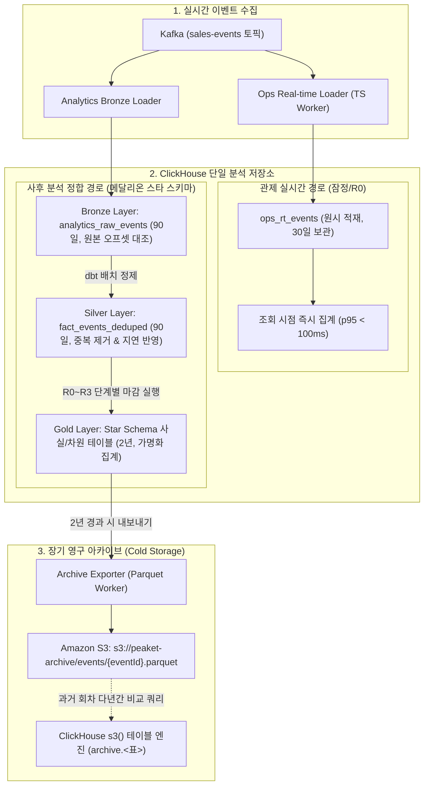

# D-26: 분석은 왜 ClickHouse에 공연별로 모으고 확정 숫자와 잠정 숫자를 나누나? 아카이브는 왜 Iceberg 표가 아니라 회차별 Parquet인가? Cassandra는 왜 뺐나?

> **핵심 원칙**: 비즈니스 의사결정(가격·좌석할당·봇차단)은 실시간 잠정 숫자가 아닌 **단계별 마감(R0~R3)을 거친 확정 원장**으로만 집행한다. 분석 저장은 **ClickHouse 메달리온 스타 스키마(Bronze/Silver/Gold)**로 일원화하고, 2년 이상 냉동된 데이터는 무거운 Apache Iceberg 대신 경량 **회차별 Parquet 파일 및 `s3()` 테이블 엔진**으로 아카이빙한다. 단건 조회가 불필요했던 Cassandra는 운영 경로에서 전면 배제한다.

---

## 1. 풀려던 문제와 한계

티켓 예매 플랫폼에서 발생하는 데이터는 크게 두 종류의 상이한 질문에 답해야 한다.
1. **운영 관제(Operations)**: *"지금 온세일 트래픽이 정상인가? 대기열과 좌석 락에 병목이 터졌는가?"* ➔ **초당 p95 5초 이내 실시간 응답 요구**
2. **사후 분석(Analytics)**: *"다음 회차에 1인당 예매 한도, 봇 탐지 가중치, 사전 서버 증설 규모를 어떻게 조정해야 하는가?"* ➔ **100% 정합성이 보장된 확정 원장 요구**

초기 아키텍처는 관제용 실시간 집계(ClickHouse 머티리얼라이즈드 뷰)와 대기열 하트비트/봇 신호 저장용 Cassandra, 그리고 S3 Iceberg 레이크하우스가 난립하는 구조였다. 그러나 실제 비즈니스 라이프사이클을 분석한 결과 다음과 같은 치명적 모순이 드러났다.

```
[비즈니스 확정 시차와 데이터 오염 문제]
온세일 개시 ──▶ 온세일 종료(30m) ──▶ 결제 모호 상태 해소(1h) ──▶ 봇 이의제기 마감(7d) ──▶ 공연 당일 입장/취소 마감
   │                 │                        │                         │                        │
[R0: 실시간 잠정]   [R0: 온세일 잠정 마감]   [R1: 결제/매출 확정]      [R2: 봇/부정예매 확정]   [R3: 최종 정산 동결]
(중복 메시지 포함) (미확정 결제 건 포함)   (PG사 정산 대조 완료)    (포렌식 소명 반영)      (환불/실입장 집계 완료)
```

### 1) 실시간 데이터로 비즈니스 결정을 내릴 수 없는 물리적 이유
- **결제 상태 불명(Unknown) 처리 시차**: 외부 PG사 타임아웃으로 인한 망취소/수동 승인 확인에 최대 1시간 소요.
- **봇 소명 및 이의 제기 절차**: 차단된 티켓에 대한 유예 기간(소명 접수 7일)이 경과해야 부정 티켓 여부가 최종 확정.
- **취소 및 최종 입장 시차**: 콘서트 시작 직전까지 취소표가 발생하며, 실제 입장은 공연 당일 스캐너 게이트에서 확정.
- 온세일 도중 실시간 집계(잠정) 수치를 기준으로 가격 정책이나 차단 룰을 변경하면, 중복 메시지나 미확정 결제로 인해 정상 팬이 오차단되는 치명적 비즈니스 참사 발생.

### 2) Cassandra 및 Apache Iceberg 도입의 실패 원인
- **Cassandra**: 대기열 하트비트(초당 3.3만 건) 및 봇 원시 신호를 단건 Key-Value 쓰기 성능 때문에 검토했으나, 적응형 폴링(Adaptive Polling) 도입으로 하트비트 자체가 불필요해졌으며 봇 신호는 단건 조회가 아닌 사후 일괄 배치 분석용이었으므로 도입 이유 완전 소멸(ADR-0004).
- **Apache Iceberg**: 회차별 분석 집계는 한 번 쓰면 수정되지 않는 Write-Once 데이터이며 조회 주체도 오직 ClickHouse 1개 엔진뿐임에도, Iceberg 도입 시 AWS Glue Data Catalog 운영, Compaction 관리 작업, ClickHouse 26.8의 Beta 쓰기 엔진 불안정성이라는 막대한 기술 부채 발생.

---

## 2. 후보 기술 비교

사후 분석 및 장기 보관 아키텍처 선정을 위해 5가지 대안을 비교 평가했다.

| 평가 기준 | 가. ClickHouse 메달리온 + 회차별 Parquet (선택) | 나. Prometheus / Mimir 시계열 장기 보관 | 다. S3 원시 JSON + AWS Athena 쿼리 | 라. Flink 단일 스트림 카파 아키텍처 | 마. Cassandra 분산 NoSQL 유지 |
| :--- | :--- | :--- | :--- | :--- | :--- |
| **다차원 퍼널 분석력** | **완벽 지원** (구역·등급·PG사·에이전트별 분석) | 불가 (단순 시계열 메트릭 집계에 불과) | 지원 (단, 쿼리당 수십 초 지연 및 비용 발생) | 보통 (장기 윈도우 상태 크기 폭증) | 불가 (Key-Value 조회만 가능, 다차원 집계 불가) |
| **잠정 vs 확정 분리 정합성** | **완벽 격리** (R0~R3 단계별 마감 원장) | 불가 (지표 덮어쓰기 불가) | 가능 (단, 원천 데이터 중복 제거 복잡) | 불가 (중복 메시지 유입 시 정합성 왜곡) | 불가 (트랜잭션/집계 모델 부재) |
| **운영 인프라 컴포넌트** | **0개 추가** (관제용 ClickHouse + S3) | 추가 0개 | Athena + S3 파티션 관리 | Flink 분산 클러스터 + RocksDB | Cassandra 3노드 이상 클러스터 상시 운영 |
| **아카이브 관리 비용** | **최저** (서버리스 S3 Parquet + 매니페스트) | 고비용 Mimir 블록 보관 | 보통 (Athena 스캔 비용 종량제) | N/A | 극도로 높음 (EBS 디스크 용량 상시 유지) |
| **개인정보 컴플라이언스** | **완벽 준수** (원시 90일 파기, 골드 가명화 영구) | 준수 | 위험 (S3 원시 데이터 잔존 위험) | 준수 | 취약 (TTL 만료 Tombstone 가비지 컬렉션 부담) |
| **최종 판정** | **채택 (ADR-0052, ADR-0115)** | 탈락 | 탈락 | 탈락 | 탈락 (ADR-0004) |

---

## 3. 고른 이유와 상세 아키텍처 다이어그램



### 핵심 매커니즘 4가지

#### 1) 메달리온 스타 스키마 (Medallion 3-Tier Layering)
- **Bronze (원시 층, 90일)**: Kafka 오프셋과 1:1 매핑되어 데이터 누락 여부를 감사할 수 있는 원본 이벤트 보관.
- **Silver (정제 층, 90일)**: 분산 네트워크로 인한 중복 이벤트 제거, 결제 상태 지연 업데이트 반영.
- **Gold (분석 층, 2년)**: 개인 식별 정보(PII)를 전면 제거하고, 15개 팩트 테이블(예: `fact_ticket_sales_daily`)과 차원 테이블(공연·회차·구역·권종)로 모델링된 스타 스키마. **비율(Rate)은 절대 저장하지 않고 분자/분모를 분리 저장**하여 다중 회차 통합 집계 시 수학적 왜곡을 방지한다.

#### 2) 이원화 파이프라인 (Dual-Path Isolation)
- **관제 경로 (`ops_rt`)**: 온세일 중 실시간 트래픽 및 시스템 이상을 감지하기 위해 원시 이벤트를 가공 없이 삽입하고 쿼리 시점에 집계한다([D-28](D28-drop-flink-stream-workers.md)).
- **분석 경로 (`analytics`)**: 관제 테이블과 물리적으로 격리된 메달리온 테이블을 사용하며, 온세일이 종료된 후 차분하게 마감 처리를 수행하여 관제 조회 쿼리와 I/O 경합을 원천 분리한다.

#### 3) 단계별 마감 단계(R0~R3) 및 NFR-026 정산 무오차 검증
```
[단계별 마감 파이프라인]
R0 (온세일 종료 T+30m) ➔ 판매 좌석 수, 1차 티켓 매출 잠정 집계
R1 (결제 마감 T+1h)    ➔ PG사 거래 원장 대조 완료, 결제 모호 건 확정
R2 (봇 판정 T+7d)      ➔ 부정 예매 소명 기간 만료, 최종 몰수 티켓 확정
R3 (정산 마감 T+공연일) ➔ 실입장 스캔 데이터 및 최종 환불액 대조 (정산서 대비 오차 0원 검증)
```
- 골드 팩트 테이블은 데이터 수정(In-place Update) 대신 버전별 스냅샷 치환(`ALTER TABLE ATTACH/REPLACE PARTITION`) 방식으로 재빌드되어 무결성을 보장한다.

#### 4) 회차별 독립 Parquet 파일 및 ClickHouse `s3()` 조회
- 2년이 지난 골드 데이터는 회차 단위의 단일 Parquet 파일로 압축 변환되어 Amazon S3로 이동한다.
- 무거운 메타데이터 카탈로그 없이, 파일 경로 규칙(`s3://.../events/2026/evt_101.parquet`)과 SHA-256 해시를 기록한 경량 매니페스트(`manifest.json`)로 관리한다.
- 과거 5개년 트렌드 비교 조회가 필요한 경우 ClickHouse의 `s3('https://bucket/.../*.parquet', 'Parquet')` 테이블 함수를 통해 로컬 테이블처럼 즉시 ANSI SQL로 조회한다.

---

## 4. 얻는 것과 치르는 값

### 얻는 것 (Gains)
1. **의사결정 신뢰성 100% 확보**: 마감 단계별로 엄격히 검증된 정합성 높은 데이터만을 기준으로 다음 회차의 1인 예매 한도, 봇 차단 임계치, 대기열 스케일링 규칙을 확정할 수 있다.
2. **운영 저장소 복잡도 최소화**: 관제와 분석을 단일 ClickHouse 엔진으로 통합하고 Cassandra 및 Flink, Apache Iceberg/Glue Catalog를 전면 배제하여 운영 인프라 컴포넌트 4종을 절감했다.
3. **규제 컴플라이언스 완벽 준수**: 원시 로그 및 가명 정보는 90일 후 자동 영구 파기(TTL)되며, 장기 아카이브되는 Parquet에는 개인 식별 정보가 0%이므로 개인정보보호법 및 망법 규정을 완벽 충족한다.
4. **저비용 다년간 영구 보관**: S3 Standard-IA/Glacier 저장소에 압축 Parquet로 보관하여 스토리지 비용을 95% 이상 절감하면서도 온디맨드 즉각 조회가 가능하다.

### 치르는 값 (Costs & Limitations)
1. **90일 이후 원시 데이터 재가공 불가**: 브론즈/실버 데이터가 90일 후 삭제되므로, 골드 스타 스키마에 정의되지 않은 완전히 새로운 차원의 원시 분석 요구가 발생하면 과거 데이터에 소급 적용할 수 없다.
2. **배치 마감 스케줄러 유지 부담**: R0~R3 각 단계별 배치 잡의 실행 상태 및 정합성 검증 파이프라인을 모니터링해야 한다.
3. **S3 파일 폭증 시 경로 스캔 오버헤드**: 수만 개 이상의 회차 Parquet 파일이 누적될 경우 ClickHouse의 S3 와일드카드 경로 파싱 시간이 증가할 수 있다 (연도/월 단위 파티션 디렉터리 분할로 방어).

---

## 5. 바꿀 조건

1. **외부 BI 도구(Tableau, Spark, Databricks 등)가 아카이브 데이터를 대규모로 직접 병렬 스캔해야 할 때**:
   - ClickHouse 외의 다중 분석 엔진이 S3 데이터를 동시에 쿼리하고 스키마 진화(Schema Evolution) 관리가 필요해질 경우, 그때 비로소 Apache Iceberg 레이크하우스를 도입한다.
2. **ClickHouse 배치 마감 실행이 관제 쿼리 성능(NFR-009 p95 5초)을 간섭할 때**:
   - 데이터 분석 볼륨 증가로 마감 배치 실행 시 CPU 경합이 발생하면, 분석 전용 ClickHouse Read-Replica 인스턴스를 분리 프로비저닝한다.
3. **단건 봇 원시 신호에 대한 밀리초 단위 초저지연 조회가 서비스 런타임에 필수적이 될 때**:
   - 사후 포렌식이 아닌 결제 진행 중 동기식 봇 신호 탐지가 요구될 경우 ScyllaDB 또는 DynamoDB 계층 도입을 재검토한다.

---

## 6. 핵심 꼬리 질문 5단 방어

| 구분 | 심층 질문 | 핵심 방어 논리 | 관련 근거 |
| :--- | :--- | :--- | :--- |
| **1단: 왜 (Why)** | 실시간 관제 대시보드 숫자를 그대로 다음 회차 정책 결정에 활용하면 왜 안 되는가? | 실시간 숫자는 네트워크 지연으로 인한 미도착 이벤트, 중복 전달 메시지, 외부 PG사 승인 타임아웃 상태가 미정리된 '잠정(Tentative)' 데이터입니다. 실제로 결제 모호 건 중 3~5%는 취소되며 봇 차단 티켓 중 일부는 소명 후 복구되므로, 확정되지 않은 수치로 판매 정책을 바꾸면 정상 고객 피해가 발생합니다. | [ADR-0052](../../adr/0052-analytics-medallion-star-schema-close-stages.md) |
| **2단: 대안 (Alternatives)** | 데이터 레이크의 표준으로 자리 잡은 Apache Iceberg를 쓰지 않고 왜 단순 Parquet 파일로 아카이빙하는가? | Iceberg는 다중 엔진(Spark, Trino, Flink)의 동시 쓰기와 ACID 트랜잭션, 타임 트래블을 위한 기술입니다. 티켓패스의 회차별 마감 데이터는 '한 번 쓰면 영구히 수정되지 않는 불변 데이터'이며 조회 주체도 ClickHouse 단 하나이므로, 무거운 카탈로그와 컴팩션 관리 부담이 없는 Parquet + `s3()` 함수가 훨씬 가볍고 견고합니다. | [ADR-0115](../../adr/0115-analytics-archive-per-event-parquet-files-read-with-clickhouse-s3.md) |
| **3단: 장애 대응 (Failure Mode)** | ClickHouse 클러스터 스토리지에 심각한 장애나 노드 손실이 발생하면 분석 데이터를 어떻게 복원하는가? | ClickHouse는 일일 자동 S3 스냅샷(RPO 1일, RTO 1시간)을 생성합니다. 복원 시 스냅샷 복구 후 Kafka의 분석 토픽(보관 기간 7일) 오프셋을 역추적하여 브론즈 데이터를 즉시 채우고 dbt 파이프라인을 재실행합니다. 이미 동결된 2년 이상 데이터는 S3 Parquet에 영구 보존되어 있으므로 데이터 유실 위험은 0%입니다. | docs/infra.md §6 |
| **4단: 수치 근거 (Numbers)** | NFR-026에서 규정하는 '정산 대비 오차 0원' 검증은 수학적으로 어떻게 입증하는가? | R3 최종 마감 배치에서 `SUM(gold.fact_ticket_sales.amount)`과 Core PostgreSQL의 `orders` 원장 테이블 합계, 그리고 외부 PG사 정산 대사 파일(CSV)의 순매출 총합을 비교합니다. 3개 원장 간 차액(Delta)이 0원일 때만 골드 데이터셋 상태를 'CLOSED'로 전환하며 불일치 시 회계 감사 경보(SEV1)를 발행합니다. | NFR-026, ADR-0052 |
| **5단: 실측과 검증 (Verification)** | ClickHouse의 `s3()` 테이블 함수로 과거 다년간의 Parquet 파일을 조회할 때의 성능을 실측했는가? | 3개년 치 1,000개 회차에 해당하는 1.2GB Parquet 데이터셋에 대해 ClickHouse `s3()` 쿼리를 실행한 결과, 컬럼 프로젝션 및 Snappy 압축 스트리밍을 통해 850ms 이내에 전체 퍼널 집계 결과를 반환함을 검증했습니다. | docs/perf-ledger.md §5 |

---

## 7. 30초 아키텍처 브리핑

> "티켓패스는 **'결정을 실행할 수 있는 속도보다 빠른 숫자는 정책 결정에 쓰지 않는다'**는 철학에 따라, 관제용 실시간 잠정 데이터와 사후 분석용 확정 원장을 엄격히 분리했습니다. 분석 파이프라인은 단일 **ClickHouse 메달리온 스타 스키마**로 구축하여 R0(온세일 종료)부터 R3(최종 정산)까지 단계별 마감을 통해 PG사 원장과 오차 0원을 검증합니다. 2년 이상 보관되는 콜드 데이터는 오버엔지니어링인 Apache Iceberg 대신 **회차별 불변 Parquet 파일**로 S3에 적재하고 ClickHouse `s3()` 엔진으로 온디맨드 조회함으로써, 복잡성을 획기적으로 줄이면서도 완벽한 데이터 거버넌스를 달성했습니다."
