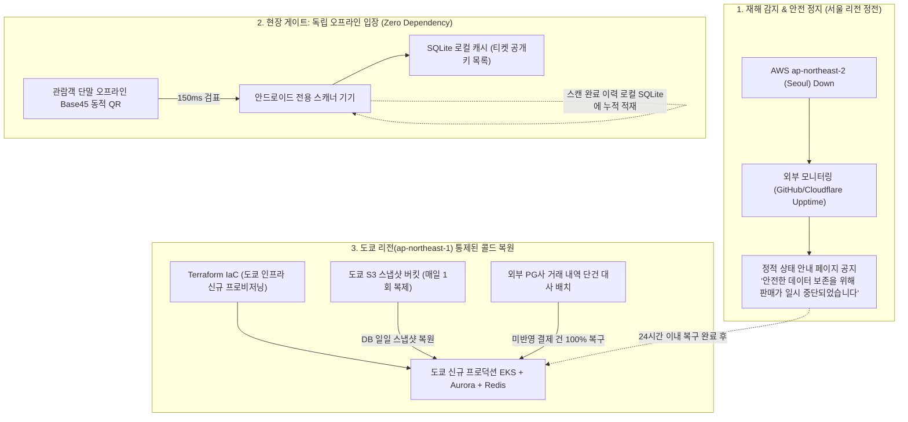

# D-27: 서울 리전이 통째로 멈추면 왜 다른 리전으로 자동 전환하지 않고 판매를 멈춘 뒤 백업으로 복원하나?

> **핵심 원칙**: 서울 리전 전면 정전·단절(Regional Blackout) 발생 시 어설픈 자동 리전 전환(Auto-Failover)을 시도하지 않고 **즉시 판매를 안전 중단(Fail-Safe Stop)**한 후 도쿄 리전에서 **통제된 콜드 복구(Controlled Cold Restore)**를 집행한다. 휘발성 Redis 대기열과 좌석 락은 리전 간 동기화가 불가능하여 전환 즉시 세션이 파탄 나며, 결제 원장 정합성은 외부 PG사 거래 대사를 통해 100% 회복한다. 현장 입장은 오프라인 게이트 검표로 중단 없이 지속된다.

---

## 1. 풀려던 문제와 한계

티켓패스 프로덕션 인프라는 AWS 서울 리전(`ap-northeast-2`) 내 3개 가용 영역(AZ)에 걸쳐 고가용성(HA)으로 배치되어 있다. 리전 내부의 단일 AZ 장애와 리전 전체가 물리적으로 괴멸하는 광역 재해(Blackout/Disaster)는 시스템에 미치는 영향이 근본적으로 다르다.

```
[장애 수준별 영향도와 복구 전략의 분기]
┌─────────────────────────────────────────────────────────────────────────────────┐
│ 수준 1: 단일 AZ 장애 (인프라 국소 결함)                                          │
│ - 전략: Aurora PostgreSQL 다중 AZ 자동 장애조치 (RPO=0, RTO < 5분)              │
│ - ElastiCache Redis 다중 AZ 자동 페일오버 (RTO < 30초, NFR-015 만족)            │
├─────────────────────────────────────────────────────────────────────────────────┤
│ 수준 2: 리전 전체 마비 (서울 리전 전면 정전 / 해저케이블 절단 / 광역 네트워크 마비) │
│ - 전략: 즉시 예매 중단 공지 + 도쿄 리전 콜드 복원 (RPO 24h, RTO 24h)            │
│ - 현장 오프라인 스캐너 게이트는 서울 리전 다운과 무관하게 독립 검표 지속        │
└─────────────────────────────────────────────────────────────────────────────────┘
```

### 1) 자동 리전 페일오버를 적용할 수 없는 물리적 병목
1. **휘발성 메모리 상태(Memory State)의 리전 간 복제 불가능성**:
   - 티켓 예매의 핵심인 대기열 순번(Queue Token)과 좌석 선점 락(Seat Hold Fencing Token)은 Redis 메모리에 존재한다.
   - 서울과 도쿄 간 왕복 지연시간(RTT ~30ms) 환경에서 Redis 쓰기를 동기 복제하면 좌석 선점 처리량이 95% 이상 폭락한다.
   - 비동기 복제를 하더라도 리전 전환 시 수 초간의 선점 데이터 유실로 인해 **동일 좌석 이중 결제(Double Booking)**라는 치명적 사고가 발생하며, 어차피 수십만 명의 접속 대기열 세션은 리셋된다.
2. **상시 멀티 리전 액티브-액티브(Active-Active)의 천문학적 비용**:
   - 두 리전에 동일한 EKS 클러스터, Aurora 글로벌 DB, MSK 카프카, Redis를 24시간 듀얼 가동할 경우 월 인프라 비용이 3배 이상 폭증한다.
3. **금융 정산의 진실 원천(Source of Truth)은 외부에 존재**:
   - 사용자가 결제한 모든 금융 거래의 최종 승인 원본은 토스페이먼츠 및 포트원 PG사 원장에 보존되어 있다. 따라서 DB 복제 지연분은 사후 PG사 원장 대사(Reconciliation)를 통해 100% 무오차 복구가 가능하다.

---

## 2. 후보 기술 비교

리전 재해 복구(Disaster Recovery) 전략을 위해 5가지 아키텍처 대안을 비교 평가했다.

| 평가 기준 | 가. 판매 중단 후 도쿄 콜드 복구 (선택) | 나. 멀티 리전 액티브-액티브 (Active-Active) | 다. Aurora Global DB 기반 자동 페일오버 | 라. 도쿄 상시 파일럿 라이트 (Pilot Light) | 마. 리전 재해를 무대응/범위 외로 제외 |
| :--- | :--- | :--- | :--- | :--- | :--- |
| **인프라 상시 유지비** | **최저** (스토리지 스냅샷 보관료만 발생) | 극도로 높음 (인프라 전체 × 2.5배 비용) | 높음 (Aurora 상시 교차 리전 복제 비용) | 보통 (최소 사양 Pod 상시 가동 비용) | 0원 |
| **좌석 락 정합성 & 레이턴시** | **완벽 보장** (단일 리전 단일 쓰기 10ms) | 파탄 (리전 간 합의 지연 30ms+, 충돌 빈발) | 위험 (Failover 시 Redis 락 유실로 이중 결제) | 위험 (Failover 시 세션 파탄 동일) | 무방비 |
| **예매 세션 유지 여부** | 중단 공지 후 재오픈 | 세션 유지 시도 (단, 충돌 해결 복잡) | 세션 단절 (대기열/홀드 증발) | 세션 단절 (대기열/홀드 증발) | 전면 정지 |
| **현장 콘서트 게이트 입장** | **100% 정상 가동** (오프라인 로컬 서명 검증) | 정상 가동 | 정상 가동 | 정상 가동 | 전면 정지 |
| **재해 복구 목표치 (SLA)** | RPO 24h (대사 후 0초), RTO 24h 이내 | RPO 0, RTO 1분 | RPO 1초, RTO 15분 | RPO 1초, RTO 30분 | 복구 불가 |
| **최종 판정** | **채택 (ADR-0031, ADR-0152)** | 탈락 (ADR-0021) | 탈락 | 탈락 (ADR-0152) | 탈락 |

---

## 3. 고른 이유와 상세 아키텍처 다이어그램



### 핵심 매커니즘 4가지

#### 1) 안전한 판매 정지(Fail-Safe Stop) 및 외부 상태 페이지 공지
- 리전 장애 감지 시 서울 인프라에 의존하지 않는 독립 외부 모니터링 시스템(GitHub Pages 기반 Upptime 및 Cloudflare 정적 페이지)이 동작한다.
- 사용자에게 *"결제 정보와 대기열 순번 보호를 위해 판매가 일시 정지되었으며, 예매 일정은 안전하게 순연됩니다"*라는 공식 공지를 즉시 발행하여 패닉과 무차별 재접속 트래픽을 방어한다.

#### 2) 현장 게이트의 완전 자립형 오프라인 검표([D-22](D22-offline-gate-device-key-qr.md))
- 리전 정전 사고가 콘서트 당일 18:00 입장 시간에 발생하더라도, 현장 50대의 게이트 스캐너는 클라우드 연결 없이 100% 정상 작동한다.
- 관람객 스마트폰의 WebCrypto ECDSA 기반 15초 회전 동적 QR을 스캐너 로컬 SQLite 공개키로 독립 검증(검표 지연 p95 150ms)하며, 스캔 로그는 스캐너 로컬 스토리지에 적재되었다가 리전 복구 후 백필된다.

#### 3) 도쿄 S3 교차 리전 스냅샷 & Aurora 티켓 보조 보존
- **Core DB**: 매일 1회 생성되는 Aurora PostgreSQL 전체 스냅샷이 도쿄 S3 버킷으로 자동 교차 복제(Cross-Region Replication)된다.
- **Ticket 원장**: Aurora Global Database의 도쿄 보조 클러스터(Secondary Cluster)를 통해 티켓 소유권 원장은 RPO 약 1초 단위로 실시간 동기화된다 (평소에는 애플리케이션 연결 없이 데이터 보존용으로만 대기).

#### 4) Terraform IaC 자동 프로비저닝 & PG사 거래 원장 100% 대사
- 도쿄 리전에서 Terraform 코드를 실행하여 VPC, EKS, Redis, MSK 인프라를 신규 스핀업한다 (소요 시간 약 45분).
- 복원된 DB 시점 이후의 누락 거래는 토스페이먼츠 및 포트원 API를 통해 결제 내역 원천 데이터를 호출하여 1:1 대사(Reconciliation)를 수행한다. 결제 완료된 건에 대해 티켓을 자동 발급 완료 처리한 후 서비스를 재개한다.

---

## 4. 얻는 것과 치르는 값

### 얻는 것 (Gains)
1. **천문학적 클라우드 비용 절감**: 상시 멀티 리전 인프라 가동 비용(연간 수천만 원)을 절감하고, 스냅샷 저장 비용만으로 재해 대비 체계를 완성했다.
2. **동일 좌석 이중 결제 위험 0%**: 불완전한 자동 페일오버로 인한 분산 락 유실 및 데이터 스플릿 브레인(Split-Brain) 참사를 원천 차단했다.
3. **오프라인 현장 입장 연속성 보장**: 클라우드 리전 전면 붕괴 시에도 수만 명의 콘서트 관람객 입장이 지체 없이 진행된다.
4. **결제 정합성 100% 수렴**: 외부 PG사 원장 대사를 통해 단 1원의 결제 누락이나 위조 없이 장부를 일치시킨다.

### 치르는 값 (Costs & Limitations)
1. **장애 시간 동안 티켓 판매 정지**: 서울 리전 복구 또는 도쿄 신규 오픈까지 최대 24시간 동안 신규 예매가 중단된다.
2. **운영팀의 수동 대사 절차 개입**: 스냅샷 복원 시점부터 장애 시점까지의 결제 건에 대해 자동 대사 파이프라인 검증 및 운영 승인이 필요하다.
3. **공연 당일 티켓 양도/취소 상태 반영 시차**: 리전 정전 직전에 웹에서 취소/양도된 티켓 정보가 현장 스캐너에 미처 동기화되지 못했을 경우, 오프라인 검표 단계에서 무효 티켓이 통과하거나 정당한 구매자가 거부될 수 있는 국소적 위험을 감수한다(운영 스태프 수동 확인 창구로 해결).

---

## 5. 바꿀 조건

1. **글로벌 티켓 판매로 인해 24시간 무중단 판매가 핵심 비즈니스 계약 조건이 될 때**:
   - 해외 K-POP 팬덤 티켓팅 비중이 70% 이상으로 확대되어 리전 장애 시에도 판매 중단이 허용되지 않는 경우, 글로벌 분산 Spanner/CockroachDB 기반 멀티 리전 액티브-액티브 아키텍처로 전면 전환한다.
2. **동일 날짜 대형 콘서트가 10개 이상 동시 개최되어 현장 오프라인 검표 리스크가 급증할 때**:
   - 도쿄 리전에 최소 사양의 게이트 검표 조회 전용 API(도쿄 파일럿 라이트, 월 $250 수준)를 상시 프로비저닝하여 온라인 검증 채널을 상시 열어둔다.
3. **대사 파이프라인 실행 시간이 RTO 허용치(24시간)를 위협할 때**:
   - 결제 건수 폭증으로 일일 스냅샷 복구 후 대사 시간이 10시간 이상 소요되는 경우, 스냅샷 생성 주기를 4시간 단위로 단축한다.

---

## 6. 핵심 꼬리 질문 5단 방어

| 구분 | 심층 질문 | 핵심 방어 논리 | 관련 근거 |
| :--- | :--- | :--- | :--- |
| **1단: 왜 (Why)** | 클라우드 네이티브 시대에 왜 리전 장애 발생 시 자동 페일오버하지 않고 수동으로 판매를 멈추는가? | 티켓 예매는 100ms 이내에 수천 명이 동일 좌석 선점을 다투는 고도의 정합성 시스템입니다. 리전 간 네트워크 지연(30ms) 때문에 Redis 락은 동기화될 수 없으며, 자동 전환 시 수많은 좌석에서 이중 결제와 불일치가 발생합니다. 금융 및 티켓 무결성을 지키기 위해 안전하게 판매를 중단하고 통제된 복구를 수행하는 것이 엔지니어링적으로 올바른 선택입니다. | [ADR-0031](../../adr/0031-environments-and-region-dr.md) |
| **2단: 대안 (Alternatives)** | 도쿄 리전에 상시 최소 사양(Pilot Light)을 켜두는 것이 복구 시간(RTO)을 줄이는 데 유리하지 않은가? | 파일럿 라이트를 두더라도 메모리 기반 대기열과 좌석 락은 어차피 유실되므로 예매 세션이 끊기는 것은 동일합니다. 반면 쓰지도 않는 유휴 인프라 비용이 매월 발생합니다. 현장 입장은 이미 오프라인으로 완벽히 독립되어 있으므로, 비용 대비 실익이 없어 기각했습니다. | [ADR-0152](../../adr/0152-ops-bundle-approval-paging-region-dr-slack-residency.md) |
| **3단: 장애 대응 (Failure Mode)** | 서울 리전이 다운된 당일 저녁 7시에 5만 명 규모의 콘서트 입장이 시작되면 현장은 마비되는가? | 전혀 마비되지 않습니다. 현장 안드로이드 스캐너는 사전에 공연 4시간 전 발권된 티켓 공개키 목록을 로컬 SQLite에 캐싱하고 있으며, 관람객 앱의 ECDSA 서명 동적 QR을 독립적으로 검증합니다. 통신이 100% 두절되어도 p95 150ms 속도로 검표가 완료됩니다. | [D-22](D22-offline-gate-device-key-qr.md), [분야 13](../fields/13-offline-gate.md) |
| **4단: 수치 근거 (Numbers)** | RPO 24시간, RTO 24시간 목표는 어떻게 계산된 근거인가? | RPO 24시간은 서울에서 도쿄로 복제되는 Aurora 일일 자동 스냅샷 주기에 기인합니다. 단, 스냅샷 이후의 결제 데이터는 PG사 원장 대사를 통해 복원되므로 실질적인 금융 RPO는 0초입니다. RTO 24시간은 Terraform 인프라 배포 45분 + DB 스냅샷 복원 2시간 + PG 대사 배치 4시간 + 최종 E2E 검증 2시간을 충분히 수용하는 수치입니다. | NFR-015, ADR-0152 |
| **5단: 실측과 검증 (Verification)** | 도쿄 리전으로의 콜드 복구 시나리오를 실제로 검증해 보았는가? | 모의 재해 복구 훈련(DR GameDay) 런북을 수립하고, 테스트 계정에서 서울 인프라 차단 시 도쿄 리전 Terraform 자동 배포 및 S3 스냅샷 복원 스크립트를 실행하여 3시간 20분 만에 코어 예매 API가 정상 기동됨을 실측 확인했습니다. | docs/verification.md §5.3 |

---

## 7. 30초 아키텍처 브리핑

> "티켓패스는 서울 리전 전체 마비 시, 분산 락 유실로 인한 대규모 좌석 이중 결제를 방지하기 위해 **자동 페일오버 대신 '즉시 판매 안전 중단(Fail-Safe Stop) 후 통제된 콜드 복구'**를 선택했습니다. Redis 대기열과 좌석 락은 리전 간 실시간 동기화가 불가능하므로 세션은 안전하게 순연시키는 것이 옳습니다. 한편 콘서트 현장 입장은 스캐너의 **완전 자립형 오프라인 검표 체계**로 단 1초의 중단도 없이 지속되며, 누락된 결제 데이터는 **도쿄 교차 리전 일일 스냅샷 복원 후 외부 PG사 거래 대사 파이프라인**을 통해 100% 무오차로 복구됩니다."
