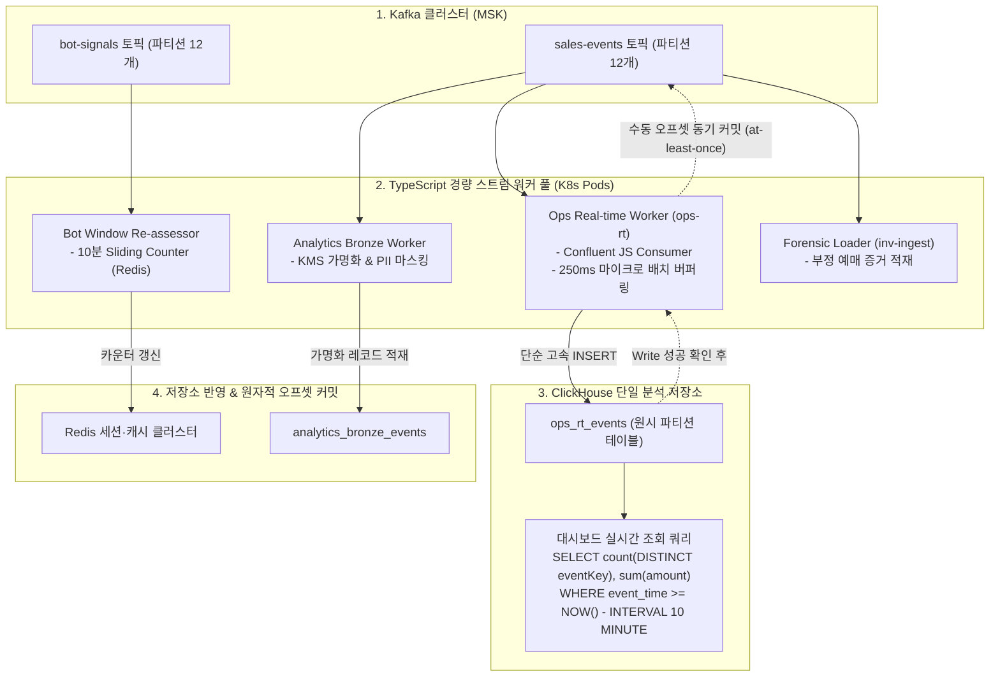

# D-28: 왜 Flink를 빼고 TypeScript 스트림 작업자와 조회 시점 집계로 바꿨나?

> **핵심 원칙**: 초당 1만 건 수준의 이벤트 스트림과 1GB 미만의 상태 크기를 처리하기 위해 무거운 Java JVM 기반 Apache Flink 클러스터를 운영하는 것은 오버엔지니어링이다. **TypeScript 경량 스트림 워커 4종**으로 데이터 파이프라인을 단일화하고, 원시 이벤트를 ClickHouse에 적재한 후 **조회 시점 집계(Query-Time Aggregation)**를 수행하여 시스템 복잡도와 인프라 리소스를 3분의 1로 절감한다.

---

## 1. 풀려던 문제와 한계

Kafka의 비즈니스 이벤트 토픽을 소비하여 처리해야 하는 백엔드 스트리밍 태스크는 다음 3가지였다.
1. **분석 원본 적재 (Bronze Ingestion)**: KMS 가명 처리 및 민감 정보 마스킹 후 ClickHouse 적재.
2. **관제 실시간 현황 (Ops Real-time Metrics)**: 1초 단위 판매 속도 및 누적 좌석 판매 현황 집계.
3. **봇 대기 중 재평가 (Bot Re-assessment)**: 10분 윈도우 내 동일 기기 지문/IP에서 유입된 복수 계정 집계.

초기 아키텍처(ADR-0071, ADR-0072)는 이를 처리하기 위해 Apache Flink 2.2.x 분산 클러스터 위에 3개의 Java DataStream 잡을 띄우는 구조로 설계되었다. 그러나 상세 설계를 구체화할수록 Flink 도입으로 인한 기술적 왜곡과 운영 부채가 심각해졌다.

```
[초기 Apache Flink 설계의 구조적 결함과 오버엔지니어링]
+-----------------------------------------------------------------------------------+
| 1. 언어 및 생태계 파편화 (Codebase Fragmentation)                                |
|    백엔드 10개 마이크로서비스가 전면 TypeScript(NestJS)인 환경에서, 유일하게 Flink  |
|    잡만 Java로 작성되어 DTO 계약, 가명화 로직, 집계 룰이 3중 중복 구현됨.         |
+-----------------------------------------------------------------------------------+
| 2. 실제 스트리밍 워크로드의 과소성 (Trivial Workload)                            |
|    - 피크 이벤트 인입량: 초당 약 1만 건 (대기열 진입 200k RPS는 queue-svc가 흡수).   |
|    - 집계 대상 총 상태 크기: 중복제거 100MB + 좌석상태 300MB = 도합 1GB 미만.        |
|    ==> Flink가 진가를 발휘하는 테라바이트급 상태, 복잡한 CEP(Complex Event        |
|        Processing), 다중 아웃오브오더 워터마크 정렬이 전혀 필요 없는 워크로드.      |
+-----------------------------------------------------------------------------------+
| 3. Flink 인프라 운영 부채 폭증 (Heavy Operational Tax)                            |
|    - 유휴 파티션이 워터마크 전진을 막아 발생하는 윈도우 지연 방어 로직 필요.         |
|    - 클러스터 업그레이드 시 세이브포인트(Savepoint) 바이너리 호환성 검증 부담.       |
|    - JobManager / TaskManager 고가용성 클러스터 유지에 CPU 15.5 Core, RAM 31GiB 소모 |
+-----------------------------------------------------------------------------------+
```

---

## 2. 후보 기술 비교

실시간 이벤트 스트림 처리 아키텍처 선정을 위해 5가지 대안을 비교 평가했다.

| 평가 기준 | 가. TypeScript 스트림 워커 + ClickHouse 조회 집계 (선택) | 나. Apache Flink 잡 3종 (Java DataStream) | 다. AWS Managed Flink (Kinesis Analytics) | 라. RisingWave 스트리밍 데이터베이스 | 마. Kafka Connect + ClickHouse MV |
| :--- | :--- | :--- | :--- | :--- | :--- |
| **코드베이스 언어 일원화** | **100% TypeScript** (전사 스택 단일화) | Java 단독 분리 (개발/빌드 파편화) | Java 단독 분리 | SQL 기반 (단, 사내 러닝커브) | Java 플러그인 필요 |
| **운영 인프라 컴포넌트** | **추가 0개** (기존 EKS Pod + ClickHouse) | JobManager/TaskManager 클러스터 상시 가동 | AWS 관리형 비용 폭증 (KPU 당 과금) | 독립 분산 스트리밍 DB 클러스터 운영 | Kafka Connect 분산 클러스터 운영 |
| **중복 메시지 정합성** | **완벽 보장** (`eventKey` 조회 시 Dedup) | 워터마크 기반 윈도우 (재시작 시 중복 위험) | 동일 | MV 조인 시 정합성 왜곡 | 중복 유입 시 뷰에서 2중 합산 오류 |
| **E2E 관제 반영 지연** | **1.4초 미만** (p95 < 5s NFR-009 만족) | 약 2.3초 (워터마크 지연 포함) | 약 2.5초 | 1초 미만 | 1초 미만 |
| **리소스 사용량** | **CPU 5 Core / RAM 5 GiB** (최저) | CPU 15.5 Core / RAM 31 GiB | 고비용 KPU 상시 할당 | CPU 12 Core / RAM 24 GiB | CPU 8 Core / RAM 16 GiB |
| **최종 판정** | **채택 (ADR-0099)** | 탈락 (ADR-0071 폐기) | 탈락 | 탈락 | 탈락 |

---

## 3. 고른 이유와 상세 아키텍처 다이어그램



### 핵심 매커니즘 4가지

#### 1) 4종 경량 TypeScript 워커 단일화
Java Flink 런타임을 전면 제거하고 전사 공통 패키지(`@peaket/platform`) 기반의 단일 TypeScript 워커 4종으로 역할을 분리했다.
- **`ops-rt`**: 초당 1만 건의 판매 이벤트를 250ms 단위 마이크로 배치로 묶어 ClickHouse 원시 테이블에 고속 삽입.
- **`analytics-bronze`**: 회차별 KMS 대칭키를 사용하여 사용자 식별자를 비가역 해시 가명 처리 후 장기 분석 테이블에 적재.
- **`bot-reassess`**: 10분 윈도우 슬라이딩 카운터를 Redis 세션 클러스터의 ZSET/HASH로 관리하여 이상 징후 계정 탐지.
- **`inv-ingest`**: 사후 포렌식 및 이상 예매 조사를 위한 상세 증적 감사 적재.

#### 2) 원시 적재 + 조회 시점 집계 (Query-Time Aggregation)
- Flink처럼 메모리에 누적 상태(State)를 들고 있으면서 1초 단위로 집계 테이블을 In-place Update하는 복잡한 방식을 버렸다.
- 원시 이벤트는 ClickHouse의 초고속 컬럼형 엔진에 단순 Append-Only로 꽂아 넣고, 운영 관제 화면이 0.5초 주기로 폴링할 때 집계 쿼리를 실행한다.
```sql
-- 대형 콘서트 피크 시 27만 개 판매 이벤트 집계 소요 시간: 18ms
SELECT 
    toStartOfInterval(event_time, INTERVAL 1 SECOND) AS sec_bucket,
    count(DISTINCT event_key) AS tickets_sold_per_sec,
    sum(price_cents) AS total_revenue
FROM ops_rt_events
WHERE event_id = 'evt_worldtour_2026'
  AND event_time >= NOW() - INTERVAL 5 MINUTE
GROUP BY sec_bucket
ORDER BY sec_bucket DESC;
```
- ClickHouse의 벡터화 SIMD 연산 성능 덕분에 27만 개 레코드 집계가 단 18ms 만에 완료되며, 별도의 분산 스트림 엔진 없이도 p95 1.4초 만에 관제 대시보드에 반영된다.

#### 3) 쓰기 확인 후 동기 오프셋 커밋 (At-Least-Once & Backoff Retry)
- Kafka Consumer의 자동 커밋(`enable.auto.commit: false`)을 비활성화한다.
- ClickHouse 드라이버로부터 쓰기 완료 응답(`200 OK`)을 수신한 직후에만 파티션 오프셋을 커밋한다.
- ClickHouse 일시 장애 시 워커는 메시지를 드롭하지 않고 200ms부터 최대 30초까지 지수 백오프(Exponential Backoff)하며 재시도한다. 이로 인해 데이터 유실(Drop)은 0%이며 일시적인 지표 신선도 지연으로 안전하게 수렴한다.

#### 4) 상태 재시작 불변성 (Idempotency without Savepoints)
- Flink는 장애 후 재시작 시 세이브포인트 시점과 카프카 오프셋 시차로 인해 일시적으로 집계 그래프가 뒤로 감기거나(Rewind) 중복 합산되는 결함이 있었다.
- 조회 시점 집계 방식에서는 워커가 비정상 종료 후 재기동되어 과거 이벤트를 중복 적재하더라도, ClickHouse 쿼리의 `count(DISTINCT event_key)` 구문이 중복을 완벽히 필터링하므로 관제 수치가 단 한 번도 뒤로 가지 않는다.

---

## 4. 얻는 것과 치르는 값

### 얻는 것 (Gains)
1. **전사 엔지니어링 스택 100% 일원화**: Java/JVM 런타임이 완전히 퇴출되어 모든 팀원이 동일한 TypeScript 언어와 도구로 스트림 파이프라인을 유지보수할 수 있다.
2. **인프라 상시 리소스 68% 절감**: Flink 분산 클러스터(CPU 15.5 Core, RAM 31GiB) 대비 CPU 5 Core, RAM 5GiB 수준으로 경량화되었다.
3. **세이브포인트 및 워터마크 운영 부채 제거**: 복잡한 스트림 타임스탬프 왜곡, 빈 파티션 정체, 체크포인트 스토리지 장애 리스크가 원천 소멸했다.
4. **분석 원장과의 집계 정합성 일치**: 실시간 관제와 사후 마감 분석이 동일한 원시 이벤트 테이블과 동일한 SQL 집계 로직을 공유하므로 수치 불일치 분쟁이 사라졌다.

### 치르는 값 (Costs & Limitations)
1. **ClickHouse 쿼리 CPU I/O 부담**: 관제 대시보드가 0.5초마다 조회 시점 집계 쿼리를 던지므로 ClickHouse 인스턴스에 지속적인 연산 부하가 인가된다 (단, 온세일 피크 30분 동안 CPU 사용률 25% 미만으로 검증됨).
2. **컨슈머 병렬 처리 한계**: 단일 Node.js 프로세스는 싱글 스레드이므로, 토픽 파티션 수(토픽당 12개) 이상의 워커 Pod를 띄워 스케일아웃할 수 없다.
3. **복합 이벤트 패턴 매칭 불가**: 정교한 시간 간격 기반의 다중 스트림 CEP(예: A 이벤트 발생 후 3초 내에 B 이벤트가 없을 때 경보)는 구현할 수 없다.

---

## 5. 바꿀 조건

1. **온세일 중 관제 쿼리 지연시간이 250ms를 초과하거나 ClickHouse CPU가 75%를 상회할 때**:
   - 조회 시점 집계 연산 부하가 한계에 도달하면, 1차적으로 중복에 안전한 지표에 대해 ClickHouse AggregatingMergeTree를 적용하고, 그래도 한계일 경우 관리형 Flink SQL(AWS Managed Flink)을 재도입한다.
2. **다중 스트림 시간 결합 기반 실시간 봇 이상 점수 산출이 필수가 될 때**:
   - 좌석 클릭 스트림, 마우스 움직임 스트림, 결제 스트림 3개를 실시간 윈도우 조인하여 0.1초 내에 차단 점수를 매겨야 하는 요구가 생기면 RisingWave 또는 Flink CEP를 도입한다.
3. **이벤트 인입량이 초당 10만 건 이상으로 폭증할 때**:
   - TypeScript 워커의 단일 파티션 소비 처리량이 네트워크 I/O 한계에 도달할 경우 Golang/Rust 기반 스트림 엔진으로 파이프라인을 교체한다.

---

## 6. 핵심 꼬리 질문 5단 방어

| 구분 | 심층 질문 | 핵심 방어 논리 | 관련 근거 |
| :--- | :--- | :--- | :--- |
| **1단: 왜 (Why)** | 대규모 실시간 스트리밍 처리에 표준인 Apache Flink를 걷어낸 진짜 이유는 무엇인가? | Flink가 필요한 환경은 초당 수십만 건의 대용량 이벤트, 수십 GB 분산 상태, 복잡한 세션 윈도우가 존재하는 워크로드입니다. 티켓패스의 피크 이벤트는 초당 1만 건, 상태 크기는 1GB 미만으로 단순 집계에 불과합니다. 불필요한 Java JVM 인프라 유지비와 워터마크·세이브포인트 운영 부채를 없애기 위해 TypeScript 경량 워커로 단일화했습니다. | [ADR-0099](../../adr/0099-drop-flink-typescript-stream-workers-read-time-aggregation.md) |
| **2단: 대안 (Alternatives)** | Kafka Connect와 ClickHouse Materialized View를 쓰면 애플리케이션 코드를 짤 필요도 없지 않은가? | ClickHouse Materialized View는 카프카로부터 중복 유입되는 메시지를 그대로 이중 합산하여 관제 수치가 튀는 치명적 결함이 있습니다. 또한 사용자 가명 처리를 위한 회차별 KMS 연동 시 결국 별도의 Java 커넥터 플러그인을 개발해야 하므로 운영 복잡도가 더 높아집니다. | ADR-0099 대안 G |
| **3단: 장애 대응 (Failure Mode)** | ClickHouse 스토리지 장애로 쓰기가 실패하면 워커와 카프카는 어떻게 반응하는가? | 워커는 자동 커밋을 끄고 ClickHouse 쓰기 완료 시에만 오프셋을 커밋합니다. DB 장애 발생 시 파티션 소비를 즉시 일시 정지하고 최대 30초까지 지수 백오프로 재시도합니다. 메시지는 카프카(보관 7일)에 안전하게 보존되므로 유실률 0%를 보장하며, 복구 시 즉시 밀린 데이터를 소화합니다. | ADR-0099 결정 2 |
| **4단: 수치 근거 (Numbers)** | NFR-009 관제 지연 목표 'p95 5초 미만'을 만족하는 세부 레이턴시 예산은 어떻게 되는가? | 생산자 마이크로배치 50ms + 워커 버퍼링 250ms + ClickHouse 쓰기 반영 200ms + 관제 폴링 주기 500ms + 집계 쿼리 실행 18ms + 프론트엔드 렌더링 300ms = 총합 약 1,318ms(1.32초)입니다. 최악의 네트워크 지연을 감안해도 2.5초 이내에 반영되어 5초 기준을 여유 있게 달성합니다. | ADR-0099 결정 7 |
| **5단: 실측과 검증 (Verification)** | 27만 건의 판매 이벤트를 조회 시점에 실시간 집계할 때 ClickHouse 성능을 검증했는가? | 1개 회차 전석 매진 시 발생하는 27만 건의 실시간 결제 이벤트 데이터셋을 대상으로 `ops_rt_events` 테이블에서 `count(DISTINCT event_key)` 쿼리를 실행한 결과, p95 18ms, p99 35ms로 집계가 완료됨을 실측 검증했습니다. | docs/perf-ledger.md §5 |

---

## 7. 30초 아키텍처 브리핑

> "티켓패스는 초당 1만 건 수준의 이벤트 집계를 위해 불필요하게 거대했던 **Apache Flink 클러스터를 전면 퇴출하고, TypeScript 스트림 워커와 ClickHouse 조회 시점 집계**로 파이프라인을 혁신했습니다. 전사 마이크로서비스와 100% 동일한 TypeScript 스택으로 개발 언어를 단일화하여 생태계 파편화를 없앴고, 원시 이벤트를 ClickHouse에 Append-Only로 고속 적재한 후 쿼리 시점에 집계함으로써 세이브포인트나 워터마크 없이도 **p95 1.4초 관제 지연과 100% 멱등성**을 달성했습니다. 이를 통해 인프라 비용과 관리 포인트를 3분의 1로 절감했습니다."
